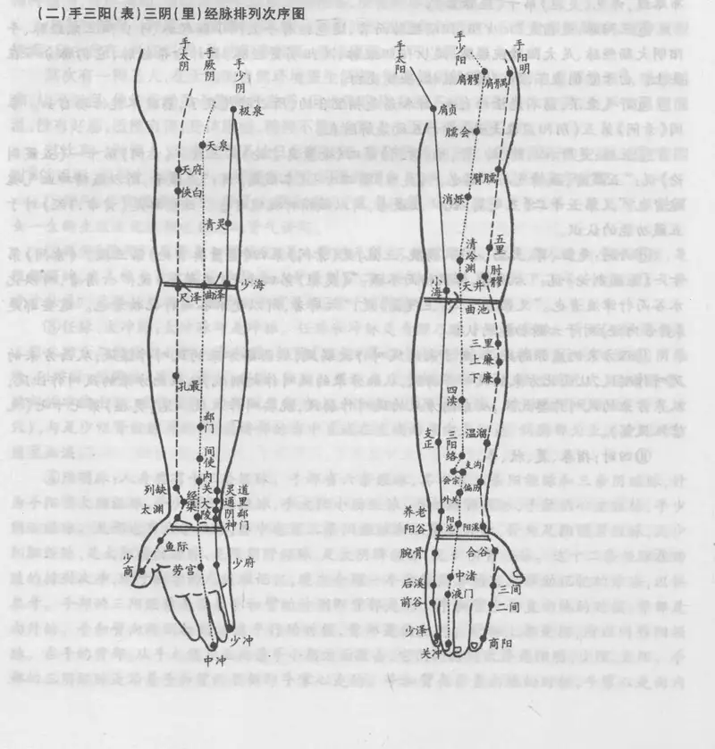
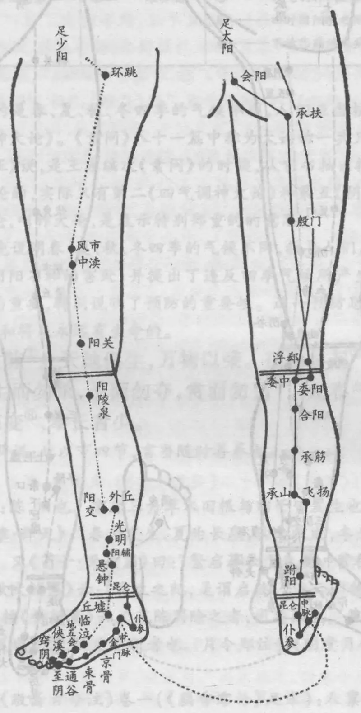
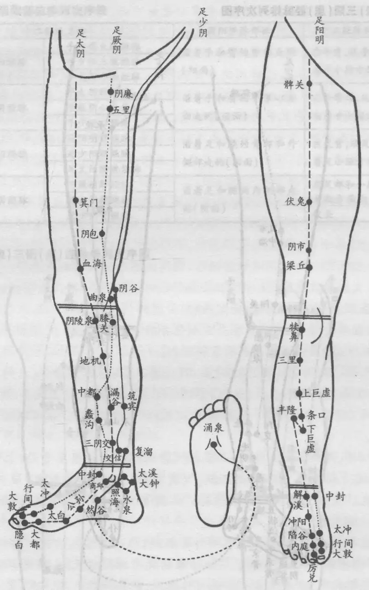

**〔卷一①〕**

上古天真论第一

四气调神大论第二

生气通天论第三

金匮真言论第四

**【集解】**

①**黄帝内经素问集解卷一**：《新校正》云：按王氏不解所以名《素问》之义，及《素问》之名起于何代。按《隋书·经籍志》，始有《素问》之名。《甲乙经》序，晋·皇甫谧之文，已云：“《素问》论病精辨”。王叔和，西晋人，撰《脉经》，云：“出《素问》《针经》”。汉·张仲景撰《伤寒杂病论》集，云：“撰用《素问》。”是则《素问》之名，著于《隋志》，上见于汉代也。自仲景以前，无文可见，莫得而知。据今世所存之书，则《素问》之名起汉世也。所以名《素问》之义，全元起有说云：“素者，本也。问者，黄帝问岐伯也。方陈性情之源，五行之本，故曰《素问》。”元起虽有此解，义未甚明。按《乾凿度》云：“夫有形生于无形，故有太易，有太初，有太始，有太素。太易者，未见气也。太初者气之始也。太始者，形之始也。太素者，质之始也。”气形质具而疴瘵由是萌生，故黄帝问此太素质之始也。《素问》之名，义或由此。

马莳说：《素问》者，黄帝与岐伯、鬼臾区、伯高、少师、少俞、雷公六臣平素问答之书，即本纪所谓咨于岐伯而作《内经》者是也。（**伯坚按：**现存《素问》七十九篇中，有五十九篇出现了岐伯，七篇出现了雷公，二篇出现了鬼臾区，《素问》中只出现了这三个人。伯高、少师、少俞三个人都是在《灵枢》中出现的。）

长尾藻城《先哲医话集》引《技养录》：愚按素，豫也。《国语》：“夫谋必素。”《注》，韦昭曰：“素，犹豫也。”《汉书》陆贾传：“将相和则士豫。”《注》，师古曰：“豫，素也。”是素、豫互训，盖同义矣。又按《史记·秦纪》昭王曰：“物不素具，不可以应卒。”《汉书·赵充国传》曰：“诚非素定庙胜之策。”素字亦并当以豫看也。问者，黄帝问岐伯等也。夫民庶蚩蚩、不知养生之道，暴施妄作，由以生疾，以婴横夭，犹如不问法禁而自抵罪。黄帝仁智，豫问岐伯以养生之道，避邪之术，以此垂世，以俾元元得全生于无穷者，亦是圣人务本之揆矣。《上古天真论》曰：“圣人不治已病治未病，不治已乱治未乱。”又曰：“病已成而后药，乱已成而后治之，譬犹渴而掘井，斗而铸兵，不亦晚乎？”是其特于卷首揭示之本旨者。且夫《内经》一部之书，独论病理而不备药方，其意盖亦专在预防故也耳。（**伯坚按：**“《上古天真论》应作《四气调神大论》”。）

〔p.31 (인쇄 14)〕

# 上古天真论第一①

**【集解】**

①**上古天真论第一**：《新校正》云：按全元起注本在第九卷，王氏重次篇第，移冠篇首。今注逐篇必具全元起本之卷第者，欲存《素问》旧第目，见今之篇次皆王氏之所移也。

**伯坚按：**本篇和《甲乙经》《黄帝内经太素》《类经》三书的篇目对照，列表于下：

| 素问 | 甲乙经 | 黄帝内经太素 | 类经 |
|---|---|---|---|
| 上古天真论第一 | 卷六——形气盛衰大论第十二 卷十一——动作失度内外伤发崩中瘀血呕血第七 | 卷二——寿限篇 | 卷一——上古之人春秋百岁今时之人半百而衰（摄生类一） 卷一——上古圣人之教下（摄生类二） 卷一——古有真人至人圣人贤人（摄生类三） 卷三——有子无子女尽七七男尽八八（藏象类十三） |

**【释题】** 本篇第一节讲上古的时候，人们即知道如何谨慎修养，来保全天真，所以叫作上古天真论。

**【提要】** 本篇用黄帝和岐伯二人问答的形式，主要讲的是个人卫生和男女一生的生理变化过程。全篇可分成三大节。第一节讲为什么上古的人能活到一百岁，而现在的人活到五十岁就衰老了。第二节讲男女一生的生理变化过程，和为什么老了就不能生育儿女。第三节讲四种不同的卫生方法，因为卫生方法不同，所以他们的寿命也各有长短不同。关于个人卫生的方法，特别着重在酒色嗜欲的节制和高级神经活动的卫生，这些原则都是人类应当长久记住的。

> 昔在①黄帝②，生而神灵③，弱而能言④，幼而徇齐⑤，长而敦敏⑥，成而登天⑦。

**【本段提纲】** 马莳说：此总述黄帝始末之辞。

**【集解】**

①**昔在**：丹波元简说：《书·尧典》序：“昔在帝尧，聪明文思，光宅天下。”孔颖达《正义》云：“郑玄云：‘书以尧为始，独云昔在，使若无先之典然也。’《诗》云：‘自古在昔。’言在昔者，自下本上之辞。言昔在者，从上自下为称。故曰使若无先之者，据代有先之而书无所先，故云昔也。”

喜多村直宽说：黄朝英《缃素杂记》：“昔在者，主其人而言之。在昔者，主其时而言之。以人言者，其人昔在而今亡也。以时言者，其在昔而非今也。一说人虽往矣，且流风遗烈犹在也，故谓之昔在。其时往矣，其事必察而后见，故谓之在昔。”宽按：《书·无逸》：“昔在殷王中宗”，《冏命》：“昔在文武”，《洪范》：“在昔鲧湮洪水”，《酒诰》：“在昔殷先哲王”，《尧典序》：“昔在帝尧”，《诗》：“自古在昔”，据此，昔在在昔必无大分别，在字唯是助语之词耳。

②**黄帝**：《史记》卷一《五帝本纪》：黄帝者，少典之子，姓公孙，名曰轩辕。生而神灵，弱而能言，幼而徇齐，长而敦敏，成而聪明。

《大戴礼记·五帝德篇》：黄帝，少典之子也，曰轩辕。生而神灵，弱而能言，幼而慧齐，长而敦敏，成而聪明。

〔p.32 (인쇄 15)〕

③**神灵**：张守节《史记正义》：言神异也。《易》曰：“阴阳不测之谓神。”《书》云：“人惟万物之灵。”故谓之神灵也。

④**弱而能言**：司马贞《史记索隐》：弱，谓幼弱时也。盖未合能言之时，而黄帝即言，所以为神异也。

⑤**幼而徇齐**：裴骃《史记集解》：徐广曰：“墨子曰：‘年逾十五则聪明心虑，无不徇通矣。’”骃按：徇，疾；齐，速也。言圣德幼而疾速也。

雷浚《说文外编》卷三：《史记·五帝本纪》：“幼而徇齐。”裴骃曰：“徇，疾也。”《索隐》曰：“《尔雅》齐速俱训为疾，今徇亦训疾，未见所出。”浚按《说文》：“侚，疾也。”徇齐当是侚齐之讹。（《说文解字诂林》第六八七八页）

**伯坚按：**徇齐，就是做事敏捷的意思。

⑥**敦敏**：《尔雅释诂》：敦，勉也。

朱起凤《辞通》第一四〇七页：敏、勉，双声，古通用。《礼·中庸》：“人道敏政。”郑注：“敏犹勉也。”是其证也。

**伯坚按：**敦敏，即敦勉。《公羊传》宣公十五年：“勉之矣。”何休《解诂》：“勉犹努力。”敦敏就是做事努力的意思。

⑦**成而登天**：丹波元坚说：成而登天，以上六句，疑王氏所补，非古经之文。何以言之？此篇全氏训解在第九卷：但使其本果有此六句，则是帝始末退在末卷，万无此理。盖王氏移《天真论》置之于八十篇之上，并添改其起语也。其文取之于《史记》《大戴礼》及《孔子家语》，改“聪明”作“登天”，冠以“昔在”二字，盖摹仿《尧典序》，而承以“乃问于天师曰”一句，组织之痕，自不可掩矣。顾全氏之旧，犹是不过“黄帝问曰”四字而已。林亿等专奉王氏、如此七句，既信为古经之真，故置而不校也。小岛春沂曰：“《千金方》作‘黄帝问岐伯曰’六字，《遐年要抄》引《太素经》亦同，此足以为确证矣。”

顾观光说：以上五句，并见《大戴礼记·五帝德篇》。“登天”，彼作“聪明”。

俞樾说：成而登天，谓登天位也。《易·明夷传》曰：“初登于天，照四国也。”可说此经登天之义。故下文即云：“乃问于天师。”乃者，承上之词，见黄帝既登为帝，乃发此问也。

喜多村直宽说：此一节刘茝庭先生以为王氏补文，其说是。且生、弱、幼、长四字并就黄帝一身上言之。况生、成二字相照，若解为鼎成，则与上文不属。又“登天”作“聪明”，隔句押韵，若是“登天”，则与韵不合矣。

> 迺①问于天师②曰：余闻上古之人，春秋皆度③百岁而动作不衰。今时之人，年④半百而动作皆衰者，时世异耶？将人失之耶⑤？

**【集解】**

①**迺**：陆懋修说：迺，古文乃字。《尔雅·释诂》：“迺，乃也。”

②**天师**：王冰说：天师，岐伯也。

张介宾说：《内经》一书，乃黄帝与岐伯、鬼臾区、伯高、少师、少俞、雷公等六臣平素讲求而成。六臣之中，惟岐伯之功独多，而爵位隆重，故尊称之为天师。

丹波元简说：按黄帝称天师，见《庄子·徐无鬼》《韩诗外传》及《说苑》云：“黄帝即位，宇内和平，思见凤凰之象，以召天老。”天老，盖天师耳。

③**度**：丹波元简说：按《玉篇》：“度与渡通，过也。”

〔p.33 (인쇄 16)〕

**伯坚按：**《汉书》卷九十九《王莽传》上：“度百里之限。”颜师古注：“度，亦逾越也。”

④**年**：度会常珍说：古抄本“年”下有“至”字，与《遐年要抄》引《太素》及《千金方》合。

⑤**将人失之耶**：原文作“人将失之耶”。

胡澍说：“人将失之耶”，当作“将人失之耶”。下文曰，“人年老而无子者，材力尽耶，将天数然也”；（“也”与“邪”古字通。《大戴礼·五帝德篇》：“请问黄帝者，人邪，抑非人耶”，《乐记正义》引“邪”作“也”；《史记·张仪传》：“此公孙衍所谓邪”，秦策“邪”作“也”；《淮南·精神篇》：“其以我为此拘拘邪”，《庄子·大宗师篇》“邪”作“也”是也。上句用“邪”而下句用“也”者，书传中多有之。昭二十六年《左传》：“不知天之弃鲁耶，抑鲁有罪于鬼神故及此也”；《史记·淮南衡山传》：“公以为吴兴兵是耶，非也”；《货殖传》：“岂所谓素封者邪，非也”是也。）《徵四失论》曰：“子年少智未及邪，将言以杂合邪”，与此文同一例。将，犹抑也。“时世异邪，将人失之邪”，谓时世异邪，抑人失之邪。“材力尽邪，将天数然也”，谓材力尽邪，抑天数然邪。“子年少智未及邪，将言以杂合邪”，谓子年少智未及邪，抑言以杂合邪。《楚策》曰：“先主老悖乎？将以为楚国袄祥乎？”《汉书·龚遂传》曰：“今欲使臣胜之邪？将安之也？”（也与邪通）《楚辞·卜居》曰：“吾宁悃悃款款朴以忠乎？将送往劳来斯无穷乎？宁诛锄草茅以力耕乎？将游大人以成名乎？”以上将字亦并为词之抑。（**伯坚按：**也邪通用，详见王引之《经传释词》卷四也字条和俞樾《古书疑义举例》卷四也邪通用例。）

田晋蕃说：唐·孙思邈《千金要方》作“将人失之邪”。按此两句与下文“材力尽邪将天数然也”句法例。《释文序例》云：“邪也弗殊”，言邪与也古字通。宜从《千金方》乙转为是。

**伯坚按：**《千金方》卷二十七《养性序》第一引本书作“将人失之邪”。今据胡澍、田晋蕃说，依《千金方》校改。

> 岐伯①对曰：上古之人，其知道②者，法于阴阳，和于术数③，食饮有节，起居有度④，不妄⑤，不作⑥，故能形与神俱，而尽终其天年，度百岁乃去⑦。

**【本段提纲】** 马莳说：此言上古之人，所以春秋皆度百岁而动作不衰者，非但以其时世之异，实由于人事之得也。

**【集解】**

①**岐伯**：皇甫谧《帝王世纪》（《太平御览》卷七二一引）：岐伯，黄帝臣也。帝使岐伯尝味草本，典主医病，经方、本草、《素问》之书咸出焉。

**伯坚按：**岐伯，有从山作岐伯的，也有从止字作歧伯的。宋景佑本《汉书·司马相如传》：“乃遂奏《大人赋》，其辞曰……诏岐伯使尚方。”颜师古注引张揖曰：“岐伯者，黄帝太医，属使主方药也。”《艺文志·神仙家》有“《黄帝岐伯按摩》十卷”。字皆从山作岐伯。而《艺文志》“太古有歧伯、俞拊”，则字从止作歧伯。宋黄善夫本《史记》和宋本《太平御览》都从止作歧伯。各种刻本的《黄帝内经》全书都作从止的歧伯，不作从山的岐伯。

②**知道**：王冰说：知道，谓知修养之道也。

③**法于阴阳，和于术数**：马莳说：术数者，修养之法则也。上古之人为圣人而在上者，能知此大道而修之，法天地之阴阳，调人事之术数。术数所该甚广，如呼吸按𫏋；及《四气调神论》，养生、养长、养收、养藏之道；《生气通天论》，阴平阳秘；《阴阳应象大论》，七损八益；《灵枢·本神篇》，长生久视；本篇下文，饮食起居之类。

丹波元简说：《广雅》：“数，术也。”《庄子·天道》：“有术数存焉。”释文引李注云：“数，术也。”《史记·仓公传》：“善为方数者。”《索隐》云：“《庄子·天道》数，音术数之数。”《抱朴子》云：“夫仙人以药物养神，以术数延命。”

〔p.34 (인쇄 17)〕

④**起居有度**：原文作“起居有常”。

《新校正》云：按全元起注本云：“饮食有常节，起居有常度。”《太素》同。

俞樾说：经文本作“食饮有节，起居有度”，故释之曰：“有常节，有常度”。若如今本，则与全氏注不合矣。且上文云：“法于阴阳，和于术数”，此文“度”字本与“数”字为韵。今作“有常”，则失其韵矣。盖即因全氏注文有“常”字而误入正文，遂夺去“度”字。

孙蜀丞（人和）说：俞樾说是正确的，但还有未尽的地方。“起居有常”的“常”字，和“度百岁乃去”的“度”字，当是彼此互抄错了。应当作“起居有度”和“常百岁乃去”。

**伯坚按：**《新校正》所引《太素》是佚文，今存残本《黄帝内经太素》没有这一段文字。《千金方》卷二十七《养性序》第一引本书，亦作“饮食有常节，起居有常度”。今据俞樾说，依《新校正》所引全元起本和《太素》校改。

⑤**妄**：许慎《说文解字》十二下女部：妄，乱也。

⑥**不妄，不作**：原文作“不妄作劳”。

《新校正》云：按全元起注本云：“饮食有常节，起居有常度，不妄不作。”《太素》同。杨上善云：“以理而取，声色芳味不妄视听也。循理而动，不为分外之事也。”

胡澍说：全本、杨本是也。法于阴阳，和于术数，相对为文。饮食有常节，起居有常度，相对为文。不妄与不作，相对为文。“作”，古读若“胙”，上与“者”“数”“度”为韵，下与“俱”“去”为韵。王氏改“饮食有常节，起居有常度”，为“饮食有节，起居有常”，则句法虚实不对。改“不妄不作”，为“不妄作劳”，是误读“作”，为作为之“作”，而以“作劳”连上文，殊不成义。既乖经旨，又昧古人属词之法，且使有韵之文，不能谐读，一举而三失随之，甚矣古书之不可轻改也。

刘师培《左盦集》卷七《黄帝内经素问校义》跋：原书“不妄作劳”，胡氏据全、杨本易为“不妄不作”，其谊甚允。“作”，即创始之义。“不作”者，与《老子》“不敢居天下先”同。

**伯坚按：**《新校正》所引《太素》是佚文，今存残本《黄帝内经太素》没有这一段文字。今据胡澍、刘师培说，依《新校正》所引全元起本和《太素》校改。

⑦**度百岁乃去**：《管子·形势解》第六十四：起居时，饮食节，寒暑适，则身利而寿命益。饮食不节，寒暑不适，则形体累而寿命损。

> 今时之人不然也，以酒为浆①，以妄为常②，醉以入房③，以欲竭其精，以好散其真④，不知持满⑤，不时⑥御神⑦，务快其心，逆于生乐⑧，起居无节，故半百而衰也。

**【本段提纲】** 马莳说：此言今时之人，年半百而动作皆衰者，非但以其时世之异，实由于人事之失也。

**【集解】**

①**以酒为浆**：吴④崑说：古人每食，必啜汤饮，谓之水浆。“以酒为浆”，言其饮无节也。

丹波元简说：《周礼》：“有浆人”。《孟子》：“箪食壶浆。”《汉·鲍宣传》：“浆酒藿肉。”张衡《思玄赋》：“斟白水为浆。”《孝子传》：“挚义浆以给过客。”此其证也。

②**以妄为常**：王冰说：寡于信也。

李治《敬斋古今注》卷一（《藕香零》拾足本）：启玄子王冰之注，取数固多，然其所不合者亦不少也。岐伯此言，以为今人逐末、丧本、塞华、遗失天理之大全，则是以妄为常。今冰以为寡于诚信，失其旨远矣。

吴崑说：上古之人，不妄作劳，今则以妄为常，言其不慎动也。

〔p.35 (인쇄 18)〕

张文虎说：《上古天真论》：“以妄为常”，王注：“寡于信也。”按自“以酒为浆”下五句，皆与上“饮食有节，起居有常，不妄作劳”反对。此“妄”字即上“不妄作劳”之“妄”，训为寡信，殊迂阔。

③**醉以入房**：丹波元简说：《汉·艺文志》：“房中者，情性之极，至道之际，是以圣王制外乐以禁内情，而为之节文。”《说文》：“房，室在旁也。”

江有诰《先秦韵读》：今时之人，以酒为浆，以妄为常，醉以入房。（阳部）

④**以好散其真**：原文作“以耗散其真”。

《新校正》云：按《甲乙经》，“耗”作“好”。

胡澍说：以耗散其真，与以欲竭其精，句义不对，则皇甫本作“好”是也。好读嗜好之好，好亦欲也。凡经传言嗜好，即嗜欲；言好恶，即欲恶。《孟子·告子篇》：“所欲有甚于生者”，《中论·夭寿篇》作“所好”。《荀子·不苟篇》：“欲利而不为所非”，《韩诗外传》作“好利”。作耗者，声之误耳。

俞樾说：《新校正》云：“《甲乙经》，‘耗’作‘好’。”樾谨按：作“好”者是也。好与欲义相近。《孟子·离娄篇》：“所欲有甚于生者”，《中论·夭寿篇》作“所好”。《荀子·不苟篇》：“欲利而不为所非”，《韩诗外传》作“好利”。是好即欲也。以欲竭其精，以好散其真，两句文异而义同。今作“以耗散其真”，则语意不伦矣。

田晋蕃说：宋张君房《云笈七签》三十二引，“耗”作“好”。

**伯坚按：**此段见《甲乙经》卷十一《动作失度内外伤发崩中瘀血呕血唾血》第七。明刻《医统正脉》本《甲乙经》仍作“以耗散其真”。今据胡澍、俞樾说校改。

⑤**持满**：汪昂说：持满，恐倾之意。（《素问灵枢类纂约注·杂论篇》）

丹波元简说：范蠡云：“持满者与天。”《荀子·宥坐篇》：“子路云，持满有道乎？”（**伯坚按：**范蠡的话，见《史记·越王勾践世家》。又见《国语·越语》下，作“持盈者与天”。）

丹波元坚说：《淮南子·氾论训》：“周公可谓能持满矣。”高诱注：“满，满而不溢也，故曰能持满。”

⑥**不时**：《新校正》云：按别本，“时”作“解”。

胡澍说：林校曰：“按别本‘时’作‘解’。”澍按：“时”字是，“解”字非也。时，善也。不时御神，谓不善御神也。《小雅·须弁篇》：“尔殽既时。”毛《传》曰：“时，善也。”《广雅》同。解与时，形声均不相近，无缘致误，亦无由得通。盖后人不明时字之训而妄改之。且善亦有解义。《学记》：“相观为善之谓摩”，《正义》曰：“善犹解也”是也。愈不必改为解矣。

田晋蕃说：按“时”之为“善”，王氏引之《经义述闻》三十一详言之，时善一声之转。

⑦**御神**：喜多村直宽说：《庄子·逍遥游》：“乘天地之正而御六气之辨。”王肃《家语》注：“御，统也，治也。”

江有诰《先秦韵读》：以欲竭其精，以耗散其真不知持满，不时御神。（真耗通韵）

⑧**逆于生乐**：王冰说：快于心欲之用，则逆养生之乐矣。

丹波元坚说：王以养生之乐解之，恐非。《吕览·知士篇》：“此剂貌辨之所以外生乐趋患难故也。”注：“外弃其生命之乐，解人之患，往见宣王，不辞难之故也。”盖此亦谓生命长久之乐也。

> 夫上古圣人之教也，下皆谓之①。虚邪贼风②，避之有时。恬惔虚无③，真气从之，精神内守，病安从来④？是以志闲而少欲，心安而不惧，形劳而不倦，气从以顺，各从其欲，皆得所愿⑤。故美其食⑥，任其服⑦，乐其俗，高下不相慕，其民故日朴⑧。是以嗜欲不能劳其目⑨，淫邪不能惑其心，愚智贤不肖不惧于物⑩，故合于道⑪。所以能年皆度百岁而动作不衰者，以其德全不危也⑫。

〔p.36 (인쇄 19)〕

**【本段提纲】** 马莳说：此言上古圣人教下有法而在下者从之，故皆能度百岁而不衰也。

**【集解】**

①**夫上古圣人之教也，下皆谓之**：原文作“夫上古圣人之教下也皆谓之”。

《新校正》云：按全元起注本云：“上古圣人之教也，下皆为之。”《太素》《千金》同。杨上善云：“上古圣人使人行者，身先行之，为不言之教。不言之教胜有言之教，故下百姓仿行者众、故曰下皆为之。”

胡澍说：全本、杨本、孙本及杨说是也。“夫上古圣人之教也，下皆为之”，下皆为之，言下皆化之也。《书·梓材》：“厥乱为民”，《论衡·致力篇》引作“厥率化民”，是“为”即“化”也。王本作“谓”者，“为”之借字耳。僖五年《左传》曰：“一之谓甚，其可再乎？”《六微旨大论》曰：“升已而降，降者谓天。降已而升，升者谓地。”昭元年《传》曰：“此之谓多矣”。若能少此，吾何以得见？十年《传》曰：“佻之谓甚矣，而壹用之。”廿一年《传》曰：“登之谓甚，吾又重之。”《周语》曰：“守府之谓多，何可兴也。”《晋语》曰：“年之谓多矣，何以能久？”《大戴礼·少间篇》曰：“何谓其不同也。”（此从元本）《楚策》曰：“人皆以谓公不善于富挚。”《管子·霸言篇》：“故贵为天子，富有天下，而我不谓贪者。”《韩诗外传》曰：“王欲用女，何谓辞之？”又曰：“何谓而泣也？”《淮南·人间篇》曰：“国危而不安，患结而不解，何谓贵智？”《列女传》《仁智传》曰：“知此谓谁？”《新序杂事篇》曰：“何谓至于此也？”《汉书·文帝纪》曰：“是谓本末者，无以异也。”以上并以“谓”为“为”。“为”与“谓”一声之转，故二字往往通用。《说苑·君道篇》：“则何为不具官乎”，《晏子春秋·问篇》“为”作“谓”。《吕氏春秋·精输篇》：“胡为不可”，《淮南·道应篇》“为”作“谓”。《文子·微明篇》：“君知所为”，《淮南·人间篇》“为”作“谓”（此从道藏本）。《汉书·高帝纪》：“郦食其为里监门”，英布传：“胡为废上计而出下计”，《史记》“为”并作“谓”。正如《素问》：“下皆为之”，而王氏所从本“为”作“谓”。盖假借皆主乎声，语辞之“为”通作“谓”，行为之“为”通作“谓”，作为之“为”通作“谓”，故化为之“为”亦通作“谓”。王氏不达，误以“谓”为告谓之“谓”，乃升“下”字于上句“也”字之上，以“上古圣人之教下”为句，“皆谓之”三字属下句，失其指矣。

喜多村直宽说：全本、《太素》，“谓”作“为”。宽按：“谓”“为”二字古通用，见王引之《经传释词》。（**伯坚按：**见《经传释词》卷二为字条和谓字条。）

**伯坚按：**《新校正》所引《太素》是佚文，今存残本《黄帝内经太素》没有这一段文字。《千金方》卷二十七《养性序》第一引本书，正作“夫上古圣人之教也，下皆为之”。今据胡澍说，依《新校正》所引全元起本、《太素》和《千金方》校改。

②**虚邪贼风**：《素问》第十三《移精变气论》：贼风数至，虚邪朝夕。

《素问》第二十九《太阴阳明论》：故犯贼风虚邪者，阳受之。

王冰说：邪乘虚入，是谓虚邪。窃害中和，谓之贼风。避之有时，谓八节之日，及太一入从之于中宫朝八风之日也。

马莳说：按《灵枢·九宫八风篇》云：“凡从其所居之乡来为实风，主生长养万物。从其冲后来为虚风伤人者也，主杀主害者。谨候虚风而避之。”故圣人曰：“避虚邪之道，如避矢石然。”又《刺节真邪篇》有“虚邪之中人也”等语，《灵枢》又有《贼风篇》，则虚邪但指风言。王注言邪从虚入，则指虚为在人者，非。

〔p.37 (인쇄 20)〕

丹波元坚说：宜参《八正神明论》，及《岁露篇》《九宫八风篇》。

顾观光说：《灵枢·九宫八风篇》云：“风从其所居之乡来为实风，主生长养万物。从其冲后来为虚风，伤人者也。”此虚邪，即虚风。

③**恬惔虚无**：王冰说：恬惔虚无，静也。

丹波元简说：《老子》曰：“恬淡为上。”《庄子》曰：“恬惔无为。”《淮南子》曰：“静漠恬淡，所以养性也。和愉虚无，所以养德也。”李善《洞箫赋》注：“《广雅》曰：恬，静也。”《说文》曰：“淡，安也。”又曰：“倓，安也。”惔、澹、淡、倓通用。

胡澍说：恬惔，元熊宗立本、明道藏本均作“恬憺”。（**伯坚按：**据丁丙《善本书室藏书志》卷十六《黄帝内经素问》十二卷条下说：“鳌峰熊宗立乃明成化、正统间坊贾也。”此作元本误。）澍按：“惔”与“憺”同。“憺”之为“惔”，犹“澹”之为“淡”。《文选》潘安仁《金谷集诗》：“绿也泛淡淡”。李善曰：“淡与澹同”。然《释音》作“恬憺”，则宋本本作“恬憺”。《阴阳应象大论》：“乐恬憺之能”，《移精变气论》：“此恬憺之世”，亦并作“恬憺”。

④**病安从来**：江有诰《先秦韵读》：虚邪贼风，避之有时，恬淡虚无，真气从之。精神内守，病安从来？（之部）

⑤**皆得所愿**：王冰说：志不贪，故所欲皆顺。心易足，故所愿必从。以不异求，故无难得也。

江有诰《先秦韵读》：是以志闲而少欲，心安而不惧，形劳而不倦，气从以顺，各从其欲，皆得所愿。（元部）

⑥**故美其食**：王冰说：顺精粗也。

《新校正》云：按别本，“美”一作“甘”。

⑦**任其服**：王冰说：随美恶也。

⑧**其民故日朴**：原文作“其民故曰朴”。

《新校正》云：按别本，“曰”作“日”。

丹波元简说：《新校正》云“曰”作“日”，为是。又唐人日曰二字同一书法，详见于顾炎武《金石文字记》。

胡澍说：“曰”字义不可通，别本作“日”是也。“日”与《孟子·尽心篇》“民日迁义”之“日”同义，言其民故日以朴也。作“曰”者，形似之误。《大戴礼·曾子天图图篇》：“故火日外景而金水内景”，《淮南·天文篇》“日”作“曰”，误与此同。

田晋蕃说：古人“日”“曰”二字同一书法，唐石经犹然。臧氏琳《经义杂记》曰：“唐石经日字皆作曰，惟上画满为日，上画不满象气出口为曰，《释文》遇二字可疑者加音切以别之。”

**伯坚按：**今据丹波元简、胡澍说，依《新校正》所引别本校改。

江有诰《先秦韵读》：故美其食，任其服，乐其俗，高下不相慕，其民故日朴。（侯部）

⑨**是以嗜欲不能劳其目**：《淮南子·精神训》：故曰，嗜欲者使人之气越，而好憎者使人之心劳，弗疾去则志气日耗。

丹波元简说：《甲乙》，“嗜”作“色”。

⑩**愚智贤不肖不惧于物**：丹波元简说：《灵》本藏篇云：“无愚智贤不肖，无以相倚也。”

⑪**合于道**：《新校正》云：按全元起注本云：“合于道数。”

丹波元简说：《新校正》云：“全元起作‘合于道数’。”《千金》同。

⑫**以其德全不危也**：王冰说：不涉于危，故德全也。《庄子》曰：“执道者德全。德全者形全。形全者圣人之道也。”又曰：“无为而性命不全者，未之有也。”

〔p.38 (인쇄 21)〕

> 帝曰：人年老①而无子者，材力尽邪？将天数然也②？
>
> 岐伯曰：女子七岁，肾气③盛，齿更，发长④。
>
> 二七而天癸⑤至，任脉⑥通，太冲脉⑥盛，月事⑦以时下，故有子。
>
> 三七，肾气平均，故真牙生而长极⑧。
>
> 四七，筋骨坚，发长极，身体盛壮。
>
> 五七，阳明脉衰⑨，面始焦，发始堕。
>
> 六七，三阳脉⑩衰于上，面皆焦，发始白。
>
> 七七，任脉虚，太冲脉衰少，天癸竭，地道不通⑪，故形坏而无子也。

**【本段提纲】** 马莳说：此与下节言男女之年老无子者，由于材力之尽，非皆天数使然。而此一节则先以女言之也。

**【集解】**

①**人年老**：丹波元简说：《卫气失常篇》：“人年五十以上为老。”《曲礼》《说文》并云：“七十曰老。”

②**将天数然也**：杨上善说：材力，摄养之力也。天数，天命之数也。

丹波元坚说：先兄曰：“《吕览·仲秋纪》：‘凡举事无逆天数。’注：‘天数，天道也。’”

③**肾气**：马莳说：《仙经》云：“先生左肾则为男，先生右肾则为女。”盖指始妊时言也。故女子七岁曰肾气始盛，男子八岁曰肾气实，皆从肾始也。

张志聪说：人之初生，先从肾始。

④**发长**：杨上善说：肾主骨发，故肾气盛，更齿发长。

丹波元坚说：先兄曰：“《六节藏象论》云：‘肾者主蛰，封藏之本，精之处也。其华在发。其充在骨。’《五藏生成篇》云：‘肾之合，骨也。其荣，发也。’”

⑤**天癸**：杨上善说：天癸，精气也。

张介宾说：天癸者，天一之气也。愚按：天癸之义，诸家俱即以精血为解，然详玩本篇，谓女子二七天癸至，月事以时下，男子二八天癸至，精气溢泻，是皆天癸在先而后精血继之，分明先至后至各有其义，焉得谓天癸即精血，精血即天癸，本末混淆，殊失之矣。夫癸者，天之水干名也。干者支之阳，阳所以言气。癸者壬之偶，偶所以言阴。故天癸者，言天一之阴气耳。气化为水，因名天癸。此先圣命名之精而诸贤所未察者。其在人身，是谓元阴，亦曰元气。人之未生，则此气蕴于父母，是谓先天之元气。人之既生，则此气化于吾身，是谓后天之元气。第气之初生，真阴甚微，及其既盛，精血乃旺。故女必二七，男必二八，而后天癸至。天癸既至，在女子则月事以时下，在男子则精气益泻，盖必阴气足而后精血化耳。阴气阴精，譬之云雨。云者阴精之气也，雨者阴气之精也，未有云雾不布而雨雪至者，亦未有云雾不浓而雨雪足者。然则精生于气，而天癸者其即天一之气乎，可无疑矣。《列子》曰：“有生者，有生生者，有形者，有形形者”，其斯之谓。

丹波元简说：《管子》云：“人，水也。男女精气合而水流形。”《家语》云：“男子八月而生齿，八岁而龀，二八十六岁而化。女子七月生齿，七岁而龀，二七十四而化。”（又见《大戴礼》）《韩诗外传》云：“男子八岁而龆，十六而精化小通。女子七岁而龀，十四而精化小通。”《通雅》云：“小通，言人道也。”可以互证焉。

丹波元坚说：《史记正义》曰：“男八月生齿，八岁毁齿，二八十六阳道通，八八六十四阳道绝。女七月生齿，七岁毁齿，二七十四阴道通，七七四十九阴道绝。”（《孔子世家》注）

〔p.39 (인쇄 22)〕

顾观光说：“天癸当是阴精，故《甲乙经》作天水。若指为血，则与下月事句复矣。”

⑥**任脉，太冲脉**：王冰说：任脉、冲脉，皆奇经脉也。冲为血海，任主胞胎，二者相资，故能有子。（**伯坚按：**《素问》第四十四《痿论》说：“冲脉者，经脉之海也。”《灵枢》第三十三《海论》说：“人有髓海，有血海，有气海，有水谷之海。冲脉者，为十二经之海。”）

又第六十二《动输篇》说：“冲脉者，十二经之海也。”

《新校正》云：按全元起注本及《太素》《甲乙经》，俱作“伏冲”。下“太冲”同。

马莳说：任冲二脉，奇经八脉之二也。（见《骨空论》）任主胞胎，冲为血海，今二脉俱通，月事应时而下。又按肝经有太冲穴，而此篇所指，实指冲脉言，乃《骨空论》所谓冲脉者起于气冲者是也，不可以其有此太字，而遂指为肝经之穴名也。

俞樾说：《新校正》云：“全元起注及《太素》《甲乙经》俱作‘伏冲’。下‘太冲’同。”樾谨按：汉人书太字或作伏。汉太尉公墓中画像，有伏尉公字。《隶续》云：“字书有伏字，与大同音。此碑所云伏尉公，盖是用伏为大，即大尉公也”。然则全本及《太素》《甲乙经》当作伏冲，即太冲也。后人不识伏字，加点作伏，遂成异字，恐学者疑惑，故俱论之。

田晋蕃说：按《灵枢·百病始生篇》亦作“伏冲”，《太素》同。《履斋示儿编》云：“伏近伏，画之相近而讹也。”

任脉、冲脉，参阅《素问》第四十一《刺腰痛篇》第八段“阳维之脉令人腰痛”句下集解。

⑦**月事**：马莳说：月事者，月经也。每月有事，故曰月事，以其有常，故又曰月经。经者常也。

喜多村直宽说：《仓公传》：“济北王侍者《韩女》病月事不下。”

⑧**真牙生而长极**：杨上善说：真牙，后牙也。长极，身长也。

丹波元坚说：“真”与“䡨”通。《仪礼·既夕礼》：“右䡨左䡨。”疏云：“䡨，谓牙两畔最长者也。”《释文》：“䡨，丁千反。”《后魏书·徐之才传》：“武成生䡨牙，之才拜贺曰：‘此是智牙。生智牙者，聪明长寿。’”

田晋蕃说：按《周礼·典瑞注》：“柱左右颠。”《释文》曰：“颠，《仪礼》作䡨。”《说文》无䡨字，颠即䡨也。经作“真”殆“颠”之烂文。（**伯坚按：**《四部丛刊》影印明翻宋相台本《周礼》和孙诒让《周礼正义》，都作“柱左右䡨”，不作“颠”字。）

⑨**阳明脉衰**：王冰说：阳明之脉气荣于面，故其衰也，发堕面焦。《灵枢》经曰：“足阳明之脉，起于鼻交頞中，下循鼻外，入上齿中，还出侠口，环唇，下交承浆，却循颐后下廉，出大迎，循颊车，上耳前，过客主人，循发际，至额颅。手阳明之脉，上颈，贯颊，入下齿缝中，还出侠口。”（**伯坚按：**见《灵枢》第十《经脉篇》。）故面焦，发堕也。

张志聪说：“夫气为阳，血脉为阴。故女子先衰于脉，而男子先衰于气也。”

丹波元坚说：下文女子必言脉，男子必言气，志说似优。

⑩**三阳脉**：杨上善说：三阳—太阳、少阳、阳明也。三阳脉俱在头，故三阳衰，面焦发白。

**伯坚按：**《素问》第七《阴阳别论》说：“三阳在头，三阴在手，所谓一也。”

⑪**地道不通**：王冰说：经水绝止，是为地道不通。

> 丈夫①八岁，肾气实，发长，齿更。
>
> 二八，肾气盛，天癸②至，精气溢泻，阴阳和，故能有子。
>
> 三八，肾气平均，筋骨劲强，故真牙生而长极。
>
> 〔p.40 (인쇄 23)〕四八，筋骨隆盛，肌肉满壮。
>
> 五八，肾气衰，发堕，齿槁。
>
> 六八，阳气衰竭于上，面焦，发鬓颁白③。
>
> 七八，肝气衰，筋不能动，天癸竭，精少，肾藏衰，形体皆极④。
>
> 八八，则齿发去。肾者主水，受五藏六府之精而藏之⑤，故五藏盛乃能泻⑥。今五藏皆衰，筋骨解堕⑦，天癸尽矣，故发鬓白，身体重，行步不正，而无子耳。

**【本段提纲】** 马莳说：此则以男言之也。

**伯坚按：**《灵枢》第五十四《天年篇》有一段文字，可以和本篇互相印证。《天年篇》说：“人生十岁，五藏始定，血气已通，其气在下，故好走。二十岁，血气始盛，肌肉方长，故好趋。三十岁，五藏大定，肌肉坚固，血脉盛满，故好步。四十岁，五藏六府十二经脉皆大盛以平定，腠理始疏，荣华颓落，发颇斑白，平盛不摇，故好坐。五十岁，肝气始衰，肝叶始薄，胆汁始灭，目始不明。六十岁，心气始衰，苦忧悲，血气懈堕，故好卧。七十岁，脾气虚，皮肤枯。八十岁，肺气衰，魄离，故言善误。九十岁，肾气焦，四藏经脉空虚。百岁，五藏皆虚，神气皆去，形骸独居而终矣。”

**【集解】**

①**丈夫**：丹波元简说：《大戴礼》：“丈者，长也。夫者，扶也。言长制万物者也。”王充《论衡》云：“人形一丈，正形也，名男子，为丈夫。”又云：“不满丈者，失其正也。”

丹波元坚说：先兄曰：“《说文》：‘周制八寸为尺，十尺为丈。人长八尺，故曰丈夫。’”

②**天癸**：马莳说：天癸者，阳精也。盖男女之精皆主肾水，故皆可称为天癸也。

顾观光说：此与女子之天癸，虽阴阳不同，而其为精则一也。《灵枢·本神篇》云：“两精相搏谓之神。”

③**发鬓颁白**：丹波元简说：《孟子》：“颁白者。”赵岐注：“颁者，斑也，头半白斑斑者也。”

④**形体皆极**：丹波元简说：《东京赋》：“马足未极”。薛注：“极，尽也。”

⑤**受五藏六府之精而藏之**：丹波元简说：按此正与“主不明则十二宫危”，“十一藏取决于胆，心者五藏六府之大主也”，文法同。

⑥**故五藏盛乃能泻**：丹波元简说：《白虎通》云：“肾之为言泻也，以窍泻也。”

⑦**筋骨解堕**：丹波元简说：《甲乙》作“懈惰”。《礼·月令》：“季秋之月行春令，则暖风来至，民气懈惰。”

陆懋修说：解，古隘切，与懈通。《释名》：“懈，解也，骨节解缓也。”堕与惰通。《大戴礼·盛德篇》：“小者偷堕。”《注》：“堕，解堕也。”《礼·月令》：“季秋行春令则民解惰。”

田晋蕃说：《灵枢·癫狂篇》：“骨酸体重，懈惰不能动”，正作“懈惰”。

> 帝曰：有其年已老而有子者，何也？
>
> 岐伯曰：此其天寿过度，气脉常通，而肾气有余也。此虽有子，男不过尽八八，女不过尽七七，而天地之精气皆竭矣①。

**【本段提纲】** 马莳说：此言年老而有子者，正以其天寿过度，气脉常通，而肾气有余也。

**【集解】**

①**而天地之精气皆竭矣**：丹波元简说：按阳主进，阴主退，天道之常理，盖大衍之数，五十有五。加九之阳数，则为六十四，乃进之极也。减六之阴数，则为四十九，乃退之极也。故男女真阴，至于此而尽矣，亦天地之常数也。

〔p.41 (인쇄 24)〕

丹波元坚说：《唐书·李叔明传》曰：“传云：‘女子十四有为人母之道，四十九绝生育之道。男子十六有为人父之道，六十四绝阳化之理。’”

顾观光说：年老而有子者，其变也。八八七七而精气皆竭者，其常也。

胡澍说：详岐伯之对，谓年老虽亦有子者，然大要生子常期，男子在八八以前，女子在七七以前，故曰：“此虽有子，男不过尽八八，女不过尽七七，而天地之精气皆竭矣”。男不过尽八八之男，即承上文之丈夫而言，女不过尽七七之女，即承上文之女子而言。

> 帝曰：夫道者年皆百数，能有子乎？
>
> 岐伯曰：夫道者能却老而全形①，身年虽寿，能生子也。

**【本段提纲】** 马莳说：上文言年老者不能生子，又有年老而有子者，皆主乎人而言，帝遂以修道而年皆百数者，问其能生子否。

**【集解】**

①**夫道者能却老而全形**：马莳说：伯言上古之世，其在上者知道，在下者合道，皆能却老而全形，非若平人之年老而形体皆极者比，其身年虽过百岁，亦能生子而无疑也。

喜多村直宽说：按“道者”，即上文“知道者”。又“全形”二字，应上文“德全”句。

**伯坚按：**对于此处的断句，马莳、吴崑、张介宾、高世栻都是“夫道者能却老而全形”。张志聪则是“夫道者能却老而全形身”。今依马莳等断句。

> 黄帝曰：余闻上古有真人①者，提挈天地②，把握阴阳，呼吸精气，独立守神，肌肉若一③，故能寿敝天地④，无有终时。此其道生⑤。

**【本段提纲】** 马莳说：此下四节，帝述其素所闻者而言之也。

**【集解】**

①**真人**：《吕氏春秋·先己篇》：凡事之本，必先治身，啬其大宝。用其新，弃其陈，腠理遂通。精气日新，邪气尽去，及其天年，此之谓真人。

张介宾说：真，天真也。不假修为，故曰真人。

丹波元简说：《说文》：“真，仙人变形而登天也。从匕、目、乚。八，所以乘载之。”徐锴曰：“真者，仙也，化也。匕者，化也。反人为匕。从目。鲁莽不能识。乚，隐也。八，乘风云也。”《庄子》云：“真人，伏戏，黄帝不得友。”《淮南子》云：“真人者，性合于道。能登假于道，精神反于至真，是谓至真人。”

胡澍说：真人，谓化人也。《说文》曰：“真，仙人变形而登天也。从七，从目，从乚。八所以乘载也。”是其义矣。

喜多村直宽说：《史·秦始皇纪》：“卢生说始皇曰：‘恶鬼辟真人。’始皇曰：‘吾慕真人。’”

②**提挈天地**：张介宾说：干旋造化，燮理阴阳，是即提挈把握之谓。

丹波元简说：《淮南子》：“提挈天地，而委万物。”高诱《注》：“一手曰提。挈，举也。”

喜多村直宽说：《尚书·大传》：“颁白不提挈。”

③**肌肉若一**：《新校正》云：按全元起注本云：“身肌宗一。”《太素》同。

杨上善云：“真人身之肌体，与太极同质，故云宗一。”

**伯坚按：**《新校正》所引《太素》是佚文，今存残本《黄帝内经太素》没有这一段文字。

张介宾说：呼接于天，故通乎气。吸接于地，故通乎精。有道独存，故能独立。神不外驰，故曰守神。神守于中，形全于外，身心皆合于道，故云肌肉若一。即首篇形与神俱之义。按此节所重者，在精气神三字，惟道家言之独详。

〔p.42 (인쇄 25)〕

④**寿敝天地**：王冰说：体同于道，寿与道同，故能无有终时，而寿尽天地也。敝，尽也。

陆懋修说：《汉书·枚乘传》：“敝无穷之乐。”注：“敝，尽也。”《灵枢·五十营》篇：“故五十营备，得尽天地之寿矣。”

喜多村直宽说：《史·龟策传》：“寿蔽天地，莫知其极。”又《吕览》：“立为天子，功名蔽天地。”高诱《注》：“蔽，犹尽也。”宽按：敝，蔽同。

**伯坚按：**《战国策》齐六鲁仲连《遗燕将书》说：“名与天壤相敝也。”鲍彪注：“言天壤敝，此名乃敝。”

⑤**此其道生**：张琦说：“此其道生”四字衍。

张文虎说：按经文四字，文不成文，当有缺误。

**伯坚按：**今据张琦、张文虎说，删去此四字。

> 中古之时有至人①者，淳②德全道，和于阴阳，调于四时，去世离俗，积精全神，游行天地之间，视听八达③之外，此盖益其寿命而强者也，亦归于真人。

**【集解】**

①**至人**：《庄子·天下篇》：不离于宗，谓之天人。不离于精，谓之神人。不离于真，谓之至人。

《新校正》云：详杨上善云：“积精全神，能至于德，故称至人。”

马莳说：《方盛衰论》中，亦有至人。

张介宾说：至，极也。至极之人。

丹波元简说：《庄子》云：“不离于真，谓之至人。”又云：“至人无己，神人无功，圣人无名。”《文子》云：“天地之间，有二十五人也。上五，有神人、真人、道人、至人、圣人。次五，有德人、贤人、智人、善人、辨人。”云云。

胡澍说：至者，大也。《尔雅》曰：“晊，大也。”郭璞作“至”。《释文》曰：“晊本又作至。”《易·彖传》曰：“大哉乾元，至哉坤元。”郑注《哀公问》曰：“至矣，言至大也。”高诱注《秦策》曰：“至，犹大也。”注《吕氏春秋·求人篇》曰：“至，大也。”是至人者，大人也。《乾文言》曰：“夫大人者与天地合其德。”与此文有至人者淳德全道，意义相似。《庄子·天下篇》曰：“不离于真，谓之至人。”不离于真，犹下文言亦归于真人也，故居真人之次。《论语》曰：“畏大人，畏圣人之言。”故在圣人之上。

②**淳**：张介宾说：淳，厚也。

丹波元简说：按《思玄赋》：“何道真之淳纯。”注：“不浇曰淳。”

③**达**：吴崑说：虽远际八荒之外者，亦必尽知之。度会常珍说：古抄本、元椠本，“达”作“远”。

丹波元简说：《淮南·地形训》云：“九州之外，乃有八夤，亦方千里。八夤之外，乃有八紘，亦方千里。”《注》：“夤，犹远也。”

> 其次有圣人①者，处天地之和，从八风②之理，适③嗜欲于世俗之间，无恚嗔④之心，行不欲离于世，被服章⑤，举不欲观于俗⑥，外不劳形于事，内无思想之患，以恬愉⑦为务，以自得为功⑧，形体不敝，精神不散，亦可以百数。

**【集解】**

〔p.43 (인쇄 26)〕

①**圣人**：《庄子·天下篇》：以天为宗，以德为本，以道为门，兆于变化，谓之圣人。

②**八风**：马莳说：大义见《灵枢·九宫八风篇》。

八风，参阅《素问》第四《金匮真言论》第一段“天有八风”句下集解。

③**适**：张介宾说：适，安便也。

丹波元坚说：先兄曰：“《吕览·重己篇》曰：‘凡生之长也，顺之也。使生不顺者欲也，故圣人必先适欲。’注：适，犹节也。”

④**恚嗔**：吴崑说：恚，小怒也。嗔怒也。

陆懋修说：《说文》：“嗔，盛气也。”《广韵》：“怒也。与瞋通。”

⑤**被服章**：《新校正》云：详“被服章”三字疑衍。此三字上下文不属。

丹波元简说：此三字，《新校正》为衍文，当然耳。

**伯坚按：**今据《新校正》、丹波元简说，删去此三字。

⑥**举不欲观于俗**：王冰说：圣人举事行止，虽常在时俗之间，然其见为则与时俗有异尔。何者？贵法道之清静也。

高世栻说：其举动也，不欲观于习俗。

喜多村直宽说：《尔雅·释言》：“观，示也。”邢疏：“示谓呈见于人也。”《国语》：“先王耀德不观兵。”又《史·五帝纪》：“尧妻之二女，观其德于二女。”

⑦**恬愉**：丹波元简说：《淮南子》云：“恬愉无矜。”注：“恬愉，无所好憎也。”

⑧**自得为功**：吴崑说：恬愉自得，适性故也。惟其适性而动，故悦而自得也。

> 其次有贤人者，法则①天地，象似②日月，辨列星辰③，逆从④阴阳，分别四时，将⑤从上古合同于道，亦可使益寿而有极时。

**【集解】**

①**法则**：张介宾说：法，效也。则，式也。

②**象似**：张介宾说：象，放也。似，肖也。

③**辨列星辰**：张介宾说：辨，别也。列，分解也。

丹波元简说：《书·尧典》：“历象星辰。”注：“辰，日月所交会之地。”《左传·昭》七年：“日月之会是谓辰。”

④**逆从**：丹波元坚说：先兄曰：“按逆从，是唯从义耳，犹言急剧为缓急，死期为死生之期，谓顺逆于阴阳之理也，见法则、象似、辨别、分别等字而可观。《内经》中用逆从二字者，或唯称从，或单称逆，不可一例而读之。”

喜多村直宽说：逆从，从也。与利害、缓急、得失同例。宜参顾氏《日知录》。

**伯坚按：**顾炎武《日知录》卷二十七《通鉴》注条说：“虞翻作表示吕岱，‘为爱憎所白’（语出《吴书》），愚谓爱憎，憎也。言憎而并及爱，古人之辞宽缓不迫故也。又如得失，失也。《史记·刺客传》：‘多人不能无生得失。’利害，害也。《史记·吴王濞传》：‘擅多而别多佗利害。’缓急，急也。《史记·仓公传》：‘缓急无可使者。’《游侠传》：‘缓急，人之所时有也。’成败，败也。《后汉书·何进传》：‘先帝尝与太后不快，几至成败。’同异，异也。《吴志·孙皓传》注：‘荡异同如反掌。’《晋书·王彬传》：‘江州当人强盛时，能立异同。’赢缩，缩也。《吴志·诸葛恪传》：‘一朝赢缩，人情万端。’祸福，祸也。晋欧阳建《临终诗》：‘潜图密已构，成此祸福端。’皆此类。”

⑤**将**：张介宾说：将，随也。

〔p.44 (인쇄 27)〕

## 《上古天真论第一》今译

上古时代的黄帝，一出生就与众不同，小时候学习讲话，比一般小孩讲得早些；儿童时代做事很敏捷；长大了工作非常努力，大功告成之后，登了天位，成为一国之主。

他问天师岐伯说：我听说上古时候的人，年龄都超过一百岁还仍旧能够工作没有衰老的现象，而现在的人只到五十岁就衰老了？是时代不同呢？还是人自己没有保养好呢？

岐伯回答说：上古时候知道卫生的人，顺着阴阳的变化而生活，注重卫生的方法，饮食起居都有一定的节制，不纵情声色，不做分外的事情，所以他们的身体和精神都能保持长久，达到他们应当享受的天年，超过一百岁才死。

现在的人就不然了，把酒作为日常的饮料，纵情视听声色，喝醉了酒又去行房，他的精力都消耗在嗜欲上面，不知道保养身体和精神，随心所欲，违背了长生的条件，起居没有节制，所以五十岁就衰老了。

上古时候的圣人教育下面人民是以身作则，于是下面人民都照着去做。按照一定的时节来避开邪气和贼风。生活安静淡泊，精气聚积不散，于是疾病就无从发生了。欲望淡泊而嗜好不多，心里平安而不恐惧，身体虽劳动而不使它疲倦，则生活很顺利，愿望容易达到。饮食也随便，衣服也随便，风俗随遇而安，彼此不相羡慕，人民就一天一天地朴实了。嗜好和淫邪都不能引诱他们，聪明的人、愚蠢的人、贤人、不肖的人都一样地生活着没有什么忧愁恐惧，这就能和卫生的道理相合。由于他们的道德朴实，不会有什么危险，所以他们的年龄都能超过一百岁，还仍旧能够工作，没有衰老的状态。

黄帝说：人有年老而没有生孩子的，是没有生孩子的能力了吗？还是一种自然的现象呢？

岐伯说：女子七岁的时候，肾气①很盛，牙齿换了，头发长了。

二七一十四岁的时候，天癸（精气）②到了，任脉③通了，太冲脉③很盛，月经也来了，于是就能生孩子。

三七二十一岁的时候，肾气很平均，后牙生出来，身体长达极点。

四七二十八岁的时候，筋和骨很坚固，头发长达极点，这是身体最壮盛的时候。

五七三十五岁的时候，阳明脉④衰了，面部开始焦枯，头发开始掉落。

六七四十二岁的时候，在上的三阳脉⑤都衰了，面部全部焦枯，头发开始变白。

七七四十九岁的时候，任脉虚了，太冲脉衰了，天癸尽了，月经停止，身体已坏，所以不能生孩子了。

男子八岁的时候，肾气很充实，头发长了，牙齿换了。

二八一十六岁的时候，肾气很盛，天癸到了，精液充满可以泄出，倘若与女子交合，就能生孩子。

三八二十四岁的时候，肾气平均，筋和骨都强而有力，于是后牙生出来，身体长达极点。

四八三十二岁的时候，筋骨很强，肌肉很壮。

五八四十岁的时候，肾气衰了，头发掉了，牙齿枯槁了。

六八四十八岁的时候，在上的阳气衰了，面部焦枯，头发花白。

七八五十六岁的时候，肝气衰了，筋不能活动自如⑥，天癸尽了，精液少了，肾气衰了，形貌体格都达到尽头了。

〔p.45 (인쇄 28)〕

八八六十四岁的时候，牙齿头发都掉了，肾是主管水的，五脏⑦六腑⑧的精都藏在肾里面，必须五脏强盛然后肾里才有精液泻出来。现在五脏都衰了，筋骨无力，天癸尽了，所以头发白，身体笨重，走路不能端正，不能生孩子。

黄帝说：有些人年纪老了还能生孩子，这是什么原因呢？

岐伯说：这是由于他们应享受的天年比一般人高些，体内的气脉常常流通，而肾气比一般人充足的原因。这种人虽能生孩子，但男子不过六十四岁，女子不过四十九岁，到了那时，他们所受于天地的精气也都尽了。

黄帝说：知道卫生的人都能活到一百岁以上，他们能生孩子吗？

岐伯说：知道卫生的人善于保养身体，不易衰老，他们年龄虽高，还是能生孩子的。

黄帝说：我听说上古时候有一种真人，他们能掌握天地阴阳变化的规律，呼吸天地的精气，精神饱满，身体调和，所以他的年寿和天地相等，没有终尽的时候。

中古时候有一种至人，道德朴实，能与阴阳四时的变化相适应，不受世俗的羁绊，精神聚积饱满，自由自在，耳聪目明，他的年寿很高，身体康强，也可以属于真人一类。

其次有一种圣人，在天地的自然环境里生活着，知道如何躲避八方来的虚邪的风⑨，嗜欲随和，从不怒恨，他的行动虽不能离开世俗，但也和世俗有所不同，不使身体疲劳，也不使思想混乱，没有好恶，适性自得，身体康强，精神不散，这种人也可以活得过百岁。

其次有一种贤人，知道遵守天地日月的法则，分别星辰的方位，顺着阴阳的变化，适应着四时⑩的运行，他与上古的人们一样能和卫生的道理相合，这种人也可以活到高年才死。

①**肾气**：古代医学家认为肾是主管生育的（见素问第八《灵兰秘典论》第一段），所以讲男女一生的生理变化过程也就先从肾气讲起。

②**天癸（精气）**：天癸是一种精气，是人身的元阴，又叫作元气。元气在人身初生的时候，是很微弱的，在人体长大之后方才壮盛。女子到了二七一十四岁，男子到了二八一十六岁，天癸方才壮盛。天癸壮盛之后，然后女子有月经，男子有精液。

③**任脉、太冲脉**：太冲脉即是冲脉。任脉和冲脉是奇经八脉中的两条脉。奇经八脉是手足三阴三阳十二经脉以外的八条经脉，按照《难经·第二十七难》的次序排列，计为阳维脉、阴维脉、阳𫏋脉、阴𫏋脉、冲脉、督脉、任脉、带脉。任脉起于中极穴的下面，经过关元穴，沿着腹部、胸部的中线上行，至咽喉部、面部到目部为止。任脉的作用主胞胎。冲脉起于气街穴（即气冲穴），与足少阴肾经脉并行，夹着脐部的当中直线在直线两旁向上行走，到胸部为止。冲脉的作用主血液。

④**阳明脉**：人身共有十二条经脉。手部有六条经脉，其中有三条阳经脉和三条阴经脉，计为手阳明大肠经脉，手少阳三焦经脉，手太阳小肠经脉，手太阴肺经脉，手厥阴心主经脉，手少阴心经脉。足部也有六条经脉，其中也有三条阳经脉和三条阴经脉，计为足阳明胃经脉，足少阳胆经脉、足太阳膀胱经脉、足厥阴肝经脉、足太阴脾经脉、足少阴肾经脉。这十二条经脉在四肢的排列次序，对于初学的人极难记忆，现在介绍一个比较简单的可以帮助记忆的方法，以供参考。手部的三阳经脉是沿着手和臂的伸侧即背部走的。手和臂在垂直向地的时候，背部是向外的。手和臂向两侧抬起与肩平行的时候，背部是向上的。外和上都是阳，所以叫作阳经脉。在手的背部，从手大指方面向着手小指方面数去，它们的排列次序是阳明、少阳、太阳。手部的三阴经脉是沿着手和臂的屈侧即手掌心走的。手和臂在垂直向地的时候，手掌心是向内的。手和臂向两侧抬起与肩平行的时候，手掌心是向下的。内和下都是阴，所以叫作阴经脉。在手掌心部，从手大指方面向着手小指方面数去，它们的排列次序是太阴、厥阴、少阴。足部的三阳经脉是沿着足和腿的背部和外侧部走的。背和外侧是阳，所以叫作阳经脉。在足的背部，从足大趾向着足小趾数去，它们的排列次序是阳明、少阳、太阳。足部的三阴经脉是沿着足和腿的内侧部走的。内侧是阴，所以叫作阴经脉。在足的内侧部，由于太阴经和厥阴经在小腿中部交叉，所以它们的排列次序上下两段略有不同。在足部和小腿下段的排列次序，从大趾方面向着足内侧部数去，是厥阴、太阴、少阴。在小腿上段和大腿部的排列次序，从足大趾方面向着腿内侧部数去，是太阴、厥阴、少阴。现在将手足三阴三阳经的排列次序列表绘图于后，以供参考。

〔p.46 (인쇄 29)〕

此处的阳明脉是指手阳明大肠经脉和足阳明胃经脉而言。手阳明大肠经脉经过面部，足阳明胃经脉经过面部和发际，所以面焦发堕是由于阳明脉衰的原故。关于各经脉在全身的分布路线，详见《灵枢》第十《经脉篇》。

⑤**三阳脉**：是指太阳、少阳、阳明经脉而言，这包括有手太阳小肠经脉、手少阳三焦经脉、手阳明大肠经脉、足太阳膀胱经脉、足少阳胆经脉、足阳明胃经脉，共计六条经脉，它们都分布在头上。由于它们衰了，所以面部焦枯，头发变白。

⑥**肝气衰了，筋不能活动自如**：肝和筋是相配合的，所以肝气衰了，筋就不能活动自如。参阅《素问》第五《阴阳应象大论》第十五段集解附表。

⑦**五脏**：是肝、心、脾、肺、肾，见《素问》第四《金匮真言论》第三段。《素问》第十一《五藏别论》说：“五藏者，藏精气而不泻也。”《灵枢》第四十七《本藏篇》说：“五藏者，所以藏精神血气魂魄者也。”又第五十二《卫气篇》说：“五藏者，所以藏精神魂魄者也。”这些都是《黄帝内经》对于五藏功能的认识。

⑧**六腑**：是胆、胃、大肠、小肠、膀胱、三焦，见《素问》第四《金匮真言论》第三段。《素问》第十一《五藏别论》说：“六腑者，传化物而不藏。”《灵枢》第四十七《本藏篇》说：“六府者，所以化水谷而行津液者也。”又第五十二《卫气篇》说：“六府者，所以受水谷而行化物者也。”这些都是《黄帝内经》对于六腑功能的认识。

⑨**八方来的虚邪的风**：从南方来的风叫作大弱风，从西南方来的风叫作谋风，从西方来的风叫作刚风，从西北方来的风叫作折风，从北方来的风叫作大刚风，从东北方来的风叫作凶风，从东方来的风叫作婴儿风，从东南方来的风叫作弱风，统共叫作八风。见《灵枢》第七十七《九宫八风篇》。

⑩**四时**：指春、夏、秋、冬。

〔p.47 (인쇄 30)〕

（一）十二经脉阴阳部位排列次序表

| 十二经脉名称 |  |  | 阴阳经脉部位 | 十二经脉的排列次序 |
|---|---|---|---|---|
| 手经脉 | 手三阳经脉 | 手阳明大肠经脉 | 沿着手和臂的背部走的 （阳面） | 在手背，从手大指方面向 着手小指方面数去 |
|  |  | 手少阳三焦经脉 |  |  |
|  |  | 手太阳小肠经脉 |  |  |
|  | 手三阴经脉 | 手太阴肺经脉 | 沿着手和臂的手掌心方 面走的（阴面） | 在手掌心，从手大指方面 向着手小指方面数去 |
|  |  | 手厥阴心主经脉 |  |  |
|  |  | 手少阴心经脉 |  |  |
| 足经脉 | 足三阳经脉 | 足阳明胃经脉 | 沿着足和腿的背部和外 侧部走的（阳面） | 在足背，从足大趾方面向 着足小趾方面数去 |
|  |  | 足少阳胆经脉 |  |  |
|  |  | 足太阳膀胱经脉 |  |  |
|  | 足三阴经脉 | 足厥阴肝经脉 | 沿着足和腿的内侧部走 的（阴面） | 在足部和小腿下段，从足 大趾方面向着足内侧部 数去 |
|  |  | 足太阴脾经脉 |  |  |
|  |  | 足少阴肾经脉 |  |  |

**（二）手三阳（表）三阴（里）经脉排列次序图**

〔p.48 (인쇄 31)〕

**（三）足三阳（表）三阴（里）经脉排列次序图**

〔p.49 (인쇄 32)〕

