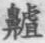

# 生气通天论第三①

①**生气通天论第三**：《新校正》云：按全元起注本在第四卷。

马莳说：按《灵枢·营卫生会篇》言宗气积于上焦，营气出于中焦，卫气出于下焦。盖以天有阳气，积阳为天也；有阴气，积阴为地也。人禀天地之气而生，亦有阳气，有阴气。阳气者，卫气也。由下焦之气阴中有阳者，从中焦之气以升于上焦而生此阳气。故《营卫生会篇》谓“卫气出于下焦”，又谓“浊者为卫”是也。目张则气上行于头，出于足太阳膀胱经睛明穴，而昼行于足手六阳经，夜行于足手六阴经，如本篇所谓“阳气者一日而主外”等语是也，又如“营卫生会篇”谓之“太阳主外”者是也。惟其不随宗气以同行于经隧之中，而自行于各经皮肤分肉之间，故《营卫生会篇》又谓之“卫行脉外”者是也。阴气者，营气也。由中焦之气阳中有阴者，随上焦之气以降于下焦而生此阴气。故《营卫生会篇》谓之“营气出于中焦”，又谓“清者为营”是也。但阴气精专，必随宗气以同行于经隧之中，始于手太阴肺经太渊穴，而行于手阳明大肠经、足阳明胃经、足太阴脾经、手少阴心经、手太阳小肠经、足太阳膀胱经、足少阴肾经、手厥阴心包络经、手少阳三焦经、足少阳胆经、足厥阴肝经，而又始于手太阴肺经，故《营卫生会篇》谓之“太阴重内”，又谓之“营行脉中”者是也，即本篇有“营气不从”之营气是也。惟此篇营气之营字；正与《灵枢》营气之营字同，其余《素问》营字俱书荣字，盖古营荣互书，大义当以营字为是。盖阴气在内，如将军之守营；阳气在外，如士卒之卫外。《史记》云：“以师兵为营卫”，则营卫二气之取义者盖如此。又《阴阳应象大论》有曰：“阴在内，阳之守。阳在外，阴之使。”其义晓然矣。愚尝思本篇有云：“阳气者，精则养神，柔则养筋。”《痹论》有云：“阴气者，静则神藏，躁则消亡。”此神圣论营卫二气至精之义也。然二气均为人之所重，而本篇所重在人卫气。但人之卫气，本于天之阳气，惟人得此阳气以自生，故曰生气通天。惟圣人全此阳气而苛疾不起，常人则反是焉。《灵枢·禁服篇》云：“审察卫气为百病母”者，信哉！本篇凡言阳气者七，谆谆示人以当全此阳气也。要之，阳气一全，则营气自从矣。大义当以《灵枢·营卫生会篇》及《卫气行篇》参看为的。

〔p.62 (인쇄 45)〕

**伯坚按：**《甲乙经》没有收载本篇的文字。本篇和《黄帝内经太素》《类经》二书的篇目对照，列表于下：

| 素问 | 黄帝内经太素 | 类经 |
|---|---|---|
| 生气通天论第三 | 卷三——调阴阳篇 | 卷十三——生气邪气皆本于阴阳（疾病类五） |

**【释题】** 马莳说：“篇首有‘自古通天者，生之本’，故名篇。”本篇开始说，人身九窍、五藏、十二节的气，都和天气相通。本篇采用这一段话做篇名，就叫作《生气通天论》。

**【提要】** 本篇第一节是黄帝说的，第二节是岐伯说的。黄帝只讲阳气，和阳气不固所发生的各种疾病。岐伯讲阴阳两气调和的重要和可能发生的疾病。末了讲酸、咸、甘、苦、辛五味对于人身生理的作用。

> 黄帝曰：夫自古通天①者，生之本，本于阴阳。天地之间，六合②之内，其气九州、九窍③、五藏④、十二节⑤，皆通乎天气⑥。其生五⑦，其气三⑧。数犯此者，则邪气伤人，此寿命之本也⑨。苍天⑩之气清净，则志意治。顺之，则阳气固，虽有贼邪弗能害也，此因时之序。故圣人传⑪精神，服⑫天气而通神明。失之，则内闭九窍，外壅肌肉，卫气⑬散解，此谓自伤，气之削也⑭。

**【本段提纲】** 马莳说：此帝言人气通乎天气。惟圣人全此天气，以固寿命之本，而众人则失之也。按《六节藏象论》云：“夫自古通天者，生之本，本于阴阳。其气九州九窍皆通乎天气。故其生五，其气三。”

**【集解】**

①**通天**：丹波元简说：王注《六节藏象论》云：“通天者，谓元气，即天真也。然形假地生，命惟天赋，故奉生之气，通系于天，禀于阴阳而为根本也。《宝命全形论》曰：‘人生于地，悬命于天，天地合气，命之曰人。’《四气调神大论》曰：‘阴阳四时者，万物之终始也，此生之本也。’此其义也。”简按：按此解颇明备。

〔p.63 (인쇄 46)〕

②**六合**：丹波元简说：高诱注《淮南》云：“孟春与孟秋为合，仲春与仲秋为合，季春与季秋为合，孟夏与孟冬为合，仲夏与仲冬为合，季夏与季冬为合，故曰六合。一曰，四方上下为六合。”

③**九窍**：马莳说：气之在人者曰九窍。阳窍在头者七：耳二，目二，鼻二，口一。阴窍之在下者二：前阴，后阴。

丹波元坚说：按《楚辞·九辩叙》：“故天有九星，以正机衡，地有九州，以成万邦，人有九窍，以通精明。”

俞樾说：按九窍二字，实为衍文，九州即九窍也。《尔雅·释兽篇》：“白州驠。”郭注曰：“州，窍。”北山经：“伦山有兽如麋，其川在尾上。”郭注曰：“川，窍也。”川即州字之误。是古谓窍为州。此言九州，不必更言九窍。九窍二字，疑即古注之误入正文者。

汪东释《素问》九州九窍之文：《素问·生气通天论》曰：“其气九州、九窍、五藏、十二节，皆通乎天气。”王冰注：“外布九州而内应九窍。”德清俞樾驳之曰：“九窍与九州，初不相应。如王氏说，将耳目口鼻各应一州，能悉言之乎？今按九窍二字，实为衍文，九州即九窍也。九窍二字，疑即古注之误入正文者。”东按俞君此论，厥有四失。《尔雅·释兽》：“白州驠。”《正义》曰：“谓马之白尻者。”别书为丑，《内则》“鳖去丑”是也。声转为涿，《三国志·周群传》：“先主嘲张裕多须云：‘诸毛绕涿居乎。’”《广雅》州、豚皆训为臀。此则州之训窍，本指隐微，岂有视听之官，共用私亵之号，其失一也。本篇诸言“内闭九窍”“九窍不通”“九窍为水注之气”，是别有九窍之文，不应于此忽然改例，其失二也。《六节藏象论》：“其气九州九窍皆通乎天气”。若复删剟九窍，宁须并承之辞？且下言“三而三之，合则为九，九分为九野，九野为九藏。”注：“九野者应九藏而为义。”假令州训为窍，野当何解？其失三也。《灵枢·邪客篇》曰：“地有九州，人有九窍”，偶语分疏，较然明白。其于《经水》曰：“经脉十二者，外合于十二经水。足太阳外合于清水。足少阳外合于渭水。足阳明外合于海水。足太阴外合于湖水。足少阴外合于汝水。足厥阴外合于渑水。手太阳外合于淮水。手少阳外合于漯水。手阳明外合于江水。手太阴外合于河水。手少阴外合于济水。手心主外合于漳水。”准是推寻，十二经既合十二水，九窍何缘不可外合九州？盖医家者流，始出于巫，后世分涂，犹多持阴阳天地五行之说，玄迹难稽，时近荒眇。不观大体，徒执单词，其失四矣。

**伯坚按：**汪东此文载《华国月刊》一卷二号，驳俞樾说，理由还不够充足。今仍从俞樾说，删去“九窍”二字，并载汪东文于后以供参考。

④**五藏**：马莳说：五藏：心、肝、脾、肺、肾。

⑤**十二节**：董仲舒《春秋繁露·官制象天篇》：天数之微，莫若于人。人之身有四肢，每肢有三节，三四十二，十二节相持而形体立矣。

杨上善说：十二节者，谓人四肢各有三大节也。

丹波元简说：《六节藏象论》无“五藏十二节”五字。此节之义，当考《灵·邪客篇》《淮南·天文训》。

⑥**皆通乎天气**：《淮南子·天文训》：天有九重，人亦有九窍。天有四时以制十二月，人亦有四肢以使十二节。天有十二月以制三百六十日，人亦有十二肢以使三百六十节。故举事而不顺天者，逆其生者也。

《淮南子·精神训》：故头之圆也象天，足之方也象地。天有四时、五行、九解、三百六十六日，人亦有四肢、五藏、九窍、三百六十六节。

〔p.64 (인쇄 47)〕

《新校正》云：详通天者生之本，《六节藏象注》甚详。又按郑康成云：“九窍者，谓阳窍七、阴窍二也。”

丹波元坚说：《淮南子·天文训》：“蚑行喙息，莫莫于人。孔窍肢体，皆通于天。”

**伯坚按：**《吕氏春秋·情欲篇》说：“人之与天地也同。万物之形虽异，其情一体也，故古之治身与天下者，必法天地也。”董仲舒《春秋繁露·深察名号篇》说：“天人之际，合而为一，同而通理，动而相益，顺而相爱，谓之德道。”《春秋繁露·为人者天篇》又说：“人之人本于天。天，亦人之曾祖父也，此人之所以上类天也。人之形体、化天数而成。人之血气，化天志而行。人之德行，化天理而义。人之好恶，化天之暖清。人之喜怒，化天之寒暑。人之受命，化天之四时。天之副在乎人。人之情性有由天者矣，故曰受由天之号也。”这都是人身是一小天地的看法，也就是人和天气相通的理论基础。

⑦**其生五**：马莳说：其所以生者五：金、木、水、火、土。

张介宾说：人生虽本乎阴阳，而禀分五行，其生五也。

张琦说：其生五，皆本五行之气而生也。

⑧**其气三**：杨上善说：谓天地间九州等物，其生皆在阴、阳、及和三气。

丹波元简说：《太平经》云：“元气有三名：太阳、太阴、中和。”出《后汉书·襄楷传》注：其气三，或此之谓欤？杨上善《太素》注云：太素分为万物，以为造化，故在天为阳，在地为阴，在人为和。”（出弘决《外典钞》）《三十一难》杨玄操注云：“天有三元之气，所以生成万物。人法天地，所以亦有三元之气，以养身形。”《六十六难》卢庶注云：“在天则三元五运相因而成，在人则三焦五藏相因而成也。《素问》曰：‘其气三，其生五’，此之谓也。”

丹波元坚说：先兄曰：“庄公三年《谷梁传》：‘独阳不生，独阴不生，独天不生，三合然后生。’注：‘徐邈曰：古人称万物负阴而抱阳，冲气以为和，然则传所谓天，盖各其冲和之功而神理所系也。’”坚按《春秋繁露》曰：“寒暑与和，三而成物。日月与星，三而成光。天地与人，三而成德。由此观之，三而一成，天之大经也。”

⑨**此寿命之本也**：杨上善说：阴阳分为四时，和气人之纵志，不顺四时和气摄生，为风寒雨湿邪气伤也。此顺二气养生，寿之本也。

张志聪说：人禀五行之气而生，犯此五行之气而死，有如水之所以载舟，而亦能覆舟，故曰此寿命之本也。

⑩**苍天**：王冰说：春为苍天，发生之主也。

张介宾说：天色深玄，故曰苍天。

丹波元简说：按《诗》：“彼苍者天。”

喜多村直宽说：《诗·王风》：“悠悠苍天。”毛传：“据远视之苍苍然，则称苍天。”《释文》：“《庄子》云：‘天之苍苍，其正色耶。’”宽按：《尔雅》：“春为苍天。”李巡云：“春，万物始生，其色苍苍。”王《注》本于此。

⑪**传**：丹波元坚说：尤怡《医学读书记》曰：“按传，当作专，言精神专一，则清静弗扰，犹苍天之气也。老子所谓专气致柔；太史公所谓精神专一，动合无形，赡足万物；班氏所谓专精神以辅天年者是也。若作传，与义难通。”

胡澍说：传当为抟字之误。抟与专同，言圣人精神专一不旁骛也。古书专一字多作抟。《系辞》传：“其静也专。”《释文》曰：“专，陆作抟。”昭二十五年《左传》：“若琴瑟之专壹。”《释文》

〔p.65 (인쇄 48)〕

曰：“专本作抟。”《史记·秦始皇纪》：“抟心揖志。”《索隐》曰：“抟，古专字。”《管子·立政篇》曰：“一道路，抟出入。”《幼官篇》曰：“抟一纯固。”《内业篇》曰：“能抟乎？能一乎？”《荀子·儒效篇》曰：“亿万之众，而抟若一人。”《讲兵篇》曰：“和抟而一。”《吕氏春秋·适音篇》曰：“耳不收则不抟。”高注曰：“不抟，入不专一也。”皆其证。

俞樾说：传读为抟，聚也。抟聚其精神，即《上古天真论》所谓精神不散也。《管子·内业篇》：“抟气如神，万物备存。”尹知章注：“抟，谓结聚也。”与此文语意相近。作传者，古字通用。

田晋蕃说：按《徵四失论》：“所以不十全者精神不专”，则此传字当读为专，独言精神专一也。《论语·释文》引郑注“鲁读传为专”，是其例。俞读为抟，抟即专字。《索隐》云：“抟，古专字。”古书多以抟为专，王氏念孙《读书杂志》于《管子·立政篇》详言之。

⑫**服**：丹波元坚说：先兄曰：“服，服膺之服，服天气清净之理也。”

**伯坚按：**“服”字作“从”字解，服天气就是顺从着天气。《尚书·舜典》：“五刑有服。”孔安国《传》：“服，从也。”《吕氏春秋·先己篇》：“期年而有扈氏服。”高诱注：“服，从也。”《史记·历书》：“三苗服九黎之德。”张守节《正义》：“服，从也。”

⑬**卫气**：王冰说：《灵枢经》曰：“卫气者，所以温分肉而充皮肤，肥腠理而司开合。”（**伯坚按：**见《灵枢》第四十七《本藏篇》。）故失其度则内闭九窍，外壅肌肉，以卫不营运，故言散解也。

**伯坚按：**《黄帝内经》讲人身有营卫二气。营气是血液，《灵枢》第十八《营卫生会篇》曾替营气下了一个确切的定义，说：“此所受气者，泌糟粕，蒸精液，化其精微，上注于肺脉，乃化而为血，以奉生身，莫贵于此，故得独行于经隧，命曰营气。”至于卫气是一种不可捉摸的精气，很难用现代语解释。《灵枢》第十八《营卫生会篇》说：“营在脉中，卫在脉外。”《灵枢》第五十二《卫气篇》说：“其浮气之不循经者为卫气，其精气之行于经者为营气。”这是营卫二气的分别。

卫气，参阅《素问》第四十三《痹论》第十一段经文和集解。

⑭**气之削也**：张介宾说：真阳受伤，元气如削，非由天降，自作之耳。

> 阳气者，若天与日，失其所，则折寿而不彰①。故天运当以日光明，是故阳因而上卫外者也②。
>
> 因于寒，志欲如连枢③，起居如惊，神气乃浮。
>
> 因于暑，汗、烦则喘、喝④，静则多言⑤，体若燔炭，汗出而散。
>
> 因于湿，首如裹⑥，湿热不攘，大筋软⑦短，小筋弛⑧长。软短为拘⑨，弛长为痿⑩
>
> 因于气，为肿⑪。四维相代⑫，阳气乃竭。

**【本段提纲】** 马莳说：此言阳气所以卫外，而阳气不固者，则四时必伤于邪气而为病也。阳气者卫气也。本篇所重在阳气，故凡本篇有阳气者，当提为各节起语。凡每节本文之病，皆由于阳气不足所致，即《灵枢·禁服篇》谓“卫气为百病之母”者是也。

**【集解】**

①**则折寿而不彰**：张介宾说：此发明阳气之本也。日不明，则天为阴晦。阳不固，则人为夭折。皆阳气之失所也。

高世栻说：短折其寿，而不彰著于人世矣。

丹波元简说：按《史记·五帝本纪》：“帝挚立，不善，崩。”《索隐》曰：“古本作‘不著’，音张虑反，犹不著明。”

②**是故阳因而上卫外者也**：杨上善说：人之阳气，若天与日，不得相无也。如天不得无日，日失其行则天不明也。故天之运动，要藉日行天得光明也。人与阳气不得相无，若无三阳行于头上，则人身不得章延寿命也。是以阳上于头，卫于外也。

〔p.66 (인쇄 49)〕

吴崑说：天以日光明，人以阳为卫，皆生气通天，与天无间也。

③**志欲如连枢**：原文作“欲如运枢”，没有“志”字。

杨上善说：连，数也。枢，动也。和气行身，因伤寒气，则志欲不定，数动不住，故起居如惊，神魂飞扬也。

《新校正》云：按全元起本作“连枢”。元起云：“阳气定如连枢者。动，系也。”

张文虎说：此下因于寒，因于暑，因于湿，因于气，皆言病源。欲如连枢云云，乃各项病状。林亿引全《注》本作连枢，云：“阳气定如连枢者。动，系也。”盖谓寒气收敛，阳气为所束，故不能适意，则劳扰不安，而神气不得静也。欲字疑误，详全注当是动字。

田晋蕃说：《太素》，“欲”上有“志”字，“运”作“连”。按杨上善注：“连，数也。枢，动也。和气行身，因伤寒气，则志欲不定，数动不住。”张氏文虎《舒艺室续笔》谓欲如连枢乃言病状。与杨义暗合，惟当时未见《太素》，而泥于全注并疑“欲”字之误。当依《太素》，“欲”上补“志”字。“志欲”与下“起居”相对为文，盖传写者失之。

**伯坚按：**此段见《黄帝内经太素》卷三《调阴阳篇》，作“志欲如连枢”。今据田晋蕃说，依《太素》校改。

④**喝**：张琦说：“喝”，疑“渴”之讹。

田晋蕃说：《说文》：“喝，㵣也。”㵣为渴之本字，是喝正作渴解，非误也。《虐论》：“外内皆热，则喘而渴。”直作喘渴。

⑤**静则多言**：马莳说：因于夏之暑气者，其体必有汗。或烦躁而动，则为喘喝。或不烦躁而静，则亦不免于多言。

⑥**首如裹**：顾观光说：言头目昏重，如物裹之。

胡澍说：此言病因于湿，头如蒙物，不瞭了耳。

⑦**软**：张介宾说：软，音软，缩也。

⑧**弛**：王冰说：弛，引也。

弛，参阅本篇第十段“筋脉沮弛”句下胡澍说。

⑨**拘**：丹波元坚说：《集韵》：“拘，俱遇切，拘拿不展。”（拿，牵也。）

⑩**软短为拘，弛长为痿**：马莳说：湿蒸为热而不能除却，大筋受湿浸热蒸，则软而短。小筋受湿浸热蒸，则懈弛而长。软短，故手足拘挛而不伸。弛长，故手足痿弱而无力矣。

⑪**因于气，为肿**：胡澍说：此气指热气而言。上云寒、暑、湿，此若言风气，则与上文不类，故知气为热气也。《阴阳应象大论》曰：“热胜则肿。”本篇下注引《正理论》曰：“热之所过则为痈肿。”故曰：“因于气为肿。”

丹波元坚说：《说文》曰：“肿，痈也。”《周官·疡医》注曰：“肿，疡痈而上生创者。”先兄曰：“古单称肿者，皆谓痈肿也。若谓跗肿、水肿、浮肿者，水病也。”

⑫**四维相代**：高世栻说：四维相代者，四肢行动不能，彼此借力而相代也。

丹波元简说：《痹论》云：“尻以代踵，脊以代头。”四维相代，与此同义。

> 阳气者，烦劳则筋张精绝①。辟②积于夏，使人煎厥③，目盲不可以视，耳闭不可以听，溃溃乎若坏都④，汩汩⑤乎不可止。

**【本段提纲】** 马莳说：此又言阳气不固者，夏时有煎厥之证，不特病暑而已。

〔p.67 (인쇄 50)〕

**【集解】**

①**烦劳则筋张精绝**：原文作“烦劳则张精绝”。

王冰说：烦扰阳和，劳疲筋骨，动伤神气，耗竭天真，则筋脉䐜胀，精气竭绝。

俞樾说：“张”字之上夺“筋”字。筋张、精绝、两文相对。今夺“筋”字，则义不明。王注曰：“筋脉䐜胀，精气竭绝。”是其所据本未夺也。

田晋蕃说：张，即胀也。左氏成公十年《传》：“将食，张，如厕。”《玉篇》肉部引作。“胀”。《淮南子·缪称训》：“大戟去水，葶历愈张。”古皆作“张”。

**伯坚按：**今据俞樾说依王冰注校补“筋”字。

②**辟**：丹波元简说：辟与襞同。《司马相如传》：“襞积褰绉。”师古注：“襞积，即今之帬褶也。”

喜多村直宽说：《文选·司马相如·子虚赋》注：“善曰：‘张揖曰：襞积，简齰也。褰，缩也。绉，栽也。’其绉中文理弗郁有似于溪谷也。”又张衡《思玄赋》注：“襞积，衣缝也。良曰：重叠也。”

③**煎厥**：《新校正》云：按《脉解》云：“所谓少气善怒者，阳气不治；阳气不治则阳气不得出，肝气当治而未得，故善怒。善怒者名曰煎厥。”

张介宾说：人以阳气为生，惟恐散失，若烦劳过度，则形气施张张于外，精神竭绝于中，阳扰阴亏，不胜炎热，故病积至夏日以益甚，令人五心烦热，如煎如熬，孤阳外浮，真阴内夺，气逆而厥，故名煎厥。

④**都**：马莳说：都所以防水。

丹波元简说：《礼·檀弓》：“洿其宫而诸焉。”郑玄注：“诸，都也，南人谓都为诸。”郦道元《水经注》：“水泽所聚谓之都，亦曰诸。”

⑤**汩汩**：《文选》木玄虚《海赋》：“泼泼汩汩”李善注：“波浪之声也。”

> 阳气者，大怒则形气绝，而血菀于上①，使人薄厥②。
>
> 有伤于筋，纵，其若不容③。
>
> 汗出偏祖④，使人偏枯⑤。
>
> 汗出见湿⑥，乃生痤⑦、痱⑧。
>
> 高梁⑨之变，是生大丁⑩，受如持虚⑪。
>
> 劳汗当风⑫，寒薄为皶⑬，郁乃痤。

**【本段提纲】** 马莳说：此又言阳气不固者，有为厥、为胀、为偏枯、为痤痱、为大丁、为皶痤、诸证也。

**【集解】**

①**阳气者，大怒则形气绝，而血菀于上**：马莳说：阳气者，贵于清净。若大怒而不清净，则形气经络阻绝不通，而血积于心胸之间。《奇病论》：“岐伯曰，胞之络脉绝”，亦阻绝之义，非断绝之谓。

张琦说：怒则气逆，而血随之郁积心胸之间，是阴阳气血并迫而然。形气绝者，营卫不通，形状若死也。

菀与郁通。参阅《素问》第二《四气调神大论》第五段则“菀藁不荣”句下集解。

②**薄厥**：高世栻说：薄厥，虚极而厥逆也。

〔p.68 (인쇄 51)〕

丹波元简说：按《圣济总录》：“赤茯苓汤，治薄厥暴怒，怒则伤肝，气逆胸中不和，甚则呕血鼽衄。”

③**有伤于筋，纵，其若不容**：吴崑说：有伤于筋，则纵而不收，其若不能为容止矣。

张志聪说：筋伤而弛纵，则四体自有若不容我所用也。

④**汗出偏祖**：原文作“汗出偏沮”。

《新校正》说：按“沮”《千金》作“祖”。全元起本作“恒”。

丹波元简说：《千金》作“袒”。又《养生门》云：“凡大汗勿偏脱衣，喜得偏风半身不遂。”《巢源》引《养生方》同。《灵·刺节真邪》云：“虚邪偏客于身半，其入深，内居荣卫，荣卫稍衰，真气去，邪气独留，发为偏枯。”乃其作“袒”似是。下文曰汗出见湿，曰高梁之变，曰劳汗当风，皆有为而发疾者，其义可见也。

田晋蕃说：按袒，脱衣见体也（见《尔雅·释训》注）。汗出而脱衣见体，岂有不致病者，故下文云：“使人偏枯”，与《千金·养生门》之言正合，且与下两节汗出见湿，劳汗当风，文义一律。若作汗出偏沮，是但言汗之病形，与下两节义相违异矣。日本古书于医方尤夥，所引《千金方》定可据也。黄氏丕烈《荛本》《仪礼校录》云：“李本作祖，此袒讹为祖，形涉而误。”林亿引《千金方》作“祖”为“袒”之误文无疑。《五藏生成篇》：“卧出而风吹之，血凝于肤者为痹。”《太素》杨上善注：“出不覆衣也。”即汗出偏袒，令人偏枯之一证。

**伯坚按：**今据丹波元简、田晋蕃说校改。

⑤**偏枯**：《灵枢》第二十三《热病》篇：偏枯，身偏不用而痛，言不变，志不乱，病在分腠之间。

杨上善说：偏枯，不随之病也。

余岩《古代疾病名候疏义》第九十七页：半枯即偏枯，亦谓之半身不遂。《吕氏春秋·似顺论》第五《别类篇》云：“鲁人有公孙绰者，告人曰：‘我能起死人。’人问其故。对曰：‘我固能治偏枯，今吾倍所以为偏枯之药，则可以起死人矣。’物固有可以为小不可以为大，可以为半不可以为全者也。”是半枯即偏枯，即今之偏瘫也，为运动障碍之病。

⑥**汗出见湿**：马莳说：人当汗出之时，玄府未闭，乃受水湿。（**伯坚按：**《素问》第六十一《水热穴》论说：“所谓玄府者，汗空也。”）

⑦**痤**：杨上善说：痤，痈之类，然小也。俗谓之疖子。

王冰说：痤，谓色赤膜愤，内蕴血脓，形小而大如酸枣，或如按豆。

丹波元简说：《说文》：“痤，小肿也。”《玉篇》：“疖也。”《韩非子》：“弹痤者痛。”《巢源》云：“肿一寸至二寸，疖也。”

余岩《古代疾病名候疏义》第一二六页：痤者，疖之小者也。小如粟粒，大如酸枣。其小者与痱瘤相似。所不同者痱瘤无脓血，痤则兼含脓血也。故《广雅》训为痈，而《玉篇》训为疖。今人译面上之粉刺为痤疮。

⑧**痱**：丹波元简说：痱，《玉篇》：“热生小疮。”《巢源》云：“人皮肤虚，为风邪所折，则起隐疹。寒多则色赤。风多则色白。甚者痒痛。搔之则成疮。”又《巢源》有夏月沸疮，盖“痱”即“沸”。

余岩《古代疾病名候疏义》第一二四页：皮肤病之痱，今之汗疹也，夏日多见之。吾乡读扶非切。声稍变而为痱。《广韵》八末：“痱，方味切，热小疮也。”《玉篇》：“痱，甫未切，热生小疮。”痱即痱，亦汗疹也。

⑨**高梁**：王冰说：高，膏也。梁，梁也。（顾观光说：六书假借之例。）

丹波元简说：《孟子》：“膏梁之味。”赵岐注：“细梁如膏者也。”朱注“膏，肥肉。梁，美谷。”简

〔p.69 (인쇄 52)〕

按：《山海经》：“都广之野，爰有膏菽，膏稻，膏黍，膏稷。”郭璞注：“言味好皆滑如膏。”《外传》曰：“膏梁之子。”刘会孟云：“嘉谷之米，炊之皆有膏。”

田晋蕃说：按《通评虚实论》：“肥贵人则高梁之疾也”，《腹中论》：“子数言热中消中不可服高梁芳草石药”，并作“高梁”。焦氏循《易通释》谓：“高，即膏之借，《素问》高梁即膏梁，膏从高声，得相通也。《论语》‘山梁雌雉’，郑云‘孔子山行见雉食梁粟也’，陆德明《音义》引之，知梁梁古通。”

**伯坚按：**《史记·太史公自序》：“啜土刑粝梁之食”句下司马贞《索隐》引《三苍》说：“梁，好米也。”《国语》十三晋语“夫膏梁之性难正也”句下韦昭注：“膏，肉之肥者。梁，食之精者。”《晋书·文苑·伏滔传》《正淮论》下篇：“生乎深宫，长于膏梁。”

⑩**是**：原文作“足生大丁”。

《新校正》云：按丁生之处，不常于足，盖谓膏梁之变，饶生大丁，非偏著足也。

丹波元简说：《春秋繁露》云：“阴阳之动，使人足病喉痹。”足字用法，与此正同。巢源云：“丁疮初作时，突起如丁盖，故谓之丁疮。令人恶寒，四支强痛，兼忉忉然牵痛，三日疮便变焦黑色，肿大光起，根蒂强，全不得近，酸痛，皆其候也。”

胡澍说：“足”当作“是”，字之误也。《荀子·礼论篇》：“不法礼，不是礼，谓之无方之民。法礼，是礼，谓之有方之士。”今本“是”并讹作“足”。“是”犹“则”也，（《尔雅》：“是，则也。”是为法则之则，故又为语辞之则。《大戴礼·正言篇》：“教定是正矣”，《家语》作“正教定则本正矣。”郑语：“若更君而周训之，是易取也。”韦昭曰：“更以君道导之，则易取。”）言膏梁之变则生大丁也。

俞樾说：《新校正》以“足”为饶足之义，亦迂曲。“足”疑“是”字之误。上云：“乃生痤痱”，此云：“是生大丁”，语意一律。“是”误为“足”，于是语词而释以实义，遂滋曲说矣。

陆懋修说：丁本作疔。《集韵》：“疔，当经切，音丁，病创也。”

**伯坚按：**今据胡澍、俞樾说校改。

⑪**受如持虚**：杨上善说：如持虚器受物。言易得也。

王冰说：外湿既侵，内热相感，如持虚器，受此邪毒，故曰受如持虚。

⑫**劳汗当风**：马莳说：人于劳苦汗出之时，当风取凉。

⑬**皶**：王冰说：皶刺长于皮中，形如米，或如针，俗曰粉刺。

丹波元简说：王注：“俗曰粉刺。”粉刺见《肘后》。《千金》作粉滓。《巢源》云：“䵟面者，面皮上有滓如米粉者也。”又《外台》有粉皶。《玉篇》：“皻与皶同。”字书，齇、、㾴、𦟰、皻并是查字。

> 阳气者，精则养神，柔则养筋①。
>
> 开阖不得，寒气从之，乃生大偻②。
>
> 陷脉为瘘③，留连肉腠④。
>
> 俞气化薄⑤，传为善畏，及为惊骇。
>
> 营气⑥不从，逆于肉理，乃生痈肿⑦。
>
> 魄汗⑧未尽，形弱而气烁⑨，穴俞以闭，发为风疟⑩。
>
> 故风者，百病之始也⑪。清静则肉腠闭拒，虽有大风苛毒弗之能害，此因时之序也⑫。
>
> 故病久则传化，上下不并，良医弗为⑬。故阳畜积，病死。而阳气当隔，隔者当泻⑭。不亟正治，粗⑮乃败之。

〔p.70 (인쇄 53)〕

**【本段提纲】** 马莳说：此又言阳气不固者，有为偻、为瘘、为善畏、为惊骇，为痈肿、为风疟、为膈、诸证也。

**【集解】**

①**阳气者，精则养神，柔则养筋**：马莳说：阳气者，内化精微，养人之神，外则柔和，养人之筋。

高世栻说：上文大怒气绝，至血菀而伤筋。故曰阳气者柔则养筋。所以申明上文，阳气不柔，而筋无所养也。

②**开阖不得，寒气从之，乃生大偻**：张介宾说：开谓皮腠发泄，合谓玄府闭封，皆卫气为之主也，若卫气失所，则当开不开，当闭不闭，不得其宜为寒所袭，结于筋络之间，软急不伸，则形为偻俯矣。《经筋篇》曰：“阳急则反折，阴急则俯不伸。”即此之谓。

丹波元简说：《脉要精微》曰：“膝者，筋之府。屈伸不能，行则偻俯，筋将惫矣。”大偻义正同。

余岩《古代疾病名候疏义》第一五七页：《说文解字》：“偻，尪也。”段氏注云：“盖尪是曲胫之名，引申为曲脊之名。”背曲胫曲，同为骨之变化。如慢性多发性关节炎，佝偻病及骨软化病等病皆能使腰背脊关节发生弯曲，而股膝关节往往同时亦发生畸形。背偻之病，除上述三病之外，又有强直性关节炎、畸形性关节病、脊柱骨疡等，皆有曲背之候，乃诸病之一证候也。

③**陷脉为瘘**：张介宾说：陷脉，寒气自经络而陷入脉中也。瘘，鼠瘘之属。

丹波元简说：《说文》：“颈肿也。”《慧琳藏经音义》引《考声》云：“瘘，久疮不差曰瘘。”《巢源》有九瘘、三十六瘘。李梴《入门》云：“瘘，即漏也。经年成漏者。与痔漏之漏相同。但在颈则曰瘰漏，在痔则曰痔漏。”又云：“凡痈疽久则脓流出，如缸瓮之有漏。”

余岩《古代疾病名候疏义》第一一九页：瘘为瘰疬，今之颈部淋巴腺结核也。又引申为疮久不合，常流脓水者，皆谓之瘘。其发于身体而与颈瘘相似者，因亦名之为瘘，如《病源》卷三十四《诸痔候》云：“痔久不瘥，变为瘘”是也。《病源》又屡言“脓溃成瘘”。然则医家之所谓瘘，实指疮疡溃后，久不收口，留小孔道，常常出汁，或脓或水者而言。今亦谓之瘘，又谓之瘘孔。

④**留连肉腠**：丹波元简说：王注：“久瘀内攻，结于肉理。”知肉腠即肉理。《仪礼公食大大礼》；“载体进奏。”注：“奏，谓皮肤之理也。”又《乡饮酒礼》：“皆右体进腠。”注：“腠，理也。”

⑤**俞气化薄**：王冰说：言若寒中于背俞之气，变化入深而薄于藏府者，则善为恐畏及发为惊骇也。

马莳说：各经皆有俞穴（此非“井荥俞经合”之俞，凡一身之穴，皆可曰俞。），邪气变化依薄，传为善畏及惊骇之疾。

张介宾说：寒气自脉渐深，流于经俞，气化内薄，则侵及藏府，故传为恐畏，为惊骇，以阳气受伤于内也。

丹波元简说：经文，俞、输、腧通用。《玉篇》：“腧，五藏腧也。”《史记》：“五藏之输。”注：“经穴也。”《项氏家说》云：“腧，象水之窦，即窬字也”，见《难经汇考》。

**伯坚按：**《黄帝内经》中的俞字，有三种不同的意义。第一种意义是指一般孔穴而言，凡是孔穴都可叫作俞，例如本篇此处即是这样的意义。第二种意义是指井、荥、俞、原、经、合的俞而言，这是指五藏经脉，和六府经脉中的孔穴各有一个孔穴名叫作俞，参阅《素问》第三十六《刺疟篇》第十六段“刺指井”句下集解。第三种意义是指足太阳膀胱经脉的背俞而言，参阅《素问》第四十七《奇病论》第七段“治之以胆募俞”句下集解。

〔p.71 (인쇄 54)〕

⑥**营气**：《灵枢》第十八《营卫生会篇》：此所受气者，泌糟粕，蒸精液，化其精微，上注于肺脉，乃化而为血，以奉生身，莫贵于此，故得独行于经隧，命曰营气。

《灵枢》第七十一《邪客论篇》：营气者，泌其津液，注之于脉，化以为血，以营四末，内注五藏六府，以应刻数焉。

营气，参阅《素问》第四十三《痹论》第十一段经文和集解。

⑦**痈肿**：余岩《古代疾病名候疏义》第二三六页：按《说文》：“肿，痈也。痈，肿也。”盖痈肿两字，混言之则可通，且往往两字连文并举。其义有二。其一，今之脓疡也。《史记·仓公传》载：“齐侍御史成病疽，五日而𦡈肿，八日呕脓死”，此𦡈肿则脓疡也。《战国策》：“人之所以喜扁鹊者，为有臃肿也。”臃即𦡈字，并与痈同。《素问·五常政大论》卑监之纪曰：“其动疡、涌、分、溃、痈肿。”王冰注曰：“痈肿，脓疮也。”此痈肿为脓疡之证。其二，则坟起肿大也。诸书之单言肿者，皆指膨胀粗大坟起而言，不得训为痈。

⑧**魄汗**：杨上善说：魄，肺之神也。肺主皮毛腠理，人之汗者皆是肺之魄神所营，因名魄汗。

丹波元简说：魄、白古通。《礼记·内则》：“白膜”作“魄膜”。《淮南·修务训》云：“奉一爵酒，不知于色，挈一石之尊，则白汗交流。”《战国策》鲍彪注：“白汗，不缘暑而汗也。”（楚策）《阴阳别论》：“魄汗未藏。”王注：“流汗未止。”

喜多村直宽说：白汗见《经脉别论》。（**伯坚按：**《素问》第二十一《经脉别论》：“厥气留薄，发为白汗。”）

田晋蕃说：按《尔雅》：“魄，间也。”孔，魄，《尔雅》同训为间。《说文》：“间，隙也。”魄汗者，孔开汗泄之谓，为下句穴俞以闭之对文，与《经脉别论》“发为白汗”异义。

⑨**烁**：**伯坚按：**《文选》马季长《长笛赋》：“或铄金砻石。”李善注：“贾逵注传曰：‘消，铄也。’铄与烁同。”《国语·周语》三：“众口铄金。”韦昭注：“铄，消也。”陆德明《经典释文》卷二十七《庄子·胠箧篇》音义：“不烁，不消坏也。”《素问》第三十四《逆调论》：“是人当肉烁也。”王冰注：“烁，言消也，言久久此人当肉消削也。”

烁，参阅《素问》第三十五《疟论》第十三段“令人消烁脱肉”和第五十《刺要论》第八段“髓伤则销铄”句下集解。

⑩**风疟**：张介宾说：“汗出未止，卫气未固，其时形气正在消弱，而风寒薄之，俞穴随闭，邪气留止，郁而为疟。以所病在风，故名风疟。”《金匮真言论》曰：“夏暑汗不出者，秋成风疟。”亦言俞穴之闭也。

丹波元简说：此即疟耳，必非有一种风疟者。《金匮真言》云：“秋善病风疟。”又云：“夏暑汗不出者秋成风疟。”《刺疟》云“风疟发则汗出恶风。”《疟论》云：“夫痎疟皆生于风。”俱可证也。

⑪**百病之始也**：《素问》第十九《玉机真藏论》：是故风者，百病之长也。

《素问》第四十二《风论》：故风者，百病之长也。

《素问》第六十《骨空论》：余闻风者，百病之始也。

《灵枢》第四十九《五色篇》：小子闻风者，百病之始也。

⑫**故风者，百病之始也。清静则肉腠闭拒，虽有大风苛毒弗之能害，此因时之序也**：张介宾说：凡邪伤卫气，如上文寒暑湿气风者，莫不缘风气以入，故风为百病之始。然卫气者，阳气也。人惟清静，无过劳扰，则腠理闭而阳气固，虽有大风苛毒弗之能害也。所谓清静者无他，在因四时之气序耳。如《四气调神论》曰：应春气以养生，应夏气以养长，应秋气以养收，应冬气以养藏，逆之则灾害生，从之则苛疾不起。顺其自然，是得四时清静之道。

〔p.72 (인쇄 55)〕

⑬**故病久则传化，上下不并，良医弗为**：王冰说：并谓气交通也。然病之深久，变化相传，上下不通，阴阳否隔，虽医良法妙，亦何以为之。

丹波元简说：王充《论衡》云：“医能治一病谓之巧，能治百病谓之良。故良医服百病之方，治百人之疾。”

⑭**阳气当隔，隔者当泻**：马莳说：此阳气者不能卫外，徒尔畜积于内，其病久久当死。斯时也，且当成膈。膈者，乖隔不通之谓也。《阴阳别论》曰：“三阳结谓之隔。隔者当泻。若不急泻，以正治之，此粗工之所以败也。”

隔是便闭。参阅《素问》第七《阴阳别论》第十四段“三阳结谓之隔”句下集解。

⑮**粗**：马莳说：《灵枢·九针十二原篇》，名下工为粗。

> 故阳气者，一日而主外①。平旦人气生。日中而阳气隆②。日西而阳气已虚，气门乃闭③。是故暮而收拒，无扰筋骨，无见雾露。反此三时④，形乃困薄⑤。

**【本段提纲】** 马莳说：此言阳气在人，当开合得宜以顺之也。

**【集解】**

①**一日而主外**：张介宾说：一日而主外，昼则阳气在外也。

俞樾说：上文云：“是故阳因而上卫外者也。”下文云：“阳者卫外而为固也。”是阳气固主外。然云“一日而主外”，则义不可通。“主外”，疑“生死”二字之误。下文云：“平旦人气生，日中而阳气隆，日西而阳气已虚，气门乃闭。”虽言生不言死，然既有生即有死，阳气生于平旦，则是日西气虚之后已为死气也。故云阳气者一日而生死。生与主，死与外，并形似而误。

田晋蕃说：《灵枢·营卫生会篇》：“太阴主内，太阳主外，各行二十五度，分为昼夜。”

②**日中而阳气隆**：田晋蕃说：《灵枢·营卫生会篇》：“日中而阳陇”，“隆”作“陇”。晋蕃按：元李治《古今注》云：“《列子·汤问》：‘自此冀之南，汉之北，无陇断焉。’《孟子·公孙丑篇》：‘有贱丈夫焉，必求龙断而登之。’丁云：‘按龙与隆声相近。隆，高也。盖古人之言耳，如胥须之类是也。’陇之与隆，文异义同。”

③**气门乃闭**：王冰说：气门，谓玄府也，所以发泄经脉营卫之气，故谓之气门也（**伯坚按：**《素问》第六十一《水热穴论》：“所谓玄府者，汗空也。”）

④**三时**：张志聪说：三时，平旦，日中，日西也。

⑤**形乃困薄**：张介宾说：此所以顺阳气也。阳出而出，阳藏而藏。暮时阳气藏于阴分，故动宜收敛，以拒虚邪。无扰筋骨，则阳不耗于内。无见雾露，则邪不侵于外。若劳扰不分朝暮，反此三时，则阳气失养，形体劳困衰薄矣。

田晋蕃说：按顾炎武唐韵正引此文，薄读旁故反。《管子·内业篇》：“思之而不舍，内困外薄”，读与此同。房玄龄注：“五藏困于内，形骸薄于外也。”

> 岐伯曰：阴者，藏精而起亟也①。阳者，卫外而为固也。阴不胜其阳，则脉流薄疾②，并乃狂③。阳不胜其阴，则五藏气争，九窍不通④。是以圣人陈阴阳⑤，筋脉和同。骨髓坚固，气血皆从⑥。如是则内外调和，邪不能害，耳目聪明，气立⑦如故。

**【本段提纲】** 马莳说：此伯形上文阳气主外之义，遂言营卫相须为用，而偏胜者应，惟圣人则善调之也。

**【集解】** ①阴者，藏精而起亟也：马莳说：营气者，即阴气也。营气藏五藏之精，随宗气以运行于经脉之中，而外与卫气相表里。卫气有所应于外，营气即随之而起矣，夫是之谓起亟也。

〔p.73 (인쇄 56)〕

田晋蕃说：《易·说卦》：“为亟心。”《释文》：“亟，荀作极，云中也。”此亟字亦当作极，训中。阴之起中，与下句阳之卫外，相对为文。

②**薄疾**：王冰说：薄疾，谓极虚而急数也。

③**并乃狂**：王冰说：并，谓盛实也。

马莳说：《宣明五气论》《灵枢·九针篇》，皆曰：“邪入于阳则狂。”

张琦说：阳性速，阴性迟，阳胜其阴，故脉来急数。若阴为阳并，则阳实而为狂。

江有诰《先秦韵读》：阴不胜其阳，则脉流薄疾，并乃狂。（阳部）

④**九窍不通**：张介宾说：上七窍，五官也。下二窍，二阴也。

张琦说：清阳出上窍，浊阴出下窍。阳微阴盛，清阳不升，浊阴填塞，五藏之气，纷争奔乱，故上窍不通，而下窍亦塞。

⑤**陈阴阳**：张介宾说：陈阴阳，犹言铺设得所，不使偏胜也。

⑥**气血皆从**：江有诰《先秦韵读》：阳不胜其阴，则五藏气争，九窍不通。是以圣人陈阴阳，筋脉和同。骨髓坚固，气血皆从。（东侵借韵）

⑦**气立**：王冰说：邪气不克，故真气独立而如常。

张介宾说：人受天地之气以立命，故曰气立。然必阴阳调和，而后气立如故。

> 风客淫气①，精乃亡，邪伤肝也②。
>
> 因而饱食，筋脉横解③，肠澼为痔④。
>
> 因而大饮，则气逆。
>
> 因而强力⑤，肾气乃伤，高骨⑥乃坏。
>
> 凡阴阳之要，阳密乃固⑦。两者不和⑧，若春无秋，若冬无夏。因而和之，是谓圣度⑨。故阳强不能密，阴气乃绝⑩。阴平阳秘⑪，精神乃治。阴阳离决，精气乃绝⑫。

**【本段提纲】** 马莳说：此言病有伤肝者，不慎则为肠病、为肺病、为肾病。遂因肾伤之义，而示人以阴阳交会之要也。

**【集解】**

①**风客淫气**：丹波元简说：王注《痹论》云：“淫气，谓气之妄行者。”简按：《说文》：“淫，浸淫随理也。”徐云：“随其脉理而浸渍也。”

张琦说：客风淫于阳气，则精亡而传肝，风气通于肝也。藏府皆有精。

淫气，参阅《素问》第四十三《痹论》第七段“淫气喘息”句下集解。

②**精乃亡，邪伤肝也**：王冰说：风气应肝，故风淫精亡，则伤肝也。《阴阳应象大论》曰：“风气通于肝”也。风薄则热起，热盛则水干，水干则肾气不营，故精乃无也。亡，无也。

《新校正》云：按全元起云：“淫气者，阴阳之乱气，因其相乱而风客之则伤精，伤精则邪入于肝也。”

马莳说：风者，百病之长。风来客之，浸淫以乱营卫之气，则风薄而热起，热盛而水干，水干而肾气不营，故精气乃亡。然邪之所伤，何藏为始，以风气通于肝，故邪气伤肝为始耳。唯风气入肝，以致肾精乃亡，则凡饮食起居皆当慎矣。

〔p.74 (인쇄 57)〕

③**筋脉横解**：高世栻说：筋脉横解者，肝主之筋，心主之脉，不循经上下，而横散懈弛也。

④**肠澼为痔**：杨上善说：澼，音癖，泄脓血也。广肠漏泄脓血，名之为痔也。

王冰说：《痹论》曰：“饮食自倍，肠胃内伤”，此伤之信也。

丹波元简说：肠澼二字，《素》《灵》中凡见，多指赤白滞痢而言。唯本篇云：“肠澼为痔”，盖古肠垢脓血出从谷道之总称。

度会常珍说：古抄本“澼”下有“裂”字。

余岩《古代疾病名候疏义》第二三二页：《说文》疒部痔下曰：“后病也。”《文选·登徒子好色赋》注曰：“痔、后病也。”《庄子·人间世篇》释文引司马曰：“痔，引创也。”今亦谓之痔。

⑤**因而强力**：杨上善说：因力已入房，故伤肾也。

王冰说：强力，谓强力入房也。

⑥**高骨**：王冰说：高骨，谓腰高之骨也。

张介宾说：高骨，腰之骨也。

沈彤《释骨》：项大椎之下二十一节。第十三节至第十六节曰高骨，曰大骨。（《生气通天论》云：“肾骨乃伤，高骨乃坏。”王注云：“高骨，谓腰之高骨。”是高骨通谓腰间脊骨之高者也。）

⑦**阳密乃固**：孙思邈《备急千金要方》卷二十七《房中补益》第八：凡御女之道，不欲令气未感动，阳气微弱，即以交合，必须先徐徐嬉戏，使神和意感，良久，乃可令得阴气。阴气推之，须臾自强，所谓弱而内迎，坚急出之。进退欲令疏迟，情动而止。不可高自投掷，颠倒五藏，伤绝精脉，生致百病。但数交而慎密者，诸病皆愈，年寿日益，去仙不远矣，不必九一三五之数也。能百接而不施泻者，长生矣。御女之法，能一月再泄，岁二十四泄，皆得二百岁，有颜色，无疾病。若加以药，则可长生也。人年二十者四日一泄，三十者八日一泄，四十者十六日一泄，五十者二十日一泄，六十者闭精勿泄，若体力犹壮者一月一泄。凡人气力自有强盛过人者，亦不可抑忍久而不泄，致生痈疽。若年过六十而有数旬不得交合，意中平平者，自可闭固也。

王冰说：阴阳交会之要者，正在于阳气闭密而不妄泄尔。密不妄泄，乃生气强固而能久长，此圣人之道也。

⑧**两者不和**：王冰说：两谓阴阳，和谓和合，则交会也。

⑨**是谓圣度**：孙思邈《备急千金要方》卷二十七《房中补益》第八：或曰：年未六十，当闭精守一为可尔否？曰：不然。男不可无女，女不可无男。无女则意动，意动则神劳，神劳则损寿。若念真正无可思者，则大佳长生也。然而万一无有，强抑郁闭之，难持易失，使人漏精尿浊，以致鬼交之病，损一而当百也。

张志聪说：是谓圣人调养之法度。

江有诰《先秦韵读》：凡阴阳之要，阳密乃固。两者不和，若春无秋，若冬无夏（音互）。因而和之，是谓圣度。（鱼部）

⑩**阳强不能密，阴气乃绝**：张介宾说：强，亢也。孤阳独用，不能固密，则阴气耗而竭绝矣。

⑪**阴平阳秘**：王冰说：阴气和平，阳气秘密。

张介宾说：平，即静也。秘，即固也。

⑫**阴阳离决，精气乃绝**：张介宾说：决，绝也。有阳无阴则精绝。有阴无阳则气绝。两相离决，非病则亡。

**伯坚按：**关于男女交合的养生方法，古代叫作房中术，在孙思邈《备急千金要方》卷二十七《房中补益》第八和丹波康赖《医心方》卷二十八都有详细记载，可以参阅。

〔p.75 (인쇄 58)〕

> 因于露风①，乃生寒热。
>
> 是以春伤于风，邪气留连，乃为洞泄②。
>
> 夏伤于暑，秋为痎疟③。
>
> 秋伤于湿④，上逆而咳⑤，发为痿、厥⑥。
>
> 冬伤于寒⑦，春必温病⑧。
>
> 四时之气，更伤五藏⑨。

**【本段提纲】** 马莳说：此言四时伤于邪者之为诸病，亦由上文阳气不固，而不能因时之序所致也。

**伯坚按：**《黄帝内经》中，连本篇一共有二处这样类似的文字。《素问》第五《阴阳应象大论》说：“故曰：冬伤于寒，春必病温。春伤于风，夏生飧泄。夏伤于暑，秋必痎疟。秋伤于湿，冬生咳嗽。”《灵枢》第七十四《论疾诊尺篇》说：“故曰：冬伤于寒，春生瘅热。春伤于风，夏生后泄、肠澼。夏伤于暑，秋生痎疟。秋伤于湿，冬生咳嗽。”

**【集解】**

①**因于露风**：王冰说：因于露体，触冒风邪。

②**洞泄**：《新校正》云：按《阴阳应象大论》曰：“春伤于风，夏生飧泄。”

丹波元简说：《阴阳应象大论》作“飧泄”，《论疾诊尺》作“后泄肠澼”，知洞泄即是飧泄。《邪气藏府病形》云：“洞者食不化，下嗌还出。”《甲乙经》，作“洞泄”。盖洞、筒同。《说文》：“筒，通箫也。”徐云：“通洞无底。”水谷不化，如空洞无底，故谓之洞泄。《巢源》：“洞泄者，痢无度也。”水谷痢候引本篇文详论之，当参考。又见小儿洞泄下利候。王氏《准绳》云：“餐泄，水谷不化而完出”，是也。《史记·仓公传》同风，（《太平御览》作洞风），即此也。或饮食太过，肠胃所伤，亦致米谷不化，此俗呼水谷利也。邪气留连，盖至夏之谓。

喜多村直宽说：《圣济总录》：“洞泄，谓食已即泄，乃飧泄之甚者。此因春伤于风，邪气留连，至夏发为飧泄，至长夏发为洞泄。”

③**秋为痎疟**：余岩《古代疾病名候疏义》第三一九页：疟多发于秋，故《素问·阴阳应象大论》：夏伤于暑，秋必痎疟；《金匮真言论》云：“秋善病风疟”；《灵枢·论疾诊尺篇》：“夏伤于暑，秋生痎疟是也。”所以多于秋者，以秋多蚊故。疟，蚊所传授也。

痎疟是疟疾的总名，参阅《素问》第三十五《疟论》第一段“夫痎疟皆生于风”句下集解。

④**秋伤于湿**：田晋蕃说：喻嘉言《医门法律》作“秋伤于燥”。汪谢城曰：“秋伤于湿，与《诗》叹其湿矣之湿同，据《说文》为㬤字之假借，非若水流湿之湿也。喻氏改湿为燥，字虽非而义自不悖。”晋蕃按《痹论》“或燥或湿”，钞宋本无“或燥”二字，正以湿燥义相混而误衍也。王氏引之《经义述闻》三十二云：“借湿为㬤，而解者误以为润湿之湿。”

⑤**上逆而咳**：《新校正》云：按《阴阳应象大论》云：“秋伤于湿，冬生咳嗽。”

余岩《古代疾病名候疏义》第三一九页：《天官·疾医》：“冬时有嗽上气疾。”郑注：“嗽，咳也。上气，逆喘也。”所以冬时有嗽上气者，冬则空气燥而冷，气道易受其刺激也。孙诒让《周礼正义》云：“《素问·五藏生成论》云：‘咳嗽上气，厥在胸中。’又《咳论》云：‘久咳不已，则使人多涕唾，而面浮肿，气逆也。’又《生气通天论》云：‘秋伤于湿，上逆而咳，发为痿厥。’然则上气亦因咳之甚，而气逆为喘，事亦相因，故经云嗽上气疾也。”岩按：喘逆与咳嗽，有相因者，有不相因者。如肺炎，如细支气管炎，咳而兼喘者也，慢性支气管炎尤甚。如今之所谓哮喘，则喘逆而已，不甚咳也。心脏病之喘，亦不甚咳也。然哮喘及心脏病，其发不限冬夏，至于慢性支气管炎，冬时增剧，肺炎、细支气管炎，亦冬时为多，则《周礼》所举嗽上气疾，谓肺炎，细支气管炎及慢性支气管炎之类也。

〔p.76 (인쇄 59)〕

⑥**痿、厥**：张介宾说：上文言因于湿者，大筋软短，小筋弛长，软短为拘，弛长为痿，所以湿气在下，则为痿为厥。痿多属热，厥则因寒也。

痿，参阅《素问》第四十四《痿论》第一段“五藏使人痿”句下集解。

厥，参阅《素问》第四十五《厥论》第一段“厥之寒热者”句下集解。

⑦**冬伤于寒**：田晋蕃说：《云笈七签》引“寒”作“汗”。刘奎《松峰说疫》曰：“盖言冬时过暖，以致汗出，则来年必病温。余细体验之良然。”晋蕃按：《宋书》《鲜卑吐谷浑传》：“楼喜拜曰：处可寒。”可寒即可汗，寒汗音近而转。冬伤于汗，春必温病，与《金匮真言论》“藏于精者春不病温”同理，亦足以备一说。（**伯坚按：**参阅《素问》第四十二《风论》第十段“甚则身汗”句下集解。）

⑧**春必温病**：《新校正》云：按此与《阴阳应象大论》重，彼注甚详。

马莳说：《素问·热论》：“岐伯曰：凡病伤寒而成温者，先夏至者为病温，后夏至者为病暑。”《阴阳应象大论》云：“冬伤于寒，春必病温。”张仲景《伤寒论》曰：“冬感于寒，至春变为温病。”则温之为义明矣。杨玄操释《难经》《五十八难》之温病以为是疫疠之气者，非也。

丹波元简说：“温病”，论疾诊天作“痒热”。《溯洄集》云：“寒者，冬之令也。冬感之偶不即发，而至春，其身中之阳虽始为寒邪所郁，不得顺其渐升之性，然亦必欲应时而出，故发为温病也。”又云：“春为温病者，盖因寒毒中人肌肤，阳受所郁，至春，天地之阳气外发，其人身受郁之阳，亦不能出，故病作也。”

丹波元坚说：“春必温病”，《太素》作“春乃病热”。胡澍说：“春必温病”，于文不顺，写者误倒也。当从《阴阳应象大论》，作“春必病温”。《金匮真言论》曰：“故藏于精者，春不病温。”《玉版论要》曰：“病温虚甚死。”《平人气象论》曰：“凡热曰病温。”《热论》曰：“先夏至日者为病温。”《评热病论》曰：“有病温者，汗出辄复热。”皆作病温。

田晋蕃说：按顾炎武《唐韵》正谓病古音平漾反，引此文“春必温病”，与下文“更伤五藏”为韵。然则经作温病，特古人之倒文协韵耳。

温病，参阅《素问》第五《阴阳应象大论》第九段“春必病温”句下集解。

⑨**四时之气，更伤五藏**：王冰说：寒暑温凉，递相胜负，故四时之气，更伤五藏之和也。

> 阴之所生，本在五味①。阴之五宫，伤在五味②。
>
> 是故味过于酸，肝气以津③，脾气乃绝④。
>
> 味过于咸，大骨气劳⑤，短肌⑥，心气抑⑦。
>
> 味过于甘，心气喘满⑧，色黑，肾气不衡⑨。
>
> 味过于苦，脾气不濡⑩，胃气乃厚⑪。
>
> 味过于辛，筋脉沮弛⑫，精神乃央⑬。
>
> 是故谨和五味，骨正筋柔，气血以流，凑理⑭以密。如是，则骨气以精⑮，谨道如法，长有天命⑯。

**【本段提纲】** 马莳说：此言五味能伤五藏，而善养者慎之也。

五味和五藏的配合，参阅《素问》第十五《五藏生成篇》第三段和第二十三《宣明五气篇》第一段经文和集解。

〔p.77 (인쇄 60)〕

五味伤五藏，参阅《素问》第二十三《宣明五气篇》第六段经文和集解。

**【集解】**

①**阴之所生，本在五味**：马莳说：《阴阳应象大论》：“岐伯曰：酸生肝。苦生心。甘生脾。辛生肺。咸生肾。”则阴之所生，本在五味。阴者，五藏皆属阴也。手太阴肺。手少阴心。足太阴脾。足少阴肾。足厥阴肝。

②**阴之五宫，伤在五味**：王冰说：所谓阴者，五神藏也。宫者，五神之舍也。言五藏所生，本资于五味。五味宣化，各凑于本宫。虽因五味以生，亦因五味以损，正为好而过节，乃见伤也。

马莳说：阴之五宫，所伤亦在五味。《阴阳应象大论》：“岐伯曰：酸伤筋。苦伤气。甘伤肉。辛伤皮毛。咸伤血。”盖五味过节，则五藏亦伤于五味也。

张介宾说：此下言阴之所以生者在五味，而所以伤者亦在五味也。五宫，五藏也。

③**肝气以津**：王冰说：肝多津液。

张介宾说：津，溢也。酸入肝，过于酸则肝气溢。

④**脾气乃绝**：张介宾说：酸从木化，木实则克土，故脾气乃绝。

⑤**味过于咸，大骨气劳**：马莳说：大骨者，即上节之所谓高骨也。《玉机真藏论》亦谓之大骨。

张介宾说：咸入肾，肾主骨，过于咸则伤肾，故大骨气劳。劳，困剧也。

张志聪说：大骨，腰高之骨，肾之府也。过食咸则伤肾，故骨气劳伤。

沈彤《释骨》：《生气通天论》云：“味过于咸，大骨气劳。”注云：“咸归肾也。”按腰为肾府，此大骨当在腰间，即诸高骨也。

顾观光说：大骨即高骨。

高骨，参阅本篇第八段“高骨乃坏”句下集解。

⑥**短肌**：杨上善说：肌肉短小。

王冰说：肌肤缩短。

丹波元坚说：先兄曰：“盖是《阴阳别论》所谓索泽，《山海经》所谓体腊也。”

⑦**心气抑**：王冰说：心气抑滞而不行。何者？咸走血也。

张介宾说：咸从水化，水胜则克火，故心气抑。

⑧**满**：丹波元简说：《汉石显传》：“忧满不食。”注：“满，懑同。”盖满读为懑也。

满，参阅《素问》第七《阴阳别论》第九段“心满”句下集解。

⑨**色黑，肾气不衡**：王冰说：衡，平也。

张介宾说：甘从土化，土胜则水病，故黑色见于外，而肾气不衡于内。

⑩**脾气不濡**：张介宾说：若入心，过于苦则心阳受伤，而脾失所养，气乃不濡。濡者，润也。

⑪**味过于苦，脾气不濡，胃气乃厚**：马莳说：味过于苦，则苦反伤心，母邪乘子，火气烁土，脾气不能濡泽，胃气乃反加厚矣。

张介宾说：脾气不濡，则胃气留滞，故曰乃厚。厚者，胀满之谓。

顾观光说：脾气不濡，过于燥也。脾不为胃行其津液，胃气乃积而厚矣。胃气一厚，客纳遂少，反以有余成其不足，非强厚之谓也。

⑫**味过于辛，筋脉沮弛**：张介宾说：辛入肺，过于辛则肺气乘肝。肝主筋，故筋脉沮弛。

胡澍说：沮弛，谓坏废也。《一切经音义》卷一引《三苍》曰：“沮，败坏也。”《小雅·小旻篇》：“何日斯沮。”《楚辞·九叹》：“颜黴黧以沮败兮。”毛传王注并曰：“沮，坏也。”《汉书·司马迁传》注曰：“沮，毁坏也。”《李陵传》注曰：“沮，谓毁坏之。”弛本作驰。襄二十四年《谷梁传》：“弛弛候。”《荀子·王制篇》：“大事殆乎弛。”范宁、杨倞并曰：“弛，废也。”或作弛。《汉书·文帝纪》：“辄弛以利民。”颜注曰：“弛，废弛。”《文选·西京赋》：“城尉不弛折。”薛综曰：“弛，废也。”本篇上文曰：“大筋软短，小筋弛长，软短为拘，弛长为痿。”痿与废相近。《刺要论》：“肝动则春病热而筋弛。”注曰：“弛，犹纵缓也。”《皮部论》：“热多则筋弛骨消。”注曰：“弛，缓也。”纵缓亦与废相近。《广雅》：“弛纵，置也。”置即废也。是沮弛为坏废也。

〔p.78 (인쇄 61)〕

⑬**精神乃央**：《新校正》云：央，乃殃也，古文通用。如膏粱之作高梁，草滋之作草兹之类，盖古文简略，字多假借用者也。

张介宾说：辛散气，则精神耗伤，故曰乃央。

胡澍说：按林读央为殃，得之。汉《无极山碑》：“为民来福除央。”《吴仲山碑》：“而遭祸央。”殃并作央，即其证。惟未解殃字之义。澍谓殃亦败坏之意。《广雅》曰：“殃，败也。”《月令》曰：“冬藏殃败。”《晋语》曰：“吾主以不贿闻于诸候，今以梗阳之贿殃之，不可。”是殃为败坏也。沮、弛、殃三字，又相近，故经类举之。经意辛味大过，木受金刑，则筋脉为之坏废，精神因而败坏，故曰味过于辛，筋脉沮弛，精神乃央。筋脉沮弛，与形体毁沮，精气弛坏同意。（形体毁沮，《疏五过论》文。精气弛坏，《汤液醪醴论》文。）精神乃央，与高骨乃坏同意（高骨乃坏见上文）。

俞樾说：央者，尽也。《楚辞·离骚》：“时亦犹其未央兮。”王逸注曰：“央，尽也。”《九歌》：“烂昭昭兮未央。”注曰：“央，已也。”已与尽同义。精神乃央，言精神乃尽也。

田晋蕃说：按央、殃字通。《吴仲山碑》：“而遭祸央”，《无极山碑》：“为民来福除央”，殃俱作央。殃，犹病也。（《国语·晋语》：“今以梗阳之贿殃之”注。）精神乃央，犹言精神乃病也。俞氏《读书余录》据《楚辞》王逸注，以为央尽也，不知人至精神乃尽，已无生理，此文与以上四节不过言五味所伤，训央为尽，于经义未合。

⑭**凑理**：丹波元简说：《尔雅》：“凑，聚也。”《波冢周书》：“周于中土，以为天下之大凑。”盖会聚元真之处，故谓之凑。以其在肌肉中，又从肉作腠。《文心雕龙》：“凑理无滞。”

凑理即腠理，是说皮肤的文理。参阅《素问》第五《阴阳应象大论》第三段“清阳发腠理”句下集解。

⑮**则骨气以精**：高世栻说：五味和，则肾主之骨以正，肝主之筋以柔，肺主之气，心主之血以流，脾主之凑理以密，诚如是也，则有形之骨，无形之气，皆以精粹，可谓谨道如法，生气通天，而长有天命矣。

丹波元坚说：《吕览》：“简选欲其精也。”注：“精犹锐利。”

⑯**谨道如法，长有天命**：杨上善说：谨，顺也。如是调养身者，则气骨常得精胜，上顺天道，如先圣法则，寿弊天地，故长有天命也。

## 《生气通天论第三》今译

黄帝说：阴阳的变化是一切生命的根本，这一切的生命自古以来都是和天气相通的。人们住在天地之间，他们的九窍①、五脏、四肢的十二个关节都是和天气相通的。天和人都是由五行②生出来的。它们的气有阳气、阴气与和气三种。人应当顺应着五行和三气来生活，如果屡次触犯五行三气，则风寒暑湿各种邪气就会伤害人体，这是人的寿命长短的根本原因。天气清净的时候，则人的精神也好。顺应着四时的次序而生活着，则体内的阳气坚固（聚积不散），虽有风寒暑湿各种邪气，也不能伤害人。所以知道卫生的人总是聚精会神去适应着天气，于是就可以和天气相通。如果不能这样做，则九窍就会闭塞，肌肉就会壅滞，卫气（阳气）③就会流散，这是自己伤害自己，削弱自己的生气。

〔p.79 (인쇄 62)〕

人身的阳气，可以拿天与日来做比喻，日光如果不明则天就会阴晦，人身的阳气如果不坚固则人就会死亡。阳气的作用是在人身上部防御外来伤害的，犹之如明朗的日光能使天运正常一样。

如果受了寒的伤害，阳气被寒气所束缚，不能适意，就会扰乱不安，精神不得安静。

如果受了暑的伤害，就会出汗、烦躁、气喘、口渴。即令安静下来，也可以发生谵语。身体发热，热得和燃烧的炭一样，出汗之后热才散。

如果受了湿的伤害，头部就如被包裹，不能清醒。湿蒸成热之后，倘若不能除掉这些湿热，大筋受了湿浸热蒸，就会缩短，于是手足拘挛而不能伸直；小筋受了湿浸热蒸，就会引长，于是手足痿弱无力。

如果受了热气的伤害，发生痈肿，四肢中必有因之而失去活动功能的，需要其他尚未损伤的肢体来代偿活动，阳气就衰竭了。

阳气如果不坚固，做了烦心劳力的事，就会筋脉肿胀，精气消亡。这样的情形如果拖到夏天，就会成为煎厥④（容易发怒），眼睛也看不见，耳朵也听不见，和大水决堤一样，阳气就汹涌地流散了。

阳气如果不坚固，在大怒的时候，血（营气）和气（卫气）都会阻塞不通，形状如同死了一样，血液郁积在上部，而成为薄厥④。

倘若筋受了伤害，就会松弛无力，不能由自己随心所欲地使用了。

倘若露出半边身体而出汗，就会使人半身不遂。

倘若在出汗的时候遇着湿气，就会发生小疖子和痱子。

平常营养太好的人，会发生疔疮，而没有一点抵抗的能力。

劳动出汗的时候，受了风凉，会发生粉刺，抑郁了就会发生小疖子。

阳气的精妙可以养神，阳气的柔和可以养筋。

皮肤汗孔（的开闭是由阳气主持的，）如果开闭不适当，寒气侵入了人体，就会发生驼背（大偻）。

寒气陷入脉中，就会发生瘘，结连在肌肤上。

寒气由孔穴侵入脏腑，就会发生害怕和惊骇。

营气（血液）⑤流行不顺，逆着肌肉的纹理流，就会发生痈肿（脓疡）。

不在夏季而出汗，汗还未止，体气薄弱，忽受风寒，孔穴因之闭塞，风寒的邪气留在体内，就会发生疟疾。

风是一切疾病的原因。人能形神清净则肌肤可以抵抗外邪，虽有大风也不能发生伤害，主要是适应四时的气候来保养身体。

倘若疾病太久，则会传到身体他处而发生变化，上下（阳阴）的气不相交通，如此虽良医也没有办法。阳气如果蓄积在一处而和阴气不交通，就会病死。阳气如果隔塞不通，就应当泻出来。必须早一点给予正确的治疗，倘遇着没有经验的医师就坏了。

阳气在白昼是防御外来伤害的。天明的时候阳气发生。日中的时候阳气很隆盛。日落的时候阳气就衰退了，汗孔就关闭了。在夜晚阳气闭藏的时候，不要劳动筋骨，不可冒犯雾露。若不在这三个时候而偏在夜晚出外劳动，身体就会困倦衰弱。

〔p.80 (인쇄 63)〕

岐伯说：阴气是在里面保藏精气的。阳气是在外面保卫身体的。阳气如果太强，胜过了阴气，则脉搏虚而急；倘若阳气独盛把阴气吞并了，就会发生狂病。阴气如果太强，胜过了阳气，则五脏的气（阴气）纷争奔乱，就会发生九窍不通。所以圣人卫生的方法，是妥善安排阴阳，不使有一气偏胜，于是筋脉平和，骨髓坚固，气血都很顺利，这样就内外调和，邪气不能损害人体，耳聪目明，生气勃勃。

阳气受了邪风的浸渍，肝就受到伤害，精气就会消失。

如果这样的人再加以饱食，筋脉就会弛张，而发生肠澼（痢疾），成为痔疮。

如果这样的人再加饮酒过度，就会发生气逆。

如果这样的人再加以行房，肾气就会受伤，腰部的脊椎骨会损坏。

凡是男女卫生的要点，主要在男子保住不泄。男女不交合是不好的，譬如有春天而没有秋天，有冬天而没有夏天。圣人卫生的方法，是要男女交合的。男子强壮而常泄，女子也会消耗，必须女子平静而男子保住不泄，精神才会好。男女不交合，会使精气灭绝，或则发生疾病，或则就会死亡。

由于裸体吹了风，就会发生寒热。

如果春季为风所伤害，邪气留在体内，就会发生洞泄（厉害的腹泻）。

如果夏季为暑所伤害，到了秋季就会成为疟疾。

如果秋季为湿所伤害，就会发生气喘咳嗽，而成为痿⑥和厥⑦。

如果冬季为寒所伤害，到了春季必会得温病⑧。

四时的气候不同，轮流着来伤害五脏。

五脏虽是由五味⑨生出的，但是五脏也常为五味所伤害。

味过于酸，则肝会产生很多津液，脾气就会灭绝⑩。

味过于咸，则腰部的脊椎骨疲劳，肌肉缩短，心部抑郁⑪。

味过于甜，则气喘心闷，面部呈现黑色，肾气不得平衡⑫。

味过于苦，则脾不润泽，胃部胀满⑬。

味过于辛辣，则筋脉败坏，精神就不济了⑭。

所以必须调和五味，然后可以骨正筋柔，气血流通，皮肤紧密，这样就骨骼坚强，遵守着卫生的方法，可以长寿。

①**九窍**：九窍是耳二窍、目二窍、鼻二窍、口一窍、尿道一窍、肛门一窍。

②**五行**：五行是木、火、土、金、水。五行有相生相克的作用。木可以燃烧，所以木生火。木燃烧之后变成灰土，所以火生土。土中有金属矿物，所以土生金。金可以融化成为液体，所以金生水。草木需要水分才能生长，所以水生木。这是五行相生的说法。在上面能生的这一行叫作母，在下面所生的这一行叫作子。木的根可以深入土中，所以木克土。土可以将水填为平地，所以土克水。水可以将火灭掉，所以水克火。火可以融化金属，所以火克金。金可以作成刀斧斩伐树木，所以金克木。这是五行相克的说法。古代医学家将人身各种事物统统归纳于这五个类型之中，也就是和五行相配合（详见《素问》第五《阴阳应象大论》），例如肝属木，心属火，脾属土，肺属金，肾属水。凡是所配合的人身各种事物也和五行本身一样可以发生生克作用。

③**卫气（阳气）**：卫气是人身一种不可捉摸的精气，和营气是对立的。卫气是阳气，营气是阴气。

〔p.81 (인쇄 64)〕

④**煎厥，薄厥**：煎厥和薄厥都是古代病名，是症候群的名称。由于大怒，气得手足发冷而成为厥逆，所以叫作煎厥和薄厥。

⑤**营气（血液）**：营气是血液。《灵枢》第十八《营卫生会篇》说：“中焦亦并胃中，出上焦之后，此所受气者，泌糟粕，蒸精液，化其精微，上注于肺脉，乃化而为血，以奉生身，莫贵于此，故得独行于经隧（血管），命曰营气。”又第七十一《邪客篇》说：“营气者，泌其津液，注之于脉，化以为血，以营四末，内注五藏六府，以应刻数焉。”这都是营气的定义，这都说明：营气就是血液。《素问》第十七《脉要精微论》说：“夫脉者，血之府也”。《灵枢》第十《经脉篇》说：“脉为营。”又第三十《决气篇》说：“壅遏营气，令无所避，是谓脉。”这都是脉的定义，说明了营气（血脉）是在脉（血管）中的。《灵枢》第十八《营卫生会篇》更明显地说：“营在脉中。”参阅《素问》第四十三《痹论》第十一段经文和集解。

⑥**痿**：痿是古代病名。痿是一个症候群的名称，有肢体萎枯、缓弱无力、不能运动等症状。参阅《素问》第四十四《痿论》。

⑦**厥**：厥是古代病名，是一组症候群的名称。凡患病发厥的，先由手指、足趾尖冷起，从肢体向躯干进行，这就是厥，又叫作厥逆。参阅《素问》第四十五《厥论》。

⑧**温病**：温病是古代病名，是一个症候群的名称，是一种有较长潜伏期的热病。

⑨**五味**：五味是酸、苦、甘、辛、咸，代表着食物。

⑩**脾气就会灭绝**：酸和肝是相配合的，所以味过于酸则肝会产生很多津液。酸和木是相配合的，脾和土是相配合的，所以味过于酸，酸木就会克脾土，而使脾气灭绝。参阅《素问》第五《阴阳应象大论》第十五段集解附表。

⑪**心部抑郁**：咸和肾是相配合的，腰部的脊椎骨是肾所在的部位，所以味过于咸，则腰部的脊椎骨疲劳。咸和水是相配合的，心和火是相配合的，所以味过于咸，咸水就会克心火，而使心部抑郁。参阅《素问》第五《阴阳应象大论》第十五段集解附表。

⑫**肾气不得平衡**：甜是和土相配合的，黑及肾是和水相配合的，味过于甜，则甜土克肾水，所以面部呈现黑色，肾气不得平衡。参阅《素问》第五《阴阳应象大论》第十五段集解附表。

⑬**胃部胀满**：苦和火是相配合的，脾和土是相配合的，苦火应当能生脾土，但在这里却需要用另外一种解释。苦和心是相配合的，味过于苦，可以使心受损伤。心和火是相配合的，心火受了损伤，不能生养脾土，于是脾不润泽。参阅《素问》第五《阴阳应象大论》第十五段集解附表。胃和脾是相为表里的，所以也连同受了影响。

⑭**精神就不济了**：辛和肺是相配合的，味过于辛，使肺气盛，肺金胜则克肝木。肝和筋是相配合的，所以筋脉败坏。辛和肺是相配合的，肺呼吸的是气，所以辛走气。味过于辛，可以使气流散，呼吸微弱，精神也就不济了。参阅《素问》第五《阴阳应象大论》第十五段集解附表。
