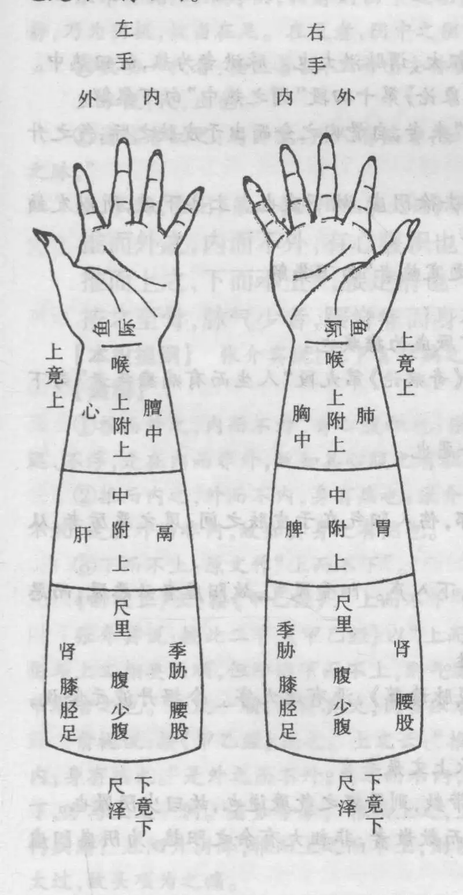

**〔卷五〕**

脉要精微论第十七

平人气象论第十八

# 脉要精微论第十七①

①**脉要精微论第十七**：《新校正》云：按全元起本在第六卷。

**伯坚按：**本篇第十八、第十九、第二十、第二十一，凡四段，据《新校正》说，全元起本在《汤液篇》（见本篇第十八段“帝曰”句下集解）。

**伯坚按：**本篇和《甲乙经》《黄帝内经太素》《类经》三书的篇目对照，列表于下：

| 素问 | 甲乙经 | 黄帝内经太素 | 类经 |
|---|---|---|---|
| 脉要精微论第十七 | 卷一——五色第十五 卷四——经脉第一中 卷四——经脉第一下 卷六——寿夭形诊病候耐痛不耐痛大论第十一 卷八——五藏传病发寒热第一上 卷十一——阳厥大惊发狂痫第二 卷十一——足太阳厥脉病发溏泄下痢第五 卷十一——五气溢发消渴黄瘅第六 卷十一——寒气客于经络之中发痈疽风成发厉浸淫第九下 | 卷十四——四时诊脉篇 卷十五——五藏脉诊篇 卷二十六——痈疽篇 | 卷五——诊法常以平旦（脉色类一） 卷五——部位（脉色类二） 卷五——脉合四时阴阳规矩（脉色类九·一） 卷五——脉合四时阴阳规矩（脉色类九·二） 卷六——搏坚软散为病不同（脉色类二十） 卷六——诸脉证脉法（脉色类二十一·一） 卷六——诸脉证脉法（脉色类二十一·二） 卷六——关格（脉色类二十二·二） 卷六——精明五色（脉色类三十） 卷六——新病久病毁伤脉色（脉色类三十六） 卷十七——病成而变（疾病类七十七） 卷十八——梦寐（疾病类八十五·二） 卷十八——风寒痈肿（疾病类八十七） 卷十八——失守失强者死（疾病类九十一） |

〔p.240 (인쇄 223)〕

**【释题】** 切脉的方法是非常精细微妙的，本篇讲切脉的要义，所以叫作《脉要精微论》。马莳说：“此篇论诊脉之要，至精至微，故名篇。”

**【提要】** 本篇用黄帝、岐伯问答的形式，主要讲切脉的诊断学。所讲的脉象，有长短、迟数、大小、坚软、虚实、浮沉、滑涩各种不同，这都是手指可以分别得出的，没有什么玄虚的话。这样细致地观察脉象，是世界医学文献中最早的了。

> 黄帝问曰：诊法何如①？
>
> 岐伯对曰：诊法常以平旦②，阴气未动，阳气未散③，饮食未进，经脉④未盛，络脉⑤调匀，气血未乱⑥，故乃可诊有过之脉⑦。

**【本段提纲】** 马莳说：此以诊脉之时候言之也。

**【集解】**

①**诊法何如**：张介宾说：诊，视也，察也，候脉也。凡切脉、望色、审问病因，皆可言诊，而此节以诊脉为言。

诊法，参阅《素问》第十六《诊要经终论》第一段“诊要何如”句下集解。

②**平旦**：张介宾说：平旦者，阴阳之交也。阳主昼，阴主夜。阳主表，阴主里。凡人身营卫之气，一昼一夜五十周于身，昼则行于阳分，夜则行于阴分，迨至平旦，复皆会于寸口。故《难经》曰：“寸口者，脉之大会，五藏六府之所终始也。”《营卫生会篇》曰：“平旦，阴尽而阳受气矣。日中而阳陇，日西而阳衰，日入阳尽而阴受气矣。”《口问篇》曰：“阳气尽阴气盛则目瞑。阴气尽而阳气盛则寤矣。”故诊法当于平旦初寤之时。

平旦，参阅《素问》第四《金匮真言论》第三段“平旦至日中”句下集解。

③**阴气未动，阳气未散**：汪机说：平旦未劳于事，是以阴气未扰动，阳气未耗散。（《读素问钞脉候篇》）

④**经脉**：参阅《素问》第五《阴阳应象大论》第十段“端络经脉”句下集解。

⑤**络脉**：《灵枢》第十七《脉度篇》：经脉为里，支而横者为络，络之别者为孙。

⑥**阴气未动，阳气未散，饮食未进，经脉未盛，络脉调匀，气血未乱**：吴崑说：未动，静也。未散，敛也。未盛，平也。调匀，和也。未乱，治也。

⑦**有过之脉**：马莳说：人之有病，如事之有过误，故曰有过之脉。

过，参阅《素问》第五《阴阳应象大论》第二十二段“见微得过”句下集解。

> 切脉动静①而视精明②，察五色，观五藏有余不足、六府强弱、形之盛衰，以此参伍③决死生之分。

**【本段提纲】** 马莳说：此以诊脉之要诀言之也。

**【集解】**

①**切脉动静**：王冰说：切，谓以指切近于脉也。

张介宾说：切者，以指按索之谓。切脉之动静，诊阴阳也。

丹波元简说：望、闻、问三者，临病人乃可知焉，惟脉非切近其体肤不能诊之，故谓之切脉。王以切近解之，为是。杨玄操《难经注》：“切，按也。”（**伯坚按：**杨玄操此注，见王九思《难经集注》卷四《第六十一难》。）

②**精明**：马莳说：精明者，指神气也。《移精变气论》有“得神者昌”，《汤液醪醴论》有“神去之而病不愈”，《玉版论》有“神转不回”，则神气精明，不俟于昏沉者，最为诊法之要耳。孟子曰：

〔p.241 (인쇄 224)〕

“存乎人者莫良于眸子，胸中正则眸子了焉”者是也。

吴崑说：精明，目中眸子，精神也。

喜多村直宽说：陈无择《三因方》：“经中所谓视精明者，盖五藏精明聚于目，精全则目明，神定则视审。审视不了，则精明败矣。”

③**参伍**：张介宾说：参伍之义，以三相较谓之参，以伍相类谓之伍，盖彼此反观，异同互证，而必欲搜其隐微之谓，如《易》曰：“参伍改变，错综其数，通其变遂成天地之文，极其数遂定天下之象，非天下之至变，其孰能与于此”，即此谓也（丹波元简说：出《系辞》上）。

丹波元简说：按《荀子》曰：“窥敌制胜，欲伍以参。”又曰：“参伍明谨施赏刑。”杨倞注云：“参伍，犹错杂也。”（**伯坚按：**“窥敌制胜，欲伍以参”，见《荀子·议兵篇》。“参伍明谨施赏刑”，见《荀子·成相篇》。）

丹波元坚说：先兄曰：“参伍二字，《朱子文集》详释之。”（**伯坚按：**见《朱文公文集》卷六十七《参伍以变错综其数说》。）

喜多村直宽说：《三部九候论》：“形气相得者生。参伍不调者病。”王注：“参，谓参校，伍，谓类伍，参校类伍而有不调也。”《说文》：“三人相杂谓之参。五人相杂谓之伍。”（**伯坚按：**见《说文解字系传》伍字下徐锴说。）

> 夫脉者，血之府也①。长则气治②。短则气病③。数则烦心④。大则病进⑤。上盛则气鬲⑥。下盛则气胀⑦。代则气衰⑧。细则气少⑨。涩则心痛⑩。浑浑⑪革⑫至如涌泉⑬，病进而色弊⑭。绵绵其去如弦绝⑮，死⑯。

**【本段提纲】** 马莳说：此以诊脉之脉体言之也。

**【集解】**

①**血之府也**：王冰说：府，聚也，言血之多少皆聚见于经脉之中也。故《刺志论》曰：“脉实血实，脉虚血虚，此其常也，反此者病”，由是故也。

李中梓说：营行脉中，故为血府。然行是血者，是气为之司也。《逆顺篇》曰：“脉之盛衰者，所以候血气之虚实。”则知此举一血而气在其中，即下文气治气病，义益见矣。（《内经知要·脉诊篇》）

②**长则气治**：王冰说：长脉者，往来长。夫脉长为气和，故治。

马莳说：脉长则气治，以气足故应手而长。

③**短则气病**：王冰说：短脉者，往来短。短为不足，故病。

马莳说：脉短则气病，以气滞故应手而短。

④**数则烦心**：王冰说：数脉者，往来急速。数急为热，故烦心。

⑤**大则病进**：王冰说：大脉者，往来满大。大为邪盛，故病进也。

⑥**上盛则气鬲**：原文作“上盛则气高”。

《新校正》云：按全元起本，“高”作“鬲”。

丹波元简说：此言上下者，指上部下部之诸脉，详见《三部九候论》。“气高”，全本作“气鬲”。《史记·仓公传》：“气鬲病，使人烦懑，食不下，时呕沫。”

**伯坚按：**今据《新校正》引全元起本校改。

鬲，参阅《素问》第七《阴阳别论》第七段“其传为隔”句下集解。

⑦**下盛则气胀**：张介宾说：下盛者，邪滞于下，故腹为胀满。

⑧**代则气衰**：王冰说：代脉者，动而中止，不能自还。

〔p.242 (인쇄 225)〕

马莳说：脉来中止，不能自还者为代，代则正气已衰，故不能自还也。犹人负重以至中途，而力乏不前，欲求代于人者耳。

张介宾说：脉多变更不常者曰代，气虚无主也。

丹波元简说：按马《注》仍王义，而申明《伤寒论》《脉经》之旨者。《史记·仓公列传》云：“不平而代。”又云：“代者，时参击，乍躁乍大也。”张守节《正义》云：“动不定曰代。”此可确张说也。代脉有三义，见张氏《脉神章》。

张琦说：代为藏气衰败。

**伯坚按：**张介宾《景岳全书》卷四《脉神章》上《内经·脉义·胃气篇》说：“详代脉之义，本以更代为言。如《宣明五气篇》曰：‘脾脉代者，’谓胃气随时而更，此四时之代也。《根结篇》曰：‘五十动而不一代’者，谓五藏受气之盛衰，此至数之代也。本篇曰：‘但代无胃曰死’者，谓代无真藏不死也。由此观之，则凡见忽大忽小，乍迟乍数，倏而变更不常者，均谓之代。自王叔和云：‘代脉来，数中止不能自还，脉代者死’，自是以此相传，遂失代之真义。”

⑨**细则气少**：王冰说：细脉者，动如莠蓬。

《新校正》云：按《太素》，“细”作“滑”（**伯坚按：**此是《太素》佚文，今存残本《黄帝内经太素》没有这一段文字。）

马莳说：脉来细细如丝者曰细，细则正气已少，故脉息细微也。

⑩**涩则心痛**：王冰说：涩脉者，往来时不利而蹇涩也。

马莳说：脉来如刀刮竹（丹波元简说：出虞庶。），而往来甚难者曰涩。涩则心血不足而有时作痛也。

张介宾说：涩为血少气滞，故为心痛。

⑪**浑浑**：王冰说：浑浑，言脉气浊乱也。

丹波元简说：《文选·七发》注：“浑浑，波相随貌。”

丹波元坚说：先兄曰：“《山海经》：‘东望泑泽，河水所潜也，其源浑浑泡泡。’注：‘水喷涌之声也。’”

⑫**革**：王冰说：革至者，谓脉来弦而大，实而长也。

丹波元简说：革，《集韵》：“音殛，急也。”《礼·檀弓》：“夫子之病革矣。”

⑬**至如涌泉**：王冰说：如涌泉者，言脉汩汩但出而不返也。

吴崑说：涌泉，如泉之始出，涌涌而至也。

⑭**病进而色弊**：王冰说：若病候日进，而色弊恶，如此之脉，皆必死也。

⑮**绵绵其去如弦绝**：王冰说：绵绵，言微微似有而不甚应手也。如弦绝者，言脉卒断如弦之绝去也。

张介宾说：绵绵如写漆，（丹波元简说：出《辨脉篇》。）及如弓弦之断绝者，皆真气已竭，故死。

丹波元简说：《诗·大雅疏》：“绵绵，微细之辞。”

⑯**浑浑革至如涌泉，病进而色弊。绵绵其去如弦绝，死**：《新校正》云：按《甲乙经》及《脉经》，作“浑浑革革，至如涌泉，病进而危。弊弊绰绰，其去如弦绝者，死。”（**伯坚按：**此段见《甲乙经》卷四《经脉》第一中。今本《甲乙经》作“浑浑革革，至如涌泉，病进而色弊之绰绰其去如弦绝者死。”此段又见《脉经》卷一《迟疾短长杂病法》第十三，文与《新校正》所引相同。）

俞樾说：按王本有夺误，当依《甲乙经》及《脉经》订正。惟病进而色，义不可通，色乃绝之坏字，言待其病进而后绝也。至如涌泉者，一时未即死，病进而后绝。去如绝弦，则即死矣。两者不同，故分别言之。

〔p.243 (인쇄 226)〕

> 夫精明、五色者，气之华也①。赤欲如白裹朱②，不欲如赭③。白欲如鹅羽，不欲如盐④。青欲如苍璧之泽，不欲如蓝⑤。黄欲如罗裹雄黄，不欲如黄土⑥。黑欲如重漆色，不欲如地苍⑦。五色精微象见矣，其寿不久也⑧。夫精明者，所以视万物，别白黑，审短长。以长为短，以白为黑，如是则精衰矣⑨。

**【本段提纲】** 马莳说：此节复以精明五色之义申之也。

**伯坚按：**《素问》第十《五藏生成篇》有类似的一段文字，说：“故色见青如草兹者死，黄如枳实者死，黑如炲者死，赤如衃血者死，白如枯骨者死，此五色之见死也。青如翠羽者生，赤如鸡冠者生，黄如蟹腹者生，白如豕膏者生，黑如乌羽者生，此五色之见生也。”

**【集解】**

①**夫精明、五色者，气之华也**：吴崑说：精明见于目，五色显于面，皆为气之光华，宜察视也。

俞樾说：精明、五色，本是二事。精明以目言。五色以颜色言。盖人之目与颜色，皆足以决人之生死。下文曰：“赤欲如白裹朱，不欲如赭。白欲如鹅羽，不欲如盐。青欲如苍璧之泽，不欲如蓝。黄欲如罗裹雄黄，不欲如黄土。黑欲如重漆色，不欲如地苍。五色精微象见矣，其寿不久也。”此承五色言之，以人之颜色决生死也。又曰：“夫精明者，所以视万物，别白黑，审短长。以长为短，以白为黑，如是则精衰矣。”此承精明言之，以人之目决生死也。

②**赤欲如白裹朱**：马莳说：“白”当作“帛”。

张介宾说：白裹朱，隐然红润而不露也。

丹波元简说：宋本《脉经》，“白”作“帛”。（**伯坚按：**见《脉经》卷五《扁鹊华佗察声色要诀》第四。《四部丛刊》影印元广勤书堂本，“白”也作“帛”。）

喜多村直宽说：《圣惠方》，“白”作“帛”。《说文》“帛，缯也。从巾，白声。”

孙诒让说：案白与帛通，谓白色之帛也，亦谓之缟。《五藏生成篇》云：“生于心，如以缟裹朱。生于肺，如以缟裹红。生于肝，如以缟裹绀。生于脾，如以缟裹栝楼实。生于肾，如以缟裹紫。”注云：“缟，白色。”此下文云：“黄欲如罗裹雄黄。”凡言裹者，皆谓缯帛之属。

田晋蕃说：按白，帛同。钱氏站《十经文字通正书》云：“《玉藻》：‘大帛不绥。’注：‘帛当为白。’是帛与白通。”赤欲如白裹朱，犹下文黄欲如罗裹雄黄也。《诗·六月》“白旆”，《正义》作“帛筏”。

③**不欲如赭**：吴崑说：五色华泽者生。五色枯败者死。

张介宾说：赭，代赭也，色赤而紫。

丹波元简说：《说文》：“赭，赤土也。”

④**白欲如鹅羽，不欲如盐**：《新校正》云：按《甲乙经》作“白欲如白璧之泽，不欲如垩”。《太素》而出之。（**伯坚按：**此段见《甲乙经》卷一《五色》第十五。今本《甲乙经》作“白欲如白璧之泽，不欲如垩也”。《新校正》所引《太素》是佚文，今存残本《黄帝内经太素》没有这一段文字。）

张介宾说：鹅羽白而明。盐色白而暗。

⑤**青欲如苍璧之泽，不欲如蓝**：张介宾说：苍璧之泽，青而明润。蓝色虽青而沉晦。

丹波元简说：《白虎通》：“璧者，外圆象天，内方象地。”《尔雅》：“肉倍好谓之璧。”

丹波元坚说：先兄曰：“《周礼·大宗伯》：‘听以苍璧礼天。’”

⑥**黄欲如罗裹雄黄，不欲如黄土**：张介宾说：罗裹雄黄，光泽而隐。黄土之色，沉滞无神。

⑦**黑欲如重漆色，不欲如地苍**：《新校正》云：按《甲乙经》作“炭色”。（**伯坚按：**今本《甲乙经》作“黑欲如重漆色，不欲如炭也”。）

〔p.244 (인쇄 227)〕

张介宾说：重漆之色，光彩而润。地之苍黑，枯暗如尘。

喜多村直宽说：地苍，按此亦似指物而言，姑存疑。

田晋蕃说：按“不欲如地”，即《脉解篇》“面黑如地色”之义也。“不欲如炭”，即《五藏生成篇》“黑如炲”之义也。惟地苍未详。《山海经》五部注：“苍玉依黑石而生。”

⑧**五色精微象见矣，其寿不久也**：王冰说：赭色、盐色、蓝色、黄土色、地苍色见者，皆精微之败象，故其寿不久。

⑨**夫精明者，所以视万物，别白黑，审短长。以长为短，以白为黑，如是则精衰矣**：吴崑说：言目之精明，所以视万物、别白黑、审长短。若视长为短，视白为黑，则失其精明之体，是精气内衰也。

> 五藏者，中之守也①。中盛②、藏满③、气胜④、伤恐者⑤，声如从室中言⑥，是中气之湿也⑦。言而微，终日乃复言者⑧，此夺气也⑨。衣被不敛，言语善恶不避亲疏者，此神明之乱也⑩。仓廪不藏者⑪，是门户不要也⑫。水泉不止者，是膀胱不藏也⑬。得守者生，失守者死⑭。

**【本段提纲】** 马莳说：此言五藏为身之守，而失守则死也。

**【集解】**

①**五藏者，中之守也**：《新校正》云：按《甲乙经》及《太素》，“守”作“府”。（**伯坚按：**此段见《甲乙经》卷六《寿夭形诊病候耐痛不耐痛大论》第十一，作“凡五藏者，中之府”。《新校正》所引《太素》是佚文，今存残本《黄帝内经太素》没有这一段文字。）

张介宾说：五藏者，各有所藏，藏而勿失，则精神完固，故为中之守也。

②**中盛**：王冰说：中，谓腹中。盛，谓气盛。

③**中盛、藏满**：张介宾说：中，胸腹也。藏，藏府也。盛、满，胀急也。

④**气胜**：王冰说：气胜，谓胜于呼吸而喘息变易也。

张介宾说：气胜，喘息也。

⑤**伤恐者**：吴崑说：伤，悲伤。恐，惊也。伤为肺志，恐为肾志，盖肺气不利则悲，湿土刑肾则恐也。

⑥**声如从室中言**：吴崑说：声如从室中言，吐气难而声不显也。

张介宾说：声如从室中言，混浊不清也。

⑦**是中气之湿也**：王冰说：皆腹中有湿气乃尔也。

张介宾说：是皆水气上逆之候，故为中气之湿证，此脾、肺、肾三藏之失守也。

⑧**终日乃复言者**：田晋蕃说：王氏念孙《读书杂志》：“谓良久乃复言也。良久谓之终日，犹常久谓之终古。”

⑨**言而微，终日乃复言者，此夺气也**：吴崑说：言语轻微，难于接续，俟之终日，乃能复言，惟夺于气如此。

张介宾说：气虚之甚，故声不接续，肺藏失守也。

夺，脱也，参阅《素问》第二《四气调神大论》第四段“使气亟夺”句下集解。

⑩**衣被不敛，言语善恶不避亲疏者，此神明之乱也**：马莳说：衣被不敛束，言语善恶不避亲疏者，此乃神明之乱也。盖心为君主之官，神明出焉，非神明之乱必不至是矣。心藏失守。

〔p.245 (인쇄 228)〕

⑪**仓禀不藏者**：王冰说：仓廪，谓脾胃。《灵兰秘典论》曰；“脾胃者，仓廪之官也。”

吴崑说：仓廪，脾胃也。不藏，传送太速也。

⑫**是门户不要也**：王冰说：门户，谓魄门。《五藏别论》曰：“魄门亦为五藏使，水谷不得久藏也。”魄门，则肛门也。要，谓禁要。

张介宾说：要，约束也。幽门、阑门、魄门，皆仓廪之门户，门户不能固，则肠胃不能藏，所以泄利不禁。脾藏之失守也。

⑬**是膀胱不藏也**：王冰说：水泉，谓前阴之流注也。

张介宾说：膀胱与肾为表里，所以藏津液，水泉不止而遗溲失禁，肾藏之失守也。

⑭**得守者生，失守者死**：张介宾说：五藏得守，则无以上诸病，故生。失守，则神去而死矣。

> 夫五府者①，身之强也②。头者精明之府③，头倾、视深④，精神将夺矣⑤。背者胸中之府⑥，背曲、肩随⑦，府将坏矣。腰者肾之府⑧，转摇不能，肾将惫矣⑨。膝者筋之府⑩，屈伸不能，行则偻⑪附⑫，筋将惫矣。骨者髓之府⑬，不能久立，行则振掉⑭，骨将惫矣。得强则生，失强则死⑮。

**【本段提纲】** 张介宾说：此下言形气之不守，而内应乎五藏也。

**【集解】**

①**夫五府者**：原文作“夫五藏者”。

吴崑注本作“五府者”。

高世栻说：所谓观六府强弱、形之盛衰者，以在外之形身论之，则头背腰膝骨皆谓之府。

张琦说：“藏”，当作“府”。申上六府强弱、形之盛衰之义。此府五而前文云六，误也。

**伯坚按：**今据吴崑本和张琦说校改。

②**身之强也**：吴崑说：下文所言五府者，乃人身恃之以强健。

③**头者精明之府**：张介宾说：五藏六府之精气皆上升于头，以成七窍之用，故头为精明之府。

高世栻说：人身精气，上会于头，神明上出于目，故头者精明之府。

④**头倾、视深**：张介宾说：头倾者，低垂不能举也。视深者，目陷无光也。

⑤**头倾、视深，精神将夺矣**：吴崑说：夺，失也。

高世栻说：若头倾视深，则精气神明不上行于头，而精神将夺矣。

⑥**背者胸中之府**：高世栻说：胸在内，背在外，故背者胸中之府。

⑦**肩随**：丹波元简说：“肩随”，楼氏《纲目》作“肩垂”。

**伯坚按：**《黄帝内经太素》卷十四《真藏脉形篇》“肩随内消”句下杨上善注说：“两肩垂下曰随。”

⑧**腰者肾之府**：张志聪说：两肾在于腰内，故腰为肾之外府。

⑨**腰者肾之府，转摇不能，肾将惫矣**：吴崑说：惫与败同，坏也。

高世栻说：肾居腰内，故腰者肾之府，若转摇不能，则腰骨空虚，而肾将惫矣。

⑩**膝者筋之府**：张介宾说：筋虽主于肝，而筋络关节以立此身者，惟膝腘之筋为最，故膝为筋之府。

⑪**偻**：吴崑说：偻，曲其身也。

偻，参阅《素问》第三《生气通天论》第五段“乃生大偻”，句下集解。

⑫**附**：《新校正》云：按别本，“附”一作“俯”。

丹波元简说：《左传》昭七年：“正考父一命而偻，再命而伛，三命而俯。”杜注：“俯共于伛，伛共于偻。”又府同。《说文》：“府，俯病也。”《广雅》：“府，短也。”

〔p.246 (인쇄 229)〕

张琦说：附，俯同。

余岩《古代疾病名候疏义》第一二二页：《说文》：“府，俯病也。从疒，付声。”徐锴《系传》云：“《尔雅》注：‘戚施之疾，俯而不能仰也。’”桂馥《义证》云：“释木：‘瘣木，苻娄。’樊光云：‘苻娄，尪伛。’馥谓苻娄即府偻。”盖即今之脊椎后湾也，亦名龟背。

⑬**骨者髓之府**：张介宾说：髓充于骨，故骨为髓之府。

⑭**振掉**：吴崑说：振，动也。掉，摇也。

⑮**得强则生，失强则死**：高世栻说：此六府强弱，属于形之盛衰，故以头背腰膝骨为府。得强，则形身之府气盛，故生。失强，则形身之府气衰，故死。此观六府强弱，形之盛衰之法也。

> 岐伯曰①：反四时者，有余为精②，不足为消③。应太过，不足为精④；应不足，有余为消⑤；阴阳不相应，病名曰关格⑥。

**【本段提纲】** 张介宾说：此言四时阴阳脉之相反者，亦为关格也。

**【集解】**

①**岐伯曰**：《新校正》云：详此“岐伯曰”前无问。

②**有余为精**：高世栻说：精，精强也。

俞樾说：精之言甚也。《吕氏春秋·勿躬篇》：“自蔽之精者也。”《至忠篇》：“乃自伐之精者。”高诱《注》并训精为甚。有余为精，言诸有余者皆为过甚耳。

③**不足为消**：高世栻说：消，消弱也。

张介宾说：《禁服篇》曰：“春夏人迎微大，秋冬寸口微大，如是者命曰平人。”以人迎为阳脉而主春夏，寸口为阴脉而主秋冬也。若其反者，春夏气口当不足而反有余，秋冬人迎当不足而反有余，此邪气之有余，有余者反为精也。春夏人迎当有余而反不足，秋冬寸口当有余而反不足，此血气之不足，不足者日为消也。

④**应太过，不足为精**：张介宾说：如春夏人迎应太过，而寸口之应不足者反有余而为精；秋冬寸口应太过，而人迎之应不足者反有余而为精；是不足者为精也。

⑤**应不足，有余为消**：张介宾说：春夏寸口应不足，而人迎应有余者反不足而为消；秋冬人迎应不足，而寸口应有余者反不足而为消；是有余者为消也。

⑥**岐伯曰**：反四时者，有余为精，不足为消。应太过，不足为精；应不足，有余为消；阴阳不相应，病名曰关格：马莳说：春夏人迎应太过也，今春夏而使气口为精；秋冬气口应太过也，今秋冬而使人迎为精；是使不足者反为精也。春夏气口应不足也，今春夏而使人迎为消；秋冬人迎应不足也，今秋冬而使气口为消；是使有余者反为消也，乃阴经阳经各不相应，病名曰关格。《灵枢》终始、经脉、五色、禁服、四时气等篇之论关格，而皆指之为死不治者，宜也。大义具见第一卷《六节藏象论》末节中。

张介宾说：应不足而有余者，邪之日盛。应有余而不足者，正必日消。若此者是为阴阳相反，气不相营者，皆名关格。

丹波元简说：按此一项三十九字，与前后文不相顺承，疑是它篇错简。

张琦说：此他经脱文，不可强解。

张文虎说：按此三十九字突出，与上下文不接。下《玉机真藏论篇》论脉反四时，帝既拜稽首著之玉版，其文已毕。下“五藏受气”云云，仍岐伯之言，而上无“岐伯曰”三字，疑此文即彼篇错简。

〔p.247 (인쇄 230)〕

**伯坚按：**此段见《甲乙经》卷六《寿夭形诊病候耐痛不耐痛大论》第十一。现存残本《黄帝内经·太素》没有这一段文字。

关格，参阅《素问》第九《六节藏象论》第四段“人迎与寸口俱盛四倍已上为关格”句下集解。

> 帝曰：脉其四时动奈何①？知病之所在奈何？知病之所变奈何？知病乍在内奈何？知病乍在外奈何？请问此五者可得闻乎②？
>
> 岐伯曰③：请言其与天运转大也④。万物之外，六合之内⑤，天地之变，阴阳之应⑥，彼春之暖为夏之暑⑦，彼秋之忿为冬之怒⑧，四变之动，脉与之上下⑨。以春应中规，夏应中矩，秋应中衡，冬应中权⑩。是故冬至四十五日，阳气微上，阴气微下⑪。夏至四十五日，阴气微上，阳气微下⑫。阴阳有时，与脉为期⑬。期而相失⑭，知脉所分⑮。分之有期，故知死时⑯。微妙在脉，不可不察⑰。察之有纪，从阴阳始⑱。始之有经⑲，从五行生⑳。生之有度，四时为数㉑。循数勿失㉒，与天地如一㉓。得一之情㉔，以知死生㉕。是故声合五音，色合五行，脉合阴阳㉖。

**【本段提纲】** 马莳说：此帝欲以脉知五者，伯言当法天之四时、阴阳、五行而已。

**【集解】**

①**脉其四时动奈何**：丹波元坚说：《甲乙经》无“其”字。

顾观光说：《甲乙经》，“其”作“有”。

**伯坚按：**此段见《甲乙经》卷四《经脉》第一下，作“脉有四时动奈何”。

②**请问此五者可得闻乎**：张志聪说：以上论切脉气，察精明，听声音，审藏府之有余不足，观形体之盛衰，参伍错综，以决死生之分。此以下复论脉合阴阳四时，诊脉而知病之所在，病成而变为他病，候尺寸以分别藏府之外内上下左右，曲尽其脉要精微之理，故复设此问焉。

③**岐伯曰**：《新校正》云：详此对与问不甚相应。脉四时动、病之所在、病之所变，按文颇对。病在内在外之说，后文殊不相当。

④**请言其与天运转大也**：杨上善说：人身合天，故请言人身与天合气转运之道也。

高世栻说：人之阴阳升降，如天运之环转广大，故曰请言其与天运转大也。

⑤**万物之外，六合之内**：王冰说：六合，谓四方上下也。

张介宾说：物在天中，天包物外，天地万物，本同一气。

丹波元坚说：先兄曰：“物在天中，天包物外，盖万物之外，六合之内，犹言天地间也。”

⑥**天地之变，阴阳之应**：高世栻说：天施地生，则有天地之变。人之阴阳，应乎天地，则有阴阳之应。

⑦**彼春之暖为夏之暑**：杨上善说：春夏者，阴气终始也。春之三月，阳气之始，气和日暖。夏之三月，阳盛暑热，乃是春暖增长为之也。

王冰说：春暖为夏暑，言阳生而至盛。

《新校正》云：按全元起注本，“暖”作“缓”。

张介宾说：春之暖者，为夏暑之渐也。

⑧**彼秋之忿为冬之怒**：“彼秋之忿”，《黄帝内经·太素》作“彼秋之急”。

杨上善说：秋冬者，阴气终始也。秋之三月，阴气之始，风高气切，故名为急。冬之三月，阴气严烈，乃是秋凉增长为之也。

王冰说：秋忿为冬怒，言阴少而之壮也。“忿”为“急”，言秋气劲急也。

〔p.248 (인쇄 231)〕

马莳说：按彼春之暖四句，又见《至真要大论》。张仲景《伤寒论》引之。（**伯坚按：**见《伤寒论》卷二《伤寒例》。）

张介宾说：秋之忿者，为冬怒之渐也。

田晋蕃说：按《医心方》卷十三《札记》云：“忿即急字。俗急作怠，再讹作忿也。”

⑨**四变之动，脉与之上下**：杨上善说：暖暑急怒，是天之运。四气变动，人之经脉与彼四气上下变动亦不异也。春夏之脉，人迎大于寸口，故为上也；寸口小于人迎，故为下也。秋冬之脉，寸口大于人迎，故为上也；人迎小于寸口，故为下也。

马莳说：盖四时有变，而吾人之脉，特随之而上下耳。上下者，浮沉也。

张介宾说：春生、夏长、秋收、冬藏，是即阴阳四变之动，而脉亦随之以上下也。

⑩**春应中规，夏应中矩，秋应中衡，冬应中权**：《汉书·魏相传》：东方之神太昊，乘震，执规，司春。南方之神炎帝，乘离，执衡，司夏。西方之神少昊，乘兑，执矩，司秋。北方之神颛顼，乘坎，执权，司冬。

丹波元简说：按《淮南·时则训》云：“制度阴阳，大制有六度，天为绳，地为准，春为规，夏为衡，秋为矩，冬为权。”虽与此章有不同者，而以规矩衡权配四时，当时已有其说，不唯医经也。

**伯坚按：**规矩权衡，是说脉象的弦钩毛石，现在列表于下，以期明显：

<table>
<thead>
<tr>
<th rowspan="2"></th>
<th rowspan="2">四时</th>
<th colspan="2">脉象</th>
<th rowspan="2">脉要精微论王冰注</th>
</tr>
<tr>
<th>平人气象论</th>
<th>玉机真藏论</th>
</tr>
</thead>
<tbody>
<tr>
<td>规</td>
<td>春</td>
<td>弦</td>
<td>弦</td>
<td>春脉软弱，轻虚而滑，如规之象。中外皆然，故以春应中规</td>
</tr>
<tr>
<td>矩</td>
<td>夏</td>
<td>钩</td>
<td>钩</td>
<td>夏脉洪大，兼之滑数，如矩之象。可正平之，故以夏应中矩</td>
</tr>
<tr>
<td>衡</td>
<td>秋</td>
<td>毛</td>
<td>浮</td>
<td>秋脉浮毛，轻涩而散，如称衡之象。高下必平，故以秋应中衡</td>
</tr>
<tr>
<td>权</td>
<td>冬</td>
<td>石</td>
<td>营</td>
<td>冬脉如石，兼沉而滑，如称权之象。下远于衡，故以冬应中权也</td>
</tr>
</tbody>
</table>

权衡，参阅《素问》第十四《汤液醪醴论》第五段“平治于权衡”和第十五《玉版论要篇》第二段“治在权衡相夺”句下集解。

⑪**冬至四十五日，阳气微上，阴气微下**：马莳说：冬至四十五日以后，乃小寒大寒以至立春也，阳气渐上，阴气渐下。惟阳气渐上，故在春为暖而渐至于暑。

⑫**夏至四十五日，阴气微上，阳气微下**：马莳说：夏至四十五日以后，乃小暑大暑以至立秋也，阴气渐上，阳气渐下。惟阳气渐下，故在秋为忿，而渐至于冬则为怒。

⑬**与脉为期**：王冰说：察阴阳升降之准，则知经脉递迁之象。

吴崑说：与脉为期，谓春规、夏矩、秋衡、冬权相期而至也。

张介宾说：与脉为期者，脉随时而变迁也。

⑭**期而相失**：吴崑说：期而相失，谓规矩权衡不合于春夏秋冬也。

高世栻说：阴阳上下有时，即与人生之脉为期。至期而不上下。是期而相失也。

⑮**知脉所分**：马莳说：期有不同，知脉有四时之分。

〔p.249 (인쇄 232)〕

高世栻说：分别其阳气不上，阴气不上，是知脉有所分也。

⑯**分之有期，故知死时**：张介宾说：分之有期者，谓衰王各有其时也，知此者，则知死生之时矣。

高世栻说：阳气不上，死于春。阴气不上，死于秋。是分之有期，故知死时也。

⑰**微妙在脉，不可不察**：江有诰《先秦韵读》：微妙在脉，不可不察。（支祭合韵）

⑱**察之有纪，从阴阳始**：张志聪说：纪，纲也。察脉之纲领皆从阴阳始，即冬至阳气微上，夏至阴气微上，阴阳上下，自有经常之理。

丹波元坚说：“纪”“始”押韵，即见《五藏生成篇》。（**伯坚按：**《素问》第十《五藏生成篇》第十段：“诊病之始，五决为纪。”）

江有诰《先秦韵读》：察之有纪，从阴阳始。（之部）

⑲**经**：张介宾说：经，经常也。

⑳**从五行生**：吴崑说：始之又有经常之道，阴中有五行，阳中亦有五行，是脉从五行生也。

江有诰《先秦韵读》：始之有经，从五行生。（耕部）

㉑**生之有度，四时为数**：原文作“四时为宜”。

《新校正》云：按《太素》，“宜”作“数”。

吴崑说：木生于春，火生于夏，金生于秋，水生于冬，土生于四季，是脉生有其节度，与四时为宜，不得过差也。

丹波元坚说：“宜”字当从《太素》作“数”。盖此段“分之有期”以下十四句，每二句押以同韵，“度”与“宜”其韵不通，“度”与“数”其部则一（《广韵》，“宜”在上平五支，“度”在去声十二暮，“数”在上声九麌。段玉裁《六书音均表》，暮麌并在古音第五部）。仍知《太素》为是。盖四时为数者，言从五行衰王而为准度者，必就四时为计数。

俞樾说：《新校正》云：“《太素》，‘宜’作‘数’。”樾谨按作“数”者是也。度与数为韵。

**伯坚按：**此段见《黄帝内经太素》卷十四《四时诊脉篇》，作“生之有度，四时为数”。今据丹波元坚、俞樾说，依《太素》校改。

江有诰《先秦韵读》：生之有度（平声），四时为宜。（鱼歌通韵）

㉒**循数勿失**：原文作“补泻勿失”。

丹波元坚说：“补泻勿失”，《太素》作“循数勿失”。坚按《太素》为是。盖此段隔句每取句末一字以为次句起语，上云为数，故承以循数。言人之有脉，循四时之数，不敢违失，犹与天地云为其理如一也。且本节论诊法，不及针药，补泻二字殊无着落，盖知旧文为讹。

**伯坚按：**《太素》卷十四《四时诊脉篇》作“循数勿失”。今据丹波元坚说，依《太素》校改。

㉓**与天地如一**：高世栻说：人身之脉，一如天地，至微至妙。

江有诰《先秦韵读》：补泻勿失，与天地如一。（脂部）

㉔**得一之情**：丹波元坚说：《太素》，“精”作“诚”。

㉕**以知死生**：张介宾说：一之精者，天人一理之精微也。天地之道，阳主乎动，阴主乎静，阳来则生，阳去则死，知天道之所以不息者，则知人之所以死生矣。

丹波元简说：按“始之”以下三十三字，《甲乙》无之。又“是知阴盛则梦”以下七十八字亦同，《新校正》有误置之说。今删此一百字，则文意贯通，似《甲乙》为正（**伯坚按：**本段见《甲乙经》卷四《经脉》第一下，没有这三十三字）。

丹波元坚说：坚按“始之”以下三十三字，疑不必羡文。《庄子·刻意》：“纯素之道，惟神是守。守而勿失，与神为一。一之精通，合于天伦。”句法相似。

〔p.250 (인쇄 233)〕

江有诰《先秦韵读》：得一之精，以知死生。（耕部）

㉖**声合五音，色合五行，脉合阴阳**：王冰说：声表宫、商、角、徵、羽，故合五音。色见青、黄、赤、白、黑，故合五行。脉彰寒暑之休王，故合阴阳之气也。

张介宾说：声音，宫、商、角、徵、羽。色合金、木、水、火、土。脉合四时阴阳。虽三者若乎有分，而理则一也。

> 是知阴盛则梦涉大水恐惧，阳盛则梦大火燔灼，阴阳俱盛则梦相杀毁伤；上盛则梦飞，下盛则梦堕；甚饱则梦予，甚饥则梦取；肝气盛则梦怒，肺气盛则梦哭①。

**【集解】**

①是知阴盛则梦涉大水恐惧，阳盛则梦大火燔灼，阴阳俱盛则梦相杀毁伤；上盛则梦飞，下盛则梦堕；甚饱则梦予，甚饥则梦取，肝气盛则梦怒，肺气盛则梦哭：《灵枢》第四十三《淫邪发梦篇》：阴气盛则梦涉大水而恐惧。阳气盛则梦大火而燔焫。阴阳俱盛则梦相杀。上盛则梦飞。下盛则梦堕。甚饥则梦取。甚饱则梦予。肝气盛则梦怒。肺气盛则梦恐惧哭泣飞扬。心气盛则梦善笑恐畏。脾气盛则梦歌乐身体重不举。肾气盛则梦腰脊两解不属。

《新校正》云：详“是知阴盛则梦涉大水恐惧”至此，乃《灵枢》之文，误置于斯，仍少心、脾、肾气所梦，今具《甲乙经》中。

马莳说：按此篇与《灵枢·淫邪发梦篇》大同，但彼更详耳。《方盛衰论》亦有诸梦。《周官》六梦，《列子·周穆王篇》有阴气壮等梦，大义俱与此同。

**伯坚按：**《甲乙经》卷六《淫邪袭内生梦大论》第八也有这一段文字，但根据它的前后引文，知道《甲乙经》是从《灵枢·淫邪发梦篇》引的，而不是从《素问·脉要精微论》引的。

> 短虫多则梦聚众，长虫多则梦相击毁伤①。

**【集解】**

①**短虫多则梦聚众，长虫多则梦相击毁伤**：《新校正》云：详此二句亦不当出此，应他经脱简文也。

**伯坚按：**这两句是《灵枢·淫邪发梦篇》所没有的。《甲乙经》卷四《经脉》第一下引《脉要精微论》，自“黄帝问曰脉有四时动奈何”，至“此六者持脉之大法也”，当中没有这第九、第十两段文字。今据《新校正》、丹波元简（见前）说，依《甲乙经》删去此两段，共七十七字。

> 是故持脉有道，虚静为保①。春日浮，如鱼之游在波②。夏日在肤，泛泛乎万物有余③。秋日下肤，蛰虫将去④。冬日在骨⑤，蛰虫周密，君子居室⑥。故曰⑦：“知内者按而纪之⑧，知外者终而始之⑨。”此六者，持脉之大法⑩。

**【本段提纲】** 马莳说：此一节言持脉之法，正以答脉有四时之动也。

**【集解】**

①**持脉有道，虚静为保**：《新校正》云：按《甲乙经》，“保”作“宝”。

张介宾说：凡持脉之道，一念精诚，最嫌扰乱，故必虚其心，静其志。

李中梓说：虚者，心空而无杂想也。静者，身静而不喧动也（《内经知要·脉诊篇》）。

丹波元简说：保、葆、宝，古通用。《史记·留侯世家》：“见谷城山下黄石，取而葆祠之。”注：“《史记》珍宝字皆作葆。”《徵四失论》：“从容之葆。”

丹波元坚说：按《灵》《素》中“道”“宝”押韵，不一而足。如“治病之道，气内为宝”（《疏五过论》）；“治数之道，从容之葆”（《徵四失论》）；“持针之道，坚者为宝”（《九针十二原论》）；“营气之道，内谷为宝”（《营气篇》）；“灸刺之道，何者为宝”（《四时气篇》。宝原作定，今从《甲乙》。）；“审知其道，是谓身宝”（《五乱篇》）是也。又诸子间亦见之。如《管子》：“成功之道，赢缩为宝”；《六韬》：“凡谋之道，周密为宝”（《武韬》）；“必出之道，器械为宝”（《虎韬》）；吴子：“夫安国家之道，先戒为宝”（《料敌》）；《韩非子》：“人生之道，静退为宝”（《主道》）；《吕览》：“凡食之道，无饥无饱，是之谓五藏之葆”（《尽数》）；“凡农之道，厚之为宝”（《审时》）；是也。

〔p.251 (인쇄 234)〕

江有诰《先秦韵读》：是故持脉有道，虚静为保。（幽部）

②**春日浮，如鱼之游在波**：王冰说：虽出，犹未全浮。

吴崑说：象春升之气，未尽出于地也。

江有诰《先秦韵读》：春日浮，如鱼之游。（幽部。在波二字衍。）

③**夏日在肤，泛泛乎万物有余**：王冰说：泛泛，平貌。阳气大盛，脉气亦象万物之有余，易取而洪大也。

吴崑说：夏日脉来在肤，泛泛然充满于指，象夏时万物之有余。

丹波元简说：《说文》：“泛，浮也。”通作“汎”。

④**秋日下肤，蛰虫将去**：王冰说：随阳气之渐降，故曰下肤。何以明阳气之渐降，蛰虫将欲藏去也。

吴崑说：秋日阳气下降，故脉来下于肌肤，象蛰虫将去之象也。

丹波元坚说：或曰：“王训藏去者，《汉书·苏武传》：‘去屮实而食之。’师古曰：‘去，谓藏之也。’《三国志·华佗传》：‘何忍无急去药？’裴松之曰：‘古语以藏为去。’是其义也。”此说似是。《说文》：“蛰，藏也。”此盖谓当蛰之虫，将蛰地下也。

田晋蕃说：按“去”通作“弆”，藏也。“弆”本后作，古人藏弆字只用“去”。《晏子春秋》五：“晏子之鲁，朝食进馈，膳有豚焉。晏子曰：‘去其二肩。’”《汉书·陈遵传》：“遵善书，与人尺牍，皆藏去以为荣。”皆作“去”。

江有诰《先秦韵读》：夏日在肤，泛泛乎万物有余。秋日下肤，蛰虫将去。（平声。鱼部。）

⑤**在骨**：王冰说：在骨，言脉深沉也。

⑥**蛰虫周密，君子居室**：王冰说：蛰虫周密，言阳气伏藏，君子居室，此人事也。

吴崑说：冬时阳气潜藏，故脉沉下在于骨分，如蛰虫周密，君子居室之象也。

江有诰《先秦韵读》：冬日在骨，蛰虫周密，君子居室。（脂部）

⑦**故曰**：喜多村直宽说：魏了翁《经外杂抄》：“故曰者，必古有此语。”

⑧**知内者按而纪之**：王冰说：知内者，谓知脉气也，故按而为之纲纪。

张介宾说：内言藏气，藏象有位，故可按可纪之。

丹波元坚说：纪，经纪之谓，犹理也。

⑨**知外者终而始之**：王冰说：知外者，谓知色象，欲以五色终而复始。

张介宾说：外言经气。经脉有序，故可终而始之。

丹波元简说：按《灵枢·终始篇》：“终始者，经脉为纪。”

江有诰《先秦韵读》：知内者按而纪之，知外者终而始之。（之部）

⑩**此六者，持脉之大法**：《新校正》云：详此前，对帝问“脉其四时动奈何”之事。

张介宾说：必知此四时内外六者之法，则脉之时动，病之所在，及病变之或内或外，皆可得而知也，故为持脉之大法。

喜多村直宽说：史载之《脉要精微解》云：“以经意考之，以四时之脉，分表里之浅深，而决之以内外之辨。且以春日浮如鱼之游在波，则阳气之萌，脉虽见而未出于肤。夏日在肤，泛泛乎万物有余，则脉已在肤矣。秋日下肤，蛰虫将去，则秋阴气之至，脉虽下肤而未至于沉。冬日在骨，蛰虫周密，则脉已沉矣。以是知内者按而纪之，以明脉之在里也，如秋日之下肤，冬日之在骨是也。知外者终而始之，以明脉之在表也，如春日之浮，夏日之泛是也。然知内者必曰按而纪之者，盖脉之在内，非深按之无以得其实。知外皆终而始之，则初按而病已见矣，故因其病以推原其本。启玄子乃以知内为知脉，知外为知色，殊非黄帝持脉之大法也。”

〔p.252 (인쇄 235)〕

> 心脉①搏②坚而长③，当病舌卷、不能言。其软而散者④，当消⑤，环⑥自已。

**【本段提纲】** 马莳说：此以下六节，正以答知病所在四句之问，而此一节言心脉有刚柔而病亦以异也。

**【集解】**

①**心脉**：《素问》第二十《三部九候论》：“中部人，手少阴也。人以候心。”王冰注：“谓心脉也。在掌后锐骨之端，神门之分，动应于手也。”

②**搏**：王冰说：搏，谓搏击于手也。

田晋蕃说：《太素》《甲乙经》，“搏”作“揣”，下文同。晋蕃按“搏”为“抟”之误文。唐慧苑《华严经音义》云：“揣字，《正义》作抟，音徒鸾切，从专声，非从耑韵。流俗不能别兹两形，遂谬用揣字。揣，初委切，此乃揣量之字也。”盖唐以前有以揣作抟者，观《太素》《甲乙经》之作揣，知经文本作抟。此之抟坚而长，下云其软而散者，坚与软对，抟与散对也。《灵枢·五色篇》“察其散抟”，亦抟与散相对为文，可据以订正。下文肺、肝、胃、脾、肾五脉，误与此同。《鹏鸟赋》：“何足控抟。”如淳曰：“抟，或作揣。”严可均曰：“是揣抟同声也。”

**伯坚按：**本篇第十二、第十三、第十四、第十五、第十六、第十七，共六段，见《甲乙经》卷四《经脉》第一中，凡“搏”字《甲乙经》都作“揣”字。又见《黄帝内经太素》卷十五《五藏脉诊篇》，凡“搏”字《太素》也都作“揣”字。

③**心脉搏坚而长**：马莳说：心脉搏击于手，而且坚且长。

张介宾说：按搏击之脉，皆肝邪盛也。肝本属木，而何五藏皆畏之？盖五藏皆以胃气为本，脉无胃气则死。凡木强者土必衰，脉搏者胃多败，故坚搏为诸藏所忌。兹心脉搏坚而长者，以心藏之胃气不足而邪有余也。搏之微则邪亦微，搏之甚则几于真藏矣，故当以搏之微甚而察病之浅深。后四藏者仿此。

④**心脉搏坚而长，当病舌卷，不能言。其软而散者**：张介宾说：按本篇五藏脉病，一曰搏坚而长，一曰软而散，而其为病多皆不足，何也？盖搏坚而长者，邪胜乎正，是为邪之所凑，其气必虚也。软而散者，本原不足，是谓正气夺则虚也。一以有邪而致虚，一以无邪本虚，虽若一而病本不同，所当辨也。

⑤**当消**：王冰说：消，谓消散。

吴崑说：病当消去。

⑥**环**：环与还通，旋疾也，参阅《素问》第十六《诊要经终论》第七段“中心者环死”句下孙诒让说。

> 肺脉①搏坚而长，当病唾血。其软而散者，当病灌汗②，至今不复散发也③。

**【本段提纲】** 马莳说：此言肺脉有刚柔而病亦以异也。

**【集解】**

①**肺脉**：《素问》第二十《三部九候论》：“中部天，手太阴也。天以候肺。”王冰注：“谓肺脉也。在掌后寸口中，是谓经渠，动应于手。”

〔p.253 (인쇄 236)〕

②**灌汗**：杨上善说：汗出如灌。

王冰说：灌，谓灌洗，盛暑多为此也。

③**至今不复散发也**：《新校正》云：详下文诸藏各言色，而心肺二藏不言色者，疑阙文也。

张介宾说：汗多亡阳，故不可更为发散也。

> 肝脉①搏坚而长、色不青，当病坠若搏②；因血在胁下，令人喘逆③。其软而散、色泽者④，当病溢饮⑤。溢饮者，渴暴多饮，而易入肌皮肠胃之外也⑥。

**【本段提纲】** 马莳说：此言肝脉有刚柔而病亦以异也。

**【集解】**

①**肝脉**：《素问》第二十《三部九候论》：“下部天，足厥阴也。下部之天以候肝。”王冰注：“谓肝脉也。在毛际外羊矢下一寸半陷中，五里之分，卧而取之，动应于手也。”

②**肝脉搏坚而长、色不青，当病坠若搏**：吴崑说：非本藏自病，当病坠伤，及为搏击所伤。

张介宾说：肝脉搏坚而长，肝自病也，藏病于中，色必外见，其色当青而不青者，以病不在藏而在经也。

③**当病坠若搏，因血在胁下，令人喘逆**：张介宾说：必有坠伤，若由搏击，则血停胁下而气不利，故令人喘逆。

④**色泽者**：张志聪说：《金匮要略》：“夫病水人，面目鲜泽，盖水溢于皮肤，故其色润泽也。”

⑤**溢饮**：丹波元简说：《金匮要略》云：“饮水流行，归于四肢，当汗出而不汗出，身体疼重，谓之溢饮。”

⑥**而易入肌皮肠胃之外也**：王冰说：以水饮满溢，故渗溢易而入肌皮肠胃之外也。

《新校正》云：按《甲乙经》，“易”作“溢”。（**伯坚按：**此段见《甲乙经》卷四《经脉》第一中。今本《甲乙经》作“而易入肌皮肠胃之外也”，下注云：“一本作溢”，与《新校正》所引本不同。）

俞樾说：按王本亦当作“溢”，其注云：“以水饮满溢故渗溢易而入肌皮肠胃之外也”，此“易”字无义。盖正文误“溢”为“易”，故后人于注中妄增“易”字耳，非王本之传。

田晋蕃说：“易”字不误。隐六年《左传》：“《商书》曰：‘恶之易也。’”王氏《经义述闻》曰：“易者，延也，谓恶之蔓延也。”易之为延，历引五证，此“易”字亦当作蔓延解。盖言渴暴多饮，致水饮蔓延入于肌肤肠胃之外也。水饮由肠胃而蔓延肌皮，肌皮即是肠胃之外，故曰“易入肌皮肠胃之外”。《疟论篇》：“热气盛藏于皮肤之内，肠胃之外。”

> 胃脉①搏坚而长，其色赤，当病折髀②。其软而散者，当病食痹③。

**【本段提纲】** 马莳说：此言胃脉有刚柔而病亦以异也。

**【集解】**

①**胃脉**：《素问》第二十《三部九候论》：“下部人，足太阴也。人以候脾胃之气。”王冰注：“候胃气者，当取足跗之上，冲阳之分，穴中脉动乃应手也。”

②**当病折髀**：王冰说：病则髀如折也。

髀，股外也。股外曰髀，髀上曰髋。参阅《素问》第二十二《藏气法时论》第十二段“尻阴股膝髀腨胻足皆痛”句下集解。

③**当病食痹**：杨上善说：胃虚不消水谷，故食积胃中为痹而痛。

王冰说：痹，痛也。食则痛闷而气不散也。

张介宾说：食痹者，食入不化，入则闷痛呕汁，必吐出乃已也。（《类经》卷二十七《运气类》二十八“食痹而吐”句下注。）

〔p.254 (인쇄 237)〕

丹波元简说：按《至真要大论》王注云：“食痹，谓食已心下痛，阴阴然不可名也，不可忍也，吐出乃止，此为胃气逆而不下流也。”

> 脾脉①搏坚而长、其色黄，当病少气②。其软而散、色不泽者，当病足䯒③肿若水状也④。

**【本段提纲】** 马莳说：此言脾脉有刚柔而病亦以异也。

**【集解】**

①**脾脉**：《素问》第二十《三部九候论》：“下部人，足太阴也。人以候脾胃之气。”王冰注：“谓脾脉也。在鱼腹上趋筋间，直五里下，箕门之分，宽巩足单衣，沉取乃得之，而动应于手也。”

②**少气**：气息微弱也，参阅《素问》第四十九《脉解》第三段“所谓胸痛少气者”句下集解。

③**䯒**：䯒，胫也，参阅《素问》第二十二《藏气法时论》第十二段“尻阴股膝髀腨胻足皆痛”句下集解。

④**肿若水状也**：杨上善说：脾虚色不泽者，胻肿若水之状也。

丹波元坚说：按若水状，系专言胻肿。

> 肾脉①搏坚而长、其色黄而赤者，当病折腰②。其软而散者，当病少血，至今不复也。

**【本段提纲】** 马莳说：此言肾脉有刚柔而病亦以异也。

**【集解】**

①**肾脉**：《素问》第二十《三部九候论》：“下部地，足少阴也。地以候肾。”王冰注：“谓肾脉也。在足内踝后跟骨上陷中，大溪之分，动应手。”

②**当病折腰**：杨上善说：病腰痛。

王冰说：腰如折也。

丹波元简说：按《刺腰痛论》云：“解脉令人腰痛，如引带，如折腰状。”

> 帝曰①：诊得心脉②而急，此为何病？病形何如？
>
> 岐伯曰：病名心疝③。少腹当有形也④。
>
> 帝曰：何以言之？
>
> 岐伯曰：心为牡藏⑤，小肠为之使⑥，故曰少腹当有形也⑦。

**【本段提纲】** 马莳说：此言脉有心疝之证也。

**【集解】**

①**帝曰**：《新校正》云：详“帝曰”至“以其胜治之愈”，全元起本在《汤液篇》。

②**心脉**：参阅本篇第十二段“心脉搏坚而长”句下集解。

③**心疝**：丹波元简说：《大奇论》云：“心脉搏滑急，为心疝。”《四时刺逆从论》云：“滑则病心风疝。”《邪气藏府病形篇》：“心疝，引脐，小腹鸣。”

④**少腹当有形也**：丹波元简说：《圣济总录》云：“夫藏病必传于府，今心不受邪，病传于府，故小肠受之为疝而痛，少腹当有形也。世之医者以疝为寒湿之疾，不知心气之厥亦能为疝。心疝者，当兼心气以治之。”方具于九十四卷。

少腹即小腹，参阅《素问》第二十二《藏气法时论》第九段“引少腹”句下集解。

⑤**心为牡藏**：张介宾说：牡，阳也。心属火而居于鬲上，故曰牡藏。

〔p.255 (인쇄 238)〕

丹波元简说：《灵枢·顺气一日分为四时篇》亦有此文。

**伯坚按：**《灵枢》第四十四《顺气一日分为四时篇》说：“肝为牡藏。心为牡藏。脾为牝藏。肺为牝藏。肾为牝藏。”

⑥**小肠为之使**：张介宾说：心与小肠为表里，故脉络相通而为之使。

⑦**故曰少腹当有形也**：张介宾说：小肠居于少腹，故少腹当有形也。

> 帝曰：诊得胃脉①病形何如？
>
> 岐伯曰：胃脉实则胀，虚则泄②。

**【本段提纲】** 马莳说：此言胃脉之实者为胀，虚者泄。

**【集解】**

①**胃脉**：胃脉，参阅本篇第十五段“胃脉搏坚而长”句下集解。

②**虚则泄**：《新校正》云：详此前，对帝问“知病之所在”。

张介宾说：实则邪有余，故胀满。虚为正不足，故泄利。

> 帝曰：病成而变，何谓①？
>
> 岐伯曰：风成为寒热②。瘅③成为消中④。厥⑤成为巅疾⑥。久风为飧泄⑦。脉风成为疠⑧。病之变化，不可胜数⑨。

**【本段提纲】** 张介宾说：此举风热之邪，以见致病之概，其他变化百出，有不可以数计者，亦犹此也。

**【集解】**

①**病成而变，何谓**：吴崑说：病成，邪客之久而病成也。变，变易也。

张介宾说：成言病之本，变言病之标，标本不同，是谓之变。

②**风成为寒热**：王冰说：《生气通天论》曰：“因于露风，乃生寒热。”故风成为寒热也。

丹波元简说：寒热，盖虚劳寒热之谓，即后世所谓风劳。下文云：“沉细数散者，寒热也。”次篇云：“寸口沉而喘，曰寒热。”及《灵枢·论疾诊尺篇、寒热病篇、风论》等所论皆然。

③**瘅**：王冰说：瘅，谓湿热也。

吴崑说：瘅，热邪也。

丹波元简说：按王注《奇病论》云：“瘅，谓热也。”而此章冠以湿字，非是。《汉书·严助传》：“南方暑湿，近夏瘅热。”王充《论衡》云：“人形长七尺，形中有五常。有瘅热之病，深自克责，犹不能愈。”又云：“天地之有湛也，何以知不如人之有水病也？其有旱也，何以知不如有瘅疾也？”《左传》：“荀偃瘅疽。”（哀三年）《史记》：“风瘅、肺消瘅”，及《本经》“消瘅、瘅疟”之类，皆瘅为热之义。

④**消中**：王冰说：消中之证，善食而瘦。

《新校正》云：详王注以善食而瘦为消中，按本经多食数溲为之消中，善食而瘦乃是食㑊之证，当云善食而溲数。

吴崑说：善食而饥，名曰消中。

丹波元坚说：《说文》：“瘅，劳病也。从疒，单声。”是义医经所无。先兄曰：“《淮南子·说山训》：‘嫁女于病消者夭死，则后难复处也。’《后汉·李迪传》：‘素有消病。’注：‘消中病也。’”

消中，是糖尿病，参阅《素问》第四十七《奇病论》第六段“转为消渴”句下集解。

⑤**厥**：王冰说：厥，谓气逆也。

〔p.256 (인쇄 239)〕

厥，参阅《素问》第四十五《厥论》第一段“厥之寒热者”句下集解。

⑥**巅疾**：吴崑说：巅，癫同，古通用。气逆上而不已，则上实而下虚，故令忽然癫仆，今世所谓五痫是也。

巅疾有癫痫和癫狂二义，参阅《素问》第四十七《奇病论》第九段“人生而有病巅疾者”句下集解。

⑦**久风为飧泄**：张志聪说：风乃木邪，久则内干脾土而成飧泄矣。故曰：“春伤于风，邪气留连，乃为洞泄。”

飧泄，是消化不良的腹泻，参阅《素问》第二《四气调神大论》第三段“冬为飧泄”句下集解。

⑧**脉风成为疠**：王冰说：经《风论》曰：“风寒客于脉而不去，名曰疠风。”又曰：“疠者，有荣气热胕，其气不清，故使其鼻柱坏而色败，皮肤疡溃。”然此则癞也。夫如是者，皆脉风成结变而为也。

俞正燮说：疠，即大麻风及洋霉疮。《素问·风论》云：“疠者，热胕，气不清，鼻柱坏，色败，皮肤疡溃，风寒客脉不去。”所谓风气与太阳俱入脉腧，肌内愤䐜而有疡，由太阳达面部，牵连十二经及胸腹藏府也。古人不喜正言之，故谓之恶疾。《神仙感遇传》云：“崔言得疾，眉发自落，鼻梁崩倒，肌肤得疮如疥，皆目为恶疾不可救。有异人教以皂荚刺烧灰，大黄九蒸九晒为末，以大黄汤调服之，须眉自生。”此今方书先用九龙丸攻下之意。又按《酉阳杂俎》云：“北齐李庶无须，博陵崔谌谓之曰：‘何不以锥刺颐作数十孔，拔左右好须者栽之？’庶曰：‘持此还施贵族藝眉有验，然后藝须。’崔家时有恶疾，故庶以此调之。”应即指言事，然则言疾愈须发生而眉竟落矣。唐《高僧传》云：“齐武平时，梁州薛河寺僧远为性疏诞，不修细行，好逐流荡欢宴为任。眼边有乌点，洗拭之，眉毛一时随手落尽。”是落眉即疠，如洋霉为流荡疾也。周庾信《郑伟墓志》云：“消渴连年，屡有相如之患。迄于大渐，遂如范增之疾。桐君对药，分阙神明。李柱侍医，更无方技。”《铭》曰：“梧桐茂苑，杨柳倡家。千金回雪，百日流霞。凋零倏忽，凄怆荣华。河阳古树，金谷残花。”亦此疾也。《苕溪渔隐丛话》云：“刘贡父晚年得恶疾，须眉堕落，鼻梁断坏，怆感惭愧，转加困剧而毙。东坡先有大风起兮眉飞扬，安得壮士兮守鼻梁之谑。”其事不见《刘攽传》，而检《东坡志林》有一条云：“元丰六年十月十二夜有得风疾者，口不能言，死生之争有甚于刀锯木索者，知其不可救，默为祈死而已。此复何罪乎？酒色之娱而已。”必系刘事，元丰应作元佑。攽兄敞亦知永兴军，惑官妓，得惊眩疾，但时犹谓之风。未有洋霉名。明嘉靖时汪道贯赠王穉登诗云：“身上杨梅疮作果，眼中莱菔翳为花。”其名杨梅，以形象言之也。《蜀梼杌》云：“潘炕嬖美妾解愁，遂风恙成疾。”《癸辛杂识》亦言：“闽俗过癞，堕耳塌鼻，断手足而殂，谓即大风疾。”是其疾亦由男女误合。《东坡志林》引《左传》“女阳物”，又言淫则生内热蛊惑之疾，故淫者不为蛊则为风，皆风热生湿，展转不已，深可惧也。又按《文选·辨命论》注引韩诗云：“芣苡，伤夫有恶疾也。”薛君云：“芣苡泽泄臭恶之草，诗人伤其君子有恶疾，人道不通，求已不得，发愤而作。”《尔雅》云：“芣苡，马舄。”为今车前草，而薛君云：“泽泄皆利湿药”。诗言有恶疾，又言人道不通，又言采芣苡，非今之洋霉而复何恶疾也哉？唐·王焘《外台秘要》引《素女经》云：“七伤之情，不可不思第六之忌。新息沐浴，头身发湿，举重作事，流汗如雨，以合阴阳，风冷必伤，少腹急痛，要脊疼强，四肢酸疼，五藏防响，上攻头面，或生漏沥。”云出《古今录验》二十五卷。中所云四肢酸疼上攻头面，其证皆合。隋·巢元方《诸病源候论》二十四《花瘘候》云：“风湿客于皮肤，与血气相搏，其肉突出外，如花开状。”二十五《反花疮候》云：“初生如饭粒，破则血出，生恶肉有根，肉出反散如花。诸恶疮久不瘥者亦然。”又《头面身体诸疮》《诸久疮》皆云：“内热外虚，风湿所乘，初生如疱，随瘥随发。”又诸《恶疮候》云：“风热挟湿毒之气。”《浸淫疮候》云：“风热发于肌肤。”《无名疮候》云：“如恶疮或瘥或剧，风热搏于血气所生。”所云恶疮久不瘥，直洋霉也。唐孙思邈《千金宝要方》云：“交合毕，蒸热得气，以菖蒲末、白梁粉敷令燥，则湿疮不生。”又云：“治阴恶疮，以蜜煎甘草末涂之。”则专指肝经瘰疬鱼口便毒。宋·窦汉卿《疮疡全书》言霉疮由于生疳疮之妇人交合熏其毒气而生。明嘉靖时汪机《本草会编》、李时珍《本草纲目》，万历时陈实功《外科正宗》均有杨梅疮名。明时朝鲜许俊《东医宝鉴·杂病篇》云：“天泡疮，一名杨梅疮，与癞大同，生面上形如鼓钉，生毛发者如绵花，生两阴尻臀筋骨上者如紫葡萄，生乳胁者如湿烂杨梅。其如鱼脬中多白水者为天泡。多由肝脾肾风湿热之毒，因男女房室传染。”时珍言：“正德间杨梅疮始盛”，又云：“来自岭表故名广疮，其时始立专门治法。”万历时王肯堂《外科证治准绳》言由“肝肾湿热所致”，天启时张介宾《景岳全书》言：“冲脉所感。”西洋《人身图说·正面全身》言：“小腹下横骨为发便毒之所。凡与女人污秽者交，横骨受热，乃内动发便毒及棉花杨梅等疮，或受寒热，亦成此证。”实则《素问》风与太阳入脉腧为尽其理，太阳连督脉贯十二经，膀胱坏胃熏肺。术士不深求，且不读古书，不知杨梅当作洋霉，实即风疠也。

〔p.257 (인쇄 240)〕

余岩《古代疾病名候疏义》第一三〇页：《说文》：“疠，恶疾也。从疒，虿省声。”岩按疠有二义。其一，为今之癞，俗所谓麻风也。《太素》卷二十八《诸风数类》云：“疠者，营气热胕，其气不精，故使其鼻柱坏而色败也，皮肤伤溃。”其所述病候，与今之癞合。字亦作厉。《庄子·齐物论》：“厉与西施。”《释文》云：“李音赖。司马云病癞。”《史记》卷八十六《刺客列传》：“豫让又漆身为厉。”索隐：“癞，恶疮病也。凡漆有毒，近之多患疮肿，若癞病然，故豫让以漆涂身，令其若癞耳。然疠癞声相近，古多假厉为癞。”是也。其二，为传染病之通名，古之所谓疫也。左氏哀元年《传》：“天有灾疠。”注：“疠，疾疫也。”《山海经·东山经》东次二经，葛山之首：“无草木，澧水出焉，其中多珠鳖鱼，食之无疠”。郭注：“无疠，无时气病也。”字亦作痢。公羊庄二十年《传》：“大瘠者何？痢也。”何休《解诂》云：“痢者，民疾疫也。”阮元《校勘记》引惠拣云：“痢，即疠字，古厉列通。”是也。明吴文可《温疫论》，谓温病之原因，为一种疠气，实为病原细菌学之先河，迨细菌学发达以来，传染病之本态益以明矣。又按《诗·大雅·文王之什·思齐篇》：“烈假不遐。”郑笺，“烈”作“疠”。孔疏引《说文》：“疠，疫疾也。”今阮刻《十三经》，“疫疾”作“恶疾”，与今本《说文》同。盖作恶疾者近是，癞与疫两者皆可谓之恶疾，许或包举之。

⑨**病之变化，不可胜数**：《新校正》云：详此前对帝问：“知病之所变奈何。”

张志聪说：言病之变化，不可胜数，举此数者，以类推之。

> 帝曰：诸痈肿①、筋挛②、骨痛，此皆安生③？
>
> 岐伯曰：此寒气之肿，八风之变也④。
>
> 帝曰：治之奈何？
>
> 岐伯曰：此四时之病，以其胜治之，愈也⑤。

**【本段提纲】** 马莳说：此言痈肿、筋挛、骨痛之三者，有得病之由，治病之法也。

**【集解】**

①**痈肿**：参阅《素问》第三《生气通天论》第五段“乃生痈肿”句下集解。

②**筋挛**：是筋拳曲不能伸开，参阅《素问》第十二《异法方宜论》第五段“其病挛痹”句下集解。

③**此皆安生**：杨上善说：因于痈肿，有此二病，故请所生。

张介宾说：此言诸病痈肿而有兼筋挛骨痛者也。诸家以痈肿、筋挛、骨痛，释为三证，殊失经意。观下文曰“此寒气之肿”，则其所问在肿，义可知矣。

〔p.258 (인쇄 241)〕

④**此寒气之肿，八风之变也**：王冰说：八风，八方之风也。

高世栻说：此寒气之肿，言痈肿之生于寒也。八风之变，言筋挛骨痛之生于风也。以明病之所生，即病之所变也。

八风，参阅《素问》第四《金匮真言论》第一段“天有八风”句下集解。

⑤**此四时之病，以其胜治之，愈也**：张介宾说：四时之病，即时气也。治之以胜，如《至真要大论》曰：“至诸胜复，寒者热之，热者寒之，温者清之，清者温之，散者收之，抑者散之，燥者润之，急者缓之，坚者软之，脆者坚之，衰者补之，强者泻之，各安其气，必清必静，则病气衰”者，此之谓也。

张志聪说：以胜治之者，以五行气味之胜治之而愈也。如寒淫于内，治以甘热，如东方生风，风生木，木生酸，辛胜酸之类。

> 帝曰：有故病①，五藏发动②，因伤脉色，各何以知其久暴至之病乎③？
>
> 岐伯曰：悉乎哉问也！征④其脉小，色不夺⑤者，新病也⑥。征其脉不夺，其色夺者，此久病也⑦。征其脉与五色俱夺者，此久病也⑧。征其脉与五色俱不夺者，新病也⑨。

**【本段提纲】** 马莳说：此言征之脉色，可以知有故病暴病之异也。

**【集解】**

①**有故病**：马莳说：故病者，即下文之所谓久病也。

张介宾说：有故病，旧有宿病也。

②**五藏发动**：张介宾说：五藏发动，感触而发也。

③**有故病，五藏发动，因伤脉色，各何以知其久暴至之病乎**：马莳说：暴病者，即下文之所谓新病也。

高世栻说：人身之病，久暴不同。有五藏故病，发动于外，因伤脉色，非一时生变之暴病，各何以知其久至与暴至之病乎？

④**征**：吴崑说：征，验也。

⑤**色不夺**：朱骏声《说文通训定声》：《素问·通评虚实论》：“精气夺则虚。”注：“谓精气减少如夺去也。”《腹中论》：“勿动亟夺。”注：“去也。”（《说文解字诂林》第五四六页）

夺，参阅《素问》第二《四气调神大论》第四段“使气亟夺”句下集解。

⑥**新病也**：王冰说：气乏而神犹强也。

马莳说：征其脉小，小者虚也，而色则不夺，神气如故，正以其暂时得病，颜色无改，脉则一时之虚，所以谓之新病也。

张介宾说：脉小者邪气不盛，色不夺者形神未伤，故为新病。

⑦**征其脉不夺，其色夺者，此久病也**：张介宾说：病久而经气不夺者有之，未有病久而形色不变者，故脉不夺而色夺者为久病。

⑧**征其脉与五色俱夺者，此久病也**：张介宾说：表里俱伤也。

⑨**新病也**：张介宾说：表里俱无恙也。

> 肝与肾脉并至，其色苍赤，当病毁伤①。不见血，已见血，湿若中水也②。

**【本段提纲】** 马莳说：此举色与脉反者，而详诊其病之不同也。

**【集解】** ①肝与肾脉并至，其色苍赤，当病毁伤：杨上善说：弦石俱至而色见青赤，其人当病被击内伤。其伤见色，故青赤也。

〔p.259 (인쇄 242)〕

马莳说：肝之脉弦，肾之脉沉，则肝与肾脉并至，宜乎肝之色苍，肾之色黑，其二色当并见也。今则见其苍不见其黑而见其赤，有心血之义参焉者何也？须知肝脉而见脉色，必曾有恚怒，当病毁伤之疾。

张介宾说：肝脉弦，肝主筋。肾脉沉，肾主骨。苍者肝肾之色，青而黑也。（丹波元简说：按苍，《说文》“草色也”，青而黑未知何据。）赤者心火之色，心主血也。脉见弦沉而色苍赤者，筋骨血脉俱病，故必当为毁伤也。

②**不见血，已见血，湿若中水也**：张介宾说：凡毁伤筋骨者，无论不见血已见血，其血必凝，其经必滞，气血凝滞，形必肿满，故如湿气在经，而同于中水之状。

丹波元简说：按此一节，与上下文不相顺承，疑有脱误。

田晋蕃说：《御纂医宗金鉴·正骨心法》：“损伤之证，皮不破而内损者，多有瘀血。破肉伤䐃，每致亡血过多。二者治法不同。内损故不见血。破肉伤䐃故已见血。”薛雪《医经原旨》：“无论不见血已见血，其血必凝，其经必滞，气血凝滞，形必肿满，故如湿气在经而同于中水之状也。”

> 尺内①两傍则季胁也②：尺外以候肾；尺里以候腹③。中附上④：左，外以候肝，内以候鬲；右，外以候胃，内以候脾。上附上⑤：右，外以候肺，内以候胸中；左，外以候心，内以候膻中。前以候前，后以候后⑥。上竟上者，胸、喉中事也⑦。下竟下者，少腹、腰、股、膝、胫、足中事也⑧。

**【本段提纲】** 丹波元简说：此即诊尺肤之部位。

**【集解】**

①**尺内**：王冰说：尺内，谓尺泽之内也。

丹波元简说：按王注“尺内谓尺泽之内也”，此即诊尺肤之部位。《平人气象论》云：“尺涩脉滑，尺寒脉细。”王注亦云：“谓尺肤也。”《邪气藏府病形篇》云：“善调尺者，不待于寸。”又云：“夫色脉与尺之相应，如桴鼓影响之相应也。”《论疾诊尺篇》云：“尺肤泽。”又云：“尺肉弱。”《十三难》云：“脉数，尺之皮肤亦数。脉急，尺之皮肤亦急。”《史记·仓公传》亦云：“切其脉，循其尺。”仲景云：“按寸不及尺。”皆其义也。而其所以谓之尺者。《说文》：“尺，十寸也。人手卻十分动脉为寸口，十寸为尺。尺，所以指尺规矩事也。从尸，从乙。乙，所识也。周制，寸、尺、咫、寻、常、仞诸度量皆以人之体为法。”徐锴曰：“《家语》曰：‘布指知尺，舒肱知寻。’”《大戴礼》云：“布指知寸，布手知足，舒肱知寻。”明是尺即谓臂内一尺之部分，而决非寸关尺之尺也。寸口分寸关尺三部，昉于《难经》，马、张诸家以寸关尺之尺释之，与经旨差矣。

**伯坚按：**《黄帝内经》所说的尺，和后代医家所说寸关尺的尺，完全是两回事。第一，《内经》所说的尺，不是指脉而言，《素问》第十八《平人气象论》说：“尺热曰病温。尺不热：脉滑曰病风；脉涩曰痹。”又说：“尺涩，脉滑，谓之多汗。尺寒、脉细，谓之后泄。”又第二十八《通评虚实论》说：“是寸脉急而尺缓也。”又说：“脉口热而尺寒也。”《灵枢》第七十四《论疾诊尺篇》说：“余欲无视色持脉，独调其尺，以言其病，从外知内，为之奈何？”在这些文字里，尺和脉都是对举的，可见尺和脉是不同的。第二，《内经》所说的尺，是说尺部的皮肤。《灵枢》第四《邪气藏府病形篇》说：“脉急者，尺之皮肤亦急。脉缓者，尺之皮肤亦缓。脉小者，尺之皮肤亦减而少气。脉大者，尺之皮肤亦贲而起。脉滑者，尺之皮肤亦滑。脉涩者，尺之皮肤亦涩。”又第七十一《邪客篇》说：“持其尺，察其肉之坚脆、小大、滑涩、寒温、燥湿。”又第七十四《论疾诊尺篇》说：“尺肤滑，其淖泽者，风也。尺肉弱者，解㑊安卧。脱肉者，寒热，不治。尺肤滑而泽脂者，风也。尺肤涩者，风痹也。尺肤粗如枯鱼之鳞者，水泆饮也。尺肤热甚，脉盛躁者，病温也；其脉盛而滑者，病且出也。尺肤寒其脉小者，泄，少气。尺肤炬然先热后寒者，寒热也。尺肤先寒、久持之而热者，亦寒热也。”可见尺是指皮肤而言。《黄帝内经太素》卷十五《尺寸诊篇》“尺热曰病温”句下杨上善注说：“尺之皮肤复热”，杨上善是以皮肤释尺。《素问·平人气象论》“尺涩脉滑”句下王冰注说：“谓尺肤涩而尺脉滑也”；又“尺寒脉细”句下王冰注说：“肤寒脉细”；王冰也是以皮肤释尺。凡《内经》所说的尺热、尺寒、尺涩，都是说皮肤的寒热滑涩。为什么叫作尺呢？自寸口到肘部的长度是一尺（周尺），所以这一部分就叫作尺，这一部分的皮肤就叫作尺肤。尺泽是孔穴的名称，在肘中约上动脉（见《甲乙经》卷三），正是距离寸口一尺（周尺）的地点，叫作尺泽，也是由此得名的。

〔p.260 (인쇄 243)〕

②**季胁也**：马莳说：季胁者，肋骨尽处也。

高世栻说：季胁，胁之尽处也。

胁，参阅《素问》第十《五藏生成篇》第十一段“支鬲胠胁”句下集解。

③**尺外以候肾，尺里以候腹**：丹波元坚说：今考经文，但言中附上，上附上，而不言下附下。然以下文推之，则此三句是一节，其为下附下可知矣。且此三句特不分左右，是均两手而言。尺内者尺内侧也，尺外者尺外侧也，下文内外字皆然，可以互证。尺里者，尺内外侧之中央也。

④**中附上**：张介宾说：中附上，言附尺之上而居乎中者。

⑤**上附上**：张介宾说：上附上，言上而又上。

⑥**后以候后**：张介宾说：此重申上下内外之义而详明之也。上半部为前，下半部为后，盖言上以候上，下以候下也。

⑦**上竟上者，胸、喉中事也**：王冰说：上竟上，至鱼际也。

张介宾说：竟，尽也。言上而尽于上，在脉则尽于鱼际，在体则应于胸喉。

⑧**下竟下者，少腹、腰、股、膝、胫、足中事也**：王冰说：下竟下，谓竟尺之脉动处也。

张介宾说：下而竟于下，在脉则尽于尺部，在体则应于少腹足中。

丹波元简说：今据王义，考经文，见左图：

> 粗大者，阴不足，阳有余，为热中也①。
>
> 〔p.261 (인쇄 244)〕来疾去徐②，上实下虚③，为厥④、巅疾⑤。
>
> 来徐去疾，上虚下实，为恶风也⑥。故中恶风者阳气受也⑦。
>
> 有脉俱沉、细、数者⑧，少阴厥也⑨。
>
> 沉、细、数、散者，寒热也⑩。
>
> 浮而散者，为眴仆⑪。
>
> 诸浮不躁者皆在阳则为热，其有躁者在手⑫。诸细而沉者皆在阴则为骨痛，其有静者在足⑬。
>
> 数动一代者⑭，病在阳之脉也，泄及便脓血。
>
> 诸过者切之⑮：涩者，阳气有余也；滑者，阴气有余也。阳气有余，为身热无汗。阴气有余，为多汗身寒。阴阳有余，则无汗而寒。

**【本段提纲】** 丹波元简说：按此下以脉象而候阴阳邪正之盛虚，与尺肤之义自别。

**【集解】**

①**粗大者，阴不足，阳有余，为热中也**：王冰说：粗大，谓脉洪大也。脉洪者为热，故曰热中。

热中，热气在腹也，参阅《素问》第十八《平人气象论》第十四段“谓之热中”句下集解。

②**来疾去徐**：丹波元简说：滑氏《诊家枢要》云：“来者，自骨肉之分而出于皮肤之际，气之升也。去者，自肤之际而还于骨肉之分，气之降也。”

③**上实下虚**：杨上善说：来疾阳盛，故上实也。去徐阴虚，故下虚也。上实下虚，所以发巅疾也。

④**厥**：参阅《素问》第四十五《厥论》第一段“厥之寒热者”句下集解。

⑤**巅疾**：马莳说：其病当为厥疾及巅疾焉。

高世栻说：气惟上逆，上而不下，故为巅疾，犹言厥成为巅疾也。

巅疾有癫痫和癫狂二义，参阅《素问》第四十七《奇病论》第九段“人生而有病巅疾者”句下集解。

⑥**为恶风也**：吴崑说：阴实阳虚，不任风寒，故令恶也。

高世栻说：恶风，疠风也。

张志聪说：此阳虚阴盛，为恶风也。盖风为阳邪，伤人阳气在于皮肤之间，风之恶厉者，从阳而直入于里阴，是以去疾下实也。

⑦**故中恶风者阳气受也**：张介宾说：恶，上去声，下入声。阳受风气，故阳虚者必恶风，而恶风之中人亦必阳气受之也。

丹波元坚说：《太素》无此九字。坚按：无者似胜。

**伯坚按：**此段见《黄帝内经·太素》卷十五《五藏脉诊篇》，没有此九字。今据丹波元坚说，依《太素》删去此九字。

⑧**有脉俱沉、细、数者**：喜多村直宽说：“俱”字承上文来去言。

⑨**少阴厥也**：马莳说：沉细者，肾脉也。沉细而带数，则肾经之气厥逆也，故曰少阴厥也。

⑩**寒热也**：高世栻说：热有阴阳，申明有脉沉细而数散者，非粗大有余之阳热，为阴盛阳虚之寒热也。

丹波元简说：按此亦虚劳寒热也。

⑪**眴仆**：王冰说：头眩而仆倒也。

〔p.262 (인쇄 245)〕

吴崑说：眴，目旋也。

丹波元坚说：先兄曰：“《方言》：‘朝鲜冽水之间，颠眴谓之瞑眩。’《史记·屈原传》：‘眴兮窈窕。’徐广云：‘眴，眩也。’”眴、眩古通用，即见《原识·五藏生成篇》“狗蒙”下。

陆懋修说：《文选》扬雄《剧秦美新》：“臣尝有颠眩病。”注：“眴与眩古字通。”

⑫**诸浮不躁者皆在阳则为热，其有躁者在手**：王冰说：但浮不躁，则病在足阳脉之中。躁者，病在手阳脉之中也。

张介宾说：脉浮为阳，而躁则阳中之阳。故但浮不躁者，皆属阳脉，未免为热。若浮而兼躁，乃为阳极，故当在手。在手者，阳中之阳，谓手三阳经也。此与《终始篇》：“人迎一盛，病在足少阳，一盛而躁，病在手少阳”义同。

⑬**诸细而沉者皆在阴则为骨痛，其有静者在足**：王冰说：细沉而躁，则病生于手阴脉之中。静者，病生于足阴脉之中也。

张介宾说：沉细为阴，而静则阴中之阴。故脉但沉细者，病无阴分，当为骨痛。若沉细而静，乃为阴极，故当在足。在足者，阴中之阴，谓足三阴经也。

⑭**数动一代者**：杨上善说：三动已去称数。数动一代息者，阳脉虚也。

王冰说：代，止也。

⑮**诸过者切之**：马莳说：凡人有病者，如有过误相似，故曰过。本篇上文曰：“故乃可诊有过之脉。”

过，参阅《素问》第五《阴阳应象大论》第二十二段“见微得过”句下集解。

> 推而外之，内而不外，有心腹积也①。推而内之，外而不内，身有热也②。
>
> 推而上之，下而不上③，腰足清也④。推而下之，上而不下⑤，头项痛也⑥。
>
> 按之至骨，脉气少者，腰脊痛而身有痹也⑦。

**【本段提纲】** 张介宾说：此下言察病之法，当推求于脉以法其疑似也。

**【集解】**

①**推而外之，内而不外，有心腹积也**：张介宾说：凡病者在表而欲求之于外矣，然脉则沉、迟、不浮，是在内而非外，故知其心腹之有积也。推，音吹，诸释作推动之推者非。

②**推而内之，外而不内，身有热也**：张介宾说：凡病若在里而欲推求于内矣，然脉则浮、数、不沉，是在外而非内，故知其身之有热也。

③**下而不上**：原文作“上而不下”。

《新校正》云：按《甲乙经》，“上而不下”作“下而不上”。

张介宾说：按此二节，《甲乙经》以“上而不下”作“下而不上”，“下而不上”作“上而不下”，似与上文相类而顺，但即曰下而不上，则气脉在下，何以腰足反清？且本经前二节反言之，后二节顺言之也。一反一顺，两得其义，仍当以本经为正。

俞樾说：按《甲乙经》是也。上文云：“推而外之，内而不外，有心腹积也。推而内之，外而不内，身有热也。”是外之而不外，内之而不内，皆为有病。然则此文亦当言上之而不上，下之而不下，方与上文一例。若如今本，“推而上之，上而不下”，“推而下之，下而不上”，则固其所耳，又何病焉？且阳升阴降，推而上之而不上，则阴气太过，故腰足为之清；推而下之而不下，则阳气太过，故头项为之痛。

**伯坚按：**此段见《甲乙经》卷四《经脉》第一中，作“下而不上”。今据俞樾说，依《甲乙经》校改。

〔p.263 (인쇄 246)〕

④**腰足清也**：王冰说：腰足冷也。

俞樾说：按“清”，当为“凊”。《说文》仌部：“凊，寒也。”故王《注》云：“腰足冷。”

田晋蕃说：《五藏生成篇》：“腰痛、足清、头痛。”王《注》：“清，亦冷也。”

⑤**上而不下**：原文作“下而不上”。

《新校正》云：按《甲乙经》，“下而不上”作“上而不下”。

**伯坚按：**俞樾有说见上。此句，《甲乙经》作“上而不下”。今据俞樾说，依《甲乙经》校改。

⑥**头项痛也**：田晋蕃说：尤氏怡《医学读书记》曰：“上而不下者，上盛而下虚，下虚则下无气，故腰足冷。下而不上者，有降而无升，则上不荣，故头项痛也。上文二段是有余之病，故受病处脉自著。此二段是不足之病，故当病处脉反衰。下文‘按之至骨、脉气少者，腰脊痛而身有痹’，亦不足之诊也。经文虚实互举，深切诊要，自当从古。”

⑦**按之至骨，脉气少者，腰脊痛而身有痹也**：高世栻说：若按之至骨，不应于指，脉气少者，此阴盛阳虚，生阳之气不能上行，当腰脊痛而身有痹病也。承上文上下外内之病，而言诊脉亦有外内上下之法也。以上答帝“知病乍在内乍在外”之问者如此。

## 《脉要精微论第十七》今译

黄帝问说：诊脉应当如何呢？

岐伯回答说：诊脉常以清晨为宜。在这个时候，阴气还没有动，阳气还没有散，还没有进饮食，经脉①还不盛，络脉②很调匀，血气还没有乱，就可以将病脉鉴别出来。

切按脉搏的跳动情况，观察眼睛的神气和面部的颜色，审视五脏的虚实、六腑的强弱、形体的盛衰，用这些情况互相参考，就可以决定死生。

脉是血储聚的地方。脉搏长则健康。脉搏短则有病。脉搏快则心烦躁。脉搏大则病加重。上部的脉搏强盛则有气鬲病③，下部的脉搏强盛则腹部胀满。有代脉（变更不常）的是脏气衰。脉搏微细的是阳气少。脉搏涩（往来甚难）的则是心痛病。如果脉搏来得乱、来得急、和泉水涌出一样，则是病势加重，必会面色败坏。如果脉搏微细，去时如琴弦断了一样，则定会死亡。

眼睛和面色是表现人身的精气的。红色需要如同白绸裹着的红色一样，不可像紫红色。白色需要如同鹅毛一样，不可像盐。青色需要如同青玉一样（明朗润泽），不可像蓝色（青而沉晦）。黄色需要如同薄绸裹着雄黄一样，不可像黄土。黑色需要如同黑漆一样，不可像地下尘土的黑色。如果面部出现了这些败色，他的寿命不会久长。眼睛是看望东西、分别白黑、审视长短的，如果看东西不清楚，将长的看成短的，将白的看成黑的，那就是精气衰了。

五脏是镇守身体内部的。如果胸腹胀满，喘气，悲伤恐惧，讲话的时候吐气困难、声音微弱，这是由于体内有湿气所致。如果讲话的声音微弱，下气不接上气，这是由于中气虚脱所致。如果衣裳颠倒，乱讲乱骂，这是由于精神失常所致。如果腹泻，则是由于脾胃有病所致。如果小便不止，则是由于膀胱有病所致。如果五脏能起镇守内部的作用，则可以活。如果五脏失掉了镇守内部的作用，则会死亡。

五府是身体强健的根本。头是精神的府，如果头垂不能举起，眼睛陷入无光，这说明精神将要消失了。背是胸中的府，如果背脊弯曲，两肩低垂，说明这一府将要毁坏了。腰是肾的府，如果腰部不能转摇，说明肾将疲倦了。膝是筋的府，如果膝部不能屈伸，脊柱弯曲，说明筋将疲倦了。骨是髓的府，如果不能久立，走路摇摆，说明骨将疲倦了。如果身体能够维持强健则可以活。如果身体不能维持强健则会死亡。

〔p.264 (인쇄 247)〕

岐伯说：凡脉搏违反四时的，过甚就是有余，消弱就是不足，如果应当不足的而反过甚，应当有余的而反消弱，像这样的脉搏是由于阴阳不相适应所致，这个病名叫作关格。

黄帝说：脉搏是如何随着四时而变动的？如何从脉搏来找出疾病的部位？如何从脉搏来知道疾病的变化？如何知道病在内部？如何知道病在外部？这五个问题我能知道吗？

岐伯说：人身是和天地相配合的。人身的阴阳是和天地的变化相呼应的。天地有春夏秋冬四时气候的变化，脉搏也就随着它们而有变化。春季有弦脉④，夏季有钩脉④，秋季有毛（浮）脉④，冬季有石（营）脉④。冬至四十五天以后，阳气渐上，阴气渐下。夏至四十五天以后，阴气渐上，阳气渐下。随同天时阴阳的变迁，脉搏也有变动。如果脉搏乱了这个正常规律，就是病脉。如果将病脉分别清楚，就可以决定死期。脉的微妙不可不细心体察。要体察阴阳的变化，五行的生克，四时的迁移。掌握了这一原则，就可以参透天人合一的道理，也就可以决定死生。声音是和五音相配合的。面部的颜色是和五行相配合的。脉搏是和阴阳（四时）相配合的。

诊脉最重要的是心要谦虚，身要安静。春季的脉搏是浮的，如同鱼在水面游泳一样。夏季的脉搏在皮肤上面一触即得，洪大充实。秋季的脉搏在皮肤下面，如同蛰伏的虫行将隐藏一样。冬季的脉搏在骨，深沉潜伏，如同蛰伏的虫和善知哲理的人一样。要知道内部五脏的病况，可以从脉搏看出来。要知道外部经脉的病况，也可以从脉搏找出它的过程。以上这六种不同的征象，是诊脉的基本法则。

如果心脉（神门穴）搏击于手，又坚、又长，则有舌头卷缩不能讲话的病。如果心脉又软又散，则病会消退，随即痊愈。

如果肺脉（经渠穴）搏击于手，又坚、又长，则有吐血的病。如果肺脉又软又散，则有汗出如洗的病，万不可再用发汗法来治疗。

如果肝脉（男五里穴、女太冲穴）搏击于手，又坚、又长，面色不发青，这是坠地受伤或是被人打伤。这种病人有时气喘气逆，则是由于血积在胁下所致。如果心脉又软又散，面色润泽不枯的，是溢饮病。溢饮病是由于口渴饮水过多，于是水溢出肠胃肌肤之外（全身水肿），所以病名叫作溢饮。

如果胃脉（冲阳穴）搏击于手，又坚、又长，面呈红色，则有髀痛如同骨折一样的病。如果胃脉又软又散，则是食痹病（胃痛不能食物）。

如果脾脉（箕门穴）搏击于手，又坚、又长，面呈黄色，则有气息微弱的病。如果又软又散，面色不润泽的，则有小腿肿大如同水肿一样的病。

如果肾脉（太溪穴）搏击于手，又坚、又长，面部呈黄红色的，则有腰痛的病。如果又软又散，则有血少的病，不很容易恢复。

黄帝说：如果心脉（神门穴）紧急，这是什么病？有一些什么症状？

岐伯说：这个病名叫心疝（腹股沟疝）。小腹必有症状。

黄帝说：怎样讲呢？

岐伯说：心是阳脏，和小肠是相为表里的，所以说小腹必有症状。

黄帝说：如果胃脉（冲阳穴）有病则有一些什么症状呢？

岐伯说：胃脉实则发胀。胃脉虚则下泻。

〔p.265 (인쇄 248)〕

黄帝说：有些病已经成局了，又变化成为别的病，是怎样变的呢？

岐伯说：风病⑤变成为寒热病。瘅（热病）变成为消中（糖尿病）。厥变成为癫病。久风（慢性风病）变成为飧泄（消化不良的腹泻）。脉风⑥变成为疠（大麻风）。病的变化是讲不完的。

黄帝说：痈肿（脓疡）、筋挛（筋拳曲不能伸开）、骨痛，这几种病是怎样发生的呢？

岐伯说：它们都是由于风寒所致。

黄帝说：应当如何治疗呢？

岐伯说：这都是四季的时令病，应当根据五行相克的道理来治疗。

黄帝说：如果五脏的旧病发动，因而脉象和面色有了改变，怎样来区别它是旧病还是新病呢？

岐伯说：你问得真详细。如果脉搏细小而面色没有大变化的，则是新病。如果脉搏没有大变化而面色有大变化的，则是旧病。如果脉搏和面色都发生大变化的，则是旧病。如果脉搏和面色都没有发生大变化的，则是新病。

肝脉（弦脉）和肾脉（石脉）同时来，面部呈青红色，是被人打伤所致。不论见了血或没有见血，都发肿如同水肿一样。

靠着季胁（肋骨尽处的胁）两旁的尺部皮肤⑦，外侧是测候肾的，内侧是测候腹部的。在中段的尺部皮肤：左手，外侧是测候肝的，内侧是测候鬲的；右手，外侧是测候胃的，内侧是测候脾的。靠近腕部的尺部皮肤：右手，外侧是测候肺的，内侧是测候胸中的；左手，外侧是测候心的，内侧是测候膻中的。尺部的各部分皮肤都有一定的测候目标。最上面（靠着腕部）的尺部皮肤，是测候胸和喉的。最下面（靠着肘部）的尺部皮肤，是测候小腹、腰和下肢的。

凡脉搏粗大，这说明是阴气不足而阳气有余，是热中（腹内发热）。

凡脉搏来时快而去时慢，这说明是上部实而下部虚，是厥、癫病。

凡脉搏来时慢而去时快，这说明是上部虚而下部实，是恶风（大麻风）。

凡脉搏又沉、又细、又快的，是少阴（手少阴心经和足少阴肾经）厥逆。

凡脉搏又沉、又细、又快、又散的，是发寒热。

凡脉搏又浮、又散的，是晕眩仆倒。

凡脉搏浮而不躁动的，则病在阳分，有发热的症状；如果脉搏浮而躁动的，则病在手部三阳经。凡脉搏细而沉的，则病在阴分，有骨痛的症状；如果脉搏沉细而平静的，则病在足部三阴经。

凡脉搏快而时一停止的，这是病在阳分的脉象，有腹泻和大便下脓血的症状。

凡切按病脉：脉搏涩的是阳气有余；脉搏滑的是阴气有余。如果阳气有余，则身体发热而没有汗。如果阴气有余，则汗多而身体寒冷。如果阴气阳气都有余，则没有汗而身体寒冷。

外面看去似乎是表面的疾病，而脉搏却表现为里面有病的脉象（沉、迟、不浮），并不表现为外面有病的脉象（浮、数、不沉），这是心腹里面有积（结块）。外面看去似乎是里面的疾病，而脉搏却表现为外面有病的脉象（浮、数、不沉），并不表现为里面有病的脉象（沉、迟、不浮），这是身体有热。

在外面看去似乎是上部的疾病，而脉搏却表现为下部有病的脉象（下盛上虚），并不表现为上部有病的脉象（上盛下虚），这是腰足寒冷。外面看去，似乎是下部的疾病，而脉搏却表现为上部有病的脉象（上盛下虚），并不表现为下部有病的脉象（下盛上虚），这是头部后颈部痛。

如果按到骨头上，而脉搏还是很微弱的，这是腰脊痛而有痹病。

〔p.266 (인쇄 249)〕

①**经脉**：经脉在《黄帝内经》中的原始意义，主要是指大血管，详见《素问》第五《阴阳应象大论今译》第一注。

②**络脉**：络脉是经脉的分支。络脉的分支，叫作孙络。皮肤上可以看见的青筋（静脉管）是浮在皮肤上的络脉，叫作浮络。

③**气鬲病**：气鬲病是古代病名，是一个症状群的名称。它的症状是烦闷，食物不能下去，时时呕沫。

④**弦脉、钩脉、毛脉、石脉**：弦钩毛石四脉，在《素问》中有两种不同的名称。《素问》第十八《平人气象论》和第二十三《宣明五气篇》叫作弦钩毛石，而第十九《玉机真藏论》则叫作弦钩浮营。它们的名称虽不同，而意义都是一样的，毛脉即是浮脉，石脉即是营脉。弦脉的脉象是来势软弱，轻虚而滑，端直而长。钩脉的脉象是来时强盛而去时衰弱。毛脉的脉象是轻虚而浮，来时急而去时散。石脉的脉象是来时沉而软。关于本书各篇经文和历代各家注解讲这四种脉象的，可参阅《素问》第二十三《宣明五气篇》第十三段集解提纲附表。

⑤**风病**：风是古代病名，是一个症候群的名称。凡是认为由邪风侵入体内而发生的疾病，都叫作风。风病的范围很广，小病包括有普通伤风在内，大病包括有大麻风在内。参阅《素问》第四十三《风论》。

⑥**脉风**：脉风是经脉的风病。《素问》第四十二《风论》第四段说：“风气与太阳俱入，行诸脉俞，散于分肉之间，与卫气相干，其道不利，故使肌肉愤䐜而有疡。卫气有所凝而不行，故其肉有不仁也。疠者，有荣气热胕，其气不清，故使其鼻柱坏而色败，皮肤疡溃。风寒客于脉而不去，名曰疠风，或名曰寒热。”这就是脉风变成为疠的解释。

⑦**尺部皮肤**：尺部是和手掌心同在一面的前臂全部。
