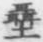

# 平人气象论第十八①

①**平人气象论第十八**：《新校正》云：按全元起本在第一卷。

**伯坚按：**本篇和《甲乙经》《黄帝内经太素》《类经》三书的篇目对照，列表于下：

| 素问 | 甲乙经 | 黄帝内经太素 | 类经 |
|---|---|---|---|
| 平人气象论第十八 | 卷四——经脉第一上 | 卷十五——尺寸诊篇 | 卷五——呼吸至数（脉色类三） |
|  | 卷四——经脉第一中 | 卷十五——五藏脉诊篇 | 卷五——脉分四时无胃曰死（脉色类十一） |
|  |  |  | 卷五——逆从四时无胃亦死（脉色类十二·一） |
|  |  |  | 卷五——逆从四时无胃亦死（脉色类十二·二） |
|  |  |  | 卷五——五藏平病死脉胃气为本（脉色类十三） |
|  |  |  | 卷五——三阳脉体（脉色类十四） |
|  |  |  | 卷五——寸口尺脉诊诸病（脉色类十六·一） |
|  |  |  | 卷五——寸口尺脉诊诸病（脉色类十六·二） |
|  |  |  | 卷六——孕脉（脉色类二十三·一） |
|  |  |  | 卷六——真藏脉死期（脉色类二十八·二） |
|  |  |  | 卷十六——风水黄疸之辨（疾病类五十九） |

〔p.267 (인쇄 250)〕

**【释题】** 平人就是健康的人。本篇主要讲健康人的脉的气象，所以叫作《平人气象论》。

**【提要】** 本篇用黄帝、岐伯问答的形式，讲健康脉和病脉的分别，内容可以分为五节。第一节讲健康脉和病脉的搏动次数。第二节讲脉和胃气的关系，来判断是健康脉、是病脉，还是死脉。第三节讲某些个别的脉象是一些什么疾病的象征。第四节讲脉和四时的关系。第五节再讲脉和胃气的关系，讲健康人和病人的心、肺、肝、脾、肾五脉的分别。本篇特别着重脉象里面的胃气，有胃气的就生，没有胃气的就死。什么叫作胃气呢？《玉机真藏论》说：“脉弱以滑，是有胃气。”张介宾解释说：“大都脉代时宜，无太过，无不及，自有一种雍容和缓之状者，便是胃气之脉。”（《类经》卷五《脉色类》十一注）

> 黄帝问曰：平人何如①？
>
> 岐伯对曰：人一呼，脉再动；一吸，脉亦再动②；呼吸定息，脉五动；闰以太息；命曰平人③。平人者，不病也。常以不病调病人④，医不病，故为病人平息以调之，为法⑤。

**【本段提纲】** 马莳说：此言一息五至之诊为无病也。

**【集解】**

①**平人何如**：王冰说：平人，谓气候平调之人也。

丹波元简说：《调经论》云：“阴阳匀平，以充其形，九候若一，命曰平人。”《终始篇》云：“形肉血气，必相称也，是谓平人。”

②**人一呼，脉再动；一吸，脉亦再动**：丹波元简说：按《灵枢·动输篇》：“一呼，脉再动。一吸，脉亦再动。”《甲乙》引作“一呼，脉亦再动。一吸，脉亦再动。”（**伯坚按：**见《甲乙经》卷四《经脉》第一上，今本《甲乙经》作“一呼脉再动。一吸脉亦再动。”）

③**呼吸定息，脉五动；闰以太息；命曰平人**：马莳说：鼻中出气曰呼，入气曰吸。呼吸定息，总为一息。言医人一呼而彼脉遂再动，一吸而彼脉遂再动，呼吸定息，脉遂五至，犹岁之有闰，是闰以太息之脉，乃所谓一息五至也。如此者名曰平人。

张介宾说：出气曰呼。入气曰吸。一呼一吸，总名一息。动，至也。再动，再至也。常人之脉，一呼两至，一吸亦两至。呼吸定息，谓一息既尽，而换息未起之际也，脉又一至。故曰五动。闰，余也，犹闰月之谓。言平人常息之外，间有一息甚长者，是为闰以太息，而又不止五至也。此即平人不病之常度。

丹波元简说：按张注详备，与《难经》符。但《难经》以一呼再动，一吸再动，呼吸之间又一动，为定息五动；张则以一息四动，两息之间又一动，为五动，此为少异焉。李云：“一息四至。呼吸定息脉五动者，当其闰以太息之时也。”马及志、高并同。此说不可从。果如其言，则宜云：“闰以太息，呼吸脉五动”。噫！何倒置经文而释之也。

④**常以不病调病人**：丹波元简说：《甲乙》，“病”下有“之人”二字。（**伯坚按：**今本《甲乙经》作“常以不病之人以调病人”。）

⑤**医不病，故为病人平息以调之，为法**：吴崑说：医不病，则呼吸调匀，故能为病人平息以调脉。为法，为则也。

丹波元简说：《甲乙》，无“为法”二字。

> 人一呼、脉一动，一吸、脉一动，曰少气①。

**【本段提纲】** 马莳说：此言一息二至之脉为少气，自平脉之不及者言之也。

**【集解】**

〔p.268 (인쇄 251)〕

①**曰少气**：马莳说：由正气衰少，故脉如是也。

少气，气息微弱也，参阅《素问》第四十九《脉解》第三段“所谓胸痛少气者”句下集解。

> 人一呼、脉三动，一吸、脉三动，而躁①：尺热曰病温②；尺不热，脉滑曰病风，脉涩曰痹③。

**【本段提纲】** 马莳说：此言一息六至之脉为诸病，自平脉之太过者言之也。

**【集解】**

①**躁**：王冰说：躁，谓烦躁。

马莳说：躁者，动之甚也。王注以躁为烦躁。按《灵枢·终始、禁服》等篇，有“一倍而躁，二倍而躁”等语，则躁本言脉不言病也。

张介宾说：躁者，急疾之谓。

②**尺热曰病温**：杨上善说：脉之三动，以是气之有余，又加躁急，尺之皮肤复热，即阳气盛，故为病温。

张介宾说：尺热，言尺中近臂之处有热者，必其通身皆热也。脉数、躁而身有热，故知为病温。

高世栻说：脉躁急而尺肤热，则曰病温。

丹波元坚说：按《论疾诊尺篇》曰：“尺肤热甚，脉盛躁者，病温也。”

③**尺不热，脉滑曰病风，脉涩曰痹**：杨上善说：一呼三动而躁、尺皮不热，脉滑曰风，涩曰痹也。

《新校正》云：按《甲乙经》，无“脉涩曰痹”一句。（**伯坚按：**此段见《甲乙经》卷四《经脉》第一上，没有“脉涩曰痹”四字。）

张介宾说：数滑而尺不热者，阳邪盛也，故当病风。然风之伤人，其变不一，不独在于肌表，故尺不热也。涩为血不调，故当病痹。《脉法》曰：“滑，不涩也，往来流利。涩，不滑也，如雨沾沙。滑为血实气壅。涩为气滞血少。”

丹波元简说：按《寿夭刚柔篇》云：“病在阳者命曰风。病在阴者命曰痹。”此章与痹对言，亦谓偏风之属。

丹波元坚说：按《论疾诊尺篇》曰：“尺肤滑、其淖泽者，风也。”又曰：“尺肤滑而泽脂者，风也。尺肤涩者，风痹也。”

> 人一呼，脉四动以上，曰死①。
>
> 脉绝不至，曰死。
>
> 乍疏乍数，曰死②。

**【本段提纲】** 马莳说：此举三者之脉为必死，以其无胃气为逆也。

**【集解】**

①**人一呼，脉四动以上，曰死**：马莳说：人一呼脉当再动，而今曰四动，则一吸脉当再动，而亦四动，所谓一息八至脉也。《脉诀》以八至为脱脉，《难经》以为夺精。且曰四动以上，则《脉诀》以九至为死脉，十至为归墓，十一、十二则为绝魂脉，故皆谓之死脉也。此则自五至以上之太过者言之耳。

张介宾说：一呼四动，则一息八至矣，况以上乎？《难经》谓之夺精，四至曰脱精，五至曰死，六至曰命尽。是皆一呼四至以上也，故死。（**伯坚按：**见《难经·十四难》：“四至曰夺精，五至曰死，六至曰命绝，此死之脉。”）

〔p.269 (인쇄 252)〕

②**人一呼，脉四动以上，曰死。脉绝不至，曰死。乍疏乍数，曰死**：高世栻说：人一呼脉四动以上，则太过之极。脉绝不至，则不及之极。乍疏乍数，则错乱之极。故皆曰死。

> 平人之常气禀于胃。胃者，平人之常气也。人无胃气曰逆，逆者死①。

**【本段提纲】** 马莳说：以平人常时之脉气，必禀于胃气而生，人无胃气，夫是之谓逆，逆则知其为死也。

**【集解】**

①**平人之常气禀于胃。胃者，平人之常气也。人无胃气曰逆，逆者死**：杨上善说：胃者，人迎胃脉也。五藏之脉，弦、钩、代、浮、石，皆见于人迎胃脉之中。胃脉即足阳明脉，主于水谷，为五藏、六府、十二经脉之长，所以五藏之脉欲见之时，皆以胃气将至人迎也。胃气之状，柔弱是也。故人迎五脉见时，但弦、钩、代、毛、石各各自见无柔弱者，即五藏各失胃气，故脉独见。独见当死。

张介宾说：土得天地中和之气，长养万物，分王四时，而人胃应之。凡平人之常，受气于谷，谷入于胃，五藏六府皆以受气，故胃为藏府之本。此胃气者，实平人之常气，有不可以一刻无者，无则为逆，逆则死矣。胃气之见于脉者，如《玉机真藏论》曰：“脉弱以滑，是有胃气。”《终始篇》曰：“邪气来也紧而疾。谷气来也徐而和。”是皆胃气之谓。大都脉代时宜，无太过，无不及，自有一种雍容和缓之状者，便是胃气之脉。

> 春胃微弦曰平①。弦多胃少曰肝病②。但弦无胃曰死③。胃而有毛曰秋病④。毛甚曰今病⑤。藏真散于肝，肝藏筋膜之气也⑥。

**【本段提纲】** 杨上善说：胃者，人迎胃脉也。五藏之脉，弦、钩、代、浮、石，皆见于人迎胃脉之中。胃脉，即足阳明脉，主于水谷，为五藏六府十二经脉之长，所以五藏之脉欲见之时，皆以胃气将至人迎也。

马莳说：此承上文“人无胃气曰逆”，故此下五节遂言五藏皆以胃气为本，而此一节则自肝脉而言之也。

**【集解】**

①**春胃微弦曰平**：王冰说：言微似弦，不谓微而弦也。钩及软弱、毛、石义并同。

吴崑说：弦，脉引而长若琴弦也。胃，冲和之名。春脉宜弦，必于冲和之中微带弦，是曰平调之脉。

张介宾说：春令木王，其脉当弦，但宜微弦而不至太过，是得春胃之充和也，故曰平。按此前后诸篇，皆以春弦、夏钩、秋毛、冬石分四季所属者，在欲明时令之脉，不得不然也。然脉之迭见，有随时者，有不随时者。或春而见钩，便是夏脉；春而见毛，便是秋脉；春而见石，便是冬脉。因变知病，圆活在人，故有二十五变之妙。若谓春必弦，夏必钩，则殊失胃气之精义矣。

②**弦多胃少曰肝病**：张介宾说：弦多者，过于弦也。胃少者，少和缓也。是肝邪之胜，胃气之衰，故为肝病。

③**但弦无胃曰死**：张介宾说：但有弦急而无冲和之气者，是春时胃气已绝，而肝之真藏见也，故曰死。

④**胃而有毛曰秋病**：张介宾说：毛为秋脉属金，春时得之，是为贼邪，以胃气尚存，故至秋而后病。

⑤**毛甚曰今病**：吴崑说：若脉来毛甚，则无胃气，肝木受伤已深，不必至秋，今即病矣。

〔p.270 (인쇄 253)〕

⑥**藏真散于肝，肝藏筋膜之气也**：吴崑说：藏，上去声，下平声，后皆同。肝气喜散，春时肝木用事，故五藏天真之气皆散于肝。若其所藏，则藏筋膜之气而已。

张介宾说：《金匮真言论》曰：“东方青色，入通于肝，是以知病之在筋也。”

丹波元坚说：先兄曰：“按藏真，非真藏之真，即言五藏真元之气，各应五时而见脉象也。”

> 夏胃微钩曰平①。钩多胃少曰心病②。但钩无胃曰死③。胃而有石曰冬病④。石甚曰今病⑤。藏真通于心，心藏血脉之气也⑥。

**【本段提纲】** 马莳说：此以心脉之病言之也。

**【集解】**

①**夏胃微钩曰平**：吴崑说：钩，前曲后倨如带钩也。言夏脉宜钩，必于冲和胃气之中，脉来微钩，是曰平调之脉。

张介宾说：夏令火王，其脉当钩，但宜微钩而不至太过，是得夏胃之和也，故曰平。

②**钩多胃少曰心病**：张介宾说：钩多者，过于钩也。胃少者，少冲和也。是心火偏胜，胃气偏衰，故为心病。

③**但钩无胃曰死**：张介宾说：但有钩盛，而无平和之气者，是夏时胃气已绝，而心之真藏见也，故死。

④**胃而有石曰冬病**：张介宾说：石为冬脉属水，夏时得之，是为贼邪，以胃气尚存，故至冬而后病。

⑤**石甚曰今病**：吴崑说：若脉来石甚，则无胃气，心火受伤已深，不必至冬，今即病矣。

⑥**藏真通于心，心藏血脉之气也**：吴崑说：心气喜通，夏时心火用事，故五藏天真之气皆通于心。若心之所藏，则藏血脉之气耳。

张介宾说：《金匮真言论》曰：“南方赤色，入通于心，是以知病之在脉也。”

> 长夏胃微耎弱曰平①。弱多胃少曰脾病②。但代无胃曰死③。软弱有石曰冬病④。石甚曰今病⑤。藏真濡于脾，脾藏肌肉之气也⑥。

**【本段提纲】** 马莳说：此举胃脉之病言之也。

**【集解】**

①**长夏胃微耎弱曰平**：吴崑说：耎，软同。耎弱，脾之脉也。长夏属土，脉宜软弱，必于冲和胃气之中微带软弱，谓之平调之脉。

张介宾说：长夏属土，虽主建未之六月，然实兼辰、戌、丑、未四季之月为言也。四季土王之时，脉当软弱，但宜微有软弱而不至太过，是得长夏胃气之和缓也，故曰平。

②**弱多胃少曰脾病**：张介宾说：弱多胃少，则过于弱而胃气不足，以土王之时而得之，故为脾病。

③**但代无胃曰死**：张介宾说：代，更代也。脾主四季，脉当随时而更，然必欲皆兼和软，方得脾脉之平。若四季相代，而但弦、但钩、但毛、但石，是但代无胃见真藏也，故曰死。

④**软弱有石曰冬病**：张介宾说：石为冬脉属水，长夏阳气正盛，而见沉石之脉，以火土气衰而水反乘也，故至冬而病。

⑤**石甚曰今病**：原文作“弱甚曰今病”。

《新校正》云：按《甲乙经》，“弱”作“石”。（**伯坚按：**此段见《甲乙经》卷四《经脉》第一中。今本《甲乙经》作“软甚曰今病”。）

〔p.271 (인쇄 254)〕

马莳说：“弱甚”之“弱”，当作“石”。

张介宾说：“弱”，当作“石”。长夏石甚者，火土大衰，故不必至冬，今即病矣。

顾观光说：“石”字是。

田晋蕃说：林校曰：“《甲乙经》，‘弱’作‘石’。”今本《甲乙经》作“软”。《脉经》三作“石”。晋蕃按：软弱为长夏本脉。《甲乙经》作“软甚”与《经》作“弱甚”，初无二义，林何所取以校《经》乎？知古文《甲乙经》与《脉经》同作“石甚”无疑。经作“弱甚”，则承上文但代无胃之死脉，（上文“但代无胃”，《脉经》作“但弱无胃”。）岂但今病而已？以下文“弦甚曰今病”等句例之，盖《经》本作“石甚”，故皇甫谧据而为《甲乙》。林所见之本作“弱甚”，传写之讹也。

**伯坚按：**今据马莳、张介宾、顾观光、田晋蕃说校改。

⑥**藏真濡于脾，脾藏肌肉之气也**：吴崑说：濡，泽也。脾气喜濡泽。长夏之时，脾土用事，故五藏真气皆濡泽于脾。若脾之所藏，则藏肌肉之气者也。

张介宾说：《金匮真言论》曰：中央黄色，入通于脾，是以知病之在肉也。

> 秋胃微毛曰平①。毛多胃少曰肺病②。但毛无胃曰死③。毛而有弦曰春病④。弦甚曰今病⑤。藏真高于肺，以行荣卫阴阳也⑥。

**【本段提纲】** 马莳说：此举肺脉之病言之也。

**【集解】**

①**秋胃微毛曰平**：吴崑说：毛，脉来浮、涩，类羽毛也。秋脉宜毛，必于冲和胃气之中，脉来微毛，是曰平调之脉。

张介宾说：秋令金王，其脉当毛，但宜微毛而不至太过，是得秋胃之和也，故曰平。毛者，脉来浮涩，类羽毛之轻虚也。

②**毛多胃少曰肺病**：张介宾说：毛多胃少，是金气偏胜，而少和缓之气也，故为肺病。

③**但毛无胃曰死**：张介宾说：但毛无胃，是秋时胃气已绝，而肺之真藏见也，故死。

④**毛而有弦曰春病**：张介宾说：弦为春脉属木，秋时得之，以金气衰而木反乘也，故至春木王时而病。

⑤**弦甚曰今病**：吴崑说：若脉来弦甚而无胃气，则肝木受病已深，不待移时，今即病矣。

⑥**藏真高于肺，以行荣卫阴阳也**：王冰说：肺处上焦，故藏真高也。《灵枢经》曰：“荣气之道，内谷为宝（**伯坚按：**原作“内谷为实”，今据《灵枢》第十六《营气篇》校正）。谷入于胃，气传与肺，流溢于中，布散于外。精专者行于经隧。”以其自肺宣布，故云以行荣卫阴阳也。

张介宾说：秋金用事，其气清肃，肺处上焦，故藏真之气高于肺。肺主乎气，而荣行脉中卫行脉外者，皆自肺宣布，故以行荣卫阴阳也。

> 冬胃微石曰平①。石多胃少曰肾病②。但石无胃曰死③。石而有钩曰夏病④。钩甚曰今病⑤。藏真下于肾，肾藏骨髓之气也⑥。

**【本段提纲】** 马莳说：此举肾脉之病言之也。

**【集解】**

①**冬胃微石曰平**：吴崑说：石，脉来沉实也。冬脉宜石，必于冲和胃气之中，脉来微石，是曰平调之脉。

张介宾说：冬令水王，脉当沉石，但宜微石而不至太过，是得冬胃之和也，故曰平。石者，脉来沉实，如石沉水之谓。

〔p.272 (인쇄 255)〕

②**石多胃少曰肾病**：张介宾说：石多胃少，是水气偏胜，反乘土也，故为肾病。

③**但石无胃曰死**：张介宾说：但石无胃，是冬时胃气已绝，而肾之真藏见也，故死。

④**石而有钩曰夏病**：张介宾说：钩为夏脉属火，冬时得之，以水气衰而火反侮也，故至夏火王时而病。

⑤**钩甚曰今病**：吴崑说：若脉来钩甚而无胃气，则心火受病已深，不必移时，今即病矣。

⑥**藏真下于肾，肾藏骨髓之气也**：王冰说：肾居下焦，故云藏真下也。

吴崑说：肾气喜下，冬时肾水用事，故五藏天真之气同下于肾。若肾之所藏，则藏骨髓之气者也。

张介宾说：《金匮真言论》曰：“北方黑色，入通于肾，是以知病之在骨也。”

> 胃之大络名曰虚里①，贯鬲②、络肺，出于左乳下，其动应手③，脉宗气也④。盛喘数绝者，则病在中⑤。结而横⑥，有积矣⑦。绝不至，曰死⑧。乳之下，其动应衣，宗气泄也⑨。

**【本段提纲】** 马莳说：此承上文而言，五藏皆以胃气为本，故胃有大络，其脉气不同而病死亦异也。

**【集解】**

①**胃之大络名曰虚里**：杨上善说：虚，音墟。虚里，城邑居处也。此胃大络，乃是五藏六府所禀居处，故曰虚里。

②**贯鬲**：鬲是横膈膜。参阅《素问》第十六《诊要经终论》第七段“中鬲者”句下集解。

③**其动应手**：原文作“其动应衣”。

丹波元简说：《甲乙》，“衣”作“手”。“应衣”，当从《甲乙》而作“应手”。若“应衣”则与下文何别？

顾观光说：“衣”字误，当依《甲乙经》作“手”。

**伯坚按：**此段见《甲乙经》卷四《经脉》第一中，作“其动应手”。今据丹波元简、顾观光说，依《甲乙经》校改。这是说心脏的搏动。

④**宗气也**：杨上善说：宗，尊也。此之大络，一身之中血气所尊，故曰宗气。

王冰说：宗，尊也，主也，谓十二经脉之尊主也。

马莳说：宗气，即大气也。《灵枢》邪客篇、刺节真邪篇皆曰宗气。《灵枢·五味篇》谓之大气。

丹波元简说：按《五味篇》曰：“大气积于胸中，命曰气海。”《邪客篇》曰：“宗气积于胸中。”皆此义也。《通雅》云：“宗、尊，一字。《孝经》‘宗祀’，注：‘尊祀’。”王云“宗，尊也”，此乃古训。

⑤**盛喘数绝者，则病在中**：杨上善说：其脉动如人喘数而绝者，病在藏中也。

王冰说：绝，谓暂断绝也。中，谓腹中也。

张介宾说：若虚里动甚而如喘，或数急而兼断绝者，由中气不守而然，故曰病在中。

高世栻说：其病在鬲中也。

⑥**结而横**：吴崑说：脉来迟，时一止，曰结。横，横格于指下也。

丹波元简说：横，盖谓其动横及于右边。

⑦**有积矣**：高世栻说：结而横，则鬲中有积矣。

⑧**绝不至，曰死**：张介宾说：虚里脉绝者，宗气绝也，故必死。

⑨**乳之下，其动应衣，宗气泄也**：《新校正》云：按全元起本无此十一字。《甲乙经》亦无。详上下文义，多此十一字，当去。

〔p.273 (인쇄 256)〕

马莳说：乳下之动应衣者，予曾见其人，病终不治。

张介宾说：愚按虚里跳动，最为虚损病本，故凡患阴虚劳怯，则心下多有跳动，及为惊悸慌张者，是即此证。人止知其心跳，而不知为虚里之动也。但动之微者病尚微，动之甚者病则甚，亦可因此以察病之轻重。

张琦说：其动应衣，动之甚也。

钱熙祚《素问跋》：林亿据全本及《甲乙经》并无此十一字，以为衍文。按乳下之动应衣者，病终不治，以今验古，信而有征。林氏以为衍文，盖因上文云“其动应衣，脉宗气也”，似与此经不合。然《甲乙经》本作“其动应手”。盖动而微则动应手，动而甚则应衣，微则为平，甚则为病。王氏必有所本，未可断为衍文矣。

顾观光说：“乳之下，其动应衣，宗气泄也”，此十一字当存。

> 欲知寸口①太过与不及：
>
> 寸口之脉中手短者，曰头痛②。
>
> 寸口脉中手长者，曰足胫痛③。
>
> 寸口脉中手促上击者，曰肩背痛④。
>
> 寸口脉沉而坚者，曰病在中⑤。
>
> 寸口脉浮而盛者，曰病在外⑥。
>
> 寸口脉沉而弱，曰寒热及疝瘕少腹痛⑦。
>
> 寸口脉沉而横⑧，曰胁下有积、腹中有横积痛⑨。
>
> 寸口脉沉而喘，曰寒热⑩。
>
> 脉盛、滑、坚者，曰病在外⑪。
>
> 脉小、实而坚者，病在内⑫。
>
> 脉小、弱以涩，谓之久病⑬。
>
> 脉滑、浮而疾者，谓之新病⑭。
>
> 脉急者，曰疝瘕⑮、少腹痛⑯。
>
> 脉滑曰风。
>
> 脉涩曰痹⑰。
>
> 缓而滑曰热中⑱。
>
> 盛而紧曰胀⑲。

**【本段提纲】** 杨上善说：上来诊人迎法，以下诊寸口法。故曰欲知诊寸口之脉有病唯有太过与不及也。

马莳说：此言寸口之脉，可以验诸病也。

**【集解】**

①**寸口**：杨上善说：口者，气行处也。从关至鱼一寸之处，有九分之位，是手太阴气所行之处，故曰寸口。（丹波元坚说：杨以为从关至鱼一寸之处有九分之位，殊失经旨。）

马莳说：寸口者，气口也。《经脉别论》曰：“气口成寸，以决死生。”

寸口，参阅《素问》第九《六节藏象论》第四段“寸口一盛”句下集解。

〔p.274 (인쇄 257)〕

②**寸口之脉中手短者，曰头痛**：马莳说：寸口之脉，中医人之手指而短者，其病止在上，不及于下，名曰头痛。

③**寸口脉中手长者，曰足胫痛**：马莳说；寸口之脉，中医人之指而长者，其病当在下，名曰足胫痛。

④**寸口脉中手促上击者，曰肩背痛**：杨上善说：脉从下向上击人手，如从下有物上击人手，是阳气盛。阳脉行于肩背，故知肩背痛也。

马莳说：寸口之脉，中医人之指而促上来击者，是肩背在上，故其脉促上也，名曰肩背痛。

张介宾说：脉来急促而上部击手者，阳邪盛于上也，故为肩背痛。

⑤**寸口脉沉而坚者，曰病在中**：张介宾说：沉为在里，坚为阴实，故病在中。

⑥**寸口脉浮而盛者，曰病在外**：张介宾说：浮为在表，盛为阳强，故病在外。

⑦**寸口脉沉而弱，曰寒热及疝瘕少腹痛**：王冰说：沉为寒，弱为热，故曰寒热也。又沉为阴盛，弱为阳余，余盛相薄，正当寒热，不当为疝瘕而少腹痛，应古之错简尔。

《新校正》云：按《甲乙经》无此十五字。况下文已有“寸口脉沉而喘曰寒热，脉急者曰疝瘕少腹痛”，此文衍，当去。

马莳说：据理此处及“疝瘕少腹痛”六字为衍。

**伯坚按：**此段见《甲乙经》卷四《经脉》第一中，没有此十五字。今据《新校正》、马莳说，依《甲乙经》删去此十五字。

⑧**寸口脉沉而横**：杨上善说：横，指下脉横也。

张介宾说：横，急数也。

张志聪说：横，横逆，言脉之形象，非谓病也。

丹波元简说：《甲乙》，“横”下有“坚”字。按横，谓寸口脉位，横斜于筋骨间。

张琦说：脉细而附骨，横格指下。

丹波元坚说：《太素》，“横”下有“坚”字。《大奇论》：“脉之横格，是胆气予不足也。”王注：“脉长而坚，如横木之在指下也。”

⑨**胁下有积、腹中有横积痛**：马莳说：寸口之脉，沉而且横，则胁下当有积，及腹中亦有横积作痛也。

⑩**寸口脉沉而喘，曰寒热**：杨上善说：沉，阴气也，脉动如人喘者，是为阳也。即知寒热也。

吴崑说：喘，脉来如人之喘急也。沉为阴，喘为阳，故病则为寒热。

张介宾说：喘，急促也。

⑪**脉盛、滑、坚者，曰病在外**：王冰说：盛滑为阳，阳病病在外也。

马莳说：寸口之脉浮而盛者固为在外，然脉之盛而且滑且坚者阳脉也，亦病之在外也。

⑫**脉小，实而坚者，病在内**：王冰说：小实为阴，阴病病在内。

马莳说：沉而坚者固病在内，然脉之小实而坚者阴脉也，亦病之在内也。

度会常珍说：古抄本，“病”上有“曰”字。

⑬**脉小、弱以涩，谓之久病**：王冰说：小为气虚，涩为无血，血气虚弱，故云久远之病也。

⑭**脉滑、浮而疾者，谓之新病**：王冰说：滑浮为阳足，脉疾为气全，阳足气全，故云新浅之病也。

⑮**疝瘕**：疝瘕，可能是膀胱炎一类的疾病，参阅《素问》第十九《玉机真藏论》第九段“一名曰蛊”句下集解。

〔p.275 (인쇄 258)〕

⑯**少腹痛**：杨上善说：按其脉如弓弦，是阴气积，故知疝瘕，少腹痛也。

吴崑说：急，弦急也，是为厥阴病状。

少腹即小腹，参阅《素问》第二十二《藏气法时论》第九段“引少腹”句下集解。

⑰**脉滑曰风。脉涩曰痹**：马莳说：脉来见滑，是滑为阳脉，风者阳先受之，故当病风。脉来见涩，是涩为阴脉，主阴血不足，故当病痹。

丹波元坚说：先兄曰：“此二句重出，系剩文。”

参阅本篇第三段“脉滑曰病风，脉涩曰痹”句下集解。

⑱**缓而滑曰热中**：杨上善说：缓滑，阳也。指下如按缓绳而去来流利，是热中候者。

王冰说：缓，谓纵缓之状，非动之迟缓也。

热中，热气在腹也，参阅本篇第十四段“谓之热中”句下集解。

⑲**盛而紧曰胀**：杨上善说：寸口脉盛紧实者，是阴气内积，故为胀也。

王冰说：盛紧，盛满也。

> 脉从阴阳，病易已。
>
> 脉逆阴阳，病难已①。
>
> 脉得四时之顺，曰病无他②。
>
> 脉反四时③及不间藏④，曰难已。

**【本段提纲】** 马莳说：此言脉当与病而相顺也。

**【集解】**

①**脉从阴阳，病易已。脉逆阴阳，病难已**：王冰说：脉病相应谓之从，脉病相反谓之逆。

吴崑说：阴病得阴脉，阳病得阳脉，谓之从，病为易已。反者为逆，病则难已。

②**脉得四时之顺，曰病无他**：马莳说：此脉当与时而相顺也。春病得弦脉，夏病得钩脉，秋病得毛脉，长夏得缓脉，秋得钩脉，冬病得石脉，则脉得四时之顺，曰病无他。

张介宾说：虽曰有病，无他虞也。

③**脉反四时**：王冰说：春得秋脉，夏得冬脉，秋得夏脉，冬得四季脉，皆谓反四时，气不相应，故难已也。

马莳说：若脉反四时，则春得涩脉，夏得石脉，长夏得弦脉，秋得钩脉，冬得缓脉，是谓反四时者也。

④**不间藏**：张介宾说：不间藏者，如木必乘土，则肝病传脾，土必乘水，则脾病传肾之类，是皆传其所胜，不相假借。脉证得此，名曰鬼贼，其气相残，为病必甚。若间其所胜之藏而传其所生，是谓间藏。如肝不传脾而传心，心不传肺而传脾，其气相生，虽病亦微。故《标本病传论》曰：“间者并行”，指间藏而言也；“甚者独行”，指不间藏而言也。《五十三难》曰：“七传者死，间藏者生。”七传者，得其所胜也。间藏者，传其所生也。皆此之谓。考之吕氏注《五十难经》曰：“间藏者，间其所胜之藏而相传也。心胜肺，脾间之。脾胜肾，肺间之。肺胜肝，肾间之。肾胜心，肝间之。肝胜脾，心间之。此谓传其所生也。”其说亦通。又《玉机真藏论》曰：“五藏有病，则各传其所胜。不治，法三月若六月，若三日若六日，传五藏而当死。是顺传所胜之次。”即此不间藏之义也。

> 臂多青脉，曰脱血①。
>
> 尺脉缓涩②，谓之解㑊③、安卧④。
>
> 〔p.276 (인쇄 259)〕尺热、脉盛，谓之脱血⑤。
>
> 尺涩、脉滑，谓之多汗⑥。
>
> 尺寒、脉细，谓之后泄⑦。
>
> 脉尺粗、常热者，谓之热中⑧。

**【本段提纲】** 马莳说：此言尺脉亦可以验诸证也。

**【集解】**

①**臂多青脉，曰脱血**：杨上善说：臂，尺地也。尺地络脉青黑为寒，即知脱血。

张介宾说：血脱则气去，气去则寒凝，凝泣则青黑，故臂见青色。言臂则他可知矣，即诊尺之义。

张志聪说：诊，视也。论诊尺必先视臂之脉色。臂多青脉者，臂内浮见之络脉多青，盖因血脱而不华于色也。

②**尺脉缓涩**：丹波元坚说：先兄曰：“按尺脉缓涩，犹言头项强痛，盖尺肤缓而脉涩也。”坚按此说甚确。《论疾诊尺篇》：“尺肉弱者解㑊安卧”，缓与弱其义一也。盖《素》《灵》中尺位无诊脉之法，下文尺涩、尺滑，及《通评虚实论》：“寸脉急而尺缓”等，皆是尺肤之谓。原《识》于《虚实论》有说，宜参。《奇病论》“尺脉数甚”，“脉”字衍，彼篇详言之。（**伯坚按：**参阅《素问》第二十八《通评虚实论》第四段“是寸脉急而尺缓也”和第四十七《奇病论》第四段“人有尺脉数甚”句下集解。）

③**谓之解㑊**：《素问》第十九《玉机真藏论》：冬脉太过，则令人解㑊。

《素问》第三十六《刺疟篇》：足少阳之疟，令人身体解㑊。

《素问》第五十《刺要论篇》：刺骨无伤髓，髓伤则消铄，䯒瘦，体解㑊然不去矣。

《素问》第六十四《四时刺逆从论》：夏刺经脉，血气乃竭，令人解㑊。

《灵枢》第七十四《论疾诊尺篇》：尺肉弱者，解㑊安卧。

王冰说：寒不寒，热不热，弱不弱，壮不壮，伫不可名，谓之解㑊也。

张介宾说：解㑊者，困倦难名之状也。

丹波元简说：杭世骏《道古堂集》云：“解㑊二字，不见他书。解即懈。㑊音亦。倦而支节不能振举，惫而精气不能检摄，筋不束骨，脉不从理，解解㑊㑊，不可指名，非百病中有此一症也。《内经》言此者凡五。《平人气象论》云：‘尺脉缓涩，谓之解㑊。’王氏注：‘伫不可名。’仫，困弱也。（丹波元简说：按《宋书·明恭王皇后传》：后在家为仫弱妇人。）《玉机真藏论》云：‘冬脉太过，则令人解㑊。’此从脉起见也。《刺疟论》云：‘足少阳之疟，令人身体解㑊，寒不甚，热不甚，恶见人，见人心惕惕然，热多汗出甚。’此从疟起见也。《刺要论》云：‘刺骨无伤髓，髓伤则销铄胻酸，体解㑊然不去矣。’《四时刺逆从论》云：‘夏刺经脉，血气乃竭，令人解㑊。’此从刺而究其极也。要皆从四末以起，如经所言堕怠，小变其辞，而意较微眇尔。”简按王注据《刺疟论》解之，然此少阳疟之状，而非解㑊之义。杭氏之说为稳帖。解㑊字亦见《论疾诊尺篇》，云：“尺肉弱者，解㑊也。”盖解亦即懈堕、懈倦之谓。《四时刺逆从论》“解㑊”，《诊要经终论》作“解堕”。《刺疟论》“解㑊”，《巢源》作“解倦”，此可以证也。㑊，即亦字从人者，与易通。王注《气厥论》云：“食亦者，谓食入移易而过，不生肌肤。亦，易也。”《甲乙》引《气厥论》，作“食㑊”。《骨空论》：“易髓无孔。”王《注》云：“易，亦也。”此可以证㑊、亦同，而与易通也。而易谓变易其平常。《神农本草经》蜣螂条：“狂易。”（《证类》音羊，误。《汉书·外戚传》云：“素有狂易病。”师古注：“狂易者，狂而变易常性也。”）《阴阳别论》：“偏枯痿易。”王注：“易，谓变易常用而痿弱无力也。”《大奇论》：“跛易偏枯。”王注：“血气变易为偏枯也。”知是解易即解惰变易平常之义矣。

〔p.277 (인쇄 260)〕

丹波元坚说：按加藤良白曰：“解㑊通作解怿。《正法华经》卷五《五百弟子诀品》云：‘又瞻如来诸佛境界，得未曾有，欢喜踊跃，无衣食想，肢体解怿，不能于衣食。’《音释》：‘怿音亦。’”

莫文泉《研经言》卷二《释解㑊》：㑊字，《说文》所无。以食亦推之，当为亦。亦通于射。《古今人表》：“曹严公亦姑”，师古曰：“即射姑也。”《诗抑》：“矧可射思。”射，厌也。然则解㑊云者，则懈怠而厌事也。射又通于夜。《荀子·劝学》：“西方有木焉名曰夜干”，亦作射干。《左·昭廿五传》：“狐射姑”，《释文》本作射。夜从亦省声。《说文》：“夜，舍也，天下休舍也。”然则解㑊云者，谓懈怠而休舍也。夜又通于液。周有叔液鼎，即八士之叔夜。而《周官·考工》“弓人春液角”，近朱骏声谓：“液，解也”，然则解㑊云者，即解字之重言也。

**伯坚按：**杭世骏《道古堂文集》卷二十《与魏玉衡书》说：“解㑊二字，不见他书。解即懈。㑊音亦。倦而支节不能振举，惫而精气不能检摄，筋不束骨，脉不从理，解解㑊㑊，不可指名，非百病中有此一症也。《内经》言此者凡五。《平人气象论》云：‘尺脉缓涩，谓之解㑊。’王氏注：‘伫不可名。’仫，困弱也。《玉机真藏论》云：‘冬脉太过，则令人解㑊。’此从脉起见也。《刺疟论》云：‘足少阳之疟，令人身体解㑊，寒不甚，热不甚，恶见人，见人心惕惕然，热多汗出甚。’此从疟起见也。《刺要论》云：‘刺骨无伤髓。髓伤则消铄，䯒瘦，体解㑊然不去矣。’《四时刺逆从论》云：‘夏刺经脉，血气乃竭，令人解㑊。’此从刺而究其极也。要皆从四末以起见，如经所言堕怠，小变其辞，而意较微渺尔。后世传注有与经发明者又有二。《风论》云：‘使人怢慄而不能食，名曰寒热。’‘怢慄’，全元起本作‘失味’，皇甫谧《甲乙经》作‘解㑊’。则怢慄即解㑊之解也。《至真要大论》云：‘发不远热，无犯温凉。’王氏注：‘不发汗以夺盛阳，则热内淫于四支而为解㑊不可名也。粗工呼为鬼气恶病，久久不已，则骨热髓涸齿乾，乃为骨热病。’此又究极解㑊之流弊，所谓救病于已形也。宋景濂《送葛医师序》，不得其解。《篁南》江氏辑《名医类案》，引《叶氏录验方》，以为俗名发痧之症，于瘟疫大头天行之后，别列一门，武断极矣。发痧，余尝有此病，发必神思躁扰，少腹痛，《灵》《素》未尝言及，特小小患苦耳，与解㑊之义毫不干涉。篁南父子负盛名，而《内经》不读，庸医祖述其说，转以欺世，事无害而理则大谬矣。足下续案已成，删去此门，庶为稳惬，毋令人有误解《内经》之诮，荛言或可采也。”

④**安卧**：杨上善说：懈惰安卧也。

丹波元坚说：杨据上句读，宜从。《论疾诊尺篇》可以互证。《海论》：“髓海不足，则脑转耳鸣，胫痠眩冒，目无所见，懈怠安卧。”亦是一征。

⑤**尺热、脉盛，谓之脱血**：原文作“脉盛谓之脱血”，没有“尺热”二字。

丹波元坚说：《太素》，“脉”上有“尺”字。坚按此句当作“尺热脉盛，谓之脱血”。正与前尺脉对言例相合。《论疾诊尺篇》曰：“尺炬然热、人迎大者，当夺血。”此其明据矣。盖《太素》原有“热”字，而杨氏不知其脱，至王所见本，则并“尺”字而脱之，故遂以安卧属脉盛也。

**伯坚按：**此段见《黄帝内经·太素》卷十五《尺寸诊篇》，作“尺脉盛谓之脱血”。今依《太素》，并据丹波元坚说校补“尺热”二字。

⑥**尺涩、脉滑，谓之多汗**：吴崑说：尺部肌肤涩，是皮毛失其津液也。脉来滑，则营血无伤，故谓多汗。

丹波元简说：《阴阳别论》曰：“阳加于阴，谓之汗。”

⑦**尺寒、脉细，谓之后泄**：马莳说：尺部见冷，而脉又兼细，是寒气在腹，泄利未已，谓之后泄。

⑧**脉尺粗、常热者，谓之热中**：马莳说：热气在腹，谓之热中也。

〔p.278 (인쇄 261)〕

丹波元坚说：先兄曰：“此亦谓脉粗、尺肤常热。”《脉要精微论》云：“粗大者，阴不足，阳有余，为热中也。”又鳌城公观曰：“当作‘脉粗、尺常热’。”坚按《脉经》曰：“尺脉粗、常热者，谓之热中，腰胯痛，小便赤热。”更考经无粗脉，此脉字疑衍，然《脉经》亦既有之，不敢妄决。

**伯坚按：**喜多村直宽说：“按经文‘中’字，多指腹中言。”参阅《素问》第十六《诊要经终论》第十三段“中热”句下集解。

> 肝见庚辛死①。心见壬癸死②，脾见甲乙死③。肺见丙丁死④。肾见戊己死⑤。是谓真藏见，皆死⑥。

**【本段提纲】** 马莳说：此言真藏脉见者，各有相克之死期也。

**【集解】**

①**肝见庚辛死**：王冰说：庚辛为金，伐肝木也。

马莳说：庚辛者，金日也。肝之真藏脉见而全无胃气，则至庚辛日而死，以金克木也。

十天干和五行的配合，参阅《素问》第二十二《藏气法时论》第二段提纲附表。

②**心见壬癸死**：王冰说：壬癸为水，灭心火也。

马莳说：壬癸者，水日也。心之真藏脉见而全无胃气，则至壬癸日而死，以水克火也。

③**脾见甲乙死**：王冰说：甲乙为木，克脾土也。

马莳说：甲乙者，木日也。脾之真藏脉见而全无胃气，则至甲乙日而死，以木克土也。

④**肺见丙丁死**：王冰说：丙丁为火，铄肺金也。

马莳说：丙丁者，火日也。肺之真藏脉见而全无胃气，则至丙丁日而死，以火克金也。

⑤**肾见戊己死**：王冰说：戊己为土，刑肾水也。

马莳说：戊己者，土日也。肾之真藏脉见而全无胃气，则至戊己日而死，以土克水也。

⑥**是谓真藏见，皆死**：马莳说：是谓真藏脉见，故皆死也。

> 颈脉动、喘、疾咳，曰水①。
>
> 目裹微肿②、如卧蚕起之状③，曰水④。
>
> 溺黄赤、安卧者，黄疸⑤。
>
> 已食如饥者⑥，胃疸⑦。
>
> 面肿，曰风⑧。
>
> 足胫肿，曰水⑨。
>
> 目黄者，曰黄疸⑩。

**【本段提纲】** 马莳说：此言即诸证而可以辨曰水、曰黄疸、曰胃疸、曰风之异也。

**【集解】**

①**颈脉动、喘、疾咳，曰水**：张介宾说：颈脉，谓结喉旁动脉，足阳明之人迎也。水气上逆，反侵阳明，则颈脉动。水溢于肺，则喘急而疾咳。

②**目裹微肿**：杨上善说：目果，目上下睑也。睑之微肿，水之候。

丹波元坚说：《太素》，“裹”作“果”。

田晋蕃说：《灵枢·水胀篇》，“裹”作“窠”。按《医心方》十引《水胀篇》文，作“目果上微肿”。盖《灵枢》本作“果”，“窠”为“果”之讹。《师传篇》云：“目下果大，其胆乃横”，是其证。《尔雅·释鱼》：“前弇诸果。”《释文》云：“果，众家作裹，郭作此字。”知裹、果古通。

③**如卧蚕起之状**：丹波元坚说：《太素》无“蚕”字。坚按无“蚕”字者为是。《水胀篇》：“水始起也，目窠上微肿，如新卧起之状。”《论疾诊尺篇》：“视人之目窠上微痈，如新卧起状，其颈脉动、时咳，按其手足上窅而不起者，风水肤胀也。”俱可以证。

〔p.279 (인쇄 262)〕

**伯坚按：**此段见《黄帝内经太素》卷十五《尺寸诊篇》，没有“蚕”字。今据丹波元坚说，依《太素》删去此“蚕”字。

④**曰水**：王冰说：《评热病论》曰：“水者，阴也。目下，亦阴也。腹者，至阴之所居也。故水在腹中者，必使目下肿也。”

⑤**溺黄赤、安卧者，黄疸**：王冰说：疸，劳也。肾劳胞热，故溺黄赤也。《正理论》曰：“谓之劳瘅，以女劳得之也。”

《新校正》云：详王《注》以疸为劳义，非。若谓女劳得疸则可，若以疸为劳，非矣。

张介宾说：疸，黄病也。

田晋蕃说：按《说文》：“瘅，劳病也。”“疸，黄病也。”按王注文义则经文是瘅非疸。（注引《正理论》劳瘅，明出瘅字。）段氏玉裁曰：“瘅与疸音同而义别。如郭注《山海经》、师古注《汉书》，皆云‘瘅，黄病’，王冰注《素问》黄疸云：‘疸，劳也’，则二字互相假而淆惑矣。”

余岩《古代疾病名候疏义》第一四四页：黄疸者，血中胆汁色素之量，异常增加，而皮肤、粘膜、藏、府、体液，皆被染而色黄也。其见于外候者，眼结膜、白色巩膜、皮肤、粘膜、汗、尿等之发黄，乃其表证也。血中胆汁色素之增加，其来多端，乃临证上一证候之名，非一病之专名也。

⑥**已食如饥者**：喜多村直宽说：案“如”“而”通用。

⑦**胃疸**：丹波元简说：按疸、瘅同。即前篇所谓消中，后世所称中消渴也。（**伯坚按：**消中是糖尿病，参阅《素问》第四十七《奇病论》第六段“转为消渴”句下集解。）

⑧**面肿，曰风**：马莳说：水证有兼风者，其面发肿，盖面为诸阳之会，风属阳，上先受之，故感于风者面必先肿，不可误以为止于水也。《评热病论》《水热穴论》《灵枢·论疾诊尺篇》，皆名曰风水。

丹波元简说：按《金匮要略》云：“面目肿大有热，名曰风水。”又云“腰以上肿，当发汗。”

⑨**足胫肿，曰水**：吴崑说：脾胃主湿，肾与膀胱主水，其脉皆行于足胫，故足胫肿者为水。

丹波元简说：《金匮要略》云：“腰以下肿，当利小便。”

⑩**目黄者，曰黄疸**：王冰说：阳怫于上，热积胸中，阳热上燔，故目黄也。《灵枢经》曰：“目黄者病在胸。”

> 妇人手少阴①脉动甚者，妊子也②。

**【本段提纲】** 马莳说：此言妇人妊子之脉也。

**【集解】**

①**手少阴**：《新校正》云：按全元起本作“足少阴”。

顾观光说：《灵枢·论疾诊尺篇》亦作“手少阴”，则全本不足信也。

②**妇人手少阴脉动甚者，妊子也**：杨上善说：手少阴脉，心经脉也。心脉主血，女子怀子则月血外闭不通，故手少阴脉内盛，所以动也。

王冰说：手少阴脉，谓掌后陷者中，当小指，动而应手者也。

张介宾说：手少阴，心脉也。动甚者，流利滑动也。心主血，血王乃能胎。妇人心脉动甚者，血王而然，故当妊子。启玄子云：“手少阴脉，谓掌后陷者中，当小指、动而应手者也。”盖指心经之脉，即神门穴也。其说甚善。任、妊同，孕也。

陆懋修说：妊，亦作姙。《说文》：“妊，孕也。”《广雅·释诂》：“妊，偒也。”《释言》：“妊，娠也。”《后汉书·章帝纪》：“今诸怀妊者，赐胎养谷。”注引《说文》亦作“姙”。

〔p.280 (인쇄 263)〕

孕脉，参阅《素问》第七《阴阳别论》第十五段“阴搏阳别谓之有子”句下集解。

> 脉有逆从四时①。未有藏形②，春夏而脉瘦③，秋冬而脉浮大，命曰逆四时也④。

**【本段提纲】** 马莳说：此举脉之与时相逆者言之也。

**伯坚按：**《素问》第十九《玉机真藏论》第十七段有类似的一段文字，说：“未有藏形，于春而脉沉涩，秋冬而脉浮大，名曰逆四时也。”

**【集解】**

①**脉有逆从四时**：张介宾说：逆，反也。从，顺也。

②**未有藏形**：张志聪说：未有春弦、夏钩、秋毛、冬石之藏形。

③**春夏而脉瘦**：《新校正》云：按《玉机真藏论》，“瘦”作“沉涩”。

④**春夏而脉瘦，秋冬而脉浮大，命曰逆四时也**：马莳说：脉有顺四时者，即上文“脉得四时之顺曰病无他”是也。脉有逆四时者，未有正藏之脉相形，而他藏之脉反见。春夏脉宜浮大今反沉细而瘦，秋冬脉宜沉细今反浮大而肥，此即所谓逆四时也。《玉机真藏论》云：“未有藏形，于春夏而脉沉涩，秋冬脉浮大，名曰逆四时。”与此意正同。

> 风热而脉静；泄而脱血，脉实；病在中，脉虚；病在外，脉涩坚者；皆难治①。命曰反四时也②。

**【本段提纲】** 马莳说：此言脉与病反者，是亦脉与时反之意也。

**伯坚按：**《素问》第十九《玉机真藏论》第十七段有类似的一段文字，说：“病热，脉静；泄而脉大；脱血而脉实；病在中，脉实坚；病在外，脉不实坚者；皆难治。”

**【集解】**

①**风热而脉静；泄而脱血，脉实；病在中，脉虚；病在外，脉涩坚者；皆难治**：王冰说：风热当脉躁而反静，泄而脱血当脉虚而反实，邪气在内当脉实而反虚，病气在外当脉虚滑而反坚涩，故皆难治也。

②**命曰反四时也**：《新校正》云：详“命曰反四时也”此六字，应古错简，当去。自前“未有藏形春夏”至此五十三字，与后《玉机真藏论》文相重。

**伯坚按：**今据《新校正》说，删去此六字。

> 人以水谷为本，故人绝水谷则死，脉无胃气亦死。所谓无胃气者，但得真藏脉，不得胃气也。所谓脉不得胃气者，肝不弦、肾不石也①。

**【本段提纲】** 马莳说：此言五藏以胃气为本，而胃气以水谷为本，是无水谷者无胃气，无胃气者为真藏脉见也。

**【集解】**

①**人以水谷为本，故人绝水谷则死，脉无胃气亦死。所谓无胃气者，但得真藏脉，不得胃气也。所谓脉不得胃气者，肝不弦、肾不石也**：王冰说：不弦不石，皆谓不微似也。

张介宾说：人生所赖者水谷，故胃气以水谷为本，而五藏又以胃气为本。若脉无胃气而真藏之脉独见者死，即前篇所谓但弦无胃、但石无胃之类是也。然但弦但石，虽为真藏，但肝无气则不弦，肾无气则不石，亦由五藏不得胃气而然，与真藏无胃者等耳。

高世栻说：所谓无胃气者，但得真藏脉，不得柔和之胃气也。所谓脉不得胃气者，至春而肝不微弦，至冬而肾不微石也。

〔p.281 (인쇄 264)〕

> 太阳脉至，洪大以长①。
>
> 少阳脉至，乍数乍疏，乍短乍长②。
>
> 阳明脉至，浮大而短③。

**【本段提纲】** 马莳说：此举王阳之脉而言之，正见脉贵顺四时也。

**【集解】**

①**太阳脉至，洪大以长**：杨上善说：以手按人迎脉洪大以长者，是太阳脉也，即手足太阳小肠膀胱脉之状也。

张介宾说：此言人之脉气必随天地阴阳之化而为之卷舒也。太阳之气，王于谷水后六十日，是时阳气太盛，故其脉洪大而长也。

②**少阳脉至，乍数乍疏，乍短乍长**：杨上善说：按之乍疏乍数乍短乍长者，少阳脉也，即手足少阳三焦及胆脉之状。

张介宾说：少阳之气，王于冬至后六十日，是时阳气尚微，阴气未退，故长数为阳，疏短为阴，而进退未定也。

③**阳明脉至，浮大而短**：杨上善说：按之浮大而短者，阳明脉也，即手足阳明胃及大肠之候也。

张介宾说：阳明之气，王于雨水后六十日，是时阳气未盛，阴气尚存，故脉虽浮大而仍兼短也。按此论但言三阳而不及三阴，诸家疑为古文脱简者，是也。及阅《七难》所载，则阴阳俱全。其言：“少阳之至，乍大乍小，乍短乍长；阳明之至，浮大而短；太阳之至，洪大而长”；与此皆同。至谓：“太阴之至，紧大而长；少阴之至，紧细而微；厥阴之至，沉短而敦”；此三阴三阳之辨，乃气令必然之理，盖阴阳有变更，脉必随乎时也。又曰：“其气以何月各王几日？然。冬至之后，得甲子，少阳王。复得甲子，阳明王。复得甲子，太阳王。复得甲子，少阴王。复得甲子，厥阴王。王各六十日。六六三百六十日以成一岁。此三阴三阳之王时日大要也。”据此二说，则逐节推之可知矣。又按《至真要大论》曰：“厥阴之至其脉弦。少阴之至其脉钩。太阴之至其脉沉。少阳之至大而浮。阳明之至短而涩。太阳之至大而长。”义若与此有不同者何也？盖此篇以寒暑分阴阳，彼以六气分阴阳也，观者宜各解其义。

俞正燮说：按《难经·七难》，有：“太阴之至，紧大而长。少阴之至，紧小而微。厥阴之至，沉短而敦。”后之论者，谓《素问》古本所有，今乃脱落。不知《素问》此条言人迎六阳脉，并无六阴。若寸口六阴，则有弦钩平体，安得谓肺脾紧大而长岂不死乎？以此知《难经》不可用。后之《素问》注说，多由之致昧。

田晋蕃说：按俞氏论此三篇为人迎脉候，于理甚长。《阴阳别论》篇：“三阳在头。三阴在手。”王注：“头谓人迎。手谓气口。”《灵枢·四时气》篇：“气口候阴。人迎候阳。”为其说之所本。《难经·七难》引《经》言“少阳之至”云云，阴阳并候，见《至真要大论》中，不得据以为此篇之脱简。

> 夫平心脉来①，累累如连珠，如循琅玕②，曰心平③。夏以胃气为本④。
>
> 病心脉来，喘喘连属，其中微曲，曰心病⑤。
>
> 死心脉来，前曲后居⑥，如操带钩，曰心死⑦。

**【本段提纲】** 马莳说：上文第五节至第九节，论五藏平脉、病脉、死脉，既已悉矣，而此下五节又详喻之。此一节则自心经而言之也。

〔p.282 (인쇄 265)〕

**【集解】**

①**夫平心脉来**：《素问》第二十《三部九候论》：“中部人，手少阴也。人以候心。”王冰注：“谓心脉也。在掌后锐骨之端，神门之分，动应于手也。”

②**琅玕**：张介宾说：琅玕，按《名珍图》曰：“玉而有光者。”《说文》曰：“琅玕似珠。”

丹波元简说：按《禹贡》：“厥贡惟球琳琅玕。”孔《传》：“琅玕，石而似珠。”《尔雅·释地》：“西北之美者，有崑峇虚之璆琳琅玕焉。”郭注：“琅玕，状如珠也。”《山海经》曰：“崑峇山有琅玕。”

③**心平**：马莳说：脉满而盛，来如连珠，按之如循琅玕，乃来盛去衰，有钩而且和之义，所以谓之中也。

张介宾说：脉来中手如连珠、如琅玕者，言其盛满滑利，即微钩之义也，是为心之平脉。前篇脉分四时，已悉五藏平病死脉，而此则详言其形也。

④**夏以胃气为本**：马莳说：夏以胃气为本，取其钩而且和也。

⑤**喘喘连属，其中微曲，曰心病**：吴崑说：喘喘连属，言脉来如喘人之息，急促之状也。其中微曲，则不能如循琅玕之滑利矣。是失中和之气，为心之病也。

张介宾说：其中微曲，即钩多胃少之义。

⑥**前曲后居**：王冰说：居，不动也。

张介宾说：前曲者，谓轻取则坚强而不柔。后居者，谓重取则牢实而不动。

丹波元简说：按丁德用注《十五难》云：“后居，倨而不动，劲有，故曰死也。”王注居为不动，盖读为倨。倨，踞同。《汉书》：“高祖箕踞”，《张耳传》作“箕倨”。踞，蹲也，故为不动之义。

俞樾说：按居者，直也，言前曲而后直也。《释名·释衣服》曰：“裾，倨也，倨倨然直。”居与倨通。王《注》曰：“居不动也”，失之。

陆懋修说：“曲”，《甲乙经》作“钩”。居，与倨通。《考工记》冶氏：“已倨则不入，已钩则不决。”《注》：“已倨，谓微直而邪多也。”《礼·乐记》：“倨中矩。句中钩。”《汉书·酷吏郅都传》：“丞相条侯至贵居也。”居与倨同。

喜多村直宽说：《吕广十五难注》：“后居谓之后直。”

田晋蕃说：《甲乙经》，“曲”作“钩”。焦氏循《易余籥录》曰：“居为倨之通借字，曲即钩也。带钩之状，近交纽处钩曲欲其固，尾后则舒而倨矣。王注居为不动，非是。”晋蕃按：作钩是也。前钩后居，犹言前钩后据也。程瑶田《磬折古义》谓《考工记》呼凡角为据句。古人于寸尺咫寻常仞诸度量，皆以人之体为法，《素问》则还以据句状人体之脉，盖借以言脉之甚，所谓但钩无胃也。王氏筠《弟子职·正音》居句如矩注。《尔雅·释畜》“驳倨牙”，《淮南·本经训》作“居牙”，是居倨同字之证。李时溥《经义考实》：“《周礼》车人：‘倨句磬折。’句视磬折为尤曲。”

⑦**曰心死**：王冰说：操，执持也。钩，谓革带之钩。

马莳说：前虽似曲，而后则居然不动，如操执带钩，则全无和意，所以谓之死也。

> 平肺脉来①，厌厌聂聂②，如落榆荚③，曰肺平。秋以胃气为本④。
>
> 病肺脉来，不上不下，如循鸡羽，曰肺病⑤。
>
> 死肺脉来，如物之浮，如风吹毛，曰肺死⑥。

**【本段提纲】** 马莳说：此即肺经之平脉、病脉、死脉而喻之也。

**【集解】**

①**平肺脉来**：《素问》第二十《三部九候论》：“中部天，手太阴也。天以候肺。”王冰注：“谓肺脉也。在掌后寸口中，是谓经渠，动应于手。”

〔p.283 (인쇄 266)〕

②**厌厌聂聂**：马莳说：厌厌聂聂者，恬静之意。

吴崑说：厌厌聂聂，翩翻之状，浮薄而流利也。

丹波元坚说：《圣惠方》载《十四难》文作“檿檿𣠞”。考《广韵》：“檿，叶动貌，于琰切。”《说文》：“𣠞，木叶摇白也。从木，聂声。”据此，如循榆叶，义似相叶。然要不过蹁跹轻浮之谓。

③**如落榆荚**：马莳说：榆叶非甚粗大，而如落榆叶，则有轻虚以浮之意，所以谓之平也。

张介宾说：如落榆荚，轻浮和缓貌，即微毛之义也。

丹波元简说：李时珍云：“榆有数十种。荚榆，其木甚高大，未生叶时，枝条间先生榆荚，形状似钱而小，色白成串，俗呼榆钱，后方生叶。”

④**秋以胃气为本**：马莳说：秋以胃气为本，取其毛而且和也。

⑤**不上不下，如循鸡羽，曰肺病**：王冰说：谓中央坚而两旁虚。

马莳说：鸡羽者，轻虚之物也。不上不下，如循鸡羽，则鸡羽两旁虽虚，而中央颇有坚意，所以谓之病也。

吴崑说：不上不下，则非厌厌聂聂翩翻流利之形矣。如循鸡羽，涩而难也。

丹波元简说：按《玉机真藏论》秋病脉曰：“其气来毛而中央坚，两傍虚，此谓太过。”王注盖本于此，而马衍其义。

⑥**如物之浮，如风吹毛，曰肺死**：张介宾说：如物之浮，空虚无根也，如风吹毛，散乱无绪也。亦但毛无胃之义。

丹波元简说：按毛，草也。《左传》隐三年：“涧溪沼沚之毛。”丁德用《十五难注》云：“风吹毛者，飘腾不定，无归之象。”

> 平肝脉来①，软弱招招，如揭长竿末梢，曰肝平②。春以胃气为本③。
>
> 病肝脉来，盈实而滑，如循长竿，曰肝病④。
>
> 死肝脉来，急益劲，如新张弓弦，曰肝死⑤。

**【本段提纲】** 马莳说：此即肝经之平脉、病脉、死脉而喻之也。

**【集解】**

①**平肝脉来**：《素问》第二十《三部九候论》：“下部天，足厥阴也。下部之天以候肝。”王冰《注》：“谓肝脉也。在毛际外羊矢下一寸半陷中，五里之分，卧而取之，动应于手也。”

②**软弱招招，如揭长竿末梢，曰肝平**：马莳说：招招者，迢迢也。迢迢然长竿末梢，最为软弱，揭之则似弦而甚和，所以谓之平也。

张介宾说：招招，犹迢迢也。揭，高举也。高揭长竿，梢必柔软，即和缓弦长之义，是为肝之平脉。

张志聪说：软弱，初生柔和之气也。以手相呼曰招招，乍起乍伏之象，形容其初生之脉象也。曰长竿末梢，长而软也。此皆本于胃气，故藏真之脉，得以柔软和平。（丹波元简说：志注本于《诗·邶风》“招招舟子”之疏，尤得其解。）

③**春以胃气为本**：马莳说：春以胃气为本，取其弦而且和也。

④**盈实而滑，如循长竿，曰肝病**：王冰说：长而不软，故若循竿。

马莳说：盈实而滑，似有坚意，而长竿非循末梢，则弦而不和，所以谓之病也。

张介宾说：盈实而滑，弦之过甚也。如循长竿，无末梢之和软也。亦弦多胃少之义。

⑤**急益劲，如新张弓弦，曰肝死**：杨上善说：肝真藏脉来，劲急犹如新张琴瑟之弦，无有濡弱，是无胃气，故为死候也。

〔p.284 (인쇄 267)〕

> 平脾脉来①，和柔相离②，如鸡践地，曰脾平③。长夏以胃气为本④。
>
> 病脾脉来，实而盈数，如鸡举足，曰脾病⑤。
>
> 死脾脉来，锐坚如乌之喙⑥，如鸟之距，如屋之漏，如水之流，曰脾死⑦。

**【本段提纲】** 马莳说：此即脾经之平脉、病脉、死脉而喻之也。

**【集解】**

①**平脾脉来**：《素问》第二十《三部九候论》：“下部人，足太阴也。人以候脾胃之气。”王冰《注》：“谓脾脉也。在鱼腹上趋筋间，直五里下，箕门之分，宽巩足单衣，沉取乃得之，而动应于手也。”

②**和柔相离**：张介宾说：和柔，雍容不迫也。相离，匀净分明也。

张琦说：相离，相附也。

喜多村直宽说：骊恕公曰：“按离非别离之离。《诗》云：‘月离于毕。’又云：‘不离于里。’并训丽是也。”

③**如鸡践地，曰脾平**：吴崑说：如鸡践地，缓步也。

张介宾说：如鸡践地，从容轻缓也。此即冲和之气，亦微软弱之义，是为脾之平脉。

④**长夏以胃气为本**：马莳说：长夏以胃气为本，取其弱而且和也。

⑤**实而盈数，如鸡举足，曰脾病**：张介宾说：实而盈数，强急不和也。如鸡举足，轻疾不缓也。前篇言弱多胃少，此言实而盈数，皆失中和之气，故曰脾病。

⑥**锐坚如乌之喙**：许慎：《说文解字》二上口部：喙，口也。从口，彖声。许秽切。

⑦**如鸟之距，如屋之漏，如水之流，曰脾死**：王冰说：乌喙鸟距，言锐坚也。水流屋漏，言其至也。水流谓平至不鼓。屋漏谓时动复住。

张介宾说：如乌之喙，如鸟之距，言坚锐不柔也。如屋之漏，点滴无伦也。如水之流，去而不返也。是皆脾气绝而怪脉见，亦但代无胃之义，故曰脾死。

> 平肾脉来①，喘喘累累②如钩③，按之而坚④，曰肾平。冬以胃气为本⑤。
>
> 病肾脉来，如引葛，按之益坚，曰肾病⑥。
>
> 死肾脉来，发如夺索⑦，辟辟如弹石⑧，曰肾死⑨。

**【本段提纲】** 马莳说：此即肾经之平脉、病脉、死脉而喻之也。

**【集解】**

①**平肾脉来**：《素问》第二十《三部九候论》：“下部地，足少阴也。地以候肾。”王冰注：“谓肾脉也。在足内踝后跟骨上陷中，大溪之分，动应手。”

②**喘喘累累**：高世栻说：其气喘喘，其气累累。

③**喘喘累累如钩**：原文作“喘喘累累如钩”。

丹波元坚说：《太素》，“钩”作“旬”。杨曰：“旬，平也。手下坚实而平，此为石脉之形，故曰平也。”坚按：古旬、匀多通用（段玉裁谓云）。故杨以旬为均平之义。然于喘喘累累，殊未衬切。仍考《太素》“旬”字即是“銞”字。“如钧”，盖“如钧”讹。《说文》：“銞，古文钧，或从旬。”《淮南子·原道训》：“钧旋毂转。”注：“钧，陶人作瓦器法下转旋者。”《汉书·邹阳传》：“独化于陶钧之上。”张晏曰：“陶家名模下圆转者为钧。”其云如钧，即是此义，为沉濡而滑之象，始与夏平脉有别。

**伯坚按：**今据丹波元坚说校改。

〔p.285 (인쇄 268)〕

④**按之而坚**：张介宾说：冬脉沉石，故按之而坚，若过于石，则沉伏不振矣。

⑤**冬以胃气为本**：张介宾说：石而和也。

⑥**如引葛，按之益坚，曰肾病**：王冰说：形如引葛，言不按且坚，明按之则尤甚也。

张介宾说：脉如引葛，坚搏牵连也。按之益坚，石甚不和也。亦石多胃少之义，故曰肾病。

⑦**夺索**：吴崑说：夺索，两人争夺其索，引长而坚劲也。

⑧**辟辟如弹石**：王冰说：辟辟如弹石，言促又坚也。

⑨**发如夺索，辟辟如弹石，曰肾死**：张介宾说：索如相夺，其劲必甚。辟辟如弹石，其坚必甚。即但石无胃之义，故曰肾死。

## 《平人气象论第十八》今译

黄帝问说：健康人的脉搏是怎样的？

岐伯回答说：人一呼，脉搏跳两次；一吸，脉搏也跳两次；一息已完，正在换气的时候，那时脉搏又跳一次。平常呼吸的时候，偶然有一息较长的，这一息犹如闰年闰月一样，在这偶然一息的时候，脉搏就不止五跳了。有这样的脉搏，就叫作健康的人。健康的人就是没有病的人。用呼吸作时间尺度来测量病人的脉搏迟速，这呼吸必须是没有病的人才行。医师没有病，所以可用他的呼吸作标准。

人一呼脉搏跳一次，一吸脉搏也跳一次，则病人有气息微弱的现象。

人一呼脉搏跳三次，一吸脉搏也跳三次，而脉搏又躁动（急疾），如果尺肤热则是温病，如果尺肤不热而脉滑的则是风病，如果尺肤不热而脉搏涩的则是痹。

人一呼，脉搏跳四次以上，则会死。

脉搏停止不来，则会死。

脉搏忽快忽慢，则会死。

健康人的精气都是从胃得来的，所以也可以说胃即是健康人的精气。如果脉搏没有胃气①（雍容和缓的状态）的，叫作逆，逆就会死。

春季的脉搏有胃气而微带弦脉（春脉），这是健康的现象。如果弦脉过多而胃气过少，则有肝病。如果只有弦脉而没有胃气，则会死。如果有胃气而有毛脉（秋脉），则到了秋季会发病。如果毛脉很显著，则现在有病。五脏的真气在春季发散在肝里面，至于肝本身则是藏筋膜之气的②（和筋膜相配合的）。

夏季的脉搏有胃气而微带钩脉（夏脉），这是健康的现象。如果钩脉过多而胃气过少，则有心病。如果只有钩脉而没有胃气，则会死。如果有胃气而有石脉（冬脉），则到了冬季会发病。如果石脉很显著，则现在有病。五脏的真气通过到心里面，至于心本身则是藏血脉之气的②（和血脉相配合）。

长夏（六月）的脉搏有胃气而微带软弱（长夏脉），这是健康的现象。如果软弱过多而胃气过少，则有脾病。如果只有代脉（变更不常）而没有胃气，则会死。如果软弱而有石脉（冬脉），则到了冬季会发病。如果石脉很显著，则现在有病。五脏的真气浸润到脾里面，至于脾本身则是藏肌肉之气的（和肌肉相配合）②。

秋季的脉搏有胃气而微带毛脉（秋脉），这是健康的现象。如果毛脉过多而胃气过少，则有肺病。如果只有毛脉而没有胃气，则会死。如果毛脉而兼有弦脉（春脉），则到了春季会发病。如果弦脉很显著，则现在有病。五脏的真气高升到肺里面，至于肺本身则是行走营卫阴阳之气的②。

〔p.286 (인쇄 269)〕

冬季的脉搏有胃气而微带石脉（冬脉），这是健康的现象。如果石脉过多而胃气过少，则有肾病。如果只有石脉而没有胃气，则会死。如果石脉而兼有钩脉（夏脉），则到了夏季会发病。如果钩脉很显著，则现在有病。五脏的真气下降到肾里面，至于肾本身则是藏骨髓之气的②（和骨髓相配合）。

胃的大络脉名叫“虚里”，它贯穿横膈膜，络住着肺，出到左乳下面，它在这里的跳动可用手摸得着，这是脉的宗气（主气）③所在。如果这条络脉跳动如喘气一样，又快又急，偶尔暂时中断，这是鬲中（胸腔下部）有病。如果此处脉搏来迟而偶尔一停，脉搏的跳动横格于指头下面，这是内部有积（结块）。如果此处脉搏停止不来，则会死。如果左乳下面脉搏跳动剧烈，以致衣也随着跳动，这说明脉的宗气已泄。

寸口脉搏的太过和不及，所表现的疾病如下：

寸口脉搏短的，是头痛。

寸口脉搏长的，是脚和小腿痛。

寸口脉搏急促而触手如击的，是肩部背部痛。

寸口脉搏沉而坚实的，是内部的病。

寸口脉搏浮而强盛的，是外部的病。

寸口脉搏沉而横格指下，是胁下有积（结块）和腹内有横积作痛。

寸口脉搏沉而急，是寒热病。

脉搏又盛、又滑、又坚的，是外部的病。

脉搏又小、又实、又坚的，是内部的病。

脉搏又小、又弱、又涩的，是老病。

脉搏又滑、又浮、又快的，是新病。

脉搏急的，是疝瘕④、小腹痛。

脉搏滑的，是风病。

脉搏涩的，是痹。

脉搏又缓、又滑的，是热中（腹内发热）。

脉搏盛满的，是胀病。

脉和阴阳相顺（阴病得阴脉，阳病得阳脉），则病容易好。

脉和阴阳相逆（阴病得阳脉，阳病得阴脉），则病难好。

脉和四时相顺，则虽有病而没有其他危险。

脉和四时相反，及病由一脏传给所克的脏⑤，则病难好。

手臂多青脉，是脱血的现象。

尺肤缓而脉搏涩，是困倦想睡的现象。

尺肤热而脉搏盛，是脱血的现象。

尺肤涩而脉搏滑，是汗多的现象。

尺肤冷而脉搏细，是腹泻的现象。

尺肤常热而脉搏粗，是热中（腹内有热）的现象。

肝（木）的真脏脉遇着庚辛（金）日子，会死。心（火）的真脏脉遇着壬癸（水）日子，会死。脾（土）的真脏脉遇着甲乙（木）日子，会死。肺（金）的真脏脉遇着丙丁（火）日子，会死。肾（水）的真脏脉遇着戊己（土）日子，会死⑥。这些真脏脉出现，都是会死的。

〔p.287 (인쇄 270)〕

颈部的脉搏跳动，气喘，咳嗽，是水肿病。

目眶微肿，如同睡觉刚起床一样，是水肿病。

小便呈黄红色，想睡，是黄疸病。

虽吃了东西而如同饥饿一样，是胃疸病⑦。

面部发肿，是风病。

脚和小腿发肿，是水肿病。

眼呈黄色，是黄疸病。

妇女手少阴心经脉（神门穴）跳动得厉害的，是怀妊的现象。

脉和四时的配合有顺逆之分。如果没有本脏脉而出现他脏脉，在春夏（应当浮大而反）沉细，在秋冬（应当沉细而反）浮大，这叫作脉和四时相反。

凡有风热病的人，脉搏沉静；有腹泻和脱血的病人，脉搏坚实；病在内部而脉搏虚；病在外部而脉搏又坚又涩；有这些情况的病人都很难治疗。

饮食物是人的根本，没有饮食物则人会死。脉搏如果没有胃气（雍容和缓的状态）也会死。只有真脏脉而没有雍容和缓的状态就叫作没有胃气，如果没有胃气，则肝就不可能微带弦脉，肾就不可能微带石脉了。

太阳脉⑧（手太阳小肠经脉和足太阳膀胱经脉）是洪大而长的。

少阳脉⑧（手少阳三焦经脉和足少阳胆经脉）是忽快忽慢、忽短忽长的。

阳明脉⑧（手阳明小肠经脉和足阳明胃经脉）是又浮、又大、又短的。

健康的心脉（神门穴）来的时候，接连不断而来，手按去如同摸着一串珠子一样的，这说明心是健康的。夏季（心脉）心须有胃气。

有病的心脉来的时候，急促如同喘气一样，手按去不能像一串珠子一样地滑利，这说明心有病。

将死的心脉来的时候，手轻按则坚强而不柔和，手重按则牢实而不动，这说明心将死了。

健康的肺脉（经渠穴）来的时候，翩跹流利，和缓轻浮，如落榆钱一样，这说明肺是健康的。秋季（肺脉）必须有胃气。

有病的肺脉来的时候，不上不下（不流利），中央坚而两旁虚，如同摸着鸡毛一样，这说明肺有病。

将死的肺脉来的时候，如同浮在空中一样地空虚，如同风吹羽毛一样地散乱，这说明肺将死了。

健康的肝脉（男五里穴、女太冲穴）来的时候，缓和柔软，如同高举的长竿末梢一样，这说明肝是健康的。春季（肝脉）必须有胃气。

有病的肝脉来的时候，坚实而滑，长而不软，如同摸着长竿一样，这说明肝有病。

将死的肝脉来的时候，来势急而有力，如同新张开的弓弦一样，这说明肝将死了。

健康的脾脉（箕门穴）来的时候，雍容不迫，匀净分明，如同鸡踏在地上一样，这说明脾是健康的。长夏（脾脉）必须有胃气。

有病的脾脉来的时候，强急不和，轻快不缓，如同鸡举足一样，这说明脾有病。

将死的脾脉来的时候，如同乌嘴鸟爪一样地又锐又坚，如同屋漏一样地点滴无序，如同水流一样地去而不返，这说明脾将死了。

〔p.288 (인쇄 271)〕

健康的肾脉（太溪穴）来的时候，接连而来，沉濡而滑，按去坚实，这说明肾是健康的。冬季（肾脉）必须有胃气。

有病的肾脉来的时候，坚搏牵连如同牵引葛布一样，按去更加坚实，这说明肾有病。

将死的肾脉来的时候，牵引很长而坚劲有力，如同弹石块一样，这说明肾将死了。

①**胃气**：凡是健康的脉搏，都有一种雍容和缓的状态。这种雍容和缓的状态，古代医学家叫它为胃气。

②肝本身则是藏筋膜之气的，心本身则是藏血脉之气的，脾本身则是藏肌肉之气的，肺本身则是行走营卫阴阳之气的，肾本身则是藏骨髓之气的：肝是和筋相配合的，心是和血脉相配合的，脾是和肉相配合的，肺是和皮毛相配合的，肾是和骨髓相配合的。参阅《素问》第五《阴阳应象大论》第十五段集解提纲附表和第二十三《宣明五气篇》第十一段集解提纲附表。

③**脉的宗气（主气）**：脉的宗气就是脉的主气，也就是指心脏而言。

④**疝瘕**：疝瘕是古代病名，是一个症候群的名称，有小腹烦闷发热而痛，小便流出白浊的症状，可能是膀胱炎一类的疾病。参阅《素问》第十九《玉机真藏论》第九段。

⑤**及病由一脏传给所克的脏**：例如由肝（木）传给脾（土），则木克土，病就难好。其余类推，这种现象叫不间藏。

⑥肝（木）的真脏脉遇着庚辛（金）日子，会死。心（火）的真脏脉遇着壬癸（水）日子，会死。脾（土）的真脏脉遇着甲乙（木）日子，会死。肺（金）的真脏脉遇着丙丁（火）日子，会死。肾（水）的真脏脉遇着戊己（土）日子，会死：天干和五行的配合如下：甲乙和木相配合，丙丁和火相配合，戊己和土相配合，庚辛和金相配合，壬癸和水相配合。在六十甲子中，凡是有甲字（甲子、甲戌、甲申、甲午、甲辰、甲寅）和乙字（乙丑、乙亥、乙酉、乙未、乙巳、乙卯）的十二个日子都属木，病人出现了脾（土）的真脏脉而遇着这十二个日子，这是木克土，所以就会死。其余类推。

⑦**胃疸病**：胃疸是古代病名，是一个症候的名称。可能即是糖尿病的一个症候。

⑧**太阳脉，少阳脉，阳明脉**：太阳、少阳、阳明的脉象，据俞正燮和田晋蕃说，都是在人迎穴切按得来的。在人迎穴切按，如果洪大而长，即是太阳脉象；如果忽快忽慢、忽短忽长，即是少阳脉象；如果又浮、又大、又短，即是阳明脉象。

〔p.289 (인쇄 272)〕
