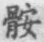

# 腹中论第四十①

①**腹中论第四十**：《新校正》云：按全元起本在第五卷。

**伯坚按：**本篇和《甲乙经》《黄帝内经太素》《类经》三书的篇目对照，列表于下：

| 素问 | 甲乙经 | 黄帝内经太素 | 类经 |
|---|---|---|---|
| 腹中论第四十 | 卷七——六经受病发伤寒热病第一中 | 卷二十六——痈疽篇 | 卷十五——厥逆之治须其气并（疾病类三十八） |
|  | 卷八——经络受病入肠胃五藏积发伏梁息贲肥气痞气奔豚第二 | 卷二十九——胀论篇 | 卷十五——寒热病（疾病类四十五·二） |
|  | 卷八——水肤胀鼓胀肠覃石瘕第四 | 卷三十——伏梁病篇 | 卷十六——鼓胀（疾病类五十五） |
|  | 卷十一——五气溢发消渴黄瘅第六 | 卷三十——热痛篇 | 卷十六——消瘅热中（疾病类六十·二） |
|  | 卷十一——动作失度内外伤发崩中瘀血呕血唾血第七 | 卷三十——血枯篇 | 卷十七——胎孕（疾病类六十二·一） |
|  | 卷十一——寒气客于经络之中发病疽风成发厉浸淫第九下 |  | 卷十七——血枯（疾病类六十三） |
|  | 卷十二——妇人杂病第十 |  | 卷十七——伏梁（疾病类七十三） |

**【释题】** 本篇讲几种发生腹部症状的疾病，所以叫作《腹中论》。

**【提要】** 本篇用黄帝、岐伯问答的形式，讲几种疾病的病理、症状和治疗方法。第一讲鼓胀。第二讲血枯。第三讲伏梁。第四讲热中消中。第五讲厥逆。第六讲怀孕。第七讲病热、䐜胀、头痛。《黄帝内经》全书所讲的治疗方法，绝大部分是针刺疗法，本篇提出了药物治疗，列举了鸡矢醴和乌鲗骨丸两个处方，这是医学发展另一方向的开始。

> 黄帝问曰：有病心腹满①，旦食则不能暮食②，此为何病？
>
> 岐伯对曰：名为鼓③胀④。
>
> 帝曰：治之奈何？
>
> 岐伯曰：治之以鸡矢醴⑤，一剂知，二剂已⑥。
>
> 帝曰：其时有复发者何也？
>
> 岐伯曰：此饮食不节，故时有病也。虽然其病且已，故时⑦当病气聚于腹也⑧。

**【本段提纲】** 马莳说：此论鼓胀之病，而有治之之方也。

**【集解】**

①**心腹满**：高世栻说：心腹，心之下，腹之上也。满，胀满也。

②**旦食则不能暮食**：张介宾说：内伤脾胃，留滞于中，则心腹胀满，不能再食。

〔p.532 (인쇄 515)〕

③**鼓**：《新校正》云：按《太素》，“鼓”作“谷”。

丹波元坚说：《太素》今本与本《经》同。

田晋蕃说：《新校正》：“按《太素》，鼓作谷。”晋蕃按：按《水经注》，“土鼓城”亦作“土谷城”。《诗》：“作为式谷”，叶“征以中垢”。顾炎武《唐韵正》，垢音古，谷亦音古。然则鼓之与谷，以音近而通也。《中山经》：“其草多竹鸡鼓。”毕氏沅《新校正》云：“即上鸡谷草。谷鼓声相近。”

**伯坚按：**此段见《黄帝内经太素》卷二十九《胀论篇》，今本《太素》仍作“鼓胀”，不作“谷胀”，与《新校正》所见本不同。

④**胀**：张介宾说：其胀如鼓，故名鼓胀。

张志聪说：鼓胀者，如鼓革之空胀也。此因脾土气虚，不能磨谷，故旦食而不能暮食，以致虚胀如鼓也。

余岩《古代疾病名候疏义》第二五四页：考旧书之言胀者，多谓与肿不同，以胀为中满，以肿为表起。《千金方》二十一《水肿》第四云：“蛊胀，但腹满，不肿。水胀，胀而四肢面目俱肿大。”两句详略，互文见义。腹满，即胀；不肿，即四肢面目不肿大；谓蛊胀之病，但胀而四肢面目不肿。至于水胀之病，腹满而四肢面目亦肿也。蛊胀，《灵枢·水胀篇》作“鼓胀”，俗谓之单腹胀，今之腹水也，四肢面目不肿。又凡外部不见膨起，而内部自觉充满者，亦曰胀，如左氏成十年《传》：“将食，张”，是也。此不过大便欲出，自觉腹胀满耳，非有腹部膨起之候也。

⑤**鸡矢醴**：杨上善说：取鸡粪作丸，熬令烟，盛以清酒一斗半沃之，承取汁，名曰鸡醴。饮取汗。一剂不愈，至于二剂，非直独疗鼓胀。肤胀亦愈。

王冰说：按古《本草》，鸡矢并不治鼓胀，惟大利小便，微寒。

马莳说：按鸡屎醴方，见《医学正传》《古今医鉴袖珍》等书，及他书甚多。

张介宾说：鸡矢之性，能消积下气，通利大小二便，盖攻伐实邪之剂也。一剂可知其效，二剂可已其病。凡鼓胀由于停积及湿热有余者，皆宜用之。若脾肾虚寒发胀及气虚、中满等证，最所忌也，误服则死。鸡矢醴法，按《正传》云：“用羯鸡矢一升，研细，炒焦色，地上出火毒，以百沸汤淋汁，每服一大盏，调木香、槟榔末各一钱，日三服，空腹服，以平为度。”又按《医鉴》等书云：“用干羯鸡矢八合，炒微焦，入无灰好酒三碗，共煎干至一半许，用布滤取汁。五更热饮则腹鸣，辰巳时行二三次，皆黑水也。次日觉足面渐有绉纹，又饮一次，则渐绉至膝上而病愈矣。”此二法，似用后者为便。

丹波元简说：按《圣济总录》：“治鼓胀旦食不能暮日鸡屎醴法。鸡矢干者，右一味为末，每用醇酒调一钱七，食后临卧服。”《宣明论》：“鸡屎醴散。鸡屎醴干者，炒大黄、桃仁各等分，右为末，每服二钱，水盏半，生姜三片，煎七分，食前服。”《千金》，产后中风，鸡粪酒，《妇人良方》引作鸡屎醴：“鸡粪一升，熬令黄。乌豆一升，熬令声绝，勿焦。以清酒三升半，先淋鸡粪，次淋豆。取汁，一服一升。温服取汗。”

丹波元坚说：鸡矢泻下之力颇峻，王氏以为利小便者是，其云取汗者误矣。《千金》治产后中风，别是法，鼓胀岂宜取汗乎？《鸡峰普济方》：“鸡矢醴。若心腹满，旦食暮不能食，由脾元虚衰，不能克制于水，水气止行，浸渍于土，土湿则不能运化水谷，气不宣流，上下痞塞，故令人中满。旦则阳气方长，谷气易消，故能食。首春则阴气方进，谷不得化，故不能食。其脉沉实而滑，病名谷胀，宜鸡矢醴。鸡矢白半升，右以好酒一斗，渍七日，温服一盏，温酒调服尽净为佳。”又方以智《物理不识》有矢醴说，殊少其要，仍不录。

喜多村直宽说：方以智云：“《素问》以鸡矢醴治鼓胀。王注：‘《本草》，鸡矢利小便，不治蛊胀。’不知鸡矢能下气通利，故岐伯用之。”

〔p.533 (인쇄 516)〕

⑥**一剂知，二剂已**：吴崑说：知，效之半也。已，效之全也。

知，参阅《素问》第三十六《刺疟篇》第二十一段“二刺则知”句下集解。

⑦**故时**：原文作“时故”。

喜多村直宽说：“时故”二字疑倒，其义似通，且与上文相应。

**伯坚按：**此段见《黄帝内经太素》卷二十九《胀论篇》，这一句作“虽然其病且已，时当痛气聚于腹。”今据喜多村直宽说校改。

⑧**病气聚于腹也**：吴崑说：言虽是饮食不节，时有病者，但此病且已之后，时有自然病者，此由病气聚于腹未尽已也。病根未拔，故亦复发焉。

张介宾说：病虽将愈，而复伤其脾，所以气复聚也。

> 帝曰：有病胸胁支满①者，妨于食，病至则先闻腥臊臭②，出清液③，先唾血，四支清④，目眩⑤，时时前后血⑥，病名为何？何以得之？
>
> 岐伯曰：病名血枯。此得之年少时有所大脱血，若⑦醉入房，中气竭，肝伤，故月事衰少不来也⑧。
>
> 帝曰：治之奈何？复以何术⑨？
>
> 岐伯曰：以四乌鲗骨⑩，一藘茹⑪，二物并合之⑫，丸以雀卵⑬，大如小豆，以五丸为后饭⑭，饮以鲍鱼⑮汁，利伤中及伤肝也⑯。

**【本段提纲】** 马莳说：此论血枯之病，而有治之之方也。

**【集解】**

①**支满**：张介宾说：支满者，满如支膈也。

支，支柱也。参阅《素问》第十《五藏生成篇》第十一段“支鬲”句下集解。

②**臊臭**：马莳说：《金匮真言论》，论肝“其臭臊”，论肺“其臭腥”。

③**出清液**：张介宾说：吐清液也。

④**四支清**：张介宾说：四肢清冷，气不能周也。

清，冷也。参阅《素问》第十七《脉要精微论》第二十六段“腰足清也”句下集解。

⑤**眩**：王冰说：眩，谓目视眩转也。

⑥**前后血**：王冰说：前后血，谓前阴、后阴出血也。

⑦**若**：犹或也，见王引之《经传释词》卷七若字条。参阅《素问》第十九《玉机真藏论》第八段“法三月若六月”句下集解。

⑧**醉入房，中气竭，肝伤，故月事衰少不来也**：马莳说：伯言此名为血枯也。是得之年少之时曾大脱血，凡鼻衄、便血、吐血皆是也。其人不知所慎，醉以入房，致使醉则损伤其中气而竭绝，入房则劳其肝气而受伤，盖司闭藏者肾也，司疏泄者肝也，故入房不惟伤肾，而且伤肝也。在丈夫则精液衰乏，女子则月事衰少不来也，但本节则主女子而言耳。

张介宾说：血枯者，月水断绝也。致此之由，其源有二。一则以少时有所大脱血，如胎产既多、及崩淋吐衄之类皆是也。一则以醉后行房，血盛而热，因而纵肆，则阴精尽泄，精去则气去，故中气竭也。夫肾主闭藏，肝主疏泄，不惟伤肾而且伤肝，及至其久，则三阴俱亏，所以有先见诸证如上文所云，而终必至于血枯，则月事衰少不来也。此虽以女子为言，若丈夫有犯前证，亦不免为精枯之病，则劳损之属皆是也。

〔p.534 (인쇄 517)〕

⑨**复以何术**：张介宾说：复者，复其血气之原也。

⑩**四乌鲗骨**：王冰说：按古《本草经》，云乌鲗鱼骨、藘茹等并不治血枯，然经法用之，是攻其所生所起尔。夫醉劳力以入房，则肾中精气耗竭。月事衰少不至，则中有恶血淹留。精气耗竭，则阴萎不起而无精。恶血淹留，则血痹着中而不散。故先兹四药用入方焉。古《本草经》曰：“乌鲗鱼骨，味咸冷平无毒，主治女子血闭。”

《重修政和经史证类备用本草》卷二十一（《四部丛刊》影印本）：乌贼鱼骨，味咸，微温。主女子漏下赤白经汁，血闭，阴蚀肿痛，寒热症瘕，无子。（**伯坚按：**以上黑地白字，是《神农本草经》原文。）

张介宾说：乌鲗，即乌贼也，骨名海螵蛸。其气味咸温下行，故主女子赤白漏下、及血闭、血枯。其性涩，故亦能令人有子。

丹波元简说：按《说文》：“鲗，乌鲗鱼也。”《本草》作乌贼。罗愿云：“此鱼有文墨可法则，故名乌鲗。鲗者，则也。骨名螵蛸，象形也。”王所谓古《本草经》，即《证类》白字文。

喜多村直宽说：《医心方》引崔禹云：“南海多垂矴而浮焉，鸟朔未见之，为死即啄，因惊卷捕以煞之，故名曰乌贼。”

陆懋修说：《说文》：“鲗，乌鲗鱼也。”《一切经音义》引《埤苍》：“鷠鲗鱼腹中有骨，出南都。背有一骨阔二寸许，有鬐甚长，口中有墨，瞋则潠人。”《古今注》：“乌鲗，一名河伯度事小史。”《临海记》：“乌鲗以其怀板含墨，故号小史鱼也。”《尔雅翼》：“鷠鲗状如革囊，背上独一骨，形如樗蒲子而长，名海螵蛸。”

⑪**藘茹**：王冰说：古《本草经》曰：“藘茹，味辛，寒平，有小毒。主散恶血。”

《新校正》云：按《甲乙经》及《太素》，“藘茹”作“蔺茹”。详王注性味乃蔺茹，当改“藘”作“蔺”。（丹波元简说：“按《本草》有‘蔺茹’而无‘藘茹’，故《新校正》云‘当改藘作蔺’，然南齐王子隆年三十一，而体过充壮，常服藘茹丸以自销损。《证类本草》蔺茹条引本篇王《注》文。知是藘、蘆、蔺一音，古通用。”田晋蕃说：“按蔺茹，《太平御览》作‘蔺茹’，引《健康记》曰：‘健康出草蘆茹’。《尔雅·释地》：‘医无蔺’，《汉书·地理志》作‘医无慮’。知闾、慮、盧声近，古通用。”）

《重修政和经史证类备用本草》卷十一（《四部丛刊》影印本）：蔺茹，味辛，寒。主蚀恶肉、败疮、死肌，杀疥虫，排脓恶血，除大风、热气、善忘、不乐。（**伯坚按：**以上黑地白字，是《神农本草经》原文。）

《重修政和经史证类备用本草》卷七（《四部丛刊》影印本）：茜根，味苦，寒。主寒湿风痹，黄疸，补中。（**伯坚按：**以上黑地白字，是《神农本草经》原文。）一名茹藘。（**伯坚按：**以上黑字。）

张介宾说：藘茹，一名茹藘，即茜草也。气味甘寒无毒，能止血治崩，又能益精气、活血、通经脉。按《甲乙经》及《太素》《新校正》俱作“蔺茹”者非，盖蔺茹有毒，岂血枯者所宜，皆未之详察耳。

丹波元简说：考《诗·郑风》：“茹藘在阪。”《尔雅》：“茹藘，茜也。”郭注：“可以染绛。”邢《疏》：“一名地血，齐人谓之茜。”《别录》：“茜根，一名茹藘。”血枯所用，当是茹藘。李时珍云：“茜根，色赤而气温，味微酸而带咸，色赤入营，气温行滞，味酸入肝而咸走血，手足厥阴血分之乐也。专于行血活血，俗方用治女子经水不通，以一两煎酒服之，一日即通，甚效。”

⑫**四乌鲗骨，一藘茹，二物并合之**：杨上善说：四，四分。一，一分。

丹波元简说：四乌鲗骨，一蔺茹，诸家不释。《圣济总录》：“乌贼鱼骨去甲，四两。蔺茹一两。”《妇人良方》同。此盖谓藘茹用乌鲗骨四之一，古法不必拘于秤量，故云尔。

〔p.535 (인쇄 518)〕

⑬**雀卵**：王冰说：古《本草经》曰：“雀卵，味甘，温平，无毒。主治男子阴萎不起，强之令热，多精有子。”

《重修政和经史证类备用本草》卷十九（《四部丛刊》影印本）：雀卵，味酸，温，无毒。主下气，男子阴萎不起，强之令热，多精有子。（**伯坚按：**以上黑字，是《名医别录》文。《神农本草经》不载此品。）

张介宾说：雀，即麻雀也。雀卵气味甘温，能补益精血，主男子阴萎不起，故可使多精有子，及女子带下便溺不利。

丹波元简说：李时珍云：“俗呼老而斑者为麻雀。”

⑭**后饭**：王冰说：饭后药先，谓之后饭。

高世栻说：后饭者，先药后饭，使药下行，而以饭压之也。

⑮**鲍鱼**：王冰说：古《本草经》曰：“鲍鱼，味辛，臭，温平，无毒。主治瘀血血痹在四支不散者。”

《重修政治经史证类备用本草》卷二十（《四部丛刊》影印本）：鲍鱼，味辛，臭，温，无毒。主坠堕、蹷、腕折、瘀血血痹在四肢不散者，女子崩中血不止。勿令中咸。（**伯坚按：**以上黑字，是《名医别录》文。《神农本草经》不载此品。）

〔역주 1〕 위 「蹷」의 첫 글자는 원서에 骨+安 꼴로 찍혀 있어 그림으로 그대로 옮겼다. 이 꼴은 유니코드에 없고, 이체자 사전(대만 교육부 《異體字字典》 腿 항목의 이체자는 蹆·骽 뿐)에도 실려 있지 않다. 원전 《證類本草》·《圖經衍義本草》·《千金翼方》은 모두 「骽(吐猥切, 腿와 같은 글자)蹷」로 적었으므로, 妥를 모양이 비슷한 安으로 잘못 조판한 것으로 보인다(추정). 읽을 때는 「骽蹷」로 보면 된다.

张介宾说：鲍鱼，即今之淡干鱼也，诸鱼皆可为之，惟石首鲫鱼者为胜。其气味辛无毒。鱼本水中之物，故其性能入水藏，通血脉，益阴气。煮汁服之，能同诸药通女子血闭也。

丹波元简说：李时珍云：“鲍鱼，《别录》既云‘勿令中咸’，即是淡鱼无疑矣。”《妇人良方》《圣济总录》，并云：“以鲍鱼煎汤下，以饭压之。”《千金翼》治妇人漏血崩中鲍鱼汤，鲍鱼、当归、阿胶、艾叶，凡四味，可见其有益阴之功也。

喜多村直宽说：《家语》：“如入鲍鱼之肆。”《周礼》：“朝事之笾宝鲍。”

⑯**利伤中及伤肝也**：原文作“利肠中及伤肝也”。

《新校正》云：按别本一作“伤中”。

喜多村直宽说：按《新校正》“一作伤中”，似是。盖伤中及伤肝，乃上文“中气竭、肝伤”之义也。

**伯坚按：**今据喜多村直宽说校改。

> 帝曰：病有少腹盛①，上下左右皆有根②，此为何病？可治不③？
>
> 岐伯曰：病名曰伏梁④。
>
> 帝曰：伏梁何因而得之？
>
> 岐伯曰：裹大脓血，居肠胃之外，不可治。治之每切按之致死⑤。
>
> 帝曰：何以然？
>
> 岐伯曰：此下则因阴必下脓血⑥。上则迫胃脘⑦，生鬲侠胃脘内痈⑧。此久病也，难治⑨。居齐上为逆。居齐下为从⑩。勿动亟夺⑪。论在《刺法》中⑫。

**【本段提纲】** 马莳说：此论伏梁之证。

**【集解】**

①**少腹盛**：张志聪说：盛，满也。少腹，脐下也。

少腹即小腹。参阅《素问》第二十二《藏气法时论》第九段“引少腹”句下集解。

②**上下左右皆有根**：吴崑说：根，病之所穷止也。

张志聪说：上下左右皆有根，此病在血分，有脉络之连络于上下四旁也。

③**不**：吴崑说：不，古否字。

〔p.536 (인쇄 519)〕

④**伏梁**：《新校正》云：详此伏梁，与心积之伏梁大异。病有名同而实异者非一，如此之类是也。

吴崑说：伏梁，言如潜伏之桥梁，为患深着之名。此与《难经》论伏梁不同，彼为心之积，是藏之阴气也；此为聚脓血，是阳毒也。

张介宾说：伏，藏伏也。梁，强梁坚硬之谓。按《邪气藏府病形篇》曰：“心脉微缓，为伏梁，在心下，上下行，时唾血。”又《经筋篇》曰：“手少阴之筋病，内急心承伏梁。”故《五十六难》曰：“心之积名曰伏梁，起脐上，大如臂，上至心下。”其义本此二篇。然观本节云：“齐上为逆，齐下为从。”下节云：“环齐而痛，病名伏梁。”是又不独以心积为伏梁也。盖凡积有内伏而坚强者，皆得名之。故本篇独言伏梁者，其总诸积为言可知也。

⑤**切按之致死**：吴崑说：谓以手切近而按之，则致人死。

张介宾说：按，折也。切按之者，谓过于妄攻也，故必致死。

高世栻说：治之每急切而按摩之，必真气受伤，故致死。

⑥**因阴必下脓血**：王冰说：若因薄于阴，则便下脓血。

张志聪说：此下，谓少腹。阴，前后阴也。

⑦**胃脘**：胃府也。参阅《素问》第七《阴阳别论》第三段“胃脘之阳也”句下集解。

⑧**生鬲侠胃脘内痈**：王冰说：若迫近于胃，则病气上出于鬲，复侠胃脘内长其痈也。

吴崑说：内痈，内溃之痈，不显于外也。

侠，夹也。参阅《素问》第三十一《热论》第二段“其脉侠鼻”句下集解。

⑨**此久病也，难治**：张介宾说：此非一朝夕所致者，延积既久，根结自深，故不易治。

⑩**居齐下为从**：王冰说：若裹大脓血居齐上，则渐伤心藏，故为逆。居齐下则去心稍远，犹得渐攻，故为从。从，顺也。

吴崑说：齐、脐同。齐下之分，小大肠膀胱之所部也，皆能受伤，即脓血穿溃，而不系人之生死，故为从。

⑪**勿动亟夺**：杨上善说：亟，数也。不可辄动数夺，夺之致死。

王冰说：亟，数也。夺，去也。言不可移动，但数数去之则可矣。

马莳说：决不可轻动之也，如上文切按之谓。必数数泻以夺之，则可以渐减而不使之上迫耳。

高世栻说：勿动亟夺，犹言勿用急切按摩以夺之，不当亟夺而妄夺，必真气受伤而致死。

丹波元简说：按高《注》允当，今从之。

夺，脱失也。参阅《素问》第二《四气调神大论》第四段“使气亟夺”句下集解。

⑫**论在《刺法》中**：马莳说：《刺法》，本经篇名，第七十二，今亡。

张介宾说：伏梁一证，即今之所谓痞块也，欲治之者莫妙于灸。

**伯坚按：**《素问》第三十三《评热病论》第四段也说：“论在《刺法》中。”参阅《素问》第七十七《疏五过论》第八段“《揆度》《阴阳》《奇恒》”句下集解。

> 帝曰：人有身体、髀、股、胻皆肿①，环②齐而痛，是为何病？
>
> 岐伯曰：病名伏梁③。此风根也④。其气溢于大肠而著于肓⑤，肓之原，在齐下⑥，故环齐而痛也。不可动之。动之，为水、溺涩之病⑦。

**【本段提纲】** 马莳说：此亦论伏梁之证，而戒其不可以轻动也。本节文见《奇病论》四十七。此节伏梁证与上节绝不相同，可见病有名同而实异者。

高世栻说：此伏梁之在气分，不同于裹大脓血之伏梁也。

**伯坚按：**《素问》第四十七《奇病论》第三段说：“帝曰：‘有人身体、髀、股、胻皆肿，环齐而痛，是为何病？’岐伯曰：‘病名曰伏梁。此风根也。其气溢于大肠而著于肓，肓之原在齐下，故环齐而痛也。不可动之。动之，为水、溺涩之病也。’”

〔p.537 (인쇄 520)〕

**【集解】**

①**髀、股、胻皆肿**：髀，股外也。胻，胫也。参阅《素问》第二十二《藏气法时论》第十二段“尻阴股膝髀腨胻足皆痛”句下集解。

②**环**：丹波元简说：王注《奇病论》云：“环，谓圆绕如环也。”

③**伏梁**：《灵枢》第四《邪气藏府病形篇》：心脉微缓，为伏梁，在心下上下行，时唾血。

王冰说：此二十六字错简在《奇病论》中。若不有此二十六字，则下文无据也。

《新校正》云：详此并无注解，尽在下卷《奇病论》中。

④**此风根也**：王冰说：此四字本篇有，《奇病论》中亦有之。

张介宾说：风根，即寒气也。如《百病始生篇》曰：“积之始生，得寒乃生，厥乃成积”，即此谓也。

⑤**其气溢于大肠而著于肓**：著，附著也。参阅《素问》第十六《诊要经终论》第三段。“邪气著藏”句下集解。

⑥**肓之原，在齐下**：王冰说：齐下，谓脖胦，在齐下同身寸之二寸半。《灵枢经》曰：“肓之原，名曰脖胦。”

吴崑说：腔中无肉空腋之处（丹波元简说：腋，疑隙误。），名曰肓。原，源也。脐下，气海也，一名脖胦。《灵枢》曰：“肓之原，名曰脖胦”，此之谓也。（丹波元简说：“肓之原，名曰脖胦”，出《九针十二原》。）

丹波元简说：《左传》成公十年云：“疾居肓之上，膏之下。”《说文》：“肓，心下鬲上也。”（下上原错，今从《左传音义》引。）傅氏《左传辨误》云：“杜云：‘肓，鬲也。心下为膏。’愚考《素问·刺禁篇》云：‘鬲肓之上，中有父母。’杨上善云：‘心下鬲上为肓。’曾亲观猪脏心鬲之处，方忆膈者隔也，自鬲以上皆心肺清洁之属，自鬲以下皆肠胃清浊之属，则心在上鬲在下固矣。而心下有微脂为膏，鬲上有薄膜为肓也。其《痹论》又云：‘皮肤之中，分肉之间，熏于肓膜’。注云：‘肓膜，谓五藏之间鬲中膜也。’则正与心下之微脂相对，益明矣。”傅此说太详备，可谓发前注所未发矣。（**伯坚按：**明傅逊《左传注解辨误》二卷，《四库全书总目提要》经部春秋类存目一著录，有明万历十三年自刻本。在傅逊的时代，《黄帝内经太素》早已亡佚，傅氏无从得见。傅氏所引杨上善注，是从《素问·新校正》转引而来。）

丹波元坚说：《稗海》本《搜神记》曰：“心上为膏。心下为肓。”段玉裁曰：“许言鬲上为肓者，析言之。鬲上肓，肓上膏，膏上心。”是说本于杜氏。《稗海》本《搜神记》似晚出书，然释膏字或有其理，当考。

肓，参阅《素问》第五十二《刺禁论》第一段“鬲肓之上，中有父母”句下集解。

⑦**动之，为水、溺涩之病**：吴崑说：水溺，小便也。

张志聪说：不可动者，不可妄攻以动之也。盖风邪之根留于脐下，动之则风气淫泆而鼓动其水矣。水溢于上，则小便为之不利矣。（丹波元简说：按志水下句，与诸注异。）

丹波元坚说：王注《奇病论》曰：“故动之则为水而溺涩也。动，谓齐其毒药而击动之，使其大下也。”

> 帝曰：夫子数言热中①、消中②，不可服高梁、芳草、石药③。石药发疽④，芳草发狂⑤。夫热中、消中者，皆富贵人也。今禁高梁，是不合其心。禁芳草、石药，是病不愈。愿闻其说⑥。
>
> 〔p.538 (인쇄 521)〕岐伯曰：夫芳草之气美，石药之气悍⑦，二者其气急疾坚劲⑧，故非缓心和人不可以服此二者⑨。
>
> 帝曰：不可以服此二者何以然？
>
> 岐伯曰：夫热气慓悍⑩，药气亦然，二者相遇，恐内伤脾。脾者土也而恶木，服此药者，至甲乙日更论⑪。

**【本段提纲】** 马莳说：此详热中、消中者，不可服膏梁、芳草、石药也。

**【集解】**

①**热中**：王冰说：多饮数溲，谓之热中。

热中，热气在腹也。参阅《素问》第十八《平人气象论》第十四段“谓之热中”句下集解。

②**消中**：王冰说：多食数溲，谓之消中。

张介宾说：按消瘅、消中者，即后世所谓三消证也。凡多饮而渴不止者为上消，消谷善饥者为中消，溲便频而膏浊不禁者为下消。如《气厥论》之云：“肺消鬲消”，《奇病论》之云：“消渴”，即上消也。《脉要精微论》云：“瘅成为消中”，《师传篇》云：“胃中热则消谷，令人善饥”，即中消也。《邪气藏府病形篇》云：“肾脉肝脉微小，皆为消瘅”，肝肾在下，即下消也。

消中是糖尿病。参阅《素问》第七《阴阳别论》第十四段“二阳结谓之消”，第十七《脉要精微论》第二十段“瘅成为消中”和第四十七《奇病论》第六段“转为消渴”句下集解。

③**高梁、芳草、石药**：王冰说：高，膏；梁，米也。石药，英乳也。芳草，浓美也。

张介宾说：高梁，厚味也。芳草，辛香之品也。石药，煅炼金石之类也。三者皆能助热，亦销阴，凡病热者所当禁用。

丹波元坚说：《楚辞·大招》：“和致芳只。”注：“芳，姜椒也。”张衡《七辨》：“芳以姜椒。”此所谓芳草，盖姜椒之属，张注亦谓是也。

高梁，参阅《素问》第三《生气通天论》第四段“高梁之变”句下集解。

④**石药发疽**：原文作“石药发瘨”。

丹波元简说：按瘨，《说文》：“病也。一曰腹胀也。”乃瞋从疒者。而《战国策》为癫狂之癫，古通用可知矣。《甲乙》作“疽”，似是。

田晋蕃说：《甲乙经》十一，“瘨”作“疽”。晋藩按：《说文》有“瘨”无“癫”，“瘨”为瘨狂之正字。但《素问》瘨狂字，如《脉解篇》之“所谓甚则狂颠疾者”，《阴阳类篇》之“颠疾为狂”，皆借“颠”为之。此处作“瘨”，殆为“疽”之误文。《千金翼方》有治服石及散发背痈疽方，《外台秘要》有疗服石之人患疮肿方，石药发疽，古多有之。

**伯坚按：**此段见《甲乙经》卷十一《五气溢发消渴黄瘅》第六，作“石药发疽”。今据丹波元简、田晋蕃说，依《甲乙经》校改。

⑤**狂**：参阅《素问》第二十八《通评虚实论》第二十一段“狂”句下集解。

⑥**夫热中、消中者，皆富贵人也。今禁高梁，是不合其心。禁芳草、石药，是病不愈。愿闻其说**：王冰说：热中、消中者，脾气之上溢，甘肥之所致，故禁食高梁芳美之草也。《通评虚实论》曰：“凡治消瘅，甘肥贵人则高梁之疾也。”又《奇病论》曰：“夫五味入于口，藏于胃，脾为之行其精气。津液在脾，故令人口甘。此肥美之所发也，此人必数食甘美而多肥也。肥者令人内热，甘者令人中满，故其气上溢，转为消渴。”此之谓也。夫富贵人者，骄恣纵欲，轻人而无能禁之，禁之则逆其志，顺之则加其病，帝思难诘，故发问之。

〔p.539 (인쇄 522)〕

高世栻说：夫热中、消中者，精血内竭，火热消烁，皆富贵人之病也。富贵之人厚味自养，今禁膏粱，是不合其心。富贵之人土气壅滞，宜升散其上，镇重其下，今禁芳草石药，是病不愈。愿闻所以禁之之说。

⑦**石药之气悍**：丹波元坚说：《仓公传》论曰：“中热不溲者，不可服五石，石之为药精悍。”

⑧**二者其气急疾坚劲**：王冰说：坚，定也，固也。劲，刚也。言其芳草、石药之气坚定固久，刚烈而卒不歇灭，此二者是也。

张介宾说：芳美者气热而散，悍急者惟刚而烈也。

⑨**故非缓心和人不可以服此二者**：马莳说：非性缓心和者不可以轻服。

⑩**慓悍**：王冰说：慓，疾也。

吴崑说：慓悍，急疾也。

丹波元简说：慓悍二字，见《阴阳应象大论》。（**伯坚按：**《素问》第五《阴阳应象大论》第二十六段说：“其慓悍者按而收之。”）

喜多村直宽说：《说文》：“慓，疾也。悍，勇也。”《博雅》：“慓，急也。”《集韵》：“悍，急也。”

⑪**至甲乙日更论**：王冰说：甲乙为木，故至甲乙日更论脾病之增减也。

吴崑说：甲乙，木也。至此日更论者，虑其为病益甚也。

十天干和五行五藏的配合，参阅《素问》第三十二《刺热篇》第一段“甲乙大汗”句下集解附表。

> 帝曰：善。有病膺肿①、颈②痛、胸③满、腹胀，此为何病？何以得之？
>
> 岐伯曰：名厥逆④。
>
> 帝曰：治之奈何？
>
> 岐伯曰：灸之则瘖⑤。石⑥之则狂。须其气并，乃可治也。
>
> 帝曰：何以然？
>
> 岐伯曰：阳气重上，有余于上，灸之则阳气入阴，入则瘖⑦。石之则阳气虚，虚则狂⑧。须其气并而治之，可使全也⑨。

**【本段提纲】** 马莳说：此论厥逆之证，必待其阴阳气并而后可治之也。

**【集解】**

①**膺肿**：王冰说：膺，胸傍也。

《新校正》云：按《甲乙经》作“痈肿”。

张介宾说：膺，胸之两傍高处也。

丹波元简说：按痈、壅同。详见于《气厥论》。（**伯坚按：**见《素问》第三十七《气厥论》第一段“痈肿”句下丹波元简说。）

丹波元坚说：《太素》亦作“痈肿”。

②**颈**：王冰说：颈，项前也。

③**胸**：王冰说：胸，膺间也。

④**名厥逆**：马莳说：膺、颈、胸、腹，皆在上中二焦也。今膺肿、颈痛、胸满、腹胀，则下气逆上，病名厥逆。

张介宾说：此以阴并于阳，下逆于上，故病名厥逆。

⑤**瘖**：吴崑说：瘖，失音也。

瘖，参阅《素问》第二十三《宣明五气篇》第八段“搏阴则为瘖”句下集解。

〔p.540 (인쇄 523)〕

⑥**石**：吴崑说：石，谓以砭石刺之也。

石，参阅《素问》第十二《异法方宜论》第二段“其治宜砭石”句下集解。

⑦**瘖**：杨上善说：灸之瘖者，阳气上实，阴气下虚，灸之大壮阳盛，溢入阴，故瘖。

张介宾说：阳气有余于上，而复灸之，是以火济火也。阳极乘阴，则阴不能支，故失声为瘖。

⑧**狂**：张介宾说：阳并于上，其下必虚，以石泄之，则阳气随刺而去，气去则上下俱虚而神失其守，故为狂也。

⑨**须其气并而治之，可使全也**：马莳说：必须其阳气从上而降，阴气从下而升，阴阳相并，然后治之，或灸或针，可使全也。所谓阳气者，卫气也；阴气者，营气也。

张介宾说：气并者，则阴阳既逆之后，必渐通也。盖上下不交，因而厥逆，当其乖离而强治之，恐致偏绝，故必须其气并，则或阴或阳，随其盛衰，察而调之，可使保全也。

> 帝曰：善。何以知怀子之且生也？
>
> 岐伯曰：身有病①而无邪脉也②。

**【本段提纲】** 马莳说：此言怀子之将生者，身虽经闭而脉则无病也。

**【集解】**

①**身有病**：王冰说：病，谓经闭也。《脉法》曰：“尺中之脉来而断绝者，经闭也。月水不利，若尺中脉绝者，经闭也。”今病经闭，脉反如常者，妇人妊娠之证，故云身有病而无邪脉。

汪昂说：病字，王注解作经闭。昂按妇人怀子，多有呕恶、头痛诸病，然形虽病而脉不病。若经闭其常耳，非病也。

②**无邪脉也**：张介宾说：身病者脉亦当病，或断续不调，或弦涩细数，是皆邪脉，则真病也。若六脉和滑而身有不安者，其为胎气无疑矣。

丹波元坚说：《金匮》曰：“妇人得平脉，阴脉小弱，其人渴不能食，无寒热，名妊娠。”

> 帝曰：病热而有所痛者何也？
>
> 岐伯曰：病热者，阳脉也，以三阳之动也①。人迎一盛少阳，二盛太阳，三盛阳明，入阴也②。夫阳入于阴，故病在头与腹，乃䐜胀而头痛也③。
>
> 帝曰：善。

**【本段提纲】** 马莳说：此言病热而有所痛者，正以外感之疾，阳毕入阴，故外头痛而内腹胀也。

**【集解】**

①**病热者，阳脉也，以三阳之动也**：吴崑说：言是阳脉受病也。动，脉来动甚也，病则为痛。

张介宾说：阳脉者，火邪也。凡病热者必因于阳，故三阳之脉其动甚也。

张志聪说：夫病热者，阳脉盛也。阳脉盛者，三阳之气动之也。

②**人迎一盛少阳，二盛太阳，三盛阳明，入阴也**：杨上善说：阳明血气最大，故人迎三盛，得知有病。太阳次少，故二盛得知。次少阳最少，故一盛得知。太阳在头，故热病起，太阳先受。太阳受已，下如阳明，故阳明次病。阳明受已，末流少阳，故少阳有病。

《新校正》云：按《六节藏象论》云：“人迎一盛病在少阳，二盛病在太阳，三盛病在阳明”，与此论同。又按《甲乙经》：“三盛阳明”，无“入阴也”三字。

马莳说：《六节藏象论》《灵枢》《终始》《禁服》《五色》《四时气》等篇皆云：“人迎一盛，病在足少阳；一盛而躁，病在手少阳。人迎二盛，病在足太阳；二盛而躁，病在手太阳。人迎三盛，病在足阳明；三盛而躁，病在手阳明。”三阳既毕，则入之三阴经分矣。

〔p.541 (인쇄 524)〕

张介宾说：人迎，足阳明脉，所以候阳也。如《终始》《禁服》《六节藏象》等篇，俱详明其义。凡邪热在表，三阳既毕，乃入于阴分矣。

③**故病在头与腹，乃䐜胀而头痛也**：张介宾说：头主阳，腹主阴，阳邪在头则头痛，及其入于阴分则腹为䐜胀也。

## 《腹中论第四十》今译

黄帝问说：有人心腹胀满，早晨吃了饭则晚上不能再吃，这是什么病呢？

岐伯回答说：这个病名叫作鼓胀。

黄帝说：如何治疗呢？

岐伯说：应当用鸡矢醴①去治它。吃一剂即会较好，吃两剂即可痊愈。

黄帝说：这个病也有第二次再发的，这是什么原因呢？

岐伯说：这是由于饮食没有节制，所以再发。这种病虽然再发，还是会痊愈的。

黄帝说：有胸部胁部胀满，不能进食，病发的时候则闻着腥臊臭，口吐清水，吐血，四肢寒冷，眼睛发眩，大小便出血，这是什么病，从何得来的。

岐伯说：这个病名叫作血枯。这种人年轻的时候曾有过大出血，或者喝醉了酒又去行房，中气衰竭，肝受了伤，在女子则月经减少不来。

黄帝说：如何治疗呢？如何恢复血气呢？

岐伯说：用四份乌鲗骨（墨鱼骨），一份藘茹，将它们并合在一块，用麻雀蛋混合做成丸子，如小豆大小，在饭前服，每次服五丸，用鲍鱼汤送下，这对中气受伤和肝受伤是有效的。

黄帝说：有小腹胀满，上下左右都有根，这是什么病？能不能治疗？

岐伯说：这个病名叫作伏梁。

黄帝说：什么原因就得伏梁呢？

岐伯说：在肠胃外面，有裹着脓血的处所，这是无法治疗的。如果在诊治的时候将手用力按着它，则会致死。

黄帝说：为什么呢？

岐伯说：在小腹下面，则由大小便排出脓血。在小腹上面，则迫近胃部靠着横膈膜夹着胃而成为内痈，这是一个慢性病，很难治疗。在肚脐上面的伏梁是逆证。在肚脐下面的伏梁是顺证。不可用力按摩来按消它。《刺法》这一部书中对于这个病曾有讨论。

黄帝说：有躯干、髀部②、大腿、小腿都肿大，围绕着肚脐痛，这是什么病呢？

岐伯说：这个病名叫作伏梁。这是由于寒气所致。寒气充满了大肠而附着肓③，肓的根源在肚脐下面，所以围绕着肚脐痛。不可动它，动了它则会成为水肿、小便闭塞的病。

黄帝说：你常说热中（糖尿病多饮）和消中（糖尿病多食）不可以吃肥厚丰美的食物，不可以服用辛香和石类的药品。石类的药品可以使人生疽。辛香的药品可以使人发狂。凡得这种病的人都是富贵人。如果禁止吃肥厚丰美的食物，则他不愿意。如果不用辛香和石类的药品，则病不会好。我希望知道处理这种病的方法。

岐伯说：辛香的药物味美，石类的药物气悍，它们的作用都剧烈而持久，不是心性缓和的人不可以轻服。

黄帝说：为什么不可以服这两类药物呢？

〔p.542 (인쇄 525)〕

岐伯说：人体内的热气剧烈，这两类的药性也剧烈，它们合在一块，则将使脾受伤。脾属土而厌恶木，如果服用这两类药品，则须待至甲乙（木）的日子再看情形说话（看脾是否受伤）。

黄帝说：好。有病膺部（胸的两旁高处）肿大、颈部痛，胸部（胸的当中凹处）胀满，腹部胀满的，这是什么病？从何得来的？

岐伯说：这个病名叫作厥逆。

黄帝说：如何治疗呢？

岐伯说：如果用灸法治疗，则会失音。如果用砭石治疗，则会发狂。需要等到病人的阴气阳气并合之后才可治疗。

黄帝说：为什么呢？

岐伯说：上面的阳气有余，如果用灸法则阳气进入阴分，进入阴分则会失音。如果用砭石则阳气虚弱，阳气虚弱则会发狂。须待至阴气阳气合并之后再开始治疗，才可收效。

黄帝说：好。如何才能知道女子怀孕将生呢？

岐伯说：凡怀孕的女子身上虽有种种的病（月经停止、呕吐、头痛等），但脉搏却是正常的没有病象。

黄帝说：患热病的而有痛的症状，这是什么原因呢？

岐伯说：热病是阳经脉的病，三阳经脉跳动得很厉害。人迎脉盛过寸口脉一倍的是少阳病，盛过二倍的是太阳病，盛过三倍的是阳明病，最后侵进阴脉。由阳脉侵进阴脉，所以病在头部和腹部，而有腹胀和头痛的症状。

黄帝说：好。

①**鸡矢醴**：据《圣济总录》，是用干鸡屎研为粉末，用醇酒调一钱匕，在饭后临睡前口服。

②**髀部**：髀是一个身体表面部位的名词，是左右两边髂骨嵴下面的部位。

③**肓**：心的下面，横膈膜的上面，这个部位名叫作肓。
