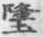

# 奇病论第四十七①

①**奇病论第四十七**：《新校正》云：按全元起本在第五卷。

吴崑说：奇病，特异于常之病也。

丹波元简说：凡风也、痹也、厥也、痿也，属类颇多。此篇所载重身声瘖、息积、疹筋等，率皆奇特之病，故以奇病名篇。

田晋蕃说：按《方盛衰论》云：“奇恒之势，乃六十首。”《玉版论要》云：“奇恒者，言奇病也。”顾氏观光疑此篇即古《奇恒》书之仅存者。（**伯坚按：**顾观光说见《素问》第十五《玉版论要篇》第一段“奇恒者言奇病也”句下集解。）

**伯坚按：**本篇和《甲乙经》《黄帝内经太素》《类经》三书的篇目对照，列表于下：

| 素问 | 甲乙经 | 黄帝内经太素 | 类经 |
|---|---|---|---|
| 奇病论第四十七 | 卷四——病形脉诊第二上 | 卷二十九——风水论篇 | 卷十五——肾风风水（疾病类三十一·二） |
|  | 卷八——经络受病入肠胃五藏积发 伏梁息贲肥气痞气奔豚第二 | 卷三十——重身病篇 卷三十——息积病篇 | 卷十五——厥逆头痛（疾病类三十六·一） 卷十五——厥逆头痛（疾病类三十六·二） |
|  | 卷八——肾风发风水面胕肿第五 | 卷三十——伏梁病篇 | 卷十六——脾瘅胆瘅（疾病类六十一） |
|  | 卷九——大寒内薄骨髓阳逆发头痛 第一 | 卷三十——脾瘅消渴篇 卷三十——胆瘅篇 | 卷十七——胎孕（疾病类六十二·二） 卷十七——癫疾（疾病类六十五·二） |
|  | 卷九——邪在心胆及诸藏府发悲恐 太息口苦不乐及惊第五 | 卷三十——头齿痛篇 卷三十——疹筋篇 | 卷十七——伏梁（疾病类七十三·二） 卷十七——息积（疾病类七十四） |
|  | 卷九——足厥阴脉动喜怒不时发癫 疝遗溺癃第十一 | 卷三十——癫疾篇 卷三十——厥死篇 | 卷十七——疹筋（疾病类七十五） |
|  | 卷十一——阳厥大惊发狂痫第二 |  |  |
|  | 卷十一——五气溢发消渴黄瘅第六 |  |  |
|  | 卷十二——妇人杂病第十 |  |  |

**【释题】** 本篇讨论几种奇特的疾病，所以叫作《奇病论》。

**【提要】** 本篇用黄帝、岐伯问答的形式，讨论几种疾病的病理、诊断和治疗。第一讲重身声瘖。第二讲息积。第三讲伏梁。第四讲疹筋。第五讲厥逆。第六讲脾瘅。第七讲胆瘅。第八讲厥。第九讲巅疾。第十讲肾风。本篇也提出了药物治疗，用导引服药治息积，用兰草治脾瘅，这是《腹中论》《病能论》以后，在《素问》中第三篇提出的药物治疗。

> 黄帝问曰：人有重身①九月而瘖②，此为何也？
>
> 岐伯对曰：胞之络脉绝也③。
>
> 帝曰：何以言之？
>
> 岐伯曰：胞络者，系于肾少阴之脉，贯肾，系舌本，故不能言④。
>
> 帝曰：治之奈何？
>
> 岐伯曰：无治也。当十月复⑤。《刺法》曰：“无损不足、益有余，以成其疹⑥。”然后调之⑦，所谓无损不足者，身羸瘦无用镵石也⑧。无益其有余者，腹中有形而泄之，泄之则精出而病独擅中，故曰疹成也⑨。

〔p.618 (인쇄 601)〕

**【本段提纲】** 马莳说：此谓重身而瘖者，当产后愈，不必强施以攻补之法也。

**【集解】**

①**重身**：杨上善说：妇人怀子，又名曰重身。

王冰说：重身，谓身中有身，则怀妊者也。

丹波元简说：《诗·大雅》：“大任有身。”毛《传》：“身，重也。”《笺》：“谓怀孕也。”

田晋蕃说：按《诗·大明》笺：“重，谓怀孕也。”陈氏奂曰：“怀子曰重，今江苏有此遗语。”身，古㑗字。《玉篇》：“㑗，妊身也。”《广雅》：“身，㑗也。”重与身同义，古人自有复语耳。

②**九月而瘖**：王冰说：瘖，谓不得言语也。妊娠九月，足少阴脉养胎约气，断则瘖不能言也。

马莳说：瘖，症也。九月而瘖者，医书谓人之受孕者，一月肝经养胎，二月胆经养胎，三月心经养胎，四月小肠经养胎，五月脾经养胎，六月胃经养胎，七月肺经养胎，八月大肠经养胎，九月肾经养胎，十月膀胱经养胎，先阴经而后阳经，始于木而终于水，以五行之相生为次也。然以理推之，则手足十二经之经脉，昼夜流行无间，无时无日而不供养胎气也，必无分经养胎之理。今曰九月而瘖，盖时至九月，则妊胎已久，儿体日长，胞络宫之络脉系于胃经者，阻绝而不通，故间有为之瘖者，非人人然也。

丹波元简说：按徐之才《逐月养胎法》，见于《千金方》。

顾观光说：《脉经》云：“妇人怀胎，一月之时足厥阴脉养，二月足少阳脉养，三月手心主脉养，四月手少阳脉养，五月足太阴脉养，六月足阳明脉养，七月手太阴脉养，八月手阳明脉养，九月足少阴脉养，十月足太阳脉养。诸阴阳各养三十日。手太阳、少阴不养者，下主月水，上为乳汁。”

③**胞之络脉绝也**：马莳说：此乃阻绝之绝，非断绝之谓。《生气通天论》云：“大怒则形气绝而血菀于上”，亦阻绝之绝。

吴崑说：胞，子室也。络脉，支络之脉也。

胞，参阅《素问》第四十三《痹论》第五段“胞痹者”句下集解。

④**胞络者，系于肾少阴之脉，贯肾，系舌本，故不能言**：《灵枢》第十《经脉篇》：肾足少阴之脉，起于小指之下，邪走足心，出于然谷之下，循内踝之后，别入跟中，以上踹内，出腘内廉，上股内后廉，贯脊，属肾，络膀胱。其直者，从肾上贯肝膈，入肺中，循喉咙，挟舌本。其支者，从肺出络心，注胸中。

⑤**当十月复**：王冰说：十月胎去，胞络复通，肾脉上营，故复旧而言也。

丹波元简说：《医说》引邵氏《后闻见录》云：“郝翁名允，博陵人。一妇人妊，咽嘿不能言。翁曰：‘儿胞大经壅，儿生经行则言矣，不可毒以药。’”又引《医余》云：“孕妇不语，非病也。闻如此者，不须服药，临产日但服保生丸、四物汤之类，产后便语，亦自然之理，非药之功。”

⑥**以成其疹**：王冰说：疹，谓久病也。

王引之《经义述闻》卷二十殄病条：《鲁语》：“铸名器，藏宝财，固民之殄病是待。”按殄，亦病也。《周官·稻人》：“夏以水殄草而芟夷之。”郑注曰：“殄，病也。”《大雅·瞻卬篇》曰：“邦国殄瘁。”殄之言瘨也，疹也。《大雅·云汉篇》：“胡宁瘨我以旱。”郑《笺》曰：“瘨，病也。”《释文》：“瘨，韩《诗》作疹。”《越语》：“疾疹贫病。”疹、殄、瘨，声近而义同。

丹波元简说：按《国语》：“孤子寡妇疾疹。”《伤寒例》云：“小人触冒，必婴暴疹。”

田晋蕃说：按疹，籀文胗。《灵枢·胀论》：“必审其胗。”此疹字即疢疾之疢。《小雅·小弁篇》及《左传》成六年、哀五年《释文》，并云“疢或作疹”。《广雅音》云：“疢，今疹字也。”《考工记》：“疢疾险中。”注：“牛有久病。”王训疹为久病，足证疹即疢也。

〔p.619 (인쇄 602)〕

⑦**然后调之**：《新校正》云：按《甲乙经》及《太素》无此四字。按全元起注云：“所谓不治者，其身九月而瘖，身重不得为治，须十月满身后复如常也，然后调之。”则此四字本全元起注文，误书于此，当删去之。

丹波元简说：此四字宜据《新校正》删之，明是全注羼入。

**伯坚按：**此段见《甲乙经》卷十二《妇人杂病》第十；又见《黄帝内经太素》卷三十《重身病篇》，都没有“然后调之”四字。今据《新校正》、丹波元简说，依《甲乙经》《太素》删去此四字。

⑧**身羸瘦无用镵石也**：王冰说：妊娠九月，筋骨疲劳，力少身重，又拒于谷，故身形羸瘦，不可以镵石伤也。（喜多村直宽说：注“妊娠九月”云云见《巢源》。）

张志聪说：镵，谓针。石，砭石也。《针经》曰：“形气不足，病气不足，此阴阳之气俱不足也，不可刺之。刺之则重不足，不足则阴阳俱竭，血气皆尽，五藏空虚，筋骨髓枯，老者绝灭，壮者不复矣。”是以身羸瘦者不可妄加针石。（**伯坚按：**张志聪所引《针经》，见《灵枢》第五《根结篇》。）

⑨**腹中有形而泄之，泄之则精出而病独擅中，故曰疹成也**：张介宾说：胎元在胞而刺之，则精气必泄，精泄则胎气伤，而病独专于中，是益其有余，故疹成也。

张志聪说：泄，谓用针泻之。《针经》曰：“刺之害中而不去则精泄，精泄则病益甚而恇。”按腹中胞积皆为有形，在女子胞则曰无益其有余，在息积则曰不可灸刺，在伏梁曰不可动之，是腹中有形者皆不可刺泄。刺虽中病而有形之物不去，则反泄其精气，正气出而邪病反独擅于其中，故为疹成也。（**伯坚按：**张志聪所引《针经》，见《灵枢》第一《九针十二原篇》，又见第二十一《寒热病篇》。）

> 帝曰：病胁下满、气逆①，二三岁不已，是为何病？
>
> 岐伯说：病名曰息积②。此不妨于食，不可灸刺。积为导引、服药③，药不能独治也。

**【本段提纲】** 马莳说：此言息积之病，当兼导引服药以治之也。

**【集解】**

①**病胁下满，气逆**：马莳说：胁下胀满，气甚喘逆。

②**病名曰息积**：《灵枢》第六十六《百病始生篇》：是故虚邪之中人也，始于皮肤，皮肤缓则腠理开，开则邪从毛发入，入则抵深，深则毛发立，毛发立则淅然，故皮肤痛。……留而不去，传舍于肠胃之外，募原之间，留著于脉，稽留而不去，息而成积。

张介宾说：积不在中而在胁之下者，初起微小，久而至大，则胁满气逆，喘促息难，故名息积。今人有积在左胁之下，俗名为痞者，其即此证，惟小儿为尤多。盖饮食过伤，脾不及化，则余气留滞而结聚于此，其根正在胁间，阳明病剧，则上连于肺，此其所以为息积也。

丹波元简说：按《百病始生篇》云：“稽留不去，息而成积。”据此则息谓生长（出《前汉·宣帝纪》师古注），犹瘜肉之瘜也。《圣济总录》云：“夫消息者，阴阳之更事也。今气聚胁下，息而不消，积而不散，故满逆为病。然气客于外，不干胃府，故不妨食，特害于气息也。导引能行积气，药力亦藉导引而行故也。”有方附于五十七卷。此以息而不消、积而不散，解息积之义，极是矣。而至谓害于气息，则竟未免歧误。

钱熙祚《素问跋》：《奇病论》云：“病胁下满、气逆，二三岁不已，名曰息积。”《甲乙经》作“息贲”，以此隶《难经》息贲条后，则“积”字为传写之误无疑。《难经》言“息贲在右胁下，覆大如杯，久不愈，病气逆、喘咳”，与经文正相合也。

〔p.620 (인쇄 603)〕

顾观光说：“积”字误，当依《甲乙经》作“贲”。

田晋蕃说：《甲乙经》八，“积”作“贲”。按《难经》明曰：“留结为积”，故经以息积名之。

**伯坚按：**钱熙祚《素问跋》所说的话是有问题的。按《甲乙经》这一部书，据皇甫谧《自序》所说，是将《针经》（即今天的《灵枢》）《素问》和《明堂孔穴针灸治要》三部书混合编成的，自序中并没有提到《难经》。根据《甲乙经》全书的体例，凡所引《素问》《灵枢》和《明堂》三部书的文字，都没有注明哪一条出于什么书。可见凡是注明书名或人名的，如“《素问》曰”“《灵枢》曰”“《难经》曰”“张仲景曰”“杨上善曰”等，都是后人的小注混入正文的文字，而不是皇甫谧《甲乙经》的原文。此段见《甲乙经》卷八《经络受病入肠胃五藏积发伏梁息贲肥气痞气奔豚第二》，上面明明冠有“《难经》曰”三字，这很明显是混入正文的后人小注。钱熙祚所说《甲乙经》“以此隶《难经》息贲条后”，仿佛是皇甫谧当时有意如此，实则这是后人将这一段《难经》注入《甲乙经》的，与《甲乙经》原文无关。

③**积为导引、服药**：高世栻说：积，渐次也，须渐次为之导引而服药。导引，运行也。运行则经脉之亏者可复，若但服药，则药不能独治也。

导引，参阅《素问》第十二《异法方宜论》第六段“其治宜导引按𫏋”句下集解。

> 帝曰：人有身体、髀、股、胻皆肿，环齐而痛，是为何病？
>
> 岐伯曰：病名曰伏梁①。此风根也。其气溢于大肠而著于肓，肓之原、在齐下，故环齐而痛也。不可动之。动之，为水、溺涩之病也②。

**【本段提纲】** 王冰说：此一问答之义，与《腹中论》同，以为奇病，故重出于此。

**伯坚按：**《素问》第四十《腹中论》第四段说：“帝曰：‘人有身体、髀、股、胻皆肿，环齐而痛，是为何病？’岐伯曰：‘病名伏梁。此风根也。其气溢于大肠而著于肓，肓之原、在齐下，故环齐而痛也。不可动之。动之，为水、溺涩之病。’”

**【集解】**

①**病名曰伏梁**：《灵枢》第四《邪气藏府病形篇》：心脉微缓，为伏梁，在心下上下行，时唾血。

王冰说：以冲脉病，故名曰伏梁。然冲脉者，与足少阴之络起于肾下，出于气街，循阴股内廉，斜入腘中，循胻骨内廉，并足少阴经，下入内踝之后，入足下。其上行者，出齐下同身寸之三寸关元之分，侠齐直上，循腹各行，会于咽喉。故身体、髀皆肿，绕齐而痛，名曰伏梁。环，谓圆绕如环也。

②**动之，为水、溺涩之病也**：王冰说：以冲脉起于肾下，出于气街，其上行者起于胞中，上出齐下关元之分，故动之则为水而溺涩也。动，谓齐其毒药而击动之，使其大下也。

**伯坚按：**这一段和《素问》第四十《腹中论》第四段完全相同，参阅该段集解。

> 帝曰：人有尺脉数甚①，筋急而见②，此为何病？
>
> 岐伯曰：此所谓疹筋③。是人腹必急④。白色、黑色见，则病甚⑤。

**【本段提纲】** 高世栻说：此疹筋腹急，为先天奇病，而病必甚也。

**【集解】**

①**人有尺脉数甚**：王冰说：《脉要精微论》曰：“尺外以候肾。尺里以候腹中。”

丹波元简说：按《十三难》云：“脉数，尺之皮肤亦数。”丁氏注：“数，心也，所以臂内之皮肤热也。”盖与此同义。

丹波元坚说：《太素》无“脉”字。杨曰：“尺□（按当肤字）数□（按当筋字）急见出者，此为疹筋。筋急腹急，此必金水垂（按当作乘）。肝，故色白黑即甚也。有本为尺瘦也。”坚按《太素》为是。一作尺瘦者尤是。盖血液虚少故尺肉削减，即为腹筋竖急之诊。此脉字芟去，而《素》《灵》中遂无尺部诊脉之说矣。《难经·经释》于《十三难》下曰：“今去经文大小字而易数字。数者，一息六七至之谓。若皮肤则如何能数？”按所言经文者，《灵·邪气藏府病形篇》也。

〔p.621 (인쇄 604)〕

**伯坚按：**此段见《甲乙经》卷四《病形脉诊》第二上，作“人有尺肤缓甚”。

②**筋急而见**：王冰说：筋急，谓掌后尺中两筋急也。

张介宾说：筋急而见，筋脉拘急而形色外见也。

高世栻：筋急而见，肌肉脱也。

③**疹筋**：吴崑说：疹筋，病筋也。

④**是人腹必急**：王冰说：腹急，谓侠齐竖筋俱急。以尺里候腹中，故见尺中筋急必腹中拘急矣。

丹波元简说：按《圣济总录》云：“夫热则筋缓，寒则筋急。今也肝气内虚，虚则生寒，故筋急而见。其尺脉数甚者，盖尺里以候腹中，其人腹急，则尺脉见数，数亦为虚，以腹内气虚故也。气既寒而筋急，其色又见白黑，是为寒甚之证。”有方附于四十二卷。又《外台》云：“痃癖，发即两筋弦急。”陈氏《妇人良方》云：“痃者，在腹内近齐左右，各有一条筋脉急痛，大者如臂，次者如指，因气而成，如弦之状，名曰痃气也。”慧琳《一切经音义》云：“痃病，即腹中冷气病也，发即脉胀牵急，如似弓弦，故俗呼为痃气病也。”据王注，此即疹筋也。

⑤**白色、黑色见，则病甚**：王冰说：色见，谓见于面部也。夫相五色者，白为寒，黑为寒，故二色见、病弥甚也。

> 帝曰：人有病头痛，以数岁不已，此安得之？名为何病①？
>
> 岐伯曰：当有所犯大寒，内至骨髓。髓者、以脑为主，脑逆故令头痛，齿亦痛②。病名曰厥逆③。
>
> 帝曰：善。

**【本段提纲】** 马莳说：此言岁久头痛者，以其寒入于脑，气有所逆而然也。

**【集解】**

①**人有病头痛，以数岁不已，此安得之？名为何病**：王冰说：头痛之疾，不当逾月，数年不愈，故怪而问之也。

②**齿亦痛**：王冰说：全注：“人先生于脑，缘有脑则有骨髓。齿者，骨之本也。”

张琦说：按王氏引全注，仅见此条。

**伯坚按：**张琦此说不确。王冰采用全元起注，共有五处。王冰明引全元起注计有二处。第一处是《素问》第十九《玉机真藏论》第十八段“此其候也”句下注。第二处是本篇此段。王冰暗引全元起注计有三处。第一处是本篇第八段“此有余也”句下注。第二处是《素问》第五十四《针解》第三段“人齿面目应星”句下注。第三处是《素问》第七十九《阴阳类论》第十六段“期在石水”句下注。王冰暗引的这三处，下面都有新校正，说明王冰是采用全元起注。

③**病名曰厥逆**：杨上善说：大寒入于骨髓，流入于脑中，以其脑有寒逆，故头痛数岁不已，齿为骨余，故亦齿痛。

丹波元简说：《圣济总录》，方附于五十一卷。李氏《兰室秘藏》有羌活附子汤，罗氏《卫生宝鉴》有麻黄附子细辛汤，危氏《得效方》有白附子散，并治大寒犯脑头痛。

> 帝曰：有病口甘者，病名为何？何以得之？
>
> 〔p.622 (인쇄 605)〕岐伯曰：此五气之溢也①。名曰脾瘅②。夫五味入口，藏于胃，脾为之行其精气③，津液在脾④，故令人口甘也。此肥美之所发也，此人必数食甘美而多肥也⑤。肥者、令人内热，甘者、令人中满，故其气上溢，转为消渴⑥。治之以兰⑦，除陈气也⑧。

**【本段提纲】** 马莳说：此言有脾瘅之疾者，当转为消渴，而有治之之法也。

**【集解】**

①**此五气之溢也**：杨上善说：五气，五谷之气。

王冰说：脾热则四藏同禀，故五气上溢也。

吴崑说：五气，腥、焦、香、臊、腐也。溢，上溢也。

张介宾说：五气，五味之所化也。

张志聪说：五气者，土气也。土位中央，在数为五，在味为甘，在臭为香，在藏为脾，在窍为口。

丹波元简说：按万历本《医说》作“土气”，志《注》为是。王意亦当如此。

顾观光说：五气，当谓五味之气。

田晋蕃说：按下文云，“五味入口，藏于胃，脾为之行其精气”，故曰五气。

②**脾瘅**：王冰说：瘅，谓热也。生因脾热，故曰脾瘅。

丹波元简说：《圣济总录》云：“夫食入于阴，长气于阳，肥甘之过，令人内热而中满，则阳气盛矣，故单阳为瘅也。其证口甘。久而弗治，转为消渴，以热气上溢故也。”有方附于四十五卷。

喜多村直宽说：《汉·艺文志》：“《五藏六府瘅十二病方》四十卷。”

③**精气**：吴崑说：精气，气之清而美者。

④**津液在脾**：杨上善说：液在脾者，五谷液也。

⑤**此人必数食甘美而多肥也**：《吕氏春秋·本生篇》：肥肉厚酒，务以自强，命之曰烂肠之食。

丹波元简说：《甲乙》作“数食美而多食甘肥”，简按《甲乙》为是。枚乘《七发》：“甘脆肥浓，命曰腐肠之药。”

⑥**消渴**：《新校正》云：按《甲乙经》，“消渴”作“消瘅”。

吴崑说：消渴，饮水善消，而渴不已也。

余岩《古代疾病名候疏义》第二一三页：《释名》“消㵣：㵣，渴也。肾气不周于胸胃中，津液消渴，故欲得水也。”按《说文》㵣下曰：“欲饮歠，从欠，渴声。”段氏《注》曰：“渴者，水尽也，音同竭。水渴则欲水，人㵣则欲饮，其意一也。今则用竭为水渴字，用渴为饥㵣字，而㵣字废矣，渴之本义废矣。”据此则㵣字实为饥渴、口渴之本字。

消㵣乃病之证候，非病名也。《素问·奇病论》有病名脾瘅者，述其发病之因曰：“此肥美之所发也，此人必数食甘美而多肥也。肥者令人内热，甘者令人中满，故其气上溢，转为消渴。”是则消渴者，脾瘅所呈之证候也。亦名消瘅。《素问·通评虚实论》曰：“凡治消瘅、仆击、偏枯、痿、厥、气满、发逆，肥贵人则高梁之疾也。”高梁之疾，即《奇病论》之所谓食甘美而多肥者也。后人则径以消渴为病名，不复言脾瘅、消瘅矣。《素问·气厥论》又有肺消、鬲消之别，以饮一溲二为肺消，虽其说支离，不可为据，然观此可知消渴之候，于渴欲饮之外，又有溲多之候也。《金匮要略》卷中《消渴小便利淋》第十三亦云：“男子消渴，小便反多。”又《脉经》卷八《消渴小便利淋脉证》第七曰：“趺阳脉数，胃中有热，则消谷引食，大便必坚，小便则数。”于是知消渴之病，又有消谷引食与大便坚二候矣。又庾信《周大将军襄城公·郑伟墓志铭》曰：“消歇连年，屡有相如之患。至于大渐，遂如范增之疾。”相如，司马相如也。相如之患即消渴。范增之疾乃发背，即痈疽也。巢元方《病源》卷五曰：“其病变多发痈疽。”《千金方》亦曰：“消渴之人，愈与未愈，常须思虑有大痈。”观此，可知消渴之病，又有发生痈疽之虞矣。

〔p.623 (인쇄 606)〕

综合以上诸候，消渴之病，有多食、渴饮水、小便多、大便坚、发痈疽等证候，乃今日之糖尿病也。

⑦**治之以兰**：王冰说：兰，谓兰草也。《神农》曰：“兰草，味辛，热，平，利水道，辟不祥，胸中痰澼也。”

《重修政和经史证类备用本草》卷七（《四部丛刊》影印本）：兰草，味辛，平，主利水道，杀蛊毒，辟不祥。（**伯坚按：**以上黑地白字，是《神农本草经》原文。）

张介宾说：兰草性味甘寒，能利水道，辟不祥，除胸中痰癖，其气清香，能生津止渴，润肌肉，故可除陈积畜热之气。

丹波元简说：《圣济总录》：“治脾瘅口甘中满，兰草汤：兰草，一两，切。右一味，以水三盏煎，取一盏半，去滓，分温三服，不拘时候。”按李杲《试效方》有兰香饮子，《兰室秘藏》名甘露膏，治消渴、饮水极甚、善食而瘦。王逊《药性纂要》云：“《素问》所谓治之以兰除陈气者，幽兰、建兰之叶，非兰草、泽兰也。”建兰、幽兰古所无，此袭寇宗奭、陈嘉谟之谬说耳。

⑧**除陈气也**：王冰说：除，谓去也。陈，谓久也。言兰除陈久甘肥不化之气者，以辛能发散故也。《藏气法时论》曰：“辛者，散也。”

> 帝曰：有病口苦，取阳陵泉①。口苦者，病名为何？何以得之？
>
> 岐伯曰：病名曰胆瘅②。夫肝者，中之将也，取决于胆，咽为之使③。此人者，数谋虑不决，故胆虚气上溢④，而口为之苦。治之以胆募俞⑤。治在《阴阳十二官相使》中⑥。

**【本段提纲】** 马莳说：此言有胆瘅之疾者，当有治之之法也。

**【集解】**

①**有病口苦，取阳陵泉**：《新校正》云：按全元起本及《太素》，无“口苦取阳陵泉”六字。详前后文势，疑此为误。

丹波元简说：此六字宜据《新校正》而删之。

**伯坚按：**此段见《黄帝内经太素》卷三十《胆瘅篇》，没有“口苦取阳陵泉”六字。今据《新校正》、丹波元简说，依《太素》删去此六字。

②**病名曰胆瘅**：王冰说：亦谓热也。胆汁味苦，故口苦。

③**夫肝者，中之将也，取决于胆，咽为之使**：王冰说：《灵兰秘典论》曰：“肝者，将军之官，谋虑出焉。胆者，中正之官，决断出焉。”肝与胆合，气性相通，故诸谋虑取决于胆。咽胆相应，故咽为使焉。

《新校正》云：按《甲乙经》曰：“胆者，中精之府，五藏取决于胆，咽为之使。”疑此文误。（丹波元简说：《甲乙》，“肝”上有“胆者中精之府”六字，与《新校正》所援异。）

张介宾说：夫谋虑在肝，无胆不断，故肝为中之将，而取决于胆也。又足少阳之脉上挟咽，足厥阴之脉循喉咙之后上入颃颡，是肝胆之脉皆会于咽，故咽为之使。

丹波元简说：《灵·师传篇》云：“肝主为将。”《六节藏象论》云：“十二藏皆取决于胆。”《本输篇》云：“肝合胆。胆者，中精之府。”（《五行大义》引《河图》，文同。）盖本节主胆而言，《甲乙》文为正焉。《圣济总录》作“夫胆为中正之官，清净之府，十一藏之所取决，咽为之使。”

④**此人者，数谋虑不决，故胆虚气上溢**：丹波元简说：《甲乙》，无“虚”字。按数谋虑不决，宜胆气怫郁，《甲乙》似是。《圣济总录》云：“数谋不断，则清净者浊而扰矣，故气上溢而为口苦也。经所谓是动则病口苦，以气为是动也。”有方附于四十二卷。

**伯坚按：**此段见《甲乙经》卷九《邪在心胆及诸藏府发悲恐太息口苦不乐及惊》第五，作“胆气上溢”，没有“虚”字。今据丹波元简说，依《甲乙经》删去“虚”字。

〔p.624 (인쇄 607)〕

⑤**治之以胆募俞**：杨上善说：可取胆募日月穴也。

王冰说：胸腹曰募。背脊曰俞。胆募在乳下二肋外，期门下同身寸之五分。俞在脊第十椎下两傍，相去各同身寸之一寸半。

丹波元简说：按《甲乙》云：“日月，胆募也，在期门下五分。”王《注》腹募背俞，原于《六十七难》。

**伯坚按：**募和俞都是孔穴的一种名称。《难经·六十七难》说：“五藏募皆在阴，而俞在阳者，何谓也？然。阴病行阳，阳病行阴，故令募在阴，俞在阳。”杨玄操《注》说：“腹为阴，五藏之募皆在腹，故曰募皆在阴。背为阳，五藏之俞皆在背，故曰俞皆在阳。”这里所说的俞穴，是指足太阳膀胱经脉的背俞而言，与井荥俞经合的俞穴不同。（井荥俞经合，参阅《素问》第三十六《刺疟篇》第二十一段“刺指井”句下集解。）关于五藏六府的募穴和俞穴，详载于《甲乙经》卷三，现在将这些孔穴名称和部位（根据《甲乙经》）以及它们所属的经脉（根据滑寿《十四经发挥》）列表于下，以供参考。

<table>
<thead>
<tr>
<th rowspan="2">藏府</th>
<th colspan="3">募穴</th>
<th colspan="3">俞穴</th>
</tr>
<tr>
<th>名称</th>
<th>部位</th>
<th>所属经脉</th>
<th>名称</th>
<th>部位</th>
<th>所属经脉</th>
</tr>
</thead>
<tbody>
<tr>
<td>肝</td>
<td>期门</td>
<td>在第二肋端，不容傍各一寸五分，上直两乳。 足太阴、厥阴、阴维之会。举臂取之</td>
<td>足厥阴 肝经</td>
<td>肝俞</td>
<td>在第九椎下两傍各一 寸五分</td>
<td>足太阳 膀胱经</td>
</tr>
<tr>
<td>心</td>
<td>巨阙</td>
<td>在鸠尾下一寸。任脉气所发</td>
<td>任脉</td>
<td>心俞</td>
<td>在第五椎下两傍各一 寸五分</td>
<td>足太阳 膀胱经</td>
</tr>
<tr>
<td>脾</td>
<td>章门</td>
<td>一名长平，一名胁窌。在大横外，直脐，季胁 端。足厥阴、少阴之会。侧卧，屈上足，伸下 足，举臂取之</td>
<td>足厥阴 肝经</td>
<td>脾俞</td>
<td>在第十一椎下两傍各 一寸五分</td>
<td>足太阳 膀胱经</td>
</tr>
<tr>
<td>肺</td>
<td>中府</td>
<td>一名膺中俞。在云门下一寸，乳上三肋间陷 者中，动脉应手。仰而取之。手太阴之会</td>
<td>手太阴 肺经</td>
<td>肺俞</td>
<td>在第三椎下两傍各一 寸五分。</td>
<td>足太阳 膀胱经</td>
</tr>
<tr>
<td>肾</td>
<td>京门</td>
<td>一名气府，一名气俞。在监骨下腰中，挟脊， 季肋下一寸八分</td>
<td>足少阳 胆经</td>
<td>肾俞</td>
<td>在第十四椎下两傍各 一寸五分</td>
<td>足太阳 膀胱经</td>
</tr>
<tr>
<td>胃</td>
<td>中脘</td>
<td>一名太仓。在上脘下一寸，居心蔽骨与脐之 中。手太阳、少阳、足阳明所生，任脉之会</td>
<td>任脉</td>
<td>胃俞</td>
<td>在第十二椎下两傍各 一寸五分</td>
<td>足太阳 膀胱经</td>
</tr>
<tr>
<td>胆</td>
<td>日月</td>
<td>在期门下一寸五分。足太阴、少阳之会</td>
<td>足少阳 胆经</td>
<td>胆俞</td>
<td>在第十椎下两傍各一 寸五分。足太阳脉所 发。正坐取之</td>
<td>足太阳 膀胱经</td>
</tr>
<tr>
<td>大肠</td>
<td>天枢</td>
<td>一名长溪，一名谷门。去肓俞一寸五分，侠 脐两旁各二寸陷者中。足阳明脉气所发</td>
<td>足阳明 胃经</td>
<td>大肠俞</td>
<td>在十六椎下两傍各一 寸五分</td>
<td>足太阳 膀胱经</td>
</tr>
<tr>
<td>小肠</td>
<td>关元</td>
<td>一名次门。在脐下三寸。足三阴、任脉之会</td>
<td>任脉</td>
<td>小肠俞</td>
<td>在第十八椎下两傍各 一寸五分</td>
<td>足太阳 膀胱经</td>
</tr>
<tr>
<td>膀胱</td>
<td>中极</td>
<td>一名气原，一名玉泉。在脐下四寸。足三 阴、任脉之会</td>
<td>任脉</td>
<td>膀胱俞</td>
<td>在第十九椎下两傍各 一寸五分</td>
<td>足太阳 膀胱经</td>
</tr>
<tr>
<td>三焦</td>
<td>石门</td>
<td>一名利机，一名精露，一名丹田，一名命门。 在脐下二寸。任脉气所发</td>
<td>任脉</td>
<td>三焦俞</td>
<td>在第十三椎下两傍各 一寸五分</td>
<td>足太阳 膀胱经</td>
</tr>
</tbody>
</table>

〔p.625 (인쇄 608)〕

⑥**治在《阴阳十二官相使》中**：王冰说：言治法具于彼篇，今经已亡。

张介宾说：“治”当作“论”。即《灵兰秘典论》也。

顾观光说：按《灵兰秘典论》下《新校正》云：“全本名《十二藏相使》。”胆者中正之官决断出焉，正发明取胆募俞之义，则张说是也。但经又冠以阴阳，岂《灵兰秘典论》即《阴阳篇》之仅存者乎？

田晋蕃说：按《十二官相使》果即《灵兰秘典论》，则王氏但易其篇题，何得云“今经已亡”？然则《灵兰秘典论》特《阴阳篇》中之仅存者，殆信然也。

**伯坚按：**《灵兰秘典论》说：“胆者，中正之官。膀胱者，州都之官。”中正是曹魏以后才有的官名。州都是刘宋、北魏以后才有的官名。并且皇甫谧《甲乙经》里面没有引用《灵兰秘典论》一句话。可见这一篇肯定是魏、晋以后的作品。其中可能继承了《阴阳十二官相使》这一书的一些内容，但决不即是《阴阳十二官相使》。

> 帝曰：有癃者①一日数十溲②，此不足也。身热如炭③，颈膺如格④，人迎躁盛⑤，喘息⑥，气逆⑦，此有余也。太阴脉微细如发者⑧，此不足也。其病安在？名为何病？
>
> 岐伯曰：病在太阴⑨，其盛在胃⑩，颇在肺⑪。病名曰厥⑫。死不治。此所谓得五有余、二不足也。
>
> 帝曰：何谓五有余、二不足？
>
> 岐伯曰：所谓五有余者⑬，五⑭病之气有余也。二不足者⑮，亦病气之不足也。今外得五有余，内得二不足，此其身不表不里，亦正死明矣⑯。

**【本段提纲】** 马莳说：此言表里俱病者，而决其为死也。

**【集解】**

①**有癃者**：杨上善说：癃，痳也。

王冰说：癃，小便不得也。

丹波元简说：陈氏《三因方》云：“淋，古谓之癃，名称不同也。癃者，罢也。淋者，滴也。今名虽俗，于义为得。”此说非是。戴侗《六书故》曰：“淋、癃，实一声也。汉殇帝讳隆，故改癃为，改隆虑县为林虑县。”盖《内经》《本草经》皆用癃字，作淋皆后人所改。

丹波元坚说：按《六书故》曰：“人病小便淋沥不通者，今谓之淋，古作癃”云云。《史记·孝景本纪》索隐曰：“隆虑，音林闾，避殇帝讳改之。”

癃，参阅《素问》第二十三《宣明五气篇》第二段“膀胱不利为癃”句下集解。

②**一日数十溲**：吴崑说：癃，不得小便也。溲，得小便也。癃而一日数十溲者，由中气虚衰，欲便则气不能传送，出之不尽，少间则又欲便而溲出亦无多也。

丹波元简说：按《口问篇》云：“中气不足，溲便为之变。”

③**身热如炭**：张介宾说：如炭者，热之甚也。

④**颈膺如格**：张介宾说：颈言咽喉。膺言胸臆。如格者，上下不通，若有所格也。

⑤**人迎躁盛**：王冰说：人迎躁盛，谓结喉两傍脉动盛满急数，非常躁速也，胃脉也。

张介宾说：人迎躁盛者，足阳明动脉在结喉两旁，所以候阳也。

人迎，参阅《素问》第九《六节藏象论》第五段“故人迎一盛病在少阳”句下集解。

⑥**喘息**：张介宾说：喘息者，呼吸急促也。

〔p.626 (인쇄 609)〕

⑦**气逆**：张介宾说：气逆者，治节不行也。

⑧**太阴脉微细如发者**：王冰说：太阴脉微细如发者，谓手大指后同身寸之一寸骨高脉动处脉，则肺脉也。此正手太阴脉气之所流，可以候五藏也。

张介宾说：太阴脉微细者，即两手寸口之脉，所以候阴也。

**伯坚按：**《素问》第二十《三部九候论》说：“中部天，手太阴也。天以候肺。”

王冰《注》说：“谓肺脉也。在掌后寸口中，是谓经渠，动应于手。”

⑨**病在太阴**：马莳说：此病在太阴经之不足，观气口微细之脉可知也。

张介宾说：太阴之脉细微者，正以气口亦太阴也，藏气不足则脉见于此。

⑩**其盛在胃**：马莳说：其气盛在于胃，观人迎躁盛之脉可知也。《六节藏象论》《灵枢·终始》《禁服》等篇，皆以人迎三盛为病在阳明，所以谓之其盛在胃也。

张介宾说：上文云“身热如炭”者，胃主肌肉也。“颈膺如格”者，胃脉循喉咙、入缺盆、下膈也。人迎躁盛者，即《终始》等篇所云“人迎一盛二盛三盛四盛且大且数名曰溢阳”也。凡上三者皆属阳明，故曰其盛在胃。

⑪**颇在肺**：王冰说：以喘息、气逆，故云颇亦在肺也。

马莳说：至于喘息、气逆，颇关在肺，然肺虚也，非盛也，特邪气耳。

⑫**病名曰厥**：王冰说：病因气逆，证不相应，故病名曰厥，死不治也。

张介宾说：阴不入阳，故其盛在胃。阳不入阴，故太阴细微。病名曰厥者，阴阳皆逆也。

⑬**所谓五有余者**：王冰说：外五有余者，一身热如炭、二颈膺如格、三人迎躁盛、四喘息、五气逆也。

⑭**五**：丹波元简说：《甲乙》，无“五”字。

**伯坚按：**此段见《甲乙经》卷九《足厥阴脉动喜怒不时发癫疝遗溺癃》第十一，作“病之气有余也”，没有“五”字。今依《甲乙经》删去此“五”字。

⑮**二不足者**：王冰说：内二不足者，一病癃一日数十溲，二太阴脉微细如发。

⑯**今外得五有余，内得二不足，此其身不表不里，亦正死明矣**：王冰说：夫如是者，谓其病在表则内有二不足，谓其病在里则外得五有余，表里既不可凭，补泻固难为法，故曰此其身不表不里，亦正死明矣。

张介宾说：欲泻其邪，则阴虚于里。欲补其虚，则阳实于外。救里不可，治表亦不可，此不表不里之病，即阳证阴脉之类，有死而已，不能为也。

> 帝曰：人生而有病颠疾者①，病名曰何？安所得之？
>
> 岐伯曰：病名为胎病，此得之在母腹中。时其母有所大惊，气上而不下，精气并居，故令子发为颠疾也②。

**【本段提纲】** 高世栻说：癫，癫痫也。生而病癫，亦先天奇病。

**【集解】**

①**人生而有病颠疾者**：张介宾说：按巅疾者，即癫痫也。本经“巅”“癫”通用，于此节之义可见，诸家释为顶巅者非。盖儿之初生即有病癫痫者，今人呼为胎里疾者即此，未闻有胎病顶巅者也。就诸篇有书巅字者，当因此以辨其义。

丹波元坚说：《太素》作“癫疾”。

顾观光说：按《甲乙经》《圣济总录》及《御览》七百三十九，并引作“癫”。“癫”与“颠”通。

余岩《古代疾病名候疏义》第一〇九页：按古多颠狂并言，而病不同。颠者，今谓之癫痫。其病状则《灵枢经·巅狂》第二十二之言曰：“先不乐，头重痛，视举，目赤，甚作极，已而烦心”；曰：“引口啼呼，喘悸”；曰：“反僵”。视举者，戴眼直视也。悸，动也，谓痉挛也。僵，谓僵仆也。

〔p.627 (인쇄 610)〕

巢氏《病源候论》卷二有《风癫候》，云：“其发则仆地，吐涎沫，无所觉”，是也。又有《五癫病候》。一曰：“阳癫，发如死人，遗尿，食顷乃解。”此乃今癫痫病小发作中之失神，此种发作但有失神而无搐动，故曰如死人也。在《病源》卷四十五《小儿杂病诸候》中有《风痫候》条云：“脉浮者为阳痫，内在六府，外在肌肤，犹易治，病先身冷，不惊瘛，不啼唤”，此所谓如死人也。二曰：“阴癫，初生小时，脐疮未愈，数洗浴，因此得之。”此未叙及病候。而在卷四十五《风痫》条中亦有阴痫。亦只云：“脉沉者为阴痫，内在五藏，外在骨髓，极者难治。”脉沉难治而外，亦不言何等病候。夫癫痫之发，脉反细数者，惟癫痫频发状态为然，此往往有生命危险，故为难治，然则所谓阴癫者，其即此欤？三曰：“风癫，发时眼目相引，牵纵，反强，羊鸣，食顷方解。”风癫，大名也。其上条《风癫候》云：“其发则仆地，吐涎沫，无所觉”，与此文合读，然后癫痫之候方备，互相足也。盖癫痫之主要证候有二，痉挛与意识消失是也。目相引者，眼球之搐动也，为眼肌之痉挛。牵纵与瘛疭同，亦搐动也。反强，即上所引《灵枢》之反僵，即角弓反张也。角弓反张之候，见于癫痫大发作之始，所谓强直性痉挛期也。眼目相引，牵纵，则已入间代性痉挛之期矣。先后颠倒者，古人之审证不细、或行文不谨故也。羊鸣者，声带痉挛也，今谓之癫痫性叫号。吐涎沫者，咀嚼肌之间代性痉挛也。以上皆痉挛之候。至于仆地无所知，则意识消失之候也。四曰：“湿癫，眉头痛，身重。”此非癫痫发作时病候，其发作后之所感觉者乎？五曰：“马癫，发作时时，反目口噤，手足相引，身体皆然。”此皆癫痫痉挛期所有事，殊无独特分叙之必要，惟其“发作时时”一语，似谓发作反覆不休之状，或即今之癫痫频发状态乎？但不知何以名为马癫。宋钱乙《小儿药证直诀》卷一有《五痫论》，曰犬痫，曰羊痫，曰牛痫，曰鸡痫，曰猪痫，而无马痫。《小儿卫生总微论方》，则无羊痫而有马痫，其候为“张口，摇头，背强硬，马叫”。然此不过俗人因鸣声相似，杜撰分别，非《病源》之马痫也。

《病源·五癫病候》又云：“若僵倞起如狂及遗粪者，难治。”倞，亦强也。如狂者今之癫痫代偿症也，有精神错乱、幻觉、妄想、狂躁等候，甚者至于杀人放火，迨发作终熄，则全不记忆。此非真狂，故曰如狂也。此证往往害及周围之人，乃癫痫中最危险之证候，故曰难治。至于遗粪，则大小便失禁，为癫痫病人痉挛期常见之事，未为难治也。

癫，痫，一病也。《病源候论》卷四十《五痫候》云：“痫者，小儿病也，十岁以上为癫，十岁以下为痫。”《千金方》卷十四《风眩》第四引徐嗣伯曰：“大人曰癫，小儿则为痫，其实则一。”《玉篇》：“痫，小儿瘨病。”慧琳《一切经音义》六《大般若波罗密多经》第五百一十四卷癫痫下引《集训》云：“痫，小儿瘨病也。”又三十五《一字奇特佛顶经》上卷癫痫下引《文字集略》云：“痫，小儿风病也。”又三十七《孔雀王神咒经》下卷癫痫下引《声类》：“痫，小儿瘨也。”《玄应·一切经音义》十《佛阿毗昙论》下卷枯痫下引《声类》：“今谓小儿瘨曰痫也。”又十二《贤愚经》第五卷痫病下引《声类》：“小儿瘨也。”又二十二《瑜伽师地论》第二十三卷癫痫下引《声类》云：“痫，小儿癫也。”希麟《续一切经音义》三《新译十地》卷第四癫痫下亦引《集训》云：“痫，小儿癫病。”是《巢氏病源》以前固已训痫为小儿瘨病矣。乃王肯堂《证治准绳》、邹澍《本经疏证》等均非之，此不知古训，强为分别者也。

瘨亦训狂。《广雅疏证·释诂》四：“瘨，狂也。”王念孙《疏证》云：“瘨之言颠也。字通作颠。《急就篇》：‘疝瘕颠疾狂失响。’颜师古《注》云：‘颠疾，性理颠倒失常也。’”又云：“《急就篇》注云：‘颠疾，亦谓之狂獝，妄动作也。’”盖所谓颠狂者，乃包括精神病中意志、情绪、知能、思想之颠倒失常者为言，乃精神病中最宽泛之证候群名，非可专一病而言也，与癫痫不同。癫痫乃专一之病名，其病状上文已述之，以意识消失与痉挛为主候，此与其他精神病不同者也。惟瘨病既与痫同，而瘨又可训狂，故古来医家聚讼不休，莫能理解。夫瘨者，颠也。颠者，倒也。癫痫之瘨，以颠沛僵仆为义。瘨狂之瘨，以颠冥迷惑为义。今以癫痫为独特之病，以瘨狂为精神病颠倒失常之证候群名，则界限清而混沌辟，由此以董理众说，若纲在纲矣。《难经·五十九难》云：“狂癫之病，何以别之？然。狂疾之始发，少卧而不饥，自高贤也，自辨智也，自居贵也，妄笑好歌乐，妄行不休是也。癫疾始发，意不乐，僵仆，直视。”此所云癫，乃癫痫之癫，非癫狂之癫也。王肯堂《证治准绳》卷五《癫狂痫总论》云：“癫者，或狂或愚，或歌或笑，或悲或泣，如醉如痴，言语有头无尾，秽洁不知，积年累月不愈，俗呼心风，此志愿高大而不遂所欲者多有之。”又云：“狂者，病之发时，猖狂刚暴，如伤寒阳明大实，发狂骂詈，不避亲疏，甚则登高而歌，弃衣而走，踰垣上屋，非力所能，或与人语所未尝见之事，如有邪依附之是也。”又《癫病》条云：“癫病，俗谓之失心风，多因抑郁不遂、侘傺无聊而成。精神恍惚，言语错乱，喜怒不常，有狂之意，不如狂之甚。狂者暴病，癫者久病也。”此乃指癫狂之癫而言者也。盖王氏以狂为精神病之有发扬性者，以癫为精神病之有沉郁性也。《癫狂痫总论》又云：“癫病发则昏不知人，眩仆倒地，不省高下，甚而瘛疭抽掣，目上视，或口角㖞斜，或口作六畜之声。”此则专以痫为癫痫病也。王氏以精神病发扬沉郁分狂颠，杜撰之说也。

〔p.628 (인쇄 611)〕

颠疾，参阅《素问》第二十三《宣明五气篇》第八段“搏阳则为巅疾”句下集解。

②**时其母有所大惊，气上而不下，精气并居，故令子发为癫疾也**：吴崑说：惊则气乱，故阴精阳气并而为痫也。

张介宾说：惊则气乱而逆，故气上不下。气乱则精亦从之，故精气并及于胎，令子为癫痫疾也。

高世栻说：此得之在母腹中时，其母有所大惊，其气上而不下，精以养胎，气上不下则精与惊气并居，既生以后故令子发为癫疾也。此癫疾为先天奇病而属于不治也。

张志聪说：有所大惊，则气暴上而不下。夫精以养胎，而精气并居者也。母受惊而气上，则子之惊气亦逆，故令子发为巅疾也。

张琦说：精血随惊气俱上，故中于头首也。

> 帝曰：有病痝然①如有水状，切其脉大、紧②，身无痛者，形不瘦，不能食，食少，名为何病？
>
> 岐伯曰：病生在肾，名为肾风③。肾风而不能食④，善惊，惊已⑤，心气痿者死⑥。
>
> 帝曰：善。

**【本段提纲】** 马莳说：此言肾风之症，而至于心痿则死也。按肾风名色，又见《评热病论》《水热穴论》《灵枢·论疾诊尺篇》。

**伯坚按：**《素问》第三十三《评热病论》说：“帝曰：‘有病肾风者，面胕痝然壅，害于言，可刺不？’岐伯曰：‘虚不当刺。不当刺而刺，后五日其气必至。’帝曰：‘其至何如？’岐伯曰：‘至必少气，时热，时热从胸背上至头，汗出，手热，口干苦渴，小便黄，目下肿，腹中鸣，身重难以行，月事不来，烦而不能食，不能正偃，正偃则咳，病名曰风水。论在《刺法》中。’”又第六十一《水热穴论说》：“肾者，牝藏也。地气上者属于肾而生水液也，故曰至阴。勇而劳甚则肾汗出，肾汗出逢于风，内不得入于藏府，外不得越于皮肤，客于玄府，行于皮里，传为胕肿，本之于肾，名曰风水。”《灵枢》第七十四《论疾诊尺篇》说：“视人之目窠上微痈，如新卧起状，其颈脉动，时咳，按其手足上窅然而不起者，风水肤胀也。”

〔p.629 (인쇄 612)〕

**【集解】**

①**痝然**：王冰说：痝然，谓面目浮起而色杂也。

丹波元简说：痝，庞，厖同。《玉篇》：“大也。”乃状浮起貌也。庞，又庞杂之庞，故王兼二义而释之。详见于《评热病论》。

②**脉大、紧**：王冰说：大紧，谓如弓弦也。

张介宾说：脉大者，阴虚也。脉紧者，寒气也。

③**病生在肾，名为肾风**：张介宾说：病生在肾，名为肾风，其非外感之风可知。然则五风有由内生者，皆此义也。所以风有内外之分，不可不辨。愚按风之为病，最多误治者，在不明其表里耳。盖外风者，八方之所中也。内风者，五藏之本病也。八风自外而入，必先有发热、恶寒、头痛、身痛等证，此因于外者，显然有可察也。五风由内而病，则绝无外证，而忽病如风，其由内伤可知也。

④**肾风而不能食**：马莳说：《水热穴论》云：“肾者，胃之关也。关门不利，故聚水而成其病。”则欲其能食也难矣。

⑤**惊已**：顾观光说：《甲乙经》作“不已”。

⑥**心气痿者死**：王冰说：肾水受风，心火痿弱，水火俱困，故必死。

马莳说：若惊后而心经痿弱无气者，则心本不受邪，今者心伤则神去，神去则死矣。（末语见《灵枢·邪客篇》）

吴崑说：肾邪陵心，令人善惊。若惊已而心气犹壮，是谓神王，生之徒也。惊已而心气痿者，是谓神亡，死之属也。

张志聪说：水者，火之胜。肾风非死证，此病生于肾，逆传其所胜，故死。

## 《奇病论第四十七》今译

黄帝问说：有的孕妇怀孕到了第九个月而发生失音的现象，这是什么原因呢？

岐伯回答说：是由于子宫的络脉阻绝所致。

黄帝说：怎样讲呢？

岐伯说：子宫的络脉，系着足少阴肾经的脉，贯穿着肾，系着舌本，所以就有失音的现象。

黄帝说：如何治疗呢？

岐伯说：不必治疗。到了第十个月生产之后自然就恢复了。《刺法》曾说：“不可减少不足的或增加有余的来造成疾病。”孕妇身体已经瘦弱，如果再用针石治疗，这就是将不足的再行减少。孕妇腹内有胎，如果用泻法则精气泻出而胎受了伤，于是造成疾病，这就是将有余的再行增加（增加疾病）。

黄帝说：有人患胁下胀满，气喘的，拖延两三年都不好，这个是什么病呢？

岐伯说：这个病名叫作息积。这个病不妨碍饮食，不可用灸法和针刺。应当逐渐采用导引和药物来治疗，但是药物不能单独治好它。

黄帝说：有人躯干、髀部（屁股两边髂骨嵴下面的部位）、大腿、小腿都肿大，围绕肚脐痛，这是什么病呢？

〔p.630 (인쇄 613)〕

岐伯说：这个病名叫作伏梁。这是由于寒气所致。寒气充满了大肠而附着肓，肓的根源在肚脐下面，所以围绕着肚脐痛。不可动它，动了它则会成为水肿、小便闭塞的病。

黄帝说：有人尺部的皮肤发热，脉搏疾数，筋脉拘急（缩紧）可以看得见，这是什么病呢？

岐伯说：这个病名叫作疹筋。患这个病的人的腹部肌肉必定拘急（缩紧）。如果面部有白色、黑色出现，则病势很重。

黄帝说：有人患头痛，几年都不好，这是如何得来的呢？叫作什么病呢？

岐伯说：这是由于冒犯了大寒，寒气侵入到骨髓所致。髓的主宰是脑，脑受了寒气的侵害，所以头痛，牙齿也痛。这个病名叫作厥逆。

黄帝说：好。

黄帝说：有人患口甜，这是什么病？如何得来的呢？

岐伯说：这是由于五味（饮食物）的气向上溢出所致。这个病名叫作脾瘅。五味（饮食物）进入口中，藏在胃里面，由脾来散布精气，五味的津液既在脾里面（脾是和甜味相配合的），所以令人口甜。这种甜味是因肥厚甜美的食物而发生的，这个病人一定经常是吃肥厚甜美的食物。肥的食物令人内部发热，甜的食物令人内部发闷（口味滞人），所以它的气向上溢出，转而成为消渴（糖尿病）。应当用兰草（泽兰）内服，可以消除陈久不化的肥厚甜美的气味。

黄帝说：有人患口苦，这是什么病？如何得来的呢？

岐伯说：这个病名叫作胆瘅。肝是体内的将领，由胆来决断而咽做佐使。这个病人一定是经常谋虑不决，于是胆气向上溢出，而有口苦的现象。应当取用胆的募穴（日月穴）①和俞穴（胆俞穴）②来治疗。治疗这一病的方法，载在《阴阳十二官相使》这一部书里面。

黄帝说：有人患癃病（小便困难），一天要小便数十次而撒不出，这是不足的现象。而全身发热如同燃烧的炭一样，颈部和膺部（胸的两旁高处）如同有东西在内隔住一样，人迎脉躁盛，呼吸迫促，气喘，这又是有余的现象，而太阴脉（手太阴肺经脉即寸口脉）的脉搏微细如同头发一样，这又是不足的现象。这是哪一部位的病呢？病名叫作什么呢？

岐伯说：这个病是手太阴肺经的病，病势主要是在胃（人迎躁盛），而和肺颇有关系（呼吸迫促、气喘）。这个病名叫作厥。这是死证，无法治疗。这就是所谓五有余，二不足。

黄帝说：怎样叫作五有余，二不足呢？

岐伯说：所谓五有余是说病气的有余［（一）身热如同燃烧的炭一样，（二）颈部和膺部如同有东西在内隔住一样，（三）人迎脉躁盛，（四）呼吸迫促，（五）气喘］。所谓二不足也是说病气的不足［（一）癃病每天小便数十次，（二）太阴脉微细如同头发一样］。现在外面的症状则有五有余，里面的症状则有二不足，病既不在表（内有二不足），又不在里（外有五有余），所以是死证。

黄帝说：人有生出世即患癫病的，这叫作什么病呢？如何得来的呢？

岐伯说：这个病名叫作胎病，是从娘肚子里面得来的。娘怀孕的时候，受了大惊骇，气向上升而不下降，精血（胎）和惊气合并在一块，于是胎儿就发生癫病。

黄帝说：有患发肿的如同水肿一样，脉搏又大又紧，身上没有痛，形状不瘦，但是不能吃东西或者吃得很少，这是什么病呢？

岐伯说：这是肾病，这个病名叫作肾风。如果患肾风的病人而不能吃东西，容易发惊，发惊之后心脏虚弱的，则会死。

①**胆的募穴（日月穴）**：五脏六腑各有一个募穴，胆的募穴即是日月穴。日月穴在期门穴（乳的正下面，肋弓的边缘）的下面一点七厘米。它是足少阳胆经脉的一个孔穴。它是双穴，左右各一。

〔p.631 (인쇄 614)〕

②**俞穴（胆俞穴）**：五脏六腑在人体背部各有一个俞穴，都叫作背俞，这和井荥俞经合的俞穴不同，这是另外一回事，不可混为一谈。背俞里面的胆俞穴在背部第十椎下旁边，距离脊柱中线五厘米。是足太阳膀胱经脉的一个孔穴。它是双穴，左右各一。
