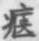
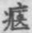
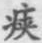

# 脉解第四十九①

①**脉解第四十九**：《新校正》云：按全元起本在第九卷。

**伯坚按：**本篇和《甲乙经》《黄帝内经太素》《类经》三书的篇目对照，列表于下。

| 素问 | 甲乙经 | 黄帝内经太素 | 类经 |
|---|---|---|---|
| 脉解第四十九 | 卷七——足阳明脉病发热狂走第二 | 卷八——经脉病解篇 | 卷十四——六经病解（疾病类十一） |

**【释题】** 马莳说：“按此篇论病，大抵出于《灵枢·经脉篇》诸经为病，篇内曰‘所谓’者，正以古有是语而今述之也。故名篇。”本篇所讲的都是疾病的一般症状和病理，并没有讲脉象。因为这些疾病是按三阳三阴经脉分类的，所以篇名叫作脉解。喜多村直宽说：“此篇《太素》题曰《经脉病解》，《脉解》名义得之大明矣。”

**【提要】** 本篇讲一些疾病的一般症状和病理，内容可以分为六节。第一节讲足太阳膀胱经脉的肿腰脽痛，偏虚，强上引背，耳鸣，狂巅疾，聋，瘖俳。第二节讲足少阳胆经脉的心胁痛，不可反侧，跃。第三节讲足阳明胃经脉的洒洒振寒，胫肿，水，胸痛少气，恶人与火闻木音则惕然而惊，独闭户牖而处，乘高而歌弃衣而走，头痛鼻鼽腹肿。第四节讲足太阴脾经脉的病胀，噫，呕，得后与气则快然如衰。第五节讲足少阴肾经脉的腰痛，呕咳上气喘，目𥉂𥉂无所见，煎厥，恐如人将捕之，恶闻食臭，面黑如地色，咳血。第六节讲足厥阴肝经脉的㿗疝少腹肿，腰脊痛，㿗癃疝肤胀，嗌干热中。

> 太阳所谓肿腰、脽①痛者，正月太阳寅，寅、太阳也②，正月阳气出在上而阴气盛，阳未得自次也③，故肿腰、脽痛也。
>
> 所谓④病偏虚为跛者⑤，正月阳气冻解地气而出也⑥，所谓⑦偏虚者，冬寒颇有不足者，故偏虚为跛也⑧。
>
> 所谓强上引背者⑨，阳气大上而争⑩，故强上也。
>
> 所谓耳鸣者，阳气万物⑪盛上而跃，故耳鸣也。
>
> 所谓甚则狂颠疾者⑫，阳尽在上而阴气从下，下虚上实，故狂颠疾也⑬。
>
> 所谓浮为聋者，皆在气也⑭。
>
> 所谓入中为瘖者，阳盛已衰，故为瘖也⑮。内夺而厥⑯则为瘖⑰、俳⑱，此肾虚也。少阴不至者，厥也⑲。

**【本段提纲】** 马莳说：此言膀胱经之诸证，其义应时合肾者也。按此节何以膀胱释之？盖其经络为病与手太阳无涉，故当以膀胱释之，以下诸经仿此。按膀胱诸证岂尽在正月哉，特论与时相应之义有如此耳。盖虚实在人，随时为病，不必尽在正月也。彼善养者，有实无虚，则时亦不能使之病矣。读者于此类经典，不以辞而害意斯可耳。后义仿此。

**【集解】**

①**脽**：杨上善说：脽，尻也，音谁也。

〔p.646 (인쇄 629)〕

王冰说：脽，谓臀肉也。

高世栻说：《六元正纪大论》云：“太阳终之气，则病腰脽痛。”

丹波元简说：脽，《说文》：“尻也。”汉《东方朔传》：“连脽尻。”《注》：“臀也。”盖脽从肉，故王释为臀肉。此四字，即与《厥论》：“肿首头重”，《著至教论》：“干嗌喉塞”，字法正同。（**伯坚按：**参阅《素问》第四十五《厥论》第七段“则肿首头重”句下集解。）

丹波元坚说：按《经脉篇》膀胱足太阳有腰痛。

陆懋修说：《广雅·释亲》：“臀谓之脽”。《汉书·东方朔传》：“连脽尻。”注：“脽，臀也。”

②**正月太阳寅，寅、太阳也**：王冰说：正月三阳生，主建寅，三阳谓之太阳，故曰寅太阳也。

丹波元坚说：按弟子掘川济曰：“此篇以足三阳三阴配之六月，太阳为正月，厥阴为三月，阳明为五月，少阴为七月，少阳为九月，太阴为十一月，三阳三阴每互其位而必隔一月。今本《经》七月误作十月，殊为不伦。须从《太素》是正。”此说极确。

喜多村直宽说：物茂卿曰：“所谓正月、九月、十月之类，非实指月而言，乃譬喻之言耳。”

陈遵妫《中国古代天文学简史》第三十七页：秦朝采取颛顼历，以十月为岁首，汉初也照常使用。到了汉武帝才改用太初历，以元封七年（公元前一〇四年）为太初元年，以建寅正月为岁首。

**伯坚按：**现在根据本篇内容，将十二月、十二地支和足三阴三阳经脉的配合列表于下，以期明显。

| 十二月 | 十二地支 | 三阴三阳经脉 |
|---|---|---|
| 正月 | 寅 | 足太阳膀胱经 |
| 二月 | 卯 |  |
| 三月 | 辰 | 足厥阴肝经 |
| 四月 | 巳 |  |
| 五月 | 午 | 足阳明胃经 |
| 六月 | 未 |  |
| 七月 | 申 | 足少阴肾经 |
| 八月 | 酉 |  |
| 九月 | 戌 | 足少阳胆经 |
| 十月 | 亥 |  |
| 十一月 | 子 | 足太阴脾经 |
| 十二月 | 丑 |  |

③**正月阳气出在上而阴气盛，阳未得自次也**：马莳说：正月之时，阳气虽出于上，而寒气正行，故阴气尚盛，阳气犹未得其王时之位次也。是以膀胱之气，名盛而实虚。

吴崑说：次，序也，阳未得自序，故人病亦应之也。

④**所谓**：原文作“病偏虚为跛者”，没有“所谓”二字。

高世栻说：旧本“所谓”二字误传“出也”下，今改正。

**伯坚按：**今据高世栻说，将“出也”下面的“所谓”二字移至此处，使前后文的体例一致。

〔p.647 (인쇄 630)〕

⑤**病偏虚为跛者**：高世栻说：偏虚，犹偏枯。本经《大奇篇》云：“肾壅，则髀䯒大跛易偏枯”，故申明所谓病偏虚为跛者。

⑥**正月阳气冻解地气而出也**：高世栻说：正月阳气始生，地冻始解，地气从下而上出也。

丹波元简说：盖谓阳气自东方解地气之冻而上出也。

⑦**所谓**：丹波元简说：“所谓”二字，从高而删之为是。

**伯坚按：**今据高世栻、丹波元简说，删去此处的“所谓”二字，移置前面“病偏虚为跛者”上。

⑧**冬寒颇有不足者，故偏虚为跛也**：高世栻说：此言冬失其藏，至春有偏枯之跛病也。

⑨**所谓强上引背者**：王冰说：强上，谓颈项噤强也。甚则引背矣。

高世栻说：本经《热论》云：“伤寒一日，巨阳受之，头项痛，腰脊强。”是腰脊之强，上引于背而至头项也。

⑩**阳气大上而争**：吴崑说：阳气过盛，大上而争，故强上引背也。

⑪**所谓耳鸣者，阳气万物**：高世栻说：《灵枢·经筋篇》云：“手太阳之筋，其病应耳中鸣。”故申明所谓耳鸣者，乃阳气万物盛上而跃，跃则振动，故耳鸣也。

张琦说：“万物”二字衍。

张文虎说：按“万物”二字疑衍。上节云：“所谓强上引背者，阳气大上而争”，是其例。

**伯坚按：**今据张琦、张文虎说，删去“万物”二字。

⑫**所谓甚则狂癫疾者**：杨上善说：脱衣登上，驰走妄言，即谓之狂。僵仆而倒，遂谓之颠也。

张介宾说：“巅”“癫”同。按《经脉篇》足太阳经脉条下作“癫”，盖古所通用也。所谓甚者，言阳邪甚也。阳邪甚于阳经，则阳尽在上，阴气在下，上实下虚，故当为狂颠之病。

田晋蕃说：《灵枢·经脉篇》，“颠”作“癫”。顾氏观光《校勘记》曰：“二字古通。”

狂颠病，参阅《素问》第四十七《奇病论》第九段“人生而有病颠疾者”句下集解。

⑬**阳尽在上而阴气从下，下虚上实，故狂颠疾也**：高世栻说：《经脉论》云：“足太阳所生病者，狂癫疾。”故申明所谓甚则狂癫疾者，乃阳尽在上而阴气从下，阴气从下则下寒而虚，阳尽在上则上热而实，下虚上实，故有太阳经脉之狂癫疾也。

⑭**所谓浮为聋者，皆在气也**：高世栻说：《经脉论》云：“手太阳之脉，入耳中，所生病者耳聋。”申明所谓浮而聋者，是逆气上浮而为聋，皆在气也。

⑮**所谓入中为瘖者，阳盛已衰，故为瘖也**：高世栻说：本经《腹中论》云：“阳气入阴，入则瘖。”故申明所谓入中为瘖者，“阳气盛时则不瘖”。阳盛已衰故为瘖也。

⑯**内夺而厥**：马莳说：夺者，即《通评虚实论》之所谓精气夺则虚也。

吴崑说：内，谓房劳也。夺，耗其阴也。

张介宾说：内夺者，夺其精也。精夺则气夺而厥，故声瘖于上，体废于下。

⑰**瘖**：杨上善说：瘖，不能言也。（丹波元坚说：杨本于《说文》。）

瘖，参阅《素问》第二十三《宣明五气篇》第八段“搏阴则为瘖”句下集解。

⑱**俳**：杨上善说：痱，音肥，风病不能言也，谓四肢不用。瘖不能言，心无所知。（**伯坚按：**《太素》，“俳”作“痱”。）

王冰说：俳，废也。舌瘖足废，故云此肾虚也。

高世栻说：“俳”“痱”同，音肥。瘖痱者，口无言而四肢不收，故曰此肾虚也。

丹波元简说：《灵·热病篇》云：“痱之为病也，身无痛者，四肢不收，志乱不甚。其言微知，可治。甚则不能言，不可治也。”楼氏《纲目》曰：“痱，废也。痱，即偏枯之邪气深者。痱与偏枯是二疾。以其半身无气营运，故名偏枯。以其手足废而不收，或名痱，或偏废，或全废，皆曰痱也。”《汉书·贾谊传》云：“辟者，一面病。痱者，一方病。”师古注：“辟，足病。痱，风病也。”（本出于《说文》）由此观之，痱即仲景《中风篇》所谓邪入于藏、舌即难言者。盖痱是病名，偏风是所因，偏枯是病证，必非有别也。《圣济总录》有《瘖俳门》，载治舌瘖不能言、足废不能用、肾虚弱、其气厥不至舌下、地黄饮子等方，具于五十一卷。

〔p.648 (인쇄 631)〕

丹波元坚说：按《尔雅》：“痱，病也。”郝懿行《尔雅义疏》曰：“通作腓。《诗》：‘百卉具腓。’《传》：‘腓，病也。’《释文》引《韩诗》云：‘变也。’变、病义近，声又相转。《文选·戏马台诗》注引《毛诗》作‘痱今作腓’，《玉篇》引《诗》正作‘百卉具痱’，可知腓古本作痱矣。”

顾观光说：王冰《注》云：“俳，废也。”此谓俳为痱之假借也。《说文》云：“痱，风病也。”

田晋蕃说：按《诗·小雅》：“百卉具腓。”此假腓为痱也。古无假俳为痱者。痱从疒。疒者，象人倚箸之形。今从人作俳，盖为痱之烂文。

余岩《古代疾病名候疏义》第十六页：岩按痱之为病有二。其一，为中风后所遗病候。《灵枢·热病》第二十三云：“痱之为病也，身无痛者，四肢不收，智乱不甚。其言微知，可治。甚则不能言，不可治也。”《病源候论》《千金方》皆谓之风痱。此盖中风之后，手足瘫痪，不能屈伸者也。其二，则皮肤病也。郝氏《义疏》云：“陶注《本草》说虾蟇云：‘此是腹大，皮上多痱瘟者是也。’《一切经音义》廿五引《字略》云：‘痱瘟，小肿也。’”岩按郝氏所云《一切经音义》，乃玄应《一切经音义》二十五《阿比达磨顺正理论》第十六卷痱瘟下注也。盖即今之汗疹。

余岩《古代疾病名候疏义》第一二三页：《说文》：“痱，风病也。从疒，非声。”《史记》卷一百七《灌夫列传》：“魏其良久乃闻，闻即恚，病痱。”《索隐》：“痱，音肥，又扶味反，风病也。”《汉书》卷五十二，《灌夫传》，颜《注》亦云：“痱，风病也，音肥。”《太素》卷二十五《热病》说：“痱为病也。”杨上善《注》：“痱，扶非反，风病也。”

⑲**少阴不至者，厥也**：张介宾说：此释上文内夺而厥之义也。少阴者，肾脉也，与太阳为表里。若肾气内夺，则少阴不至。少阴不至者，以阴虚无气，无气则阳衰，致厥之由也。

> 少阳所谓心胁痛者①，言少阳戌也。戌者，心之所表也②。九月阳气尽而阴气盛，故心胁痛也。
>
> 所谓不可反侧者③，阴气藏物也④。物藏则不动，故不可反侧也。
>
> 所谓甚则跃⑤者，九月万物尽衰，草木毕落而堕⑥，则气去阳而之阴，气盛而阳之下长⑦，故谓跃。

**【本段提纲】** 马莳说：此言胆经诸证，其义与时应也。按心胁痛、不能转侧，见《灵枢·经脉篇》本经是动则病之下。

**【集解】**

①**少阳所谓心胁痛者**：高世栻说：《经脉论》云：“足少阳则病心胁痛。”故申明少阳所谓心胁痛者。

丹波元坚说：《经脉篇》胆足少阳有心胁痛，不可转侧。

②**戌者，心之所表也**：原文作“言少阳盛也盛者心之所表也”。

丹波元坚说：《太素》，“盛”并作“成”。小岛尚质说：“成盖戌误 。”

顾观光说：心属君火，无为由少阳相火而表著。

喜多村直宽说：《太素》，“盛”并作“成”。宽按：“成”当“戌”讹。

〔p.649 (인쇄 632)〕

田晋蕃说：《太素》，“盛”俱作“成”。晋蕃按：以上下文“寅太阳也”“阳明者午也”之例，“盛”当作“戌”。《太素》作“成”者，与“戌”形近而讹，遂辗转以“盛”为之。《刺腰痛篇》：“成骨”，《甲乙经》作：“盛骨”。观下文王注曰：“其墓于戌”，故曰少阳戌也。顾氏观光谓：“心属君火，无为由少阳相火而表著”，故曰戌者心之所表也。

**伯坚按：**此段见《黄帝内经太素》卷八《经脉病解篇》。今本《太素》作“言少阳戌也，戌者心之所表也”。今据小岛尚质、喜多村直宽、田晋蕃说，依《太素》校改。参阅本篇第一段“寅太阳也”句下集解附表。

③**所谓不可反侧者**：高世栻说：反侧，犹转侧。《经脉论》云：“足少阳病不能转侧。”故申明所谓不可反侧者。

④**阴气藏物也**：马莳说：九月阴气方盛，主于藏物，物藏则不动，故不可反侧。

⑤**跃**：王冰说：跃，谓跳跃也。

⑥**草木毕落而堕**：丹波元简说：《文选》潘岳《寡妇赋》：“木落叶而陨枝。”李善注云：“毛苌《诗传》曰：‘陨，坠也。’”《千金方》：“蒲黄汤主疗小儿落床堕地。”

田晋蕃说：按“堕”当作“椭”。《太玄经》：“土不和，木科椭。”范望曰：“科椭，枝叶不布。”草木毕落而椭，言草木毕落而枝叶不布也。《说文》无堕字。段氏玉裁曰：“今字堕为陊。”阜部：“陊，落也。”木部：“𣔵，木叶陊也。”若作堕，则与毕落文义复矣。

⑦**气盛而阳之下长**：吴崑说：气盛，气盛于阴也。之，往也。下，下体也。阳之下，谓阳气往下，如少阳之脉出膝外廉行于两足是也。长，生长也。阳为动物，长于两足，故令跃。

> 阳明所谓洒洒振寒者①，阳明者、午也，五月盛阳之阴也②。阳盛而阴气加之，故洒洒振寒也。
>
> 所谓胫肿而股不收者③，是五月盛阳之阴也。阳者衰于五月，而一阴气上与阳始争，故胫肿而股不收也④。
>
> 所谓上喘而为水者⑤，阴气下而复上，上则邪客于藏府间，故为水也⑥。
>
> 所谓胸痛、少气者⑦，水气在藏府也。水者、阴气也，阴气在中，故胸痛、少气也。
>
> 所谓甚则厥⑧、恶人与火、闻木音则惕然而惊者⑨，阳气与阴气相薄⑩，水火相恶，故惕然而惊也⑪。
>
> 所谓欲独闭户牖而处者，阴阳相薄也。阳尽⑫而阴盛，故欲独闭户牖而居⑬。
>
> 所谓病至则欲乘高而歌、弃衣而走者，阴阳复争而外并于阳，故使之弃衣而走也⑭。
>
> 所谓客孙脉⑮则头痛、鼻鼽⑯、腹肿者，阳明并于上，上者则其孙络太阴也，故头痛、鼻鼽、腹肿也⑰。

**【本段提纲】** 马莳说：此言胃经诸证，其义应时合脾者也。按诸病见《灵枢·经脉篇》本经是动则病之下。

**【集解】**

①**阳明所谓洒洒振寒者**：高世栻说：《经脉论》云：“足阳明之脉，则病洒洒振寒。”故申明阳明所谓洒洒振寒者。

〔p.650 (인쇄 633)〕

丹波元坚说：《经脉篇》，胃足阳明有洒洒振寒。

洒洒，寒貌。参阅《素问》第三十二《刺热篇》第四段“先洒淅然厥起毫毛”句下集解。

②**阳明者、午也，五月盛阳之阴也**：王冰说：五月夏至，一阴气上，阳气降下，故曰盛阳之阴也。

高世栻说：阳明者，午也。午主五月，一阴始生，故五月盛阳之阴也。

阳明者午也，参阅本篇第一段“寅太阳也”句下集解附表。

③**所谓胫肿而股不收者**：高世栻说：《经筋篇》云：“足阳明之筋，其病支胫转筋，髀前肿，筋弛纵缓不胜收。”故申明所谓胫肿而股不收者。

④**阳者衰于五月，而一阴气上与阳始争，故胫肿而股不收也**：高世栻说：五月之时，盛阳之阴也，阳者衰于五月，而一阴之气上与阳明始争，故阳明经脉有胫肿而股不收之病也。

⑤**所谓上喘而为水者**：高世栻说：本经《逆调论》云：“卧则喘者，是水气之客也。”故申明所谓上喘而为水者。

⑥**阴气下而复上，上则邪客于藏府间，故为水也**：吴崑说：藏，肺藏。府，胃府。

高世栻说：冬至一阳初生，阴气下降。五月之时，一阴始生，阴气下而复上，上则水邪客于藏府之间，故为水也。

⑦**所谓胸痛、少气者**：余岩《古代疾病名候疏义》第一四四页：《说文解字》：“㾜，病息也。从疒，夹声。”段氏《注》云：“病息，谓病之鼻息也。”桂氏《义证》云：“病息也者，本书：‘㛍，息也，一曰少气也。’《玉篇》作：‘，病少气。’”王筠《句读》云：“《玉篇》又收字，云：‘病少气’，然则小息即少气之谓也。”岩按小徐本“病息”作“病小息”，故王筠云然。又按《集韵》入声三十帖：“㰰，喘息。”然则之义，盖谓呼吸浅短也。胡氏吉宣曰：“病息，谓非正常之呼吸，气息微弱也。”

⑧**厥**：参阅《素问》第四十五《厥论》第一段“厥之寒热者”句下集解。

⑨**所谓甚则厥、恶人与火、闻木音则惕然而惊者**：高世栻说：《经脉论》云：“阳明病至，则恶人与火、闻木音则惕然而惊，甚则骭厥。”故申明所谓甚则厥、恶人与火、闻木音则惕然而惊者。

丹波元坚说：《经脉篇》：“病至则恶人与火，闻木声则惕然而惊，心欲动，独闭户塞牖而处。甚则欲上高而歌，弃衣而走。”

⑩**阳气与阴气相薄**：吴崑说：薄，摩荡也。

⑪**水火相恶，故惕然而惊也**：高世栻说：恶火者，厥为阴、为水，乃水火相恶；又木能生火，故闻木音则惕然而惊也。

丹波元简说：按本节所解，与《阳明脉解篇》异义。

**伯坚按：**《素问》第三十《阳明脉解》说：“黄帝问曰：‘足阳明之脉病，恶人与火，闻木音则惕然而惊。钟鼓不为动，闻木音而惊，何也？愿闻其故。’岐伯对曰：‘阳明者，胃脉也。胃者，土也。故闻木音而惊者，土恶木也。’帝曰：‘善。其恶火何也？’岐伯曰：‘阳明主肉，其脉血气盛，邪客之则热，热甚则恶火。’”

⑫**阳尽**：丹波元坚说：尽者，犹《伤寒论》：“血弱气尽”之尽，即阳气不振之义，非竭尽之义。

⑬**故欲独闭户牖而居**：王冰说：恶喧故尔。

**伯坚按：**《素问》第三十《阳明脉解》说：“帝曰：‘其恶人何也？’岐伯曰：‘阳明厥则喘而惋，惋则恶人。’”

⑭**所谓病至则欲乘高而歌、弃衣而走者，阴阳复争而外并于阳，故使之弃衣而走也**：《新校正》云：详“所谓甚则厥”至此，与前《阳明脉解论》相通。

〔p.651 (인쇄 634)〕

高世栻说：《经脉论》云：“阳明病至，甚则欲上高而歌、弃衣而走。”故申明所谓甚则欲乘高而歌、弃衣而走者。

**伯坚按：**《素问》第三十《阳明脉解》说：“帝曰：‘善。病甚则弃衣而走，登高而歌，或至不食数日，逾垣上屋，所上之处皆非其素所能也，病反能者何也？’岐伯曰：‘四支者，诸阳之本也。阳盛则四支实，实则能登高也。’帝曰：‘其弃衣而走者何也？’岐伯曰：‘热盛于身，故弃衣欲走也。’”

⑮**孙脉**：高世栻说：孙脉，孙络脉也。

⑯**鼻鼽**：鼽，鼻腔闭塞也。参阅《素问》第四《金匮真言论》第二段“故春善病鼽衄”句下集解。

⑰**上者则其孙络太阴也，故头痛、鼻鼽、腹肿也**：高世栻说：出处未详，大抵皆阳明之病。所谓客孙脉则头痛、鼻鼽、腹肿者，乃阳明之脉，不从下行，而并于上，并于上者，则其孙络之脉，合脾之大络而为太阴也。阳明并于上，故头痛、鼻鼽；孙络太阴，故腹肿也。

丹波元简说：按此一句难通，故吴改作“其头之孙络腹之太阴也”十字，张以为太阴者言阴邪之盛，非阴经之谓，俱臆见也。高注稍妥，姑从之。

丹波元坚说：按《经脉篇》惟有鼽衄。

> 太阴所谓病胀者①，太阴、子也，十一月万物气皆藏于中②，故曰病胀。
>
> 所谓上走心为噫者③，阴盛而上走于阳明，阳明络属心，故曰上走心为噫也④。
>
> 所谓食则呕者⑤，物盛满而上溢，故呕也。
>
> 所谓得后与气⑥则快然如衰者⑦，十一月阴气下衰而阳气且出，故曰得后与气则快然如衰也⑧。

**【本段提纲】** 马莳说：此言脾经诸证，其义应时合胃者也。按诸病，见《灵枢·经脉篇》本经是动则病之下。

**【集解】**

①**太阴所谓病胀者**：高世栻说：《经脉论》云：“太阴病腹胀。”故申明太阴所谓病胀者。

丹波元坚说：按《经脉篇》，脾足太阴有：“腹胀善噫，得后与气则快然如衰。”

②**太阴、子也，十一月万物气皆藏于中**：杨上善说：以十一月阴气大，故曰太阴。阴气内聚，阳气外通。十一月阴气内聚，虽有一阳始生，气微未能外通，故内病为胀也。

高世栻说：子，十一月也。十一月，万物之气皆藏于中。藏于中，故太阴经脉则曰病胀也。

太阴子也，参阅本篇第一段“寅太阳也”句下集解附表。

③**所谓上走心为噫者**：马莳说：《宣明五气论》曰：“心为噫。”又按《灵枢·口问篇》曰：“寒气客于胃，厥逆从下上散，复出于胃，故为噫 。”夫《素问》言心而《灵枢》言胃，则此篇兼言阴气走于胃，胃走于心，见三经相须而为噫也。（丹波元简说：三经，谓心、脾、胃。）

高世栻说：《经脉论》云：“太阴病善噫 。”本经《宣明五气篇》云：“心为噫。”故申明所谓上走心为噫者。

张志聪说：噫者，嗳气也。《灵枢经》云：“脾是动病腹胀善噫。”《口问篇》曰：“气出于胃则为噫 。”《五气论》曰：“心为噫 。”（**伯坚按：**张志聪所引《灵枢经》见《灵枢》第十《经脉篇》。）

噫，嗳气也，参阅《素问》第七《阴阳别论》第八段“善噫”句下集解。

〔p.652 (인쇄 635)〕

④**阴盛而上走于阳明，阳明络属心，故曰上走心为噫也**：高世栻说：太阴阴甚而上走于阳明，阳明胃络连属心包之络，故太阴经脉而曰上走心为噫也。

⑤**所谓食则呕者**：高世栻说：《经脉论》云：“太阴病食则呕。”故申明所谓食则呕者。

⑥**所谓得后与气**：杨上善说：得后便及泄气，快然腹减。

马莳说：后者，圊也。气者，肛门失气也。

⑦**则快然如衰者**：高世栻说：《经脉论》云：“腹胀善噫 ，得后与气则快然如衰。”故申明所谓得后与气则快然如衰者。

衰，差也。参阅《素问》第四十二《风论》第二段“其寒也则衰食饮”和第四十六《病能论》第六段“衰其食”句下集解。

⑧**十一月阴气下衰而阳气且出，故曰得后与气则快然如衰也**：高世栻说：太阴为阴中之至阴。十二月，至阴也。至阴则阴气下衰而阳气且将出，故太阴经脉腹胀善噫，而曰得后与气则快然如衰也。

> 少阴所谓腰痛者①，少阴者、肾②也，七月③万物阳气皆伤④，故腰痛也⑤。
>
> 所谓呕、咳、上气、喘者⑥，阴气在下，阳气在上，诸阳气浮无所依从，故呕、咳、上气、喘也⑦。
>
> 所谓邑邑⑧不能久立久坐，起则目䀮䀮⑨无所见者⑩，万物阴阳不定，未有主也。秋气始至，微霜始下而方杀，万物阴阳内夺，故目䀮䀮无所见也⑪。
>
> 所谓少气⑫、善怒者⑬，阳气不治；阳气不治则阳气不得出，肝气当治而未得，故善怒⑭。善怒者，名曰煎厥⑮。
>
> 所谓恐如人将捕之者⑯，秋气万物未有毕去⑰，阴气少，阳气入，阴阳相薄，故恐也⑱。
>
> 所谓恶闻食臭者⑲，胃无气，故恶闻食臭也⑳。
>
> 所谓面黑如地色者㉑，秋气内夺，故变于色也㉒。
>
> 所谓咳则有血者㉓，阳脉伤也。阳气未盛于上而脉满，满则咳，故血见于鼻也㉔。

**【本段提纲】** 马莳说：此言肾、肝、脾、肺诸证，其义应于纯阴之候也。按诸证亦见《灵枢·经脉篇》各经是动则病之下。

**【集解】**

①**少阴所谓腰痛者**：高世栻说：《经脉论》云：“足少阴之别，虚则腰痛。”故申明少阴所谓腰痛者。

②**肾**：喜多村直宽说：据前后例，“肾”当作“申”。

③**七月**：原文作“十月”。

丹波元坚说：《太素》作“七月”。

顾观光说：“十月”当作“七月”，观下文“秋气始至”可见。此以三阳配寅、午、戌，三阴配申、子、辰，与术家三合之说同。

田晋蕃说：按“七”“十”字形近易混。《周礼·考工记》：“凡攻木之工七。”注：“故书七为十。”辀人：“轨前十尺。”注：“十或作七。”

**伯坚按：**此段见《黄帝内经太素》卷八《经脉病解篇》，作“七月”。今据顾观光、田晋蕃说，依《太素》校改。参阅本篇第一段“寅太阳也”句下集解附表。

〔p.653 (인쇄 636)〕

④**伤**：吴崑说：伤者，抑而不扬之意。

⑤**故腰痛也**：高世栻说：腰乃肾府，少阴者、肾也，少阴太阳雌雄相合，太阳主春之首，则少阴主冬之首。十月之时，万物阳气皆伤，所以然者，承秋之肃杀也，故少阴经脉而病腰痛也。

⑥**所谓呕、咳、上气、喘者**：高世栻说：《经脉论》云：“足少阴脉病，则咳唾，喝喝而喘，咽肿上气。”故申明所谓呕、咳、上气、喘者。

丹波元坚说：《经脉篇》有：“咳，唾则有血，喝喝而喘”，又有：“上气”。

⑦**阴气在下，阳气在上，诸阳气浮无所依从，故呕、咳、上气、喘也**：张介宾说：阳根于阴，阴根于阳，互相倚也。若阴中无阳，沉而不升，则孤阳在上，浮而不降，无所依从，故为呕、咳、上气、喘也。按前章列本节义于手太阴肺病条下，（**伯坚按：**前章系指《类经·疾病类》第十《十二经病》条，即《灵枢·经脉篇》。）此则言于肾经，正以肺主气，肾主精，精虚则气不归元，即无所依从之义。

⑧**所谓邑邑**：原文作“所谓色色”。

《新校正》云：详“色色”字疑误。

张介宾说：色色，误也，当作邑邑，不安貌。

丹波元简说：按“邑邑”，与“悒悒”通。《史记·商君传》云：“安能邑邑待数十百年。”悒，《说文》：“不安也。”

丹波元坚说：《太素》，“色色”作“邑邑”。

田晋蕃说：按《太素》作“邑邑”，是也。

**伯坚按：**此段见《黄帝内经太素》卷八《经脉病解篇》，作“邑邑”。今据张介宾、丹波元简、田晋蕃说，依《太素》校改。

⑨**䀮䀮**：《玉篇》目部：䀮，呼光切，目不明。

⑩**无所见者**：高世栻说：不能久立久坐，乃坐而欲起之意。《经脉论》云：“坐而欲起，目䀮䀮如无所见。”故申明所谓不能久立久坐则目䀮䀮无所见者。

丹波元坚说：《经脉篇》有：“坐而欲起，目䀮䀮如无所见。”

⑪**秋气始至，微霜始下而方杀，万物阴阳内夺，故目䀮䀮无所见也**：张介宾说：秋气至，微霜下，万物俱衰，阴阳未定，故内无所主而坐起不常，目则䀮䀮无所见，以阴肃阳衰，精气内夺，故应深秋十月之候。

⑫**少气**：气息微弱也。参阅本篇第三段“所谓胸痛少气者”句下集解。

⑬**善怒者**：高世栻说：少气者，气并于下也。本经《调经论》云：“血并于上，气并于下，心烦惋，善怒。”故申明所谓少气、善怒者。

⑭**阳气不治则阳气不得出，肝气当治而未得，故善怒**：吴崑说：阳气不治者，阳气不舒也。肝气当治而未得者，木性不得条达也。肝志怒，故善怒。

⑮**煎厥**：马莳说：《生气通天论》亦有“煎厥”，当参考之。

吴崑说：煎厥者，怒志煎熬厥逆也。

丹波元简说：按此与少阴不相涉，乃属少阳、厥阴之病，则为可疑。

**伯坚按：**《素问》第三《生气通天论》说：“阳气者，烦劳则筋张精绝，辟积于夏，使人煎厥。”

⑯**所谓恐如人将捕之者**：高世栻说：《经脉论》云：“肾病则善恐，心惕惕如人将捕之。”故申明所谓恐如人将捕之者。

丹波元坚说：《经脉篇》：“气不足则善恐，惕惕如人将捕之。”

〔p.654 (인쇄 637)〕

**伯坚按：**《素问》第十五《玉版论要篇》说：“夏刺秋分，病不愈，令人心中欲无言，惕惕如人将捕之。”又第二十二《藏气法时论》说：“肝病者，虚则目䀮䀮无所见，耳无所闻，善恐，如人将捕之。”《灵枢》第四《邪气藏府病形篇》说：“胆病者，善太息，口苦，呕宿汁，心下澹澹恐人将捕之。”又第十九《四时气篇》说：“善呕，呕有苦，长太息，心中憺憺恐人将捕之。”

⑰**秋气万物未有毕去**：高世栻说：秋气万物凋谢，十月始冬，未能尽藏，故万物未有毕去。毕，尽也。未能尽去阳入阴也。

⑱**故恐也**：马莳说：《宣明五气论》曰：“精气并于肾则为恐”也。

吴崑说：恐，肾志也。阳邪入薄于肾，故善恐。

张介宾说：阴气，言肾气也。阳气，言邪气也。阴气将藏未藏，而阳邪入之，阴阳相薄，则伤肾而为恐，故亦应秋气。

⑲**所谓恶闻食臭者**：高世栻说：恶闻食臭者，不欲食也。《经脉论》云：“肾病饥不欲食。”故申明所谓恶闻食臭者。

⑳**胃无气，故恶闻食臭也**：张介宾说：胃无气，胃气败也。胃气所以败者，肾为胃关，肾中真火不足，不能温养化原，故胃气虚而恶闻食臭也。此即前章饥不欲食之义。（**伯坚按：**前章指《灵枢·经脉篇》。）

㉑**所谓面黑如地色者**：高世栻说：地色，地苍之色，如漆柴也。《经脉论》云：“肾病，面如漆柴。”故申明所谓面黑如地色者。

㉒**秋气内夺，故变于色也**：张介宾说：色以应目，阳气之华也。阴胜于阳，则面黑色变，故应秋气。此即前章面如漆柴之义。（**伯坚按：**前章指《灵枢·经脉篇》。）

高世栻说：因秋时肃杀之气，内夺其精华，故至冬则变于色，而黑如地色也。

㉓**所谓咳则有血者**：高世栻说：《经脉论》云：“肾病咳唾则有血。”故申明所谓咳则有血者。

㉔**阳脉伤也。阳气未盛于上而脉满，满则咳，故血见于鼻也**：张介宾说：阳脉伤者，上焦之脉伤也。阳气未盛于上而脉满，则所满者皆寒邪也。盖肾脉上贯肝膈，入肺中，故咳则血见于口，衄则血见于鼻也。

高世栻说：阴血乘于阳位，阳脉不归于阴，故曰阴脉伤也。阴血乘阳，脉不归阴，则阳脉满。十月之时，阳气未盛于上，未当盛时而脉满，则阳气内逆，故满则咳，咳则有血而且见于鼻也。

> 厥阴所谓㿗疝①，妇人少腹肿者②，厥阴者、辰也，三月阳中之阴，邪在中，故曰㿗疝、少腹肿也③。
>
> 所谓腰脊痛、不可以俯仰者④，三月一振⑤，荣华万物，一俯而不仰也⑥。
>
> 所谓㿗⑦、癃⑧、疝⑨、肤胀者⑩，曰阴亦盛而脉胀不通，故曰㿗、癃、疝也⑪。
>
> 所谓甚则嗌干⑫、热中者⑬，阴阳相薄而热，故嗌干也⑭。

**【本段提纲】** 马莳说：此言肝经诸证，其义亦应时也。按诸证见《灵枢·经脉篇》本经是动则病之下。

**【集解】**

①**厥阴所谓㿗疝**：杨上善说：颓，谓丈夫少腹寒气成积阴气之中而痛也。疝，谓寒积气上入少腹而痛也。病在少腹痛，不得大小便，病名曰疝也。

高世栻说：㿗疝，犹㿉疝，言高肿也。

丹波元简说：按王氏《资生经》云：“《千金》曰：‘气冲主㿗。’《明堂下经》曰：‘治㿉疝。’则是㿗即㿉疝也。”《巢源》云：“㿉者，阴核气结肿大也。”详见于《阴阳别论》颓疝《注》。

〔p.655 (인쇄 638)〕

余岩《古代疾病名候疏义》第二二五页：《释名》：“阴肿曰隤，气下隤也。”又曰：“疝，亦言诜也，诜诜引小腹急痛也。”按《说文》隤字下云：“下队也”，不云阴肿。《玉篇》作㿉，曰：“下肿病”，下肿即阴肿，故《广韵》上平十五灰㿉字下注曰：“阴病”，可见《玉篇》之下肿，即《广韵》之阴病，亦即《释名》之阴肿，而隤亦即㿉字矣。又《集韵》于㿉字下注曰：“《苍颉篇》，阴病或作㿗、㾯、㾽。”于是知《广韵》阴病之训，本诸《苍颉篇》也。㿗字见于《素问·脉解篇》：“厥阴所谓㿗疝”是也。字亦作颓，《阴阳别论篇》曰：“三阳为病，……其传为颓疝”是也。颓亦用为下坠之义。《尔雅》：“焚轮谓之颓。”郭注曰：“暴风从上下。”《正义》引李巡曰：“焚轮暴风，从上来降，谓之颓。颓，下也。”《文选·长笛赋》：“感回飚而将颓。”注曰：“颓，落也。”《史记·河渠书》：“水颓以绝商颜。”《集解》引臣瓒曰：“下流曰颓。”水之从上下流曰颓，犹风之从上下降曰颓也。《礼记·檀弓》：“泰山其颓乎”，亦崩坠之意也。㿗字则后人就颓字而加疒傍耳。颓之为㿗，犹隤之为㿉也。《灵枢》不作㿗，皆作㿉，《邪气藏府病形篇》：“肝脉滑甚为㿉疝，”《经脉篇》：“肝足厥阴之脉，是动，丈夫㿉疝，妇人少腹痛”是也。㿉字《玉篇》始收之，㿗字《集韵》始收之，则㿗更为后起之字，昭然明矣。《素问》作㿗，《灵枢》作㿉，知《灵枢》之字较古于《素问》，而说者乃谓《灵枢》之书后于《素问》而作，此亦足以证其说之非矣。

隤之名为疝，见于《素问》《灵枢》，上文所引《素问》之颓疝、㿗疝，《灵枢》之㿉疝，是也。

疝病之名，古今异趣，《病源》七疝，与本条阴隤之疝异病。《千金》卷二十四，㿗病分四种，一曰肠㿗，二曰卵胀，三曰气㿗，四曰水㿗，而不详言其证候。明李梴《医学入门》以肠㿗为小肠气；而卵胀作卵㿗，谓为玉茎肿硬；气㿗为睾丸能左右相过；水㿗为外肾肿大如斗，不痛不痒。其以肠㿗为小肠气，是也，名实俱符，即今日鼠蹊脱脏，下坠其肠于阴囊者也。其以卵胀为玉茎肿硬则非。《千金》所谓卵者，睾丸也，有“治㿗疝、卵偏大、气上不能动方”，以睾丸有两，分居左右，一肿大，一不肿大，故曰偏大，是卵即睾丸之证也。然则《千金》之卵胀，谓睾丸肿大也，非谓玉茎。玉茎者，阴茎也。其以气㿗为睾丸能左右相过，以今日之病言之，无此病也，或为今之移动性脱脏，则未可知。其以水㿗为外肾肿大如斗，乃今之慢性阴囊水肿，阴囊血瘤、象皮病、肠脱脏及肉肿瘤等病。是故《千金》之所谓阴㿗，包含脱脏、睾丸胀大及阴囊水肿等病而言，则《释名》之所谓阴隤，当此包含此多种疾病，非一病之专名也。肠脱脏省曰肠脱，俗多作脱肠。

《病源候论》《千金方》而后，论疝者莫详于张子和。子和不以《病源》七疝之名为然，自立七疝之名，在《儒门事亲》卷二《疝本肝经宜通勿塞状》十九，曰寒疝、水疝、筋疝、血疝、气疝、狐疝、㿗疝。其与《病源》不同之点，则以疝为专主阴器之病，以为专由足厥阴肝经所生也。其所以倡此说者，以《灵枢·经脉篇》言“足厥阴肝经，过阴器，入小腹”，故也。故子和之七疝，为阴器之病，应属《释名》此条范围之内，与《病源》之七疝完全不同。

子和叙㿗疝之候曰：“其状阴囊肿缒，如升如斗，不痒不痛者是也。……王冰曰：‘阳气下坠，阴气上争，上争则寒多，下坠则筋缓，故睾垂纵缓，因作㿗疝也。’”按此所引王冰之言，即《素问·阴阳别论》㿗疝之注文也。其所述病候，乃有大至如升如斗者盖即今日之超巨大阴囊肠脱也。

㿗疝为鼠蹊肠脱，至曰诜诜引小腹痛，则肠脱而有嵌顿者矣。

㿗疝，参阅《素问》第七《阴阳别论》第六段“其传为颓疝”句下集解。

②**妇人少腹肿者**：高世栻说：《经脉论》云：“厥阴病，丈夫㿉疝，妇人少腹肿。”故申明所谓㿗疝、妇人少腹肿者。

〔p.656 (인쇄 639)〕

③**厥阴者、辰也，三月阳中之阴，邪在中，故曰㿗疝、少腹肿也**：高世栻说：厥阴者，辰也。辰，三月也。三月之时，其气将阳。阳中之阴，言阳未尽阳，阳中有阴也。阳中之阴，则阴邪在厥阴经脉中，故厥阴而曰㿗疝、少腹肿也。

厥阴者辰也，参阅本篇第一段“寅太阳也”句下集解附表。

④**所谓腰脊痛、不可以俯仰者**：高世栻说：《经脉论》云：“厥阴病腰痛，不可以俯仰。”故申明所谓腰脊痛，不可以俯仰者。

⑤**三月一振**：杨上善说：振，动也。

张介宾说：三月一振，阳气振也，故荣华万物。

⑥**荣华万物，一俯而不仰也**：高世栻说：三月之时，振动发生，草木向荣而华秀，故三月一振荣华，生机虽盛，犹未畅达，故万物一皆俯而不仰也。厥阴主三月，故厥阴经脉之病腰脊痛，不可以俯而复仰也。

⑦**㿗**：高世栻说：㿗，㿗疝也。

㿗，参阅本段“厥阴所谓㿗疝”句下集解。

⑧**癃**：高世栻说：癃、溺闭也。

癃，参阅《素问》第二十三《宣明五气篇》第二段“膀胱不利为癃”和第四十七《奇病论》第八段“有癃者”句下集解。

⑨**疝**：参阅《素问》第四十八《大奇论》第六段“皆为疝”句下集解。

⑩**肤胀者**：高世栻说：出处未详，大抵皆厥阴之病。㿗、癃、疝、肤胀者，阴器肿，不得小便，则肤胀也。故申明所谓㿗、癃、疝、肤胀者。

丹波元简说：按《灵·水胀篇》云：“肤胀者，寒气客于皮肤之间，鼛鼛然不坚，腹大，身尽肿，皮厚，按其腹窅而不起，腹色不变，此其候也。”

⑪**阴亦盛而脉胀不通，故曰㿗、癃、疝也**：高世栻说：阴气亦盛，而经脉胀不通，故曰㿗、癃、疝而肤胀也。

丹波元简说：亦字，承上文㿗疝及腰脊痛而下之，盖与《平人气象论》“一呼脉再动，一吸脉亦再动”之“亦”同义。

⑫**嗌干**：嗌，咽也。参阅《素问》第五《阴阳应象大论》第二十段“地气通于嗌”句下集解。

⑬**热中者**：高世栻说：《经脉论》云：“足厥阴病，甚则嗌干。手厥阴病，心中热。”故申明所谓甚则嗌干，热中者。

热中，热气在腹也。参阅《素问》第十八《平人气象论》第十四段“谓之热中”句下集解。

⑭**阴阳相薄而热，故嗌干也**：马莳说：阴阳相薄，而在内为热中，在上为嗌干也。

高世栻说：阴阳相薄而热，热甚于中，故嗌干也。

## 《脉解第四十九》今译

足太阳膀胱经的病所发生的症状：

腰肿，屁股痛。正月属寅①，是和太阳相配合的。在正月的时候，阳气虽已出在上面而阴气还很盛，阳气还没有达到旺时的位次，所以发生腰肿，屁股痛。

半身虚弱，不良于行。在正月的时候，地面解冻，阳气出来。由于冬季寒冷时没有将身体保养好，所以发生半身虚弱、不良于行。

〔p.657 (인쇄 640)〕

后颈强直，牵引到背也强直。由于阳气过盛，向上部争扰，所以后颈强直。

耳鸣。由于阳气过盛，向上部活跃，所以耳鸣。

病重则有狂病、癫病。由于阳气尽在上部而阴气在下面，于是下部虚而上部实，所以发生狂病或癫病。

逆气上浮则成聋。这是由于气所致。

阳气进入内部则失音。由于阳气过盛而衰退，所以失音。如果房事过度而厥气逆上，则成为失音和痱痪，这是肾虚的现象。（由于肾虚，于是）足少阴肾经的气不能来，这是发厥的原因。

足少阳胆经的病所发生的症状：

心部胁部痛。（九月属）戌，是和少阳相配合的。戌是表示心的。在九月的时候，阳气尽而阴气盛，所以心部胁部痛。

身体不能转动。阴气盛则万物闭藏，万物闭藏则不能动，所以身体不能转动。

病重则跳跃。在九月的时候，万物都衰，木叶坠落，万物的气都离阳就阴，阴气盛而阳气在下面仍旧生长，所以就跳跃。

足阳明胃经的病所发生的症状：

发寒战。（五月属）午，是和阳明相配合的。五月是盛阳进入到阴的时候，阳气盛而有阴气加入，所以发寒战。

小腿肿大而大腿无力。五月是盛阳进入到阴的时候，阳气到了五月就衰了，阴气开始上来和阳气争扰，所以小腿肿大而大腿无力。

气喘，水肿。阴气降到下部而又重复上来，于是邪气停留在脏腑之间，所以成为水肿。

胸痛，气息微弱。这是由于水气在脏腑所致。水是阴气，阴气在体内，所以发生胸痛，气息微弱。

病重则发厥（四肢寒冷），厌恶人与火，听见木头声音则发惊。这是由于阳气和阴气相摩荡，水火是对立的，彼此相厌恶，所以发惊。

关闭门窗独住，不愿见人。这是由于阴气和阳气相摩荡，阳气已尽而阴气正盛，所以关闭门窗独住，不愿见人。

发病的时候，登高唱歌，裸体乱跑。这是由于阴气和阳气争扰，为阳气所吞并，于是阳气独盛，所以裸体乱跑。

孙脉有病则头痛，鼻腔闭塞，腹部肿大。这是由于阳明脉（足阳明胃经脉）的孙络合并入太阴脉（足太阴脾经脉），所以发生头痛，鼻腔闭塞，腹部肿大。

足太阴脾经的病所发生的症状：

腹部发胀。（十一月属）子，是和太阴相配合的。在十一月的时候，万物的气都藏在体内，所以腹部发胀。

向上传到心而发生嗳气。阴气过盛而向上走入阳明（足阳明胃经），阳明的络脉和心相连，所以向上传到心而发生嗳气。

吃东西即呕吐。凡物盛满则向上溢出，所以呕吐。

大便通了和放屁之后即感觉舒服，如同病势已退一样。这是由于在十一月的时候，阴气将衰，阳气将出，所以大便通了和放屁之后即感觉舒服，如同病势已退一样。

足少阴肾经的病所发生的症状：

〔p.658 (인쇄 641)〕

腰痛。（七月属）申，是和少阴相配合的。少阴是肾，在七月的时候，万物的阳气都受了伤，所以腰痛。

呕吐，咳嗽，呼吸迫促，气喘。这是由于阴气在下部，阳气在上部，阳气浮着无所依附，所以发生呕吐，咳嗽，呼吸迫促，气喘。

悒悒不乐，不能久站久坐，站起来则看不见东西。这是由于在七月的时候，万物的阴阳还没有定局，体内没有主宰所致。在这个时候，秋气刚来，微霜刚下，才有肃杀的气象，万物的阴阳虚脱，所以眼睛看不见东西。

气息微弱，容易发怒。这是由于阳气不舒畅所致。阳气不舒畅则阳气不得出外，肝气也不舒畅，所以容易发怒。容易发怒，这个病名叫作煎厥。

恐惧，如同有人捉他一样。在这个时候，万物的气还未能全部去阳入阴，阴气少，阳气侵入，阴气和阳气相摩荡，所以发生恐惧。

厌恶食物的臭味。这是由于胃气败坏，不想吃东西，所以厌恶食物的臭味。

面呈黑色，如同地面的黑色一样。这是由于秋季肃杀的气，夺去体内的精华，所以面部变色。

咳嗽出血。这是由于阳脉受伤所致。上部的阳气未盛而脉（血管）充满，脉充满则咳嗽，所以鼻部出血。

足厥阴肝经的病所发生的症状：

㿗疝（腹股沟疝），在女子则小腹肿大。（三月属）辰，是和厥阴相配合的。这是由于三月是阳中之阴，邪气在体内，所以发生㿗疝，小腹肿大。

腰部脊部痛，不能弯腰伸腰。这是由于在三月的时候，阳气振动，草木开花，草木如果一弯曲就不能再伸直，所以人也是一样。

㿗（腹股沟疝），癃（小便困难），疝，皮肤发胀。这是由于阴盛，脉发胀而不通畅，所以发生㿗，癃，疝。

病重则咽干、热中（腹内发热）。这是由于阴气和阳气相摩荡而发热，所以咽干。

①**正月属寅**：汉武帝太初元年公布太初历，以建寅为正月，所以说正月属寅。以后各月即按着十二地支的排列次序顺着推下去，二月属卯，三月属辰，四月属巳，五月属午，六月属未，七月属申，八月属酉，九月属戌，十月属亥，十一月属子，十二月属丑。

〔p.659 (인쇄 642)〕
