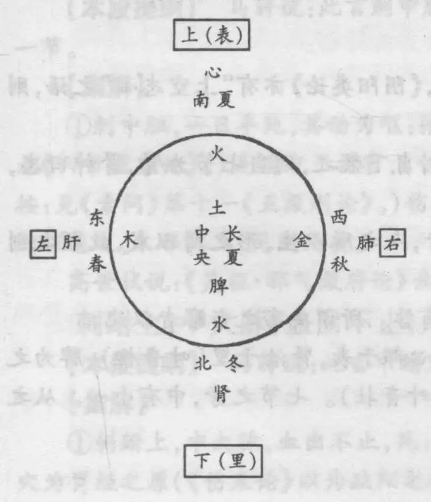
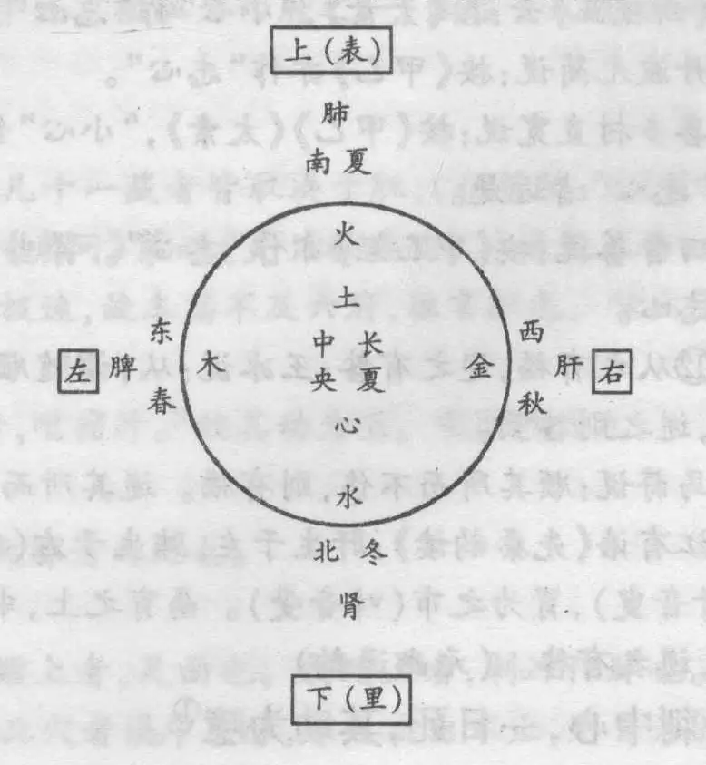

# 刺禁论第五十二①

①**刺禁论第五十二**：《新校正》云：按全元起本在第六卷。

高世栻说：禁者，藏有要害，不可不察也。中伤藏气则死。中伤经脉或病或死。刺之所禁，不可不知。盖从之则有福，逆之则有咎也。

**伯坚按：**本篇和《甲乙经》《黄帝内经太素》《类经》三书的篇目对照，列表于下：

| 素问 | 甲乙经 | 黄帝内经太素 | 类经 |
|---|---|---|---|
| 刺禁论第五十二 | 卷五——针灸禁忌第一上 卷五——针道第四 | 卷十九——知针石篇 | 卷二十二——刺害（针刺类六十四） |

**【释题】** 马莳说：“刺有刺禁之穴，故名篇。”本篇讲一些禁止针刺的地方和刺了会发生一些什么情况，所以叫作刺禁论。

**【提要】** 本篇用黄帝、岐伯问答的形式，内容可以分为四节。第一节讲内藏的位置，和刺中了什么内藏就会得一些什么结果。第二节讲某些地方不可刺，刺了会得一些什么结果。第三节讲某些情况的病人，如大醉、大怒、大劳、新饱、大饥、大渴、大惊都不可刺。第四节又讲一些不可刺的地方，刺了会得一些什么结果。

> 黄帝问曰：愿闻禁数①。
>
> 岐伯对曰：藏有要害②，不可不察③。肝生于左④，肺藏于右⑤，心部于表⑥，肾治于里⑦，脾为之使⑧，胃为之市⑨。鬲肓之上，中有父母⑩。七节之傍，中有小心⑪。从之有福，逆之有咎⑫。

**【本段提纲】** 马莳说：此将陈禁刺之数，乃先以藏府之有定次者言之也。

**【集解】**

①**愿闻禁数**：高世栻说：数，条目也。帝承上二篇之意，谓刺要刺齐，其中必有所禁，故愿闻禁数。

数，理也。参阅《素问》第十五《玉版论要篇》第一段“请言道之至数”句下集解。

②**藏有要害**：丹波元简说：顾炎武《日知录》云：“《南越尉佗传》：‘发兵守要害处。’按《汉书·西南夷传》注：‘师古曰，要害者，在我为要，于敌为害也。’此解未尽。要害，谓攻守必争之地。我可以害彼，彼可以害我，谓之害。人身亦有要害。《素问》岐伯对黄帝曰：‘脉有要害。’《后汉·来歙传》：‘中臣要害。’”

丹波元坚说：贾谊《过秦论》：“要害之郡。”又“要害之处。”

③**不可不察**：江有诰《先秦韵读》：藏有要害，（胡列反）不可不察。（祭部）

④**肝生于左**：杨上善说：肝者，为木，在春，故气生左。

⑤**肺藏于右**：杨上善说：肺者，为金，在秋，故气藏右也。

高世栻说：人身面南，左东右西。肝主春生之气，位居东方，故肝生于左。肺主秋收之气，位居西方，故肺藏于右。

⑥**心部于表**：杨上善说：心者，为火，在夏，居于太阳最上，故为表。

〔p.666 (인쇄 649)〕

高世栻说：心为阳中之太阳（**伯坚按：**见《素问》第九《六节藏象论》。），故心部于表。

张志聪说：部分也。心为阳藏而主火，火性炎散，故心气分部于表。

张琦说：部者，统属之词。

⑦**肾治于里**：杨上善说：肾者，为水，在冬，居于太阴最下，故为里也。

高世栻说：肾为阴中之太阴（**伯坚按：**见《素问》第九《六节藏象论》。），故肾治于里。

张志聪说：肾为阴藏而主水，水性寒凝，故肾气主治于里。

⑧**脾为之使**：王冰说：营动不已，糟粕水谷，故使者也。

高世栻说：脾主为胃行其津液，以灌四旁，故脾为之使。

**伯坚按：**五脏和五行的配合，是阴阳五行学说在医学上的基本问题，在古代有两种不同的说法。一种是《今文尚书》欧阳说，这一配合是肝木、心火、脾土、肺金、肾水。一种是《古文尚书》说，这一配合是脾木、肺火、心土、肝金、肾水（见《礼记·月令》孟春之月“祭先脾”句下孔颖达《正义》引许慎《五经异义》）。这两种说法，古代医学家都采用过。《周礼·秋官司寇·大司寇》“以肺石达穷民”句下，贾公彦疏引《阴阳疗疾法》说：“肺属南方火。”可见著《阴阳疗疾法》的这一位医学家采用的和《古文尚书》说相同。《吕氏春秋·十二纪》《礼记·月令》和《淮南子·时则训》所说也都与《古文尚书》说相同。但是《黄帝内经》采用的却和《今文尚书》欧阳说相同。西汉是今文家最兴盛的时代，所以今文说占了上风，古文说后来在医学上完全湮没了。郑玄说：“今医疾之法，以肝为木、心为火、脾为土、肺为金、肾为水，则有瘳也。若反其术，不死为剧。”（见《礼记·月令》孟春之月“祭先脾”句下孔颖达《正义》引郑玄《驳五经异义》）这是说，现在医学上五脏和五行的配合和《今文尚书》说相同，然后才能治愈疾病，否则不死即会变厉害。这虽然是由于郑玄对许慎的有心立异，也由此可知当时一般认为用今文说来解释医学上的问题还是比较妥当的。

古文说所讲五脏与五行配合的位置，是根据祭祀的时候所宰杀的动物的向南的五脏实际位置排列的，所以脾在左，肝在右，肺在上，肾在下，心在中（详见《礼记·月令》孟春之月“祭先脾”句下孔颖达《正义》）。今文说所讲的五脏与五行配合的位置，则是根据理想的。现在将两说的配合列图于下：

**今文说（黄帝内经）五藏的理想位置**

**古文说（阴阳疗疾法）五藏的实际位置**按照这一图看来，《黄帝内经》所讲五脏的位置，是肝在左，肺在右，心在上，肾在下，脾在中。这并不是五脏在动物或人身体内的实际位置，而是与五行相配合的理想位置。由此我们可以理解本篇所说：“肝生于左，肺藏于右，心部于表（上），肾治于里（下），脾为之使（中）”了。

〔p.667 (인쇄 650)〕

⑨**胃为之市**：王冰说：水谷所归，五味皆入，如市杂，故为市也。

高世栻说：胃为水谷之海，众物所聚，故胃为之市。

张志聪说：心为阳中之太阳，故部于表。肾为阴中之太阴，故治于里。盖以四藏之气，分左右表里上下，脾胃居中，故为之市。

⑩**中有父母**：杨上善说：心下鬲上谓肓。心为阳，父也。肺为阴，母也。肺主于气，心主于血，共营卫于身，故为父母也。

喜多村直宽说：《阴阳类论》：“三阳为父。三阴为母。”

余岩《古代疾病名候疏义》第三四五页：成十年传：“居肓之上，膏之下。”杜《注》云：“肓，鬲也。心下为膏。”孔《疏》云：“此贾逵之言也，杜依田之。”《释文》云：“肓，徐音荒，《说文》云：‘心下鬲上也。’”岩按今本《说文》作“肓，心上鬲下也。从肉，亡声。《春秋传》曰：‘病在肓之下。’”与《传》文肓之上异，又与《释文》所引《说文》心下鬲上亦异。《太素》十九《知针石篇》：“鬲肓之上，中有父母。”杨上善注云：“心下鬲上谓肓。”与《释文》所引《说文》合，盖今本《说文》误也。段氏《说文注》云：“贾传中说：‘肓，鬲也’，统言之。许云：‘鬲上为肓’者，析言之。鬲上肓，肓上膏，膏上心。今本作心上鬲下，则不可通矣。”其说是也。贾、杜既以心下为膏，则心在膏上；《传》文云居肓之上膏之下，则膏在肓上；许云鬲上为肓，则肓在鬲上。以今日人体解剖学言之，心下为心囊，囊中有液，心囊下连横隔膜，横隔膜即鬲也。然则鬲上肓者，心囊也，古谓之心包络。肓上膏者，心在囊中液也。心者，直接浸于液中，故曰膏上心。

鬲，参阅《素问》第十《五藏生成篇》第十一段“病在鬲中”和第十六《诊要经终论》第七段“中鬲者”句下集解。

肓，参阅《素问》第四十《腹中论》第四段“肓之原在齐下”和第四十三《痹论》第十一段“熏于肓膜”句下集解。

⑪**中有小心**：杨上善说：脊有三七二十一节，肾在下七节之傍。肾神曰志，五藏之灵皆名为神，神之所以任物得名为心，故志心者，肾之神也。

《新校正》云：按《太素》，“小心”作“志心”。

丹波元简说：按《甲乙》亦作“志心”。

喜多村直宽说：按《甲乙》《太素》，“小心”作“志心”，《阴阳类论》亦有“上空志心”之语，则其作“志心”者近是。

田晋蕃说：按《甲乙经》亦作“志心”。肾当十四椎下，自下数之，则当七节为肾，肾神曰志，故曰志心。

⑫**从之有福，逆之有咎**：王冰说：从，谓随顺也。八者，人之所以生，形之所以成，故顺之则福延，逆之则咎至。

马莳说：顺其所而不伤，则有福。逆其所而伤之，则有咎。所谓要害之当察者以此。

江有诰《先秦韵读》：肝生于左，肺生于右（叶音酉），心部于表，肾治于里（叶音柳），脾为之使（叶音叟），胃为之市（叶音受）。鬲肓之上，中有父母（叶音壮）。七节之旁，中有小心。从之有福，逆之有咎。（元幽通韵）

> 刺中心，一日死，其动为噫①。
>
> 〔p.668 (인쇄 651)〕刺中肝，五日死，其动为语②。
>
> 刺中肾，六日死，其动为嚏③。
>
> 刺中肺，三日死，其动为咳。
>
> 刺中脾，十日死，其动为吞④。

**【本段提纲】** 马莳说：此言误刺五藏者，有死期与死证也。

**伯坚按：**《黄帝内经素问》讲误刺五藏的死期，共有三处。现在列表于下，以供参考。

| 刺中五藏 | 本篇 | 《素问》第十六《诊要经终论》 | 《素问》第六十四《四时刺逆从论》 |
|---|---|---|---|
| 刺中心 | 一日死，其动为噫 | 中心者环死 | 一日死，其动为噫 |
| 刺中肝 | 五日死，其动为语 |  | 五日死，其动为语 |
| 刺中肾 | 六日死，其动为嚏 | 中肾者七日死 | 六日死，其动为嚏欠 |
| 刺中肺 | 三日死，其动为咳 | 中肺者五日死 | 三日死，其动为咳 |
| 刺中脾 | 十日死，其动为吞 | 中脾者五日死 | 十日死，其动为吞 |

**【集解】**

①**噫**：嗳气也，参阅《素问》第七《阴阳别论》第八段“善噫”句下集解。

②**语**：张介宾说：语，谓无故妄言也。肝在气为语，语见则肝绝矣。

语，参阅《素问》第二十三《宣明五气篇》第二段“肝为语”句下集解。

③**嚏**：喷嚏也，参阅《素问》第二十三《宣明五气篇》第二段“肾为欠为嚏”句下集解。

④**吞**：《新校正》云：刺中五藏，与《诊要经终论》并《四时刺逆从论》相重。此叙五藏相次之法，以所生为次。《甲乙经》以心、肺、肝、脾、肾为次，是以所克为次。全元起本旧文则错乱无次矣。

丹波元简说：按《宣明五气篇》云：“心为噫。肝为语。肾为嚏。肺为咳。脾为吞。”

吞，吞酸也，参阅《素问》第二十三《宣明五气篇》第二段“脾为吞”句下集解。

> 刺中胆，一日半死，其动为呕①。

**【本段提纲】** 马莳说：此言刺中胆者一日半死。按胆为六府之一，当别于五藏，故此另为一节。

**【集解】**

①**刺中胆，一日半死，其动为呕**：张介宾说：凡十一藏者皆取决于胆，（**伯坚按：**见《素问》第九《六节藏象论》。）是谓中正之官，（**伯坚按：**见《素问》第八《灵兰秘典论》。）奇恒之府，（**伯坚按：**见《素问》第十一《五藏别论》。）伤之者其危极速，故本篇不及六府，独言胆也。呕出于胃而胆证忌之，木邪犯土，见则死矣。

高世栻说：《灵枢·邪气藏府论》云：“胆病者，呕宿汁。”故其动为呕。呕胆气虚也。

> 刺跗上，中大脉，血出不止，死①。

**【本段提纲】** 马莳说：此言中跗上而误中大脉者为死也。

**【集解】**

①**刺跗上，中大脉，血出不止，死**：马莳说：跗上者，足面也。刺跗上者，刺冲阳脉也。冲阳穴为胃经之原（《伤寒论》以为趺阳之脉），若刺此穴者误中大脉，以致血出不止，则胃为五藏六府之大海，其气渐衰，必至于死也。前篇言刺肉者无伤脉，则自此以下，凡中脉之义皆同矣。

〔p.669 (인쇄 652)〕

丹波元简说：按大脉，盖谓冲脉之别。《灵·动输篇》云：“冲脉，并少阴之经，下入内踝之后，入足下。其别者，邪入踝，出属跗上，入大指之间，注诸络以温足胫。”又《逆顺肥瘦篇》云：“其前者，伏行出跗，属下循跗，入大指间，渗诸络而温肌肉。”其已如此，今刺而中伤之，则所以致死也。中，去声。

> 刺面，中溜脉①，不幸为盲。

**【本段提纲】** 马莳说：此言刺面部而误中溜脉者为盲也。

**【集解】**

①**中溜脉**：马莳说：按《灵枢·本输篇》云：“溜于鱼际。”则溜与流同。所谓溜脉者，凡脉与目流通者皆是也。又按《灵枢·大惑论》云：“五藏六府之精皆上注于目而为之精。”又按《灵枢·论疾诊尺篇》云：“赤脉从上下者，太阳病；从下上者，阳名病；从外走内者，少阳病。”此皆溜脉之义也。不知其脉与目通，而刺面部者误中流脉，则不幸而目当为盲也。

> 刺头，中脑户①，入脑立死。

**【本段提纲】** 马莳说：此言刺头而误中脑户者为立死也。

**【集解】**

①**中脑户**：张介宾说：脑户，督脉穴，在枕骨上，通于脑中。脑为髓海。乃元阳精气之所聚，针入脑则真气泄，故立死。

> 刺舌下，中脉太过，血出不止，为瘖①。

**【本段提纲】** 马莳说：此言刺舌下而失之太过者为瘖也。

**【集解】**

①**刺舌下，中脉太过，血出不止，为瘖**：张介宾说：舌下脉者，任脉之廉泉穴，足少阴之标也。中脉太过，血出不止，则伤肾，肾虚则无气，故令人瘖。按《忧恚无言论》曰：“足之少阴上系于舌，络于横骨，终于会厌。”《脉解篇》曰：“内夺而厥，则为瘖俳，此肾虚也。”然则瘖本于肾，无所疑矣。

瘖，失音也。参阅《素问》第二十三《宣明五气篇》第八段“搏阴则为瘖”句下集解。

> 刺足下布络①，中脉，血不出，为肿②。

**【本段提纲】** 马莳说：此言刺足下布络而误中其脉者当为肿也。

**【集解】**

①**刺足下布络**：王冰说：布络，谓当内踝前足下空处布散之络，正当然谷穴分也。

马莳说：布络者，凡足之六经皆有络脉也。误中其脉而血又不出，则必邪不得散而为肿矣。王《注》上以为然谷之中者，凿之甚也。

②**血不出，为肿**：张介宾说：若血不出，气必随针而壅，故为肿也。

> 刺郄①，中大脉，令人仆，脱色②。

**【本段提纲】** 马莳说：郄中者，委中也。误中郄中之大脉，则令人仆倒而面色如脱去也。

**【集解】**

①**刺郄**：王冰说：寻此经郄中主治，与《中诰流注经》委中穴正同。应郄中者以维穴为名，委中处所为名亦犹寸口、脉。气口皆同一处尔。

张介宾说：郄，足太阳委中穴也。

〔p.670 (인쇄 653)〕

②**令人仆，脱色**：王冰说：令人仆倒而面色如脱去也。

丹波元简说：按《经脉篇》云：“甚者泻之则闷，闷甚则仆不得言，闷则急坐之也。”俱是后世所谓针晕也。详见于《针灸聚英》等。

> 刺气街①，中脉，血不出，为肿鼠仆②。

**【本段提纲】** 马莳说：此言刺气街而误中其脉者当为肿也。

**【集解】**

①**气街**：王冰说：气街，在腹下，挟齐两旁相去四寸，鼠仆上一寸，动脉应手也。

《新校正》云：《气府论》注：“气街在齐下横骨两端鼠鼷上一寸也。”

吴崑说：气街，穴名，一名气冲，在少腹两傍，去中行四寸，动脉应手，足阳明、少阳之所经也。

②**为肿鼠仆**：《新校正》云：按别本，“仆一作‘鼷’”。

马莳说：“仆”作“鼷”。刺气冲者，误中其脉而血又不出，则血气并聚于中，故内结为肿在鼠鼷之中也。

丹波元简说：《甲乙》“仆”作“鼷”。鼷，《说文》“小鼠也”。鼷，《玉篇》“鼠名”。《巢源·附骨疽候》云：“产妇女人，喜着鼠膜髂头胜膝间。”知是仆、膜、鼷同义，即鼠鼷也。

> 刺脊间①，中髓，为伛②。

**【本段提纲】** 马莳说：此言刺脊中而误中其脊髓者为伛也。

**【集解】**

①**刺脊间**：王冰说：脊间，谓脊骨节间也。

②**中髓，为伛**：王冰说：伛，谓伛偻，身蜷屈也。

余岩《古代疾病名候疏义》第一五七页：《说文》，“伛，偻也。从人，区声。”《礼记·问丧》：“伛者不袒。”陆德明《经典释文》云：“伛，背曲也。”刘熙《释名》：“呕，伛也，将有所吐，脊曲伛也。”玄应《一切经音义》二《大望槃经》第十二卷背偻下注引《通俗文》：“曲脊谓之伛偻。”岩按伛偻，谓身蜷曲向前也。其形似俯，故《吕氏春秋·季春纪·明理篇》云：“肓、秃、伛、尪”；高诱注云：“伛偻，俯者也。”左氏昭七年《传》：“一命而偻，再命而伛，三命而俯。”段氏《说文》伛下注说之曰：“析言之，毫无二义。”

> 刺乳上，中乳房，为肿、根蚀①。

**【本段提纲】** 马莳说：此言刺乳上而误中乳房者为肿，其根当自蚀也。

**【集解】**

①**刺乳上，中乳房，为肿、根蚀**：王冰说：为大肿，中有脓根，内蚀肌肤，化为脓水而久不愈。

张介宾说：乳房，乃胸中气血交凑之室，故刺乳上之穴而误中乳房，则气结不散，留而为肿，肿则必溃，且并乳根皆蚀，而难于愈也。

丹波元简说：根，谓乳房之根，非乳根穴。《汉书·西羌传》：“疽食浸淫，莫知所限。”又《后汉董卓传》：“溃痈虽痛，胜于内食。”

> 刺缺盆①，中内陷②，气泄③，令人喘、咳逆。

**【本段提纲】** 马莳说：此言刺缺盆而误中内陷者，当为喘，咳，逆气也。

**【集解】**

①**刺缺盆**：张志聪说：缺盆，在喉旁两横骨陷中，若缺盆然，故以为名。缺盆之中央任脉也。

〔p.671 (인쇄 654)〕

②**中内陷**：高世栻说：刺之过深，则为内陷。

③**气泄**：**伯坚按：**中内陷，是刺穿肺尖，所以气泄。

> 刺手鱼腹①，内陷，为肿。

**【本段提纲】** 马莳说：此言刺手鱼腹而内陷者当为肿也。

**【集解】**

①**刺手鱼腹**：张志聪说：鱼腹，在手大指下，如鱼腹之圆壮，手太阴之鱼际穴也。

> 无刺大醉，令人气乱。无刺大怒，令人气逆。无刺大劳人。无刺新饱人。无刺大饥人。无刺大渴人。无刺大惊人①。

**【本段提纲】** 马莳说：此历举不可轻刺之人，无非刺禁之大义也。

**【集解】**

①**无刺大醉，令人气乱。无刺大怒，令人气逆。无刺大劳人。无刺新饱人。无刺大饥人。无刺大渴人。无刺大惊人**：《新校正》云：详“无刺大醉”至此七条，与《灵枢经》相出入。《灵枢经》云：“新内无刺，已刺无内。大怒无刺，已刺无怒。大劳无刺，已刺无劳。大醉无刺，已刺无醉。大饱无刺，已刺无饱。大饥无刺，已刺无饥。大渴无刺，已刺无渴。大惊、大恐，必定其气乃刺之也。”（**伯坚按：**《新校正》所引《灵枢经》见《灵枢》第九《终始篇》，今字句次序略有异同）

> 刺阴股①，中大脉，血出不止，死。

**【本段提纲】** 马莳说：此言刺阴股而误中大脉者为死也。

**【集解】**

①**刺阴股**：吴崑说：脾、肾、肝三脉皆行于阴股。

> 刺客主人①，内陷中脉②，为内漏③，为聋。

**【本段提纲】** 马莳说：此言刺客主人而内陷中脉者，为内漏、为耳聋也。

**【集解】**

①**刺客主人**：王冰说：客主人，穴名也，今名上关。在耳前上廉起骨，开口有空，手少阳、足阳明交会于中。

②**内陷中脉**：王冰说：陷脉，言刺太深也。

③**为内漏**：王冰说：刺太深则交脉破决，故为耳内之漏。

张介宾说：脓生耳底，是为内漏。

> 刺膝膑①，出液，为跛。

**【本段提纲】** 马莳说：此言刺膝膑而出液者当为跛也。

**【集解】**

①**刺膝膑**：张介宾说：膑，膝盖骨也。

沈彤《释骨》：盖膝之骨曰膝髌。

丹波元简说：按《白虎通》云：“髌，膝盖骨也。”《圣济总录》云：“髀枢下端为膝盖旨者，左右共二，无势，多液。”

> 刺臂太阴脉①，出血多，立死。

**【本段提纲】** 马莳说：此言刺肺脉而出血过多者当立死也。

**【集解】**

①**刺臂太阴脉**：马莳说：臂太阴，即手太阴肺经之脉。按《灵枢·寒热病篇》亦有臂太阴，以其脉行于臂，故既可曰手又可曰臂也。

〔p.672 (인쇄 655)〕

> 刺足少阴脉①，重虚出血②，为舌难以言。

**【本段提纲】** 马莳说：此言刺肾经而使之重虚出血者当为瘖也。

**【集解】**

①**刺足少阴脉**：王冰说：足少阴，肾脉也。

②**重虚出血**：马莳说：肾既虚，而刺之出血，则为重虚。

> 刺膺①，中陷，中肺②，为喘逆、仰息③。

**【本段提纲】** 马莳说：此言刺膺中而误中其肺者当为喘逆、仰息也。

**【集解】**

①**膺**：胸之两傍高处也。参阅《素问》第三十二《刺热篇》第四段“痛走胸膺背”句下集解。

②**中肺**：马莳说：首中字平声，次中字去声。

丹波元简说：按此总言膺中诸穴。盖肺位于胸膺中，故误中肺则为云云证。

③**喘逆、仰息**：马莳说：病喘急而逆，仰首而息也。

> 刺肘①，中内陷，气归之，为不屈伸②。

**【本段提纲】** 马莳说：此言刺曲泽而误中陷脉者为不屈伸也。

**【集解】**

①**刺肘**：张介宾说：肘中者，手太阴之尺泽、厥阴之曲泽皆是也。

②**中内陷，气归之，为不屈伸**：高世栻说：刺肘过深，中伤内陷，邪气归之，则机关不利，故为不屈伸。

> 刺阴股下三寸，内陷，令人遗溺①。

**【本段提纲】** 马莳说：此言刺肝穴而误使内陷者当遗溺也。

**【集解】**

①**刺阴股下三寸，内陷，令人遗溺**：张介宾说：阴股之脉，足三阴也，皆上聚于阴器。惟少阴之在股间者，有经无穴。其在气冲下三寸者，足厥阴之五里也，主治肠中热泄不得溺，若刺深内陷，令人遗溺不禁，当是此穴。然厥阴之阴包，阳明之箕门，皆治遗溺，若刺之太深，则溺反不止矣。

> 刺掖下胁间①，内陷，令人咳。

**【本段提纲】** 马莳说：此言刺肺脉而误使内陷者当为咳也。

**【集解】**

①**刺掖下胁间**：王冰说：掖下，肺脉也。

丹波元简说：按“腋”字，《说文》所无，作“掖”为正。

掖下胁，胠也。参阅《素问》第十《五藏生成篇》第十一段“支鬲胠胁”句下集解。

> 刺少腹①，中膀胱，溺出令人少腹满。

**【本段提纲】** 马莳说：此言刺少腹而误中膀胱则溺出而少腹满也。

**【集解】**

①**少腹**：即小腹。参阅《素问》第二十二《藏气法时论》第九段“引少腹”句下集解。

> 刺腨肠①，内陷，为肿。

**【本段提纲】** 马莳说：此言刺腨肠而误使内陷者当为肿也。

〔p.673 (인쇄 656)〕

**【集解】**

①**腨肠**：吴崑说：腨，足腹也。

张志聪说：腨肠，一名鱼腹，俗名腿肚。如鱼之腹，故以为名。

腨，参阅《素问》第二十二《藏气法时论》第十二段“尻阴股膝髀腨胻足皆痛”句下集解。

> 刺匡上陷骨①，中脉，为漏②、为盲。

**【本段提纲】** 马莳说：此言刺目眶而误中其脉者当为漏为盲也。

**【集解】**

①**刺匡上陷骨**：高世栻说：匡上，目匡之上，眉间也。陷骨，丝竹空穴，眉后陷骨也。

丹波元简说：按匡，眶同，《史记·淮南王安传》：“涕满匡而横流”是也。《甲乙》：“丝竹空，在眉后陷者中，足少阳脉气所发。”《外台》：“一名目窌。”

匡，参阅《素问》第十九《玉机真藏论》第十一段“目匡陷”句下集解。

②**为漏**：王冰说：故为目漏。

张介宾说：流泪不止而为漏。

丹波元坚说：上文有内漏。《著至教论》：“上为巅疾，下为漏病。”王注：“漏血脓出。”此惟注目漏，其意亦恐谓脓漏出。《巢源》有目泪出止候，又有目脓漏候，曰：“风热客于睑眦之间，热，搏于血液，令眦内结聚，津液乘之不止，故成脓汁不尽，谓之脓漏。”

> 刺关节中液出，不得屈伸①。

**【本段提纲】** 马莳说：此言刺关节中而使之液出者当不能屈伸也。

**【集解】**

①**刺关节中液出，不得屈伸**：王冰说：液出则筋膜干，故不得屈伸也。

## 《刺禁论第五十二》今译

黄帝问说：我希望知道针刺的一些禁忌部位。

岐伯回答说：五脏的部位都是要害，不可不注意。肝（木）的部位在左边，肺（金）的部位在右边，心（火）的部位在上面，肾（水）的部位在下面，脾（土）和胃的部位在中间。在鬲（横膈膜）肓（横膈膜的上面心的下面）的上面，其中有最主要的器官（心脏）。在脊椎从下面倒数上去第七节的两旁，其中有比心脏次一等重要的器官（肾脏）。要注意不可伤害这些部位，如果伤害了这些部位就会发生祸患。

刺中了心，一天就会死，症状是嗳气。

刺中了肝，五天就会死，症状是胡言乱语。

刺中了肾，六天就会死，症状是打喷嚏。

刺中了肺，三天就会死，症状是咳嗽。

刺中了脾，十天就会死，症状是吞酸。

刺中了胆，一天半就会死，症状是呕吐。

刺脚背，刺中了大脉（大血管），就会血出不止，会死。

刺面部，刺中了溜脉（和眼睛相连的脉），不幸会瞎眼。

刺头部，刺中了脑户穴①，针进入脑中立刻会死。

〔p.674 (인쇄 657)〕

刺舌下，刺中了脉太过，就会血出不止，会失音。

刺足下各经散布的络脉，刺中了脉，如果血不出来，就会发肿。

刺郄（委中穴），刺中了大脉，就会令人仆倒，面部变色。

刺气街穴（即气冲穴），刺中了脉，如果血不出来，鼠鼷部位（腹股沟）就会发肿。

刺脊骨中间，刺中了髓，就会成为驼背。

刺乳上，刺中了乳房，就会发肿，乳房的根会溃烂。

刺缺盆穴②，刺中了空陷，有气泄出来，就会气喘，咳嗽。

刺手上鱼腹的部位（鱼际穴），刺中了空陷，就会发肿。

大醉的人不可刺，刺则令人气乱。大怒的人不可刺，刺则令人气逆。在重劳动过后不可刺。饿得厉害的人不可刺。口干得厉害的人不可刺。受了大惊骇的人不可刺。

刺大腿内侧，刺中了大脉，如果血出不止，就会死。

刺客主人穴③，刺中了空陷里面的脉，就会发生内漏（耳底生脓）和聋。

刺膝盖骨，刺出了浆液，就会跛脚。

刺手太阴肺经脉的孔穴，如果出血多，立刻会死。

刺足太阴肾经脉的孔穴，如果出了血，（肾虚又加以血虚）则是虚上加虚，舌头就会不能说话。

刺膺部（胸的两旁高处）而刺中空陷，即是刺中了肺，就会气喘，仰着头呼吸。

刺肘部刺中了空陷，邪气侵入，就会不能弯手伸手。

刺大腿内侧下三寸，刺中了空陷，就会小便失禁。

刺胁间，刺中了空陷，就会咳嗽。

刺小腹，刺中了膀胱，尿流出来，就会小腹胀满。

刺小腿肚，刺中了空陷，就会发肿。

刺眼眶上陷骨（丝竹空穴），刺中了脉，就会成为漏（流脓），瞎眼。

刺关节，刺出了浆液，就会不能屈伸。

①**脑户穴**：脑户穴在枕骨上强间穴的下面五厘米，正在后头部。是督脉的一个孔穴。它是单穴。

②**缺盆穴**：缺盆穴在锁骨上窝中央，肺尖部。它是足阳明胃经脉的一个孔穴。它是双穴，左右各一。

③**客主人穴**：客主人穴即是上关穴，在耳前颧弓的上侧，鬓角前面，发际处。是足少阳胆经脉的一个孔穴。它是双穴，左右各一。
