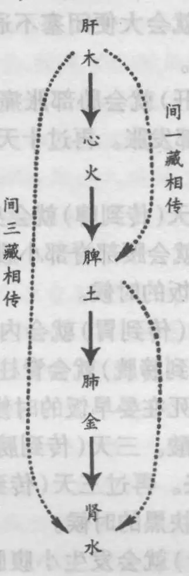

# 标本病传论第六十五①

①**标本病传论第六十五**：《新校正》云：按全元起本在第二卷《皮部论篇》前。

**伯坚按：**今存残本《黄帝内经太素》没有收载本篇的文字。本篇和《甲乙经》《类经》二书的篇目对照，列表于下：

| 素问 | 甲乙经 | 类经 |
|---|---|---|
| 标本病传论第六 十五 | 卷六——逆顺病本末方宜形志大论第二 卷六——五藏传病大论第十 | 卷十——病有标本刺有逆从（标本类四） 卷十——标本逆从治有先后（标本类五） 卷十八——病传死期（疾病类九十四·二） |

**【释题】** 马莳说：“本篇前二节论标本，后八节论病传，故名篇。《灵枢》以《病本篇》论标本，以《病传篇》论病之所传，分为二篇，其义全同。”

**【提要】** 本篇用黄帝、岐伯问答的形式，讲标本和病传两件事，内容可以分为两节。前一节讲标本，疾病在什么情况下应当先治本，在什么情况下应当先治标。后一节讲病传，就是疾病在人体内的传变，也就是疾病的发展过程，分别讲心病、肺病、肝病、脾病、肾病、胃病、膀胱病等的病传和死期。

> 黄帝问曰：病有标本①，刺有逆从②，奈何？
>
> 岐伯对曰：凡刺之方，必别阴阳③，前后相应④，逆从得施⑤，标本相移⑥，故曰有其在标而求之于标，有其在本而求之于本，有其在本而求之于标，有其在标而求之于本。故治有取标而得者，有取本而得者，有逆取而得者⑦，有从取而得者⑧。故知逆与从，正行无问⑨。知标本者，万举万当。不知标本，是谓妄行。

〔p.834 (인쇄 817)〕

**【本段提纲】** 马莳说：此言病有标本，刺有逆从也。

**【集解】**

①**病有标本**：马莳说：标者，病之后生。本者，病之先成。此乃病体之不同也。

②**刺有逆从**：马莳说：逆者，如病在本而求之于标，病在标而求之于本。从者，如在本求本，在标求标。此乃治法之不同也。

③**凡刺之方，必别阴阳**：马莳说：凡刺之方必别病在阴经阳经。

张介宾说：阴阳二字，所包者广，如经络、时令、气血、疾病，无所不在。

④**前后相应**：马莳说：前后者，背腹也，其经络互相为应。

吴崑说：谓经穴前后刺之，气相应也。

张志聪：前后相应者，有先病后病也。

⑤**逆从得施**：吴崑说：逆者反治。从者正治。得施，谓施治无失也。

⑥**标本相移**：马莳说：施逆从之法，以移标本之病。

吴崑说：刺者或取于标，或取于本，互相移易。

⑦**有逆取而得者**：高世栻说：有逆取而得者，即在本求标，在标求本也。

⑧**有从取而得者**：吴崑说：言标本逆从之刺，各有所宜，治非一途取也。

高世栻说：有从取而得者，即在标求标、在本求本也。

⑨**故知逆与从，正行无问**：马莳说：故知刺法之逆从者，乃正行之法，而不必问之于人也。

> 夫阴阳、逆从、标本之为道也，小而大，言一而知百病之害①。少而多，浅而博，可以言一而知百也。以浅而知深，察近而知远②，言标与本，易而勿及③。治反，为逆。治得④，为从⑤。先病而后逆者，治其本。先逆而后病者，治其本⑥。先寒而后生病者，治其本。先病而后生寒者，治其本。先热而后生病者，治其本。先热而后生中满者，治其标。先病而后泄者，治其本⑦。先泄而后生他病者，治其本，必且调之，乃治其他病。先病而后生中满者，治其标⑧。先中满而后烦心者，治其本。人有客气，有固气⑨。小大不利，治其标⑩。小大利，治其本。病发而有余，本而标之，先治其本，后治其标⑪。病发而不足，标而本之，先治其标，后治其本⑫。谨察间、甚⑬，以意调之⑭。间者，并行。甚者，独行⑮。先小大不利而后生病者，治其本。

**【本段提纲】** 马莳说：此言凡病皆当先治其本，惟中满及大小便不利者，则不分为标为本而必先治之也。

**伯坚按：**《灵枢》第二十五《病本篇》说：“先病而后逆者，治其本。先逆而后病者，治其本。先寒而后生病者，治其本。先病而后生寒者，治其本。先热而后生病者，治其本。先泄而后生他病者，治其本，必且调之，乃治其他病。先病而后中满者，治其标。先病后泄者，治其本。先中满而后烦心者，治其本。有客气有固气。大小便不利，治其标。大小便利，治其本。病发而有余，本而标之，先治其本，后治其标。病发而不足，标而本之，先治其标，后治其本。谨详察间、甚，以意调之。间者并行。甚为独行。先小大便不利而后生他病者，治其本也。”

**【集解】** ①言一而知百病之害：吴崑说：一者，本也。百者，标也。

〔p.835 (인쇄 818)〕

②**察近而知远**：王冰说：虽事极深玄，人非咫尺，略以浅近而悉贯之。

③**易而勿及**：王冰说：标本之道虽易可为言，而世人识见无能及者。

④**治得**：张介宾说：得相得也，犹言顺也。

⑤**为从**：吴崑说：此释逆从二字之义。

高世栻说：不知标本，治之相反则为逆。识其标本，治之得宜，则为从。

⑥**先逆而后病者，治其本**：马莳说：凡先生病而后病势逆者，必先治其初病之为本。若先病势之逆而后生他病者，则又以病势逆之为本而先治之也。

吴崑说：此二逆字，皆是呕逆。

张介宾说：有因病而致血气之逆者，有因逆而致变生之病者，有因寒热而生为病者，有因病而生为寒热者，但治其所因之本原，则后生之标病可不治而自愈矣。

⑦**先病而后泄者，治其本**：丹波元简说：“本”，疑“标”误。泄者，脾胃虚败所致，故宜治其标。下文云：“先泄而后生他病者治其本，且调之，乃治其他病”，其义自明。

⑧**先病而后生中满者，治其标**：张介宾说：诸病皆先治本，而惟中满者先治其标，盖以中满为病，其邪在胃，胃者藏府之本也，胃满则药石之气不能行，而藏府皆失其所禀，故先治此者，亦所以治本也。

⑨**有固气**：原文作“有同气”。

《新校正》云：按全元起本，“同”作“固”。

丹波元简说：按全本，“同”作“固”，似是。盖客气谓邪气，固气谓真气欤？

**伯坚按：**今据丹波元简说，依《新校正》所引全元起本校改。

⑩**小大不利，治其标**：吴崑说：小大二便不利，危急之候也，虽为标亦先治之。

⑪**本而标之，先治其本，后治其标**：王冰说：本而标之，谓有先病，复有后病也。以其有余，故先治其本，后治其标也。

吴崑说：正气有余者，先治其本而后标之。

高世栻说：病发而邪气有余，则本而标之。申明本而标之者，先治其邪气之本，后治正气之标，此治有余之法也。

⑫**标而本之，先治其标，后治其本**：王冰说：标而本之，谓先发轻微缓者，后发重大急者。以其不足，故先治其标，后治其本也。

吴崑说：正气不足者，先治其标而后本之。

张介宾说：此以病气强弱而言标本也。如病发之气有余则必侮及他藏他气，而因本以传标，故必先治其本。病发之气不足，则必受他藏他气之侮，而因标以传本，故必先治其标。盖亦治所从生也。

张琦说：先病为本，后病为标。藏府为本，经脉为标。正气为本，病气为标。察标本之道，必知有余不足，消息之，方可施治。有余者，病虽多端，必从其受邪之所先治之，后及其标。若不足之人，不任峻攻，则先剪其羽翼，徐杀其势，乃可治其本病之处。此因人之本气虚实不同而异治也。

⑬**间、甚**：吴崑说：间，差间也。甚，益甚也。

张介宾说：间者，言病之浅。甚者，言病之重也。

⑭**以意调之**：王冰说：以意调之，谓审量标本、不足、有余，非谓舍法而以意妄为也。

〔p.836 (인쇄 819)〕

⑮**甚者，独行**：张介宾说：病浅者可以兼治，故曰并行。病甚者难容杂乱，故曰独行。盖治不精专，为法之大忌，故当加意以调之也。一曰：“病轻者邪气与元气互为出入，故曰并行。病甚者邪专王而肆虐，故曰独行。”于义亦通。

高世栻说：如邪正之有余不足，叠胜而相间者，则并行其治。并行者，补泻兼施、寒热互用也。如但邪气有余，但正气不足，而偏甚者，则独行其治。独行者，专补、专泻、专寒、专热也。

张琦说：间者并行谓病势轻者标本可以兼治。甚者独行，谓病势甚者或宜治本或宜治标，一意专行，勿多胆狗也。

> 夫病传者，心病，先心痛；一日而咳①；三日胁支痛②；五日闭塞不通，身痛，体重③。三日不已，死④，冬夜半，夏日中⑤。

**【本段提纲】** 马莳说：此以心病言之也。

**伯坚按：**《灵枢》第四十二《病传篇》说：“病先发于心，一日而之肺，三日而之肝，五日而之脾。三日不已，死，冬夜半，夏日中。”

**【集解】**

①**一日而咳**：张介宾说：《病传论》所谓“一日而之肺”者，即其义也。

②**三日胁支痛**：张介宾说：肺复传肝，故胁支痛，即所谓“三日而之肝”也。

**伯坚按：**支，支柱也。参阅《素问》第十《五藏生成篇》第十一段“支鬲胠胁”句下集解。

③**体重**：张介宾说：所谓“五日之脾”也。脾病则不能运化，故闭塞不通。

④**三日不已，死**：张介宾说：再三日不已，则脾又传肾，五藏俱伤，故死。

⑤**夏日中**：王冰说：谓正子午之时也。

> 肺病，喘咳①；三日而胁支满痛②；一日身重，体痛③；五日而胀④。十日不已，死⑤，冬日入，夏日出⑥。

**【本段提纲】** 马莳说：此言肺病相传之死期也。

**伯坚按：**《灵枢》第四十二《病传篇》说：“病先发于肺，三日而之肝，一日而之脾，五日而之胃。千日不已，死，冬日入，夏日出。”

**【集解】**

①**肺病，喘咳**：张介宾说：肺主息，故病为喘咳。

②**三日而胁支满痛**：张介宾说：“三日而之肝”也。

③**体痛**：吴崑说：身体痛，脾病也。

张介宾说：“一日而之脾”也。

④**五日而胀**：吴崑说：胀，胃病也。胀者，由于闭塞不通使然，此土气败绝，升降之机息，即痞胀也。

张介宾说：“五日而之胃”，自藏传府也。

⑤**十日不已，死**：张介宾说：十日不已，则胃复传肾，五行生成之数已极，故死。

⑥**冬日入，夏日出**：王冰说：孟冬之中，日入于申之八刻三分。仲冬之中，日入于申之七刻三分。季冬之中，日入于申，与孟月等。孟夏之中，日出于寅之八刻一分。仲夏之中，日出于寅之七刻三分。季夏之中，日出于寅，与孟月等也。

> 肝病，头目眩，胁支满①；三日体重，身痛②；五日而胀③；三日腰脊少腹痛，胫酸④。三日不已，死⑤，冬日入⑥，夏早食⑦。

〔p.837 (인쇄 820)〕

**【本段提纲】** 马莳说：此言肝病相传之死期也。

**伯坚按：**《灵枢》第四十二《病传篇》说：“病先发于肝，三日而之脾，五日而之胃，三日而之肾。三日不已，死，冬日入，夏蚕食。”

**【集解】**

①**胁支满**：张介宾说：肝开窍于目，而经脉布于胁肋也。

②**三日体重，身痛**：张介宾说：即“三日而之脾”也。

③**五日而胀**：张介宾说：即“五日而之胃”也。

④**三日腰脊少腹痛，胫酸**：张介宾说：即“三日而之肾”也。

少腹即小腹。参阅《素问》第二十二《藏气法时论》第九段“引少腹”句下集解。

⑤**三日不已，死**：张介宾说：三日不已，则肾复传心，故死。

⑥**冬日入**：王冰说：日入，早晏如冬法也。

⑦**夏早食**：王冰说：早食，谓早于食时，则卯正之时也。

喜多村直宽说：《左传》林注：“食时当公。”《玉海》“辰时也。”《淮南子》曰：“至于曾泉，是谓蚕食也。”

> 脾病，身痛，体重①；一日而胀②；二日少腹腰脊痛，胫酸③；三日背䏹筋痛④，小便闭⑤。十日不已，死⑥，冬人定⑦，夏晏食⑧。

**【本段提纲】** 马莳说：此言脾病相传之死期也。

**伯坚按：**《灵枢》第四十二《病传篇》说：“病先发于脾，一日而之胃，二日而之肾，三日而之膂膀胱。十日不已，死，冬人定，夏晏食。”

**【集解】**

①**脾病，身痛，体重**：张介宾说；脾主肌肉也。

②**一日而胀**：张介宾说：即“一日而之胃”也。

③**二日少腹腰脊痛，胫酸**：张介宾说：即“二日而之肾”也。

④**三日背䏹筋痛**：马莳说：䏹，膂同。肾自传于膀胱，故背䏹筋痛，少便自闭也。

⑤**小便闭**：张介宾说：即“三日而之膂膀胱”也。

⑥**十日不已，死**：张介宾说：十日不已，则复传于心，故死。

⑦**冬人定**：王冰说：人定谓申后二十五刻。

喜多村直宽说：《左传》杜注：“人定为舆。”《玉海》“亥时也。”

⑧**夏晏食**：王冰说：晏食，谓寅后二十五刻。

丹波元简说：晏，晚也。《淮南·天文训》：“日至于桑野，是谓晏食。”未详王注何据。

> 肾病，少腹腰脊痛，䯒酸①；三日背䏹筋痛，小便闭②；三日腹胀③；三日两胁支痛④。三日不已，死⑤，冬大晨⑥，夏晏晡⑦。

**【本段提纲】** 马莳说：此言肾病相传之死期也。

**伯坚按：**《灵枢》第四十二《病传篇》说：“病先发于肾，三日而之膂膀胱，三日而上之心，三日而之小肠。三日不已，死，冬大晨，夏晏晡。”

**【集解】**

①**䯒酸**：张介宾说：肾主下部，其经脉行于少腹腰脊䯒骨之间也。

②**三日背䏹筋痛，小便闭**：张介宾说：即“三日而之膂膀胱”也。

〔p.838 (인쇄 821)〕

③**三日腹胀**：张介宾说：即“三日而之小肠”也。

④**三日两胁支痛**：张介宾说：即“三日而上之心”也。

⑤**死**：张介宾说：复伤肺金也。

⑥**冬大晨**：王冰说：大晨，谓寅后九刻，大明之时也。

马莳说：冬之大晨在寅末。

吴崑说：冬大晨，辰也。

⑦**夏晏晡**：王冰说：晏晡，谓申后九刻，向昏之时也。

马莳说：夏之晏晡以向昏。

吴崑说：夏晏晡戌也。

喜多村直宽说：《左传》杜注：“晡时为仆。”《玉海》：“申时也。”《淮南子》曰：“至于悲谷，是谓晡时。”高注：“悲谷，西南方之大壑。”

> 胃病，胀满①；五日少腹腰脊痛，䯒酸②；三日背𦛗筋痛，小便闭③；五日身体重④。六日不已，死⑤，冬夜半后⑥，夏日昳⑦。

**【本段提纲】** 马莳说：此言胃病相传之死期也。

**伯坚按：**《灵枢》第四十二《病传篇》说：“病先发于胃，五日而之肾，三日而之膂膀胱，五日而上之心。二日不已，死，冬夜半，夏日昳。”

**【集解】**

①**胀满**：王冰说：以其脉循腹故如是。

②**䯒酸**：张介宾说：即“五日而之肾”也。

③**三日背䏹筋痛，小便闭**：张介宾说：即“三日而之膂膀胱”也。

④**五日身体重**：马莳说：据理当以《灵枢》五日而上之心者为正，乃水克火也。

张介宾说：《病传论》曰：“五日而上之心。”此云身体重者疑误。

⑤**死**：张介宾说：心复传肺也。

⑥**冬夜半后**：王冰说：夜半后，谓子后八刻，丑正时也。

⑦**夏日昳**：王冰说：日昳，谓午后八刻，未正时也。

喜多村直宽说：《左传》杜注：“夜半为皂。日昳为台。”《玉海》：“谓子时与未时也。”

> 膀胱病，小便闭①；五日少腹胀，腰脊痛，䯒酸②；一日腹胀③；一日身体痛④。二日不已，死⑤，冬鸡鸣⑥，夏下晡⑦。

**【本段提纲】** 马莳说：此言膀胱病相传之死期也。

**伯坚按：**《灵枢》第四十二《病传篇》说：“病先发于膀胱，五日而之肾，一日而之小肠，一日而之心。二日不已，死，冬鸡鸣。夏下晡。”

**【集解】**

①**膀胱病，小便闭**：王冰说：以其为津液之府故尔。

②**五日少腹胀，腰脊痛，䯒酸**：张介宾说：即“五日而之肾”也。

③**一日腹胀**：张介宾说：即“一日而之小肠”也。

④**一日身体痛**：张介宾说：即“一日而之心”，府传藏也。心主血脉，故为身体痛。

⑤**二日不已，死**：张介宾说：心病不已，必又传金藏，故死。

⑥**冬鸡鸣**：王冰说：鸡鸣，谓早鸡鸣，丑正之分也。

〔p.839 (인쇄 822)〕

马莳说：冬之鸡鸣在丑。

吴崑说：冬鸡鸣，丑也。

喜多村直宽说：《左传》杜注：“鸡鸣为士。”《玉海》：“丑时也。”

⑦**夏下晡**：王冰说：下晡，谓日下于晡时，申之后五刻也。

马莳说：夏之下晡在申。

吴崑说：夏下晡，未也。

> 诸病以次是相传①，如是者皆有死期，不可刺②。间一藏止③，及至三四藏者，乃可刺也④。

**【本段提纲】** 马莳说：此结言相传而为甚者死，不必刺，间藏而为生者可刺之也。

**伯坚按：**《灵枢》第四十二《病传篇》说：“诸病以次相传，如是者皆有死期，不可刺也。间一藏及二三四藏者，乃可刺也。”

**【集解】**

①**诸病以次是相传**：度会常珍说：古抄本无“是”字。

顾观光说：“是”字衍，当依《甲乙经》删。

**伯坚按：**本段见《甲乙经》卷六《五藏传病大论》第十，没有“是”字。今据顾观光说，依《甲乙经》删去“是”字。

②**如是者皆有死期，不可刺**：王冰说：五藏相移皆如此。有缓传者，有急传者。缓者、或一岁二岁三岁而死，其次或三月若六月而死，急者一日二日三日四日或五六日而死，则此类也。寻此病传之法，皆五行之气，考其日数，理不相应。夫以五行为纪，以不胜之数传于所胜者，谓火传于金，当云一日；金传于木，当云二日；木传于土，当云四日；土传于水，当云三日；水传于火，当云五日也。若以已胜之数传于不胜者，则木三日传于土，土五日传于水，水一日传于火，火二日传于金，金四日传于水。经之传日，似法三阴三阳之气。《玉机真藏论》曰：“五藏相通，移皆有次，不治，三月若六月，若三日，若六日，传而当死。”此与同也。虽尔，犹当临病详视日数，方悉是非尔。

张介宾说：上文相传死期各有远近，盖其藏有要害，气有虚实也。仓公曰：“能谷者过期、不能谷者不及期”，正此之谓。即有死徵，不可刺矣。

张志聪说：以上诸病如是相胜克而传者，皆有速死之期，非刺之可能救也。

③**间一藏止**：《新校正》云按《甲乙经》无“止”字。

丹波元简说：《病传篇》《甲乙》，并无“止”字。

④**及至三四藏者，乃可刺也**：王冰说：间一藏止者，谓隔过前一藏而不更传也，则谓木传土，土传水，水传火，火传金，金传木而止，皆间隔一藏也。及至三四藏者，皆谓至前第三第四藏也。诸至三藏者，皆是其已不胜之气也；至四藏者，皆至已所生之父母也。不胜则不能为害于彼，所生则父子无克伐之期，气顺以行，故刺之可矣。

张介宾说：间三四藏者，皆非以次相传者也。治之则愈，故可用针刺之。

张志聪说：或间一藏相传而止，不复再传别藏者，乃可刺也。假如心病传肝，肺病传脾，此乃子行乘母，至肝藏、脾藏而止，不复再胜克相传于他藏者，可刺也。假如心病传脾，肺病传肾，乃母行乘子，得母藏之生气，不死之证也。如心病传肾，肺病传心，肝病传肺，此从所不胜，来者为微邪，乃可刺也。金西铭曰：“五藏相传，止可间二藏三藏，经言四藏者，或藏传之于府，而后传于他藏，府亦可以名藏也。”

〔p.840 (인쇄 823)〕

**伯坚按：**现将间藏传病绘图于下，以期明显：

## 《标本病传论第六十五》今译

黄帝问说：疾病有标有本，针刺有顺有逆，这是怎样讲的？

岐伯回答说：凡是针刺，必须分清楚阴阳经脉，必须使背部和腹部互相照应，必须搞清楚顺逆，然后决定或者治标病，或者治本病。有病在标而治标的，有病在本而治本的，有病在本而治标的，有病在标而治本的。治疗的方法有治标而成功的，有治本而成功的，有逆治而成功的，有顺治而成功的。如果知道顺逆，只须照着去做，不必再问他人。如果搞得清楚标病本病，则一切举动都会如法。如果搞不清楚标病本病，就会乱走乱来。

阴阳、顺逆、标本，只要掌握了它们的基本原则，由小而大，由少而多，由浅而博，对于一切疾病都可以应用。从浅的可以知道深的，从近的可以知道远的。虽然说起来标和本是很容易的，但是一般人并没有掌握着。治疗反了就叫作逆，治疗成功就叫作顺。先病而后逆的，应当治本。先逆而后病的，应当治本。先发冷而后生病的，应当治本。先生病而后发冷的，应当治本。先发热而后生病的，应当治本。先发热而后发生内部胀满的，应当治标。先生病而后下泻的，应当治本。先下泻而后生其他的病的，应当治本，必须先治下泻，再治其他的病。先生病而后发生内部胀满的，应当治标。先发生内部胀满而后发生心闷的，应当治本。病人体内有邪气，有正气（必须分清楚）。小大便不通畅，应当治标。小大便通畅，应当治本。如果病气有余（病势重），则应当先治本而后治标。如果病气不足（病势轻），则应当先治标而后治本。应当小心地观察病势的轻重，而后斟酌治疗。病势轻的，标本可以兼治。病势重的，或治本，或治标，应当只专治一项。先发生大小便不通畅而后生病的，应当治本。

〔p.841 (인쇄 824)〕

疾病的传变（发展过程）如下：心病，会发生心痛。一天（传到肺）就会咳嗽。再过三天（传到肝）就会胁部胀痛。再过五天（传到脾）就会大便闭塞不通，全身发痛，身体沉重。再过三天不愈就会死，冬季死在夜半，夏季死在日中。

肺病，会发生气喘，咳嗽。三天（传到肝）就会胁部胀痛。再过一天（传到脾）就会身体沉重，全身发痛。再过五天（传到胃）就会内部发胀。再过十天不愈就会死，冬季死在太阳落山的时候，夏季死在太阳出山的时候。

肝病，会发生头晕目眩，胁部胀满。三天（传到脾）就会身体沉重，全身发痛。再过五天（传到胃）就会内部发胀。再过三天（传到肾）就会腰部脊部小腹痛，小腿发酸。再过三天不愈就会死，冬季死在太阳落山的时候，夏季死在早饭的时候。

脾病，会发生全身痛，身体沉重。一天（传到胃）就会内部发胀。再过两天（传到肾）就会小腹腰部脊部痛，小腿发酸。再过三天（传到膀胱）就会脊柱两旁肉痛，小便不通。再过十天不愈就会死，冬季死在半夜人定的时候，夏季死在晏早饭的时候。

肾病，会发生小腹腰部脊部痛，小腿发酸。三天（传到膀胱）就会发生脊柱两旁肉痛，小便不通。再过三天（传到小肠）就会腹部发胀。再过三天（传到心）就会胁部胀痛。再过三天不愈就会死，冬季死在大清早晨，夏季死在天快黑的时候。

胃病，会发生内部胀满。五天（传到肾）就会发生小腹腰部脊部痛，小腿发酸。再过三天（传到膀胱）就会脊柱两旁肉痛，小腿发酸。再过五天（传到心）就会身体沉重。再过六天不愈就会死，冬季死在夜半后，夏季死在下午。

膀胱病，会发生小便不通。五天（传到肾）就会发生小腹发胀，腰部脊部痛，小腿发酸。再过一天（传到小肠）就会发生腹胀。再过一天（传到心）就会身体痛。再过两天不愈就会死，冬季死在鸡叫的时候，夏季死在下午。

各病都是按照着次序传下去的。像这样传的都有一定的死期，无法治疗。如果间隔着跳过一脏相传，即停止不再传，或则间隔着跳过三脏或四脏相传，才可以施用针刺治疗①。

①**如果间隔着跳过一脏相传，即停止不再传，或则间隔着跳过三脏或四脏相传，才可以施用针刺治疗**：五脏的排列次序是肝木、心火、脾土、肺金、肾水。如果由肝木，间隔着心火一脏，而传给脾土，这就是间隔着一脏相传。如果由肝木，间隔着心火脾土肺金三脏，而传给肾水，这就是间隔着三脏相传。

〔p.842 (인쇄 825)〕
