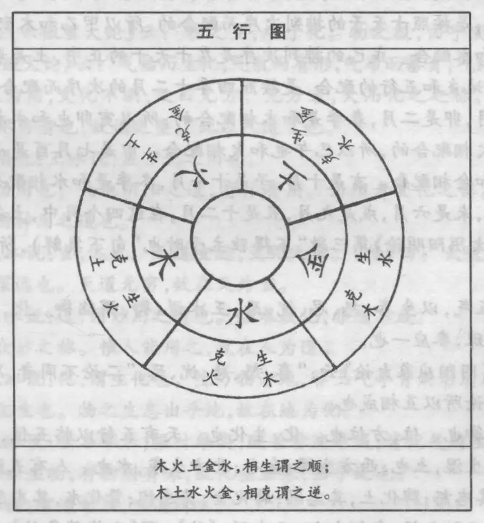
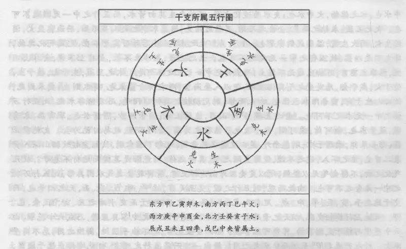
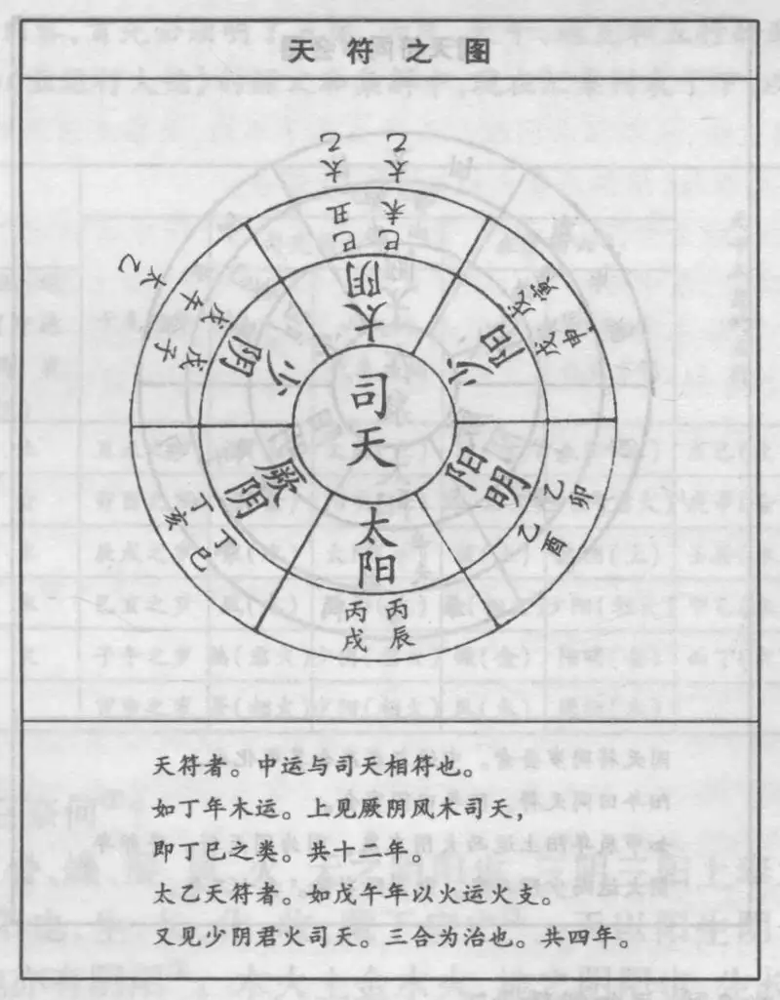
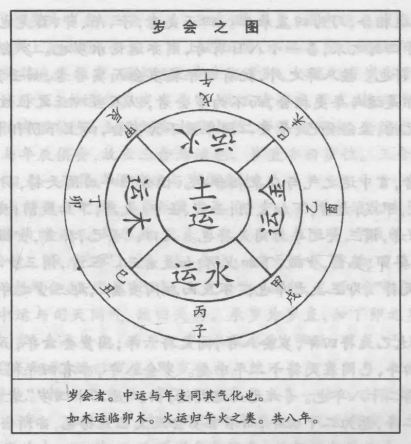
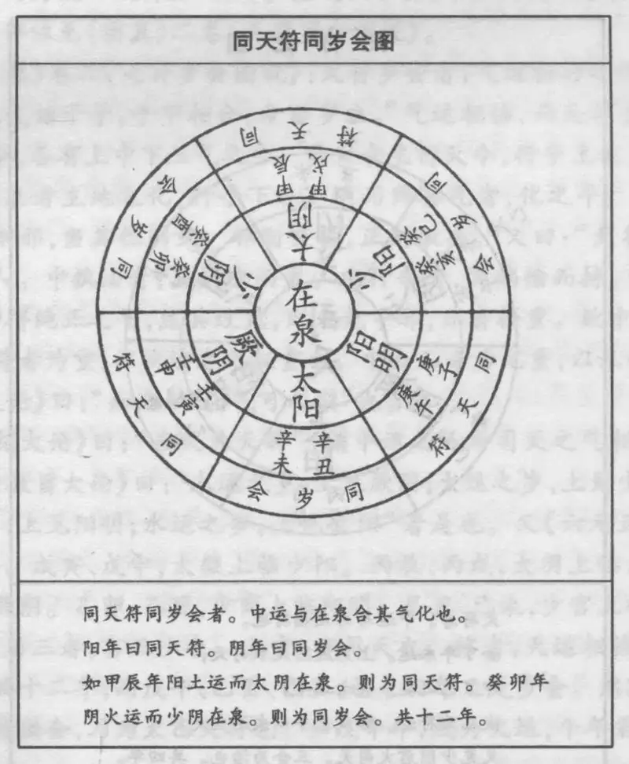
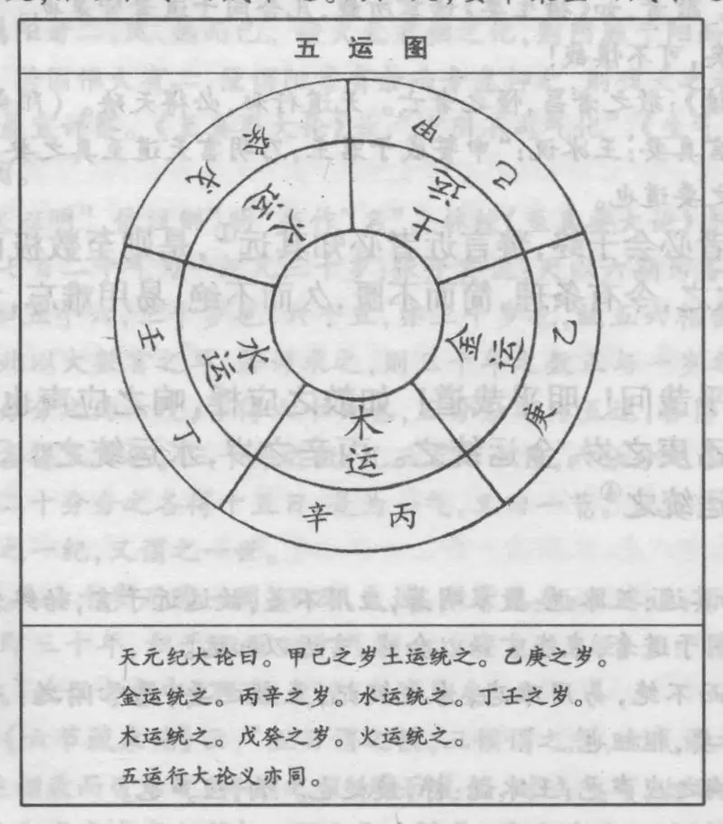

**〔卷十九〕**

天元纪大论第六十六

五运行大论第六十七

六微旨大论第六十八

# 天元纪大论第六十六①

①**天元纪大论第六十六**：**伯坚按：**《甲乙经》和今存残本《黄帝内经太素》都没有收载本篇的文字。本篇和《类经》的篇目对照，列表于下：

| 素问 | 类经 |
|---|---|
| 天元纪大论第六十六 | 卷二十三——天元纪（运气类三） |

> 黄帝问曰：天有五行①，御五位，以生寒、暑、燥、湿、风。人有五藏，化五气，以生喜、怒、思、忧、恐②。《论》言：“五运相袭而皆治之，终期之日，周而复始”，余已知之矣。愿闻其与三阴三阳之候，奈何合之③？
>
> 鬼臾区④稽首再拜对曰：昭乎哉问也！夫五运阴阳者，天地之道也，万物之纲纪，变化之父母，生杀之本始，神明之府也，可不通乎⑤？故物生谓之化⑥，物极谓之变⑦，阴阳不测谓之神⑧，神用无方谓之圣⑨。夫变化之为用也⑩，在天为玄⑪，在人为道⑫，在地为化⑬。化生五味⑭。道生智⑮。玄生神⑯。神在天为风⑰，在地为木⑱；在天为热⑲，在地为火⑳；在天为湿㉑，在地为土㉒；在天为燥㉓，在地为金㉔；在天为寒㉕，在地为水㉖。故在天为气，在地成形㉗，形气相感而化生万物矣㉘。然天地者，万物之上下也㉙。左右者，阴阳之道路也㉚。水火者，阴阳之征兆也㉛。金木者，生成之终始也㉜。气有多少，形有盛衰，上下相召，而损益彰矣㉝。

〔p.843 (인쇄 826)〕

**【集解】**

①**天有五行**：张介宾《类经图翼》卷一《五行统论》：五行者，水、火、木、金、土也。五行即阴阳之质，阴阳即五行之气。气非质不立，质非气不行。行也者，所以行阴阳之气也。朱子曰：五行质具于地而气行于天。其实元初只一太极，分为二，二分为四，天得一个四，地得一个四，又各有一个太极行乎其中，便是两其五行而已。故《河洛图书》具阴阳之象，分左右中前后以列五行生成之数焉。先儒曰：天地者，阴阳对待之定体。一二三四五六七八九十者，阴阳流行之次序。对待非流行不能变化，流行非对待不能自行，此五行所以流行于天地中而为用也。故大挠察天地之阴阳，立十干十二支以著日月之象。十干，以应日天之五行也。甲阳乙阴为木。丙阳丁阴为火。戊阳己阴为土。庚阳辛阴为金。壬阳癸阴为水。十二支以应月，地之五行也。子阳亥阴曰水。午阳巳阴曰火。寅阳卯阴曰木。申阳酉阴曰金。辰戌阳丑未阴曰土。干支出而六甲成。运气分而时序定。所谓天地相临，阴阳相合，而生成之道存乎其中。故五行之化，无乎不在。精浮于天则为五星，水曰辰星，火曰荧惑，木曰岁星，金曰太白，土曰镇星。形成于地则为五方，水位于北，火位于南，木位于东，金位于西，土位于中。其为四时，则木王于春，火王于夏，金王于秋，水王于冬，土王于四季。其为六气，则木之化风，火之化暑与热，土之化湿，金之化燥，水之化寒。其为名目，则水曰润下，火曰炎上，木曰曲直，金曰从革，土爰稼穑。其为功用，则水主润，火主熯，木主敷，金主敛，土主溽。其为形体，则水质平，火质锐，木质长，金质方，土质圜。其为赋性，则水性寒，火性热，木性温，金性清，土性蒸。其为五帝，则木曰太皞，火曰炎帝，土曰黄帝，金曰少皞，水曰颛顼。其为五神，则木曰勾芒，火曰祝融，土曰后土，金曰蓐收，水曰玄冥。其为五则，则火以应衡，水以应权，木以应规，金以应矩，土以应绳。至若五谷、五果、五畜、五音、五色、五臭、五味、五藏之类，无非属于五行也。又如五行气数之异，阴阳之辨，亦有所不同者。若以气言时之序，则曰木、火、土、金、水。如木当春令为阳稚，火当夏令为阳盛，金当秋令为阴稚，水当冬令为阴盛，是木火为阳，金水为阴也。若以数言生之序，则曰水、火、木、金、土。如天之生水为阳稚，天三生木为阳盛，地二生火为阴稚，地四生金为阴盛，是水木为阳，而火金为阴也。此外如洛书、乐律、刘向、班固等义，序各不同，无非变化之道，而运用之机亦无过生克之理耳。故自其相生者言，则水以生木，木以生火，火以生土，土以生金，金以生水。自其相克者言，则水能克火，火能克金，金能克木，木能克土，土能克水。自其胜复者言，则凡有所胜必有所败，有所败必有所复，母之败也，子必救之，如水之太过，火受伤矣，火之子土出而制焉；火之太过，金受伤矣，金之子水而制焉；金之太过，木受伤矣，木之子火出而焉；木之太过，土受伤矣，土之子金出而制焉；土之太过，水受伤矣，水之子木出而制焉。盖造化之几，不可无生，亦不可无制。无生则发育无由，无制则亢而为害。生克循环，运行不息，而天地之道，斯无穷已。第人知夫生之为生，而不知生中有克；知克之为克，而不知克中有用；知五之为五，而不知五者之中，五五二十五，而复有互藏之妙焉。所谓生中有克者，如木以生火，火胜则木乃灰烬；火以生土，土胜则火为扑灭；土以生金，金胜则土无发生；金以生水，水胜则金为沉溺；水以生木，木胜则水为壅滞；此其所以相生者，实亦有所相残也。所谓克中之用者，如火之炎炽，得水克而成既济之功；金之顽钝，得火克而成煅炼之器；木之曲直，得金克而成芟削之材；土之旷墁，得木克而见发生之化，水之泛滥，得土克而成堤障之用；此其所以相克者，实又所以相成也。而五常之德亦然，如木德为仁，金德为义，火德为礼，水德为智，土德为信，仁或失于柔故以义断之，义或失于刚故以礼节之，礼或失于拘故以智通之，智或失于诈故以信正之，是皆生克反用之道也。所谓五者之中有互藏者，如木之有津，木中水也；土之有泉，土中水也；金之有液，金中水也；水之镕物，火中水也；夫水为造化之原，万物之生其初皆水，而五行之中一无水之不可也。火之互藏，木钻之而见，金击之而见，石凿之而见，惟是水中之火人多不知，而油能生火，酒能生火，雨大生雷，湿多成热皆是也。且火为阳生之本，虽若无形而实无不在，凡属气化之物，非火不足以生，故五行之中一无火之不可也。土之互藏，木非土不长，火非土不荣，金非土不生，水非土不畜，万物生成无不赖土，而五行之中一无土之不可也。木之互藏，生于土，植于土，荣于火，成于金，凡发生之气其化在木，即以人生而言，所衣所食皆木也，得木则生，失木则死，故曰人生于寅，寅者阳木之位也，由人而推，则凡动植之类何非阳气，而又何非木化，此五行万物之中一无木之不可也。金之互藏，产于山石，生诸土也；淘于河沙，隐诸水也；草有汞，木有镴，藏于木也；散可结，柔可刚，化于火也。然金之为用，坚而不毁，故易曰乾为金。夫乾象正圆，形如爪卵，柔居于中，刚包乎外，是以天愈高而愈刚，地愈下而愈刚，故始皇起坟骊山深入黄泉二百丈，凿之不入，烧之不毁，使非至刚之气，真金之体，乃能若是其健而运行不息乎？故凡气化之物，不得金气无以坚强，所以皮壳在外而为捍卫者，皆得乾金之气以固其形，此五行万物之中一无金之不可也。由此而观，则五行之理，交互无穷，故甲、丙、戊、庚、壬，天之阳干也，而交于地之子、寅、辰、午、申、戌。乙、丁、己、辛、癸，天之阴干也，而交于地之丑、亥、酉、未、巳、卯。天地五行挨相交配，以天之干而交于地之十二，是于五行之中各具五行，乃成六十花甲，由六十花甲而推于天地万物，其变可胜言哉！然而变虽无穷，总不出乎阴阳，阴阳之用，总不离乎水火。所以天地之间，无往而非水火之用。欲以一言而蔽五行之理者，曰乾坤付正性于坎离，坎离为乾坤之用耳。

〔p.844 (인쇄 827)〕

**五行图**

木火土金水，相生谓之顺；

木土水火金，相克谓之逆。

〔p.845 (인쇄 828)〕

**干支所属五行图**

东方甲乙寅卯木，南方丙丁巳午火；西方庚辛申酉金，北方壬癸亥子水；辰戌丑未王四季，戊巳中央皆属土。

**伯坚按：**医学上五行的排列次序，是按照木火土金水的次序排列的，也就是按照所配合的四方和四季的次序排列的。它们的次序是：东方春木，南方夏火，中央土，西方秋金，北方冬水，十天干和五行的配合，是按照十天干的排列次序而配合的，所以甲乙和木配合，丙丁和火配合，庚辛和金配合，壬癸和水配合。戊己的排列次序是在十天干的正中，土是和中央配合的，所以戊己和土配合。十二地支和五行的配合，是按照四季十二月的次序而配合的。汉武帝的太初历正月建寅，寅是正月，卯是二月，春季是和木相配合的，所以寅卯也和木相配合。巳是四月，午是五月，夏季是和火相配合的，所以巳午也和火相配合。申是七月酉是八月，秋季是和金相配合的，所以申酉也和金相配合。亥是十月，子是十一月，冬季是和水相配合的，所以亥子也和水相配合。辰是三月，未是六月，戌是九月，丑是十二月，在这四个月中，土各寄王一十八天（详禁《素问》第二十九《太阴阳明论》第三段“不得独主于时也”句下集解），所以这四个月和土相配合。

②**人有五藏，化五气，以生喜、怒、思、忧、恐**：王冰说：御，谓临御。化，谓生化也。天真之气，无所不周，器象虽殊，参应一也。

《新校正》云：按《阴阳应象大论》云：“喜、怒、悲、忧、恐。”二论不同者，思者脾也，四藏皆受成焉，悲者胜怒也，二论所以互相成也。

张介宾说：御，临御也。位，方位也。化，生化也。天有五行以临五位，故东方生风，木也；南方生暑，火也；中央生湿，土也；西方生燥，金也；北方生寒，水也。人有五藏以化五气，故心化火，其志喜；肝化木，其志怒；脾化土，其志思；肺化金，其志忧；肾化水，其志恐。而天人相应也。

③**愿闻其与三阴三阳之候，奈何合之**：王冰说：《论》，谓《六节藏象论》也。运，谓五行应天之五运，各周三百六十五日而为纪者也，故曰终期之日周而复始也。以六合五，数未参同，故问之也。

张介宾说：《论》，即前《六节藏象论》也。终期之日，周而复始，谓期年一周而复始也。三阴三阳，六气也。言气有五运，复有六气，五六不侔，其将何以合之。

〔p.846 (인쇄 829)〕

④**鬼臾区**：陆懋修说：《史记·孝武帝纪》：“黄帝得宝鼎，宛侯问于鬼臾区。”《索隐》：“黄帝佐也。”《封禅书》：“鬼臾区号大鸿，死葬雍，故鸿冢是也。”《汉书·艺文志》阴阳家：“《鬼臾区》三篇，《图》一卷。”《古今人表》：“鬼臾区。”注：“即鬼容区也。”《亢仓子》作“鬼容邱”。《晋书·律历志》作“车区”。

⑤**夫五运阴阳者，天地之道也，万物之纲纪，变化之父母，生杀之本始，神明之府也，可不通乎**：王冰说：道，谓化生之道。纲纪，谓生长化成收藏之纲纪也。父母，谓万物形之先也。本始，谓生杀皆因而有之也。夫有形禀气而不为五运阴阳之所摄者，未之有也。所以造化不极，能为万物生化之元始者，何哉？以其是神明之府故也。然合散不测，生化无穷，非神明运为，无能尔也。

《新校正》云：详“阴阳者”至“神明之府也”，与《阴阳应象大论》同，而两论之注颇异。

张介宾说：此数句与《阴阳应象大论》同，但此多“五运”二字。

⑥**故物生谓之化**：张介宾说：万物之生，皆阴阳之气化也。

⑦**物极谓之变**：张介宾说：盛极必衰，衰极复盛，故物极者必变。

⑧**阴阳不测谓之神**：张介宾说：莫之为而为者谓之不测，故曰神，此以天道言也。

⑨**神用无方谓之圣**：王冰说：所谓化变，圣神之道也。化，施化也。变，散易也。神，无期也。圣，无思也。气之施化故曰生。气之散易故曰极。无期禀候故曰神。无思测量故曰圣。由化与变，故万物无能逃五运阴阳。由圣与神，故众妙无能出幽玄之理。深乎妙用，不可得而称之。

《新校正》云：按《六微旨大论》云：“物之生，从于化。物之极，由乎变。变化之相薄，成败之所由也。”又《五常政大论》云：“气始而生化，气散而有形，气布而蕃育，气终而象变，其致一也。”

张介宾说：神之为用，变化不测，故曰无方。无方者，大而化之之称。《南华·天运篇》曰：“无方之传，应物而不穷者也，故谓之圣。”此以人道言也。

⑩**夫变化之为用也**：王冰说：应万化之用也。

张介宾说：用，功用也。天地阴阳之道，有体有用。阴阳者变化之体。变化者，阴阳之用。此下乃承上文而发明神用之道也。

⑪**在天为玄**：王冰说：玄，远也。天道玄远，变化无穷。《传》曰：“天道远。人道迩。”

张介宾说：玄，深远也。天道无穷，故在天为玄。

⑫**在人为道**：王冰说：道，谓妙用之道也。经术政化，非道不成。

张介宾说：道，众妙之称。惟人能用之，故在人为道。

⑬**在地为化**：王冰说：化，谓生化也。生万物者地，非土气孕育则形质不成。

张介宾说：化，化生也。物之生息出乎地，故在地为化。

⑭**化生五味**：王冰说：金石草木，根叶华实，酸苦甘淡辛咸，皆化气所生，随时而有。

张介宾说：由化以生物，有物则有味，故化生五味，出乎地也。

⑮**道生智**：王冰说：智通妙用，唯道所生。

张介宾说：有道则有为，有为则有智，故道生智，存乎人也。

⑯**玄生神**：王冰说：玄远幽深，故生神也。神之为用，触遇玄通，契物化成，无不应也。

张介宾说：玄远则不测，不测则神存，故玄生神，本乎天也。

⑰**神在天为风**：王冰说：风者教之始，天之使也，天之号令也。

〔p.847 (인쇄 830)〕

⑱**在地为木**：王冰说：东方之化。

张介宾说：此以下皆言神化之为用也。神以气言，故在天之无形者为风，则在地之成形者为木，风与木同气，东方之化也。余仿此。

⑲**在天为热**：王冰说：应火为用。

⑳**在地为火**：王冰说：南方之化。

张介宾说：热与火同气，南方之化也。

㉑**在天为湿**：王冰说：应土为用。

㉒**在地为土**：王冰说：中央之化。

张介宾说：湿与土同气，中央之化也。

㉓**在天为燥**：王冰说：应金为用。

㉔**在地为金**：王冰说：西方之化。

张介宾说：燥与金同气，西方之化也。

㉕**在天为寒**：王冰说：应水为用。

㉖**在地为水**：王冰说：北方之化。神之为用，如上五化。木为风所生，火为热所炽，金为燥所发，水为寒所资，土为湿所全，盖初因而成立也。虽初因之以生成，卒因之以败散尔。岂五行之独有是哉，凡因所因而成立者悉因所因而散落尔。

《新校正》云：详“在天为玄”至此，与《阴阳应象大论》及《五运行大论》文重，注颇异。

张介宾说：寒与水同气，北方之化也。

俞正燮说：按此在天六气之五，《左传》昭元年医和言：“天有阴、阳、风、雨、晦、明六气，降为五味，发为五色，徵为五声。”《正义》引左氏先儒言：“雨为木，风为土，晦为水，明为火，阳为金，阴气属天。”合于此，则阴为相火，阳为燥，风为湿，雨为风，晦为寒，明为热。先师所传，各以明义。

㉗**故在天为气，在地成形**：王冰说：气，谓风、热、湿、燥、寒。形，谓木、火、土、金、水。

张介宾说：气即上文之风、热、湿、燥、寒。形即上文之木、火、土、金、水。此举五行之大者言，以见万物之生，亦莫不质具于地而气行乎天也。

㉘**形气相感而化生万物矣**：王冰说：此造化生成之大纪。

张介宾说：形，阴也。气，阳也。形气相感，阴阳合也，合则化生万物矣。故《宝命全形论》曰：“天地合气，命之曰人”，正此义也。

㉙**然天地者，万物之上下也**：王冰说：天覆地载，上下相临，万物化生，无遗略也。由是故万物自生自长，自化自成，自盈自虚，自复自变也。夫变者何？谓生之气极本而更始化也。孔子曰：“曲成万物而不遗。”

张介宾说：天覆之，故在上。地载之，故在下。若以司天在泉言，则亦为上下也。

㉚**左右者，阴阳之道路也**：王冰说：天有六气御下，地有五行奉上。当岁者为上，主司天。承岁者为下，主司地。不当岁者，二气居右，北行转之；二气居左，南行转之。金、木、水、火运北面正之，（顾观光说：“金木水火运北面正之”，当云“面北言之”。）常左为右，右为左，则左者南行，右者北行而反也。（顾观光说：“左者南行，右者北行而反也”，左右二字当互易。）

《新校正》云：详上下左右之说，义具《五运行大论》中。

张介宾说：左为阳主升，故阳道南行。右为阴主降，故阴道北行。是为阴阳之道路，如司天在泉之左右四问，亦其义也。

〔p.848 (인쇄 831)〕

㉛**水火者，阴阳之征兆也**：王冰说：征，信也，验也。兆，先也。以水火之寒热，彰信阴阳之先兆也。

张介宾说：征，证也。兆，见也。阴阳之征见于水火，水火之用见于寒暑，所以阴阳之往复，寒暑彰其兆，即此谓也。上数句与《阴阳应象大论》稍同。

㉜**金木者，生成之终始也**：王冰说：木主发生，应春，春为生化之始。金主收敛，应秋，秋为成实之终。终始不息，其化常行，故万物生长化成，收藏自久。

《新校正》云：按《阴阳应象大论》云：“天地者，万物之上下也。阴阳者，血气之男女。（顾观光说：此下当依《阴阳应象大论》补“也”字。下二句同。）左右者，阴阳之道路。水火者，阴阳之征兆。阴阳者，万物之能始也。”与此论相出入。

张介宾说：金主秋，其气收敛而成万物；木主春，其气发扬而生万物；故为生成之终始。按上文水、火、金、木，乃五行之四，各有其用，独不言土，何也？盖土德居中，凡此四者，一无土之不可，故兼四气之用，而寄王于四季，是以不可列言也。

㉝**气有多少，形有盛衰，上下相召，而损益彰矣**：王冰说：气有多少，谓天之阴阳三等多少不同秩也。形有盛衰，谓五运之气有太过不及也。由是少多衰盛，天地相召，而阴阳损益昭然彰著可见也。（《新校正》云：详阴阳三等之义，具下文注中。）

张介宾说：在天之气有多少，故阴阳有三等之分。在地之形有盛衰，故五行有大小之异。上下相召，即形气相感之谓。盖天气下降，气流于地，地气上升，气胜于天，升降相因，则气运有大过不及胜复微甚之变，而损益彰矣。本类诸篇所言者，皆发明损益之义，当详察也。

> 帝曰：愿闻五运之主时也何如①？
>
> 鬼臾区曰：五气运行，各终期日，非独主时也②。

**【集解】**

①**愿闻五运之主时也何如**：王冰说：时，四时也。

张介宾说：主四时之令也。

②**五气运行，各终期日，非独主时也**：王冰说：一运一日，终三百六十五日四分度之一乃易之，非主一时当其王相囚死而为绝法也，气交之内迢然而别有之也。

张介宾说：各终期日，谓五运各主期年以终其日，如甲己之岁，土运统之之类是也，非独主四时而已。

> 帝曰：请问其所谓也。
>
> 鬼臾区曰：臣积考《太始天元册文》①曰：“太虚寥廓，肇基化元②。万物资始，五运终天③。布气真灵，总统坤元④。九星悬朗，七曜周旋⑤。曰阴、曰阳、曰柔、曰刚⑥。幽显既位，寒暑弛张⑦。生生化化，品物咸章⑧”。臣斯十世，此之谓也⑨。

**【集解】**

①**《太始天元册文》**：王冰说：《天元册》，所以记天真元气运行之纪也。自神农之世，鬼臾区十世祖始诵而行之，此太古占候灵文。洎乎伏羲之时，已镌诸玉版，命曰册文。太古灵文，故命曰《太始天元册》也。

《新校正》云：详今世有《天元玉册》，或者以为即此《太始天元册文》，非是。

②**太虚寥廓，肇基化元**：王冰说：太虚，谓空玄之境，真气之所充，神明之宫府也。真气精微，无远不至，故能为生化之本始，运气之真元矣。肇，始也。基，本也。

〔p.849 (인쇄 832)〕

张介宾说：《太始天元册文》，盖太古之文，所以纪天元者也。太虚，即周子所谓无极，张子所谓由太虚有天之名也。廖廓，空而无际之谓。肇，始也。基，立也。化元，造化之本原也。

③**万物资始，五运终天**：王冰说：五运，谓木、火、土、金、水运也。终天，谓一岁三百六十五日四分度之一也，终始更代周而复始也。言五运更统于太虚，四时随部而迁复，六气分居而异主，万物因之以化生。非曰自然，其谁能始，故曰万物资始。《易》曰：“大哉乾元，万物资始乃统天，云行雨施，品物流形。”孔子曰：“天何言哉？四时行焉！百物生焉！”此其义也。

张介宾说：资始者，万物藉化元而始生。终天者，五行终天运而无已也。

④**布气真灵，总统坤元**：王冰说：太虚真气无所不至也。气齐生有，故禀气含灵者抱真气以生焉。总统坤元，言天元气常司地气化生之道也。《易》曰：“至哉坤元，万物资生，乃顺承天”。

张介宾说：布者，布天地之气，无所不至也。气有真气，化几是也。物有灵明，良知是也。虽万物形气禀乎天地，然地亦天中之物。故《易》曰：“大哉乾元，万物资始，乃统天。”“至哉坤元，万物资生，乃顺承天。”又曰：“成象之谓乾。效法之谓坤。”然则坤之元不外乎乾之元也，故曰总统坤元。

⑤**九星悬朗，七曜周旋**：王冰说：九星，上古之时也。上古世质人淳，归真反朴，九星悬朗，五运齐宣。中古道德稍衰，标星藏耀，故计星之见者七焉。九星谓天蓬、天芮、天冲、天辅、天禽、天心、天任、天柱、天英，此盖从标而为始，遁甲式法今犹用焉。七曜谓日月五星，今外蕃多以此历为举动吉凶之信也。周，谓周天之度。旋，谓左循天度而行。五星之行，犹各有进退高下小大矣。

张介宾说：九星者，天蓬一，天芮二，天冲三，天辅四，天禽五，天心六，天任七，天柱八，天英九也，见补遗《本病论》，及详《九宫星野图》，今奇门阴阳家皆用之。七曜，日月五星也。《舜典》谓之七政。七者如纬，运行于天，有迟有速，有顺有逆，故曰周旋。

江有诰《先秦韵读》：太虚寥廓，肇基化元。万物资生，五运终天。布气真灵，总统坤元。九星悬朗，七曜周旋。（元真合韵）

⑥**曰阴、曰阳、曰柔、曰刚**：王冰说：阴阳，天道也。柔刚，地道也。天以阳生阴长，地以柔化刚成也。《易》曰：“立天之道，曰阴与阳。立地之道，曰柔与刚。”此之谓也。

张介宾说：阴阳者，天道也。柔刚者，地道也。《易系》曰：“立天之道，曰阴与阳。立地之道，曰柔与刚。”邵子曰：“天之大，阴阳尽之。地之大，刚柔尽之。故天道资始，阴阳而已。地道资生，刚柔而已。”然刚即阳之道，柔即阴之道，故又曰：“动静有常，刚柔断矣。”此又以阴阳刚柔合天地而总言之也。

⑦**幽显既位，寒暑弛张**：王冰说：幽显既位，言人神各得其序。寒暑弛张，言阴阳不失其宜也。人神各守所居，无相干犯，阴阳不失其序，物得其宜，天地之道且然，人神之道（顾观光说：吴刻，“道”作“理”。）亦犹也。（度会常珍说：古抄本，“犹”作“似”。）

《新校正》云：按《至真要大论》云：“幽明何如？岐伯曰：‘两阴交尽故曰幽，两阳合明故曰明。幽明之配，寒暑之异也。’”

张介宾说：阳主昼，阴主夜，一日之幽显也。自晦而朔，自弦而望，一月之幽显也。春夏主阳而生长，秋冬主阴而收藏，一岁之幽显也。幽显既定其位，寒暑纵而弛张矣。弛张，往来也。

⑧**生生化化，品物咸章**：王冰说：上生，谓生之有情有识之类也。下生，谓生之无情无识之类也。前化，谓形容彰显者也。后化，谓蔽匿形容者也。有情有识，彰显形容，天气主之；无情无识，蔽匿形质，地气主之；禀元灵气之所化育尔。《易》曰：“天地絪蕴，万物化醇”，斯之谓欤。

〔p.850 (인쇄 833)〕

张介宾说：《易》曰：“云行雨施，品物流形。”又曰：“天地絪蕴，万物化醇。”此所以生生不息，化化无穷，而品物咸章矣。章，昭著也。

江有诰《先秦韵读》：曰阴曰阳，曰柔曰刚。幽显既位，寒暑弛张。生生化化，万物咸章。（阳部）

⑨**臣斯十世，此之谓也**：王冰说：传习斯文，至鬼臾区十世于兹，不敢失坠。

张介宾说：言传习之久，凡十世于兹者，此道之谓也。

> 帝曰：善。何谓气有多少，形有盛衰？
>
> 鬼臾区曰：阴阳之气各有多少，故曰三阴三阳也①。形有盛衰，谓五行之治各有太过、不及也②。故其始也，有余而往，不足随之；不足而往，有余从之③。知迎知随，气可与期④。应天为天符。承岁为岁直。三合为治⑤。

**【集解】**

①**何谓气有多少，形有盛衰？鬼臾区曰**：阴阳之气各有多少，故曰三阴三阳也：王冰说：由气有多少，故随其升降分为三别也。

《新校正》云：按《至真要大论》云：“‘阴阳之三也何谓？’岐伯曰：‘气有多少异用。’”王冰云：“太阴为正阴，太阳为正阳。次少者为少阴，次少者为少阳。又次为阳明，又次为厥阴。”

②**形有盛衰，谓五行之治各有太过、不及也**：王冰说；太过，有余也。不及，不足也。气至不足，太过迎之。气至太过，不足随之。天地之气亏盈如此，故云形有盛衰也。

张介宾说：此以下皆明形气之盛衰也。阴阳之气各有多少，故厥阴为一阴，少阴为二阴，太阴为三阴，少阳为一阳，阳明为二阳，太阳为三阳也。形有盛衰，如木有太少角，火有太少徵，土有太少宫，金有太少商，水有太少羽，此五行之治各有太过不及也。

③**故其始也，有余而往，不足随之；不足而往，有余从之**：张介宾说：此气运迭为消长也。始，先也。随，后也。以六十年之常而言，如甲往则乙来，甲为太宫，乙为少商，此有余而往，不足随之也。乙往则丙来，乙为少商，丙为太羽，此不足而往，有余从之也。岁候皆然。以盈虚之胜负言，如火炎者水必涸，水盛者火必灭，阴衰者阳凑之，阳衰者阴凑之，皆先往后随之义也。盖气运之消长，有盛必有衰，有胜必有复，往来相因，强弱相加，而变由作矣。

④**知迎知随，气可与期**：王冰说：言盈亏无常，互有胜负尔。始，谓甲子岁也。《六微旨大论》曰：“天气始于甲。地气始于子。子甲相合，命曰岁立。”此之谓也。则始甲子之岁，三百六十五日所禀之气当不足也。次而推之，终六甲也。故有余已则不足，不足已则有余。亦有岁运非有余非不足者，盖以同天地之化也。若余已复余，少已复少，则天地之道变常，而灾害作苛疾生矣。（《新校正》云：按《六微旨大论》云：“木运临卯，火运临午，土运临四季，金运临酉，水运临子，所谓岁会气之平也。”又按《五常政大论》云：“委和之纪，上角与正角同，上商与正商同，上宫与正宫同。伏明之纪，上商与正商同。卑监之纪，上宫与正宫同，上角与正角同。从革之纪，上商与正商同，上角与正角同。涸流之纪，上宫与正宫同。赫曦之纪，上羽与正徵同。坚成之纪，上徵与正商同。”又《六元正纪大论》云：“不及而加，同岁会。”已前诸岁并为正岁，气之平也，今王《注》以同天之化为非有余不足者非也。）

张介宾说：迎者，迎其至也。随者，随其去也。如时令有盛衰，则候至有迟速，至与不至，必先知之，是知迎也。气运有胜复，胜微者复微，胜甚者复甚，其微其甚，必先知之，是知随也。知迎知随，则岁气可期，而天和可自保矣。

〔p.851 (인쇄 834)〕

⑤**应天为天符。承岁为岁直，三合为治**：王冰说：应天，谓木运之岁上见厥阴，火运之岁上见少阳、少阴，土运之岁上见太阴，金运之岁上见阳明，水运之岁上见太阳，此五者天气下降如合符运，故曰应天为天符也。承岁，谓木运之岁岁当于卯，火运之岁岁当于午，土运之岁岁当辰戌丑未，金运之岁岁当于酉，水运之岁岁当于子，此五者岁之所直，故曰承岁为岁直也。三合，谓火运之岁上见少阴，年辰临午；土运之岁上见太阴，年辰临丑未；金运之岁上见阳明，年辰临酉；此三者天气运气与年辰俱会，故云三合为治也。岁直亦曰岁位。三合亦为天符。《六微旨大论》曰：“天符岁会曰太一天符，”谓天运与岁俱会也。

《新校正》云：按天符岁会之详，具《六微旨大论》中。又详火运上少阴，年辰临午，即戊午岁也。土运上太阴，年辰临丑未，即己丑、己未岁也。金运上阳明，年辰临酉，即乙酉岁也。

张介宾说：符，合也。承，下奉上也。直，会也。应天为天符，如丁巳，丁亥，木气合也；戊寅，戊申，戊子，戊午，火气合也；己丑，己未，土气合也；乙卯，乙酉，金气合也；丙辰，丙戌，水气合也；此十二年者，中运与司天同气，故曰天符。承岁为岁直，如丁卯之岁，木承木也；戊午之岁，火承火也；乙酉之岁，金承金也；丙子之岁，水承水也；甲辰，甲戌，己丑，己未之岁，土承土也；此以年支与岁，同气相承，故曰岁直，即岁会也。然不分阳年阴年，但取四正之年为四直承岁，如子、午、卯、酉是也。惟土无定位，寄王于四季之末各一十八日有奇，则通论承岁，如辰、戌、丑、未是也，共计八年。三合为治，言天气运气年辰也。凡天符岁会之类，皆不外此三者。若上中下三气俱合，乃为太一天符，如乙酉岁金气三合，戊午岁火气三合，己丑己未岁土气三合者是也，共四年。右详注见《图翼》二卷《天符岁会图说》。

张介宾《类经图翼》卷二《天符岁会图说》：天符岁会者，气运相符之谓也。《六微旨大论》曰：“天气始于甲，地气始于子，子甲相合，命曰岁立。”气运相临，而天符岁会盛衰虚实所由生矣。故每岁天地之令，各有上中下三气之分。司天者主行天令，行乎上也。岁运者主生化运动之机，行乎中也。在泉者主地之化，行乎下也。遇而同其气者，化之平。遇而异其气者，化之逆。故曰：“非其位则邪，当其位则正。邪则变甚，正则微也。”又曰：“天符为执法。岁会为行令。太乙天符为贵人。中执法者，其病速而危。中行令者，其病徐而持。中贵人者，其病暴而死。”虽天符岁会，皆得纯正之气，然其过亢，则未免中邪，亦有轻重。故中岁会者为轻，以行令者之权轻也。中天符者为重，以执法者之权重也。中太乙者为尤重，以三气皆伤而贵人之不可犯也。故《天元纪大论》曰：“知迎知随，气可与期”也。

天符者，《天元纪大论》曰：“应天为天符”，谓中运之气与司天之气相同者，命曰天符。符之为言合也。如《六微旨大论》曰：“木运之岁，上见厥阴；火运之岁，上见少阳、少阴；土运之岁，上见太阴；金运之岁，上见阳明；水运之岁，上见太阳”者是也。又《六元正纪大论》曰：“戊子、戊午，太徵上临少阴。戊寅、戊申，太徵上临少阳。丙辰、丙戌，太羽上临太阳。如是者三。丁巳、丁亥，少角上临厥阴。乙卯、乙酉，少商上临阳明。己丑、己未，少宫上临太阴。如是者三”。前三者，言三太也。后三者，言三少也。上者，言司天也。临者，天运相临也。二论之词不同，而义则一也。天符共十二年，而戊午、乙酉、己丑、己未四年又是岁会。然既为天符，又为岁会，是天气运气岁支三者俱会，乃为太乙天符也。如戊午年，戊为火运，午年君火司天，又午属南方火位，故曰三合为治也。

太乙天符者，尊之之号也，故太乙天符称贵人。共四年，即戊午、己丑、己未、乙酉是也。

岁会者，《天元纪大论》曰：“承岁为岁直”，乃中运之气与岁支相同者是也。《六微旨大论》曰：“木运临卯，火运临午，土运临四季，金运临酉，水运临子，所谓岁会，气之平也。”不分阴年阳年，但取四正之支与运相合，乃为四直承岁。四正支者，子、午、卯、酉是也。如辰、戌、丑、未四年，土无定位，寄旺于四时之末，各一十八日有奇，则亦通论承岁也。岁会共计八年，而四年同于天符，是即太乙天符也。按八年之外，犹有四年类岁会而实非者，如壬寅皆木，庚申皆金，癸巳皆火，辛亥皆水，亦是运与年支相合，而不为岁会者，以不当四正之位故也。然除壬寅、庚申二阳年不相和顺者无论，至若癸巳、辛亥二阴年虽不为岁会，而上下阴阳相佐，亦得乎气，其物生脉应亦皆合期也。

〔p.852 (인쇄 835)〕

同天符同岁会者，言中运之气与在泉相合也。但分阳年曰同天符，阴年曰同岁会。《六元正纪大论》曰：“甲辰，甲戌，太宫，下加太阴；壬寅、壬申，太角，下加厥阴；庚子，庚午，太商，下加阳明；如是者三。”三者，谓三太之年为同天符也。又曰：“癸巳，癸亥，少徵，下加少阳；辛丑、辛未，少羽，下加太阳；癸卯、癸酉，少徵，下加少阴；如是者三。”三者，谓三少之年为同岁会也。故又曰：“太过而加同天符”，即三太之年也；“不及而加同岁会”，即三少之年也。下加者，在泉为下也。

右天符十二年，太乙天符四年，岁会八年，同天符六年，同岁会六年，五者分而言之，共三十六年。然太乙天符四年，已同在天符十二年中矣。岁会八年，亦有四年同在天符中矣。故合而言之，六十年中，止得二十八年也。《六元正纪大论》曰：“凡二十四岁”者，盖止言天符十二年，同天符同岁会共十二年，总为二十四年，而不言岁会及太乙天符也，亦所当审。

**天符之图**

天符者。中运与司天相符也。如丁年木运。上见厥阴风木司天，即丁巳之类。共十二年。

太乙天符者。如戊午年以火运火支。又见少阴君火司天。三合为治也。共四年。

〔p.853 (인쇄 836)〕

**岁会之图**

岁会者。中运与年支同其气化也。如木运临卯木。火运归午火之类。共八年。

**同天符同岁会图**

同天符同岁会者。中运与在泉合其气化也。阳年曰同天符。阴年曰同岁会。如甲辰年阳土运而太阴在泉。则为同天符。癸卯年阴火运而少阴在泉。则为同岁会。共十二年。

**伯坚按：**现将这些名辞，详细解释于下。

（一）天符——凡各年中运的五行，和本年司天的五行相同的，这一年就叫作天符。例如《六元正纪大论》曰：“戊子、戊午，上临少阴”，这是说戊子年戊午年，按照固定规格的排列，是少阴（热气）司天，戊年中运的五行是火，少阴的五行也是火，所以戊子戊午这两年就叫作天符。

〔p.854 (인쇄 837)〕

（二）岁会——凡各年中运的五行，和本年干支纪年中的地支本身的五行相同的，这一年就叫作岁会。例如丁卯年，丁年中运的五行是木，本年地支的卯的本身五行也是木；又如乙酉年，乙年中运的五行是金，本年地支的酉的本身五行也是金；所以丁卯年乙酉年这两年就叫作岁会。

（三）太乙天符——凡各年中运的五行，既和本年司天的气的五行相同，又和本年干支纪年中的地支本身的五行相同，这是三合为治，既是天符，又是岁会，这一年就叫作太乙天符。例如戊午年，戊年中运的五行是火，按照固定规格的排列，这一年是少阴（热气）司天，少阴的五行也是火，本年地支的午的本身五行也是火，这是三合为治，所以戊午年就叫作太乙天符。

（四）同天符——十个天干中有五个属阳，五个属阴。甲、丙、戊、庚、壬五个天干属阳。乙、丁、己、辛、癸五个天干属阴。凡是阳天干纪年的中运的五行，和本年在泉的气的五行相同的，这一年就叫作同天符。例如《六元正纪大论》说：“甲辰、甲戌，下加太阴”，这是说甲辰年甲戌年，按照固定规格的排列，是太阴（湿气）在泉，甲是阳天干，甲年中运的五行是土，太阴的五行也是土，所以甲辰年甲戌年这两年就叫作同天符。

（五）同岁会——凡是阴天干纪年的中运的五行，和本年在泉的气的五行相同的，这一年就叫作同岁会。例如《六元正纪大论》说：“癸巳、癸亥，下加少阳”，这是说癸巳年癸亥年，按照固定规格的排列，是少阳（暑气）在泉，癸是阴天干，癸年中运的五行是火，少阳的五行也是火，所以癸巳年癸亥年这两年就叫作同岁会。

要想了解这一段内容，首先必须明了五运、六气、天干、地支和五行的配合，这些配合分别见于《天元纪大论》和《五运行大论》的经文和集解中，现在汇集列表于下，以期明显：

| 五行 | 五运的五行 |  | 六气的五行 |  |  |  |  | 天干本身的五行 | 地支本身的五行 |
|---|---|---|---|---|---|---|---|---|---|
|  |  |  |  | 司天的六气 |  | 在泉的六气 |  |  |  |
|  | 干支纪年 | 五运（中运即岁运） | 干支纪年 | 六气 | 六气的代表名词 | 六气 | 六气的代表名词 |  |  |
| 土 | 甲己之岁 | 土 | 丑未之岁 | 湿（土） | 太阴（土） | 寒（水） | 太阳（水） | 戊己（土） | 丑辰未戌（土） |
| 金 | 乙庚之岁 | 金 | 卯酉之岁 | 燥（金） | 阳明（金） | 热（君火） | 少阴（君火） | 庚辛（金） | 申酉（金） |
| 水 | 丙辛之岁 | 水 | 辰戌之岁 | 寒（水） | 太阳（水） | 湿（土） | 太阴（土） | 壬癸（水） | 子亥（水） |
| 木 | 丁壬之岁 | 木 | 巳亥之岁 | 风（木） | 厥阴（木） | 暑（相火） | 少阳（相火） | 甲乙（木） | 寅卯（木） |
| 火 | 戊癸之岁 | 火 | 子午之岁 | 热（君火） | 少阴（君火） | 燥（金） | 阳明（金） | 丙丁（火） | 巳午（火） |
|  |  |  | 寅申之岁 | 暑（相火） | 少阳（相火） | 风（木） | 厥阴（木） |  |  |

> 帝曰：上下相召奈何①？
>
> 鬼臾区曰：寒、暑、燥、湿、风、火，天之阴阳也，三阴三阳上奉之②。木、火、土、金、水、火，地之阴阳也，生、长、化、收、藏下应之③。天以阳生阴长。地以阳杀阴藏④。天有阴阳，地亦有阴阳⑤。木火土金水火，地之阴阳也，生长化收藏⑥。故阳中有阴，阴中有阳⑦。所以欲知天地之阴阳者，应天之气，动而不息，故五岁而右迁；应地之气，静而守位，故六期而环会⑧。动静相召，上下相临，阴阳相错，而变由生也⑨。

〔p.855 (인쇄 838)〕

**【集解】**

①**上下相召奈何**：张介宾说：此以下皆明上下相召也。

②**寒、暑、燥、湿、风、火，天之阴阳也，三阴三阳上奉之**：王冰说：太阳为寒，少阳为暑，阳明为燥，太阴为湿，厥阴为风，少阴为火，皆其元在天，故曰天之阴阳也。

张介宾说：寒、暑、燥、湿、风、火，六气化于天者也，故为天之阴阳。三阴三阳上奉之，谓厥阴奉风气，少阴奉火气，太阴奉土气，此三阴也；少阳奉暑气，阳明奉燥气，太阳奉寒气，此三阳也。

③**木、火、土、金、水、火，地之阴阳也，生、长、化、收、藏下应之**：王冰说：木，初气也。火，二气也。相火，三气也。土，四气也。金，五气也。水，终气也。以其在地应天，故云下应也。气在地，故曰地之阴阳也。

《新校正》云：按《六微旨大论》曰：“‘地理之应六节气位何如？’岐伯曰：‘显明之右，君火之位。退行一步，相火治之。复行一步，土气治之。复行一步，金气治之。复行一步，水气治之。复行一步，木气治之。’”此即木、火、土、金、水、火，地之阴阳之义也。

张介宾说：木、火、土、金、水、火，五行成于地者也。故为地之阴阳。生、长、化、收、藏下应之，谓木应生，火应长，土应化，金应收，水应藏也。按上文神在天为风等十句，其在天者止言风、热、湿、燥、寒，在地者止言木、火、土、金、水。而此二节乃言寒、暑、燥、湿、风、火，木、火、土、金、水、火。盖以在天之热，分为暑火而为六，在地之火，分为君相而为六，此因五行以化六气，而所以有三阴三阳之分也。二火义如下文。

④**天以阳生阴长。地以阳杀阴藏**：王冰说：生长者，天之道。藏杀者，地之道。天阳主生，故以阳生阴长。地阴主杀，故以阳杀阴藏。天地虽高下不同，而各有阴阳之运用也。

《新校正》云：详此经与《阴阳应象大论》文重，注颇异。

张介宾说：天为阳，阳主升，升则向生，故天以阳生阴长，阳中有阴也。地为阴，阴主降，降则向死，故地以阳杀阴藏，阴中有阳也。以岁气纪之，其征可见，如上半年为阳，阳升于上，天气治之，故春生夏长；下半年为阴，阴降于下，地气治之，故秋收冬藏也。

⑤**天有阴阳，地亦有阴阳**：王冰说：天有阴故能下降，地有阳故能上腾，是以各有阴阳也。阴阳交泰，故化变由之成也。

⑥**木火土金水火，地之阴阳也，生长化收藏**：顾观光说：张氏《类经》删此十六字，与《困学纪闻》合。（**伯坚按：**见《困学纪闻》卷九《天道》。）

钱熙祚《素问跋》：按“木火”以下十六字，必因上文误衍。上下文势紧相承接，不当以此十六字横亘于中。观王注亦无释，是误在王氏后矣。

**伯坚按：**今据钱熙祚说，删去此十六字。

⑦**故阳中有阴，阴中有阳**：王冰说：阴阳之气，极则过亢，故各兼之。《阴阳应象大论》曰：“寒极生热，热极生寒。”又曰：“重阴必阳，重阳必阴。”言气极则变也。故阳中兼阴，阴中兼阳，《易》之卦离中虚，坎中满，此其义象也。

张介宾说：天本阳也，然阳中有阴。地本阴也，然阴中有阳。此阴阳互藏之道，如坎中有奇，离中有偶，水之内明，火之内暗皆是也。惟阳中有阴，故天气得以下降；阴中有阳，故地气得以上升；此即上下相召之本。

⑧**故六期而环会**：王冰说：天有六气，地有五位。天以六气临地，地以五位承天。盖以天气不加君火故也。以六加五，则五岁而余一气，故迁一位。若以五承六，则常六岁乃备尽天元之气，故六年而环会，所谓周而复始也。地气左行，往而不返。天气东转，常自火运数五岁已，其次气正当君火之上，法不加临，则右迁君火气上，以临相火气上，故曰五岁而右迁也。由斯动静上下相临，而天地万物之情，变化之机可见矣。

〔p.856 (인쇄 839)〕

张介宾说：应天之气，五行之应天干也。动而不息，以天加地而六甲周旋也。五岁而右迁，天干之应也，即下文甲己之岁土运统之之类是也。盖甲、乙、丙、丁、戊竟五运之一周，己、庚、辛、壬、癸又五运之一周，甲右迁而己来，己右迁而甲来，故五岁而右迁也。应地之气，六气之应地支也。静而守位，以地承天而地支不动也。六期而环会，地支之周也，即下文子午之岁上见少阴之类是也。盖子、丑、寅、卯、辰、巳终六气之一备，午、未、申、酉、戌、亥又六气之一备，终而复始，故六期而环会。

⑨**动静相召，上下相临，阴阳相错，而变由生也**：王冰说：天地之道，变化之微，其由是矣。孔子曰：“天地设位而易行乎其中”，此之谓也。

《新校正》云：按《五运行大论》云：“上下相遘，寒暑相临，气相得则和，不相得则病。”又云：“上者右行，下者左行，左右周天，余而复会。”

张介宾说：动以应天，静以应地，故曰动静，曰上下，无非言天地之合气，皆所以结上文相召之义。

> 帝曰：上下周纪，其有数乎？
>
> 鬼臾区曰：天以六为节。地以五为制①。周天气者，六期为一备。终地纪者，五岁为一周②。君火以明，相火以位③。五六相合，而七百二十气为一纪凡三十岁④，千四百四十气凡六十岁而为一周，不及、太过，斯皆见矣⑤。

**【集解】**

①**地以五为制**：张介宾说：天数五，而五阴五阳，故为十干。地数六，而六阴六阳，故为十二支。然天干之五必得地支之六以为节，地支之六必得天干之五以为制，而后六甲成，岁气备。又如子、午之上为君火，丑、未之上为湿土，寅、申之上为相火，卯、酉之上为燥金，辰、戌之上为寒水，巳、亥之上为风木，是六气之在天，而以地支之六为节也。甲、己为土运，乙、庚为金运，丙、辛为水运，丁、壬为木运，戊、癸为火运，是五行之在地，而以天干之五为制也。此以地支而应天之六气，以天干而合地之五行，正其上下相召，以合六五之数也。

②**五岁为一周**：王冰说：六节，谓六气之分。五制，谓五位之分。位应一岁，气统一年，故五岁为一周，六年为一备。备，谓备历天气。周，谓周行地位。所以地位六而言五者，天气不临君火故也。

张介宾说：天之六气各治一岁，故六期为一备。地之五行亦各治一岁，故五岁为一周。一曰当以“周天气者六”为句“终地纪者五”为句，亦通。谓一岁六气各主一步，步各六十日，六六三百六十日，是周天气者六也，故期为一备。一岁五行各主一运，运七十二日，五七三百五十，二五一十，亦三百六十日，是终地纪者五也，故岁为一周，此以一岁之五六为言，以合下文一纪一周之数，尤见亲切。

③**君火以明，相火以位**：王冰说：君火在相火之右，但立名于君位，不立岁气，故天之六气不偶其气以行君火之政，守位而奉天之命以宣行火令尔。以名奉天，故曰君火以名。守位禀命，故云相火以位。

张介宾说：此明君之六气，惟火有二之义也。君者，上也。相者，下也。阳在上者，即君火也。阳在下者，即相火也。上者应离，阳地外也。故君火以明。下者应坎，阳在内也，故相火以位。火一也，而上下幽显其象不同，此其所以有辨也。愚按王氏注此曰：“君火在相火之右，但立名于君位，不立岁气。”又曰：“以名奉天，故曰君火以名。守位禀命，故曰相火以位。”详此说，是将明字改为名字，则殊为不然。此盖因《至真要大论》言少阴不司气化，故引其意而云君火不立岁气，殊不知彼言不司气化者，言君火不主五运之化，非言六气也。如子午之岁上见少阴，则六气分主天地，各有所司，何谓不立岁气。且君为大主，又岂寄空名于上者乎？以致后学宗之，皆谓君火以名，竟将明字灭去，大失先圣至要之旨。夫天人之用，神明而已。惟神则明，惟明乃神，天得之而明照万方，人得之而明见万里，皆此明字之用，诚天地万物不可须臾离者。故《气交变大论》曰：“天地之动静，神明为之纪。”《生气通天论》曰：“阳气者，若天与日，失其所则折寿而不彰，故天运当以日光明。”此皆君火以明之义也。又如《周易·说卦传》曰：“离也者，明也。万物皆相见，南方之卦也。圣人南面而听天下，响明而治，盖取诸此也。”由此言之，则天时人事无不赖此明字为之主宰，而后人泯去之，其失为何如哉？不得不正。又按君火以明，相火以位，虽其注义如前，然以凡火观之，则其气质上下亦自有君相明位之辨。盖明者，光也，火之气也。位者，形也，火之质也。如一寸之灯，光被满室，此气之为然也。盈炉之炭，有热无焰，此质之为然也。夫焰之与炭皆火也，然焰明而质暗，焰虚而质实，焰动而质静，焰上而质下，以此证之，则其气之与质固自有上下之分，亦岂非君相之辨乎？是以君火居上，为日之明，以昭天道，故于人也属心，而神明出焉。相火居下，为原泉之温，以生养万物，故于人也属肾，而元阳蓄焉。所以六气之序，君火在前，相火在后。前者肇物之生，后者成物之实。而三百六十日中，前后二火所主者止四五六七月，共一百二十日，以成一岁化育之功，此君相二火之为用也。或曰六气中五行各一，惟火言二，何也？曰天地之道，阴阳而已。阳主生，阴主杀。使阳气不充，则生意终于不广，故阳道实，阴道虚，阳气刚，阴气柔，此天地阴阳当然之道。且六气之分，属阴者三，湿、燥、寒是也；属阳者二，风、热而已。使火无君相之化，则阴胜于阳而杀甚于生矣，此二火之所以必不可无也。若因惟火有二，便谓阳常有余而专意抑之，则伐天之和，伐生之本，莫此为甚。此等大义，学者最宜详察。《至真要大论》云：“少阴不司气化”，《生气通天论》云：“天运当以日光明”，俱当参阅。

〔p.857 (인쇄 840)〕

顾观光说：“君火以明”，依注则“明”当作“名”。林校《至真要大论》亦引作“名”。

④**五六相合，而七百二十气为一纪凡三十岁**：张介宾说：天以六期为备，地以五岁为周。周余一气，终而复会，如五个六，三十岁也，六个五，亦三十岁也，故五六相合而七百二十气为一纪，凡三十岁也。然此以大数言之耳，若详求之，则三十年之数正与一岁之度相合。盖一岁之数凡三百六十日，六分分之为六气，各得六十日也，五分分之为五运，各得七十二日也，七十二分分之为七十二候，各得五日也。三十年之数，凡三百六十月，六分分之各得六十月，五分分之各得七十二月，七百二十分分之各得十五日，是为一气，又曰一节。此五六之大会，而元会运世之数皆自此起，故谓之一纪，又谓之一世。

⑤**千四百四十气凡六十岁而为一周，不及、太过，斯皆见矣**：王冰说：历法一气十五日，因而乘之，积七百二十气即三十年，积千四百四十气即六十年也。《经》云：“有余而往，不足随之。不足而往，有余从之。”故六十年中，不及、太过，斯皆见矣。

《新校正》云：按《六节藏象论》云：“五日谓之候，三候谓之气，六气谓之时，四时谓之岁，而各从其主治焉。五运相袭而皆治之，终期之日，周而复始，时立气布，如环无端，候亦同法。故曰：不知年之所加，气之盛衰虚实之所起，不可为工矣。”

〔p.858 (인쇄 841)〕

张介宾说：以三十年而倍之，则得此数，是为六十年花甲一周也。其间运五气六，上下相临之数，尽具于此。故凡太过不及，逆顺胜复之气，皆于此可见矣。

> 帝曰：夫子之言，上终天气，下毕地纪，可谓悉矣，余愿闻而藏之。上以治民，下以治身，使百姓昭著，上下和亲，德泽下流，子孙无忧，传之后世，无有终时，可得闻乎①？
>
> 鬼臾区曰：至数之机，迫迮②以微。其来可见，其往可追③。敬之者昌，慢之者亡。无道行私，必得天殃④。谨奉天道，请言真要⑤。

**【集解】**

①**上以治民，下以治身，使百姓昭著，上下和亲，德泽下流，子孙无忧，传之后世，无有终时，可得闻乎**：王冰说：安不忘危，存不忘亡，大圣之至教也。求民之瘼，恤民之隐，大圣之深仁也。

张介宾说：此以下言明五六之义也。观帝言上以治民，则圣帝重民之意为可知矣。

②**迫迮**：陆懋修说：迮，侧伯切。《后汉书·窦融传》：“覊势排迮。”注：“排迮，谓蹙迫也。”《陈忠传》：“共相压迮。”注：“迮，迫也。”《文选》陆机《叹逝赋》：“途薄莫而意迮。”注引《声类》：“迮，迫也。”

③**其来可见，其往可追**：江有诰《先秦韵读》：至数之机，迫迮以微。其来可见，其往可追。（脂部）

④**敬之者昌，慢之者亡。无道行私，必得天殃**：王冰说：谓传非其人，授于情狎及寄求名利者也。

张介宾说：至数之机，即五六相合之类也。迫迮以微，谓天地之气数，其精微切近，无物不然也。其来可见，其往可追，谓因气可以察至，因至可以求数也。然至数之微，为安危所系，故敬之者昌，慢之者亡。敬者，如《摄生类》诸章所载，凡合同于道者皆是也。设或无道行私，而逆天妄为，天殃必及之矣，可不慎哉！

江有诰《先秦韵读》：敬之者昌，慢之者亡。无道行私，必得天殃。（阳部）

⑤**谨奉天道，请言真要**：王冰说：“申誓戒于君王，乃明言天道至真之要旨也。”

张介宾说：至真之要道也。

> 帝曰：善言始者必会于终，善言近者必知其远①，是则至数极而道不惑，所谓明矣。愿夫子推而次之，令有条理，简而不匮，久而不绝，易用难忘，为之纲纪，至数之要，愿尽闻之②。
>
> 鬼臾区曰：昭乎哉问！明乎哉道！如鼓之应桴，响之应声也③。臣闻之：甲己之岁，土运统之。乙庚之岁，金运统之。丙辛之岁，水运统之。丁壬之岁，木运统之。戊癸之岁，火运统之④。

**【集解】**

①**善言近者必知其远**：王冰说：数术明著，应用不差，故远近于言，始终无谬。

张介宾说：必精明于道者，庶能言始以会终，言近以知远。

②**简而不匮，久而不绝，易用难忘，为之纲纪，至数之要，愿尽闻之**：王冰说：简，省要也。匮，乏也。久，远也。要，枢纽也。

③**如鼓之应桴，响之应声也**：王冰说：桴，鼓椎也。响，应声也。

张介宾说：桴，鼓椎也。发者为声，应者为响。

〔p.859 (인쇄 842)〕

④**甲己之岁，土运统之。乙庚之岁，金运统之。丙辛之岁，水运统之。丁壬之岁，木运统之。戊癸之岁，火运统之**：王冰说：太始天地初分之时，阴阳析位之际，天分五气，地列五行。五行定位，布政于四方。五气分流，散支于十干。当是（顾观光说：“是”，当作“时”。）黄气横于甲己，白气横于乙庚，黑气横于丙辛，青气横于丁壬，赤气横于戊癸，故甲己应土运，乙庚应金运，丙辛应水运，丁壬应木运，戊癸应火运。太古圣人望气以书天册，贤者谨奉以纪天元，下论文义备矣。

《新校正》云：详运有太过、不及、平气。甲、庚、丙、壬、戊主太过，乙、辛、丁、癸、己主不及，大法如此。取平气之法，其说不一，具如诸篇。

张介宾说：此即五行之应天干也，是为五运，详义见下章（**伯坚按：**“下章”，指《五运行大论》第一段第二段。）及《图翼·五运图解》。

张介宾《类经图翼》卷二《五运图解》：自太始初分，阴阳析位，虽五运大象昭于五天，然尚有月建之法及十二肖之说，则立运之因，是又一理。月建者，单举正月为法，如甲己之岁，正月首建丙寅，丙者火之阳，火生土，故甲己为土运。乙庚之岁，正月首建戊寅，戊者土之阳，土生金，故乙庚为金运。丙辛之岁，正月首建庚寅，庚者金之阳，金生水，故丙辛为水运。丁壬之岁，正月首建壬寅，壬者水之阳，水生木，故丁壬为木运。戊癸之岁，正月首建甲寅，甲者木之阳，木生火，故戊癸为火运。此五运生于正月之建者也。十二肖者，谓十二宫中，惟龙善变而属辰位。凡十二起甲，但至辰宫，即随其所遇之干而与之俱变矣。如甲己干头，起于甲子，至辰属戊，戊为土，此甲己之所以化土也。乙庚干头，起于丙子，至辰属庚，庚为金，此乙庚之所以化金也。丙辛干头，起于戊子，至辰属壬，壬为水，此丙辛之所以化水也。丁壬干头，起于庚子，至辰属甲，甲为木，此丁壬之所以化木也。戊癸干头，起于壬子，至辰属丙，丙为火，此戊癸之所以化火也。此又五运之遇龙而变者也。又一说谓甲刚木，克己柔土，为夫妇而成土运。乙柔木，嫁庚刚金而成金运。丁阴火，配壬阳水而成木运。丙阳火，娶辛柔金而成水运。戊阳土，娶癸阴水

**五运图**

天元纪大论曰。甲己之岁土运统之。乙庚之岁。金运统之。丙辛之岁。水运统之。丁壬之岁。木运统之。戊癸之岁。火运统之。五运行大论义亦同。

〔p.860 (인쇄 843)〕

而成火运。此二说者义各不同，今并存之，以备参校。

> 帝曰：其于三阴三阳合之奈何？
>
> 鬼臾区曰：子午之岁，上见少阴。丑未之岁，上见太阴。寅申之岁，上见少阳。卯酉之岁，上见阳明。辰戌之岁，上见太阳。巳亥之岁，上见厥阴①。少阴，所谓标也。厥阴，所谓终也②。厥阴之上，风气主之。少阴之上，热气主之。太阴之上，湿气主之。少阳之上，相火主之。阳明之上，燥气主之。太阳之上，寒气主之。所谓本也，是谓六元③。
>
> 帝曰：光乎哉道！明乎哉论！请著之玉版，藏之金匮，署曰《天元纪》④。

**【集解】**

①**子午之岁，上见少阴。丑未之岁，上见太阴。寅申之岁，上见少阳。卯酉之岁，上见阳明。辰戌之岁，上见太阳。巳亥之岁，上见厥阴**：张介宾说：此即三阴三阳之应地支也，是为六气。上者言司天，如子午之岁上见少阴司天是也。十二年皆然。

②**少阴，所谓标也。厥阴，所谓终也**：王冰说：标，谓上首也。终，谓当三甲六甲之终。

《新校正》云：详午、未、寅、酉、戌、亥之岁为正化，正司化令之实；子、丑、申、卯、辰、巳之岁为对化，对司化令之虚；此其大法也。

张介宾说：标，首也。终，尽也。六十年阴阳之序始于子、午，故少阴谓标；尽于巳、亥，故厥阴谓终。

③**是谓六元**：王冰说：三阴三阳为标，寒暑燥湿风火为本，故云所谓本也。天真元气分为六化，以统坤元生成之用。徵其应用则六化不同，本其所生则正是真元之一气，故曰六元也。

《新校正》云：按别本，“六元”作“天元”也。

张介宾说：三阴三阳者，由六气之化为之主。而风化厥阴，热化少阴，湿化太阴，火化少阳，燥化阳明，寒化太阳，故六气谓本，三阴三阳谓标也。然此六者皆天元一气之所化，一分为六，故曰六元。本篇曰天元纪者，义本诸此。

④**请著之玉版，藏之金匮，署曰《天元纪》**：张介宾说：著之玉版，垂永久也。藏之金匮，示珍重也。署，表识也。
