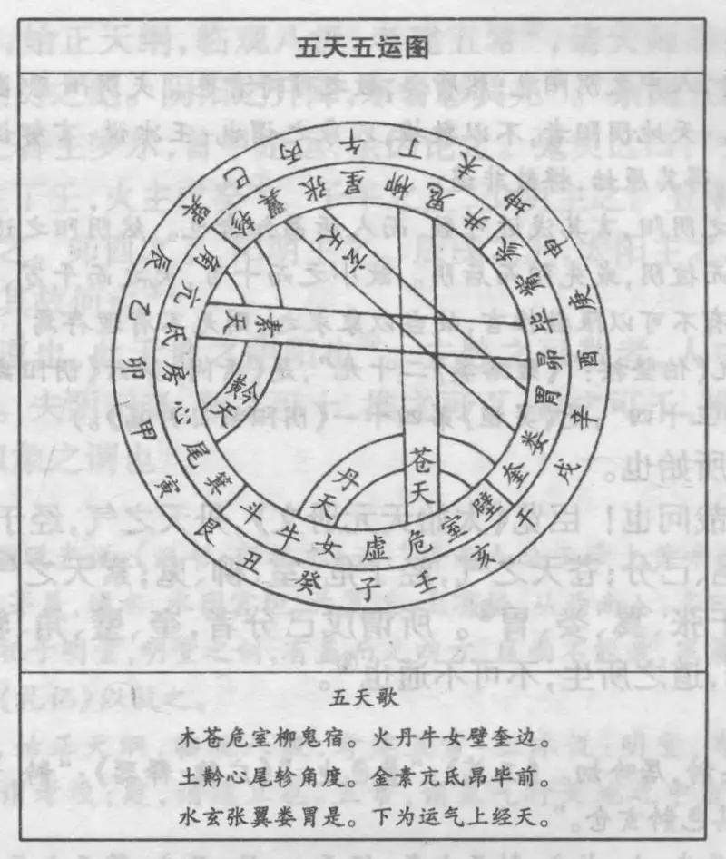
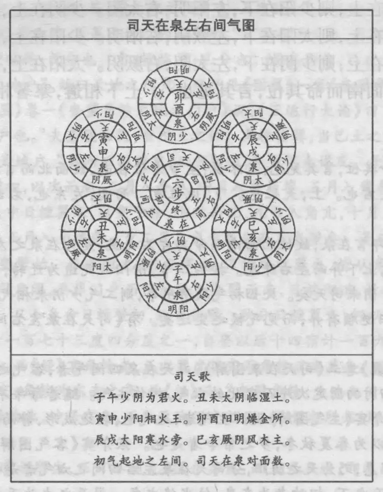
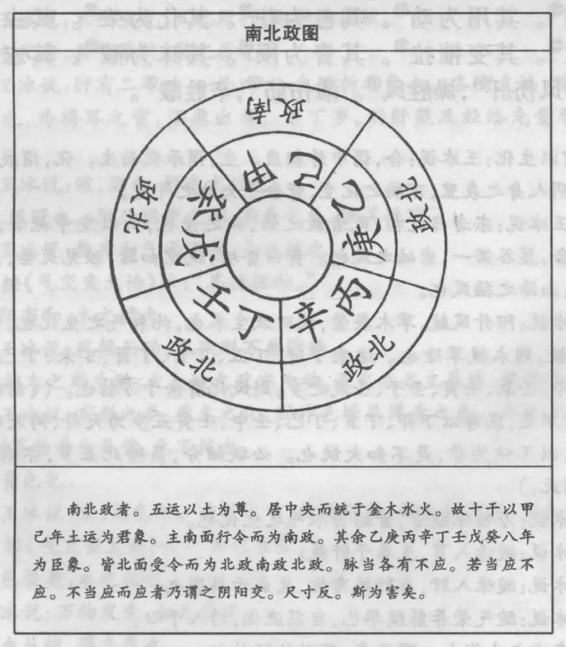
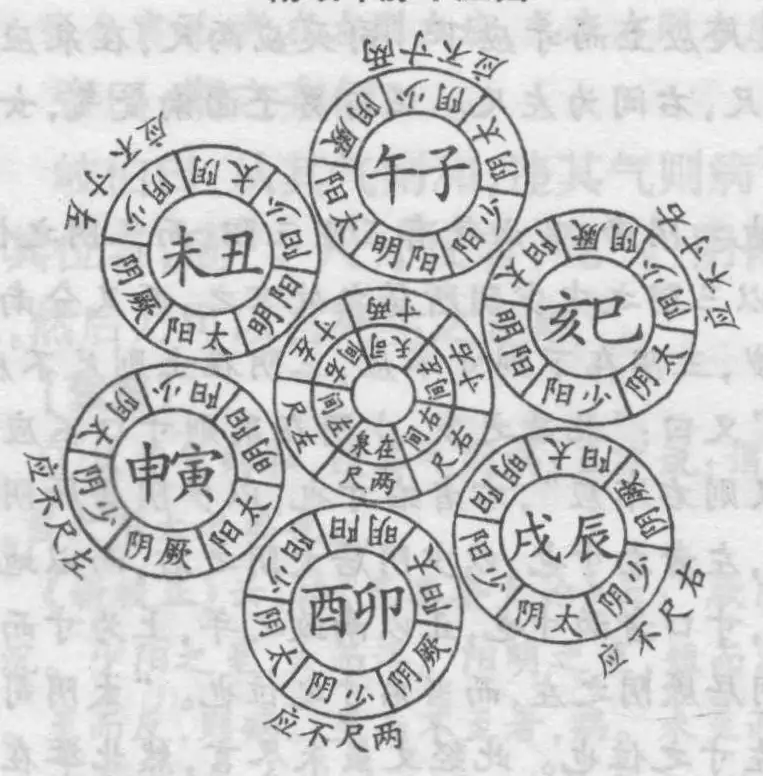
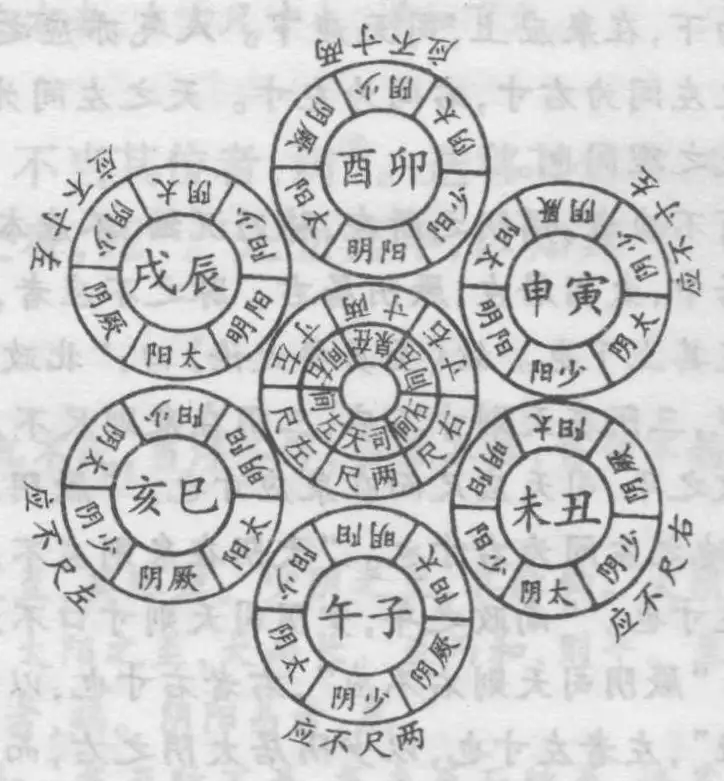
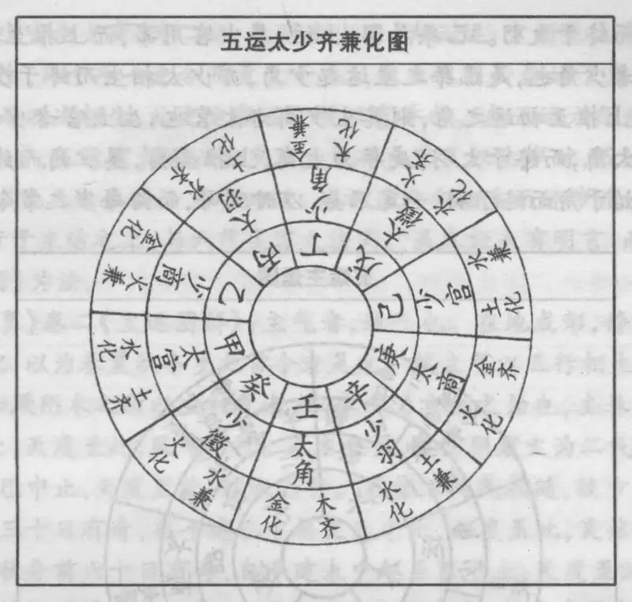
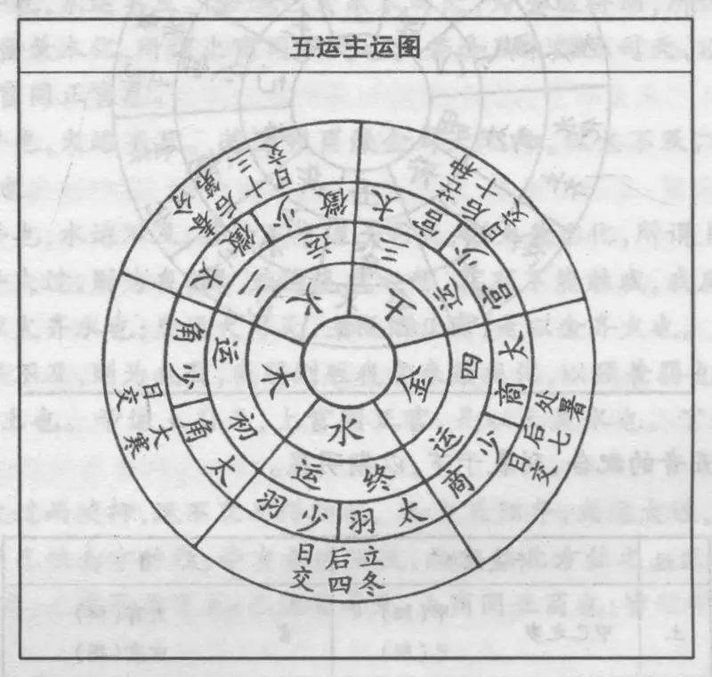
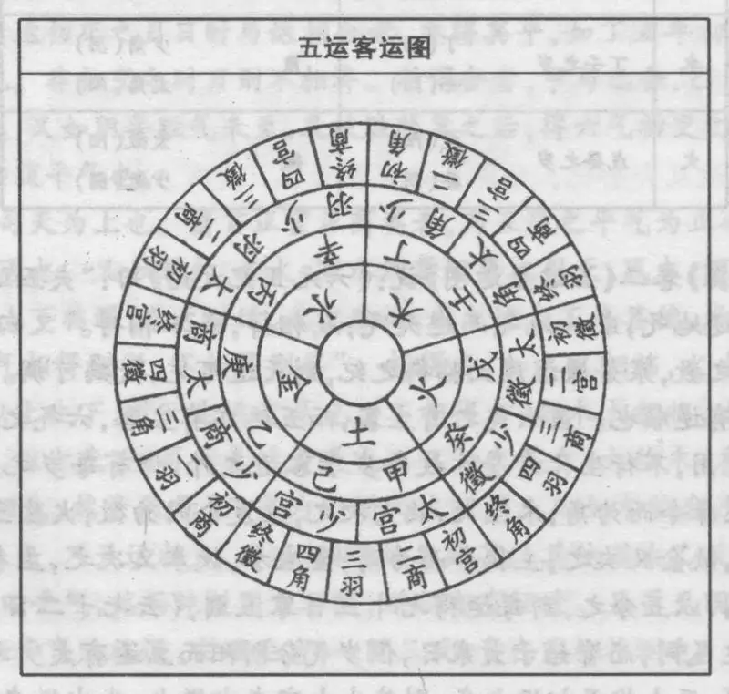
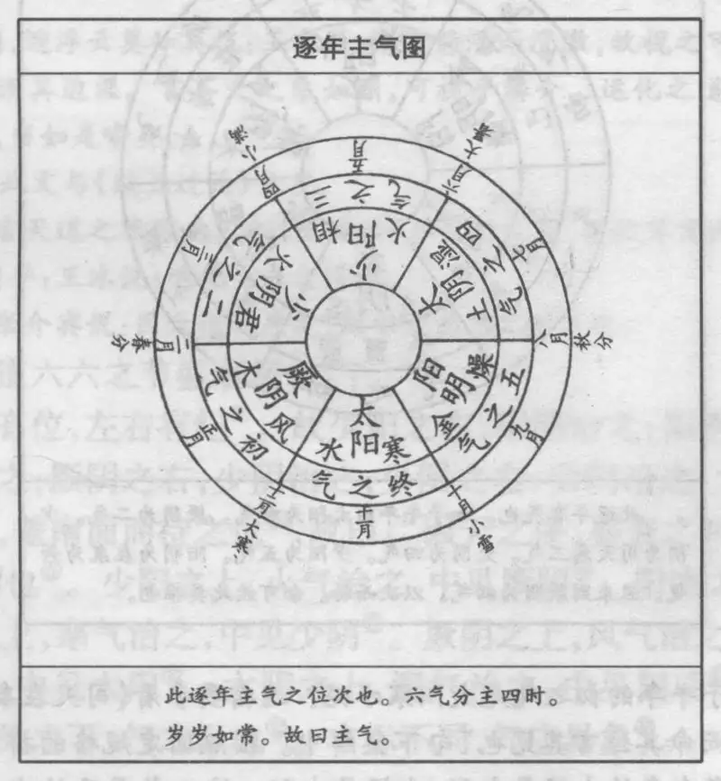
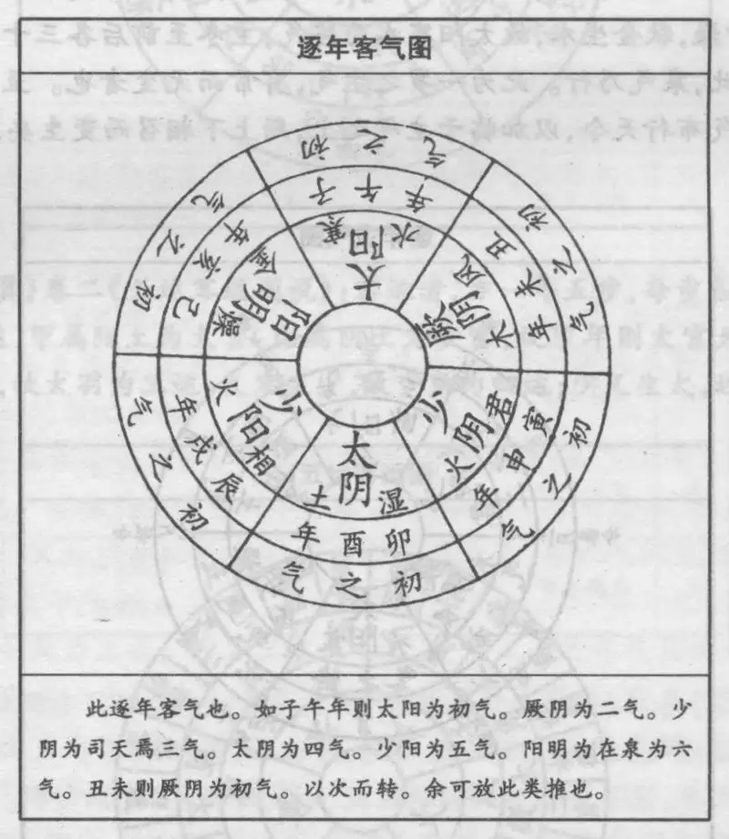

# 五运行大论第六十七①

①**五运行大论第六十七**：**伯坚按：**《甲乙经》和今存残本《黄帝内经太素》都没有收载本篇的文字。本篇和《类经》的篇目对照，列表于下：

| 素问 | 类经 |
|---|---|
| 五运行大论第六十七 | 卷三——五气之合人万物之生化（藏象类六） 卷二十三——五运六气上下之应（运气类四） 卷二十三——南政北政阴阳交尺寸反（运气类五·一） |

〔p.861 (인쇄 844)〕

> 黄帝坐明堂①，始正天纲，临观八极，考建五常②，请天师而问之曰：《论》言：“天地之动静，神明为之纪。阴阳之升降，寒暑彰其兆③。”余闻五运之数于夫子，夫子之所言正五气之各主岁尔，首甲定运，余因论之。鬼臾区曰：“土主甲己，金主乙庚，水主丙辛，木主丁壬，火主戊癸④。子午之上，少阴主之。丑未之上，太阴主之。寅申之上，少阳主之。卯酉之上，阳明主之。辰戌之上，太阳主之。巳亥之上，厥阴主之。”不合阴阳，其故何也⑤？
>
> 岐伯曰：是明道也，此天地之阴阳也⑥。夫数之可数者，人中之阴阳也；然所合，数之可得者也。夫阴阳者，数之可十，推之可百，数之可千，推之可万。天地阴阳者，不以数推，以象之谓也⑦。

**【集解】**

①**黄帝坐明堂**：顾观光说：《汉书·郊祀志》云：“济南人公玉带上黄帝时《明堂图》，明堂中有一殿，四面无壁，以茅盖，通水，水园宫垣，为复道，上有楼，从西南入，名曰昆仑。”《淮南·主术训》亦云：“昔者神农祀于明堂，明堂之制，有盖而无四方，风雨不能袭，寒暑不能伤。”盖古制如此，不可执《考工记》《礼记》以驳之。

②**黄帝坐明堂，始正天纲，临观八极，考建五常**：王冰说：明堂，布政宫也。八极，八方目极之所也。考，谓考校；建，谓建立也。五常，谓五气行天地之中者也。端居正气以候天和。

张介宾说：明堂，王者朝会之堂也。正天纲者，天之大纲在于斗，正斗纲之建以占天也。八极，八方之舆极也。观八极之理，以志地也。考，察也。建，立也。五常，五行气运之常也。考建五常，以测阴阳之变化也。

③**阴阳之升降，寒暑彰其兆**：《新校正》云：详《论》，谓《阴阳应象大论》及《气交变大论》文。彼云：“阴阳之往复，寒暑彰其兆。”

④**土主甲己，金主乙庚，水主丙辛，木主丁壬，火主戊癸**：张介宾说：此五运也。首甲定运，谓六十年以甲子为始，而定其运也。

⑤**不合阴阳，其故何也**：王冰说：首甲，谓六甲之初，则甲子年也。

《新校正》云：详金主乙庚者，乙者庚之柔，庚者乙之刚。大而言之，阴与阳；小而言之，夫与妇；是刚柔之事也。余并如此。

张介宾说：此三阴三阳之所主也。主者，司天也。不合阴阳，如五行之甲乙，东方木也，而甲化土运，乙化金运；六气之亥子，北方水也，而亥年之上，风木主之，子年之上，君火主之；又如君火司气，火木阳也，而反属少阴；寒水司气，水本阴也，而反属太阳之类；似皆不合于阴阳者也。

⑥**是明道也，此天地之阴阳也**：王冰说：上古圣人仰观天象以正阴阳，夫阴阳之道非不昭然，而人昧宗源迷其本始，则百端疑议从是而生。黄帝恐至理真宗便因诬废，愍念黎庶，故启问曰。天师知道出从真，必非谬述，故对上曰：“是明道也，此天地之阴阳也。”《阴阳法》曰：“甲己合。乙庚合。丙辛合。丁壬合。戊癸合。”盖取圣人仰观天象之义。不然，则十干之位，各在一方，征其离合，事亦寥阔。呜呼远哉，百姓日用而不知尔。故太上立言，曰吾言甚易知，甚易行，天下莫能知，莫能行，此其类也。

张介宾说：言鬼臾区之言，是明显之道也。其所云运五气六，不合阴阳者，正所以明天地之阴阳也。

〔p.862 (인쇄 845)〕

⑦夫数之可数者，人中之阴阳也；然所合，数之可得者也。夫阴阳者，数之可十，推之可百，数之可千，推之可万。天地阴阳者，不以数推，以象之谓也：王冰说：言智识偏浅，不见原由，虽所指弥远，其知弥近，得其原始，桴鼓非遥。

张介宾说：人中之阴阳，言其浅近可数，而人所易知者也。然阴阳之道，或本阳而标阴，或内阳而外阴，或此阳而彼阴，或先阳而后阴。故小之而十百，大之而千万、无非阴阳之变化，此天地之阴阳无穷，诚有不可以限数推言，故当以象求之，则无不有理存焉。数之可十以下四句，又见《经络类》二十九（**伯坚按：**“《经络类》二十九”，是《素问》第六《阴阳离合论》。）及三十四。（**伯坚按：**“《经络类》三十四”，是《灵枢》第四十一《阴阳系日月篇》。）

> 帝曰：愿闻其所始也。
>
> 岐伯曰：昭乎哉问也！臣览《太始天元册文》，丹天之气，经于牛、女、戊分；黅①天之气，经于心、尾、己分；苍天之气，经于危、室、柳、鬼；素天之气，经于亢、氐、昴、毕；玄天之气，经于张、翼、娄、胃②。所谓戊己分者，奎、壁、角、轸，则天地之门户也③。夫候之所始，道之所生，不可不通也④。

**【集解】**

①**黅**：陆懋修说：黅，居吟切。《玉篇》：“黄色也。”《广雅·释器》：“黅，黄也。”本经《五常政大论》：“敦阜之纪，其色黅玄仓。”

②丹天之气，经于牛、女、戊分；黅天之气，经于心、尾、己分；苍天之气，经于危、室、柳、鬼；素天之气，经于亢、氐、昴、毕；玄天之气，经于张、翼、娄、胃：张介宾说：此所以辨五运也。始，谓天运初分之始。《太始天元册文》，太古占天文也。丹，赤色，火气也。黅，黄色，土气也。苍，青色，木气也。素，白色，金气也。玄，黑色，水气也。此天地初分之时，赤气经于牛、女、戊分；牛、女、癸之次；戊当乾之次；故火主戊、癸也。黄气经于心、尾、己分；心、尾，甲之次；己当巽之次；故土主甲、己也。青气经于危、室、柳、鬼；危、室，壬之次；柳、鬼，丁之次；故木主丁、壬也。白色经于亢、氐、昴、毕；亢、氐，乙之次；昴、毕，庚之次；故金，主乙、庚也。黑气经于张、翼、娄、胃；张、翼，丙之次；娄、胃，辛之次；故水主丙、辛也。此五运之所以化也。又详义见《图翼》二卷《五天五运图解》。

张介宾《类经图翼》卷二《五天五运图解》：此太古占天之始，察五气，纪五天，而所以立五运也。五天五气者，谓望气之时，见丹天之火气经于牛女壁奎四宿之上，下临戊癸之方，此戊癸之所以为火运也。黅天之土气经于心尾角轸四宿之上，下临甲己之方，此甲己之所以为土运也。苍天之木气经于危室柳鬼四宿之上，下临丁壬之方，此丁壬之所以为木运也。素天之金气经于亢氐昴毕四宿之上，下临乙庚之方，此乙庚之所以为金运也。玄天之水气经于张翼娄胃四宿之上，下临丙辛之方，此丙辛之所以为水运也。是知五运之化，莫不有所由从，盖已肇于开辟之初矣。

〔p.863 (인쇄 846)〕

**五天五运图**

五天歌

木苍危室柳鬼宿。火丹牛女壁奎边。

土黅心尾轸角度。金素亢氐昴毕前。

水玄张翼娄胃是。下为运气上经天。

③**所谓戊己分者，奎、壁、角、轸，则天地之门户也**：王冰说：戊土属乾，己土属巽。《遁甲经》曰：“六戊为天门，六己为地户，晨暮占雨以西北东南。”义取此雨为土，用湿气生之，故此占焉。

张介宾说：奎，壁临乾，戊分也。角，轸临巽，己分也。戊在西北，己在东南。《遁甲经》曰：“六戊为天门，六己为地户”，故曰天地之门户。详义见《图翼》一卷《奎壁角轸天地之门户说》。

张介宾《类经图翼》卷一《奎壁角轸天地之门户》说：《五运行大论》曰：“所谓戊己分者，奎壁角轸，则天地之门户也。”夫奎壁临乾，当戊土之位。角轸临巽，当己土之位。《遁甲经》亦曰：“六戊为天门。六己为地户。”然而曰门曰户，必有所谓，先贤俱未详及。予尝考周天七政躔度，则春分二月中日缠壁初，以次而南，三月入奎娄，四月入胃昴毕，五月入觜参，六月入井鬼，七月入柳星张。秋分八月中日缠翼末，以交于轸，循次而北，九月入角亢，十月入氐房心，十一月入尾箕，十二月入斗牛，正月入女虚危。至二月复交于春分而入奎壁矣。是日之长也，时之暖也，万物之发生也，皆从奎壁始。日之短也，时之寒也，万物之收藏也，皆从角轸始。故曰春分司启，秋分司闭。夫既司启闭，要非门户而何？然自奎壁而南，日就阳道，故曰天门。角轸而北，日就阴道，故曰地户。又如春分日缠壁初，故言奎壁。秋分日缠翼末，何以不言翼轸而言角轸？盖自角以后十四宿计一百七十三度四分度之一，自奎以后十四宿计一百九十二度，度有不齐，此秋分之所以在翼末，而《经》言角轸者，正以翼度将完而角轸正当其令。且奎壁角轸为对待之宿，而奎壁为西北之交，角轸为东南之交，故《经》云：“奎壁角轸，天地之门户也。”是以伏羲《六十四卦方图》，以乾居西北，坤居东南，正合天地门户之义。凡候之所始，即道之所生，有不可不通也。

④**夫候之所始，道之所生，不可不通也**：张介宾说：此五天五运，即气候之所始，天道之所生也。

〔p.864 (인쇄 847)〕

> 帝曰：善。《论》言：“天地者万物之上下，左右者阴阳之道路”，未知其所谓也①。
>
> 岐伯曰：所谓上下者，岁上下见阴阳之所在也②。左右者，诸上见厥阴，左少阴，右太阳；见少阴，左太阴，右厥阴；见太阴，左少阳，右少阴；见少阳，左阳明，右太阴；见阳明，左太阳，右少阳；见太阳，左厥阴，右阳明。所谓面北而命其位，言其见也③。

**【集解】**

①**《论》言**：“天地者万物之上下，左右者阴阳之道路”，未知其所谓也：王冰说：《论》，谓《天元纪》及《阴阳应象大论》也。

张介宾说：此所以辨六气也。《论》，即《天元纪大论》及《阴阳应象大论》。

②**岁上下见阴阳之所在也**：张介宾说：上，司天也。下，在泉也。岁之上下即三阴三阳迭见之所在也。

③**所谓面北而命其位，言其见也**：王冰说：面向北而言之也。上，南也。下，北也。左，西也。右，东也。

张介宾说：司天在泉，俱有左右，诸上见者，即言司天，故厥阴司天则左见少阴，右见太阳，是为司天之左右间也。余义放此。同天在上，故位南面北而命其左右之见。左，西也。右，东也。

> 帝曰：何谓下？
>
> 岐伯曰：厥阴在上，则少阳在下，左阳明，右太阴。少阴在上，则阳明在下，左太阳，右少阳。太阴在上，则太阳在下，左厥阴，右阳明。少阳在上，则厥阴在下，左少阴，右太阳。阳明在上，则少阴在下，左太阴，右厥阴。太阳在上，则太阴在下，左少阳，右少阴。所谓面南而命其位，言其见也①。上下相遘，寒暑相临，气相得则和，不相得则病②。

**【集解】**

①**所谓面南而命其位，言其见也**：王冰说：主岁者位在南，故面北而言其左右；在下者位在北，故面南而言其左右也。上，天位也。下，地位也。面南，左东也，右西也，上下异而左右殊也。

张介宾说：下者即言在泉，故位北面南而命其左右之见，是为在泉之左右间也。左，东也。右，西也。司天在泉，上下异而左右殊也。按右二节，阴阳六气迭为迁转，如己亥年厥阴司天，明年子、午，则左间少阴来司天矣。又如初气厥阴用事，则二气少阴来相代矣。六气循环无已，此所以上下左右阴阳逆顺有异，而见气候之变迁矣。有《司天在泉左右间气图解》在《图翼》二卷。

张介宾《类经图翼》卷二《司天在泉图解》：司天在泉四间气者，客气之六步也。（**伯坚按：**随着每年春夏秋冬四时的固定次序而变化的六气，叫作主气。随着每年不同的司天而变化的六气，叫作客气。张介宾《主气图解》说：“主气者，地气也，在地成形，静而守位，谓木火土金水分主四时而司地化，以为春夏秋冬，岁之常令者是也。”张介宾《客气图解说》：“客气者，天气也，在天为气，动而不息，乃为天之阴阳，分司天在泉左右四间之六气者是也。”）凡主岁者为司天，位当三之气。司天之下，相对者为在泉，位当终之气。司天之左为天之左间，右为天之右间。在泉之左为地之左间，右为地之右间。每岁客气始于司天前二位，乃地之左间，是为初气，以至二气三气而终于在泉之六气。每气各主一步。然司天通主上半年，在泉通主下半年，故又曰：“岁半已前，天气主之，岁半已后，地气主之”也。

〔p.865 (인쇄 848)〕

《五运行大论》曰：“天地者，万物之上下也。左右者，阴阳之道路也。诸上见厥阴，左少阴，右太阳。见少阴，左太阴，右厥阴。见太阴，左少阳，右少阴。见少阳，左阳明，右太阴。见阳明，左太阳，右少阳。见太阳，左厥阴，右阳明。所谓面北而命其位也。”面北命位者，谓司天在上，位在南方，面北而命其左右，则东南为司天之右间，西南为司天之左间也。又曰：“何谓下？曰：厥阴在上，则少阳在下，左阳明，右太阴。少阴在上，则阳明在下，左太阳，右少阳。太阴在上，则太阳在下，左厥阴，右阳明。少阳在上，则厥阴在下，左少阴，右太阳。阳明在上，则少阴在下，左太阴，右厥阴。太阳在上，则太阴在下，左少阳，右少阴。所谓面南而命其位也。”面南命位者，谓在泉在下，位在北方，面南而命其左右，则东北为在泉之左间，西北为在泉之右间也。上者右行，自西南而降。下者左行，自东北而升。左右周天，余而复会，故上下相遘，天地相临，而变化逆顺，由兹生矣。虽同类相和气化相生者谓之顺，异类相临气化相制者谓之逆，然有气虽同类而亦为病者，以相火临于君火，为不当位故也。故《六微旨大论》曰：“君位臣则顺，臣位君则逆。逆则病近害速，顺则病远害微。所谓二火者是也。”

《六微旨大论》曰：“天道六六之节，盛衰何也？曰：上下有位，左右有纪。故少阳之右，阳明治之。阳明之右，太阳治之。太阳之右，厥阴治之。厥阴之右，少阴治之。少阴之右，太阴治之。太阴之右，少阳治之。此言客气阴阳之次序也。”

**司天在泉左右间气图**

司天歌

子午少阴为君火。丑未太阴临湿土。

寅申少阳相火王。卯酉阳明燥金所。

辰戌太阳寒水旁。巳亥厥阴风木主。

初气起地之左间。司天在泉对面数。

〔p.866 (인쇄 849)〕

②**上下相遘，寒暑相临，气相得则和，不相得则病**：王冰说：木火相临，金水相临，水木相临，火土相临，土金相临，为相得也。木土相临，土水相临，水火相临，火金相临，金木相临，为不相得也。上临下为顺，下临上为逆。逆亦郁抑而病生，土临相火君火之类者也。

张介宾说：此明上下之相遘也。遘，交也。临，遇也。司天在上，五运在中，在泉在下，三气之交，是上下相遘而寒暑相临也。所遇之气彼此相生者，为相得而安；彼此相克者，为不相得而病矣。详义见《图翼》五运六气诸解中。

> 帝曰：气相得而病者何也？
>
> 岐伯曰：以下临上，不当位也①。

**【集解】**

①**不当位也**：王冰说：六位相临，假令土临火，火临木，木临水，水临金，金临土，皆为以下临上，不当位也。父子之义，子为下，父为上，以子临父，不亦逆乎？

张介宾说：气同类者，本为相得而亦不免于病者，以下临上也。如《六微旨大论》曰：“君位臣则顺，臣位君则逆”，此指君相二火而言也。

> 帝曰：动静何如①？
>
> 岐伯曰：上者右行。下者左行。左右周天，余而复会也②。

**【集解】**

①**动静何如**：王冰说：言天地之行左右也。

张介宾说：此言迁转之动静也。

②**上者右行。下者左行。左右周天，余而复会也**：王冰说：上，天也。下，地也。周天，谓天周地五行之位也。天垂六气，地布五行，天顺地而左回，地承天而东转。木运之后，天气常余，余气不加于君火，却退一步加临相火之上，是以每五岁已退一位而右迁，故曰左右周天，余而复会。会，遇也，合也。言天地之道，常五岁毕，则以余气迁加，复与五行座位再相会合而为岁法也。周天，谓天周地位，非周天之六气也。

张介宾说：上者右行，言天气右旋，自东而西以降于地。下者左行，言地气左转，自西而东以升于天。故司天在上，必历巳、午、未、申而西降；在泉在下，必历亥、子、丑、寅而东升也。

顾观光说：上者右行，谓太阳循黄道东行，移一度也。下者左行，则《尚书·考灵曜》所谓地有四游，冬至、地上行北而西三万里，夏至、地下行南而东亦三万里，春秋二分其中也。右行左行，皆一岁一周天，而右行之度微不及于左行，故云余而复会，是即西法之最高行矣。此论天地运行之理，与五运六气全无关涉，如注则仍是鬼臾区说，何以黄帝疑而复问耶？

> 帝曰：余闻鬼臾区曰：“应地者静”。今夫子乃言下者左行，不知其所谓也。愿闻何以生之乎①？
>
> 岐伯曰：天地动静，五行迁复，虽鬼臾区其上候而已，犹不能偏明②。夫变化之用，天垂象，地成形，七曜纬虚③，五行丽地。地者，所以载生成之形类也。虚者，所以列应天之精气也。形精之动，犹根本之与枝叶也。仰观其象，虽远可知也④。

**【集解】**

①**愿闻何以生之乎**：王冰说：诘异也。

《新校正》云：按鬼臾区言“应地者静”，见《天元纪大论》中。

张介宾说：应地者静，见前《天元纪篇》。

〔p.867 (인쇄 850)〕

②**犹不能偏明**：王冰说：不能偏明，无求备也。

张介宾说：上候而已，天运之候也。不能偏明，犹未详言左右也。

③**七曜纬虚**：顾观光说：此言七曜皆在太虚之中，非同丽一天，亦非各有一天也。近日西人所自矜为创论者，岐伯早已言之。

④**虽远可知也**：王冰说：观五星之东转，则地体左行之理昭然可知也。丽，著也。有形之物，未有不依据物而得全者也。

张介宾说：天地之体虽殊，变化之用则一，所以在天则垂象，在地则成形。故七曜纬于虚，即五行应天之精气也。五行丽于地，即七曜生成之形类也。是以形精之动，亦犹根本之与枝叶耳。故凡物之在地者，必悬象于天，第仰观其象则无有不应，故上之右行，下之左行者，周流不息，而变化乃无穷也。

> 帝曰：地之为下否乎①？
>
> 岐伯曰：地为人之下，太虚之中者也②。

**【集解】**

①**地之为下否乎**：王冰说：言转不居，为下乎？为否乎？

张介宾说：此欲详明上下之义也。

②**地为人之下，太虚之中者也**：王冰说：言人之所居可谓下矣，徵其至理，则是太虚之中一物尔。《易》曰：“坤厚载物，德合无疆”，此之谓也。

张介宾说：人在地之上，天在人之上。以人之所见言，则上为天，下为地。以天地之全体言，则天包地之外，地居天之中，故曰太虚之中者也。由此观之，则地非天之下矣。然则司天者主地之上，在泉者主地之下，五行之丽地者是为五运，而运行于上下之中者也。此特举地为辨者，盖以明上中下之大象耳。

顾观光说：自人视之，地为下矣，而地实太虚中之一物，与七曜等，盖上下无定位，特随人之所见以为上下耳。旨哉斯言，非圣人孰能知之。

> 帝曰：冯乎①？
>
> 岐伯曰：大气举之也②。燥以干之。暑以蒸之。风以动之。湿以润之。寒以坚之。火以温之③。故风、寒在下④，燥、热在上，湿气在中，火游行其间⑤，寒暑六入，故令虚而化生也⑥。故燥胜则地干，暑胜则地热，风胜则地动，湿胜则地泥，寒胜则地裂，火胜则地固矣⑦。

**【集解】**

①**冯乎**：王冰说：言太阴无碍，地体何冯而止住。

张介宾说：冯，凭同。言地在太虚之中而不坠者，果亦有所依凭否也。

陆懋修说：冯，扶冰切。亦作凭。《小尔雅·释言》：“凭，依也。”《文选》张衡《西京赋》：“有凭虚公子者。”薛注：“凭，依托也。”

②**大气举之也**：王冰说：大气，谓造化之气，任持太虚者也。所以太虚不屈地久天长者，盖由造化之气任持之也。气化而变，不任持之，则太虚之器亦败坏矣。夫落叶飞空，不疾而下，为其乘气，故势不得速焉。凡有形处地之上者，皆有生化之气任持之也。然器有大小不同，坏有迟速之异，及至气不任持，则大小之坏一也。

张介宾说：大气者，太虚之元气也。乾坤万物无不赖之以立，故地在太虚之中，亦惟元气任持之耳。

〔p.868 (인쇄 851)〕

③**燥以干之。暑以蒸之。风以动之。湿以润之。寒以坚之。火以温之**：张介宾说：此即大气之所化，是为六气而运用于天地之间者也。曰燥，曰风、曰暑、曰湿、曰寒、曰火，六者各一其性，而功用亦异。

④**故风、寒在下**：顾观光说：风在空中而亦云下者，《庄子·齐物论》云：“夫大块噫气，其名为风。”

⑤**故风、寒在下，燥、热在上，湿气在中，火游行其间**：顾观光说：风寒在下，西法之温际也。燥热在上，西法之火际也。湿气在中，西法之冷际也。寒性坚凝，风以动之，而太阳之火游行其间，则化而为温矣。水土之气为太阳所吸引，升而上浮，至于冷际而止，遂能映小为大，映卑为高，西人清蒙气差之法从此生矣。

⑥**寒暑六入，故令虚而化生也**：王冰说：地体之中，凡有六入。一曰燥。二曰暑。三曰风。四曰湿。五曰寒。六曰火。受燥，故干性生焉。受暑，故蒸性生焉。受风，故动性生焉。受湿，故润性生焉。受寒，故坚性生焉。受火，故温性生焉。此谓天之六气也。

张介宾说：寒居北，风居东，自北而东，故曰风寒在下，下者左行也。热居南，燥居西，故曰燥热在上，上者右行也。地者土也，土之化湿。故曰湿气在中也。惟火有二，君火居湿之上，相火居湿之下，故曰火游行其间也。凡寒暑再更而气入者六，非虚无以寓气，非气无以化生，故曰令虚而化生也。

⑦**故燥胜则地干，暑胜则地热，风胜则地动，湿胜则地泥，寒胜则地裂，火胜则地固矣**：王冰说：六气之用。

张介宾说：凡此六者，皆言地气本乎天也。自上文“地之为下”至此，正所以发明此义。《天元纪大论》曰：“太虚廖廓，肇基化元”，亦此之谓。

> 帝曰：天地之气，何以候之①？
>
> 岐伯曰：天地之气，胜复之作，不形于诊也②。《脉法》曰：“天地之变，无以脉诊”，此之谓也③。

**【集解】**

①**天地之气，何以候之**：张介宾说：此欲因脉候以察天地之气也。

②**不形于诊也**：王冰说：言平气及胜复，皆以形证观察，不以诊知也。

③**“天地之变，无以脉诊”，此之谓也**：王冰说：天地以气不以位，故不当以诊知之。

张介宾说：天地之气，有常有变。其常气之形于诊者，如春弦、夏洪、秋毛、冬石、及厥阴之至其脉弦，少阴之至其脉钩，太阴之至其脉沉，少阳之至大而浮，阳明之至短而涩，太阳之至大而长者皆是也。若其胜复之气，卒然初至，安得遽变其脉而形于诊乎，故天地之变有不可以脉诊而当先以形证求之者。如《气交变大论》曰：“应常不应卒”，亦此之谓。

> 帝曰：间气何如①？
>
> 岐伯曰：随气所在，期于左右②。

**【集解】**

①**间气何如**：张介宾说：间气，谓司天在泉左右之间气，而脉亦当有应之也。夫此间气者，谓之为常则气有变迁，谓之为变则岁有定位，盖帝因上文云：“天地之变无以脉诊”，故复举此常中之变以求夫脉之应也。

〔p.869 (인쇄 852)〕

②**期于左右**：王冰说：于左右尺寸四部分位承之，以知应与不应，过与不过。

张介宾说：气在左则左应，气在右则右应，左右者，左右尺寸也，详如下文。

> 帝曰：期之奈何？
>
> 岐伯曰：从其气则和，违其气则病①。不当其位者，病②。迭移其位者，病③。失守其位者，危④。尺寸反者，死⑤。阴阳交者，死⑥。先立其年，以知其气。左右应见，然后乃可以言死生之逆顺⑦。

**【集解】**

①**从其气则和，违其气则病**：王冰说：谓当沉不沉，当浮不浮，当涩不涩，当钩不钩，当弦不弦，当大不大之类也。

《新校正》云：按《至真要大论》云：“厥阴之至，其脉弦。少阴之至，其脉钩。太阴之至，其脉沉。少阳之至，大而浮。阳明之至，短而涩。太阳之至，大而长。至而和，则平。至而甚，则病。至而反，则病。至而不至者，病。未至而至者，病。阴阳易者，危。”

张介宾说：气至脉亦至，从其气也，故曰和。气至脉不至，气未至而脉至，违其气也，故为病。

②**不当其位者，病**：王冰说：见于他位也。

张介宾说：应左而右，应右而左，应上而下，应下而上也。

③**迭移其位者，病**：王冰说：谓左见右脉，右见左脉，气差错故尔。

张介宾说：迭，更也。应见不见而移易于他位也。

④**失守其位者，危**：王冰说：已见于他乡，本宫见贼杀之气，故病危。

张介宾说：克贼之脉见，而本位失守也。

⑤**尺寸反者，死**：王冰说：子、午、卯、酉，四岁有之。反，谓岁当阴在寸而脉反见于尺，岁当阳在尺而脉反见于寸，尺寸俱，乃谓反也。若尺独然或寸独然，是不应气，非反也。

⑥**阴阳交者，死**：王冰说：寅、申、巳、亥、丑、未、辰、戌，八年有之。交，谓岁当阴在右、脉反见左，岁当阳在左、脉反见右，左右交见，是谓交。若左独然或右独然，是不应气，非交也。

张介宾说：此二句之义，一以尺寸言，一以左右言，皆以少阴为之主也。如阴当在尺则阳当在寸，阴当在寸则阳当在尺，左右亦然。若阴之所在，脉宜不应而反应，阳之所在，脉宜应而反不应，其在尺寸则谓之反，其在左右则谓之交，皆当死也。尺寸反者，惟子、午、卯、酉四年有之。阴阳交者，惟寅、申、巳、亥、辰、戌、丑、未八年有之。若尺寸独然，或左右独然，是为气不应，非反非交也。

⑦**先立其年，以知其气。左右应见，然后乃可以言死生之逆顺**：王冰说：《经》言岁气备矣。

《新校正》云：详此备《六元正纪大论》中。

张介宾说：先立其年之南北政及司天在泉左右间应见之气，则知少阴君主之所在，脉当不应而逆顺乃可见矣。此章详义，具《南北政图说》中，在《图翼》二卷。

张介宾说《类经图翼》卷二《南北政》说：南北二政，运有不同，上下阴阳，脉有不应。《五运行大论》曰：“先立其年，以知其气，左右应见，乃可以言死生之逆顺也。”倘粗工不知而呼寒呼热，妄施治疗，害莫大矣。

南北政者，即甲己为南政，余为北政是也。《至真要大论》曰：“阴之所在寸口何如？岐伯曰：视岁南北可知之矣。”谓南政之年，南面行令，其气在南，所以南为上而北为下，司天在上，在泉在下。人气应之，故寸为上而尺为下，左右俱同。北政之岁，北面受令，其气在北，所以北为上而南为下，在泉应上，司天应下。人气亦应之，故尺应上而寸应下。司天应两尺，在泉应两寸。地之左间为右寸，右间为左寸。天之左间为右尺，右间为左尺。正与男子面南受气，女子面北受气之理同也。

〔p.870 (인쇄 853)〕

脉有不应者，谓阴之所在，脉乃沉细，不应本脉也。阴者，言六气有三阴三阳，而三阴之位，则少阴居中，太阴居左，厥阴居右。脉之不应者，乃以三阴之中少阴所居之处言之，而又分南北二政以定其上下也。故《至真要大论》曰：“北政之岁，三阴在下则寸不应，三阴在上则尺不应。南政之岁，三阴在天则寸不应，三阴在泉则尺不应。”又曰：“北政之岁，少阴在泉则寸口不应”，正以北政之年，司天应尺而在泉应寸也。“厥阴在泉则右不应”，右者右寸也，以少阴居厥阴之左，而以地之左间为右寸也。“太阴在泉则左不应”，左者左寸也，以少阴居太阴之右，而以地之右间为左寸也。“南政之年，少阴司天则寸口不应”，寸口者两寸也，正以南政之年，上为寸而下为尺也。“厥阴司天则右不应”，右者右寸也，以少阴居厥阴之左，而当右寸之位也。“太阴司天则左不应”，左者左寸也，以少阴居太阴之右，而当左寸之位也。此经文虽未尽言，然北举在泉则天在其中矣，南举司天则泉在其中矣。故又曰：“诸不应者，反其诊则见矣。”反其诊者，谓南北相反而诊之，当自见矣。故北政之年，少阴司天则两尺不应；太阴司天则少阴在右，所以右尺不应；厥阴司天则少阴在左，所以左尺不应。南政之年，少阴在泉则两尺不应；太阴在泉则少阴在右，所以右尺不应；厥阴在泉则少阴在左，所以左尺不应也。

**南北政图**

南北政者。五运以土为尊。居中央而统于金木水火。故十干以甲己年土运为君象。主南面行令而为南政。其余乙庚丙辛丁壬戊癸八年为臣象。皆北面受令而为北政南政北政。脉当各有不应。若当应不应。不当应而应者乃谓之阴阳交。尺寸反。斯为害矣。

〔p.871 (인쇄 854)〕

**南政年脉不应图**

**北政年脉不应图**

> 帝曰：寒、暑、燥、湿、风、火，在人合之奈何？其于万物何以生化①？
>
> 岐伯曰：东方生风②。风生木③。木生酸④。酸生肝⑤。肝生筋⑥。筋生心⑦。其在天为玄⑧，在人为道⑨，在地为化⑩。化生五味⑪。道生智⑫。玄生神⑬。化生气⑭。神在天为风⑮，在地为木⑯，在体为筋⑰，在气为柔⑱，在藏为肝⑲。其性为暄⑳。其德为和㉑。其用为动㉒。其色为苍㉓。其化为荣㉔。其虫毛㉕。其政为散㉖。其令宣发㉗。其变摧拉㉘。其眚为陨㉙。其味为酸㉚。其志为怒㉛。怒伤肝㉜，悲胜怒㉝。风伤肝㉞，燥胜风㉟。酸伤筋㊱，辛胜酸㊲。

**【集解】**

①**其于万物何以生化**：王冰说：合，谓中外相应。生，谓承化而生。化，谓成立众象也。

张介宾说：此明人身之表里，万物之化生，皆合乎大地之气也。

②**东方生风**：王冰说：东者日之初，风者教之始，天之使也，所以发号施令，故生自东方也。景霁山昏，苍埃际合，崖谷若一，岩岫之风也。黄白昏埃，晚空如堵，独见天垂，川泽之风也。加以黄黑，白埃承下，山泽之猛风也。

③**风生木**：王冰说：阳升风鼓，草木敷荣，故曰风生木也，此和气之生化也。若风气施化，则飘扬敷折；其为变极，则木拔草除也。运乘丁卯、丁丑、丁亥、丁酉、丁未、丁巳之岁，则风化不足。若乘壬申、壬午、壬辰、壬寅、壬子、壬戌之岁，则风化有余于万物也。（《新校正》云：详王注以丁壬分运之有余不足，或者以丁卯、丁亥、丁巳、壬申、壬寅五岁为天符、同天符、正岁会，非有余不足，为平木运，以王注为非，是不知大统也。必欲细分，虽除此五岁，亦未为尽。下文火、土、金、水运等并同此。）

④**木生酸**：王冰说：万物味酸者，皆始自木气之生化也。

⑤**酸生肝**：王冰说：酸味入胃，生养于肝藏。

⑥**肝生筋**：王冰说：酸味入肝，自肝藏布化，生成于筋膜也。

⑦**筋生心**：王冰说：酸气荣养筋膜毕已，自筋流化，乃入于心。

张介宾说：此东方之生化也。明此者，可以治肝补心。

⑧**其在天为玄**：王冰说：玄，谓玄冥也。丑之终，东方白。寅之初，天色反黑。太虚皆闇，在天为玄，象可见。（《新校正》云：详“在天为玄”至“化生气”七句，通言六气五行生化之大法，非东方独有之也。而王注玄谓丑之终寅之初天色黑，则专言在东方，不兼诸方，此注未通。）

〔p.872 (인쇄 855)〕

⑨**在人为道**：王冰说：正理之道，生养之政化也。

⑩**在地为化**：王冰说：化，生化也。有生化而后有万物，万物无非化气以生成者也。

⑪**化生五味**：王冰说：金玉、土石、草木、菜果、根茎、枝叶、花谷、实核、无识之类，皆地化生也。

⑫**道生智**：王冰说：智，正知也，虑远也。知正则不疑于事，虑远则不涉于危，以道处之，理符于智。《灵枢》经曰：“因虑而处物谓之智。”**伯坚按：**见《灵枢》第八《本神篇》。

⑬**玄生神**：王冰说：神用无方，深微莫测，迹见形隐，物鲜能期，由是则玄冥之中，神明棲据，隐而不见，玄生神明也。

⑭**化生气**：王冰说：飞走、蚑行、鳞介、毛倮、羽五类变化，内属神机，虽为五味所该，然其生禀则异，故又曰化生气也。此上七句通言六气五行生化之大法，非东方独有之也。

《新校正》云：按《阴阳应象大论》及《天元纪大论》，无“化生气”一句。

张介宾说：气由化生，物因气化也。

⑮**神在天为风**：王冰说：鸣紊启坼，风之化也。振拉摧拔，风之用也。岁属厥阴在上，则风化于天；厥阴在下，则风行于地。

⑯**在地为木**：王冰说：长短曲直，木之体也。幹举机发，木之用也。

⑰**在体为筋**：王冰说：维结束络，筋之体也。繻纵卷舒，筋之用也。

⑱**在气为柔**：王冰说：木化宣发，风化所行，则物体柔软。

张介宾说：得木化者，其气柔软，筋之类也。

⑲**在藏为肝**：王冰说：肝有二布叶，一小叶，如木甲折之象也。各有支络，脉游于中，以宣发阳和之气，魂之宫也，为将军之官，谋虑出焉。乘丁岁，则肝藏及经络先受邪而为病也。胆府同。

⑳**其性为暄**：王冰说：暄，温也，肝木之性也。

张介宾说：暄，温暖也。肝为阴中之阳，应春之气，故其性暄。

㉑**其德为和**：王冰说：敷布和气于万物，木之德也。

《新校正》云：按《气交变大论》云：“其德敷和。”

张介宾说：春阳布和，木之德也。

㉒**其用为动**：王冰说：风摇而动，无风则万类皆静。

《新校正》云：按木之用为动，火太过之政亦为动，盖火木之主暴速，故俱为动。

㉓**其色为苍**：王冰说：有形之类，乘木之化，则外色皆见薄青之色。今东方之地，草木之上，色皆苍；遇丁岁，则苍物兼白及黄，色不纯也。

张介宾说：浅青色也。

㉔**其化为荣**：王冰说：荣，美色也。四时之中，物见华荣，颜色鲜丽者，皆木化之所生也。

《新校正》云：按《气交变大论》云：“其化生荣。”

张介宾说：物色荣美，木之化也。

㉕**其虫毛**：王冰说：万物发生，如毛在皮。

张介宾说：毛虫丛植，得木气也。

㉖**其政为散**：王冰说：发散生气于万物。

〔p.873 (인쇄 856)〕

《新校正》云：按《气交变大论》云：“其政舒启。”详木之政散，平木之政发散，木太过之政散，土不及之气散，金之用散落，木之灾散落。所以为散之异有六，而散之义惟二。一谓发散之散，是木之气也。二谓散落之散，是金之气所为也。

张介宾说：阳散于物，木之政也。按散义有二，一曰升散，木气之生也；一曰散落，金气之杀也。

㉗**其令宣发**：王冰说：阳和之气，舒而散也。

张介宾说：宣扬升发，春木令也。

㉘**其变摧拉**：王冰说：摧拔成者也。

《新校正》云：按《气交变大论》云：“其变振发。”

张介宾说：摧拉，损折败坏也。风气刚强，木之变也。

陆懋修说：《说文》：“拉，摧也。摧，折也。”《文选》左思《吴都赋》：“拉捭摧藏。”注：“拉，顿折也。”

㉙**其眚为陨**：王冰说：陨，坠也。大风暴起，草泯木坠。

《新校正》云：按《气交变大论》云：“其灾散落。”

张介宾说：眚，灾也。陨，坠落也。木兼金化，陨为灾也。

陆懋修说：《易》讼卦：“无眚。”《释文》引《子夏传》云：“妖祥曰眚。”《左》庄二十五年《传》：“非日月之眚。”注：“眚，犹灾也。月侵日为眚。”

㉚**其味为酸**：王冰说：夫物之化之变而有酸味者，皆木气之所成败也。今东方之野生，味多酸。

㉛**其志为怒**：王冰说：怒，直声也。怒所以威物。

㉜**怒伤肝**：王冰说：凡物之用极，皆自伤也。怒发于肝，而反伤肝藏。

㉝**悲胜怒**：王冰说：悲发而怒止，胜之信也。

《新校正》云：详五志，“悲”当为“忧”，盖忧伤意，悲伤魂，故云悲胜怒也。

㉞**风伤肝**：王冰说：亦犹风之折木也。风生于木，而反折之，用极而衰。

《新校正》云：按《阴阳应象大论》云：“风伤筋。”

㉟**燥胜风**：王冰说：风自木生，燥为金化，风余则制之以燥，肝盛则治之以凉，凉清所行，金之气也。

㊱**酸伤筋**：王冰说：酸泻肝气，泻甚则伤其气。《灵枢经》曰：“酸走筋。筋病无多食酸。”以此尔。走筋，谓宣行其气速疾也。气、血、肉、骨同（《新校正》云：详注云“《灵枢经》云”，乃是《素问·宣明五气篇》文。按《甲乙经》以此为《素问》，王云《灵枢经》者，误也。）

㊲**辛胜酸**：王冰说：辛，金味，故胜木之酸。酸余则胜之以辛也。

张介宾说：此东方之性用，德化，政令，皆本乎木，而内合人之肝气者也，故肝主于左。

> 南方生热①。热生火②。火生苦③。苦生心④。心生血⑤。血生脾⑥。其在天为热⑦，在地为火⑧，在体为脉⑨，在气为息⑩，在藏为心⑪。其性为暑⑫。其德为显⑬。其用为躁⑭。其色为赤⑮。其化为茂⑯。其虫羽⑰。其政为明⑱。其令郁蒸⑲。其变炎烁⑳。其眚燔焫㉑。其味为苦㉒。其志为喜㉓。喜伤心㉔，恐胜喜㉕。热伤气㉖，寒胜热㉗。苦伤气㉘，咸胜苦㉙。

**【集解】**

①**南方生热**：王冰说：阳盛所生相火君火之政也。太虚昏翳，其若轻尘，山川悉然，热之气也。大明不彰，其色如丹，郁热之气也。若形云暴升，丛然叶积，乍盈乍缩，崖谷之热也。

〔p.874 (인쇄 857)〕

②**热生火**：王冰说：热甚之气，火运盛明，故曰热生火。火者，盛阳之生化也。热气施化，则炎暑郁燠；其为变极，则燔灼销融。运乘癸酉、癸未、癸巳、癸卯、癸丑、癸亥岁，则热化不足。若乘戊辰、戊寅、戊子、戊戌、戊申、戊午岁，则热化有余。火有君火相火，故曰热生火，又云火也。

③**火生苦**：王冰说：物之味苦者，皆始自火之生化也。甘物遇火，体焦则苦，苦从火化，其可徵也。

④**苦生心**：王冰说：苦物入胃，化入于心，故诸癸岁则苦化少，诸戊岁则苦化多。

⑤**心生血**：王冰说：苦味自心，化已则布化生血脉。

⑥**血生脾**：王冰说：苦味营血已，自血流化，生养脾也。

张介宾说：此南方之生化也。明此者，可以治心补脾。

⑦**其在天为热**：王冰说：亦神化气也。暄暑郁蒸，热之化也。炎赫沸腾，热之用也。岁属少阴、少阳，在上则热化于天，在下则热行于地。

⑧**在地为火**：王冰说：光显炳明，火之体也。燔燎焦然，火之用也。

⑨**在体为脉**：王冰说：流行血气，脉之体也。壅泄虚实，脉之用也。络脉同。

⑩**在气为息**：王冰说：息，长也。

张介宾说：经络流行，脉之体也。血气和平，息之调也。心主血脉，故皆属火。

⑪**在藏为心**：王冰说：心形如未敷莲花，中有九空，以导引天真之气，神之宇也，为君主之官，神明出焉。乘癸岁，则心与经络受邪而为病。小肠府亦然。

⑫**其性为暑**：王冰说：暑，热也，心之气性也。

张介宾说：南方暑热，火之性也。心为火藏，其气应之。

⑬**其德为显**：王冰说：明显见象，定而可取，火之德也。

《新校正》云：按《气交变大论》云：“其德彰显。”

张介宾说：阳象明显，火之德也。

⑭**其用为躁**：王冰说：火性躁动，不专定也。

张介宾说：阳用躁动，火之性也。

⑮**其色为赤**：王冰说：生化之物，乘火化者，悉表备赭丹之色。今南方之地，草木之上，皆兼赤色；乘癸岁，则赤色之物兼黑及白也。

⑯**其化为茂**：王冰说：茂蕃盛也。

《新校正》云：按《气交变大论》云：“其化蕃茂。”

张介宾说：万物茂盛，火之化也。

⑰**其虫羽**：王冰说：参差长短，象火之形。

张介宾说：羽虫飞扬，得火气也。

⑱**其政为明**：王冰说：明曜彰见，无所蔽匿，火之政也。

《新校正》云：按《气交变大论》云：“其政明曜。”又按火之政明，水之气明，水火异而明同者，火之明明于外，水之明明于内，明虽同而实异也。

张介宾说：阳明普照，火之政也。

⑲**其令郁蒸**：王冰说：郁，盛也。蒸，热也。言盛热，气如蒸也。（《新校正》云：详注谓郁为盛，其义未安。按王冰注《五常政大论》云：“郁谓郁燠不舒畅也。”当如此解。）

张介宾说：暑热郁蒸，夏火令也。

〔p.875 (인쇄 858)〕

⑳**其变炎烁**：王冰说：热甚炎赫，烁石流金，火之极变也。

《新校正》云：按《气交变大论》云：“其变销烁。”

张介宾说：火烁焦枯，火之变也。

㉑**其眚燔焫**：王冰说：燔焫山川，旋及屋宇，火之灾也。

《新校正》云：按《气交变大论》云：“其灾燔焫。”

张介宾说：燔焫焚烧，火之灾也。

㉒**其味为苦**：王冰说：物之化之变而有苦味者，皆火气之所合散也。今南方之野生物多苦。

㉓**其志为喜**：王冰说：喜，悦乐也。悦以和志。

㉔**喜伤心**：王冰说：言其过也。喜发于心而反伤心，亦犹风之折木也，过则气竭，故见伤也。

㉕**恐胜喜**：王冰说：恐至则喜乐皆泯，胜喜之理，目击道存。恐则水之气也。

㉖**热伤气**：王冰说：天热则气伏不见，人热则气促喘急，热之伤气，理亦可征。此皆谓大热也，小热之气犹生诸气也。《阴阳应象大论》曰：“壮火散气，少火生气”，此其义也。

㉗**寒胜热**：王冰说：寒胜则热退，阴盛则阳衰，制热以寒，是求胜也。

㉘**苦伤气**：王冰说：大凡如此尔。苦之伤气，以其燥也。苦加以热，则伤尤甚也。何以明之？饮酒气促，多则喘急，此其信也。苦寒之物，偏服岁久，益火滋甚，亦伤气也。暂以方治，乃同少火，反生气也。

《新校正》云：详此论所伤之旨有三。东方曰风伤肝，酸伤筋；中央曰湿伤肉，甘伤脾；西方曰辛伤皮毛；是自伤者也。南方曰热伤气，苦伤气；北方曰寒伤血，咸伤血；是伤己所胜也。西方曰热伤皮毛，是被胜伤己也。凡此五方，所伤之例有三，若《太素》则俱云自伤焉。

㉙**咸胜苦**：王冰说：酒得咸而解，物理昭然。火苦之胜，制以水咸。

张介宾说：此南方之性用，德化，政令，皆本乎火，而内合人之心气者也，故心主于前。

> 中央生湿①。湿生土②。土生甘③。甘生脾④，脾生肉⑤。肉生肺⑥。其在天为湿⑦，在地为土⑧，在体为肉⑨，在气为充⑩，在藏为脾⑪。其性静兼⑫。其德为濡⑬。其用为化⑭。其色为黄⑮。其化为盈⑯。其虫倮⑰。其政为谧⑱。其令云雨⑲。其变动注⑳。其眚淫溃㉑。其味为甘㉒。其志为思㉓。思伤脾㉔，怒胜思㉕。湿伤肉㉖，风胜湿㉗。甘伤脾㉘，酸胜甘㉙。

**【集解】**

①**中央生湿**：王冰说：中央，土也。高山土湿，泉出地中，水源山隈，云生岩谷，则其象也。夫性内蕴动，而为用则雨降云腾，中央生湿，不远信矣。故《历候记》：“土润溽暑于六月”，谓是也。

②**湿生土**：王冰说：湿气内蕴，土体乃全，湿则土生，干则土死，死则庶类凋丧，生则万物滋荣，此湿气之化尔。湿气施化，则土宅而云腾雨降；其为变极，则骤注土崩也。运乘己巳、己卯、己丑、己亥、己酉、己未之岁，则湿化不足。乘甲子、甲戌、甲申、甲午、甲辰、甲寅之岁，则湿化有余也。

③**土生甘**：王冰说：物之味甘者，皆始自土之生化也。

④**甘生脾**：王冰说：甘物入胃，先入于脾，故诸己岁则甘少化，诸甲岁甘多化。

⑤**脾生肉**：王冰说：甘味入脾，自脾藏布化，长生脂肉。

⑥**肉生肺**：王冰说：甘气营肉已，自肉流化，乃生养肺藏也。

〔p.876 (인쇄 859)〕

张介宾说：此中央之生化也。明此者，可以治脾补肺。

⑦**其在天为湿**：王冰说：言神化也。柔润重泽，湿之化也。埃郁云雨，湿之用也。岁属太阴在上，则湿化于天；太阴在下，则湿化于地。

⑧**在地为土**：王冰说：敦静安镇，聚散复形，群品以生，土之体也。含垢匿秽，静而下民，为变化母，土之德也。（《新校正》云：“详《注》云：‘静而下民，为土之德’，下民之义恐字误也。”顾观光说：“下民者，下于民也。”）

⑨**在体为肉**：王冰说：覆裹筋骨，气发其间，肉之用也。疏密不时，中外否闭，肉之动也。

⑩**在气为充**：王冰说：土气施化，则万象盈。

张介宾说：土之施化，其气充盈，故曰充气。脾健则肉丰，此其征也。

⑪**在藏为脾**：王冰说：形象马蹄，内包胃脘，象土形也。经络之气，交归于中，以营运真灵之气，意之舍也，为仓廪之官，化物出焉。乘己岁，则脾及经络受邪而为病。（《新校正》云：详肝、心、肺、肾四藏《注》各言府同，独此《注》不言胃府同者，阙文也。）

⑫**其性静兼**：王冰说：兼，谓兼寒热暄凉之气也。《白虎通》曰“脾之为言并也，谓四气并之也。”

张介宾说：脾属至阴，故其性静。土养万物，故其性兼。

⑬**其德为濡**：王冰说：津湿润泽，土之德也。

《新校正》云：按《气交变大论》云：“其德溽蒸。”

张介宾说：濡润泽物，土之德也。

⑭**其用为化**：王冰说：化，谓兼诸四化，并己为五化，所谓风化、热化、燥化、寒化，周万物而为生长化成收藏也。

⑮**其色为黄**：王冰说：物乘土化，则表见黅黄之色。今中央之地，草木之上，皆兼黄色。乘己岁，则黄色之物兼苍及黑。

⑯**其化为盈**：王冰说：盈，满也。土化所及，则万物盈满。

《新校正》云：按《气交变大论》云：“其化丰备。”

张介宾说：万物充盈，土之化也。

⑰**其虫倮**：王冰说：倮露皮革，无毛介也。

张介宾说：赤体曰倮，土应肉也。

陆懋修说：倮，郎果切。亦作羸、蠃。《说文》“蠃，袒也。”《礼月令》：“中央土，其虫倮。”《周礼大司徒》：“其动物宜蠃物。”《大戴礼·天图篇》：“唯人为倮匈而后生。”注：“倮匈，谓无毛羽、无鳞介也。”

⑱**其政为谧**：王冰说：谧，静也。土性安静。

《新校正》云：按《气交变大论》云：“其政安静。”详土之政谧，水太过其政谧者，盖水太过而土下承之，故其政亦谧。

张介宾说：谧，静也。安静宁谧，土之政也。

陆懋修说：谧，弥毕切。《说文》：“谧，静语也。”《尔雅·释诂》：“谧，静也。”本经《气交变大论》：“其化清谧。”

⑲**其令云雨**：王冰说：湿气布化之所成。

张介宾说：云雨湿蒸，土之令也。

⑳**其变动注**：王冰说：动，反静也。地之动则土失性，风摇不安，注雨久下也。久则垣岸复为土矣。

〔p.877 (인쇄 860)〕

《新校正》云：按《气交变大论》云：“其变骤注。”

张介宾说：风雨动注，土之变也。

㉑**其眚淫溃**：王冰说：淫，久雨也。溃，土崩溃也。

《新校正》云：按《气交变大论》云：“其灾霖溃。”

张介宾说：霖淫崩溃，土之变也。

㉒**其味为甘**：王冰说：物之化之变而有甘味者，皆土化之所终始也。今中原之地，物味多甘淡。

㉓**其志为思**：王冰说：思以成务。

《新校正》云：按《灵枢经》曰：“因志而存变谓之思。”（**伯坚按：**见《灵枢》第八《本神篇》。）

㉔**思伤脾**：王冰说：思劳于智，过则伤脾。

㉕**怒胜思**：王冰说：怒则不思，忿而忘祸，则胜可知矣。思甚不解，以怒制之，调性之道也。

㉖**湿伤肉**：王冰说：湿甚为水，水盈则肿，水下去已，形肉已消，伤肉之验，近可知矣。

㉗**风胜湿**：王冰说：风木气故胜土湿，湿甚则制之以风。

㉘**甘伤脾**：王冰说：过节也。

《新校正》云：按《阴阳应象大论》云：“甘伤肉。”

㉙**酸胜甘**：王冰说：甘余则制之以酸，所以救脾气也。

张介宾说：此中央之性用，德化，政令，皆本乎土，而内合人之脾气者也，故脾主乎中。

> 西方生燥①。燥生金②。金生辛③。辛生肺④。肺生皮毛⑤。皮毛生肾⑥。其在天为燥⑦，在地为金⑧，在体为皮毛⑨，在气为成⑩，在藏为肺⑪。其性为凉⑫。其德为清⑬。其用为固⑭。其色为白⑮。其化为敛⑯。其虫介⑰。其政为劲⑱。其令雾露⑲。其变肃杀⑳。其眚苍落㉑。其味为辛㉒。其志为忧㉓。忧伤肺㉔，喜胜忧㉕。热伤皮毛㉖，寒胜热㉗。辛伤皮毛㉘，苦胜辛㉙。

**【集解】**

①**西方生燥**：王冰说：阳气已降，阴气复升，气爽风劲，故生燥也。夫岩谷青埃，川源苍翠，烟浮草木，远望氤氲，此金气所生，燥之化也。夜起白朦，轻如微雾，遐迩一色，星月皎如，此万物阴成，亦金气所生，白露之气也。太虚埃昏，气郁黄黑，视不见远，无风自行，从阴之阳，如云如雾，此杀气也，亦金气所生，霜之气也。山谷川泽，浊昏如雾，气郁蓬勃，惨然戚然咫尺不分，此杀气将用，亦金气所生，运之气也。天雨大霖，和气西起，云卷阳曜，太虚廓清，燥生西方，义可征也。若西风大起，木偃云胜，是为燥与湿争，气不胜也，故当复雨。然西风雨晴，天之常气，假有东风雨止，必有西风复雨，因雨而乃自晴，观是之为，则气有往复，动有燥湿，变化之象，不同其用矣。由此，则天地之气，以和为胜，暴发奔骤，气所不胜，则多为复也。

②**燥生金**：王冰说：气劲风切，金鸣声远，燥生之信，视听可知，此则燥化，能令万物坚定也。燥之施化于物如是，其为变极，则天地凄惨，肃杀气行，人悉畏之，草木凋落。运乘乙丑、乙卯、乙巳、乙未，乙酉、乙亥之岁，则燥化不足。乘庚子、庚寅、庚辰、庚午、庚申、庚戌之岁，则燥化有余。岁气不同，生化异也。

③**金生辛**：王冰说：物之有辛味者，皆始自金化之所成也。

④**辛生肺**：王冰说：辛物入胃，先入于肺，故诸乙岁则辛少化，诸庚岁则辛多化。

〔p.878 (인쇄 861)〕

⑤**肺生皮毛**：王冰说：辛味入肺，自肺藏布化，生养皮毛也。

⑥**皮毛生肾**：王冰说：辛气自入皮毛，乃流化生气，入肾藏也。

张介宾说：此西方之生化也。明此者，可以治肺补肾。

⑦**其在天为燥**：王冰说：神化也。雾露清劲，燥之化也。肃杀凋零，燥之用也。岁属阳明在上，则燥化于天；阳明在下，则燥行于地。

⑧**在地为金**：王冰说：从革坚刚，金之体也。锋刃铦利，金之用也。（《新校正》云：按别本，“铦”作“括”。）

⑨**在体为皮毛**：王冰说：柔韧包裹，皮毛之体也。渗泄津液，皮毛之用也。

⑩**在气为成**：王冰说：物乘金化则坚成。

张介宾说：《庚桑子》曰：“春气发而百草生。正得秋而万宝成。”盖物得金气而后坚，故金曰坚成。

⑪**在藏为肺**：王冰说：肺之形似人肩，二布叶，数小叶，中有二十四空、行列以分布诸藏清浊之气，主藏魄也，为相传之官，治节出焉。乘乙岁，则肺与经络受邪而为病也。大肠府亦然。

⑫**其性为凉**：王冰说：凉，清也，肺之性也。

张介宾说：西方凉爽，金之气也。肺为金藏故应之。

⑬**其德为清**：王冰说：金以清凉为德化。

《新校正》云：按《气交变大论》云：“其德清洁。”

张介宾说：秋气清肃，金之德也。

⑭**其用为固**：王冰说：固，坚定也。

张介宾说：坚而能固，金之用也。

⑮**其色为白**：王冰说：物乘金化，则表彰缟素之色。今西方之野，草木之上，色皆兼白。乘乙岁，则白色之物兼赤及苍也。

⑯**其化为敛**：王冰说：敛，收也。金化流行，则物体坚敛。

《新校正》云：按《气交变大论》云：“其化紧敛。”详金之化为敛，而木不及之气亦敛者，盖木不及而金胜之。故为敛也。

张介宾说：万物收敛，金之化也。

⑰**其虫介**：王冰说：介，甲也。外被介甲，金坚之象也。

张介宾说：皮甲坚固，得金气也。

⑱**其政为劲**：王冰说：劲，前锐也。

《新校正》云：按《气交变大论》云：“其政劲切。”

张介宾说：风气刚劲，金之政也。

⑲**其令雾露**：王冰说：凉气化生。

张介宾说：凉生雾露，秋金令也。

⑳**其变肃杀**：王冰说：天地惨凄，人所不喜，则其气也。

张介宾说：凋残肃杀，金之变也。

㉑**其眚苍落**：王冰说：青干而凋落。

张介宾说：青苍毁败，金之灾也。

㉒**其味为辛**：王冰说：夫物之化之变而有辛味者，皆金气所离合也。今西方之野，草木多辛。

〔p.879 (인쇄 862)〕

㉓**其志为忧**：王冰说：忧，虑也，思也。（《新校正》云：详王以“忧”为“思”，有害于义。按本论思为脾之志，忧为肺之志，是“忧”非“思”，明矣。又《灵枢经》曰：“愁忧则闭塞而不行。”又云：“愁忧而不解则伤意。”若是则“忧”者愁也，非“思”也。）

㉔**忧伤肺**：王冰说：愁忧则气闭塞而不行。肺藏气，故伤肺。

㉕**喜胜忧**：王冰说：神悦则喜，故喜胜忧。

㉖**热伤皮毛**：王冰说：火有二别，故此再举热伤之形证也。火气薄烁则物焦干，故热气盛则皮毛伤也。

㉗**寒胜热**：王冰说：以阴消阳，故寒胜热。

《新校正》云：按《太素》作“燥伤皮毛。热胜燥。”

㉘**辛伤皮毛**：王冰说：过节也。辛热又甚焉。

㉙**苦胜辛**：王冰说：苦，火味，故胜金之辛。

张介宾说：此西方之性用，德化，政令，皆本乎金，而内合人之肺气也，故肺主乎右。

> 北方生寒①。寒生水②。水生咸③。咸生肾④。肾生骨髓⑤。髓生肝⑥。其在天为寒⑦，在地为水⑧，在体为骨⑨，在气为坚⑩，在藏为肾⑪。其性为凛⑫。其德为寒⑬。其用为□⑭。其色为黑⑮。其化为肃⑯。其虫鳞⑰。其政为静⑱。其令□⑲。其变凝冽⑳。其眚冰雹㉑。其味为咸㉒。其志为恐㉓。恐伤肾㉔，思胜恐㉕。寒伤血㉖，燥胜寒㉗。咸伤血㉘，甘胜咸㉙。

**【集解】**

①**北方生寒**：王冰说：阳气伏，阴气升，政布而大行，故寒生也。太虚澄净，黑气浮空，天色黯然，高空之寒气也。若气似散麻，木末皆黑，微见（顾观光说：以《六元正纪大论》考之，此下当有“黄色”二字。）川泽之寒气也。太虚清白，空犹雪映，遐迩一色，山谷之寒气也。太虚白昏，火明不翳，如雾雨气，遐迩肃然，北望色玄，凝雰夜落，此水气所生，寒之化也。太虚凝阴，白埃昏翳，天地一色，远视不分，此寒湿凝结，雪之将至也。地裂水冰，河渠干涸，枯泽浮咸，水敛土坚，是土胜水，水不得自清，水所生寒之用也。

②**寒生水**：王冰说：寒资阴化，水所由生，此寒气之生化尔。寒气施化，则水冰雪雰；其为变极，则水涸冰坚。运乘丙寅、丙子、丙戌、丙申、丙午、丙辰之岁，则寒化大行。乘辛未、辛巳、辛卯、辛丑、辛亥、辛酉之岁，则寒化少。

③**水生咸**：王冰说：物之有咸味者，皆始自水化之所成结也。水泽枯涸，卤咸乃蓄，沧海味咸，盐从水化，则咸因水产，其事炳然，煎水味咸，近而可见。

④**咸生肾**：王冰说：咸物入胃，先归于肾，故诸丙岁咸物多化，诸辛岁咸物少化。

⑤**肾生骨髓**：王冰说：咸味入肾，自肾藏布化，生养骨髓也。

⑥**髓生肝**：王冰说：咸气自生骨髓，乃流化生气，入肝藏也。

张介宾说：此北方之生化也。明此者，可以治肾补肝。

⑦**其在天为寒**：王冰说：神化也。凝惨冰雪，寒之化也。凛冽霜雹，寒之用也。岁属太阳在上，则寒化于天；太阳在下，则寒行于地。

⑧**在地为水**：王冰说：阴气布化，流于地中，则为水泉。澄澈流衍，水之体也。漂荡没溺，水之用也。

⑨**在体为骨**：王冰说：强干坚劲，骨之体也。包裹髓脑，骨之用也。

〔p.880 (인쇄 863)〕

⑩**在气为坚**：王冰说：柔软之物，遇寒则坚，寒之化也。

张介宾说：物之热者，遇寒则坚，此其征也。

⑪**在藏为肾**：王冰说：肾藏有二，形如豇豆相并，而曲附于膂筋，外有脂裹，里白表黑，主藏精也，为作强之官，技巧出焉。乘辛岁，则肾藏及经络受邪而为病。膀胱府同。

⑫**其性为凛**：王冰说：凛，寒也，肾之性也。

张介宾说：凛烈战栗，水之性也。

⑬**其德为寒**：王冰说：水以寒为德化。

《新校正》云：按《气交变大论》云：“其德凄沧。”

张介宾说：冬气寒冷，水之德也。

⑭**其用为□**：王冰说：本阙。

张介宾说：“藏”字原阙，脱简也，今补之。闭藏生气，水之用也。

**伯坚按：**“其用为□”，张介宾《类经》作“其用为藏”。

⑮**其色为黑**：王冰说：物禀水成，则表被玄黑之色。今北方之野，草木之上，色皆兼黑。乘辛岁，则黑色之物兼黄及赤也。

⑯**其化为肃**：王冰说：肃，静也。

《新校正》云：按《气交变大论》云：“其化清谧。”详水之化为肃，而金之政太过者为肃，平金之政劲肃。金之变肃杀者何也？盖水之化肃者，肃静也；金之政肃者，肃杀也；文虽同而事异者也。

张介宾说：肃然静定，水之化也。

⑰**其虫鳞**：王冰说：鳞，谓鱼蛇之族类。

张介宾说：鳞潜就下，得水气也。

⑱**其政为静**：王冰说：水性澄澈而清静。

《新校正》云：按《气交变大论》云：“其政凝肃。”详水之政为静，而平土之政安静，土太过之政亦为静，土不及之政亦为静定。水土异而静同者，非同也，水之静，清净也，土之静，安静也。

⑲**其令□**：王冰说：本阙。

张介宾说：“闭塞”二字原阙，今补足之。天地闭塞，冬水令也。

**伯坚按：**“其令□”，张介宾《类经》作“其令闭塞”。

⑳**其变凝冽**：王冰说：寒甚故致是。

《新校正》云：按《气交变大论》云：“其变凛冽。”

张介宾说：寒凝严冽，水之变也。

㉑**其眚冰雹**：王冰说：非是而有，及暴过也。

《新校正》云：按《气交变大论》云：“其灾冰雪霜雹。”

张介宾说：非时冰雹，水之灾也。

㉒**其味为咸**：王冰说：夫物之化之变而有咸味者，皆水化所凝散也。今北方川泽地多咸卤。

㉓**其志为恐**：王冰说：恐以远祸。

㉔**恐伤肾**：王冰说：恐甚动中则伤肾。《灵枢经》曰：“恐惧而不解则伤精。”（**伯坚按：**见《灵枢》第八《本神篇》。）

㉕**思胜恐**：王冰说：思见祸机，故无忧恐。“思”一作“忧”，非也。

〔p.881 (인쇄 864)〕

㉖**寒伤血**：王冰说：肾胜心也。寒甚血凝，故伤血也。

㉗**燥胜寒**：王冰说：寒化则水积，燥用则物坚，燥与寒兼，故相胜也，天地之化、物理之常也。

㉘**咸伤血**：王冰说：味过于咸，则咽干、引饮，伤血之义，断可知矣。

㉙**甘胜咸**：王冰说：渴饮甘泉，咽干自已，甘为土味，故胜水咸。

《新校正》云：详自上“岐伯曰”至此，与《阴阳应象大论》同，小有增损而《注》颇异。

张介宾说：此北方之性用，德化，政令，皆本乎水，而内合人之肾气者也，故肾主于下。

> 五气更立，各有所先①。非其位则邪。当其位则正②。

**【集解】**

①**各有所先**：王冰说：当其岁时，气乃先也。

张介宾说：五行之气，化有不同。天干所临，是为五运，地支所司，是为六气，五运六气皆有主客之分，故岁时变迁，五气更立，各有所先，以主岁气也。

②**当其位则正**：王冰说：先立运，然后知非位与当位者也。

张介宾说：运气既立，则位之当与不当，气之或邪或正，可得而察矣。此与《六微旨大论》同。

> 帝曰：病之生变何如？
>
> 岐伯曰：气相得则微，不相得则甚①。

**【集解】**

①**气相得则微，不相得则甚**：王冰说：木居火位，火居土位，土居金位，金居水位，水居木位，木居君位，如是者为相得。又木居水位，水居金位，金居土位，土居火位，火居木位，如是者虽为相得，终以子僭居父母之位，下陵其上，犹为小逆也。木居金土位，火居金水位，土居水木位，金居火木位，水居火土位，如是者为不相得，故病甚也。皆先立运气及司天之气，则气之所在、相得与不相得可知矣。

张介宾说：主客相遇，上下相临，气有相得不相得，则病变由而生矣。相得者，如彼引相生则气和而病微；不相得者，如彼此相克则气乖而病甚也。

> 帝曰：主岁何如？
>
> 岐伯曰：气有余，则制己所胜，而侮所不胜。其不及，则己所不胜侮而乘之，己所胜轻而侮之①。侮反受邪②。侮而受邪，寡于畏也③。
>
> 帝曰：善。

**【集解】**

**伯坚按：**现将本段各种配合列表于下，以期明显：

| 五方 | 在天 | 在地 | 在体 | 在气 | 在藏 | 其性 | 其德 | 其用 | 其色 | 其化 | 其虫 | 其政 | 其令 | 其变 | 其眚 | 其味 | 其志 |
|---|---|---|---|---|---|---|---|---|---|---|---|---|---|---|---|---|---|
| 东 | 风 | 木 | 筋 | 柔 | 肝 | 暄 | 和 | 动 | 苍 | 荣 | 毛 | 散 | 宣发 | 摧拉 | 陨 | 酸 | 怒 |
| 南 | 热 | 火 | 脉 | 息 | 心 | 暑 | 显 | 躁 | 赤 | 茂 | 羽 | 明 | 郁蒸 | 炎烁 | 燔焫 | 苦 | 喜 |
| 中央 | 湿 | 土 | 肉 | 充 | 脾 | 静兼 | 濡 | 化 | 黄 | 盈 | 倮 | 谧 | 云雨 | 动注 | 淫溃 | 甘 | 思 |
| 西 | 燥 | 金 | 皮毛 | 成 | 肺 | 凉 | 清 | 固 | 白 | 敛 | 介 | 劲 | 雾露 | 肃杀 | 苍落 | 辛 | 忧 |
| 北 | 寒 | 水 | 骨 | 坚 | 肾 | 凛 | 寒 | □ | 黑 | 肃 | 鳞 | 静 | □ | 凝冽 | 冰雹 | 咸 | 恐 |

〔p.882 (인쇄 865)〕

**【集解】**

①**己所不胜侮而乘之，己所胜轻而侮之**：王冰说：木余则制土，轻忽于金，以金气不争，故木恃其余而欺侮也。又木少金胜，土反侮木，以木不及，故土妄凌之也。四气并同。侮，谓侮慢而凌忽之。

张介宾说：主岁，谓五运六气各有所主之岁也。己所胜，我胜彼也。所不胜，彼胜我也。假令木气有余，则制己所胜而土受其克，湿化乃衰；侮所不胜，则金反受木之侮，而风化大行也。木气不足，则己所不胜者乘虚来侮，而金令大行；己所胜者因弱相轻，而土邪反甚也。

《六节藏象论》曰：“未至而至，此谓太过，则薄所不胜而乘所胜也，命曰气淫。至而不至，此谓不及，则所胜妄行而所生受病，所不胜薄之也，命曰气迫。”运气相同，举此可类推矣。

②**侮反受邪**：王冰说：或以己强盛，或遇彼衰微，不度卑弱，妄行凌忽，虽侮而求胜，故终必受邪。

张介宾说：若恃己之强，肆行暴侮，有胜必复，反受其邪。《五常政大论》曰：“乘危而行，不速而至，暴虐无德，灾反及之”，正此谓也。

③**侮而受邪，寡于畏也**：王冰说：受邪，各谓受己不胜之邪也。然捨己宫观，适他乡邦，外强中干，邪盛真弱，寡于敬畏，由是纳邪，故曰寡于畏也。

《新校正》云：按《六节藏象论》曰：“未至而至，此谓太过，则薄所不胜而乘所胜，命曰气淫。至而不至，此谓不及，则所胜妄行而所生受病，所不胜薄之，命曰气迫。”即此之义也。

张介宾说：五行之气，各有相制。畏其所制，乃能守位。寡于畏，则肆无忌惮，而势极必衰，所以反受其邪。此天道之盈虚，自毫发无容爽者。上文自“五气更立”至此，详义见《五运太少齐兼化逆顺图解》及《主气客气》《主运客运》《司天在泉》各图说中，在《图翼》二卷。

张介宾《类经图翼》卷二《五行太少齐兼化逆顺图解》：气运有盛衰之殊，年干有太少之异。阳年曰五太，因其气旺有余也。阴年曰五少，因其气衰不及也。太过则己胜，反齐胜己者之化。不及则己弱，以致胜己者来兼其化。上应于天，有星辰倍减之象。下应于地，有动植耗育之征。盖以五运之休囚旺相不同，而万物之成熟灾伤有厚薄也。然而不及之年，得助合则同其正化。太过之纪，被制抑则得其平和。此生化胜复之理，所以无穷，而方月应变之妙，岂容执一，要非知权达变之士，有不可以易造者也。条略于下：

太过岁——凡五运阳年，各主六年，五六共三十年。太过之年，反齐胜己之化，如太宫土运反齐木化，太角木运反齐金化，太商金运反齐火化，太徵火运反齐水化，太羽水运反齐土化也。

不及岁——五运阴年，各主六年，五六共三十年。不及之年，则胜者来兼其化，如少宫土运木来兼化，少角木运金来兼化，少商金运火来兼化，少徵火运水来兼化，少羽水运土来兼化也。

太宫——六甲年也。

太商——六庚年也，金运太过。若逢子午君火、寅申相火司天之年，则太商被天之抑，乃得其平，所谓上徵与正商同也。正商者，如乙酉比和之类。余放此。若逢辰戌寒水司天，亦为小逆，以水为金子，子居父上，故曰逆。余放此。

太角——六壬年也，木运太过。若逢子午寅申二火司天，则为逆，以子居父上也。

太徵——六戊年也，火运太过。若逢辰戌寒水司天，则太徵被抑，乃得其平，所谓上羽与正徵同也。

〔p.883 (인쇄 866)〕

太羽——六丙年也。

少宫——六己年也，土运不及。若逢丑未湿土司天，为中运得助，所谓上宫同正宫也。若逢巳亥风木司天，则木兼土化，所谓上角同正角也。

少商——六乙年也，金运不及。若逢卯酉燥金司天，为中运得助，所谓上商同正商也。若逢巳亥风木司天，以金不及，火来兼化，则木得其政，所谓上角同正角也。

少角——六丁年也，木运不及。若逢巳亥风木司天，为中运得助，所谓上角同正角也。若逢卯酉燥金司天，则金兼木化，所谓上商同正商也。若逢丑未湿土司天，以木不及，金来兼化，则土得其政，所谓上宫同正宫也。

少徵——六癸年也，火运不及。若逢卯酉燥金司天之年，以火不及，水来兼化，则金得其政，所谓上商同正商也。

少羽——六辛年也，水运不及，若逢丑未湿土司天，则土兼水化，所谓上宫同正宫也。

齐化——凡阳年太过，则为我旺。若遇克我之气，其有不能胜我，我反齐之。如戊运水司天，上羽同正徵，是以火齐水也；庚运火司天，上徵同正商，是以金齐火也。

兼化——凡阴年不及，则为我弱，我弱则胜我者来兼我化，以强兼弱也。如己运木司天，上角同正角，是以木兼土也。辛运土司天，上宫同正宫，是以土兼水也。丁运金司天，上商同正商，是以金兼木也。

平气——如运太过而被抑，运不及而得助也。如戊辰阳年，火运太过，而寒水司天抑之；癸巳阴年，火运不及，而巳位南方助之；辛亥水运不及，而亥位北方位之。又如丁运木司天，上角同正角也；己运土司天，上宫同正宫也；乙运金司天，上商同正商也；皆曰平气，而物生脉应皆得和平之气也。

得政——如乙年阴金木司天，金运不及，火来兼化，则木不受克而得其政，所谓上角同正角也。丁年阴木土司天，木运不及，金来兼化，则土不受克而得其政，所谓上宫同正宫也。癸年阴火金司天，火运不及，水来兼化，则金不受克而得其政，所谓上商同正商也。此虽非亢则害，然亦以子救母，而实则承乃制之义。

干德符——谓新运初交之月日时与运相合者，亦得其平，如丁亥年初交之月日时得壬者，则壬与丁合之类是也。非初交之时日则不相济。所谓合者，甲与己合，乙与庚合，丙与辛合，丁与壬合，戊与癸合也。又如阴年胜气未至，及被胜既复之后，得六气初交之时日，及月建之干相助合者，即得正位，亦获平气也。

右凡诸言上者，司天为上也。诸言正宫正商类者，乃五运之平气为正也。五运太少所纪各不同者，盖有遇有不遇也。又如君火、相火、寒水例属阳年之司天，风木、湿土、燥金例属阴年之司天，六十年中各有上下临遇，或天胜运，或运胜天，或太过者不务其德，或不及者逢其所胜，故《五运行大论》曰：“气相得则微，不相得则甚”。相得者，如木火相临，火土相临，土金相临，金水相临，水木相临，以上生下，司天生运者是也。不相得者，如木土相临，土水相临，水火相临，火金相临，金木相临，以上克下，司天克运者是也。又如土临火，火临木，木临水，水临金，金临土，以下生上，虽曰相生，然子居母上，亦为小逆而主微病。又如木临金土，火临水金，土临木水，金临火木，水临土火，乃天运相克，为不相得，故其病甚。其他若太乙天符、岁会、同天符、同岁会，则其符会虽皆曰平气，然而纯驳固自不同，逆顺亦有轻重。且司天既有临遇，在泉岂无临遇，天地既有临遇，六步岂无临遇，玄理无穷，一隅三反，贵在因机推测也。

〔p.884 (인쇄 867)〕

**五运太少齐兼化图**

**伯坚按：**五运和五音的配合，列表于下，以期明显。

| 五运 | 干支纪年 |  | 五音 |  |
|---|---|---|---|---|
| 土 | 甲己之岁 | 甲（阳） 己（阴） | 宫 | 太宫（阳） 少宫（阴） |
| 金 | 乙庚之岁 | 乙（阴） 庚（阳） | 商 | 少商（阴） 太商（阳） |
| 水 | 丙辛之岁 | 丙（阳） 辛（阴） | 羽 | 太羽（阳） 少羽（阴） |
| 木 | 丁壬之岁 | 丁（阴） 壬（阳） | 角 | 少角（阴） 太角（阳） |
| 火 | 戊癸之岁 | 戊（阳） 癸（阴） | 徵 | 太徵（阳） 少徵（阴） |

张介宾《类经图翼》卷二《五运主运图》说：《六元正纪大论》曰：“夫五运之化，或从天气，或逆天气，或泛天气而逆地气，或从地气而逆天气，或相得，或不相得。”又曰：“先立其年以明其气，金木水火土运行之数，寒暑燥湿风火临御之纪，则天道可见，民病可调。”此经文明言五运之化有常数，客主之运有逆顺也。盖六气之有主客，而五运亦有主客，六气之有六步，而五运之气岂一主其岁而四皆无用，不行生化者乎？故每岁于客运之外，仍有每岁之主运，皆起于角而以次下生者也。如木主春令而为角；木生火，故火次之，主夏令而为徵；火生土，故土又次之，主长夏令而为宫；土生金，故金又次之，主秋令而为商；金生水，故水又次之，主冬令而为羽。每岁三百六十五日二十五刻，以五分之，则每运得七十三日零五刻，（云七十二日者，以三百六十日为言也。）亦与六步之主气同，而皆始于大寒日，但岁气分阴阳而主运有太少之异耳。假如甲年为阳，土运，属太宫用事，而上推至初运之角，则其生太宫者少徵也，生少徵者太角也，是以甲年主运起太角，太少相生而终于太羽。己年属阴，土运，属少宫用事，而上推至初运之角，则其生少宫者太徵也，生太徵者少角也，是己年之主运起少角，亦少太相生而终于少羽也。又如乙年为阴，金运，属少商，而上推至初运之角，则其生少商者太宫也，生太宫者少徵也，生少徵者太角也，是乙年之主运起太角，而终于太羽，庚年为太商，上推至角，属少角而终于少羽也。余年仿此。此主运之气，必始于角而终于羽，一定不易，以时交司，而为每岁之常令也。

〔p.885 (인쇄 868)〕

**五运主运图**

张介宾《类经图翼》卷二《五运客运图说》：客运者，亦一年五步，每步各得七十三日零五刻。假如甲己之年为土运，甲属阳土为太宫，己属阴土为少宫，故甲年则太宫为初运；太生少，故少商为二运；少又生太，故太羽为三运；太又生少，故少角为四运；少又生太，故太徵为终运。己年

**五运客运图**

〔p.886 (인쇄 869)〕

则少宫阴土为初运；少宫生太商，为二运；太商生少羽，为三运；少羽生太角，为四运；太角生少徵，为终运。太少互生，凡十年一主令而竟天干也。但主运则必春始于角而冬终于羽，客运则以本年中运为初运，而以次相生，此主运客运之所以有异也。夫五运六气者，无非天地之气候。六气有司天在泉以主岁，五运有大运以主岁。六气有主客气以主岁时，五运亦有主客运以行天令。《运气全书》云：“地之六位则分主于四时，天之五运亦相生而终岁度。”《天元玉册·截法》中，亦有岁之客运，行于主运之上，与六气主客之法同。虽本经未有明言，而气运生化之理在所必至，当以《天元玉册》为法。

张介宾《类经图翼》卷二《主运图解》：主气者，地气也。在地成形，静而守位，谓木火土金水分主四时而司地化，以为春夏秋冬岁之常令者是也。然主气以五行相生为序，而太阴土所以居少阳火之后也。如厥阴木之所以主初气者，以春木为方生之始也，主春分前六十日有奇，自斗建丑中起至卯中止，天度至此，风气乃行。春木生火，故少阴君火为二气，主春分后六十日有奇，自斗建卯中起至巳中止，天度至此，暄淑乃行。君相以同气相随，故少阳相火，继君火而为三气，主夏至前后各三十日有奇，自斗建巳中起至未中止，天度至此，炎热乃行。夏火生土，故太阴湿土为四气，主秋分前六十日有奇，自斗建未中起至酉中止，天度至此，云雨乃盛，湿蒸乃作。长夏之土生金，故阳明燥金为五气，主秋分后六十日有奇，自斗建酉中起至亥中止，天度至此，清气乃行，万物皆燥，秋金生水，故太阳寒水为终气，主冬至前后各三十日有奇，自斗建亥中起至丑中止，天度至此，寒气乃行。此为一岁之主气，有常而无变者也。至于年神有太少之异，六步有正对之殊，客气布行天令，以加临于主气之上，斯上下相召而变生矣。

**逐年主气图**

此逐年主气之位次也。六气分主四时。岁岁如常。故曰主气。

张介宾《类经图翼》卷二《客气图解》：客气者，天气也，在天为气，动而不息，乃为天之阴阳，分司天在泉左右四间之六气者是也。故三阴三阳之气，更迭主时而行天令，以加临于主气之上，而为一岁之变化。然客气以阴阳先后之数为序，故太阴土所以居少阳火之前也。如三阴之序，以厥阴为始者，一阴也；次少阴者，二阴也；又次太阴者，三阴也。三阳之序，以少阳为始者，一阳也；次阳明者，二阳也；又次太阳者，三阳也。湿土一也，而客气之湿居火前，主气之土居火后，虽若前后有不同，而实皆处于六者之中，正以见土德之位也。凡客令所至，则有寒暑燥湿风火非常之化，故冬有烁石之热，夏有凄沧之凉，和则为生化，不和则为灾伤，此盖以客气所加，乃为胜制郁发之变耳。故《五运行大论》曰：“五运更立，各有所先。非其位则邪，当其位则正。气相得则微，不相得则甚。”又曰：“气有余，则制己所胜而侮所不胜。气不及，则己所不胜侮而乘之，己所胜轻而侮之。侮反受邪。侮而受邪，寡于畏也。”此客气有不时之加临，而主气则只当奉行天令耳，故凡客主之气，则但有胜而无复也。总而言之，司天通主上半年，在泉通主下半年，此客气之概也。析而言之，则六气各有所主，此分六气之详也。司天在上，在泉在下，中运居中，通主一岁。如司天生克中运，谓之以上临下，为顺。运气生克司天，谓之以下临上，为逆。在泉亦然。顺分生克之殊，逆有大小之别，此古人举运气之端倪耳。若其二气相合，象变迥异，千变万化，何有穷尽？如四时有非常之化，常外更有非常。四方有高下之殊，殊中又分高下。百步之内，晴雨不同。千里之外，寒暄非类。故察气候者，必因诸天。察方宜者，必因诸地。圆机之士，又当因常以察变，因此以察彼，庶得古人未发之玄，而尽其不言之妙欤。

〔p.887 (인쇄 870)〕

**逐年客气图**

此逐年客气也。如子午年则太阳为初气。厥阴为二气。少阴为司天焉三气。太阴为四气。少阳为五气。阳明为在泉为六气。丑未则厥阴为初气。以次而转。余可放此类推也。

**伯坚按：**为什么子午年的初之气是太阳寒水呢？这需要参看《司天在泉左右间气图》，在本篇第二段“所谓面南而命其位言其见也”句下集解中。按照固定规格的排列，子午年是少阴司天，阳明在泉。这一年在泉的左间是太阳，右间是少阳。这一年司天的左间是太阴，右间是厥阴。每年的初之气都是从本年在泉的左间数起，二之气就是本年司天的右间，三之气就是本年的司天，四之气就是本年司天的左间，五之气就是本年在泉的右间，终之气就是本年的在泉。所以子午年的初之气是太阳寒水。其余各年由此例推。

〔p.888 (인쇄 871)〕

**伯坚按：**《司天在泉图解》，见本篇第二段“所谓面南而命其位言其见也”句下集解。
