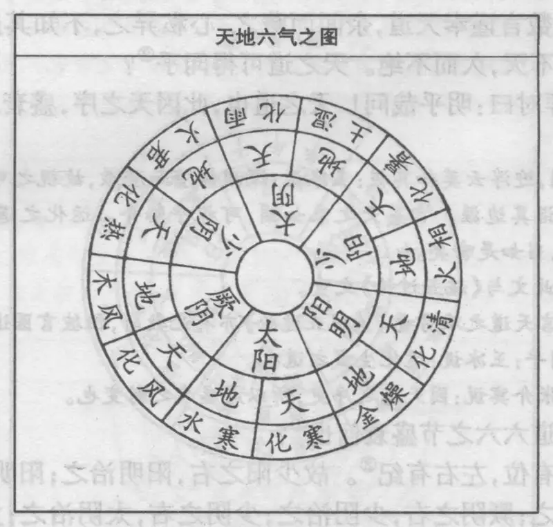
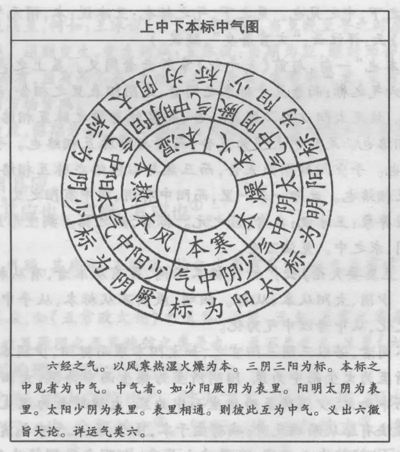
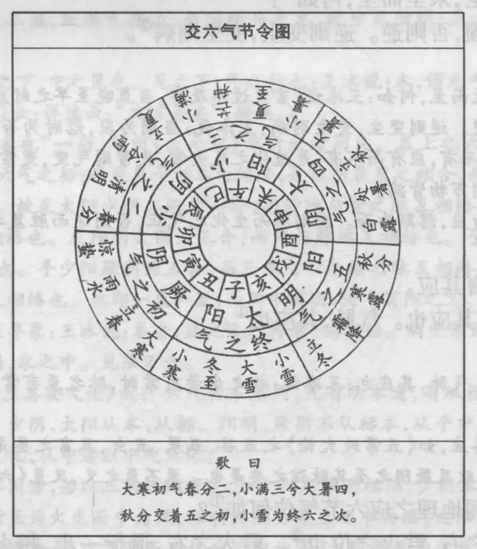
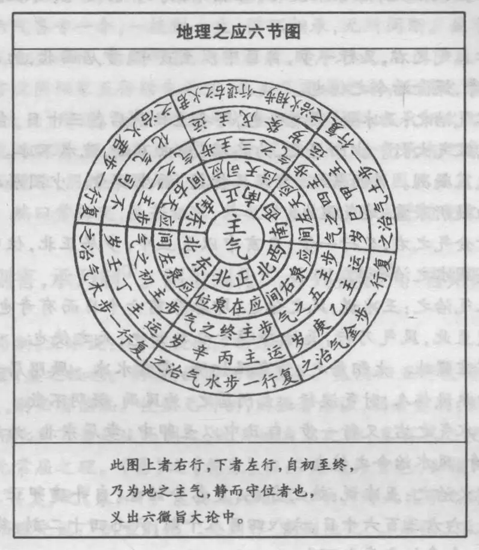
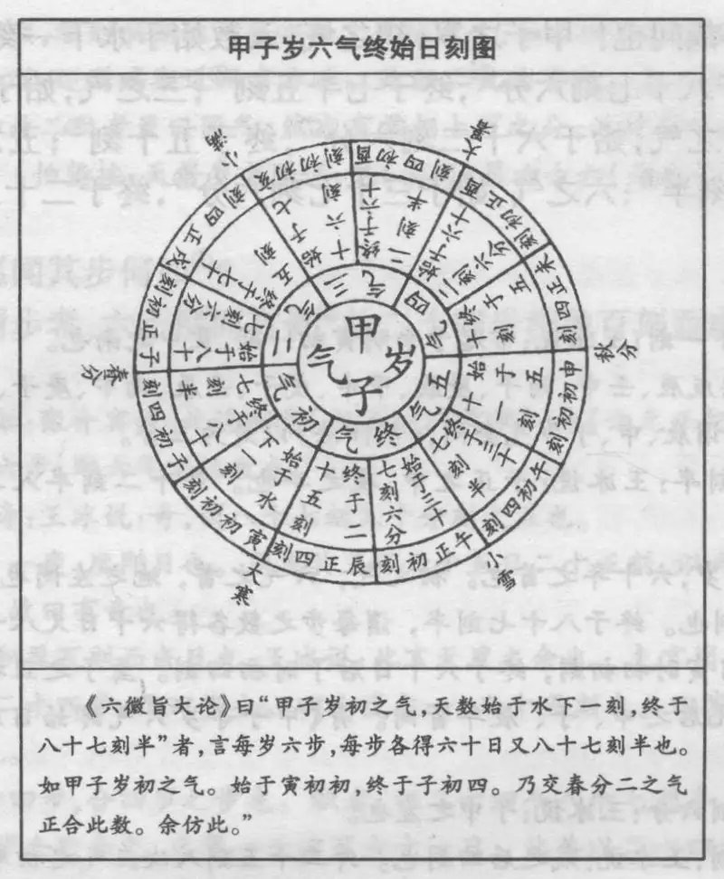
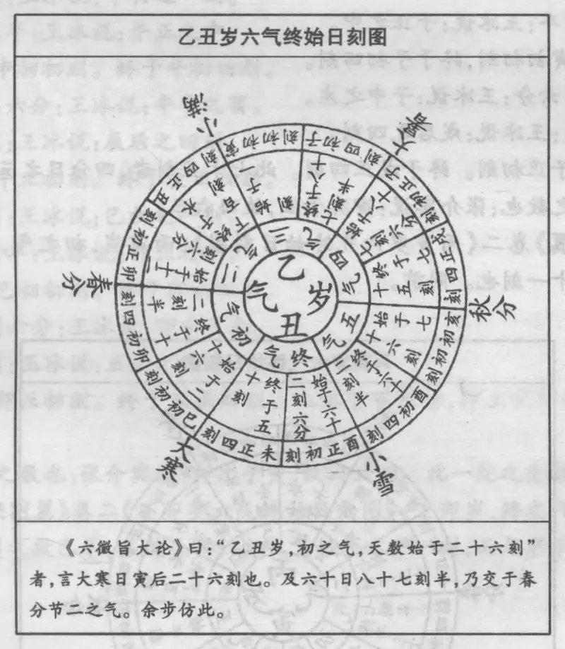
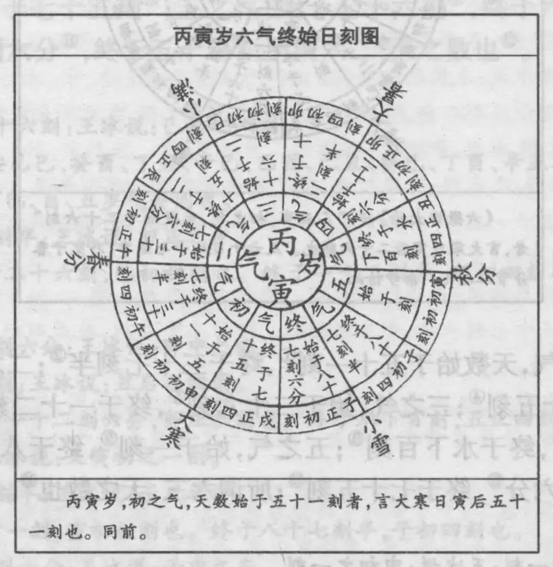
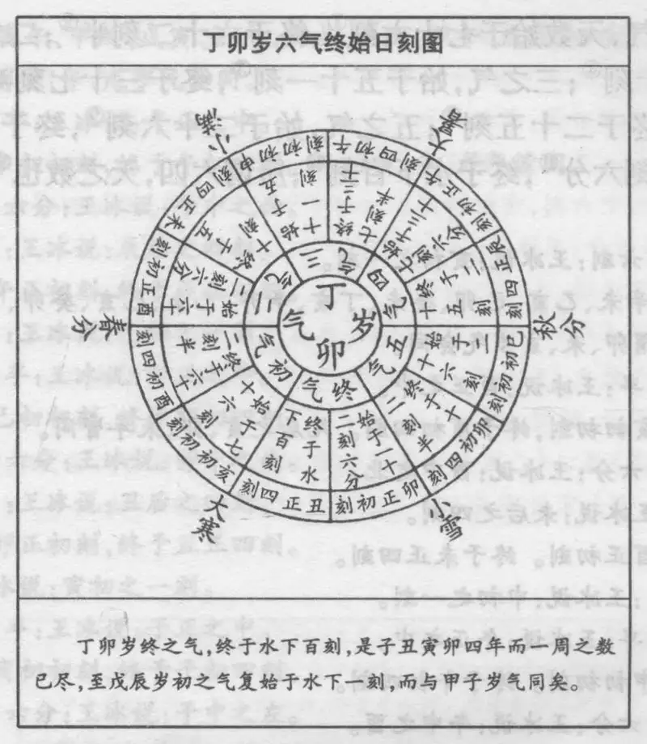
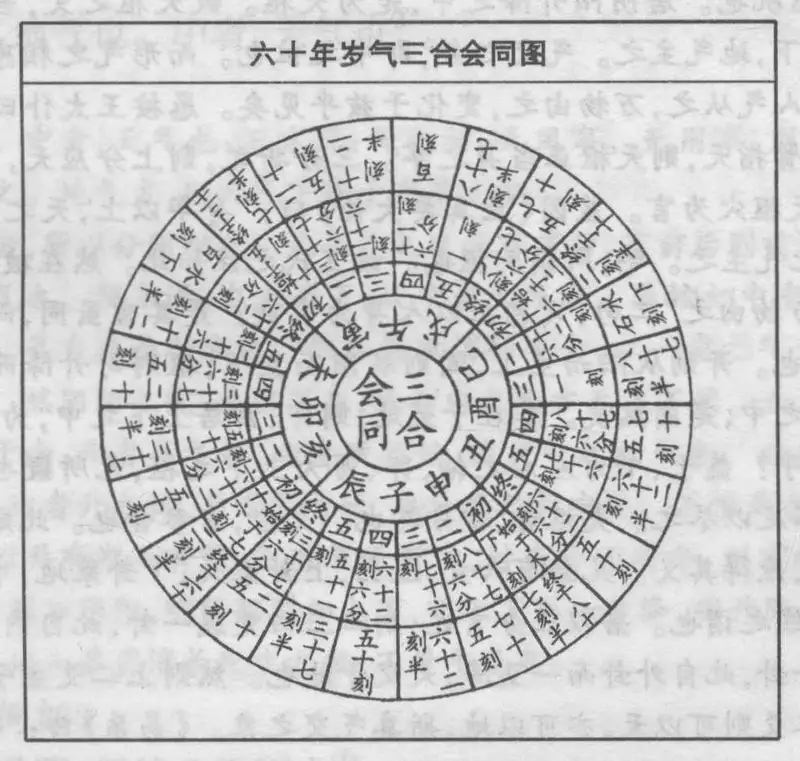

# 六微旨大论第六十八①

①**六微旨大论第六十八**：**伯坚按：**《甲乙经》和今存残本《黄帝内经太素》都没有收载本篇的文字。本篇和《类经》的篇目对照，列表于下：

| 素问 | 类经 |
|---|---|
| 六微旨大论第六十八 | 卷二十三——天地六六之节标本之应亢则害承乃制（运气类六） 卷二十四——天符岁会（运气类七·一） 卷二十四——六步四周三合会同子甲相合命曰岁立（运气类八） 卷二十四——上下升降气有初中神机气立生化为用（运气类九） |

> 黄帝问曰：呜呼远哉，天之道也，如迎浮云，若视深渊。视深渊尚可测，迎浮云莫知其极①。夫子数言谨奉天道，余闻而藏之，心私异之，不知其所谓也，愿夫子溢志尽言其事，令终不灭，久而不绝。天之道可得闻乎②？
>
> 岐伯稽首再拜对曰：明乎哉问！天之道也，此因天之序，盛衰之时也③。

**【集解】**

①**视深渊尚可测，迎浮云莫知其极**：王冰说：深渊静滢而澄澈，故视之可测其深浅。浮云飘泊而合散，故迎之莫诣其边涯。言苍天之象如渊，可视乎鳞介。运化之道犹云，莫测其去留。六气深微，其于运化，当如是喻矣。

《新校正》云：详此文与《疏五过论》文重。

张介宾说：此甚言天道之难穷也。《疏五过论》亦有此数句，但彼言医道，此言天道也。

②**天之道可得闻乎**：王冰说：运化生成之道也。

③**盛衰之时也**：张介宾说：因天道之序更，所以成盛衰之时变也。

> 帝曰：愿闻天道六六之节盛衰何也①？
>
> 岐伯曰：上下有位，左右有纪②。故少阳之右，阳明治之；阳明之右，太阳治之；太阳之右，厥阴治之；厥阴之右，少阴治之；少阴之右，太阴治之；太阴之右，少阳治之；此所谓气之标，盖南面而待之也③，故曰：“因天之序，盛衰之时，移光定位，正立而待之”④，此之谓也⑤。少阳之上，火气治之，中见厥阴⑥。阳明之上，燥气治之，中见太阴⑦。太阳之上，寒气治之，中见少阴⑧。厥阴之上，风气治之，中见少阳⑨。少阴之上，热气治之，中见太阳⑩。太阴之上，湿气治之，中见阳明⑪。所谓本也。本之下，中之见也。见之下，气之标也⑫。本标不同，气应异象⑬。

**【集解】**

①**愿闻天道六六之节盛衰何也**：王冰说：六六之节，经已启问，（顾观光说：见《六节藏象论》。）天师未敷其旨，故重问之。

②**上下有位，左右有纪**：王冰说：上下，谓司天地之气二也。余左右四气，在岁之左右也。

〔p.889 (인쇄 872)〕

张介宾说：此言六位之序，以明客气之盛衰也。

③**此所谓气之标，盖南面而待之也**：王冰说：标，末也。圣人南面而立以阅气之至也。

张介宾说：此即天道六六之节也。三阴三阳以六气为本，六气以三阴三阳为标。然此右字皆自南面而观以待之，所以少阳之右为阳明也。有《天地六气图解》，在《图翼》二卷。

张介宾《类经图翼》卷二《天地六气图解》：《天元纪大论》曰：“夫五运阴阳者，天地之道也。”又曰：“在天为气，在地成形，形气相感而化生万物矣。”又曰：“神在天为风，在地为木。在天为热，在地为火。在天为湿，在地为土。在天为燥，在地为金。在天为寒，在地为水。”夫六气之合于三阴三阳者，分而言之，则天地之化有气有形；合而言之，则阴阳之理标出乎本。（所谓标本者，六气为本，三阴三阳为标。）如主气之交司于四时者，春属木为风化，夏初君火为热化，盛夏相火为暑化，长夏属土为湿化，秋属金为燥化，冬属水为寒化，此六化之常，不失其常，即所谓当其位则正也。如客气之有盛衰逆顺者，则司天主上，在泉主下，左右四间各有专王，不时相加以为交合，此六化之变，变有不测，即所谓非其位则邪也。故正则为德化政令，邪则为灾变眚伤。太者之至徐而常，少者之至暴而亡。而凡为淫胜、邪胜、相胜、相复等变，亦何莫非天地六化之气所致欤！

**天地六气之图**

④**正立而待之**：顾观光说：此引《八正神明论》文。

⑤**此之谓也**：王冰说；移光，谓日移光。定位，谓面南观气。正立观岁，数气之至，则气可待之也。

张介宾说：光，日光也。位，位次也。凡此六气之次，即因天之序也。天既有序，则气之王者为盛，气之退者为衰。然此盛衰之时，由于日光之移，日光移而后位次定。圣人之察之者，但南面正立而待之，则其时更气易皆于日光而见之矣。故《生气通天论》曰：“天运当以日光明”，正此移光定位之义。此数句与《八正神明论》同。

⑥**少阳之上，火气治之，中见厥阴**：王冰说：少阳，南方火，故上见火气治之；与厥阴合，故中见厥阴也。

〔p.890 (인쇄 873)〕

张介宾说：此以下言三阴三阳各有表里，其气相通，故各有互根之中气也。少阳之本火，故火气在上；与厥阴为表里，故中见厥阴；是以相火而兼风木之化也。此有《上中下本标中气图解》，在《图翼》四卷。

张介宾《类经图翼》卷四《标本中气从化解》：《至真要大论》曰：“少阳太阴从本。少阴太阳从本，从标。阳明、厥阴不从标本，从乎中也。”启玄子《注》曰：“少阳之本火，太阴之本湿，本末同，故从本也。少阴之本热，其标阴；太阳之本寒，其标阳；本末异，故从本从标。阳明之中太阴，厥阴之中少阳，本末与中不同，故不从标本，从乎中也。从本、从标、从中、皆以其为化生之用也。”此注殊欠明显，即汪石山《图注》亦隐晦难解。愚按少阳、太阴从本者，以少阳本火而标阳，太阴本湿而标阴，标本同气，故当从本。然少阳太阴亦有中气而不言从中者，以少阳之中，厥阴木也，木火同气，木从火化矣，故不从中也；太阴之中，阳明金也，土金相生，燥从湿化矣，故不从中也。少阴太阳从本从标者，以少阴本热而标阴，太阳本寒而标阳，标本异气，故或从本，或从标，而治之有先后也。然少阴太阳亦有中气，以少阴之中，太阳水也，太阳之中，少阴火也，同于本则异于标，同于标则异于本，故皆不从中气也。至若阳明厥阴不从标本从乎中者，以阳明之中，太阴湿土也，亦以燥从湿化矣；厥阴之中，少阳火也，亦以木从火化矣；故阳明厥阴不从标本而从中气也。要之，五行之气，以木遇火则从火化，以金遇土则从湿化，总不离于水流湿，火就燥，同气相求之义耳。故本篇曰：“从本者化生于本，从标本者有标本之化，从中者以中气为化”也。必详明标本化生之所自，则知所以调治之矣。故张子和《标本运气歌》曰：“少阳从本为相火。太阴从本湿土坐。厥阴从中火是家。阳明从中湿是我。太阳少阴标本从。阴阳二气相包裹。风从火断汗之宜。燥与湿兼下之可。万病能将火湿分。彻开轩、岐无缝锁。”又其《十二经水火分治歌》，其义大同，皆本诸此。详载《儒门事亲》第十四卷中。

**上中下本标中气图**

六经之气。以风寒热湿火燥为本。三阴三阳为标。本标之中见者为中气。中气者。如少阳厥阴为表里。阳明太阴为表里。太阳少阴为表里。表里相通。则彼此互为中气。义出六微旨大论。详运气类六。

〔p.891 (인쇄 874)〕

⑦**阳明之上，燥气治之，中见太阴**：王冰说：阳明，西方金，故上燥气治之；与太阴合，故燥气之下，中见太阴也。

张介宾说：阳明之本燥，故燥气在上；与太阴为表里，故中见太阴；是以燥金而兼湿土之化也。

⑧**太阳之上，寒气治之，中见少阴**：王冰说：太阳，北方水，故上寒气治之；与少阴合，故寒气之下，中见少阴也。

《新校正》云：按《六元正纪大论》云：“太阳所至为寒生，中为温。”与此义同。

张介宾说：太阳之本寒，故寒气在上；与少阴为表里，故中见少阴；是以寒水而兼君火之化也。

⑨**厥阴之上，风气治之，中见少阳**：王冰说：厥阴，东方木，故上风气治之；与少阳合，故风气之下，中见少阳也。

张介宾说：厥阴之本风，故风气在上；与少阳为表里，故中见少阳；是以风木而兼相火之化也。

⑩**少阴之上，热气治之，中见太阳**：王冰说：少阴，东南方君火，故上热气治之；与太阳合，故热气之下，中见太阳也。

《新校正》云：按《六元正纪大论》云：“少阴所至为热生，中为寒。”与此义同。

张介宾说：少阴之本热，故热气在上；与太阳为表里，故见太阳；是以君火而兼寒水之化也。

⑪**太阴之上，湿气治之，中见阳明**：王冰说：太阴，西南方土，故上湿气治之；与阳明合，故湿气之下，中见阳明也。

张介宾说：太阴之本湿，故湿气在上；与阳明为表里，故中见阳明；是以湿土而兼燥金之化也。

⑫**所谓本也。本之下，中之见也。见之下，气之标也**：王冰说：本，谓元气也。气别为主，则文言著矣。（《新校正》云：详注云：“文言著矣”，疑误。）

张介宾说：“所谓本也”一句，与前《天元纪》章所云者同义。盖上之六气，为三阴三阳之本；下之三阴三阳，为六气之标；而兼见于标本之间者，是阴阳表里之相合，而互为中见之气也。其于人之应之者亦然。故足太阳少阴二经为一合，而膀胱与肾之脉互相络也。足少阳厥阴为二合，而胆与肝脉互相络也。足阳明太阴为三合，而胃与脾脉互相络也。手太阳少阴为四合，而小肠与心脉互相络也。手少阳厥阴为五合，而三焦与心包络之脉互相络也。手阳明太阴为六合，而大肠与肺脉互相络也。此即一表一里，而阳中有阴、阴中有阳之义。

⑬**本标不同，气应异象**：王冰说：本者，应之元。标者，病之始。病生形用，求之标。方施其用，求之本。标本不同，求之中。见法万全。

《新校正》云：按《至真要大论》云：“六气标本不同，气有从本者，有从标本者，有不从标本者。少阳、太阴从本。少阴、太阳从本、从标。阳明、厥阴不从标本，从乎中。故从本者化生于本，从标本者有标本之化，从中者以中气为化。”

张介宾说：标本不同者，若以三阴三阳言之，如太阳本寒而标阳，少阴本热而标阴也。以中见之气言之，如少阳所至为火生而中为风，阳明所至为燥生而中为湿，太阳所至为寒生而中为热，厥阴所至为风生而中为火，少阴所至为热生而中为寒，太阴所至为湿生而中为燥也。故岁气有寒热之非常者；诊法有脉从而病反者；病有生于本，生于标，生于中气者；治有取本而得，取标而得，取中气而得者；此皆标本之不同，而气应之异象，即下文所谓物生其应，脉气其应者是也。故如瓜甜蒂苦，葱白叶青，参补芦泻，麻黄发汗，根节止汗之类，皆本标不同之象。

〔p.892 (인쇄 875)〕

> 帝曰：其有至而至，有至而不至，有至而太过，何也①？
>
> 岐伯曰：至而至者，和。至而不至，来气不及也。未至而至，来气有余也②。

**【集解】**

①**其有至而至，有至而不至，有至而太过，何也**：王冰说：皆谓天之六气也。初之气，起于立春前十五日。余二、三、四、五、终气，次至而分治六十日余八十七刻半。

张介宾说：此下正以明气候之盛衰也。六气治岁，各有其时，气至有迟早，而盛衰见矣。

②**未至而至，来气有余也**：王冰说：时至而气至，和平之应，此则为平岁也。假令甲子岁气有余，于癸亥岁未当至之期先时而至也。乙丑岁气不足，于甲子岁当至之期后时而至也。故曰来气不及，来气有余也。言初气之至期如此。岁气有余，六气之至皆先时。岁气不及，六气之至皆后时。先时后至，后时先至，各差十三日而应也。（顾观光说：“十三”当作“三十”。）

《新校正》云：按《金匮要略》云：“有未至而至，有至而不至，有至而不去，有至而太过。冬至之后得甲子，夜半少阳起，少阴之时阳始生，（顾观光说：“阴”字误，当依《金匮要略》作“阳”。）天得温和。以未得甲子天因温和，此为未至而至也。以得甲子而天未温和，此为至而不至。以得甲子而天寒不解，此为至而不去。以得甲子而天温如盛夏时，此为至而太过。”此亦论气应之一端也。

张介宾说：时至气亦至，和平之应也，此为平岁。若时而气不至，来气不及也。时未至而气先至，来气有余也。

> 帝曰：至而不至，未至而至，何如①？
>
> 岐伯曰：应则顺，否则逆。逆则变生，变生则病②。

**【集解】**

①**至而不至，未至而至，何如**：王冰说：言太过不及岁，当至晚至早之时应也。

②**应则顺，否则逆。逆则变生，变生则病**：王冰说：当期为应，愆时为否。天地之气生化不息，无止碍也，不应有而有，应有而不有，是造化之气失常，失常则气变，变常则气血纷挠而为病也。天地变而失常，则万物皆病。

张介宾说：当期为应，愆期为否。应则顺而生化之气正，否则逆而胜复之变生。天地变生，则万物亦病矣。

> 帝曰：善。请言其应。
>
> 岐伯曰：物生，其应也。气脉，其应也①。

**【集解】**

①**物生，其应也。气脉，其应也**：王冰说：物之生荣有常时，脉之至有常期，有余岁早，不及岁晚，皆依期至也。

张介宾说：物生其应，如《五常政大论》之五谷、五果、五虫、五畜之类是也。气脉其应，如《至真要大论》之南北政及厥阴之至其脉弦之类是也。至不至之义，又见《六元正纪大论》。

> 帝曰：善。愿闻地理之应六节气位何如①？
>
> 岐伯曰：显明之右，君火之位也②。君火之右，退行一步，相火治之③。复行一步，土气治之④。复行一步，金气治之⑤。复行一步，水气治之⑥。复行一步，木气治之⑦。复行一步，君火治之⑧。相火之下，水气承之⑨。水位之下，土气承之⑩。土位之下，风气承之⑪。风位之下，金气承之⑫。金位之下，火气承之⑬。君火之下，阴精承之⑭。

〔p.893 (인쇄 876)〕

**【集解】**

①**愿闻地理之应六节气位何如**：张介宾说：此下言地理之应六节，即主气之静而守位者也。故曰六位，亦曰六步，乃六气所主之位也。

②**显明之右，君火之位也**：张介宾说：显明者，日出之所，卯正之中，天地平分之处也。显明之右，谓自斗建卯中以至巳中，步居东南，为天之右间，主二之气，乃春分后六十日有奇，君火治令之位也。若客气以相火加于此，是谓以下临上，臣位居则逆矣。此下有《交六气节令图解》及《地理之应六节图》，在《图翼》二卷。

张介宾《类经图翼》卷二《交六气节令图解》：四时六气，节有常期。湿暑寒凉，岁有常令。《运气全书》云：“阴阳相遘，分六位而日月推移。寒暑弛张，运四时而气令更变。”故凡一岁之气，始于大寒日交风木之初气，次至春分日交君火之二气，次至小满日交相火之三气，次至大暑日交湿土之四气，次至秋分日交燥金之五气，次至小雪日交寒水之终气，每气各主六十日八十七刻半，是谓六步。每步中各有节序四气，是谓二十四气，而所以节分六步者也。总六步而得三百六十五日二十五刻以成一岁，故《六微旨大论》曰：“显明之右，君火之位也，君火之右，退行一步，相火治之，复行一步，土气治之，复行一步，金气治之，复行一步，水气治之，复行一步，木气治之”者，正以言六位之主气也。显明者，谓日出之地，即卯位也。右者谓卯在东方，面东视之，君火当二之气，位在卯之右也。退行者，谓君火又右一步，当三气相火之位也。余仿此。

**交六气节令图**

歌曰

大寒初气春分二，小满三兮大暑四，

秋分交着五之初，小雪为终六之次。

张介宾《类经图翼》卷二《地理之应六节图》：此图上者右行，下者左行，自初至终，乃为地之主气，静而守位者也。义出《六微旨大论》中。

〔p.894 (인쇄 877)〕

**地理之应六节图**

此图上者右行，下者左行，自初至终，乃为地之主气，静而守位者也，义出六微旨大论中。

③**君火之右，退行一步，相火治之**：王冰说：日出谓之显明，则卯地气分春也。（顾观光说：“分春”二字疑倒。）自春分后六十日有奇，斗建卯正，至于巳正，君火位也。自斗建巳正至未之中，三之气分，相火治之，所谓少阳也。君火之位，所谓少阴，热之分也。天度至此，暄淑大行，居热之分，不行炎暑，君之德也。少阳居之，为僭逆，大热早行，疫疠乃生。阳明居之，为温凉不时。太阳居之，为寒雨间热。厥阴居之，为风湿雨生羽虫。少阴居之，为天下疵疫，以其得位君令宣行故也。太阴居之，为时雨。火有二位，故以君火为六气之始也。相火则夏至日前后各三十日也，少阳之分，火之位也。天度至此，炎热大行。少阳居之，为热暴至，草萎，河干炎亢，湿化晚布。阳明居之，为凉气间发。太阳居之，为寒气闲至，热争，冰雹。厥阴居之，为风热大行，雨生羽虫。少阴居之，为大暑炎亢。太阴居之，为云雨雷电。退，谓南面视之，在位之右也。一步，凡六十日又八十七刻半。余气同法。

张介宾说：退行一步，谓退于君火之右一步也。此自斗建巳中，以至未中，步居正南，位直司天，主三之气，乃小满后六十日有奇，相火之治令也。

④**复行一步，土气治之**：王冰说：雨之分也，即秋分前六十日而有奇，斗建未正至酉之中，四之气也。天度至此，云雨大行，湿蒸乃作。少阳居之，为炎热沸腾，云雨雷电。阳明居之，为清雨雾露。太阳居之，为寒雨害物。厥阴居之，为暴风雨摧拉，雨生倮虫。少阴居之，为寒热气反用，山泽浮云暴雨溽蒸。太阴居之，为大雨霪霪。

张介宾说：复行一步，谓于相火之右又行一步也。此自未中以至酉中，步居西南，为天之左间，主四之气，乃大暑后六十日有奇，湿土治令之位也。

⑤**复行一步，金气治之**：王冰说：燥之分也，即秋分后六十日而有奇，自斗建酉正至亥之中，五之气也。天度至此，万物皆燥。少阳居之，为温清更正，万物乃荣。阳明居之，为大凉燥疾。太阳居之，为早寒。厥阴居之，为凉风大行，雨生介虫。少阴居之，为秋湿热病时行。太阴居之，为时雨沉阴。

〔p.895 (인쇄 878)〕

张介宾说：此于土气之右，又行一步，自酉中以至亥中，步居西北，为地之右间，主五之气，乃秋分后六十日有奇，燥金治令之位也。

⑥**复行一步，水气治之**：王冰说：寒之分也，即冬至日前后各三十日，自斗建亥至丑之中，六之气也。天度至此，寒气大行。少阳居之，为冬温，蛰虫不藏，流水不冰。阳明居之，为燥寒劲切。太阳居之，为大寒凝冽。厥阴居之，为寒风标扬，雨生鳞虫。少阴居之，为蛰虫出见，流水不冰。太阴居之，为凝阴寒雪，地气湿也。

张介宾说：此于金气之右，又行一步，自亥中以至丑中，步居正北，位当在泉，主终之气，乃小雪后六十日有奇，寒水之治令也。

⑦**复行一步，木气治之**：王冰说：风之分也，即春分前六十日而有奇也，自斗建丑正至卯之中，初之气也。天度至此，风气乃行，天地神明号令之始也，天之使也。少阳居之，为温疫至。阳明居之，为清风雾露朦昧。太阳居之，为寒风切冽，霜雪水冰。厥阴居之，为大风发荣，雨生毛虫。少阴居之，为热风伤人，时气流行。太阴居之，为风雨，凝阴不散。

张介宾说：此于水气之右，又行一步，自丑中以至卯中，步居东北，为地之左间，主初之气，乃大寒后六十日有奇，风水治令之位也。

⑧**复行一步，君火治之**：王冰说：热之分也，复春分始也，自斗建卯正至巳之中，二之气也。凡此六位，终纪一年，六六三百六十日，六八四百八十刻，六七四十二刻，其余半刻积而为三，约终三百六十五度也。余奇细分率之可也。

张介宾说：此自木气之末，复行于显明之右，君火之位，是为主气六步之一周。

⑨**相火之下，水气承之**：王冰说：热盛水承，条蔓柔弱，凑润衍溢，水象可见。

《新校正》云：按《六元正纪大论》云：“少阳所至为火生，终为蒸溽。”则水承之义可见。又云：“少阳所至为标风，燔燎，霜凝。”亦下承之水气也。

⑩**水位之下，土气承之**：王冰说：寒甚物坚，水冰流涸，土象斯见，承下明矣。

《新校正》云：按《六元正纪大论》云：“太阳所至为寒雪，冰雹，白埃。”则土气承之之义也。

⑪**风气承之**：王冰说：疾风之后，时雨乃零，是则湿为风吹，化而为雨。

《新校正》云：按《六元正纪大论》云：“太阴所至为湿生，终为注雨。”则土位之下，风气承之而为雨也。又云：“太阴所至为雷霆，骤注，烈风。”则风承之义也。

⑫**风位之下，金气承之**：王冰说：风动气清，万物皆燥，金承木下，其象昭然。

《新校正》云：按《六元正纪大论》云：“厥阴所至为风生，终为肃。”则金承之义可见。又云：“厥阴所至为飘怒，大凉。”亦金承之义也。

⑬**金位之下，火气承之**：王冰说：锻金生热，则火流金，乘火之上，理无妄也。

《新校正》云：按《六元正纪大论》云：“阳明所至为散落，温。”则火乘之义也。

⑭**君火之下，阴精承之**：王冰说：君火之位，大热不行，盖为阴精制承其下也。诸以所胜之气乘于下者，皆折其标盛，此天地造化之大体尔。

《新校正》云：按《六元正纪大论》云：“少阴所至为热生，中为寒。”则阴承之义可知。又云：“少阴所至为大暄，寒。”亦其义也。又按《六元正纪大论》云：“‘水发而雹雪，土发而飘骤，木发而毁折，金发而清明，火发而曛昧，何气使然？’曰：‘气有多少，发有微甚。微者当其气，甚者兼其下。征其下气，而见可知也。’”所谓征其下者，即此六承气也。

〔p.896 (인쇄 879)〕

张介宾说：此言六位之下，各有所承。承者，前之退而后之进也。承之为义有二，一曰常，一曰变。常者，如六气各专一令，一极则一生，循环相承，无所间断。故于六位盛极之下，各有相制之气随之以生，由生而化，由微而著，更相承袭，时序乃成，所谓阳盛之极则阴生承之，阴盛之极则阳生承之，亦犹阴阳家五行胎生之义，此岁气不易之令，故谓之常。常者，四时之序也。变者、如《六元正纪大论》所谓：“少阳所至为火生，终为蒸溽，水承相火之象也；水发而雹雪，土气承水之象也；土发而飘骤，风木承土之象也；木发而毁折，金气承木之象也；金发而清明，火气承金之象也；火发而曛昧，阴精承君火之象也。此则因亢而制，因胜而复，承制不常，故谓之变。变者，非时之邪也。然曰常曰变，虽若相殊，总之防其太过，而成乎造化之用，理则一耳。”

> 帝曰：何也？
>
> 岐伯曰：亢则害，承乃制①。制生则化②，外列盛衰③。害则败乱，生化大病④。

**【集解】**

①**亢则害，承乃制**：王冰说：亢，过极也。物恶其极。

张介宾说：亢者，盛之极也。制者，因其而抑之也。盖阴阳五行之道，亢极则乖，而强弱相残矣。故凡有偏盛，则必有偏衰。使强无所制，则强者愈强，弱者愈弱，而乖乱日甚。所以亢而过甚，则害乎所胜而承其下者必从而制之，此天地自然之妙，真有莫之使然而不得不然者。天下无常胜之理，亦无常屈之理。《易》之《乾象》曰：“亢之为言也，知进而不知退，知存而不知亡，知得而不知丧。”《复》之《象》曰：“复其见天地之心乎。”即此亢承之义。

②**制生则化**：顾观光说：“制生则化”，吴刻作“制则生化”。盖依王氏《溯洄集》改。

③**外列盛衰**：张介宾说：“制生则化”当作“制则生化”，传写之误也。夫盛极有制则无亢害，无亢害则生化生乎自然，当盛者盛，当衰者衰，循序当位，是为外列盛衰。外列者，言发育之多也。

④**害则败乱，生化大病**：张介宾说：亢而无制，则为害矣。害则败乱失常，不生化正气而为邪气，故为大病也。按王安道曰：“予读《内经》，至‘亢则害，承乃制’，喟然叹曰，至矣哉，其造化之枢纽乎。王太仆发之于前，刘河间阐之于后，圣人之蕴，殆靡遗矣。然学者尚不能释然，得不犹有未悉之旨欤？请推而陈之。夫自‘显明之右’至‘君火治之’十五句，言六节所治之位也。自‘相火之下’至‘阴精承之’十二句，言地理之应岁气也。‘亢则害，承乃制’三句，言抑其过也。‘制则生化’至‘生化大病’四句，言有制之常与无制之变也。承，犹随也。然不言随而言承者，以下言之，则有土奉之象，故曰承。虽谓之承，而有防止之义存焉。亢者，过极也。害者，害物也。制者，克胜之也。然所承者，其不亢则随之而已，故虽承而不见；既亢则克胜以平之，承斯见矣，然而迎之不知其所来，迹之不知其所止，固若有不可必者。然可必者常存乎杳冥恍惚之中，而莫之或欺也。”河间曰：“已亢过极，则反似胜己之化。”夫似也者，其可以形质求哉？故后篇云：“厥阴所至为风生，终为肃，少阴所至为热生，终为寒”之类，其为风生为热生者亢也，其为肃为寒者制也。又水发而雹雪，土发而飘骤之类，其水发土发者亢也，其雹雪飘骤者制也。若然者，盖造化之常不能以无亢，亦不能以无制焉耳。又虞天民曰：“制者，制其气之太过也。害者，害承者之元气也。”所谓元气者，总而言之，谓之一元，如天一生水，水生木，木生火，火生土，土生金，金复生水，循环无端，生生不息也。分而言之，谓之六元，如水为木之化元，木为火之化元，火为土之化元，土为金之化元，金为水之化元，亦运化而无穷也。假如火不亢，则所承之水随之而已，一有亢极，则其水起以平之，盖恐害吾金元之气，子来救母之意也。六气皆然。此五行胜复之理，不期然而然者矣。由此观之，则天地万物，固无往而非五行，而亢害承制，又安往而不然哉？故求之于人，则五藏更相平也，五志更相胜也，五气更相移也，五病更相变也。故火极则寒生，寒极则湿生，湿极则风生，风极则燥生，燥极则热生，皆其化也。第承制之在天地者出乎气化之自然，而在人为亦有之，则在挽回运用之得失耳。使能知其微，得其道，则把握在我，何害之有？设承制之盛衰不明，似是之真假不辨，则败乱可立而待也，惟知者乃能慎之。

〔p.897 (인쇄 880)〕

> 帝曰：盛衰何如？
>
> 岐伯曰：非其位则邪。当其位则正。邪则变甚。正则微①。

**【集解】**

①**当其位则正。邪则变甚。正则微**：张介宾说：气不相和者为非位，气相得者为当位，故有邪正微甚之分。上二句又出《五运行大论》。

> 帝曰：何谓当位？
>
> 岐伯曰：木运临卯①，火运临午，土运临四季，金运临酉，水运临子，所谓岁会，气之平也②。

**【集解】**

①**木运临卯**：张介宾说：此下言岁会也。

②**火运临午，土运临四季，金运临酉，水运临子，所谓岁会，气之平也**：王冰说：非太过，非不及，是谓平运主岁也。平岁之气，物生、脉应，皆必合期，无先后也。

《新校正》云：详木运临卯，丁卯岁也。火运临午，戊午岁也。土运临四季，甲辰、甲戌、己丑、己未岁也。金运临酉，乙酉岁也。水运临子，丙子岁也。内戊午、己丑、己未、乙酉，又为太一天符。

张介宾说：此岁运与年支同气，故曰岁会，其气平也，共八年。

> 帝曰：非位何如？
>
> 岐伯曰：岁不与会也①。

**【集解】**

①**岁不与会也**：王冰说：不与本辰相逢会也。

张介宾说：岁运不与地支会，则气有不平者矣。

> 帝曰：土运之岁，上见太阴①；火运之岁，上见少阳、少阴②；金运之岁，上见阳明；木运之岁，上见厥阴；水运之岁，上见太阳；奈何③？
>
> 岐伯曰：天之与会也④，故《天元册》曰天符⑤。

**【集解】**

①**上见太阴**：张介宾说：此下言天符也。上谓司天。

②**上见少阳、少阴**：王冰说：少阴、少阳皆火气。

③**奈何**：张介宾说：奈何，谓此十二年以岁运与司天同气者，又何以然也。

④**天之与会也**：王冰说：天气与运气相逢会也。

《新校正》云：详土运之岁，上见太阴，己丑、己未也。火运之岁，上见少阳，戊寅、戊申也；上见少阴，戊子、戊午也。金运之岁，上见阳明，乙卯、乙酉也。木运之岁，上见厥阴，丁巳、丁亥也。水运之岁，上见太阳，丙辰、丙戌也。内己丑、己未、戊午、乙酉，又为太一天符。按《六元正纪大论》云：太过而同天化者三，不及而同天化者亦三。戊子、戊午，太徵，上临少阴，戊寅、戊申、太徵，上临少阳，丙辰、丙戌，太羽，上临太阳；如是者三。丁巳、丁亥，少角，上临厥阴；乙卯、乙酉，少商，上临阳明；己丑、己未，少宫，上临太阴；如是者三。临者太过不及，皆曰天符。

〔p.898 (인쇄 881)〕

⑤**故《天元册》曰天符**：张介宾说：“天与运会也。”

> 天符岁会何如①？
>
> 岐伯曰：太一天符之会也②。

**【集解】**

①**天符岁会何如**：张介宾说：此帝问太一天符也。

②**太一天符之会也**：王冰说：是谓三合，一者天会，二者岁会，三者运会也。《六元正纪大论》曰：“三合为治”，此之谓也。

《新校正》云：按太一天符之详，具《天元正纪大论》注中。

张介宾说：既为天符，又为岁会，是为太一天符之会，如上之己丑、己未、戊午、乙酉四岁是也。太一者，至尊无二之称。

> 帝曰：其贵贱何如？
>
> 岐伯曰：天符为执法。岁位为行令。太一天符为贵人①。

**【集解】**

①**太一天符为贵人**：王冰说：执法犹相辅。行令犹方伯。贵人犹君主。

张介宾说：执法者位于上，犹执政也。行令者位乎下，犹诸司也。贵人者，统乎上下，犹君主也。

> 帝曰：邪之中也奈何①？
>
> 岐伯曰：中执法者，其病速而危②。中行令者，其病徐而持③。中贵人者，其病暴而死④。

**【集解】**

①**邪之中也奈何**：张介宾说：言以非常之邪，不时相加而中伤者也。

②**中执法者，其病速而危**：王冰说：执法，官人之绳准，自为邪僻，故病速而危。

张介宾说：中执法者，犯司天之气也。天者生之本，故其病速而危。

③**中行令者，其病徐而持**：王冰说：方伯，无执法之权，故无速害，病但执持而已。

张介宾说：中行令者，犯地支之气也。害稍次之，故其病徐而持。持者，邪正相持而吉凶相半也。

④**中贵人者，其病暴而死**：王冰说：义无凌犯，故病则暴而死。

张介宾说：中贵人者，天地之气皆犯矣。故暴而死。按此三者，地以天为主，故中天符者甚于岁会。而太一天符者，乃三气合一，其盛可知，故不犯则已，犯则无能解也，人而受之，不能免矣。

> 帝曰：位之易也何如？
>
> 岐伯曰：君位臣则顺。臣位君则逆。逆则其病近，其害速。顺则其病远，其害微。所谓二火也①。

**【集解】**

①**所谓二火也**：王冰说：相火居君火，是臣居君位，故逆也。君火居相火，是君居臣位，故顺也。远，谓里远；近，谓里近也。

张介宾说：君者，君火也。臣者，相火也。君位臣者，如以少阴之客而加以少阳之主，是君在上而臣在下，故为顺，顺则病期远而害亦微。臣位君者，如以少阳之客而加于少阴之主，是臣在上而君在下，故为逆，逆则病期近而害亦速。此以二火为言也。盖五行各一，而其胜复逆顺之相加各有所辨，惟此二火者虽曰同气，然亦有君相上下之分，故特举而辨之。有天符岁会图说：在《图翼》二卷。（**伯坚按：**天符岁会图说，见《素问》第六十六《天元纪大论》第二段“三合为治”句下集解。）

〔p.899 (인쇄 882)〕

> 帝曰：善。愿闻其步何如①？
>
> 岐伯曰：所谓步者，六十度而有奇②故二十四步积盈百刻而成日也③。

**【集解】**

①**愿闻其步何如**：张介宾说：此连前章（**伯坚按：**“前章”，指《六元正纪大论》第十二段。）而详求其六步之数。六步，即六气之位数也。

②**六十度而有奇**：王冰说：奇，谓八十七刻又十分刻之五也。

张介宾说：一日一度，度即日也。周岁共三百六十五日二十五刻，以六步分之，则每步得六十日又八十七刻半，故曰有奇也。

③**故二十四步积盈百刻而成日也**：王冰说：此言天度之余也。夫言周天之度者三百六十五度四分度之一也。二十四步，正四岁也。四分度之一，二十五刻也。四岁气乘积已盈百刻，故成一日。度，一日也。

张介宾说：二十四步，合四岁之步也。积者，积二十四个八十七刻半，共得二千一百刻，是为二十一日。以四岁全数合之，正得一千四百六十一日。此共以二十四步之余，积盈百刻，合成四岁之全日，而三合会同之气数于斯见矣。

> 帝曰：六气应五行之变何如？
>
> 岐伯曰：位有终始，气有初中，上下不同，求之亦异也①。

**【集解】**

①**位有终始，气有初中，上下不同，求之亦异也**：王冰说：位，地位也。气，天气也。气与位互有差移，故气之初，天用事。气之中，地主之。地主则气流于地。天用则气腾于天。初与中皆分天步而率刻尔。初、中，各三十日余四十三刻四分刻之三也。

张介宾说：此复求上文天道六六之节，地理之应六节气位，及《天元纪大论》所谓上下相召五六相合之至数也。位，地位也。气，天气也。位有上下左右之终始，气有前后升降之初中，以天之气而加于地之位，则上下相错，互有差移，故曰上下不同，求之亦异也。初中详义见后章。（**伯坚按：**“后章”，指本篇第六段。）

> 帝曰：求之奈何？
>
> 岐伯曰：天气始于甲，地气始于子，子甲相合，命曰岁立，谨候其时，气可与期①。

**【集解】**

①**子甲相合，命曰岁立，谨候其时，气可与期**：王冰说：子甲相合，命日岁立，则甲子岁也。谨候水刻早晏，则六气悉可与期尔。

张介宾说：天气有十干而始于甲，地气有十二支而始于子，子甲相合即甲子也。干支合而六十年之岁气立，岁气立则有时可候，有气可期矣。

> 帝曰：愿闻其岁六气始终早晏何如？
>
> 〔p.900 (인쇄 883)〕岐伯曰：明乎哉问也！甲子之岁，初之气，天数始于水下一刻①，终于八十七刻半②；二之气，始于八十七刻六分③，终于七十五刻④；三之气，始于七十六刻⑤，终于六十二刻半⑥；四之气，始于六十二刻六分⑦，终于五十刻⑧；五之气，始于五十一刻⑨，终于三十七刻半⑩；六之气，始于三十七刻六分⑪，终于二十五刻⑫；所谓初六，天之数也⑬。

**【集解】**

①**天数始于水下一刻**：王冰说：常起于平明寅初一刻，艮中之南也。

《新校正》云：按戊辰、壬申、丙子、庚辰、甲申、戊子、壬辰、丙申、庚子、甲辰、戊申、壬子、丙辰、庚申岁同。此所谓辰、申、子岁气会同，《阴阳法》以是为三合。

②**终于八十七刻半**：王冰说：子正之中，夜之半也。外十二刻半入二气之初，诸余刻同入也。

张介宾说：甲子岁，六十年之首也。初之气，六气之首，地之左间也。始于水下一刻，漏水百刻之首，寅初刻也。终于八十七刻半，谓每步之数各得六十日又八十七刻半也。故甲子岁初之气，始于首日寅时初初刻，终于六十日后子时初四刻。至子之正初刻，则属于春分节而交于二之气矣。凡后之申、子、辰年皆同。有《甲子等岁六气终始日刻图解》，在《图翼》二卷。

③**始于八十七刻六分**：王冰说：子中之左也。

④**终于七十五刻**：王冰说：戌之后四刻也。外二十五刻入次三气之初率。

张介宾说：此继初气而始于八十七刻六分，直子之正初刻也。又加二气之六十日余八十七刻半，则此当终于七十五刻，直戌之正四刻也。后义仿此。

⑤**始于七十六刻**：王冰说：亥初之一刻。

⑥**终于六十二刻半**：王冰说：酉正之中也。外三十七刻半差入后。

张介宾说：始于七十六刻，亥初初刻也。终于六十二刻半，酉初四刻也。

⑦**始于六十二刻六分**：王冰说：酉中之北。

⑧**终于五十刻**：王冰说：未后之四刻也。外五十刻差入后。

张介宾说：始于六十二刻六分，酉正初刻也。终于五十刻，未正四刻也。

⑨**始于五十一刻**：王冰说：申初之一刻。

⑩**终于三十七刻半**：王冰说：午正之中，昼之半也。外六十二刻半差入后。

张介宾说：始于五十一刻，申初初刻也。终于三十七刻半，午初四刻也。

⑪**始于三十七刻六分**：王冰说：午中之西。

⑫**终于二十五刻**：王冰说：辰正之后四刻。外七十五刻差入后。

张介宾说：始于三十七刻六分，午正初刻也。终于二十五刻，辰正四刻也。此二十五刻者，即岁余法四分日之一也。

⑬**所谓初六，天之数也**：王冰说：天地之数，二十四气乃大会而同，故命此曰初六天数也。

张介宾说：初六者，子年为首之六气也。此以天之气数而加于地之步位，故曰天之数也。后仿此。

张介宾《类经图翼》卷二《甲子岁六气终始日刻图》：《六微旨大论》曰：“甲子岁，初之气，天数始于水下一刻，终于八十七刻半”者，言每岁六步，每步各得六十日又八十七刻半也。如甲子岁初之气始于寅初初，终于子初四，乃交春分二之气，正合此数。余仿此。

〔p.901 (인쇄 884)〕

**甲子岁六气终始日刻图**

《六微旨大论》曰“甲子岁初之气，天数始于水下一刻，终于八十七刻半”者，言每岁六步，每步各得六十日又八十七刻半也。如甲子岁初之气。始于寅初初，终于子初四。乃交春分二之气正合此数。余仿此。”

> 乙丑岁，初之气，天数始于二十六刻①，终于一十二刻半②；二之气，始于一十二刻六分③，终于水下百刻④；三之气，始于一刻⑤，终于八十七刻半⑥；四之气，始于八十七刻六分⑦，终于七十五刻⑧；五之气，始于七十六刻⑨，终于六十二刻半⑩；六之气，始于六十二刻六分⑪，终于五十刻⑫；所谓六二，天之数也⑬。

**【集解】**

①**天数始于二十六刻**：王冰说：巳初之一刻。

《新校正》云：按己巳、癸酉、丁丑、辛巳、乙酉、己丑、癸巳、丁酉、辛丑、乙巳、己酉、癸丑、丁巳、辛酉岁同。所谓巳、酉、丑岁气会同也。

②**终于一十二刻半**：王冰说：卯正之中。

张介宾说：始于二十六刻，巳初初刻也。终于一十二刻半，卯初四刻也。凡后之巳、酉、丑年皆同。

③**始于一十二刻六分**：王冰说：卯中之南。

④**终于水下百刻**：王冰说：丑后之四刻。

张介宾说：始于一十二刻六分，卯正初刻也。终于水下百刻，丑正四刻也。

⑤**始于一刻**：王冰说：又寅初之一刻。

⑥**终于八十七刻半**：王冰说：子正之中。

张介宾说：始于一刻，寅初初刻也。终于八十七刻半，子初四刻也。

⑦**始于八十七刻六分**：王冰说：子中之东。

〔p.902 (인쇄 885)〕

⑧**终于七十五刻**：王冰说：戌后之四刻。

张介宾说：始于八十七刻六分，子正初刻也。终于七十五刻，戌正四刻也。

⑨**始于七十六刻**：王冰说：亥初之一刻。

⑩**终于六十二刻半**：王冰说：酉正之中。

张介宾说：始于七十六刻，亥初初刻也。终于六十二刻半，酉初四刻也。

⑪**始于六十二刻六分**：王冰说：酉中之北。

⑫**终于五十刻**：王冰说：未后之四刻。

张介宾说：始于酉正初刻，终于未正四刻，此五十刻者，四分日之二也。

⑬**所谓六二，天之数也**：王冰说：一六为初六，二六为六二，名次也。

张介宾说：丑次于子，故曰六二。

张介宾《类经图翼》卷二《乙丑岁六气终始日刻图》：《六微旨大论》曰：“乙丑岁，初之气，天数始于二十六刻”者，言大寒日寅后二十六刻也。又六十日八十七刻半，乃交于春分节二之气。余步仿此。

**乙丑岁六气终始日刻图**

《六微旨大论》曰：“乙丑岁，初之气，天数始于二十六刻”者，言大寒日寅后二十六刻也。及六十日八十七刻半，乃交于春分节二之气。余步仿此。

> 丙寅岁，初之气，天数始于五十一刻①，终于三十七刻半②；二之气，始于三十七刻六分③，终于二十五刻④；三之气，始于二十六刻⑤，终于一十二刻半⑥；四之气，始于一十二刻六分⑦，终于水下百刻⑧；五之气，始于一刻⑨，终于八十七刻半⑩；六之气，始于八十七刻六分⑪，终于七十五刻⑫；所谓六三，天之数也⑬。

**【集解】**

①**天数始于五十一刻**：王冰说：申初之一刻。

〔p.903 (인쇄 886)〕

《新校正》云：按庚午、甲戌、戊寅、壬午、丙戌、庚寅、甲午、戊戌、壬寅、丙午、庚戌、甲寅、戊午、壬戌岁同。此所谓寅、午、戌岁气会同。

②**终于三十七刻半**：王冰说：午正之中。

张介宾说：始于申初初刻，终于午初四刻。凡后寅、午、戌年皆同。

③**始于三十七刻六分**：王冰说：午中之西。

④**终于二十五刻**：王冰说：辰后之四刻。

张介宾说：始于午正初刻，终于辰正四刻。

⑤**始于二十六刻**：王冰说：巳初之一刻。

⑥**终于一十二刻半**：王冰说：卯正之中。

张介宾说：始于巳初初刻，终于卯初四刻。

⑦**始于一十二刻六分**：王冰说：卯中之南。

⑧**终于水下百刻**：王冰说：丑后之四刻。

张介宾说：始于卯正初刻，终于丑正四刻。

⑨**始于一刻**：王冰说：寅初之一刻。

⑩**终于八十七刻半**：王冰说：子正之中。

张介宾说：始于寅初初刻，终于子初四刻。

⑪**始于八十七刻六分**：王冰说：子中之左。

⑫**终于七十五刻**：王冰说：戌后之四刻。

张介宾说：始于子正初刻。终于戌正四刻。此七十五刻者，四分日之三也。

⑬**所谓六三，天之数也**：张介宾说：寅次于丑，故曰六三。

张介宾《类经图翼》卷二《丙寅岁六气终始日刻图》：丙寅岁，初之气，天数始于五十一刻者，言大寒日寅后五十一刻也。同前。

**丙寅岁六气终始日刻图**

丙寅岁，初之气，天数始于五十一刻者，言大寒日寅后五十一刻也。同前。

〔p.904 (인쇄 887)〕

> 丁卯岁，初之气，天数始于七十六刻①，终于六十二刻半②；二之气，始于六十二刻六分③，终于五十刻④；三之气，始于五十一刻⑤，终于三十七刻半⑥；四之气，始于三十七刻六分⑦，终于二十五刻⑧；五之气，始于二十六刻⑨，终于一十二刻半⑩；六之气，始于一十二刻六分⑪，终于水下百刻⑫；所谓六四，天之数也⑬。

**【集解】**

①**天数始于七十六刻**：王冰说：亥初之一刻。

《新校正》云：按辛未、乙亥、己卯、癸未、丁亥、辛卯、乙未、己亥、癸卯、丁未、辛亥、乙卯、己未、癸亥岁同。此所谓卯、未、亥岁气会同。

②**终于六十二刻半**：王冰说：酉正之中。

张介宾说：始于亥初初刻，终于酉初四刻。凡后之亥、卯、未年皆同。

③**始于六十二刻六分**：王冰说：酉中之北。

④**终于五十刻**：王冰说：未后之四刻。

张介宾说：始于酉正初刻。终于未正四刻。

⑤**始于五十一刻**：王冰说：申初之一刻。

⑥**终于三十七刻半**：王冰说：午正之中。

张介宾说：始于申初初刻。终于午初四刻。

⑦**始于三十七刻六分**：王冰说：午中之西。

⑧**终于二十五刻**：王冰说：辰后之四刻。

张介宾说：始于午正初刻。终于辰正四刻。

⑨**始于二十六刻**：王冰说：巳初之一刻。

⑩**终于一十二刻半**：王冰说：卯正之中。

张介宾说：始于巳初初刻。终于卯初四刻。

⑪**始于一十二刻六分**：王冰说：卯中之南。

⑫**终于水下百刻**：王冰说：丑后之四刻。

张介宾说：始于卯正初刻。终于丑正四刻。此水下百刻者，即上文所谓二十四步，积盈百刻而成日也。

⑬**所谓六四，天之数也**：张介宾说：卯次于寅，故曰六四。此一纪之全数也。

张介宾说：《类经图翼》卷二《丁卯岁六气终始日刻图》：丁卯岁，终之气，终于水下百刻，是子丑寅卯四年而一周之数已尽，至戊辰岁初之气复始于水下一刻，而与甲子岁气同矣。

〔p.905 (인쇄 888)〕

**丁卯岁六气终始日刻图**

丁卯岁终之气，终于水下百刻，是子丑寅卯四年而一周之数已尽，至戊辰岁初之气复始于水下一刻，而与甲子岁气同矣。

> 次戊辰岁，初之气复始于一刻，常如是无已，周而复始①。

**【集解】**

①**次戊辰岁，初之气复始于一刻，常如是无已，周而复始**：王冰说：始自甲子年终于癸亥岁，常以四岁为一小周，一十五周为一大周，以辰命岁，则气可与期。

张介宾说：以上丁卯年六之气，终于水下百刻，是子、丑、寅、卯四年气数至此已尽，所谓一纪。故戊辰年则气复始于一刻，而辰、巳、午、未四年又为一纪。辰、巳、午、未之后，则申、酉、戌、亥四年又为一纪。此所以常如是无已，周而复始也。

> 帝曰：愿闻其岁候何如？
>
> 岐伯曰：悉乎哉问也！日行一周，天气始于一刻①。日行再周，天气始于二十六刻②。日行三周，天气始于五十一刻③。日行四周，天气始于七十六刻④。日行五周，天气复始于一刻⑤，所谓一纪也⑥。是故寅、午、戌，岁气会同；卯、未、亥，岁气会同；辰、申、子，岁气会同；巳、酉、丑，岁气会同；终而复始⑦。

**【集解】**

①**日行一周，天气始于一刻**：王冰说：甲子岁也。

张介宾说：岁候者，通岁之大候。此承上文而复总其气数之始也。一周者，一周于天，谓甲子一年为岁之首也。

②**天气始于二十六刻**：王冰说：乙丑岁也。

③**天气始于五十一刻**：王冰说：丙寅岁也。

④**天气始于七十六刻**：王冰说：丁卯岁也。

⑤**天气复始于一刻**：王冰说：戊辰岁也。余五十五岁循环周而复始也。

〔p.906 (인쇄 889)〕

⑥**所谓一纪也**：王冰说：法以四年为一纪，循环不已，余三岁一会同，故有三合也。

张介宾说：如前四年是也，一纪尽而复始于一刻矣。纪者如《天元纪大论》所谓终地纪者，即此纪字之义。

⑦**终而复始**：王冰说：《阴阳法》以是为三合者，缘其气会同也。不尔，则各在一方，义无由合。

张介宾说：六十年气数周流，皆如前之四年。故四年之后，气复如初。所以寅、午、戌为会同，卯、未、亥为会同，辰、申、子为会同，巳、酉、丑为会同。今阴阳家但知此为三合类局，而不知由于气数之会同如此。有《六十年岁气三合会同图》，在《图翼》二卷。

张介宾《类经图翼》卷二《水下一刻三合会同解》：《六微旨大论》曰：“甲子之岁，天数始于水下一刻，终于八十七刻半”，谓起于艮中之南，寅初一刻，盖寅为岁日之首，如《灵枢·卫气行篇》曰：“常以平旦为纪”者是也。一昼一夜凡百刻，司天者纪以漏水，故曰始于水下一刻。岁气三合会同者，如甲子岁，初之气始于水下一刻，以至终之气终于二十五刻，所谓初六，日行一周也。乙丑岁，初之气始于二十六刻，终之气终于五十刻，所谓六二，日行再周也。丙寅岁，初之气始于五十一刻，终之气终于七十五刻，所谓六三，日行三周也。丁卯岁，初之气始于七十六刻，终之气终于水下百刻，所谓六四，日行四周也。四周谓之一纪。次至戊辰、壬申岁，复皆始于一刻，与甲子岁同。所以申、子、辰岁气会同三合也。此后巳年、酉年俱同丑年。午年、戌年俱同寅年。亥年、未年俱同卯年。故申、子、辰，巳、酉、丑，寅、午、戌，亥、卯、未，岁气皆同如此，所以谓之三合。以是类推，则六十年气数可指诸掌矣。

**六十年岁气三合会同图**

> 帝曰：愿闻其用也①。
>
> 岐伯曰：言天者求之本，言地者求之位，言人者求之气交②。

**【集解】**

①**愿闻其用也**：张介宾说：此连前章（**伯坚按：**“前章”，指本篇第四段第五段。）而详求其上下升降之用也。

〔p.907 (인쇄 890)〕

②**言天者求之本，言地者求之位，言人者求之气交**：王冰说：本，谓天六气，寒、暑、燥、湿、风、火也。三阴三阳由是生化，故云本，所谓六元者也。位，谓金、木、火、土、水、君火也。天地之气，上下相交，人之所处者也。

张介宾说：本者，天之六气，风、寒、暑、湿、火、燥是也。位者，地之六步，木、火、土、金、水、火是也。言天者求之本，谓求六气之盛衰，而上可知也。言地者求之位，谓求六步之终始，而下可知也。人在天地之中，故求之于气交，则安危亦可知矣。

> 帝曰：何谓气交？
>
> 岐伯曰：上下之位，气交之中，人之居也①。故曰：“天枢之上，天气主之；天枢之下，地气主之；气交之分，人气从之，万物由之”；此之谓也②。

**【集解】**

①**上下之位，气交之中，人之居也**：王冰说：自天之下，地之上，则二气交合之分也。人居地上，故气交合之中，人之居也。是以化生变易，皆在气交之中也。

张介宾说：上者谓天，天气下降。下者谓地，地气上升。一升一降，则气交于中也，而人居之，而生化变易，则无非气交之使然。

②**“天枢之上，天气主之；天枢之下，地气主之；气交之分，人气从之，万物由之”；此之谓也**：王冰说：天枢，当脐之两旁也，所谓身半矣。伸臂指天，则天枢正当身之半也。三分析之，上分应天，下分应地，中分应气交。天地之气，交合之际，所遇寒暑燥湿风火胜复之变之化，故人气从之，万物生化悉由而合散也。

张介宾说：枢，枢机也。居阴阳升降之中，是为天枢。故天枢之义，当以中字为解。中之上，天气主之。中之下，地气主之。气交之分，即中之位也。而形气之相感，上下之相临，皆中宫应之而为之市，故人气从之，万物由之，变化于兹乎见矣。愚按王太仆曰：“天枢当脐之两旁也，所谓身半矣。伸臂指天，则天枢正当身之半。三分折之，则上分应天，下分应地，中分应气交。”此单以人身之天枢穴为言。盖因《至真要大论》曰：“身半以上，天之分也，天气主之。身半以下，地之分也，地气主之。半，所谓天枢也。”故王氏之注如此。然在彼篇本以人身为言，而此节云“人气从之，万物由之”二句，又岂止以人身为言哉？是其言虽同，而所指有不同也。夫所谓枢者，开阖之机也。开则从阳而主上，阖则从阴而主下，枢则司升降而主乎中者也。故其在人，则天枢穴居身之中，是固然矣。其在于天地，则卯、酉居上下之中，为阴阳之开阖，为辰宿之出入，非所谓天枢乎？盖子、午为左右之轴，卯、酉为上下之枢，无所疑也。第以卯酉一线之平，而谓为气交，殊不足以尽之。夫枢者，言分界也。交者，言参合也。此则有取于王氏三折之说，然必以卦象求之，庶得其义。凡卦有六爻，☰☷，上卦象天，下卦象地，中象天枢之界。此以两分言之，则中惟一线之谓也。若以三分言之，则二三四爻成一卦，此自内卦而一爻升，地交于天也。五四三爻成一卦，此自外卦而一爻降，天交于地也。然则上二爻主乎天，下二爻主乎地，皆不易者也。惟中二爻则可以天，亦可以地，斯真气交之象。《易系》曰：“六爻之动，三极之道也”，其斯之谓。由此观之，则司天在泉之义亦然。如《至真要大论》曰：“初气终三气，天气主之，四气尽终气，地气主之”，此即上下卦之义。然则三气四气，则一岁之气交也，故自四月中以至八月中，总计四个月一百二十日之间，而岁之旱潦丰俭，物之生长成收，皆系乎此，故曰气交之分，人气从之，万物由之也。如后篇《六元正纪大论》诸云持于气交者，其义即此。

顾观光说：张景岳云：“王以天枢为穴名，本《至真要大论》，然彼以人身为言，而此云人气从之，万物由之，又岂止以人身言哉？夫枢者，开阖之机也。开则从阳而主上，阖则从阴而主下，枢则司升降而主中。《至真要大论》曰：‘初气终三气，天气主之。四气尽终气，地气主之。’然则三气四气，一岁之气交也。故自四月以至八月，一百二十日之间，岁之旱潦丰俭，物之生长成收，皆系乎此。”

〔p.908 (인쇄 891)〕

> 帝曰：何谓初中①？
>
> 岐伯曰：初凡三十度而有奇。中气同法②。

**【集解】**

①**何谓初中**：张介宾说：前章（**伯坚按：**“前章”，指本篇第五段。）言气有初中，此复求其详也。

②**初凡三十度而有奇。中气同法**：王冰说：奇，谓三十日余四十三刻又四十分刻之三十也。初中相合，则六十日余八十七刻半也。以各余四十分刻之三十，故云中气同法也。

张介宾说：度，即日也。一步之数，凡六十日八十七刻半，而两分之则前半步始于初，是为初气，凡三十度而有奇。奇，谓四十三刻又四分刻之三也。后半步始于中，是为中气，其数如初，故曰同法。

> 帝曰：初中何也？
>
> 岐伯曰：所以分天地也①。

**【集解】**

①**所以分天地也**：王冰说：以是知气高下生，人病主之也。

> 帝曰：愿卒闻之。
>
> 岐伯曰：初者，地气也。中者，天气也①。

**【集解】**

①**初者，地气也。中者，天气也**：王冰说：气之初，天用事。天用事，则地气上腾于太虚之内。气之中，地气主之。地气主，则天气下降于有质之中。

张介宾说：初中者，所以分阴阳也。凡一气之度必有前后，有前后则前阳而后阴。阳主进，自下而上，故初者地气也。阴主退，自上而下，故中者天气也。愚按初中者，初言其始，气自始而渐盛也。中言其盛，气自盛而渐衰也。但本篇所谓初中者，以一步之气为言，故曰初凡三十度而有奇，中气同法。然阴阳之气，无往不在，故初中之数亦无往不然。如以一岁言之，则冬至气始于北，夏至气中于南，北者盛之始，南者衰之始，此岁气之初中也。以昼夜言之，夜则阳生于坎，昼则日中于离，坎者升之始，离者降之始，此日度之初中也。不惟是也，即一月一节，一时一刻，靡不皆然。所以月有朔而有望，气有节而有中，时有子而有午，刻有初而有正，皆所以分初中也。故明初中者则知阴阳，明阴阳则知上下，明上下则知升降，明升降则知孰为天气，孰为地气，孰为气交，而天地人盈虚消长死生之数，不外乎是矣。

> 帝曰：其升降何如？
>
> 岐伯曰：气之升降，天地之更用也①。

**【集解】**

①**气之升降，天地之更用也**：王冰说：升谓上升，降谓下降。升极则降，降极则升，升降不已，故彰天地之更用也。

张介宾说：天无地之升则不能降，地无天之降则不能升，故天地更相为用。

> 帝曰：愿闻其用何如？
>
> 〔p.909 (인쇄 892)〕岐伯曰：升已而降，降者谓天。降已而升，升者谓地①。天气下降，气流于地。地气上升，气腾于天。故高下相召，升降相因，而变作矣②。

**【集解】**

①**升已而降，降者谓天。降已而升，升者谓地**：王冰说：气之初，地气升。气之中，天气降。升已而降，以下彰天气之下流。降已而升，以上表地气之上应。天气下降，地气上腾，天地交合，泰之象也。《易》曰：“天地交泰。”是以天地之气升降，常以三十日半下上，下上不已，故万物生化无有休息，而各得其所也。

张介宾说：升出于地，升无所升，则升已而降，此地以天为用也，故降者谓天。降出于天，降无所降，则降已而升，此天以地为用也，故升者谓地。

②**天气下降，气流于地。地气上升，气腾于天。故高下相召，升降相因，而变作矣**：王冰说：气有胜复，故变生也。

《新校正》云：按《六元正纪大论》云：“‘天地之气盈虚何如？’曰：‘天气不足，地气随之。地气不足，天气从之。运居其中而常先也。恶所不胜，归所和同，随运归从而生其病也。故上胜则天气降而下，下胜则地气迁而上，多少而差。其分微者小差，甚者大差。甚则位易，气交易则大变生而病作矣。’”

张介宾说：召，犹招也。上者必降，下者必升，此天运循环之道也。阳必召阴，阴必召阳，此阴阳配合之理也。故高下相召，则有升降，有升降则强弱相因而变作矣。

> 帝曰：善。寒湿相遘，燥热相临，风火相值，其有间乎①？
>
> 岐伯曰：气有胜复。胜复之作，有德有化，有用有变，变则邪气居之②。

**【集解】**

①**其有间乎**：张介宾说：间，异也。惟其有间，故或邪或正而变由生也。

②**气有胜复。胜复之作，有德有化，有用有变，变则邪气居之**：王冰说：夫抚掌成声，沃火生沸，物之交合，象出其间，万类交合，亦由是矣。天地交合，则八风鼓折，六气交驰于其间，故气不能正者反成邪气。

张介宾说：六气皆有胜复，而胜复之作，正则为循环当位之胜复，故有德、有化、有用；邪则为亢害承制之胜复，故有灾、有变。

> 帝曰：何谓邪乎①？
>
> 岐伯曰：夫物之生，从于化。物之极，由乎变。变化之相薄，成败之所由也②。故气有往复，用有迟速，四者之有，而化而变，风之来也③。

**【集解】**

①**何谓邪乎**：王冰说：邪者，不正之目也。天地胜复，则寒、暑、燥、湿、风、火六气互为邪也。

张介宾说：凡六气之不当位者，皆互相为邪也。

②**变化之相薄，成败之所由也**：王冰说：夫气之有生化也，不见其形，不知其情，莫测其所起，莫究其所止，而万物自生自化，近成无极，是谓天和。见其象，彰其动，震烈刚暴，飘泊骤卒，拉坚摧残，摺折鼓栗，是谓邪气。故物之生也，静而化成；其毁也，躁而变革。是以生从于化，极由乎变，变化不息，则成败之由常在。生有涯分者，言有终始尔。

《新校正》云：按《六元正纪大论》云：“物生谓之化。物极谓之变。”

张介宾说：物之生，从于化，由化而生也。物之极，由乎变，由极而变也。《天元纪大论》曰：

〔p.910 (인쇄 893)〕

“物生谓之化。物极谓之变。”《五常政大论》曰：“气始而生化。气终而象变。”诸家之释此者，有曰阴阳运行则为化，春生秋落则为变；有曰万物生息则为化，寒暑相易则为变；有曰离形而易为之化，因形而易谓之变；有曰自无而有、自有而无则为化，自少而壮、自壮而老则为变；是皆变化之谓。故变化之薄于物者，生由化而成，其气进也，败由变而致，其气退也，故曰变化之相薄，成败之所由也。薄，侵迫也。

③**气有往复，用有迟速，四者之有，而化而变，风之来也**：王冰说：天地易位，寒暑移方，水火易处，当动用时，气之迟速往复故不常在，虽不可究识意端，然微甚之用而为化为变，风所由来也。人气不胜，因而感之，故病生焉，风匪求胜于人也。

张介宾说：气有往复，进退也。用有迟速，盛衰也，凡此四者之有，而为化为变矣。但从乎化，则为正风之来。从乎变，则为邪风之来。而人之受之者，安危系之矣。

> 帝曰：迟速往复，风所由生，而化而变，故因盛衰之变耳，成败倚伏游乎中，何也①？
>
> 岐伯曰：成败倚伏生乎动，动而不已，则变作矣②。

**【集解】**

①**成败倚伏游乎中，何也**：王冰说：夫倚伏者，祸福之萌也。有祸者，福之所倚也。有福者，祸之所伏也。由是故祸福互为倚伏。物盛则衰，乐极则哀，是福之极，故为祸所倚。否极之泰，未济之济，是祸之极，故为福所伏。然吉凶成败，目击道存，不可以终自然之理，故无尤也。

张介宾说：倚伏者，祸福之萌也。夫物盛则衰，乐极则哀，是福之极而祸之倚也。未济而济，否极而泰，是祸之极而福所伏也。故当其成也，败实倚之；当其败也，成实伏之；此成败倚伏游行于变化之中者也。本节特以为言者，盖示人以处变处常之道耳。《易》曰：“知进退存亡而不失其正者，其惟圣人乎！”

②**成败倚伏生乎动，动而不已，则变作矣**：王冰说：动静之理，气有常运，其微也为物之化，其甚也为物之变。化流于物，故物得之以生。变行于物，故物得之以死。由是成败倚伏，生于动之微甚迟速尔。岂唯气独有是哉？人在气中，养生之道，进退之用，当皆然也。

《新校正》云：按《至真要大论》云：“阴阳之气清静则生化治，动则苛疾起”，此之谓也。

张介宾说：动静者，阴阳之用也。所谓动者，即形气相感也，即上下相召也，即往复迟速也，即升降出入也，由是而成败倚伏无非由动而生也。故《易》曰：“吉凶悔吝者，生乎动者也。”然而天下之动，其变无穷，但动而正则吉，不正则凶，动而不已，则灾变由之而作矣。

> 帝曰：有期乎？
>
> 岐伯曰：不生不化，静之期也①。

**【集解】**

①**不生不化，静之期也**：王冰说：人之期可见者二也，天地之期不可见也。夫二可见者，一曰生之终也，其二曰变易与土同体，然后舍小生化归于大化，以死后犹化变未已，故可见者二也。天地终极，人寿有分，长短不相及，故人见之者鲜矣。

张介宾说：阳动阴静，相为对待，一消一长，各有其期。上文言成败倚伏生乎动，即动之期也。动极必变，而至于不生不化，即静之期也。然则天地以春夏为动，秋冬为静，人以生为动，死为静也。

> 帝曰：不生化乎①？
>
> 〔p.911 (인쇄 894)〕岐伯曰：出入废则神机化灭。升降息则气立孤危②。故非出入，则无以生、长、壮、老、已；非升降，则无以生、长、化、收、藏③。是以升降出入，无器不有④。故器者，生化之宇。器散则分之，生化息矣⑤。故无不出入，无不升降⑥。化有小大，期有近远⑦，四者之有，而贵常守⑧。反常，则灾害至矣⑨。故曰，无形无患，此之谓也⑩。

**【集解】**

①**不生化乎**：王冰说：言亦有不生不化者乎？

张介宾说：帝疑天地之道，岂真有不生化者乎？

②**出入废则神机化灭。升降息则气立孤危**：王冰说：出入，谓喘息也。升降，谓化气也。夫毛羽、倮、鳞介及飞走、支行，皆生气根于身中，以神为动静之主，故曰神机也。然金玉、土石、镕埏、草木，皆生气根于外，假气以成立主持，故曰气立也。《五常政大论》曰：“根于中者命曰神机，神去则机息。根于外者命曰气立，气止则化绝。”此之谓也。故无是四者，则神机与气立者生死皆绝。

《新校正》云：按《易》云：“本乎天者亲上。本乎地者亲下。”《周礼·大宗伯》有天产、地产；《大司徒》云动物、植物；即此神机、气立之谓也。

张介宾说：此言天地非不生化，但物之动静各有所由耳。凡物之动者，血气之属也，皆生气根于身之中，以神为生死之主，故曰神机。然神之存亡由于饮食呼吸之出入，出入废则神机化灭而动者息矣。物之植者，草木金石之属也，皆生气根于形之外，以气为荣枯之主，故曰气立。然气之盛衰由于阴阳之升降，升降息则气立孤危而植者败矣。此其物之修短固各有数，但禀赋者出乎天，自作者由乎我，孰非所谓静之期，亦各有其因耳。《五常政大论》曰：“根于中者命曰神机，神去则机息。根于外者命曰气立，气止则化绝。”

③**故非出入，则无以生、长、壮、老、已；非升降，则无以生、长、化、收、藏**：王冰说：夫自东自西自南自北者，假出入息以为化主。因物以全质者，承阴阳升降之气以作生源。若非此道，则无能致是生者也。

张介宾说：生、长、壮、老、已，动物之始终也，故必赖呼吸之出入。生、长、化、收、藏，植物之盛衰也，故必赖阴阳之升降。

④**是以升降出入，无器不有**：王冰说：包藏生气者，皆谓生化之器触物然矣。夫窍横者皆有出入去来之气，窍竖者皆有阴阳升降之气，往复于中。何以明之？壁窗户牖，两面伺之，皆承来气冲击于人，是则出入气也。夫阳升则井寒，阴升则水暖，以物投井，及叶坠空中，翩翩不疾，皆升气所碍也。虚管溉满，捻上悬之，水固不泄，为无升气而不能降也。空瓶小口，顿溉不入，为气不出而不能入也。由是观之，升无所不降，降无所不升，无出则不入，无入则不出。夫群品之中，皆出入升降不失常守，而云非化者，未之有也。有识无识，有情无情，去出入，已升降，而云存者，未之有也。故曰：“升降出入，无器不有。”

张介宾说：器，即形也。凡万物之成形者，皆神机气立之器也，是以升降出入，无器不有。《易》曰：“形乃谓之器”，义即此也。

⑤**器散则分之，生化息矣**：王冰说：器，谓天地及诸身也。宇，谓屋宇也。以其身形，包藏府藏，受纳神灵，与天地同，故皆名器也。诸身者，小生化之器宇；太虚者，广生化之器宇也。生化之器，自有小大，无不散也。夫小大器，皆生有涯分，散有远近也。

〔p.912 (인쇄 895)〕

张介宾说：宇者，天地四方曰宇，夫形所以存神。亦所以寓气。凡物之成形者皆曰器，而生化出乎其中，故谓之生化之宇。若形器散敝，则出入升降无所依凭，各相离分而生化息矣。此天地万物合一之道。观邵子《观易吟》曰：“一物其来有一身，一身还有一乾坤。能知万物备于我，肯把三才别立根。天向一中分造化，人于心上起经纶。天人焉有二般义，道不虚行只在人。”盖其义也。

⑥**故无不出入，无不升降**：王冰说：真生假立，形器者无不有此二者。

张介宾说：万物之多，皆不能外此四者。

⑦**化有大小，期有近远**：王冰说：近者不见远，谓远者无涯。远者无常见近，而叹有其涯矣。既近远不同期，合散殊时节，即有无交竞，异见常乖，及至分散之时，则近远同归于一变。

张介宾说：物之小者如秋毫之微，大者如天地之广，此化之小大也。夭者如蜉蝣之朝暮，寿者如彭聃之百千，此期之近远也。化之小者其期近，化之大者其期远，万物之气数固有不齐，而同归于化与期，其致则一耳。

⑧**四者之有，而贵常守**：王冰说：四者，谓出、入、升、降也。有出、入、升、降，则为常守。有出无入，有入无出，有升无降，有降无升，则非生之气也。若非胎息道成，居常而生，则未之有屏出入息，泯升降气，而能存其生化者。故贵常守。

张介宾说：四者，出入升降也。常守，守其所固有也。出入者守其出入，升降者守其升降，固有弗失，多寿无疑也。今之人外劳其形，内摇其精，固有且不保，而妄言人道，匪独欺人而且自欺，惑亦甚矣。

⑨**反常，则灾害至矣**：王冰说：出、入、升、降，生化之元主，故不可无之。反常之道，则神去其室，生化微绝，非灾害而何哉？

张介宾说：不当出而出，不当入而入，不当升而升，不当降而降，动失其宜，皆失常也。反而无害，未之有也。

⑩**无形无患，此之谓也**：王冰说：夫喜于遂，悦于色，畏于难，惧于祸，外恶风寒暑湿，内繁饥饱爱欲，皆以形无所隐，故常婴患累于人间也。若便想慕滋蔓，嗜欲无厌，外附权门，内丰情伪，则动以牢纲，坐招燔焫，欲思释傅，其可得乎？是以身为患阶尔。《老子》曰：“吾所以有大患者，为吾有身。及吾无身，吾有何患？”此之谓也。夫身形与太虚释然消散，复未知生化之气，为有而聚耶？为无而灭乎？

张介宾说：形即上文之所谓器也。夫物有是形，则有是患，外苦六气所侵，劳伤所累，内惧情欲所系，得失所牵，故君子有终身之忧，皆此形之为患耳。然天地虽大，能役有形而不能役无形。阴阳虽妙，能化有气而不能化无气。使其无形，何患之有？故曰无形无患。然而形者迹也，动也。动而无迹则无形矣，无形则无患矣。此承上文而言成败倚伏生乎动，动而不已则变作矣，是因有形之故也。四者之有，而贵常守；常守者，守天然于无迹无为，而即无形之义也。若谓必无此身，方是无迹，则必期寂灭而后可，圣人之道，岂其然哉？如《老子》曰：“吾所以有大患者，为吾有身。及吾无身，吾有何患？”其义即此。观其所谓吾者，所重在吾，吾岂虚无之谓乎，盖示人以有若无，实若虚耳。故曰：“圣人处无为之事，行不言之教，万物作焉而不辞，生而不有，为而不恃，功而不居。夫惟不居，是以不去。”又曰：“为学日益，为道日损。损而又损，以至于无为，无为而无不为矣。”皆无形无患之道也。如《孔子》之毋意，毋必，毋固、毋我，又孰非其道乎？故《丝尹子》曰：“人无以无知无为者为无我，虽有知有为不害其为无我”，正此之谓也。

> 帝曰：善。有不生不化乎①？
>
> 〔p.913 (인쇄 896)〕岐伯曰：悉乎哉问也！与道合同，惟真人也②。
>
> 帝曰：善③。

**【集解】**

①**有不生不化乎**：王冰说：言人有逃阴阳，免生化，而不生不化，无始无终，同太虚自然者乎？

张介宾说：不生不化，即不生不死也。言人有逃阴阳，免生化，而无始无终，同太虚于自然者乎？观《老子》曰：“出生入死，生之徒十有三，死之徒十有三。民之生，动之死地亦十有三。夫何故？以其生生之厚。”苏子由释之曰：“生死之道，以十言之，三者各居其三矣，岂非生死之道九，而不生不死之道一而已矣。不生不死，即《易》所谓寂然不动者也。《老子》言其九不言其一，使人自得之，以寄无思无为之妙也。有生则有死，故生之徒即死之徒也。人之所赖于生者厚，则死之道常十九。圣人常在不生不死中，生地且无，焉有死地哉？”即此不生不化之谓。（**伯坚按：**张介宾所引苏子由说，见苏辙《道德真经注》。苏辙《道德真经注》有涵芬楼影印明正统《道藏》本，在第三七四册内。）又昔人云：“爱生者，可杀也。爱洁者，可污也。爱荣者，可辱也。爱完者，可破也。本无生，孰杀之？本无洁，孰污之？本无荣，孰辱之？本无完，孰破之？知乎此者，可以出入造化，游戏死生。”此二家说，俱得不生不死之妙，故并录之。

②**惟真人也**：王冰说：真人之身，隐现莫测，出入天地内外，顺道至真以生。其为小也，入于无间。其为大也，过虚空界。不与道如一，其孰能尔乎？

③**善**：张介宾说：真人者体合于道，道无穷则身亦无穷，故能出入生死，寿敝天地，无终时也。

〔p.914 (인쇄 897)〕
