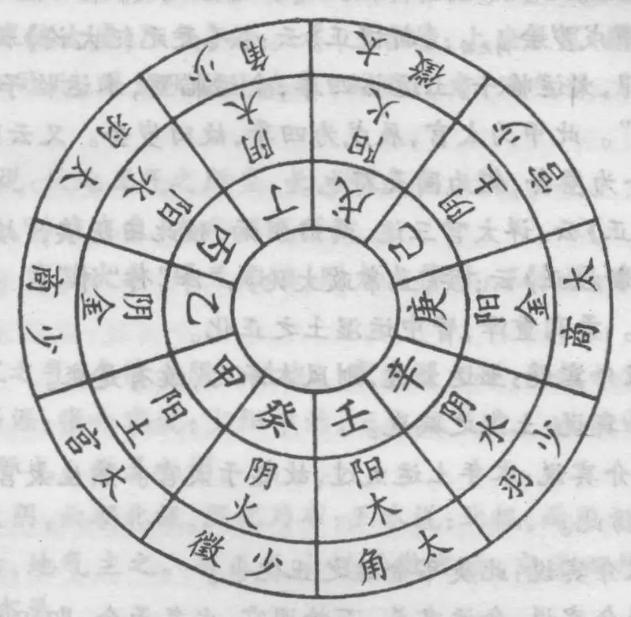
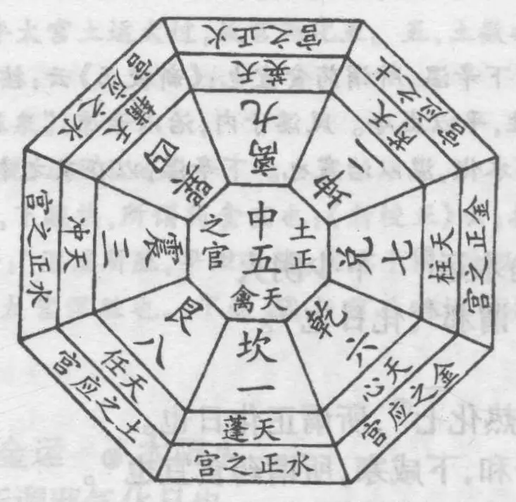
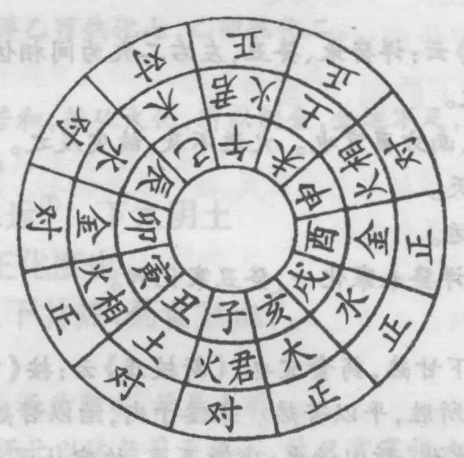
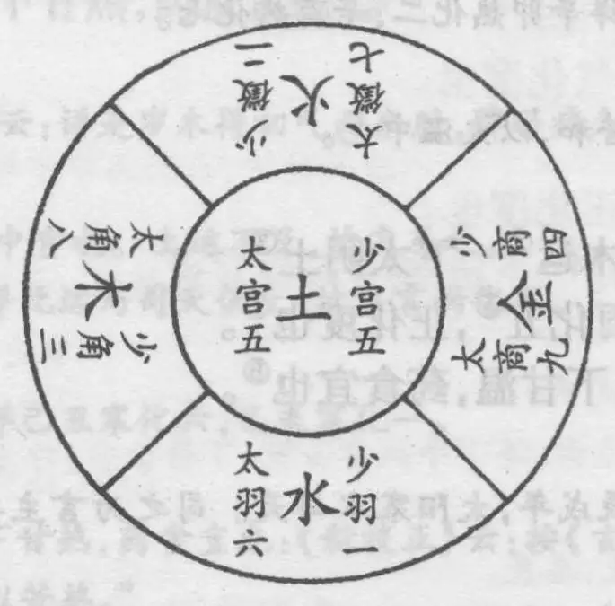

**〔卷二十一〕**

六元正纪大论第七十一

# 六元正纪大论第七十一①

①**六元正纪大论第七十一**：**伯坚按：**《甲乙经》和今存残本《黄帝内经太素》都没有收载本篇的文字。本篇和《类经》的篇目对照，列表于下：

| 素问 | 类经 |
|---|---|
| 六元正纪大论第七十一 | 卷十二——妇人重身毒之何如（论治类十三） |
|  | 卷二十四——天符岁会（运气类七·二） |
|  | 卷二十六——六十年运气病治之纪（运气类十七·一） |
|  | 卷二十六——六十年运气病治之纪（运气类十七·二） |
|  | 卷二十六——至有先后行有位次（运气类十八·一） |
|  | 卷二十六——至有先后行有位次（运气类十八·二） |
|  | 卷二十六——数有终始气有同化（运气类十九） |
|  | 卷二十六——用寒远寒用热远热（运气类二十·一） |
|  | 卷二十六——用寒远寒用热远热（运气类二十·二） |
|  | 卷二十六——六气正纪十二变（运气类二十一） |
|  | 卷二十六——上下盈虚（运气类二十二） |
|  | 卷二十六——五郁之发之治（运气类二十三·一） |
|  | 卷二十六——五郁之发之治（运气类二十三·二） |

类经将本篇第一、第二、第三、第四、第五、第六、第七，共七段和本篇第十五段混合重编，所以类经这几段的次序与《素问》的次序不同。

> 黄帝问曰：六化，六变，胜复，淫治，甘、苦、辛、咸、酸、淡①，先后，余知之矣。夫五运之化，或从五气②，或逆天气，或从天气而逆地气，或从地气而逆天气，或相得，或不相得，余未能明其事。欲通天之纪，从地之理，和其运，调其化，使上下合德，无相夺伦，天地升降不失其宜，五运宣行勿乖其政，调之正味从逆③，奈何？
>
> 〔p.982 (인쇄 965)〕岐伯稽首再拜对曰：昭乎哉问也！此天地之纲纪，变化之渊源，非圣帝孰能穷其至理欤？臣虽不敏，请陈其道，令终不灭，久而不易④。
>
> 帝曰：愿夫子推而次之，从其类序，分其部主，别其宗司，昭其气数，明其正化，可得闻乎⑤？
>
> 岐伯曰：先立其年以明其气，金、木、水、火、土运行之数，寒、暑、燥、湿、风、火临御之化，则天道可见，民气可调，阴阳卷舒，近而无惑，数之可数者，请遂言之⑥。

**【集解】**

①**甘、苦、辛、咸、酸、淡**：沈祖绵说：按甘属土，苦属火，辛属金，咸属水，酸属木，谓之五味，至于淡，无味之可言，欲以配六气，妄。

②**五气**：《新校正》云：详"五气"疑作"天气"，则与下文相协。

张介宾说："五气"当作"天气"。

③**调之正味从逆**：王冰说：气同谓之从，气异谓之逆。胜制为不相得。相生为相得。司天地之气，更淫胜复，各有主治法，则欲令平调气性，不违忤天地之气以致清静和平也。

张介宾说：五运之化，与司天在泉之气有所异同，同则为从，异则为逆，从则相得，逆则不相得也。自"通天之纪"至"勿乖其政"，则必察上中下三气之化，而调和于逆从之间，即下文"折其郁气，资其化源，抑其运气，扶其不胜，无使过暴而生其疾"等义也。"调之正味从逆"，即下文"食岁谷以全其真"，及"用寒远寒，用热远热"等义也。

④**此天地之纲纪，变化之渊源，非圣帝孰能穷其至理欤？臣虽不敏，请陈其道，令终不灭，久而不易**：王冰说：气主循环，同于天地，太过不及，气序当然，不言永定之制，则久而更易，去圣辽远，何以明之。

张介宾说：天地万物，皆不能外乎六元之化。是六元者，即天地之纲纪，变化之渊源也。

⑤**分其部主，别其宗司，昭其气数，明其正化，可得闻乎**：王冰说：部主，谓分六气所部主者也。宗司，谓配五气运行之位也。气数，谓天地五运气更用之正数也。正化，谓岁直气味所宜酸、苦、甘、辛、咸、寒、温、冷、热也。

张介宾说：类序者，类分六元，序其先后，如太阳之类皆属辰、戌者是也。部主者，凡天地左右，主气静，客气动，各有分部以主岁时，如六气五音次有不同者是也。宗司者，统者为宗，分者为司也。气数者，五行之化各有其气，亦各有其数也。正化者，当其位者为正，非其位者为邪也。

⑥先立其年以明其气，金、木、水、火、土运行之数，寒、暑、燥、湿、风、火临御之化，则天道可见，民气可调，阴阳卷舒，近而无惑，数之可数者，请遂言之：王冰说：遂，尽也。

张介宾说：先立其年，如甲子、乙丑之类是也。年辰立则岁气可明矣。

> 帝曰：太阳之政奈何？
>
> 岐伯曰：辰、戌之纪也。
>
> 太阳　太角　太阴　壬辰　壬戌　其运风，其化鸣紊启拆①，其变振拉摧拔②，其病眩掉目瞑③。
>
> 太角初正　少徵　太宫　少商　太羽终④
>
> 〔p.983 (인쇄 966)〕太阳　太徵　太阴　戊辰　戊戌　同正徵⑤。其运热，其化暄暑郁燠⑥，其变炎烈沸腾⑦，其病热郁⑧。
>
> 太徵　少宫　太商　少羽终　少角初⑨
>
> 太阳　太宫　太阴　甲辰岁会同天符　甲戌岁会同天符⑩　其运阴埃⑪，其化柔润重泽⑫，其变震惊飘骤⑬，其病湿下重⑭。
>
> 太宫　少商　太羽终　太角初　少徵⑮
>
> 太阳　太商　太阴　庚辰　庚戌　其运凉，其化雾露萧飋⑯，其变肃杀凋零⑰，其病燥背瞀胸满⑱。
>
> 太商　少羽终　少角初　太徵　少宫
>
> 太阳　太羽⑲　太阴　丙辰天符　丙戌天符⑳　其运寒㉑，其化凝惨凛冽㉒，其变冰雪霜雹㉓，其病大寒留于溪谷㉔。
>
> 太羽终　太角初　少徵　太宫　少商

**【集解】**

①**其化鸣紊启拆**：《新校正》云：按《五常政大论》云："其德鸣靡启拆"。

张介宾说：风为木化。鸣，风木声也。紊，繁盛也。启拆，萌芽发而地脉开也。此单言壬年风运之正化。后仿此。

②**其变振拉摧拔**：《新校正》云：详此其运、其化、其变，从太角等运起。

张介宾说：振，撼动也。拉，支离也。摧，败折也。拔，发根也。壬为阳木，风运太过，则金令承之，故有此变。

③**其病眩掉目瞑**：《新校正》云：详此病证，以运加司天地为言。

张介宾说：目运曰眩。头摇曰掉。目不开曰瞑。木运太过故有此风木之病。

④太角初正　少徵　太宫　少商　太羽终：张介宾说：此本年主客五运之序，皆以次相生者也。每年四季主运，在春属木，必始于角而终于羽，故于角下注初字，羽下注终字，此所以纪主运也。客运则随年干之化，如壬年阳木起太角，丁年阴木起少角，戊年阳火起太徵，癸年阴火起少徵，各年不同，循序主令，所以纪客运也。然惟丁壬木运之年，主客皆起于角，故于角音之下，复注正字，谓气得四时之正也。详具《图翼》二卷《主客运图》及《五音建运图解》中。后仿此。

张介宾《类经·图翼》卷二《五音建运图解》：《运气全书》云："五音者，五行之声音也。土曰宫，金曰商，水曰羽，木曰角，火曰徵。"《晋书》曰："角者触也，象诸阳气触动而生也，其化丁壬。徵者止也，言物盛则止也，其化戊癸。商者强也，言金坚强也，其化乙庚。羽者舒也，言阳气将复，万物将舒也，其化丙辛。宫者中也，得中和之道，无往不畜，又总堂室奥阼谓之宫，所围不一，盖以土气贯于四行，王于四季，荣于四藏，而总之之谓也，其化甲己。"故天干起于甲土，土生金，故乙次之。金生水，故丙次之。水生木，故丁次之。木生火，故戊次之。火又生土，故己又次之。循序以终于癸而复于甲也。十干以甲、丙、戊、庚、壬为阳，乙、丁、己、辛、癸为阴。在阳则属太，在阴则属少。太者为有余，少者为不及。阴阳相配，太少相生，如环无端，共成气化。但气有太少，则至有迟速。故《六元正纪大论》曰："常以正月朔日平旦视之，运有余，其至先；运不及，其至后；非有余非不足，是谓平岁，其至当其时也。"《六微旨大论》曰："至而至者和。至而不至，来气不及也。未至而至，来气有余也。又如太过被抑，不及得助，皆为平气，所谓候之所始，道之所生，不可不通也。"

〔p.984 (인쇄 967)〕

**五音建运太少相生图**

**伯坚按：**《主客运图》，见《素问》第六十七《五运行大论》第四段"寡于畏也"句下集解。

⑤**同正徵**：《新校正》云：按《五常政大论》云："赫曦之纪，上羽与正徵同。"

张介宾说：本年火运大过，得司天寒水制之，则火得其平，故云同正徵，所谓赫曦之纪，上羽与正徵同者此也。后仿此。

⑥**其化暄暑郁燠**：《新校正》云：按《五常政大论》，"燠"作"蒸"。

张介宾说：此戊年火运之正化也。

⑦**其变炎烈沸腾**：张介宾说：沸腾者，水气之薰蒸也。戊为火运火过，则寒水承之，故有此变。

⑧**其病热郁**：张介宾说：火运大过，故有是病。

⑨太徵　少宫　太商　少羽终　少角初：张介宾说：初终者，纪主运也。戊为阳火，故起于太徵，纪客运也。详义见《图翼》二卷五音《太少相生》及《主运客运图说》中。后仿此。

张介宾《类经·图翼》卷二《五音五运太少相生解》：运气有三，曰大运，主运，客运，皆有五音之属。大运者，中运也，主一岁之气，如甲己之年土运统之之类也。主运者，四时之常令也，如春木属角，夏火属徵，秋金属商，冬水属羽，土寄四季属宫，岁岁相仍者是也。客运者，十年一周，如甲年阳土则本宫起初运，乙年阴金则少商起初运，五运不同，迭相用事者是也。然三运之中，俱有太少相生之异。盖太者属阳，少者属阴，阴以生阳，阳以生阴一动一静，乃成《易》道。故甲以阳土，生乙之少商；乙以阴金，生丙之太羽；丙以阳水，生丁之少角；丁以阴木，生戊之太徵；戊以阳火，生己之少宫；己以阴土，生庚之太商；庚以阳金，生辛之少羽；辛以阴木，生壬之太角；壬以阳木，生癸之少徵；癸以阴火，复生甲之太宫。大运不离于阴阳，主客不离于大运。主运之气，每岁相同，故春必始于角而冬则终于羽。客运之气，各以本年中运为初运，而以次相生也。故《六元正纪大论》列各年运气，如太阳少阳太阴之政，子午寅申辰戌之纪，三十年运皆起于五太，太阴阳明厥阴之政，丑未卯酉巳亥之纪，三十年运皆起于五少者，所以纪客运也。又如角下注一初字，羽下注一终字，凡甲乙丙壬癸五年皆以太角为初，戊己庚辛丁五年皆以少角为初者，所以纪主运也。

〔p.985 (인쇄 968)〕

**伯坚按：**主运客运图说，见《素问》第六十七《五运行大论》第四段"寡于畏也"句下集解。

⑩甲辰岁会同天符　甲戌岁会同天符：《新校正》云：按《天元纪大论》云："承岁为岁直。"又《六微旨大论》云："木运临卯，火运临午，土运临四季，金运临酉，水运临子，所谓岁会，气之平也。"王冰云："岁直亦曰岁会"。此甲为太宫，辰戌为四季，故曰岁会。又云同天符者，按本论下文云太过而加天符，是此岁一为岁会，又为同天符也。

⑪**其运阴埃**：《新校正》云：详太宫三运，两曰阴雨，独此曰阴埃，"埃"疑作"雨"。

⑫**其化柔润重泽**：《新校正》云：按《五常政大论》，"泽"作"淖"。

张介宾说：埃，尘也。柔润重泽，皆中运湿土之正化。

⑬**其变震惊飘骤**：张介宾说：土运太过，则风木承之，故有是变。

⑭**其病湿下重**：张介宾说：土湿之病也。

⑮太角初　少徵：张介宾说：本年土运太过，故起于太宫。然生太宫者少徵，生少徵者太角，故土运以太角为初。余仿此。

⑯**其化雾露萧飋**：张介宾说：此庚年金运之正化也。

⑰**其变肃杀凋零**：张介宾说：金运肃杀，万物凋零，火气承金，即阳杀之象。

⑱**其病燥背瞀胸满**：张介宾说：金气太过，故病燥。肺金受病，故背闷瞀而胸胀满。

⑲**太羽**：《新校正》云：按《五常政大论》云："上羽而长气不化。"

⑳**丙戌天符**：《新校正》云：按《天元纪大论》云："应天为天符。"又《六微旨大论》云："土运之岁上见太阴，火运之岁上见太阳、少阴，金运之岁上见阳明，木运之岁上见厥阴，水运之岁上见太阳，曰天与之会，故曰天符。"又本论下文云："五运行同天化者，命曰天符。"又云："临者太过不及皆曰天符。"

㉑**其运寒**：《新校正》云：详太羽三运，此为上羽，少阳、少阴司天为太徵，（顾观光说："太"当作"上"。）而少阳司天运言寒肃，此与少阴司天运言其运寒者，疑此太阳司天运合太羽当言其运寒肃，少阳、少阴司天运当云其运寒也。

㉒**其化凝惨凛冽**：《新校正》云：按《五常政大论》作"凝惨寒雰。"

张介宾说：此丙年水运之正化也。

㉓**其变冰雪霜雹**：张介宾说：水太过者，土气承之，故有此变。冰雹者，土之象也。

㉔**其病大寒留于溪谷**：张介宾说：溪谷者，筋骨肢节之会，水运太过，寒甚气凝，故为是病。

> 凡此太阳司天之政，气化运行先天①。天气肃，地气静，寒临太虚，阳气不令。水、土合德，上应辰星、镇星②。其谷玄、黅③。其政肃。其令徐。寒政大举，泽无阳焰，则火发待时④。少阳中治，时雨乃涯⑤。止极雨散，还于太阴，云朝北极，湿化乃布⑥。泽流万物，寒敷于上，雷动于下⑦。寒湿之气，持于气交⑧。民病寒湿，发肌肉萎，足痿不收，濡泻、血溢⑨。

**【集解】**

①**凡此太阳司天之政，气化运行先天**：王冰说：六步之气，生、长、化、成、收、藏，皆先天时而应至也。余岁先天同之也。

张介宾说：此下总结辰戌年太阳司天六气之化也。凡子、寅、辰、午、申、戌六阳年皆为太过，丑、亥、酉、未、已、卯六阴年皆为不及。太过之气常先天时而至，故其生长化收藏气化运行皆早。不及之气常后天时而至，故其气化运行皆迟。如《气交变大论》曰："太过者先天。不及者后天。"本篇后文曰："运太过则其至先。运不及则其至后。"皆此义也。后仿此。

〔p.986 (인쇄 969)〕

②**天气肃，地气静，寒临太虚，阳气不令。水、土合德，上应辰星、镇星**：王冰说：明而大也。

张介宾说：太阳寒水司天，则太阴湿土在泉，故天气肃，地气静，水土合德，而二星当先后明也。

③**其谷玄、黅**：王冰说：天地正气之所生、长、化、成也。黅，黄也。

张介宾说：玄应司天，黅应在泉，本年正气所化。

④**其政肃。其令徐。寒政大举，泽无阳焰，则火发待时**：王冰说：寒甚则火郁，待四气乃发，暴为炎热也。

张介宾说：政肃者寒之气，令徐者阴之性也。寒盛则火郁，郁极必发，待王时而至也。

⑤**少阳中治，时雨乃涯**：张介宾说：少阳中治，三之主气也。以相火王时，而寒水之客胜其主，故时雨乃涯。涯，水际也。雨至之谓。

⑥**止极雨散，还于太阴，云朝北极，湿化乃布**：王冰说：北极，雨府也。

张介宾说：岁半之后，地气主之。自三气止极雨散之后，交于四气，则在泉用事而太阴居之，故又云朝北极，湿化布焉。

⑦**泽流万物，寒敷于上，雷动于下**：张介宾说：泽流万物，土之德也。雷动于下，火郁发也。

⑧**寒湿之气，持于气交**：王冰说：岁气之大体也。

张介宾说：上寒下湿，相持于气交之中也。

⑨**血溢**：《新校正》云：详血溢者，火发待时所为之病也。

张介宾说：血溢者火郁之病。他皆寒湿使然。

> 初之气，地气迁，气乃大温①，草乃早荣②。民乃厉，温病乃作，身热，头痛，呕吐，肌腠疮疡③。
>
> 二之气，大凉反至，民乃惨，草乃遇寒，火气遂抑④。民病气郁，中满，寒乃始⑤。
>
> 三之气，天政布，寒气行，雨乃降⑥。民病寒，反热中，痈疽，注下，心热瞀闷，不治者死⑦。
>
> 四之气，风湿交争，风化为雨，乃长，乃化，乃成⑧。民病大热，少气，肌肉萎，足痿，注下赤白⑨。
>
> 五之气，阳复化，草乃长，乃化，乃成。民乃舒⑩。
>
> 终之气，地气正，湿令行，阴凝太虚，埃昏郊野，民乃惨凄。寒风以至，反者孕乃死⑪。

**【集解】**

①**气乃大温**：王冰说：畏火致之。

②**草乃早荣**：张介宾说：本年初之气少阳用事，上年在泉之气至此迁易，故曰地气迁。后仿此。然上年终气君火也，今之初气相火也，二火之交，故气乃大温，草乃早荣。

③**肌腠疮疡**：王冰说：赤斑也。是为肤腠中，疮在皮内也。

张介宾说：客气相火，主气风木，风火相搏，故为此诸病。肌腠疮疡，班疹之属也。

④**火气遂抑**：张介宾说：燥金用事，故大凉至而火气抑。

⑤**寒乃始**：王冰说：因凉而反之于寒气，故寒气始来近人也。

〔p.987 (인쇄 970)〕

张介宾说：清寒滞于中，阳气不行也。

⑥**三之气，天政布，寒气行，雨乃降**：张介宾说：三之气，即司天也。太阳寒水用事，故寒气行，雨乃降。

⑦**民病寒，反热中，痈疽，注下，心热瞀闷，不治者死**：王冰说：当寒反热，是反天常。热起于心，则神之危亟，不急扶救，神必消亡。故治者则生，不治则死。

张介宾说：民病寒，反为热中等证，即人伤于寒而为病热之理，亦《五常政大论》所谓"太阳司天，寒气下临，心气上从"之义。盖寒水侮阳，则火无不应。若不治之，则阳绝而死矣。按六气司天，皆无不治者死之说，而惟此太阳寒水言之，可见人以阳气为生之本，有不可不顾也。

⑧**四之气，风湿交争，风化为雨，乃长，乃化，乃成**：张介宾说：厥阴客气用事，而加于太阴主气，故风湿交争而风化为雨，木得土化，故乃长、乃化、乃成也。

⑨**民病大热，少气，肌肉痿，足痿，注下赤白**：张介宾说：厥阴木气，值大暑之时，木能生火，故民病大热。以客胜主，脾土受伤，故为少气、肉萎等证。

⑩**五之气，阳复化，草乃长，乃化，乃成。民乃舒**：王冰说：大火临御，故万物舒荣。

张介宾说：五之气，少阴君火用事。岁半之后，地气主之，以太阴在泉而得君火之化，故万物能长能成，民亦舒而无病。

⑪**终之气，地气正，湿令行，阴凝太虚，埃昏郊野，民乃惨凄。寒风以至，反者孕乃死**：张介宾说：太阴湿土在泉，地气正也。故湿令行，阴凝太虚，埃昏郊野。民情喜阳恶阴，故惨凄。以湿令而寒风至，风能胜湿，故曰反。反者孕乃死，所以然者，人为倮虫，从土化也，风木非时相加，故土化者当不育也。

> 故岁宜苦以燥之、温之①。必折其郁气，先资其化源②。抑其运气，扶其不胜③。无使暴过而生其疾④。食岁谷以全其真。避虚邪以安其正⑤。适气同异，多少制之。同寒湿者燥热化，异寒湿者燥湿化⑥。故同者多之，异者少之⑦。用寒远寒，用凉远凉，用温远温，用热远热。食宜同法⑧。有假者反常。反是者病，所谓时也⑨。

**【集解】**

①**故岁宜苦以燥之、温之**：《新校正》云：详"故岁宜苦以燥之温之"九字，当在"避虚邪以安其正"下，错简在此。

张介宾说：以上十年，皆寒水司天，湿土在泉，湿宜燥之，寒宜温之。味必苦者，苦从火化，治寒以热也。

②**必折其郁气，先资其化源**：王冰说：化源，谓九月，迎而取之，以补心火。

《新校正》云：详水将胜也，先于九月迎取其化源，先泻肾之源也。盖以水王十月，故先于九月迎而取之。泻水，所以补火也。

张介宾说：折其郁气，泻有余也。资其化源，补不足也。如上文寒水司天则火气郁，湿土在泉则水气郁，故必折去其致郁之气，则郁者舒矣。又如补遗《本病篇》曰："辰戌之岁，木气升之，主逢天柱，胜而不前。少阳降地，主窒地玄，胜之不入。"故《刺法论》云："木欲升而天柱窒抑之，当刺足厥阴之井，火欲降而地玄窒抑之，当刺足少阴之所出，足太阳之所入"等义，皆所以折其郁气也。化源者，化生之源，如本年火失其养则当资木，金失其养则当资土，皆自其母气资养之，则被刺者可以无伤，亦化源之谓。按《新校正》云："详水将胜也，先于九月迎取其化源，先泻肾之源也。盖以水王十月，故先于九月迎而取之，泻水所以补火也。"此亦一义。但资取之辨，似于太过之气当曰取，不及之气当曰资。然本篇六气司天，如太阳、阳明、厥阴俱言资其化源，少阳、太阴、少阴俱言先取化源，其或言资或言取者，盖资中非不言取，取中非不言资，皆互文耳。但总不外乎化源者，即必求其本之义。

〔p.988 (인쇄 971)〕

③**扶其不胜**：王冰说：太角岁，脾不胜；太徵岁，肺不胜；太宫岁，肾不胜；太商岁，肝不胜；太羽岁，心不胜；岁之宜也如此。然太阳司天五岁之气，通宜先助心，后扶肾气。

④**无使暴过而生其疾**：张介宾说：运，言五运。气，言六气。如太角岁脾不胜，太徵岁肺不胜，太宫岁肾不胜，太商岁肝不胜，太羽岁心不胜，此五运也。六气者，如上文十年寒水司天则心火不胜，太阴在泉则肾水不胜。诸太过者抑之，不胜者扶之，则气无暴过，而疾不生矣。后仿此。

⑤**食岁谷以全其真。避虚邪以安其正**：王冰说：木过则脾病生，火过则肺病生，土过则肾病生，金过则肝病生，水过则心病生，天地之气过亦然也。岁谷，谓黄色黑色谷也。虚邪，谓从冲后来之风也。

张介宾说：岁谷，即上文玄黅谷也。其得岁气最厚，故能全真。虚邪者，从其冲后来为虚风，伤人者也。

⑥**适气同异，多少制之。同寒湿者燥热化，异寒湿者燥湿化**：王冰说：太宫、太商、太羽岁同寒湿，宜治以燥热化。太角、太徵岁异寒湿，宜治以燥湿化。

张介宾说：适，酌所宜也。气，司天在泉之气也。同异，运与气会有异同也。多少制之，因其同异之多少而为制以治之也。如太宫、太商、太羽，岁运同寒湿者，则当用燥热所化之物，盖燥以治湿，热以治寒也。若太徵、太角，岁运异寒湿者，则或从气之寒湿而用燥热之化，或从运之风热而用寒湿之化，当各因其同异多少以制之也。

⑦**故同者多之，异者少之**：王冰说：多谓燥热，少谓燥湿，气用多少，随其岁也。

张介宾说：气运同者其气甚，非多不足以制之。异者其气微，当少用以调之耳。

⑧**用寒远寒，用凉远凉，用温远温，用热远热。食宜同法**：张介宾说：远，避也。言用寒药者当远岁气之寒，用凉药者当远岁气之凉，温热者亦然。凡饮食居处之宜，皆所同法，而岁气当察也。

⑨**有假者反常。反是者病，所谓时也**：王冰说：时，谓春夏秋冬及间气所在，同则远之。即虽其时，若六气临御，假寒热温凉以除疾病者，则勿远之。如太阳司天寒为病者，假热以疗，则热用不远夏。余气例同。故曰有假反常也。食同药法尔。若无假反法，则为病之媒，非方制养生之道。

《新校正》云：按用寒远寒及有假者反常等事，下文备矣。

张介宾说：假者反常，谓气有假借而反乎常也。如夏当热而反寒，冬当寒而反热，春秋亦然。反者病，以其违于时也。按后文曰："假者何如，所谓主气不足客气胜也"，即此之谓。

> 帝曰：善。阳明之政奈何？
>
> 岐伯曰：卯、酉之纪也。
>
> 阳明　少角　少阴　清热胜复同，同正商①。丁卯岁会　丁酉　其运风清热②。
>
> 少角初正　太徵　少宫　太商　少羽终
>
> 阳明　少徵　少阴　寒雨胜复同，同正商③。癸卯同岁会　癸酉同岁会④　其运
>
> 〔p.989 (인쇄 972)〕热寒雨⑤。
>
> 少徵　太宫　少商　太羽终　太角初
>
> 阳明　少宫　少阴　风凉胜复同。己卯　己酉　其运雨风凉⑥。
>
> 少宫　太商　少羽终　少角初　太徵
>
> 阳明　少商　少阴　热寒胜复同，同正商⑦。乙卯天符　乙酉岁会太一天符⑧。其运凉热寒⑨。
>
> 少商　太羽终　太角初　少徵　太宫
>
> 阳明　少羽　少阴　雨风胜复同⑩，辛卯　少宫同⑪。辛酉　辛卯⑫　其运寒雨风⑬。
>
> 少羽终　少角初　太徵　少宫　太商

**【集解】**

①**清热胜复同，同正商**：王冰说：清胜少角，热复清气，故曰清热胜复同也。余少运皆同也。同正商者，上见阳明，上商与正商同，言岁木不及也。余准此。

《新校正》云：按《五常政大论》云："委和之纪，上商与正商同。"

张介宾说：丁年岁木不及，而司天燥金胜之，则金兼水化，反得其政，所谓委和之纪上商与正商同也。

②**其运风清热**：王冰说：不及之运，常兼胜复之气言之。风，运气也。清，胜气也。热，复气也。余少运悉同。

张介宾说：风为中运少角之气。清为胜风之气。热为复清之气。余少运胜复皆同。后仿此。

③**同正商**：《新校正》云：按伏明之纪，上商与正商同。

张介宾说：癸年火运不及，上见燥金，则金得其政，所谓伏明之纪上商与正商同也。

④**同岁会**：《新校正》云：按本论下文云："不及而加同岁会"。此运少徵为不及，下加少阴，故云同岁会。

⑤**其运热寒雨**：张介宾说：热，少徵运也。寒，胜气也。雨，复气也。

⑥**其运雨风凉**：张介宾说：雨，少宫之气。风，胜气也。凉，复气也。

⑦**同正商**：《新校正》云：按《五常政大论》云："从革之纪上商与正商同。"

张介宾说：乙年金运不足，得阳明司天之助，所谓从革之纪上商与正商同也。

⑧**乙酉岁会太一天符**：《新校正》云：按《天元正纪大论》云："三合为治。"又《六微旨大论》云："天符岁会，曰太一天符。"王冰云："是谓三合，一者天会，二者岁会，三者运会。"或云："此岁三合曰太一天符，不当更曰岁会者，甚不然也。乙酉本为岁会，又为太一天符，岁会之名不可去也。"或云："己丑、己未、戊午，何以不连言岁会而单言太一天符"？曰："举一隅不以三隅反，举一则三可知，去之则是太一天符不为岁会也，故曰不可去也。"

⑨**其运凉热寒**：张介宾说：凉为少商之气。热为胜气。寒为复气。

⑩**雨风胜复同**：顾观光说：此下当有"同少宫"三字。

⑪**辛卯　少宫同**：《新校正》云：按《五常政大论》云："五运不及，除同正角、正商、正宫外，癸丑、癸未，当云少徵与少羽同；己卯、己酉，少宫与少角同；乙丑、乙未，少商与少徵同；辛卯、辛酉、辛已、辛亥，少羽与少宫同；合有十年。今此论独于此言少宫同者，盖以癸丑、癸未，丑未为土，故不更同少羽；己卯、己酉，为金，故不更同少角；辛已、辛亥为木，故不更同少宫；乙丑、乙未下见太阳为水，故不更同少徵；又除此八年外，只有辛卯、辛酉二年为少羽同少宫也。

〔p.990 (인쇄 973)〕

张介宾说：辛为水运不及，土得乘之，故与少宫也。按五运不及之岁，凡三十年，内除丁巳、丁亥、己巳、己亥、乙巳、乙亥同正角，丁卯、丁酉、癸卯、癸酉、乙卯、乙酉同正商，丁丑、丁未、己丑、己未、辛丑、辛未同正宫外，尚余不及者十二年。内癸已、癸亥、癸丑、癸未四年，火不及也，当云少徵与少羽同。但巳、亥二年，少阳在泉，同岁会也，火气有助，故不言同少羽。丑、未二年，湿土在上，土能制水，故亦不言同少羽。己卯、己酉二年，土不及也，当云少宫与少角同。但卯酉燥金在上，金能制木，故不言同少角。乙丑、乙未二年，金不及也，当云少商与少徵同。但丑、未寒水在泉，水能制火，故不言同少徵。辛巳、辛亥、辛卯、辛酉四年，水不及也，当云少羽与少宫同。但巳、亥二年，风木司天，木能制土，故不言同少宫。凡此十二年中，除去以上十年，只有辛卯辛酉二年为少羽同少宫也，故于此独言之。然但言少宫而不言正宫者，盖非有司天当令，则气不甚王也。本节止言辛卯，不言辛酉，或其传久之误耳。

顾观光说："少宫同"此三字衍。

⑫**辛卯**：顾观光说："辛卯"此二字衍。

⑬**其运寒雨风**：张介宾说：寒，运气。雨，胜气。风，复气。

> 凡此阳明司天之政，气化运行后天①。天气急，地气明②，阳专其令，炎暑大行，物燥以坚，淳风乃治，风燥横逆，流于气交③。多阳少阴，云趋雨府，湿化乃敷④，燥极而泽⑤。其谷白、丹⑥。间谷命太者⑦。其耗白甲品羽⑧。金、火合德，上应太白、荧惑⑨。其政切，其令暴⑩。蛰虫乃见，流水不冰⑪。民病咳，嗌塞，寒热，发暴振溧，癃闷⑫。清先而劲，毛虫乃死⑬。热后而暴，介虫乃殃⑭。其发躁，胜复之作，扰而大乱⑮。清热之气，持于气交⑯。

**【集解】**

①**凡此阳明司天之政，气化运行后天**：王冰说：六步之气，生长化成庶务动静，皆后天时而应。余少岁同。

张介宾说：此总结卯、酉年阳明司天六气之化也。凡此卯、酉十年，岁气不足，故气化运行后天。详义见前太阳之政。

②**天气急，地气明**：张介宾说：燥金司天，故急。君火在泉，故明。

③**阳专其令，炎暑大行，物燥以坚，淳风乃治，风燥横逆，流于气交**：张介宾说：凡阳明司天之年，金气不足，火必乘之，故阳专其令，炎暑大行。木亦无畏，故淳风乃治。金木之气并行，则风燥行于岁运，流于气交之际也。

④**云趋雨府，湿化乃敷**：王冰说：雨府，太阴之所在也。

⑤**燥极而泽**：王冰说：燥气欲终则化为雨泽，是谓三气之分也。

张介宾说：多阳少阴，火气胜也。云趋雨府，湿化乃敷，燥气盛极，化为雨泽，皆火土合气于气交也。雨府，谓土厚湿聚之处。

⑥**其谷白、丹**：王冰说：天地正气所化生也。

张介宾说：白应司天，丹应在泉，正气所化，即岁谷也。

⑦**间谷命太者**：王冰说：命太者，谓前文太角商等气之化者。间气化生，故云间谷也。

《新校正》云：按《玄珠》云："岁谷与间谷者何？即在泉为岁谷，及在泉之左右间者皆为岁谷。其司天及运间而化者，名间谷。又别有一名间谷者，是地化不及即反所胜而生者故名间谷，即邪气之化又名并化之谷也，亦名间谷。”与王注颇异。

〔p.991 (인쇄 974)〕

张介宾说：间谷，间气所化之谷也。命，天赋也。太，气之有余也。除正化岁谷之外，则左右四间之化皆为间谷。但太者得间气之厚，故其所化独盛，是为间谷。少者得气之薄，则无所成矣。按太少间谷之义，其说有二。凡司天属太者，在泉必为少。司天属少者，在泉必为太。如卯、酉年，阳明司天，少在上也；少阴在泉，太在下也。命其太者，则当以在泉之间气命其谷也。左为太阴其色黄，右为厥阴其色苍，是苍黄二色者为本年之间谷，此以上下言也。后凡巳、亥、丑、未年，皆察在泉左右之气以求间谷，其义仿此。然本篇凡不及之岁则言间谷，而太过之岁则无，似又以胜制之气为间谷也。如卯、酉年金气不及，则火胜木强，其谷丹苍也。巳、亥年，木气不及，则金胜土强，其谷白黄也。丑、未年土气不及，则木胜水强，其谷苍黑也。亦皆命太之义。故凡君火相火寒水司天之年，正化有余，则别无命太之间谷矣。此以岁气言也。总之，岁候不齐，凡在气之有余者便是太，则所受必盛，而五谷之成所以有厚薄之分也。惟不以本年正化所出，故皆可谓之间谷，但当因气求之则善矣。后仿此。

⑧**其耗白甲品羽**：王冰说：白色甲虫多品羽类有羽翼者，耗散粢盛，虫鸟甲兵岁为灾以耗竭物类。

张介宾说：耗，伤也。白与甲，金所化也。品羽，火虫品类也。本年卯酉，金气不及而火胜之，则白甲当耗；火胜而水复，则羽虫亦耗；或此义也。然又惟厥阴司天亦曰其耗文角品羽，余者皆无，未详其义。

⑨**金、火合德，上应太白、荧惑**：王冰说：见大而明。

张介宾说：上金下火，故云合德，而二星当明。

⑩**其政切，其令暴**：张介宾说：金火之气也。

⑪**蛰虫乃见，流水不冰**：张介宾说：君火在泉也。

⑫**民病咳，嗌塞，寒热，发暴振凓，癃闷**：张介宾说：皆金火燥热之病。

⑬**清先而劲，毛虫乃死**：张介宾说：司天金气在先，木受其克，故毛虫死。

⑭**热后而暴，介虫乃殃**：张介宾说：在泉火气居后，金受其制，故介虫殃。

⑮**其发躁，胜复之作，扰而大乱**：王冰说：金先胜，木已承害，故毛虫死。火后胜，金不胜，故介虫复殃。胜而行杀，弱者已亡。复者后来，强者又死。非大乱气其何谓也？

⑯**持于气交**：张介宾说：天气地气，金火相持，故胜复互作，阴阳扰乱也。气交者，三四气之际。

> 初之气，地气迁，阴始凝，气始肃，水乃冰，寒雨化①。其病中热，胀，面目浮肿，善眠，鼽，衄，嚏，欠，呕，小便黄赤，甚则淋②。
>
> 二之气，阳乃布，民乃舒，物乃生荣③。厉大至，民善暴死④。
>
> 三之气，天政布，凉乃行，燥热交合，燥极而泽⑤。民病寒热⑥。
>
> 四之气，寒雨降⑦。病暴仆，振栗，谵妄，少气，嗌干，引饮，及为心痛，痈肿，疮疡，疟寒之疾，骨痿，血便⑧。
>
> 五之气，春令反行，草乃生荣⑨。民气和。
>
> 终之气，阳气布，候反温，蛰虫来见，流水不冰⑩。民乃康平。其病温⑪。

**【集解】** ①初之气，地气迁，阴始凝，气始肃，水乃冰，寒雨化：张介宾说：初气太阴用事，时寒气湿，故阴凝。燥金司天，故气肃。水冰者，气肃所成。寒雨者，湿土所化。

〔p.992 (인쇄 975)〕

②**其病中热，胀，面目浮肿，善眠，鼽，衄，嚏，欠，呕，小便黄赤，甚则淋**：王冰说：太阴之化。

《新校正》云：详气肃水冰，疑非太阴之化。

张介宾说：主气风，客气湿。风为阳，湿为阴。风湿为患，脾肾受伤，故为此诸病。

③**二之气，阳乃布，民乃舒，物乃生荣**：张介宾说：相火用事于春分之后，故其气应如此。

④**厉大至，民善暴死**：王冰说：臣位君故尔。

张介宾说：主君火，客相火，二火交炽，臣位于君，故疫厉大至，民善暴死。

⑤**三之气，天政布，凉乃行，燥热交合，燥极而泽**：张介宾说：天政布，司天燥金用事也。故凉乃行。然主气相火当令，故燥热交合。至三气之末以交四气，则主太阴，客太阳，故燥极而泽矣。

⑥**民病寒热**：王冰说：寒热，疟也。

张介宾说：以阳盛之时，行金凉之气，故民病寒热也。

⑦**四之气，寒雨降**：张介宾说：太阳用事于湿土王时，故寒雨降也。

⑧**病暴仆，振栗，谵妄，少气，嗌干，引饮，及为心痛，痈肿，疮疡，疟寒之疾，骨痿，血便**：王冰说：骨痿无力。

张介宾说：四气之后，在泉君火所主，而太阳寒水临之，水火相犯，故为暴仆振栗及心痛等病，皆心肾二经也。

⑨**五之气，春令反行，草乃生荣**：张介宾说：厥阴风木用事，而得在泉君火之温，故春令反行，草乃生荣。

⑩**终之气，阳气布，候反温，蛰虫来见，流水不冰**：张介宾说：少阴君火用事，故其气候如此。

⑪**其病温**：王冰说：君之化也。

张介宾说：其病为温，火之化也。

> 故食岁谷以安其气。食间谷以去其邪①。岁宜以咸、以苦、以辛，汗之、清之、散之②。安其运气，无使受邪；折其郁气，资其化源③。以寒热轻重，少多其制④。同热者多天化，同清者多地化⑤。用凉远凉，用热远热，用寒远寒，用温远温。食宜同法。有假者反之，此其道也⑥。反是者，乱天地之经，扰阴阳之纪也⑦。

**【集解】**

①**故食岁谷以安其气。食间谷以去其邪**：张介宾说：岁谷，正气所化，故可安其气。间谷，间气所生，故可以去邪。去邪者，有补偏救弊之义，谓实者可用以泻，虚者可用以补。

②**岁宜以咸、以苦、以辛，汗之、清之、散之**：张介宾说：咸从水化，在泉之君火也。苦从火化，治司天之燥金也。以辛者，辛从金化，本年火盛金衰，同司天之气以求其平也。然燥金司天，则岁半之前，气过于敛，故宜汗之散之。君火在泉，则岁半之后，气过于热，故宜清之也。

③**资其化源**：王冰说：化源，谓六月，迎而取之也。

《新校正》云：按金王七月，故逆于六月泻金气。

张介宾说：安者，顺其运气而安之也。本年燥金司天则木郁，君火在泉则金郁，详义见前。又如补遗《本病篇》曰：“卯、酉之年，太阳升天，主窒天内，胜之不前。太阴降地，主窒地苍，胜之不入。”故《刺法论》于水欲升而天内窒抑之，当刺足少阴之合。土欲降而地苍窒抑之，当刺足厥阴之所出，足少阳之所入。”王氏注曰：“化源，谓六月迎而取之也。”《新校正》云：“按金王七月，故迎于六月，泻金气。”是皆折其郁气，资取化源之义。

〔p.993 (인쇄 976)〕

④**以寒热轻重，少多其制**：张介宾说：本年上清下热，其气不同，故寒多者当多其热以温之，热多者当多其寒以清之。

⑤**同热者多天化，同清者多地化**：王冰说：少角、少徵岁同热，用方多以天清之化治之。少宫、少商、少羽岁同清，用方多以地热之化治之。火在地，故同清者多地化。金在天，故同热者多天化。

张介宾说：同者，言上文十年，运与天地，各有所同也。凡运与在泉少阴同热者，则当多用司天阳明清肃之化以治之，故曰同热者多天化，如前少角少徵年，木火同归热化者是也。运与司天阳明同清者，则当多用在泉少阴温热之化以治之，故曰同清者多地化，如前少宫少商少羽年，土金水同归寒化者是也。

⑥**用凉远凉，用热远热，用寒远寒，用温远温。食宜同法。有假者反之，此其道也**：张介宾说：此节义见前太阳之政。假者反之，谓当反而治之也。

⑦**反是者，乱天地之经，扰阴阳之纪也**：张介宾说：反之者，谓不知以上治法而反其用，故足以乱天地之经纪。

> 帝曰：善。少阳之政奈何？
>
> 岐伯曰：寅、申之纪也。
>
> 少阳　太角①　厥阴　壬寅同天符　壬申同天符　其运风鼓②，其化鸣紊启坼③，其变振拉摧拔④，其病掉眩支胁惊骇⑤。
>
> 太角初正　少徵　太宫　少商　太羽终
>
> 少阳　太徵⑥　厥阴　戊寅天符　戊申天符　其运暑，其化暄嚣郁燠⑦，其变炎烈沸腾⑧，其病上热郁血溢血泄心痛⑨。
>
> 太徵　少宫　太商　少羽终　少角初
>
> 少阳　太宫　厥阴　甲寅　甲申　其运阴雨，其化柔润重泽⑩，其变震惊飘骤⑪，其病体重胕肿痞饮⑫。
>
> 太宫　少商　太羽终　太角初　少徵
>
> 少阳　太商　厥阴　庚寅　庚申　同正商⑬　其运凉，其化雾露清切⑭，其变肃杀凋零⑮，其病肩背胸中⑯。
>
> 太商　少羽终　少角初　太徵　少宫
>
> 少阳　太羽　厥阴　丙寅　丙申　其运寒肃⑰，其化凝惨凓冽⑱，其变冰雪霜雹⑲，其病寒浮肿⑳。
>
> 太羽终　太角初　少徵　太宫　少商

**【集解】**

①**太角**：《新校正》云：按《五常政大论》云：“上徵则其气逆”。

②**其运风鼓**：《新校正》云：详风火合势，故其运风鼓。少阴司天太角运亦同。

③**其化鸣紊启坼**：《新校正》云：按《五常政大论》云：“其德鸣靡启坼”。

张介宾说：此壬年太角之正化。

〔p.994 (인쇄 977)〕

④**其变振拉摧拔**：张介宾说：太角之变。

⑤**其病掉眩支胁惊骇**：张介宾说：风木相火合病也。

⑥**太徵**：《新校正》云：按《五常政大论》云：“上徵而收气后”。

⑦**其化暄嚣郁燠**：《新校正》云：按《五常政大论》作“暄暑郁燠”，此变“暑”为“嚣”者，以上临少阳故也。

张介宾说：暄嚣，火盛之象，此戊年太徵之正化。

⑧**其变炎烈沸腾**：张介宾说：太徵之变。

⑨**其病上热郁血溢血泄心痛**：张介宾说：火之为病，内应于心。

⑩**其化柔润重泽**：张介宾说：甲年太宫之正化。

⑪**其变震惊飘骤**：张介宾说：太宫之变。

⑫**其病体重胕肿痞饮**：张介宾说：皆太宫湿胜之病。

⑬**同正商**：《新校正》云：按《五常政大论》云：“坚成之纪，上徵与正商同。”

张介宾说：木年金运太过，遇相火司天制之，则金得其平，所谓坚成之纪上徵与正商同也。

⑭**其化雾露清切**：《新校正》云：按《五常政大论》云：“雾露萧飋。”又太商三运，两言萧飋，独此言清切，详此下加厥阴，当此萧飋。

张介宾说：此庚年太商之正化。

⑮**其变肃杀凋零**：张介宾说：太商之变。

⑯**其病肩背胸中**：张介宾说：金邪在肺也。

⑰**其运寒肃**：《新校正》云：详此运不当言寒肃，以注太阳司天太羽运中。

⑱**其化凝惨凓冽**：《新校正》云：按《五常政大论》作“凝惨寒雰”。

张介宾说：此丙年太羽之正化。

⑲**其变冰雪霜雹**：张介宾说：太羽之变也。此上二条，与丙辰、丙戌年文同，但彼以寒水司天，此以相火司天，必有微甚于其间者。

⑳**其病寒浮肿**：张介宾说：太羽寒胜之病。

> 凡此少阳司天之政，气化运行先天①。天气正②，地气扰③，风乃暴举，木偃沙飞，炎火乃流④，阴行阳化，雨乃时应⑤。火、木同德，上应荧惑、岁星⑥。其谷丹、苍⑦。其政严。其令扰。故风热参布，云物沸腾，太阴横流，寒乃时至，凉雨并起⑧。民病寒中，外发疮疡，内为泄满⑨。故圣人遇之，和而不争⑩。往复之作，民病寒热，疟，泄，聋，瞑，呕吐，上怫肿，色变⑪。

**【集解】**

①**凡此少阳司天之政，气化运行先天**：张介宾说：此总结寅、申年少阳司天六气之化也。

②**天气正**：《新校正》云：详少阳司天，太阴司地，（顾观光说：“太阴”当作“厥阴”。）正得天地之正。又厥阴、少阳司地，各云得其正者，以地主生荣为言也。本或作天气止者，少阳火之性用动躁，云止义不通也。

③**地气扰**：张介宾说：少阳火气司天，阳得其位，故天气正。厥阴木气在泉，风动于下，故地气扰。

④**风乃暴举，木偃沙飞，炎火乃流**：张介宾说：此风木在泉，相火司天之化。

⑤**阴行阳化，雨乃时应**：张介宾说：太阴湿土主二之气，与少阳并行于岁半之前，故阴行阳化，雨乃时应。

〔p.995 (인쇄 978)〕

⑥**火、木同德，上应荧惑、岁星**：王冰说：见明而大。

《新校正》云：详六气惟少阳、厥阴司天司地为上下通和，无相胜克，故言火、木同德，余气皆有胜克，故言合德。

张介宾说：木火同气，故二星当明。按六气司天，惟少阳厥阴言同德，其他皆言合德。盖此以上下相生，本乎一气，故言同。彼以上下相制，各行其政，故云合也。

⑦**其谷丹、苍**：张介宾说：丹应司天，苍应在泉。

⑧**凉雨并起**：张介宾说：此皆木火之化，火盛则寒水来复故寒至雨起。

⑨**民病寒中，外发疮疡，内为泄满**：张介宾说：火盛于外，故民病寒中。外热故为疮疡。内寒故为泄漏。

⑩**故圣人遇之，和而不争**：张介宾说：圣人调摄得中，故使水火气和而不致争也。

⑪**往复之作，民病寒热，疟，泄，聋，瞑，呕吐，上怫肿，色变**：张介宾说：热盛寒复，则水火交争，故为诸病。

> 初之气，地气迁，风胜乃摇，寒乃去，候乃大温，草木早荣，寒来不杀①。温病乃起，其病气怫于上，血溢，目赤，咳逆，头痛，血崩②，胁满，肤腠中疮③。
>
> 二之气，火反郁④，白埃四起，云趋雨府，风不胜湿，雨乃零。民乃康⑤。其病热郁于上，咳逆，呕吐，疮发于中，胸嗌不利，头痛，身热，昏愦，脓疮⑥。
>
> 三之气，天政布，炎暑至，少阳临上，雨乃涯⑦。民病热中，聋，瞑，血溢，脓疮，咳，呕，鼽，衄，渴，嚏，欠，喉痹，目赤，善暴死⑧。
>
> 四之气，凉乃至，炎暑间化，白露降。民气和平⑨。其病满，身重⑩。
>
> 五之气，阳乃去，寒乃来，雨乃降，气门乃闭⑪。刚木早凋。民避寒邪，君子周密⑫。
>
> 终之气，地气正，风乃至，万物反生，霿雾以行⑬。其病关闭不禁，心痛，阳气不藏而咳⑭。

**【集解】**

①**初之气，地气迁，风胜乃摇，寒乃去，候乃大温，草木早荣，寒来不杀**：张介宾说：初气君火用事，而兼相火司天，故气候大温也。

②**血崩**：原文作“血崩”。

王冰说：今详“崩”字当作“崩”。

**伯坚按：**今据王冰说校改。

③**胁满，肤腠中疮**：王冰说：少阴之化。

张介宾说：君相二火合气，故其为病如此。

④**二之气，火反郁**：王冰说：太阴分故尔。

⑤**白埃四起，云趋雨府，风不胜湿，雨乃零。民乃康**：张介宾说：太阴湿土用事，故主气君火反郁而埃起湿胜雨零也。然主客相生，故民乃康。

⑥**其病热郁于上，咳逆，呕吐，疮发于中，胸嗌不利，头痛，身热，昏愦，脓疮**：张介宾说：皆湿热所化之病。

⑦**三之气，天政布，炎暑至，少阳临上，雨乃涯**：张介宾说：天政布，司天布化也。客主之气，皆属少阳，相火专令，故炎暑至，雨乃涯。涯言其际，凡雨之起止皆得云也。

〔p.996 (인쇄 979)〕

⑧**民病热中，聋，瞑，血溢，脓疮，咳，呕，鼽，衄，渴，嚏，欠，喉痹，目赤，善暴死**：张介宾说：主客之火交炽，故为热病如此。

⑨**民气和平**：张介宾说：燥金之客，加于湿土之主，故凉气至而炎暑间化。间者，时作时止之谓。土金相生，故民气和平。

⑩**其病满，身重**：张介宾说：燥胜者肺自病，故胸中满。湿胜者脾自病，故身体重。

⑪**气门乃闭**：《新校正》云：按王注《生气通天论》：“气门，玄府也，所以发泄经脉荣卫之气，故谓之气门。”

张介宾说：寒水之客，加于燥金之主，水寒金敛，故候如此。气门，腠理空窍也，所以发泄营卫之气，故曰气门。

⑫**民避寒邪，君子周密**：张介宾说：金肃水寒，当畏避也。

⑬**霿雾以行**：张介宾说：厥阴在泉，风木用事，主气以寒水生之，故地得其正而风至物生，霿雾行也。

陆懋修说：霿，莫红切。亦作雺。《说文》：“天气下，地不应，曰霿。地气发，天不应，曰雾。”《尔雅》，“霿”作“雺”。《易·稽览图》：“雺者，霿也。”

⑭**阳气不藏而咳**：张介宾说：时当闭藏，而风木动之，风为阳，故其为病如此。

> 抑其运气，赞所不胜①。必折其郁气，先取化源②。暴过不生，苛疾不起③。故岁宜咸、宜辛、宜酸，渗之，泄之，渍之，发之④。观气寒温，以调其过。同风热者多寒化，异风热者少寒化⑤。用热远热，用温远温，用寒远寒，用凉远凉。食宜同法。此其道也。有假者反之。反是者，病之阶也。

**【集解】**

①**赞所不胜**：张介宾说：抑其太过，助其不及也。

②**必折其郁气，先取化源**：王冰说：化源，年之前十二月，迎而取之。

《新校正》云：详王注“资取化源”，俱注云取，其意有四等。太阳司天取九月，阳明司天取六月，是二者先取在天之气也。少阳司天取年前十二月，太阴司天取九月，是二者乃先时取在地之气也。少阴司天取年前十二月，厥阴司天取四月，义不可解。按《玄珠》之说则不然。太阳、阳明之月与王注合。少阳、少阴俱取三月，太阴取五月，厥阴取年前十二月。《玄珠》之义可解。王注之月疑有误也。

张介宾说：本年相火司天则金郁，风木在泉则土郁。郁气化源，详义见前。又如《本病篇》曰：“寅、申之年，阳明升天，主窒天英，胜之不前。少阴降地，主窒地玄胜之不入。”故《刺法论》于“金欲升而天英窒抑之，当刺手太阴之经。火欲降而地玄窒抑之，当刺足少阴之所出、足太阳之所入。”

③**暴过不生，苛疾不起**：王冰说：苛，重也。

《新校正》云：详此不言食岁谷、间谷者，盖此岁天地气正上下通和，故不言也。

张介宾说：能行上法，其气自和故无暴过苛疾之患。

④**故岁宜咸、宜辛、宜酸，渗之，泄之，渍之，发之**：张介宾说：以上十年，相火司天，风木在泉。咸从水化，能胜火也。辛从金化，能胜木也。酸从木化，顺木火之性也。渗之泄之，所以去二便之实。渍之发之，所以去腠理之邪也。

〔p.997 (인쇄 980)〕

⑤**同风热者多寒化，异风热者少寒化**：王冰说：太角、太徵岁同风热，以寒化多之。太宫、太商、太羽岁异风热，以凉调其过也。

张介宾说：虽岁气宜用之治如上文，然必当观寒温之盛衰以调其有过者也。故此十年之中，其大运有与在泉同风化，司天同热化者则当多用寒化之品以治之，如太角、太徵岁是也。其有异于在泉司天风热之化者则当少用寒化之品以治之，如太宫、太商、太羽岁是也。

> 帝曰：善。太阴之政奈何？
>
> 岐伯曰：丑、未之纪也。
>
> 太阴　少角　太阳　清热胜复同，同正宫①。丁丑　丁未　其运风清热②。
>
> 少角初正　太徵　少宫　太商　少羽终
>
> 太阴　少徵　太阳　寒雨胜复同。癸丑　癸未　其运热寒雨③。
>
> 少徵　太宫　少商　太羽终　太角初
>
> 太阴　少宫　太阳　风清胜复同，同正宫④。己丑太一天符　己未太一天符　其运雨风清⑤。
>
> 少宫　太商　少羽终　少角初　太徵
>
> 太阴　少商　太阳　热寒胜复同。乙丑　乙未　其运凉热寒⑥。
>
> 少商　太羽终　太角初　少徵　太宫
>
> 太阴　少羽　太阳　雨风胜复同，同正宫⑦。辛丑同岁会　辛未同岁会　其运寒雨风⑧。
>
> 少羽终　少角初　太徵　少宫　太商

**【集解】**

①**同正宫**：《新校正》云：按《五常政大论》云：“委和之纪，上宫与正宫同。”

张介宾说：本年木运不及，则土得其政，所谓委和之纪上宫与正宫同也。

②**其运风清热**：张介宾说：风为中运少角之气。清为胜风之气。热为复清之气。

③**其运热寒雨**：张介宾说：热为中运少徵之气。寒为胜热之气。雨为复寒之气。

④**同正宫**：《新校正》说：按《五常政大论》云：“卑监之纪，上宫与正宫同。”

张介宾说：本年土运不及，得司天湿土之助，所谓卑监之纪上宫与正宫同也。

⑤**其运雨风清**：张介宾说：雨为土运之气。风为胜雨之气。清为复风之气。

⑥**其运凉热寒**：张介宾说：凉为中运少商之气。热为胜凉之气。寒为复热之气。

⑦**同正宫**：《新校正》云：按《五常政大论》云：“涸流之纪，上宫与正宫同。”或以此二岁为同岁会，为平水运，欲去同正宫三字者，非也。盖此岁有二义，而辄去其一，甚不可也。

张介宾说：辛年水运不及，而湿土司天胜之，所谓涸流之纪上宫与正宫同也。

⑧**其运寒雨风**：张介宾说：寒为中运少羽之气。雨为胜寒之气。风为复雨之气。

> 凡此太阴司天之政，气化运行后天①。阴专其政，阳气退辟②，大风时起③。天气下降，地气上腾，原野昏霿，白埃四起，云奔南极，寒雨数至，物成于差夏④。民病寒湿，腹满，身䐜愤，胕肿，痞逆，寒厥，拘急⑤。湿，寒合德，黄黑埃昏，流行气交，上应镇星、辰星⑥。其政肃，其令寂⑦。其谷黅、玄⑧。故阴凝于上，寒积于下。寒水胜火，则为冰雹。阳光不治，杀气乃行⑨。故有余宜高，不及宜下；有余宜晚，不及宜早。土之利，气之化也，民气亦从之⑩。间谷命其大也⑪。

〔p.998 (인쇄 981)〕

**【集解】**

①**凡此太阴司天之政，气化运行后天**：王冰说：万物生、长、化、成，皆后天时而生成之也。

张介宾说：此总结丑、未岁太阴司天六气之化也。

②**辟**：陆懋修说：“辟”，与“避”通，经传多作“辟”。

③**大风时起**：《新校正》云：详此太阴之政，何以言大风时起。盖厥阴为初气，居木位，春气正，风乃来，故言大风时起。

张介宾说：太阴司天以湿，太阳在泉以寒，故阴专其政，阳气退辟，土不及则风胜之，故大风时起。

④**天气下降，地气上腾，原野昏霿，白埃四起，云奔南极，寒雨数至，物成于差夏**：王冰说：南极，雨府也。差夏，谓立秋之后一十日也。（顾观光说：“一”字误，当作“三”。）

张介宾说：湿气下降，寒气上腾，故原野昏霿，白埃四起。司天主南，而太阴居之，故云奔南极，雨湿多见于南方。差，参差也。夏尽入秋，谓之差夏。盖主气当湿土之时，客气值少阳之令，土气稍温，故物成也。

⑤**腹满，身䐜愤，胕肿，痞逆，寒厥，拘急**：张介宾说：皆寒湿所化之病，䐜愤，胀满也。

⑥**湿，寒合德，黄黑埃昏，流行气交，上应镇星、辰星**：王冰说：见而大明。

张介宾说：湿寒、黄黑、镇星、辰星，皆土水之化。

⑦**其政肃，其令寂**：张介宾说：寒之政肃，湿之令寂。

⑧**其谷黅、玄**：王冰说：正气所生成也。

张介宾说：黅应司天，玄应在泉。

⑨**杀气乃行**：王冰说：黄黑昏埃，是谓杀气，自北及西，流行于东及南也。

张介宾说：上湿下寒，故政如此，杀气，阴气也。

⑩**故有余宜高，不及宜下；有余宜晚，不及宜早。土之利，气之化也，民气亦从之**：张介宾说：有余不及，言谷气也。凡岁谷间谷，色味坚脆，各有气衰气盛之别。本年寒政太过，故谷气有余者，宜高宜晚，以其能胜寒也。不及者，宜下宜早，以其不能胜寒也。民之强弱，其气亦然。

⑪**间谷命其大也**：王冰说：以间气之大者言其谷也。

> 初之气，地气迁，寒乃去，春气正，风乃来，生布万物以荣，民气条舒，风湿相薄，雨乃后①。民病血溢，筋络拘强，关节不利，身重，筋痿②。
>
> 二之气，大火正，物承化，民乃和③。其病温厉大行，远近咸若。湿蒸相薄，雨乃时降④。
>
> 三之气，天政布，湿气降，地气腾，雨乃时降，寒乃随之⑤。感于寒湿，则民病身重，胕肿，胸腹满⑥。
>
> 四之气，畏火临，溽蒸化，地气腾，天气否隔，寒风晓暮，蒸热相薄，草木凝烟，湿化不流，则白露阴布，以成秋令⑦。民病腠理热，血暴溢，疟，心腹满热，胪胀⑧，甚则胕肿⑨。
>
> 五之气，惨令已行，寒露下，霜乃早降，草木黄落⑩。寒气及体，君子周密。民病皮腠⑪。
>
> 〔p.999 (인쇄 982)〕终之气，寒大举，湿大化，霜乃积，阴乃凝，水坚冰，阳光不治⑫。感于寒，则病人关节禁固，腰脽痛⑬。

**【集解】**

①**初之气，地气迁，寒乃去，春气正，风乃来，生布万物以荣，民气条舒，风湿相薄，雨乃后**：张介宾说：客主之气，皆厥阴风木用事，故寒去物荣，以太阴湿土司天，故风湿相薄。风胜湿，故雨乃后时而至。

②**民病血溢，筋络拘强，关节不利，身重，筋痿**：张介宾说：风病在筋，湿病在肉，故为此诸证。血溢者，风伤于肝也。

③**物承化，民乃和**：张介宾说：客主之气，皆少阴君火用事，故大火气正，物承其化，民亦和也。

④**湿蒸相薄，雨乃时降**：王冰说：应顺天常，不愆时候，谓之时雨。

《新校正》云：详此以少阴居君火之位，故言大火正也。

张介宾说：火盛气热，故民病温厉。以太阴司天，故湿蒸相薄，时雨应期，故曰时降。

⑤**三之气，天政布，湿气降，地气腾，雨乃时降，寒乃随之**：张介宾说：太阴司天，湿土用事，故湿气降，地气腾而为雨。三气之后，则太阳在泉，故寒乃随之。

⑥**感于寒湿，则民病身重，胕肿，胸腹满**：张介宾说：寒凝湿滞，故其为病如此。

⑦**四之气，畏火临，溽蒸化，地气腾，天气否隔，寒风晓暮，蒸热相薄，草木凝烟，湿化不流，则白露阴布，以成秋令**：王冰说：万物得之以成。

张介宾说：少阳相火用事，其气尤烈，故曰畏火，以下凡言畏火者，皆相火也。客以相火，主以湿土，火土合气，溽蒸上腾，故天气否隔。然太阳在泉，故寒风随发于朝暮。以湿遇火，故湿化不流，惟白露阴布，以成秋令也。

⑧**胪胀**：陆懋修说：胪，力居切。《艺文类聚》引韦昭《辩释名》云：“腹前肥者曰胪。”《急就篇》：“寒气泄注腹胪胀。”注：“腹前曰胪。”又甫吾切，与肤通。《说文》：“胪，皮也。”义微别。

⑨**甚则胕肿**：张介宾说：湿热并行，故为是病。胪，皮也，一曰腹前曰胪。胕肿，肉浮肿也。

⑩**寒露下，霜乃早降，草木黄落**：张介宾说：客主之气，皆阳明燥金用事，故其政令如此。

⑪**皮腠**：张介宾说：皮腠属金，气求同类也。

⑫**终之气，寒大举，湿大化，霜乃积，阴乃凝，水坚冰，阳光不治**：张介宾说：在泉客主之气，皆太阳寒水用事，故其政令如此。

⑬**感于寒，则病人关节禁固，腰脽痛**：张介宾说：关节在骨，腰脽属肾与膀胱，皆寒求同类为病。

> 寒湿持于气交而为疾也，必折其郁气，而取化源①。益其岁气，无使邪胜②。食岁谷以全其真。食间谷以保其精③。故岁宜以苦燥之、温之。甚者，发之，泄之。不发，不泄，则湿气外溢，内溃皮拆而水血交流④。必赞其阳火，令御甚寒⑤。从气异同，少多其判也⑥。同寒者以热化，同湿者以燥化⑦。异者少之，同者多之⑧。用凉远凉，用寒远寒，用温远温，用热远热。食宜同法。假者反之，此其道也。反是者，病也。

**【集解】**

①**寒湿持于气交而为疾也，必折其郁气，而取化源**：王冰说：九月化源，迎而取之，以补益也。

〔p.1000 (인쇄 983)〕

张介宾说：以上十年，上湿下寒，故寒湿持于气交。然太阴司天则水郁，太阳在泉则火郁，郁气化源，详义见前太阳之政。又如补遗本病篇曰：“丑、未之岁，少阳升天，主窒天蓬，胜之不前。厥阴降地，主窒地晶，胜而不前。”故《刺法论》于：“火欲升而天蓬窒抑之，君火相火，同刺包络之荥。木欲降而地晶窒抑之，当刺手太阴之所出，手阳明之所入。”是皆折郁气取化源之义。

②**益其岁气，无使邪胜**：张介宾说：太阴司天，丑、未不及之岁也，故当益其岁气。

③**食岁谷以全其真。食间谷以保其精**：张介宾说：岁谷，即上文黅玄谷也。间谷义见前阳明之政。

④**内溃皮拆而水血交流**：张介宾说：以苦燥之温之，苦从火化，燥以治湿，温以治寒也。发之泄之，发散可以逐寒，渗泄可以去湿也。

⑤**必赞其阳火，令御甚寒**：王冰说：冬之分其用五步量气用之也。

张介宾说：岁气阴寒，故当扶阳。

⑥**从气异同，少多其判也**：王冰说：通言岁运之同异也。

⑦**同寒者以热化，同湿者以燥化**：王冰说：少宫、少商、少羽岁同寒。少宫岁又同湿。湿过故宜燥。寒过故宜热。少角、少徵岁平和处之也。

张介宾说：以上十年，运之与气有与在泉同寒者，当多用热化之品以治之，如少商、少羽岁是也。有与司天同湿者当多用燥化之品以治之，如少宫岁是也。其少角、少徵岁，当稍从和平以处之也。

⑧**异者少之，同者多之**：张介宾说：虽以热以燥，各有分治，然或少或多，当因运气异同随其宜而酌之。

> 帝曰：善。少阴之政奈何？
>
> 岐伯曰：子、午之纪也。
>
> 少阴　太角①　阳明　壬子　壬午　其运风鼓，其化鸣紊启拆②，其变振拉摧拔③，其病支满④。
>
> 太角初正　少徵　太宫　少商　太羽终
>
> 少阴　太徵⑤　阳明　戊子天符　戊午太一天符　其运炎暑⑥，其化暄曜郁燠⑦，其变炎烈沸腾⑧，其病上热血溢⑨。
>
> 太徵　少宫　太商　少羽终　少角初
>
> 少阴　太宫　阳明　甲子　甲午　其运阴雨，其化柔润时雨⑩，其变震惊飘骤⑪，其病中满身重⑫。
>
> 太宫　少商　太羽终　太角初　少徵
>
> 少阴　太商　阳明　庚子同天符　庚午同天符　同正商⑬　其运凉劲⑭，其化雾露萧飋⑮，其变肃杀凋零⑯，其病下清⑰。
>
> 太商　少羽终　少角初　太徵　少宫
>
> 少阴　太羽　阳明　丙子岁会　丙午　其运寒，其化凝惨凓冽⑱，其变冰雪霜雹⑲，其病寒下⑳。
>
> 太羽终　太角初　少徵　太宫　少商

〔p.1001 (인쇄 984)〕

**【集解】**

①**太角**：《新校正》云：按《五常政大论》云：“上徵则其气逆。”

②**其化鸣紊启拆**：《新校正》云：按《五常政大论》云：“其德鸣靡启拆。”

张介宾说：此壬年太角之正化。

③**其变振拉摧拔**：张介宾说：太角之变也。

④**其病支满**：张介宾说：肝木强也。

⑤**太徵**：《新校正》云：按《五常政大论》云：“上徵而收气后。”

⑥**其运炎暑**：《新校正》云：详太徵运，太阳司天曰热，少阳司天曰暑，少阴司天曰炎暑，兼司天之气而言运也。

⑦**其化暄曜郁燠**：《新校正》云：按《五常政大论》作：“暄暑郁燠”，此变“暑”为“曜”者，以上临少阴故也。

张介宾说：此戊年太徵之正化。

⑧**其变炎烈沸腾**：张介宾说：太徵之变也。

⑨**其病上热血溢**：张介宾说：阳火盛也。

⑩**其化柔润时雨**：《新校正》云：按《五常政大论》云：“柔润重淖。”又太宫三运，两作柔润重泽，此“时雨”二字疑误。

张介宾说：此甲年太宫之正化。

⑪**其变震惊飘骤**：张介宾说：太宫之变也。

⑫**其病中满身重**：张介宾说：土湿之滞也。

⑬**同正商**：《新校正》云：按《五常政大论》云：“坚城之纪，上徵与正商同。”

张介宾说：本年金运太过，而君火司天制之，则金得其平，所谓坚成之纪上徵与正商同也。

⑭**其运凉劲**：《新校正》云：详此以运合在泉，故云凉劲。

⑮**其化雾露萧飋**：张介宾说：此庚年大商之正化，运与在泉同其气，故曰凉劲。

⑯**其变肃杀凋零**：张介宾说：太商之变也。

⑰**其病下清**：张介宾说：下清，二便清泄及下体清冷也，金气之病。

⑱**其化凝惨凓冽**：《新校正》云：按《五常政大论》作“凝惨寒芬”。

⑲**其变冰雪霜雹**：张介宾说：太羽之变也。

⑳**其病寒下**：张介宾说：寒下，中寒下利，腹足清冷也。

> 凡此少阴司天之政，气化运行先天①。地气肃，天气明，寒交暑，热加燥②。云驰雨府，湿化乃行，时雨乃降③。金、火合德，上应荧惑、太白④。其政明，其令切⑤。其谷丹、白⑥。水火寒热持于气交而为病始也。热病生于上，清病生于下，寒热凌犯而争于中⑦。民病咳，喘，血溢，血泄，鼽，嚏，目赤，眦疡，寒厥入胃，心痛，腰痛，腹大，嗌干，肿上⑧。

**【集解】**

①**凡此少阴司天之政，气化运行先天**：张介宾说：此总结子、午年少阴司天六气之化也。

②**地气肃，天气明，寒交暑，热加燥**：《新校正》云：详此云寒交暑者，谓前岁终之气少阳，今岁初之气太阳，太阳寒交前岁少阳之暑也。热加燥者，少阴在上而阳明在下也。

张介宾说：阳明燥金在泉，故地气肃。少阴君火司天、故天气明。金寒而燥，火暑而热。以下临上曰交。以上临下曰加。

〔p.1002 (인쇄 985)〕

③**云驰雨府，湿化乃行，时雨乃降**：张介宾说：此即阳明天，燥极而泽之义。

④**金、火合德，上应荧惑、太白**：王冰说：见而明大。

张介宾说：上火下金，二气合德，其星当明也。

⑤**其政明，其令切**：张介宾说：火明金切。

⑥**其谷丹、白**：张介宾说：丹应司天，白应在泉。

⑦**热病生于上，清病生于下，寒热凌犯而争于中**：张介宾说：少阴司天，阳明在泉，上火下金，故水火寒热，持于气交之中，而为病如此。

⑧**民病咳，喘，血溢，血泄，鼽，嚏，目赤，眦疡，寒厥入胃，心痛，腰痛，腹大，嗌干，肿上**：张介宾说：火为热，金为寒，故热病见于上，寒病见于下。

> 初之气，地气迁，燥将去①。寒乃始，蛰复藏，水乃冰，霜复降，风乃至②。阳气郁③。民反周密，关节禁固，腰脽痛。炎暑将起，中外疮疡④。
>
> 二之气，阳气布，风乃行，春气以正，万物应荣，寒气时至，民乃和⑤。其病淋，目瞑，目赤，气郁于上而热⑥。
>
> 三之气，天政布，大火行，庶类蕃鲜，寒气时至⑦。民病气厥，心痛，寒热更作，咳，喘，目赤⑧。
>
> 四之气，溽暑至，大雨时行，寒热互至⑨。民病寒热，嗌干，黄瘅，鼽，衄，饮发⑩。
>
> 五之气，畏火临，暑反至，阳乃化，万物乃生，乃长荣，民乃康⑪。其病温⑫。
>
> 终之气，燥令行。余火内格，肿于上，咳，喘，甚则血溢。寒气数举，则霿雾翳⑬。病生皮腠，内舍于胁，下连少腹，而作寒中，地将易也⑭。

**【集解】**

①**燥将去**：《新校正》云：按阳明在泉之前岁为少阳。少阳者暑，暑往而阳明在地，太阳初之气，故上文寒交暑，是暑去而寒始也。此“燥”字乃是“暑”字之误也。

张介宾说：初气太阳用事，上年己亥少阳终之气至此已尽，当云热将去，燥字误也。

②**风乃至**：《新校正》云：按王注《六微旨大论》云：“太阳居木位为寒风切冽。”此“风乃至”当作“风乃冽”。

③**阳气郁**：张介宾说：寒水之气，客于春前，故其为候如此。

④**炎暑将起，中外疮疡**：张介宾说：此皆寒气之病。然少阴君火司天，又值二之主气，故炎暑将起，中外疮疡。

⑤**二之气，阳气布，风乃行，春气以正，万物应荣，寒气时至，民乃和**：张介宾说：风木之客，加于君火之主，故阳布风行，春气正，万物荣也。司天君火未盛，故寒气时至。木火应时，故民气和。

⑥**其病淋，目瞑，目赤，气郁于上而热**：张介宾说：君火为病也。

⑦**大火行，庶类蕃鲜，寒气时至**：张介宾说：客气君火司天，加于相火之主，故大火行，庶类蕃鲜。火极水复，热极寒生，故寒气时至。

⑧**民病气厥，心痛，寒热更作，咳，喘，目赤**：张介宾说：二火交炽，故病如此。

⑨**四之气，溽暑至，大雨时行，寒热互至**：张介宾说：客主之气皆湿土用事，故为溽暑大雨等候。

〔p.1003 (인쇄 986)〕

⑩**民病寒热，嗌干，黄瘅，鼽，衄，饮发**：张介宾说：湿热之病也。

⑪**五之气，畏火临，暑反至，阳乃化，万物乃生，乃长荣，民乃康**：张介宾说：畏火，相火也。时当秋收而阳气化，故万物荣，民乃康。

⑫**其病温**：张介宾说：时寒气热，阳邪胜也。

⑬**寒气数举，则霿雾翳**：张介宾说：燥金之客，加于寒水之主，金气收，故五气之余火内格，而为病如此。格，拒也。寒气举，雾霿翳，皆金水之化。

⑭**病生皮腠，内舍于胁，下连少腹，而作寒中，地将易也**：王冰说：气终则迁，何可长也。

张介宾说：病生皮腠，金之合也。内舍于胁下连少腹，金乘木也。金性寒，故寒中。在泉气终，故地将易。

> 必抑其运气，资其岁胜①。折其郁发，先取化源②。无使暴过而生其病也③。食岁谷以全真气。食间谷以辟虚邪④。岁宜咸以软之，而调其上⑤。甚则以苦发之，以酸收之，而安其下⑥。甚则以苦泄之⑦。适气同异而多少之。同天气者以寒清化，同地气者以温热化⑧。用热远热，用凉远凉，用温远温，用寒远寒。食宜同法。有假则反，此其道也。反是者，病作矣。

**【集解】**

①**必抑其运气，资其岁胜**：张介宾说：以上子、午十年，运气太过，必抑有余，欲得其平；岁有所胜，必资不足，无令受伤也。

②**先取化源**：王冰说：先于年前十二月迎而取之。

③**无使暴过而生其病也**：张介宾说：本年少阴司天则金郁，阳明在泉则木郁，郁气化源，义见前太阳之政，又如《本病篇》曰：“子午之岁，太阴升天，主窒天冲，胜之不前。太阳降地，主窒地阜，胜之不入。”故《刺法论》于“土欲升而天冲窒抑之，当刺足太阴之俞。水欲降而地阜窒抑之，当刺足太阴之所出，足阳明之所入。”是皆折郁气取化源之义。

④**食岁谷以全真气。食间谷以辟虚邪**：张介宾说：岁谷，即上文丹白谷也。间谷义见前阳明之政。

⑤**岁宜咸以软之，而调其上**：张介宾说：咸从水化，故能调其上之君火。

⑥**甚则以苦发之，以酸收之，而安其下**：张介宾说：苦发之可以散火，酸收之可以补金，平其上之君火，则下之燥金得安矣。

⑦**甚则以苦泄之**：张介宾说：热燥甚者，非苦寒泄之不可。愚按五味之属，如《阴阳应象大论》曰：“火生苦。”《金匮真言论》曰：“其味苦。其类火。”是分五行之味，苦从火化也。故在本篇如太阳太阴阳明等政，云以苦燥之温之及以苦发之者，皆用苦之阳也。又《阴阳应象大论》及《至真要大论》皆云：“酸苦涌泄为阴”是言气味之效，苦从阴用也，故本节云以苦泄之。《至真要大论》云：“湿司于地，热反胜之，治以苦冷，湿化于天，热反胜之，治以苦寒”者，皆用苦之阴也。再如《宣明五气论》及《五味论》俱云：“苦走骨”，夫北方生寒；在体为骨，是骨本属阴而苦则走之，岂非阴乎？可见苦味一也，而有从阴从阳，苦热苦寒之不同，何可不辨？今有谓苦属火而讳其寒者，有但知苦寒而忘其热者，皆不明气味变通之理耳举此一端，则五味之性可类见矣。又如《藏气法时论》云：“粳米牛肉枣葵皆甘，麦羊肉杏薤皆苦”之类，是于饮食常味之中，又各有辨。味变之理如此，不得其精，不足以言气味也。

⑧**同天气者以寒清化，同地气者以温热化**：王冰说：太角、太徵岁同天气，宜以寒清治之。太宫、太商、太羽岁同地气，宜以温热治之。化，治也。

〔p.1004 (인쇄 987)〕

张介宾说：言以上十年，运之与气有与司天同热者，当以寒清所化之品治之，如太角、太徵岁是也。有与在泉同寒者，当以温热所化之品治之，如太羽、太宫、大商岁是也。当各因其同异而制为之多少耳。

> 帝曰：善。厥阴之政奈何？
>
> 岐伯曰：巳、亥之纪也。
>
> 厥阴　少角　少阳　清热胜复同，同正角①。丁巳天符　丁亥天符　其运风清热②。
>
> 少角初正　太徵　少宫　太商　少羽终
>
> 厥阴　少徵　少阳　寒雨胜复同。癸巳同岁会　癸亥同岁会　其运热寒雨③。
>
> 少徵　太宫　少商　太羽终　太角初
>
> 厥阴　少宫　少阳　风清胜复同，同正角④。己巳　己亥　其运雨风清⑤。
>
> 少宫　太商　少羽终　少角初　太徵
>
> 厥阴　少商　少阳　热寒胜复同，同正角⑥。乙巳　乙亥　其运凉热寒⑦。
>
> 少商　太羽终　太角初　少徵　太宫
>
> 厥阴　少羽　少阳　雨风胜复同。辛巳　辛亥　其运寒雨风⑧。
>
> 少羽终　少角初　太徵　少宫　太商

**【集解】**

①**同正角**：《新校正》云：按《五常政大论》云：“委和之纪，上角与正角同”。

张介宾说：本年木运不及，得司天厥阴之助，所谓委和之纪上角与正角同也。

②**其运风清热**：张介宾说：风为中运少角之气。清为胜风之气。热为复清之气。

③**其运热寒雨**：张介宾说：热为运气。寒为胜气。雨为复气。

④**同正角**：《新校正》云：按《五常政大论》云：“卑监之纪，上角与正角同”。

张介宾说：本年土运不及，风木司天胜之，则木兼土化，所谓卑监之纪上角与正角同也。

⑤**其运雨风清**：张介宾说：雨为运气，风为胜气。清为复气。

⑥**同正角**：《新校正》云：按《五常政大论》云：“从革之纪，上角与正角同”。

张介宾说：本年金运不及，而厥阴司天，木无所制，则木得其政，所谓从革之纪上角与正角同也。

⑦**其运凉热寒**：张介宾说：凉为运气。热为胜气。寒为复气。

⑧**其运寒雨风**：张介宾说：寒为运气。雨为胜气。风为复气。

> 凡此厥阴司天之政，气化运行后天①。诸同正岁，气化运行同天②。天气扰，地气正③。风生高远，炎热从之，云趋雨府，湿化乃行④。风、火同德，上应岁星、荧惑⑤。其政挠。其令速⑥。其谷苍、丹⑦。间谷言大者。其耗文角品羽⑧。风燥火热，胜复更作，蛰虫来见，流水不冰⑨。热病行于下，风病行于上，风燥胜复形于中⑩。

**【集解】**

①**凡此厥阴司天之政，气化运行后天**：张介宾说：此总结巳、亥年厥阴司天六气之化也。

〔p.1005 (인쇄 988)〕

②**诸同正岁，气化运行同天**：王冰说：太过岁，运化气行先天时。不及岁，化生成后天时。同正岁，化生成与天二十四气迟速同，无先后也。

《新校正》云：详此注云：“同正岁与二十四气同”，疑非，恐是“与大寒日交司气候同”。

张介宾说：诸同正岁者其气正，其生长化收藏皆与天气相合，故曰运行同天。此虽以上文丁巳、丁亥、己巳、己亥、乙巳、乙亥六岁为言，然六十年之气亦莫不皆然。

③**天气扰，地气正**：张介宾说：风木司天，故天气扰。相火在泉，土得温养，故地气正。

④**风生高远，炎热从之，云趋雨府，湿化乃行**：张介宾说：木在上，故风生高远。火在下，故炎热从之。上气得温，故云雨作，湿化行。

⑤**风、火同德，上应岁星、荧惑**：张介宾说：木火同气，故二星当明。

⑥**其政挠。其令速**：张介宾说：风政挠，火令速。

⑦**其谷苍、丹**：张介宾说：苍应司天，丹应在泉。

⑧**其耗文角品羽**：张介宾说：前阳明之政曰：“其耗白甲品羽”。义未详。

⑨**风燥火热，胜复更作，蛰虫来见，流水不冰**：张介宾说：风甚则燥胜，燥胜则热复，故胜复更作如是。

⑩**风燥胜复形于中**：张介宾说：上下之气，持于气交也。

> 初之气，寒始肃，杀气方至①。民病寒于右之下②。
>
> 二之气，寒不去，华雪水冰，杀气施化，霜乃降，名草上焦，寒雨数至，阳复化③。民病热于中④。
>
> 三之气，天政布，风乃时举⑤。民病泣出，耳鸣，掉眩⑥。
>
> 四之气，溽暑湿热相薄，争于左之上⑦。民病黄瘅，而为胕肿⑧。
>
> 五之气，燥湿更胜，沉阴乃布，寒气及体，风雨乃行⑨。
>
> 终之气，畏火司令，阳乃大化，蛰虫出见，流水不冰，地气大发，草乃生，人乃舒⑩。其病温厉⑪。

**【集解】**

①**寒始肃，杀气方至**：张介宾说：燥金用事也。

②**民病寒于右之下**：张介宾说：金位西方，金王则伤肝，故寒于右之下。

③**阳复化**：张介宾说：太阳用事，故其气候如此。然以寒水之客，加于君火之主，其气必应，故阳复化。

④**民病热于中**：张介宾说：客应外加，火应则热于中。

⑤**天政布，风乃时举**：张介宾说：厥阴司天用事也。

⑥**民病泣出，耳鸣，掉眩**：张介宾说：风木之气见证也。

⑦**争于左之上**：张介宾说：以君火之客，加于太阴之主，四气为天之左间，故湿热争于左之上。

⑧**民病黄瘅，而为胕肿**：张介宾说：此湿热之为病也。胕肿，肉浮肿也。与足跗之跗不同。

⑨**五之气，燥湿更胜，沉阴乃布，寒气及体，风雨乃行**：张介宾说：客以湿土，主以燥金，燥湿更胜，其候若此。

⑩**阳乃大化，蛰虫出见，流水不冰，地气大发，草乃生，人乃舒**：张介宾说：少阳在泉，故候如此。

〔p.1006 (인쇄 989)〕

⑪**其病温厉**：张介宾说：时寒气热，故病温厉。

> 必折其郁气，资其化源①。赞其运气，无使邪胜②。岁宜以辛调上，以咸调下。畏火之气，无妄犯之③。用温远温，用热远热，用凉远凉，用寒远寒。食宜同法。有假反常，此之道也。反是者病。

**【集解】**

①**必折其郁气，资其化源**：王冰说：化源，四月也。迎而取之。

张介宾说：本年厥阴司天则土郁，少阳在泉则金郁，郁气化源，义见前。又如《本病篇》曰：“巳、亥之岁，君火升天，主窒天蓬，胜之不前。阳明降地，主窒地彤，胜而不入。”故《刺法论》于“火欲升而天蓬窒抑之，当刺包络之荥。金欲降而地彤窒抑之，当刺心包络之所出，手少阳之所入。”是皆折郁气取化源之义。

②**赞其运气，无使邪胜**：张介宾说：补其不足以抑有余也。

③**岁宜以辛调上，以咸调下。畏火之气，无妄犯之**：《新校正》云：详此运何以不言适气同异少多之制者，盖厥阴之政与少阳之政同，六气分政惟厥阴与少阳之政上下无克罚之异，治化惟一，故不再言同风热者多寒化，异风热者少寒化也。

张介宾说：辛从金化，以调上之风木。咸从水化，以调下之相火。然相火虚实，尤多难辨，故曰：“畏火之气，无妄犯之”，以明其当慎也。

> 帝曰：善。夫子之言可谓悉矣。然何以明其应乎？
>
> 岐伯曰：昭乎哉问也！夫六气者，行有次，止有位，故常以正月朔日平旦视之，睹其位而知其所在矣①。运有余，其至先。运不及，其至后②。此天之道，气之常也③。运非有余，非不足，是谓正岁，其至当其时也④。

**【集解】**

①**夫六气者，行有次，止有位，故常以正月朔日平旦视之，睹其位而知其所在矣**：王冰说：阴之所在，天应以云。阳之所在，天应以清净。自然分布，象见不差。

张介宾说：次，序也。位，方也。凡主客六气各有次序，亦各有方位，故欲明其应，当于正月朔日平旦视之，以察其阴阳晦明寒温风气之位，而岁候可知。盖此为时日之首，故可以占一岁之兆。

②**运有余，其至先。运不及，其至后**：王冰说：先后者寅时之先后也。先则丑后，后则卯初。

张介宾说：至先者，气先节候而至。至后者气后节候而至也。

③**此天之道，气之常也**：王冰说：天道昭然，当期必应，见无差失，是气之常也。

张介宾说：有余至蚤，不及至迟，此天气之常也。

④**是谓正岁，其至当其时也**：王冰说：当时，谓当寅之正也。

张介宾说：正岁者，和平之岁，时至气亦至也。

> 帝曰：胜复之气，其常在也，灾眚时至，候也奈何①？
>
> 岐伯曰：非气化者，是谓灾也②。

**【集解】**

①**胜复之气，其常在也，灾眚时至，候也奈何**：张介宾说：言胜复之气，本常有也，而灾眚之至，何以知之？

②**非气化者，是谓灾也**：王冰说：十二变备矣。

〔p.1007 (인쇄 990)〕

张介宾说：当其位，则为正化。非其位，则为邪化，邪则为灾矣。（**伯坚按：**“非气化者”，张介宾《类经》作“非正化者”。）

> 帝曰：天地之数，终始奈何①？
>
> 岐伯曰：悉乎哉问也！是明道也。数之始，起于上而终于下②。岁半之前，天气主之。岁半之后，地气主之③。上下交互，气交主之。岁纪毕矣④。故曰：位明气月可知乎，所谓气也⑤。

**【集解】**

①**天地之数，终始奈何**：张介宾说：司天在泉，各有所主之数。

②**起于上而终于下**：张介宾说：司天在前，在泉在后，司天主上，在泉主下，故起于上而终于下。

③**岁半之前，天气主之。岁半之后，地气主之**：王冰说：岁半，谓立秋之日也。

《新校正》云：详初气交司在前岁大寒日，岁半当在立秋前一气十五日，不得云立秋日也。

张介宾说：岁半之前，始于大寒，终于小暑也。岁半之后，始于大暑，终于小寒也。《至真要大论》曰：“初气终三气，天气主之。四气尽终气，地气主之”。

④**上下交互，气交主之。岁纪毕矣**：王冰说：交互，互体也。上体下体之中有二互体也。

张介宾说：交互者，天气地气交互为用也。气交主之，即三气四气之际，乃天地气交之时。

⑤**位明气月可知乎，所谓气也**：王冰说：大凡一气主六十日而有奇，以六位数之，位同一气，则月之节气中气可知也。故言天地气者以上下体，言胜复者以气交，言横运者以上下互，皆以节气准之候之，灾眚变复可期矣。

张介宾说：上下左右之位既明，则气之有六，月之有十二，其终始移易之数，皆可知矣，此即所谓天地之气也。

> 帝曰：余司其事，则而行之，不合其数，何也①？
>
> 岐伯曰：气用有多少，化洽有盛衰，衰盛多少同其化也②。
>
> 帝曰：愿闻同化何如？
>
> 岐伯曰：风温，春化同。热曛昏火，夏化同。胜与复同③。燥清烟露，秋化同④。云雨昏暝埃，长夏化同⑤。寒气霜雪冰，冬化同⑥。此天地五运六气之化更用，盛衰之常也⑦。

**【集解】**

①**不合其数，何也**：张介宾说：不合其数，谓上中下运气之数推其岁候，其有不能相合者也。

②**气用有多少，化洽有盛衰，衰盛多少同其化也**：张介宾说：洽，合也。气用有多少，化洽有盛衰，言一岁之上下左右主客运气必有所合，若以多合多则盛者愈盛，以少合少则衰者愈衰，故盛衰之化各有所从，则各同其化也。（**伯坚按：**“化治有盛衰”，张介宾《类经》作“化洽有盛衰”。）

③**风温，春化同。热曛昏火，夏化同。胜与复同**：张介宾说：凡四时气化有见风温者，皆木气也，故与春化同。有见热曛昏火者，皆火气也，故与夏化同。胜与复同者，言初气终三气，胜之常也，四气尽终气，复之常也，凡此同化之气，所遇皆然，而无分乎四时也。下文燥清烟露等化亦然。

④**秋化同**：张介宾说：皆金气之同化也。

⑤**长夏化同**：张介宾说：皆土气之同化也。

〔p.1008 (인쇄 991)〕

⑥**冬化同**：张介宾说：皆水气之同化也。

⑦**此天地五运六气之化更用，盛衰之常也**：张介宾说：运气更用，则化有盛衰，盛衰有常变，故难合于数也。

> 帝曰：五运行同天化者命曰天符，余知之矣。愿闻同地化者何谓也①？
>
> 岐伯曰：太过而同天化者三。不及而同天化者亦三。太过而同地化者三。不及而同地化者亦三。此凡二十四岁也②。
>
> 帝曰：愿闻其所谓也。
>
> 岐伯曰：甲辰、甲戌、太宫，下加太阴；壬寅、壬申、太角，下加厥阴；庚子、庚午、太商，下加阳明；如是者三③。
>
> 癸巳、癸亥、少徵，下加少阳；辛丑、辛未、少羽，下加太阳；癸卯、癸酉、少徵，下加少阴；如是者三④。
>
> 戊子、戊午、太徵，上临少阴；戊寅、戊申、太徵，上临少阳；丙辰、丙戌、太羽，上临太阳；如是者三⑤。
>
> 丁巳、丁亥、少角，上临厥阴；乙卯、乙酉、少商，上临阳明；己丑、己未、少宫，上临太阴；如是者三⑥。除此二十四岁，则不加不临也⑦。

**【集解】**

①**愿闻同地化者何谓也**：张介宾说：五运行同天化，以中运而同司天之化，故曰天符。此问同地化者，言中运之同在泉也。

②**此凡二十四岁也**：王冰说：六十年中，同天地之化者凡二十四岁，余悉随己多少。

张介宾说：同司天之化者，其太过不及各有三；同在泉之化者，其太过不及亦各有三也。太过谓阳年，甲、丙、戊、庚、壬也。不及谓阴年，乙、丁、己、辛、癸也。二十四岁，义如下文。

③**甲辰、甲戌、太宫，下加太阴；壬寅、壬申、太角，下加厥阴；庚子、庚午、太商，下加阳明；如是者三**：张介宾说：下加者，以上加下也，谓以中运而加于在泉也。太宫加太阴，皆土也。太角加厥阴，皆木也。太商加阳明，皆金也。此上文所谓太过而同地化者三。三者，太阴、厥阴、阳明也。共六年，是为同天符。

④**癸巳、癸亥、少徵，下加少阳；辛丑、辛未、少羽，下加太阳；癸卯、癸酉、少徵，下加少阴；如是者三**：张介宾说：少徵加少阳，皆火也。少羽加太阳，皆水也。少徵加少阴，皆火也。此上文所谓不及而同地化者亦三。三者，少阳、太阳、少阴也。共六年，是为同岁会。

⑤**戊子、戊午、太徵，上临少阴；戊寅、戊申、太徵，上临少阳；丙辰、丙戌、太羽，上临太阳；如是者三**：张介宾说：上临者，以下临上也，谓以中运而临于司天也。太徵临少阴、少阳，皆火也。太羽临太阳，皆水也。此上文所谓太过而同天化者三，三者，少阴、少阳、太阳也。

⑥**丁巳、丁亥、少角，上临厥阴；乙卯、乙酉、少商，上临阳明；己丑、己未、少宫，上临太阴；如是者三**：张介宾说：少角上临厥阴，皆木也。少商上临阳明，皆金也。少宫上临太阴，皆土也。此上文所谓不及而同天化者亦三。三者厥阴、阳明、太阴也。此上二节，太过六年，不及六年，共十二年，皆重言天符也。而其中戊午、乙酉、己丑、己未，又为太乙天符。但戊午有余，而乙酉己丑、己未为不及也。

⑦**除此二十四岁，则不加不临也**：张介宾说：谓六十年中，除此二十四岁之外，则无同气之加临矣。二十四岁详义，亦见《图翼》二卷天符岁会图说。（**伯坚按：**天符岁会图说见《素问》卷六十六《天元纪大论》第二段“三合为治”句下集解。）

〔p.1009 (인쇄 992)〕

> 帝曰：加者何谓？
>
> 岐伯曰：太过而加，同天符。不及而加，同岁会也①。
>
> 帝曰：临者何谓？
>
> 岐伯曰：太过不及皆曰天符，而变行有多少，病形有微甚，生死有早晏耳②。

**【集解】**

①**太过而加，同天符。不及而加，同岁会也**：张介宾说：此复明上文下加之义也。太过六年，下加在泉者，谓之同天符。不及六年，下加在泉者，谓之同岁会。

②**太过不及皆曰天符，而变行有多少，病形有微甚，生死有早晏耳**：张介宾说：此复明上文上临之义也。无论太过不及，上临司天者皆谓之天符，共十二年。其变行有多少，因其气之盛衰也，故病形死生，亦各有所不同耳。按此二论，（**伯坚按：**“二论”，指《六微旨大论》第三段和本篇第十二段。）曰岁会、曰天符、曰太一天符、曰同天符、同岁会，其目凡五，皆上下符会，无所克侮，均为气之相得，故于天时民病多见平和。然其气纯而一，亦恐亢则为害，故曰变行有多少，病形有微甚，生死有早晏耳。观上文二十四年之间，惟于岁会八年曰“所谓岁会气之平也”，则其他之不平可知。故曰“制则生化”，然则无制者乃为害矣。所以有至而不至，未至而至之变，皆其气之偏耳。不可因其为和，便以为常而不之察也。

> 帝曰：夫子言用寒远寒，用热远热，余未知其然也。愿闻何谓远？
>
> 岐伯曰：热无犯热，寒无犯寒①。从者和，逆者病。不可不敬畏而远之，所谓时与六位也②。
>
> 帝曰：温凉何如③？
>
> 岐伯曰：司气以热，用热无犯。司气以寒，用寒无犯。司气以凉，用凉无犯。司气以温，用温无犯④。间气同其主无犯，异其主则小犯之⑤。是谓四畏，必谨察之⑥。
>
> 帝曰：善。其犯者何如⑦？
>
> 岐伯曰：天气反时，则可依时⑧。及胜其主，则可犯⑨。以平为期，而不可过⑩。是谓邪气反胜者⑪。故曰：无失天信，无逆气宜⑫，无翼其胜，无赞其复，是谓至治⑬。

**【集解】**

①**愿闻何谓远？岐伯曰**：热无犯热，寒无犯寒：张介宾说：远，避忌之谓，即无犯也。凡用热者无犯司气之热，用寒者无犯司气之寒，是谓热无犯热，寒无犯寒。

②**所谓时与六位也**：王冰说：四时气王之月，药及食、衣，寒热温凉同者皆宜避之。若四时同犯，则以水济水，以火助火，病必生也。

张介宾说：时，谓四时，即主气也。位，谓六步，即客气也。主客之气皆当敬畏，不犯为从，犯则为逆矣。

③**温凉何如**：王冰说：温凉减于寒热，可轻犯之乎？

张介宾说：谓温凉稍次于寒热，亦可犯否？

④司气以热，用热无犯。司气以寒，用寒无犯。司气以凉，用凉无犯。司气以温，用温无

〔p.1010 (인쇄 993)〕

犯：张介宾说：司气者，司天司地之气也。“用热无犯”等四句，谓寒热温凉俱当避，即有应用者亦无过用，恐无岁气也。

⑤**间气同其主无犯，异其主则小犯之**：张介宾说：间气，左右四间之客气也。主，主气也。同者，同热同寒，其气甚，故不可犯。异者，主寒客热，主热客寒，其气分，其邪不一，故可因其势而小犯之。上节言司气，此节言间气，如《至真要大论》曰：“主岁者纪岁，间气者纪步”也。

⑥**是谓四畏，必谨察之**：张介宾说：四畏，寒、热、温、凉也。

⑦**其犯者何如**：王冰说：须犯者。

张介宾说：言有必不得已而犯之者，将何如也？

⑧**天气反时，则可依时**：王冰说：反甚为病，则可依时。

张介宾说：天气，即客气。时，即主气。客不合主，是谓反时。反时者则可依时，以主气之循环有常，客气之显微无定，故姑从乎主也。

⑨**及胜其主，则可犯**：王冰说：夏寒甚，则可以热犯热。寒气不甚，则不可犯之。

张介宾说：胜其主者，客气太过也。如夏而寒甚，客水胜也。冬而热甚，客火胜也。春凉秋温，其气皆然。故可以热犯热，以寒犯寒，以温犯温，以凉犯凉，而从其变，乃所谓从治也。

⑩**以平为期，而不可过**：王冰说：气平则止，过则病生。过而病生，与犯同也。

张介宾说：过则伤正气而增病矣。

⑪**是谓邪气反胜者**：王冰说：气动有胜，是谓邪客胜于主，不可不御也。六步之气，于六位中，应寒反热，应热反寒，应温反凉，应凉反温，是谓六步之邪胜也。差冬反温，差夏反冷，差秋反热，差春反凉是谓四时之邪胜也。胜则反其气以平之。

张介宾说：邪气反胜，则非时而至，如应热反寒，应寒反热，应温反凉，应凉反温，皆邪气反胜也。反胜者，故当反其气以平之。

⑫**无失天信，无逆气宜**：张介宾说：客主气运，至必应时，天之信也。不知时气，失天信矣。寒热温凉，用之必当，气之宜也。不知逆从，逆气宜矣。

⑬**无翼其胜，无赞其复，是谓至治**：王冰说：天信，谓至时必定翼赞皆佐之。谨守天信，是谓至真妙理也。

张介宾说：翼其胜，赞其复，皆助邪也。知而弗犯，是谓至妙之治。

> 帝曰：善。五运气行主岁之纪，其有常数乎？
>
> 岐伯曰：臣请次之。
>
> 甲子　甲午岁
>
> 上少阴火　中太宫土运　下阳明金
>
> 热化二①。雨化五②，燥化四③，所谓正化日也④。其化上咸寒，中苦热，下酸热，所谓药食宜也⑤。

**【集解】**

①**热化二**：《新校正》云：详对化从标，成数。正化从本，生数。甲子之年，熱化七，燥化九。甲午之年，热化二，燥化四。

张介宾说：司天。

〔p.1011 (인쇄 994)〕

②**雨化五**：《新校正》云：按本论正文云：“太过、不及，其数何如？太过者，其数成。不及者，其数生，土常以生也”。甲年太宫土运太过，故言雨化五。五，土数也。

张介宾说：中运。

③**燥化四**：张介宾说：在泉。

④**所谓正化日也**：王冰说：正气化也。

⑤**其化上咸寒，中苦热，下酸热，所谓药食宜也**：《新校正》云：按《玄珠》云：“上酸平，下甘温”。又按《至真要大论》云：“湿淫所胜，平以苦热，寒淫于内，治以甘热。”

张介宾说：中苦热，治太宫湿胜也。下酸热，与前后四运稍异，然彼言温，此言热，亦不相远。

> 乙丑　乙未岁
>
> 上太阴土　中少商金运　下太阳水
>
> 热化寒化胜复同，所谓邪气化日也。
>
> 灾七宫①。
>
> 湿化五②，清化四③，寒化六④，所谓正化日也。
>
> 其化上苦热，中酸和，下甘热，所谓药食宜也⑤。

**【集解】**

①**灾七宫**：《新校正》云：详七宫，西室兑位，天柱司也。灾之方，以运之当方言。

张介宾说：七，西方兑宫也。金运不及，故灾及之。

②**湿化五**：《新校正》云：详太阴正司于未，对司于丑，其化皆五，以生数也。不以成数者，土王四季，不得正方；又天有九宫，不可至十。

张介宾说：司天。

③**清化四**：《新校正》云：按本论下文云：“不及者其数生。”乙年少商金运不及，故言清化四。四，金生数也。

张介宾说：中运。

④**寒化六**：《新校正》云：详乙丑寒化六，乙未寒化一。

张介宾说：在泉。

⑤**其化上苦热，中酸和，下甘热，所谓药食宜也**：《新校正》云：按《玄珠》云：“上酸平，下甘温。”又按《至真要大论》云：“湿淫所胜，平以苦热。寒淫于内，治以甘热。”

张介宾说：中酸和者，金位之主。其补以酸，治少商之不足也。

> 丙寅　丙申岁①
>
> 上少阳相火　中太羽水运　下厥阴木
>
> 火化二②，寒化六③，风化三④，所谓正化日也。
>
> 其化上咸寒，中咸温，下辛温，所谓药食宜也⑤。

**【集解】**

①**丙申岁**：《新校正》云：详丙申之岁，申金生水，水化之令转盛，司天相火，为病减半。

②**火化二**：《新校正》云：详丙寅火化二，丙申火化七。

张介宾说：司天。

③**寒化六**：张介宾说：中运。

〔p.1012 (인쇄 995)〕

④**风化三**：《新校正》云：详丙寅风化八，丙申风化三。

张介宾说：在泉。

⑤**其化上咸寒，中咸温，下辛温，所谓药食宜也**：《新校正》云：按《玄珠》云：“下辛凉。”又按《至真要大论》云：“火淫所胜，平以咸冷。风淫于内，治以辛凉。”

张介宾说：中咸温，咸同水化，温以治寒也。下辛温，以在泉之木兼寒运之气也。

> 丁卯岁会　丁酉岁①
>
> 上阳明金②　中少角木运③　下少阴火④
>
> 清化热化胜复同，所谓邪气化日也⑤。
>
> 灾三宫⑥。
>
> 燥化九⑦，风化三⑧，热化七⑨，所谓正化日也。
>
> 其化上苦小温，中辛和，下咸寒，所谓药食宜也⑩。

**【集解】**

①**丁酉岁**：《新校正》云：详丁年正月壬寅为干德符，便为平气，胜复不至，通同正角，金不胜木，木亦不灾土。又丁卯年得卯木佐之，即上阳明不得灾之。

②**上阳明金**：张介宾说：司天。

③**中少角木运**：张介宾说：岁运丁为阴木，故属少角。

④**下少阴火**：张介宾说：在泉。

⑤**清化热化胜复同，所谓邪气化日也**：张介宾说：丁年少角，木运不及，故有燥金来胜之清化。有清化，则有火子来复之热化，然皆非本年正化，故曰邪化日也。同者，谓二年相同也。凡阴年不及，故有胜复邪化，而阳年则不言胜气。后仿此。

⑥**灾三宫**：《新校正》云：详三宫，东室震位，天冲司。

张介宾说：灾，伤也。三宫，东方震宫，木正之方也。木运不及，故木方受灾。阳年太过，则不言灾宫也。五方宫次，详《图翼》二卷《九宫星野图说》。凡言灾宫，皆以五正宫生数为例，故言三不言八。后仿此。

张介宾《类经图翼》卷二《九宫星野图说》：《天元纪大论》曰：“九星悬朗，七曜周旋。”此星曜之所以有象也。而《六元正纪大论》中，凡不及之年则有所向灾宫，五行九星咸有分野，不可不察。如少羽岁云灾一宫者，以少羽属辛，为水之不及，而一乃正北坎位，天蓬水星司也。少角岁灾三宫者，以少角属丁，为木之不及，而三乃正东震位，天冲木星司也。少宫岁灾五宫者，以少宫属己，为土之不及，而五乃中宫，天禽土星司也。少商岁灾七宫者，以少商属乙，为金之不及，而七乃正西兑位，天柱金星司也。少徵岁灾九宫者，以少徵属癸，为火之不及，而九乃正南离位，天英火星司也。此皆以五运不及之方，故灾及之。若甲丙戊庚壬年，乃为岁运太过之年，则无灾宫矣。然经文止言五正之宫，而不详言九宫者，乃既举五方为言也。使能再兼五行不尽之意而推广之，则四隅之外，及五太之年，岂无所伤，亦可意会而通矣。

按《天元玉册》九星注曰：“天蓬一，水正之宫也。天芮二，土神之应宫也。天冲三，木正之宫也。天辅四，木神之应宫也。天禽五，土正之宫也。天心六，金神之应宫也。天柱七，金正之宫也。天任八，土神之应宫也。天英九，火正之宫也。九星有位，以应九州之分野，即冀、兖、青、徐、扬、荆、豫、梁、雍，《禹贡》九州之次也。”

〔p.1013 (인쇄 996)〕

**九宫星野图**

此即洛书数。戴九履一。左三右七。二四为肩。六八为足。五居中央也。此数上中下三层横皆十五。左中右三层纵皆十五。巽中乾坤中艮四隅皆十五。故奇门家曰。纵横十五在其中也。

⑦**燥化九**：《新校正》云：详丁卯燥化九，丁酉燥化四。

张介宾说：司天也。

⑧**风化三**：张介宾说：中运不及，其数生也。

⑨**热化七**：《新校正》云：详丁卯热化二，丁酉热化七。

张介宾说：在泉也。

⑩**其化上苦小温，中辛和，下咸寒，所谓药食宜也**：《新校正》云：按《至真要大论》云：“燥淫所胜，平以苦温。热淫于内，治以咸寒。”又《玄珠》云：“上苦热。”

张介宾说：上苦小温，苦属火，以治金也。中辛和，辛属金，以和少角也。下咸寒，以水治火也。

> 戊辰　戊戌岁
>
> 上太阳水　中太徵火运①　下太阴土
>
> 寒化六②，热化七③，湿化五，所谓正化日也④。
>
> 其化上苦温，中甘和，下甘温，所谓药食宜也⑤。

**【集解】**

①**中太徵火运**：《新校正》云：详此上见太阳，火化减半。

张介宾说：戊为阳火，故曰太徵。

②**寒化六**：《新校正》云：详戊辰寒化六，戊戌寒化一。

张介宾说：言司天也。

③**热化七**：张介宾说：七者，火之成数。戊火太过，故其数成也。后仿此。

④**所谓正化日也**：张介宾说：日即度日也。此结上文句。

⑤**其化上苦温，中甘和，下甘温，所谓药食宜也**：《新校正》云：按《至真要大论》云：“寒淫所胜，平以辛热。湿淫于内，治以苦热。”又《玄珠》云：“上甘温，下酸平”。

> 己巳　己亥岁
>
> 上厥阴木　中少宫土运①　下少阳相火
>
> 〔p.1014 (인쇄 997)〕风化清化胜复同，所谓邪气化日也。
>
> 灾五宫②。
>
> 风化三③，湿化五④，火化七⑤，所谓正化日也。
>
> 其化上辛凉，中甘和，下咸寒，所谓药食宜也⑥。

**【集解】**

①**中少宫土运**：《新校正》云：详至九月甲戌月，已得甲戌，方还正宫。

②**灾五宫**：《新校正》云：按《五常政大论》云：“其眚四维。”又按《天元玉册》云：“中室天禽司非维宫，同正宫寄位二宫坤位。”

张介宾说：五，中宫也。土运不及，故灾及之。

③**风化三**：《新校正》云：详己巳风化八，己亥风化三。

张介宾说：司天。

④**湿化五**：张介宾说：中运。

⑤**火化七**：《新校正》云：详己巳热化七，己亥热化二。

张介宾说：在泉。

⑥**其化上辛凉，中甘和，下咸寒，所谓药食宜也**：《新校正》云：按《至真要大论》云：“风淫所胜，平以辛凉。火淫于内，治以咸冷。”

张介宾说：中运少宫不及，故宜甘和。

> 庚午同天符　庚子岁同天符
>
> 上少阴火　中太商金运①　下阳明金
>
> 热化七②，清化九③，燥化九④，所谓正化日也。
>
> 其化上咸寒，中辛温，下酸温，所谓药食宜也⑤。

**【集解】**

①**中太商金运**：《新校正》云：详庚午年金令减半，以上见少阴君火，年午亦为火故也。庚子年，子是水、金水相得，与庚午年又异。

②**热化七**：《新校正》云：详庚午年热化二，燥化四。庚子年热化七，燥化九。

张介宾说：司天。

③**清化九**：张介宾说：中运。

④**燥化九**：张介宾说：在泉。

⑤**其化上咸寒，中辛温，下酸温，所谓药食宜也**：《新校正》云：按《玄珠》云：“下苦热”。又按《至真要大论》云：“燥淫于内，治以苦热。”

张介宾说：中辛温，辛以从金，温以治寒也。

> 辛未同岁会　辛丑岁同岁会
>
> 上太阴土　中少羽水运①　下太阳水
>
> 雨化风化胜复同，所谓邪气化日也。
>
> 灾一宫②。
>
> 雨化五③，寒化一④，所谓正化日也。
>
> 其化上苦热，中苦和，下苦热，所谓药食宜也⑤。

〔p.1015 (인쇄 998)〕

**【集解】**

①**中少羽水运**：《新校正》云：详此至七日丙申月，水还正羽。

②**灾一宫**：《新校正》云：详一宫，北室坎位，天玄司。

张介宾说：一，北方坎宫也。水运不及，故灾及之。

③**雨化五**：张介宾说：司天。

④**寒化一**：《新校正》云：详此以运与在泉俱水，故只言寒化一，寒化一者，少羽之化气也。若太阳在泉之化，则辛未寒化一，辛丑寒化六。

张介宾说：中运、在泉同。

⑤**其化上苦热，中苦和，下苦热，所谓药食宜也**：《新校正》云：按《玄珠》云：“上酸和，下甘温。”又按《至真要大论》云：“湿淫所胜，平以苦热。寒淫于内，治以甘热。”

张介宾说：中苦和，下苦热，苦从火化，治寒以热也。

> 壬申同天符　壬寅岁同天符
>
> 上少阳相火①　中太角木运②　下厥阴木③
>
> 火化二④，风化八⑤，所谓正化日也。
>
> 其化上咸寒⑥，中酸和⑦，下辛凉⑧，所谓药食宜也。

**【集解】**

①**上少阳相火**：张介宾说：司天。

②**中太角木运**：张介宾说：中运。

③**下厥阴木**：张介宾说：在泉。

④**火化二**：《新校正》云：详壬申热化七，壬寅热化二。

张介宾说：司天。

⑤**风化八**：《新校正》云：详此以运与在泉俱木，故只言风化八。风化八，乃太角之运化也。若厥阴在泉之化，则壬申风化三，壬寅风化八。

张介宾说：运与在泉同。

⑥**其化上咸寒**：张介宾说：治司天之火。

⑦**中酸和**：张介宾说：木运太过，故宜酸和。

⑧**下辛凉**：张介宾说：治在泉也，木火合气，故宜辛凉。

> 癸酉同岁会　癸卯岁同岁会
>
> 上阳明金　中少徵火运①　下少阴火
>
> 寒化雨化胜复同，所谓邪气化日也。
>
> 灾九宫②。
>
> 燥化九③，热化二④，所谓正化日也。
>
> 其化上苦小温，中咸温，下咸寒，所谓药食宜也⑤。

**【集解】**

①**中少徵火运**：《新校正》云：详此五月遇戊午月，火还正徵。

张介宾说：癸为阴火，故属少徵。

②**灾九宫**：《新校正》云：详九宫，离位南室，天英司。

张介宾说：九，南方离宫也。火运不及而胜复所由，故灾及之。

〔p.1016 (인쇄 999)〕

③**燥化九**：《新校正》云：详癸酉燥化四，癸卯燥化九。

张介宾说：司天。

④**热化二**：《新校正》云：详此以运与在泉俱火，故只言热化二。热化二者，少徵之运化也。若少阴在泉之化。则癸酉热化七，癸卯热化二。

张介宾说：运与在泉同。

⑤**其化上苦小温，中咸温，下咸寒，所谓药食宜也**：《新校正》云：按《玄珠》云：“上苦热。”

张介宾说：中少徵火，故治虽用咸而必温也。

> 甲戌岁会同天符　甲辰岁岁会同天符
>
> 上太阳水　中太宫土运①　下太阴土
>
> 寒化六②，湿化五③，正化日也。
>
> 其化上苦热，中苦温，下苦温，药食宜也④。

**【集解】**

①**中太宫土运**：张介宾说：甲为阳土，故属太宫。

②**寒化六**：《新校正》云：详甲戌寒化一，甲辰寒化六。

张介宾说：司天。

③**湿化五**：《新校正》云：详此以运与在泉俱土，故只言湿化五。

张介宾说：中运与在泉同气，故只言湿化五而止。

④**其化上苦热，中苦温，下苦温，药食宜也**：《新校正》云：按《玄珠》云：“上甘温，下酸平。”又按《至真要大论》云：“寒淫所胜，平以辛热。湿淫于内，治以苦热。”

张介宾说：中苦温，宜湿土也。

> 乙亥　乙巳岁
>
> 上厥阴木　中少商金运①　下少阳相火
>
> 热化寒化胜复同，邪气化日也。
>
> 灾七宫②。
>
> 风化八③，清化四④，火化二⑤，正化度也⑥。
>
> 其化上辛凉，中酸和，下咸寒，药食宜也⑦。

**【集解】**

①**中少商金运**：《新校正》云：详乙亥年三月得庚辰月，见干德符，即气还正商，火未得王而先平，火不胜则水不复，又亥是水得力年，故火不胜也。乙巳岁火来小胜，巳为火佐于胜也。即于二月中气君火时化日，火来行胜，不待水复。遇三月庚辰月，乙见庚而气自全，金还正商。

②**灾七宫**：张介宾说：七，兑宫也。金运不及，故灾及之。

③**风化八**：《新校正》云：详乙亥风化三，乙巳风化八。

张介宾说：司天。

④**清化四**：张介宾说：中运。

⑤**火化二**：《新校正》云：详乙亥热化二，乙巳热化七。

张介宾说：在泉。

⑥**正化度也**：王冰说：度，谓日也。

⑦**其化上辛凉，中酸和，下咸寒，药食宜也**：张介宾说：中运少商不及，故宜治以酸和。

〔p.1017 (인쇄 1000)〕

> 丙子岁会　丙午岁
>
> 上少阴火　中太羽水运　下阳明金
>
> 热化二①，寒化六②，清化四③，正化度也。
>
> 其化上咸寒，中咸热，下酸温，药食宜也④。

**【集解】**

①**热化二**：《新校正》云：详丙子岁热化七，金之灾得其半。以运水太过，胜于天令，天令减半。丙午热化二，午为火，少阴君火司天，运虽水，一水不能胜二火，故异于丙子岁。

张介宾说：司天。

②**寒化六**：张介宾说：中运。

③**清化四**：《新校正》云：详丙子燥化九，丙午燥化四。

张介宾说：在泉。

④**其化上咸寒，中咸热，下酸温，药食宜也**：《新校正》云：按《玄珠》云：“下苦热。”又按《至真要大论》：“燥淫于内，治以酸温。”

张介宾说：中太羽，故治宜咸热。

> 丁丑　丁未岁
>
> 上太阴土①　中少角木运②　下太阳水③
>
> 清化热化胜复同，邪气化度也。
>
> 灾三宫④。
>
> 雨化五⑤，风化三⑥，寒化一⑦，正化度也。
>
> 其化上苦温⑧，中辛温⑨，下甘热⑩，药食宜也⑪。

**【集解】**

①**上太阴土**：《新校正》云：详此木运平气上刑天令，减半。

张介宾说：司天。

②**中少角木运**：《新校正》云：详丁年正月壬寅为干德符，为正角。

张介宾说：中运。

③**下太阳水**：张介宾说：在泉。

④**灾三宫**：张介宾说：三，东方震宫也。木运不及，故灾及之。

⑤**雨化五**：张介宾说：司天。

⑥**风化三**：张介宾说：中运。

⑦**寒化一**：《新校正》云：详丁丑寒化六，丁未寒化一。

张介宾说：在泉。

⑧**其化上苦温**：张介宾说：苦温从火化，治司天之湿也。

⑨**中辛温**：张介宾说：辛从金化，治中运之风木也。少角不及，故宜从温。

⑩**下甘热**：张介宾说：甘热从土火之化，治在泉之寒水也。

⑪**药食宜也**：《新校正》云：按《玄珠》云：“上酸平，下甘温。”又按《至真要大论》云：“湿淫所胜，平以苦热。寒淫于内，治以甘热。”

> 戊寅天符　戊申岁天符①
>
> 上少阳相火　中太徵火运　下厥阴木
>
> 〔p.1018 (인쇄 1001)〕火化七②，风化三③，正化度也。
>
> 其化上咸寒，中甘和④，下辛凉，药食宜也。

**【集解】**

①戊寅天符　戊申岁天符：《新校正》云：详戊申年与戊寅年小异，申为金，佐于肺，肺受火刑，其气稍实，民病得半。

②**火化七**：《新校正》云：详天符司天与运合，故只言火化七。火化七者，太徵之运气也。若少阳司天之气，则戊寅火化二，戊申火化七。

张介宾说：司天与运同。

③**风化三**：《新校正》云：详戊寅风化八，戊申风化三。

张介宾说：在泉。

④**中甘和**：张介宾说：中甘和者，太徵之火，泻以甘也。

> 己卯①　己酉岁
>
> 上阳明金　中少宫土运②　下少阴火
>
> 风化清化胜复同，邪气化度也③。
>
> 灾五宫④。
>
> 清化九⑤，雨化五⑥，热化七⑦，正化度也。
>
> 其化上苦小温，中甘和⑧，下咸寒，药食宜也。

**【集解】**

①**己卯**：《新校正》云：详己卯金与运土相得，子临父位为逆。

②**中少宫土运**：《新校正》云：详复罢土气未正，后九月甲戌月，土还正宫，己酉之年，木胜火微。

张介宾说：己为阴土，故属少宫。

③**邪气化度也**：张介宾说：凡上下文曰凉、曰清、曰燥，皆金气之化也。后仿此。

④**灾五宫**：张介宾说：五，中宫也。土运不及，故灾及之。

⑤**清化九**：《新校正》云：详己卯燥化九，己酉燥化四。

张介宾说：司天。

⑥**雨化五**：张介宾说：中运。

⑦**热化七**：《新校正》云：详己卯热化二，己酉热化七。

张介宾说：在泉。

⑧**中甘和**：张介宾说：中甘和，治土运不足也。

> 庚辰　庚戌岁
>
> 上太阳水　中太商金运①　下太阴土
>
> 寒化一②，清化九③，雨化五④，正化度也。
>
> 其化上苦热，中辛温，下甘热，药食宜也⑤。

**【集解】**

①**中太商金运**：张介宾说：庚为阳金，故属太商。

②**寒化一**：《新校正》云：详庚辰寒化六，庚戌寒化一。

张介宾说：言司天也。一者，水之生数。然本篇曰太过者其数成，似亦当云六也。

〔p.1019 (인쇄 1002)〕

③**清化九**：张介宾说：中运。

④**雨化五**：张介宾说：在泉。

⑤**其化上苦热，中辛温，下甘热，药食宜也**：《新校正》云：按《玄珠》云：“上甘温，下酸平。”又按《至真要大论》云：“寒淫所胜，平以辛热。湿淫于内，治以苦热。”

张介宾说：中辛温，辛从金化，太商宜温也。

> 辛巳　辛亥岁
>
> 上厥阴木　中少羽水运①　下少阳相火
>
> 雨化风化胜复同，邪气化度也。
>
> 灾一宫②。
>
> 风化三③，寒化一④，火化七⑤，正化度也⑥。
>
> 其化上辛凉，中苦和⑦，下咸寒，药食宜也。

**【集解】**

①**中少羽水运**：《新校正》云：详辛巳年木复土罢，至七月丙申月，水还正羽。辛亥年为水平气，以亥为水，相佐为正羽，与辛巳年小异。

②**灾一宫**：张介宾说：一，坎宫也。水运不及，故灾及之。

③**风化三**：《新校正》云：详辛巳风化八，辛亥风化三。

张介宾说：司天。

④**寒化一**：张介宾说：中运。

⑤**火化七**：《新校正》云：详辛巳热化七，辛亥热化二。

张介宾说：在泉。

⑥**正化度也**：张介宾说：愚按上文六十年气化之数，有言生数者，有言成数者。《新校正》注云：“详对化从标成数。正化从本生数。”谓如甲子年司天热化七，在泉燥化九，俱从对化也。甲午年司天热化二，在泉燥化四，俱从正化也。六十年司天在泉正对皆同此意，似乎近理。今诸家多宗之，而实有未必然者，何也？如少阴司天，子午年也，固可以子午分正对矣。然少阴司天，则阳明在泉，阳明用事则气属卯酉也，又安得以子午之气言在泉之正对耶？且凡司天有余，则在泉必不足，司天不足则在泉必有余，气本不同，若以司天从对化之成数而言在泉亦成数，司天从正化之生数而言在泉亦生数，则上有余而下亦有余，上不足下亦不足是未求上下不同之义耳。故以司天言正对则可，以在泉言正对则不合矣。且《内经》诸篇并无正对之说，惟本篇后文曰：“太过者其数成，不及者其数生”，此但欲因生成之数以明气化之微甚耳，故其言生者不言成，言成者不言生，皆各有深意存焉，似不可以强分也。然欲明各年生成之义者，但当以上中下三气合而观之，以察其盛衰之象，庶得本经之意。但正化对化之义，亦不可不知，今并附图说于《图翼》二卷，以备明者参正。

张介宾《类经·图翼》卷二《正化对化图说》：六气分上下左右而行天令，十二支分节令时日而司地化，然以六气而加于十二支，则有正化对化之不同。如厥阴之所以司于巳亥者，以厥阴属木，木生于亥，故正化于亥对化于巳也。少阴之所以司于子午者，以少阴为君火，当正南离位，故正化于午对化于子也。太阴所以司于丑未者，以太阴属土居中，王于西南未宫，故正化于未对化于丑也。少阳之所以司于寅申者，以少阳属相火，位卑于君，火生于寅，故正化于寅对化于申也。阳明所以司于卯酉者，以阳明属金，酉为西方金位，故正化于酉对化于卯也。太阳所以司于辰戌者，太阳为水，辰戌属土，然水行土中而戌居西北，为水渐王乡，是以洪范五行以戌属水，故正化于戌对化于辰也。一曰正司化令之实，对司化令之虚。一曰正化从本生数，对化从标成数，皆以言阴阳之衰盛合于十二辰以为动静消息者也。此说详具《玄珠》。今录之以备参考。

〔p.1020 (인쇄 1003)〕

**六气正化对化图**

⑦**中苦和**：张介宾说：中苦和，苦从火化，以温少羽之寒也。

> 壬午　壬子岁
>
> 上少阴火①　中太角木运②　下阳明金③
>
> 热化二④，风化八⑤，清化四⑥，正化度也。
>
> 其化上咸寒⑦，中酸凉⑧，下酸温⑨，药食宜也⑩。

**【集解】**

①**上少阴火**：张介宾说：司天。

②**中太角木运**：张介宾说：中运。

③**下阳明金**：张介宾说：在泉。

④**热化二**：《新校正》云：详壬午热化二，壬子热化七。

张介宾说：司天。

⑤**风化八**：张介宾说：中运。

⑥**清化四**：《新校正》云：详壬午燥化四，壬子燥化九。

张介宾说：在泉。

⑦**其化上咸寒**：张介宾说：咸寒从水化，治司天之君火也。

⑧**中酸凉**：张介宾说：酸从木气，大角宜凉也。

⑨**下酸温**：张介宾说：酸本从木，以治阳明何也？盖燥金在泉，金病在肺。《藏气法时论》曰：“肺欲收，急食酸以收之，用酸补之。”《至真要大论》曰：“金位之主其补以酸。”又曰：“阳明之客，以酸补之。”此以阳明居少阴之下，其气不足，故宜治之如此。

⑩**药食宜也**：《新校正》云：按《玄珠》云：“下苦热。”又按《至真要大论》云：“燥淫于内，治以苦热。”

> 癸未　癸丑岁
>
> 上太阴土　中少徵火运①　下太阳水
>
> 〔p.1021 (인쇄 1004)〕寒化雨化胜复同，邪气化度也。
>
> 灾九宫②。
>
> 雨化五③，火化二④，寒化一⑤，正化度也。
>
> 其化上苦温，中咸温，下甘热，药食宜也⑥。

**【集解】**

①**中少徵火运**：《新校正》云：详癸未、癸丑，左右二火为间相佐。又五月戊午干德符。癸见戊而气全，水未行胜。为正徵。

②**灾九宫**：张介宾说：九，南方离宫也。火运不及，故灾及之。

③**雨化五**：张介宾说：司天。

④**火化二**：张介宾说：中运。

⑤**寒化一**：《新校正》云：详癸未寒化一，癸丑寒化六。

张介宾说：在泉。

⑥**其化上苦温，中咸温，下甘热，药食宜也**：《新校正》云：按《玄珠》云：“上酸和，下甘温。”又按《至真要大论》云：“湿淫所胜，平以苦热。寒淫于内，治以甘热。”

张介宾说：中咸温，咸从水化，所以治火，少徵不及，故宜从温。

> 甲申　甲寅岁
>
> 上少阳相火　中太宫土运①　下厥阴木
>
> 火化二②，雨化五③，风化八④，正化度也。
>
> 其化上咸寒，中咸和⑤，下辛凉，药食宜也。

**【集解】**

①**中太宫土运**：《新校正》云：详甲寅之岁小异于甲申，以寅木可刑土气之平也。

②**火化二**：《新校正》云：详甲申火化七，甲寅火化一。

张介宾说：司天。

③**雨化五**：张介宾说：中运。

④**风化八**：《新校正》云：详甲申风化三，甲寅风化八。

张介宾说：在泉。

⑤**中咸和**：张介宾说：中咸和，以软坚利湿，治土胜也。

> 乙酉太一天符　乙卯岁天符
>
> 上阳明金　中少商金运①　下少阴火
>
> 热化寒化胜复同，邪气化度也。
>
> 灾七宫②。
>
> 燥化四③，清化四④，热化二⑤，正化度也。
>
> 其化上苦小温，中苦和⑥，下咸寒，药食宜也。

**【集解】**

①**中少商金运**：《新校正》云：按乙酉为正商，以酉金相佐，故得平气。乙卯之年，二之气君火分中，火来行胜，水未行复，其气以平。（顾观光说：“以”字误，当作“未”。）以三月庚辰，乙得庚合，金运正商其气乃平。

〔p.1022 (인쇄 1005)〕

张介宾说：乙为阴金，故属少商。

②**灾七宫**：张介宾说：七，西方兑宫也。金运不及，故灾及之。

③**燥化四**：《新校正》云：详乙酉燥化四，乙卯燥化九。

张介宾说：司天。

④**清化四**：张介宾说：中运。

⑤**热化二**：《新校正》云：详乙酉热化七，乙卯热化二。

张介宾说：在泉。

⑥**中苦和**：张介宾说：中苦和，苦从火化，所以制金，金运不足，故治宜苦和。

> 丙戌天符　丙辰岁天符
>
> 上太阳水　中太羽水运①　下太阴土
>
> 寒化六②，雨化五③，正化度也。
>
> 其化上苦热，中咸温，下甘热，药食宜也④。

**【集解】**

①**中太羽水运**：张介宾说：丙为阳水，故属太羽。

②**寒化六**：《新校正》云：详此以运与司天俱水，故只言寒化六。寒化六者，太羽之运化也。若太阳司天之化，则丙戌寒化一，丙辰寒化六。

张介宾说：司天中运同。

③**雨化五**：张介宾说：在泉。

④**其化上苦热，中咸温，下甘热，药食宜也**：《新校正》云：按《玄珠》云：“上甘温，下酸平。”又按《至真要大论》云：“寒淫所胜，平以辛热。湿淫于内，治以苦热。”

张介宾说：中咸温，咸从水化，太羽宜温也。

> 丁亥天符　丁巳岁天符
>
> 上厥阴木①　中少角木运②　下少阳相火③
>
> 清化热化胜复同，邪气化度也。
>
> 灾三宫④。
>
> 风化三⑤，火化七⑥，正化度也。
>
> 其化上辛凉⑦，中辛和⑧，下咸寒⑨，药食宜也。

**【集解】**

①**上厥阴木**：张介宾说：司天。

②**中少角木运**：《新校正》云：详丁年正月壬寅，丁得壬合，为干德符，为正角，平气。

张介宾说：中运。

③**下少阳相火**：张介宾说：在泉。

④**灾三宫**：张介宾说：三，东方震宫也。木气不及，故灾及之。

⑤**风化三**：《新校正》云：详此运司天俱木，故只言风化三。风化三者，少角之运化也。若厥阴司天之化，则丁亥风化三，丁巳风化八。

张介宾说：司天与运同。

⑥**火化七**：《新校正》云：详丁亥热化二，丁巳热化七。

张介宾说：在泉。

〔p.1023 (인쇄 1006)〕

⑦**其化上辛凉**：张介宾说：辛凉从金化，治风木在上也。

⑧**中辛和**：张介宾说：木运不及，而得司天之助，故宜辛宜和。

⑨**下咸寒**：张介宾说：咸寒从水化，治相火在下也。

> 戊子天符　戊午岁太一天符
>
> 上少阴火　中太徵火运　下阳明金
>
> 热化七①，清化九②，正化度也。
>
> 其化上咸寒，中甘寒，下酸温，药食宜也③。

**【集解】**

①**热化七**：《新校正》云：详此运与司天俱火，故只言热化七。热化七者，太徵之运化也。若少阴司天之化，则戊子热化七，戊午热化二。

张介宾说：司天中运同。

②**清化九**：《新校正》云：详戊子清化九，戊午清化四。

张介宾说：在泉。

③**其化上咸寒，中甘寒，下酸温，药食宜也**：《新校正》云：按《玄珠》云：“下苦热。”又按《至真要大论》云：“燥淫于内，治以苦温。”

张介宾说：中甘寒，治太徵之火也。

> 己丑太一天符　己未岁太一天符
>
> 上太阴土　中少宫土运①　下太阳水
>
> 风化清化胜复同，邪气化度也。
>
> 灾五宫②。
>
> 雨化五③，寒化一④，正化度也。
>
> 其化上苦热，中甘和，下甘热，药食宜也⑤。

**【集解】**

①**中少宫土运**：《新校正》云：详是岁木得初气而来胜，脾乃病久，土至危，金乃来复，至九月甲戌月，己得甲合，土还正宫。

②**灾五宫**：张介宾说：五，中宫也。土运不及，故灾及之。

③**雨化五**：《新校正》云：详此运与司天俱土，故只言雨化五。

张介宾说：司天中运同。

④**寒化一**：《新校正》云：详己丑寒化六，己未寒化一。

张介宾说：在泉。

⑤**其化上苦热，中甘和，下甘热，药食宜也**：《新校正》云：按《玄珠》云：“上酸平。”又按《至真要大论》云：“湿淫所胜，平以苦热。”

张介宾说：本年土运阴盛，故上宜苦热，稍异于前。中运土气不足，故宜甘和也。

> 庚寅　庚申岁
>
> 上少阳相火　中太商金运①　下厥阴木
>
> 火化七②，清化九③，风化三④，正化度也。
>
> 其化上咸寒，中辛温⑤，下辛凉，药食宜也。

〔p.1024 (인쇄 1007)〕

**【集解】**

①**中太商金运**：《新校正》云：详庚寅岁为正商，得平气，以上见少阳相火，下克于金，运不能太过。庚申之岁，申金佐之，乃为太商。

②**火化七**：《新校正》云：详庚寅热化二，庚申热化七。

张介宾说：司天。

③**清化九**：张介宾说：中运。

④**风化三**：《新校正》云：详庚寅风化八，庚申风化三。

张介宾说：在泉。

⑤**中辛温**：张介宾说：中运同正商，故宜辛温。

> 辛卯　辛酉岁
>
> 上阳明金　中少羽水运①　下少阴火
>
> 雨化风化胜复同，邪气化度也。
>
> 灾一宫②。
>
> 清化九③，寒化一④，热化七⑤，正化度也。
>
> 其化上苦小温，中苦和⑥，下咸寒，药食宜也。

**【集解】**

①**中少羽水运**：《新校正》云：详此岁七月丙申，水还正羽。

张介宾说：辛为阴水，故属少羽。

②**灾一宫**：张介宾说：一，北方水宫也。水运不及，故灾及之。

③**清化九**：《新校正》云：详辛卯燥化九，辛酉燥化四。

张介宾说：司天。

④**寒化一**：张介宾说：中运。

⑤**热化七**：《新校正》云：详辛卯热化二，辛酉热化七。

张介宾说：在泉。

⑥**中苦和**：张介宾说：中苦和，以火温中也。

> 壬辰　壬戌岁
>
> 上太阳水①　中太角木运②　下太阴土③
>
> 寒化六④，风化八⑤，雨化五⑥，正化度也⑦。
>
> 其化上苦温，中酸和，下甘温，药食宜也⑧。

**【集解】**

①**上太阳水**：张介宾说：辰戌年，太阳寒水司天。司之为言主也，主行天令，其位在上。后仿此。

②**中太角木运**：张介宾说：壬年岁运也。壬为阳木，故属太角。运之为言动也，主气交之化，其位在中。后仿此。

③**下太阴土**：张介宾说：本年湿土在泉也。在泉者主地之化，气行地中，其位在下。后仿此。

④**寒化六**：《新校正》云：详壬辰寒化六，壬戌寒化一。

张介宾说：六者，水之成数。太过者其数成。此言太阳司天也。后仿此。详义见《图翼》一卷《五行生成数图解》中。

〔p.1025 (인쇄 1008)〕

张介宾《类经图翼》卷一《五行生成数解》：五行之理，原出自然，天地生成，莫不有数，圣人察河图而推定之。其序曰：天一生水，地六成之。地二生火，天七成之。天三生木，地八成之。地四生金，天九成之。天五生土，地十成之。夫五行各具形质，而惟水火最为轻清，乃为造化之初，故天以一奇生水，地以二偶生火。若以物理论之，亦必水火为先。以小验大，以今验古，可知之矣。如草木未实，胎卵未生，莫不先由于水而后成形，是水为万物之先，故水数一。化生已兆，必分阴阳，既有天一之阳水，必有地二之阴火，故火次之，其数则二。阴阳既合，必有发生，水气生木，故木次之，其数则三。既有发生，必有收杀，燥气生金，故金次之，其数则四。至若天五生土，地十成之，似乎土生最后。而戴廷槐曰：“有地即有土矣。若土生在后，则天三之木，地四之金，将何所附？且水火木金，无不赖土，土岂后生者哉？然土之所以言五与十者，盖以五为全数之中，十为成数之极，中者言土之不偏而总统乎四方，极者言物之归宿而包藏乎万有，皆非所以言后也。”再以方位阴阳之理合之亦然。如水王于子，子者阳生之初，一者阳起之数，故水曰一。火王于午，午者阴生之初，二者阴起之数，故火曰二。木王东方，东者阳也，三者奇数亦阳也，故木曰三。金王西方，西者阴也，四者偶数亦阴也，故金曰四。土王中宫而统乎四维，五为数中，故土曰五。此五行生数之祖，先有生数而后有成数，乃成一阴一阳生成之道，此天地自然之理也。虽河图列五行之次序，而实以分五行之阴阳，阴阳既有次序，气数必有盛衰。如《六元正纪大论》曰：“寒化一，寒化六、灾一宫、灾三宫”之类，皆由此数而定。岐伯曰：“太过者其数成，不及者其数生”，土常以生也。谓如甲丙戊庚壬五太之年为太过，其数应于成。乙丁己辛癸五少之年为不及，其数应于生。惟土之常以生数者，盖五为数之中，土居位之中，而兼乎四方之气，故土数常应于中也。虽易系有天十成之谓，而《三部九候论》曰：“天地之数，始于一终于九焉”，此所以土不待十而后成也。先圣察生成之数，以求运气者，盖欲因数以占夫气化之盛衰，而示人以法阴阳，和术数，先岁气，合天和也。其所以关于生道者非浅，观者其毋忽之。

**五行生成数图**

此即河图数也。五少者其数生。五太者其数成。土常以生。故不言十。有解。

⑤**风化八**：张介宾说：八者，木之成数。此言中运也。壬木太过，故其数八。义详《五行生成数图解》中。后仿此。

⑥**雨化五**：张介宾说：五者，土之生数。此言在泉也。土常以生，故其数五。后仿此。

〔p.1026 (인쇄 1009)〕

⑦**正化度也**：张介宾说：此结上文三句，言本年上中下三气正化之度。正化，正气所化也。度，即日也，日即度也，指气令用事之时候也。后仿此。

⑧**其化上苦温，中酸和，下甘温，药食宜也**：《新校正》云：按《玄珠》云：“上甘温，下酸平。”又《至真要大论》云：“寒淫所胜，平以辛热。湿淫于内，治以苦热。”

张介宾说：其化，言气化病治之宜也。本年寒水在上，故宜苦温。太角在中，故宜酸和。湿土在下，故宜甘温。此所谓药食之宜也。后仿此。

> 癸巳同岁会　癸亥岁同岁会
>
> 上厥阴木　中少徵火运①　下少阳相火
>
> 寒化雨化胜复同，邪气化度也。
>
> 灾九宫②。
>
> 风化八③，火化二④，正化度也。
>
> 其化上辛凉，中咸和⑤，下咸寒，药食宜也。

**【集解】**

①**中少徵火运**：《新校正》云：详癸巳正徵火气平，一谓巳为火，一名岁会；二谓水未得化；三谓五月戊午月，癸得戊合，故得平气。癸亥之岁，亥为水，水得年力便来行胜，至五月戊午月，火还正徵，其气始平。

②**灾九宫**：张介宾说：九为离宫。火运不及，故灾及之。

③**风化八**：《新校正》云：详癸巳风化八，癸亥风化三。

张介宾说：司天。

④**火化二**：《新校正》云：详此运与在泉俱火，故只言火化二。火化二者，少徵火运之化也。若少阳在泉之化，则癸巳热化七，癸亥热化二。

张介宾说：运与在泉同。

⑤**中咸和**：张介宾说：中运少徵得天地之生助，故宜咸和。

> 凡此定期之纪，胜复正化皆有常数，不可不察，故知其要者，一言而终，不知其要，流散无穷，此之谓也①。

**【集解】**

①**故知其要者，一言而终，不知其要，流散无穷，此之谓也**：张介宾说：“知其要者”四句，本经凡三见。《至真要大论》者，言阴阳南北政，详本类前五。《九针十二原篇》者，言井荥五腧，详经络类十四。此言六十年之纪也。

> 帝曰：善。五运之气，亦复岁乎①？
>
> 岐伯曰：郁极乃发，待时而作也②。
>
> 帝曰：请问其所谓也。
>
> 岐伯曰：五常之气，太过、不及，其发异也③。
>
> 帝曰：愿卒闻之。
>
> 岐伯曰：太过者暴。不及者徐。暴者为病，甚。徐者为病，持④。

**【集解】**

①**五运之气，亦复岁乎**：王冰说：复，报也。先有胜制，则后必复也。

〔p.1027 (인쇄 1010)〕

张介宾说：复，报复也。此问五运之气亦如六气之胜复而岁见否？

②**郁极乃发，待时而作也**：王冰说：待，谓五及差分位也。大温发于辰、巳。大热发于未、申。大凉发于戌、亥。大寒发于丑、寅。上件所胜临之，亦待间气而发，故曰待时也。

《新校正》云：详注“及”字疑作“气”。

张介宾说：五运被胜太甚，其郁必极。郁极者必复，其发各有时也。

③**太过、不及，其发异也**：王冰说：岁太过，其发早。岁不及，其发晚。

④**太过者暴。不及者徐。暴者为病，甚。徐者为病，持**：王冰说：持，谓相执持也。

张介宾说：持者，进退缠绵，相持延久也。按太过者其气暴，不及者其气徐，此理之当然也。然前章（**伯坚按：**“前章”，指《六元正纪大论》第二十四段。）云“太者之至徐而常，少者暴而亡”，若与此节相反。而不知太者之暴肆强也，少者之亡受伤也，肆强者犹可制，受伤者不易支。故此二节互言，正以发明微甚之义耳。

> 帝曰：太过、不及，其数何如？
>
> 岐伯曰：太过者，其数成。不及者，其数生。土常以生也①。

**【集解】**

①**太过者，其数成。不及者，其数生。土常以生也**：王冰说：数，谓五常化行之数也，水数一，火数二，木数三，金数四，土数五。成数，谓水数六，火数七，木数八，金数九，土数五也。故曰土常以生也。数生者，各取其生数多少以占，故政令德化胜复之休作日、及尺寸分毫并以准之，此盖都明诸用者也。

张介宾说：太过者其数成，成者，气之盛也。不及者其数生，生者，气之微也。土气长生于四季，故常以生数而不待于成也。按此数有生成，其即气有初中之义欤？详见《图翼》一卷《五行生成数解》。（**伯坚按：**五行生成数解，见本篇第十五段“壬辰、壬戌岁寒化六”句下集解。）前章（**伯坚按：**“前章”，指本篇第十五段。）六十年运气政令之数，凡云寒化一寒化六等义即此。

> 帝曰：其发也何如？
>
> 岐伯曰：土郁之发，岩谷震惊①，雷殷气交②，埃昏黄黑③，化为白气④，飘骤高深⑤，击石飞空，洪水乃从⑥，川流漫衍，田牧土驹⑦，化气乃敷，善为时雨⑧，始生，始长，始化，始成⑨。故民病心腹胀，肠鸣而为数后，甚则心痛，胁䐜，呕吐，霍乱，饮发，注下，胕肿，身重⑩。云奔雨府，霞拥朝阳，山泽埃昏。其乃发也，以其四气⑪。云横天山，浮游生灭，佛之先兆⑫。

**【集解】**

①**土郁之发，岩谷震惊**：张介宾说：木胜制土，土之郁也。郁极则怒，怒动则发。岩谷者，土深之处。震惊者，土气之发也。

②**雷殷气交**：张介宾说：殷，盛也。气交者，升降之中，亦三气四气之间。盖火湿合气，发而为雷，故盛于火湿之令。

陆懋修说：殷，亦作磤。《广雅·释诂》：“磤，声也。”《一切经音义》引《通俗文》：“雷声曰磤。”《诗·召南》：“殷其雷。”《传》：“殷，雷声也。”《史记·封禅书》：“其声殷。”《集解》引瓒曰：“声也。”又曰：“神来时，天为之殷殷雷鸣。”《汉书·司马相如传·上林赋》：“殷天动地。”注引郭璞曰：“殷，犹震也。”何晏《景福殿赋》：“声訇殷其若震。”注引毛苌《传》曰：“磤，雷声也。”

③**埃昏黄黑**：张介宾说：尘霾蔽日也。

〔p.1028 (인쇄 1011)〕

④**化为白气**：张介宾说：湿蒸之气，岚之属也。

⑤**飘骤高深**：王冰说：郁，谓郁抑天气之甚也。故虽天气亦有涯也。分终则衰，故虽郁者怒发也。土化不行，炎亢无雨，木盛过极，故郁怒发焉。土性静定，至动也雷雨大作，而木土相持之气乃休解也。易曰：“雷雨作解”，此之谓也。土虽独怒，木尚制之，故但震惊于气交之中，而声尚不能高远也，故曰：“雷殷气交”。气交，谓土之上，尽山之高也。诗云：“殷其雷也。”所谓雷雨生于山中者，土既郁抑，天木制之，平川土薄，气常干燥，故不能先发也。山原土厚，湿化丰深，土厚气深，故先怒发也。

张介宾说：飘风骤注，冲决高深也。

⑥**击石飞空，洪水乃从**：张介宾说：岩崩石走，洪水从而出也。

⑦**川流漫衍，田牧土驹**：王冰说：疾气骤雨，岸落山化，大水横流，石迸势急，高山空谷击石先飞，而洪水随至也。洪，大也。巨川衍溢，流漫平陆，漂荡瘗没于粢盛。大水去已，石土危然，若群驹散牧于田野。凡言土者，沙石同也。

张介宾说：川流漫衍，洇没郊原也。田牧土驹，以洪水之后，惟余土石嵬然，若群驹散牧于田野也。

⑧**化气乃敷，善为时雨**：张介宾说：土湿之化，郁而伸也。

⑨**始生，始长，始化，始成**：王冰说：化，土化也。土被制，化气不敷，否极则泰，屈极则伸，处佛之时，化气因之，乃能敷布于庶类，以时而雨，滋泽草木而成也。善，谓应时也。化气既少，长气已过，故万物始生、始长、始化、始成。言是四始者，明万物化成之晚也。

张介宾说：土气被郁，物化皆迟。然土郁之发，必在三气四气之时，故犹能生长化成不失其时也。

⑩**故民病心腹胀，肠鸣而为数后，甚则心痛，胁䐜，呕吐，霍乱，饮发，注下，胕肿，身重**：王冰说：脾热之生。

张介宾说：此皆湿土为病。湿在上中二焦，故心腹胀。湿在下焦，故数后下利。心为湿乘，故心痛。肝为湿侮，故胁䐜。䐜，胀也。有声为呕。有物为吐。霍乱者，吐利并行而心目瞭乱也。饮，痰饮也。注下，大便暴泄也。湿气伤肉，则胕肿身重，皆土发湿邪之证。

⑪**云奔雨府，霞拥朝阳，山泽埃昏。其乃发也，以其四气**：王冰说：雨府，太阴之所在也。埃，白气似云而薄也。埃固有微甚，微者如纱縠之腾，甚者如薄云雾也；甚者发近，微者发远。四气，谓夏至后三十一日起，尽至秋分日也。

张介宾说：雨府，太阴湿聚之处也。霞拥朝阳，见于旦也。埃昏，土气之浊也。土主四之气，在大暑六月中后凡六十日有奇，故土郁之发以其四气。

⑫**云横天山，浮游生灭，佛之先兆**：王冰说：天际云横，山犹冠带，岩谷丛薄，乍灭乍生，有土之见，佛兆已彰，皆平明占之浮游，以午前候望也。

张介宾说：浮游，蜉蝣也，朝生暮死，其出以阴。此言大者为云横天山，小者为浮游生灭，皆湿化也。二者之见，则土郁将发，先兆彰矣。佛，郁也。

> 金郁之发，天洁地明，风清气切①，大凉乃举，草树浮烟②，燥气以行，霿雾数起③，杀气来至，草木苍干，金乃有声④。故民病咳逆，心胁满，引少腹，善暴痛，不可反侧，嗌干，面尘，色恶⑤。山泽焦枯，土凝霜卤⑥。佛乃发也，其气五⑦。夜零白露，林莽声凄，佛之兆也⑧。

〔p.1029 (인쇄 1012)〕

**【集解】**

①**金郁之发，天洁地明，风清气切**：张介宾说：火胜制金，金之郁也。金气清明急切，故其发如此。

②**大凉乃举，草树浮烟**：张介宾说：大凉者，金之寒气。浮烟者，金之敛气。

③**燥气以行，霿雾数起**：张介宾说：金风至则燥气行，阴气凝则霿雾起。霿雾，厚雾也。

④**杀气来至，草木苍干，金乃有声**：王冰说：大凉，次寒也。举，用事也。浮烟，燥气也。杀气霜雾。正杀气者以丑时，至长者亦卯时、辰时也。其气之来，色黄赤黑杂而至也。物不胜杀，故草木苍干。苍，薄青色也。

张介宾说：杀气，阴气也。苍干，凋落也。金乃有声，金气劲而秋声发也。

⑤**引少腹，善暴痛，不可反侧，嗌干，面尘，色恶**：王冰说：金胜而木病也。

张介宾说：咳逆嗌干，肺病而燥也。心胁满引少腹，善暴病不可反侧，金气胜而伤肝也。陈，晦也。金气肃杀，故面色陈而恶也。

⑥**山泽焦枯，土凝霜卤**：陆懋修说：卤，郎古切。西方咸地也。东方谓之斥，西方谓之咸卤。《易·兑卦》：“其于地也为刚卤。”《释文》：“咸，土也。”《春秋·说题词》：“广延曰大卤。”

⑦**其气五**：王冰说：夏火炎亢，时雨既愆，故山泽焦枯，土上凝白咸卤，状如霜也。五气，谓秋分后，至立冬后十五日内也。

张介宾说：燥气行故山泽焦枯，土面凝白，卤结为霜也。金王五之气，主秋分八月中后凡六十日有奇，故其发也在气之五。

⑧**夜零白露，林莽声凄，佛之兆也**：王冰说：夜濡白露，晓听风凄，有是乃为金发徵也。

张介宾说：二者之见，皆金郁欲发之先兆。

> 水郁之发，阳气乃辟①，阴气暴举，大寒乃至，川泽严凝，寒雰结为霜雪②。甚则黄黑昏翳③，流行气交，乃为霜杀，水乃见祥④。故民病寒客心痛，腰脽痛，大关节不利，屈伸不便，善厥逆，痞坚，腹满⑤。阳光不治，空积沉阴，白埃昏暝，而乃发也。其气二火前后⑥。太虚深玄，气犹麻散，微见而隐，色黑微黄，佛之先兆也⑦。

**【集解】**

①**水郁之发，阳气乃辟**：张介宾说：土胜制水，水之郁也。水郁而发，寒化大行，故阳气乃辟。辟，避同。

②**寒雰结为霜雪**：王冰说：雰，音纷。寒雰，白气也。其状如雾而不流行，坠地如霜雪，得日晞也。

张介宾说：寒雰，寒气之如雾者。

③**甚则黄黑昏翳**：陆懋修说：《方言》：“翳，掩也。”《广雅·释诂》：“翳，障也。”《楚辞》刘向《九叹》：“举霓旌之墆翳兮。”注：“墆翳，蔽隐貌。”又作瞖，目病也，义别。

④**水乃见祥**：王冰说：黄黑，亦浊恶气，水气也。祥，妖祥，亦谓泉出平地。

张介宾说：黄，土色。黑，水色。水为土郁而发，故二色并见于气交。祥，灾异也。凡吉凶之兆皆曰祥。

⑤**善厥逆，痞坚，腹满**：王冰说：阴胜阳故。

张介宾说：此皆寒水之气为病。火畏水，故心痛。寒入肾，故腰脽痛。寒则气血滞，筋脉急，故关节不利，屈伸不便。阴气胜，阳气不行，故厥逆、痞坚、腹满。

〔p.1030 (인쇄 1013)〕

⑥**其气二火前后**：王冰说：阴精与水皆上承火，故其发也在君相二火之前后，亦犹辰星迎随日也。

张介宾说：二火前后，君火二之气，相火三之气，自春分二月中而尽于小暑六月节，凡一百二十日，皆二火之所主。水本王于冬，其气郁，故发于火令之时，阴乘阳也。

⑦**太虚深玄，气犹麻散，微见而隐，色黑微黄，佛之先兆也**：王冰说：深玄，言高远而黯黑也。气似散麻，薄微可见之也。寅后卯时候之，夏月兼辰前之时亦可候也。

张介宾说：深玄，黑色也。麻散，如麻散乱可见，微见而隐也。大都占气之法，当于平旦候之，其色黑而微黄，黄为土色，黑为水色，微黄兼黑，水郁将发之先兆也。

> 木郁之发，太虚埃昏，云物以扰，大风乃至，屋发折木，木有变①。故民病胃脘当心而痛，上支两胁，鬲咽不通，食饮不下。甚则耳鸣，眩转，目不识人，善暴僵仆②。太虚苍埃，天山一色，或为浊色，黄黑郁若，横云不起雨。而乃发也，其气无常③。长川草偃，柔叶呈阴，松吟高山，虎啸岩岫，佛之先兆也④。

**【集解】**

①**木郁之发，太虚埃昏，云物以扰，大风乃至，屋发折木，木有变**：王冰说：屋发，谓发鸱吻。折木，谓大树摧拔摺落，悬竿中拉也。变，谓土生异木奇状也。

张介宾说：金胜制木，木之郁也。木郁之发，风气大行，故有埃昏云扰，发屋折木等候，皆木之为变也。

②**故民病胃脘当心而痛，上支两胁，鬲咽不通，食饮不下。甚则耳鸣，眩转，目不识人，善暴僵仆**：王冰说：筋骨强直而不用，卒倒而无所知也。

张介宾说：此皆风木肝邪之为病。厥阴之脉，挟胃贯膈，故胃脘当心而痛，鬲咽不通，食饮不下也。上支两胁，肝气自逆也。肝经循喉咙，入颃颡，连目系，上会于巅，故为耳鸣、眩转，目不识人等证。风木坚强，最伤胃气，故令人善暴僵仆。

③**太虚苍埃，天山一色，或为浊色，黄黑郁若，横云不起雨。而乃发也，其气无常**：王冰说：气如尘如云，或黄黑郁然，犹在太虚之间而特异于常，乃其候也。

张介宾说：苍埃浊色，黄黑郁若，皆风尘也。风胜湿，故云虽横而不起雨。风气之至，动变不定，故其发也亦无常期。

④**长川草偃，柔叶呈阴，松吟高山，虎啸岩岫，佛之先兆也**：王冰说：草偃，谓无风而自低。柔叶，谓白杨叶也。无风而叶皆背见，是谓呈阴，如是皆通微甚，甚者发速，微者发徐也。山行之候，则以松虎期之。原行亦以麻黄为候，秋冬则以梧桐、蝉叶候之。

张介宾说：草偃，草尚之风必偃也。呈阴，凡柔叶皆垂，因风翻动而见叶底也。松吟，声在树间也。虎啸则风生，风从虎也。凡见此者，皆木郁将发之先兆。

> 火郁之发，太虚肿翳，大明不彰①，炎火行，大暑至，山泽燔燎，材木流津，广厦腾烟，土浮霜卤，止水乃减，蔓草焦黄，风行惑言，湿化乃从②。故民病少气，疮疡，痈肿，胁，腹，胸，背，面，首，四支䐜愤，胪胀，疡痱，呕逆，瘛疭，骨痛，节乃有动，注下，温疟，腹中暴痛，血溢流注，精液乃少，目赤，心热。甚则瞀闷，懊侬，善暴死③。刻终大温，汗濡玄府。其乃发也，其气四④。动复则静，阳极反阴，湿令乃化，乃成⑤。华发水凝，山川冰雪，焰阳午泽，佛之先兆也⑥。

**【集解】** ①火郁之发，太虚肿翳，大明不彰：王冰说：肿翳，谓赤气也。大明，日也。

〔p.1031 (인쇄 1014)〕

《新校正》云：详经注中“肿”字疑误。

张介宾说：木胜制火，火之郁也。“肿”字误，当作“曛”。盖火郁而发，热化大行，故太虚曛翳昏昧，大明反不彰也。

《释音》：朦，音蒙。

顾观光说：《释音》出“朦”字，疑《经》《注》“肿”字皆朦之误也。观《长刺节论》校语，则《释音》固在林氏前。（**伯坚按：**《素问》第五十五《长刺节论》第五段“刺皮骺”句下《新校正》说：“按《释音》，‘皮骺’作‘皮䯏’，苦未反”。但今本《释音》作“光抹切”。《新校正》所引《释音》，可能是别一本《释音》，而不是今本《释音》。）

②**炎火行，大暑至，山泽燔燎，材木流津，广厦腾烟，土浮霜卤，止水乃减，蔓草焦黄，风行惑言，湿化乃从**：王冰说：太阴、太阳在上，寒湿流于太虚，心火应天，郁抑而莫能彰显，寒湿盛已，火乃与行阳气火光，故山泽燔燎，井水减少，妄作讹言雨已愆期也。湿化乃后，谓阳亢主时，气不争长，故先旱而后雨也。

张介宾说：燔燎腾烟，炎热甚也。材木流津，汁溶流也。霜卤，水泉干涸而卤为霜也。止水，畜积之水也。风行惑言，热极风生，风热交炽，而人言惑乱也。湿化乃后，雨不至也。

③故民病少气，疮疡，痈肿，胁，腹，胸，背，面，首，四支䐜愤，胪胀，疡痱，呕逆，瘛疭，骨痛，节乃有动，注下，温疟，腹中暴痛，血溢流注，精液乃少，目赤，心热。甚则瞀闷，懊侬，善暴死：王冰说：火郁而怒，为土水相持，客主皆然，悉无深犯，则无咎也。但热已胜寒，则为摧敌，而热从心起，是神气孤危，不速救之，天真将竭，故死火之用速，故善暴死。

张介宾说：此皆火盛之为病也。壮火食气，故少气。火能腐物，故疮痈。阳邪有余，故为䐜塞、愤闷、胪腔胀满、疡痱疮毒等患。火气上冲，故呕逆。火伤筋，则瘛疭抽掣。火伤骨，则骨痛难支。火伏于节，则节乃有动。火在肠胃，则注下。火在少阳，则温疟。火实于腹，则腹暴痛。火入血分，则血溢流汁。火烁阴分，则精液乃少。火入肝，则目赤。火入心，则心热。火炎上焦，则瞀闷。火郁膻中，则懊侬。火性急速，败绝真阴，则暴死。

④**刻终大温，汗濡玄府。其乃发也，其气四**：王冰说：刻终，谓昼夜水刻终尽之时也。大温，次热也。玄府，汗空也。汗濡玄府，谓早行而身蒸热也。刻尽之时，阴盛于此，反无凉气，是阴不胜阳，热既已萌，故当怒发也。

《新校正》云：详二火俱发四气者何？盖火有二位为水发之所，又大热发于申、未，故火郁之发在四气也。

张介宾说：刻终者，百刻之终也。日之刻数，始于寅初，终于丑末，此阴极之时也，故一日之气惟此最凉。刻终大温而汗濡玄府，他热可知矣。玄府，汗空也。火本王于夏，其气郁，故发于未申之四气。四气者，阳极之余也。

⑤**动复则静，阳极反阴，湿令乃化，乃成**：王冰说：火怒烁金，阳极过亢，畏火求救土中，土救热金，发为飘骤，继为时雨，气乃和平，故万物由是乃生、长、化、成。壮极则反，盛亦何长也？

张介宾说：上文言“湿化乃后”，至此则火王生土，故动复则静，阳极反阴，土气得行，湿令复至，故万物得以化成也。

⑥**华发水凝，山川冰雪，焰阳午泽，佛之先兆也**：王冰说：谓君火王时有寒至也，故岁君火发亦待时也。

张介宾说：群华之发，君火二气之候也。午泽，南面之泽也。于华发之时而水凝冰雪，见火气之郁也。于面南之泽而焰阳气见，则火郁将发之先兆也。

〔p.1032 (인쇄 1015)〕

> 有佛之应而后报也，皆观其极而乃发也①。木发无时，水随火也②。谨候其时，病可与期。失时反岁，五气不行。生、化、收、藏，政无恒也③。

**【集解】**

①**有佛之应而后报也，皆观其极而乃发也**：张介宾说：此以下总结上文郁发之义也。凡应有先兆，报必随之，盖物极则变，故郁极乃发。

②**木发无时，水随火也**：王冰说：应为先兆，发必后至，故先有应而后发也。物不可以终壮，观其壮极则佛气作焉，有郁则发，气之常也。

张介宾说：土金火之郁发，各有其时。惟风木善行数变，上文云“其气无常”，即木发无时也。水能胜火，上文云“其气二火前后”，即水随火也。

③**失时反岁，五气不行。生、化、收、藏，政无恒也**：王冰说：人失其时，则候无期准也。

张介宾说：知时气，则病气可与期。失时气，则五气之行尚不能知，又焉知生化收藏之常政哉？

> 帝曰：水发而雹雪，土发而飘骤，木发而毁折，金发而清明，火发而曛昧，何气使然？
>
> 岐伯曰：气有多少，发有微甚。微者当其气，甚者兼其下。征其下气而见可知也①。

**【集解】**

①**气有多少，发有微甚。微者当其气，甚者兼其下。征其下气而见可知也**：王冰说：六气之下，各有承气也。则如火位之下，水气承之。水位之下，土气承之。土位之下，木气承之。木位之下，金气承之。金位之下，火气承之。君位之下，阴精承之。各征其下，则象可见矣。故发兼其下，则与本气殊异。

张介宾说：此发明承制之义也。气有多少，太过不及也。发有微甚，郁微则发微，郁甚则发甚也。微者当其气，本气之见也。甚者兼其下，承气兼见也。如水位之下，土气承之，土位之下木气承之，木位之下金气承之，金位之下火气承之，火位之下水气承之是也。故水发之微者为寒，甚者为雹雪，是兼乎土，雹雪之体如土故也。土发之微者为湿，甚者为飘骤，是兼乎木，风主飘骤故也。木发之微者为风，甚者为毁折，是兼乎金，金主杀伐故也。金发之微者为燥，甚者为清明，是兼乎火，火主光明故也。火发之微者为热，甚者为曛昧，是兼乎水，水主昏昧故也。微，证也。取证于下承之气，而郁发之微甚可知矣。

> 帝曰：善。五气之发，不当位者何也①？
>
> 岐伯曰：命其差②。
>
> 帝曰：差有数乎③？
>
> 岐伯曰：后皆三十度而有奇也④。

**【集解】**

①**不当位者何也**：王冰说：言不当其正月也。

张介宾说：不当位，谓有不应其时也。

②**命其差**：王冰说：谓差四时之正月位也。

《新校正》云：按《至真要大论》云：“胜复之作，动不当位，或后时而至，其故何也。”岐伯曰：

〔p.1033 (인쇄 1016)〕

“夫气之生化，与其盛衰异也。寒暑温凉盛衰之用，其在四维。故阳之动始于温，盛于暑。阴之动始于清，盛于寒。春夏秋冬各差其分。故大要曰：彼春之暖，为夏之暑。彼秋之忿，为冬之怒。”谨按四维斥候皆归，其终可见，其始可知，彼论胜复之不当位，此论五气之发不当位，所论胜复五发之事则异，而命其差之义则同也。

张介宾说：气有盛衰，则有先后，故曰命其差。差者，不当其位也。如《至真要大论》曰：“胜复之作，动不当位，或后时而至。”但彼论胜复之至不当位，此论五气之发不当位，虽所论似异，而义则一也。

③**差有数乎**：王冰说：言日数也。

张介宾说：言日数也。

④**后皆三十度而有奇也**：王冰说：后，谓四时之后也。差三十日余八十七刻半，气犹未去而甚盛也。度，日也。四时之后令当尔。

《新校正》云：详注云：“八十七刻半”，当作“四十三刻又四十分刻之三十。”

张介宾说：后者，自始及终也。度，日也。三十度而有奇，一月之数也。奇，谓四十三刻七分半也。盖气有先至后至之差，不过三十度耳。即如气盈朔虚节序置闰之法，蚤至者先十五日有奇，迟至者后十五日有奇，或前或后，总不出一月有奇之数，正此义也。愚按本篇风云雷雨之至，虽五行各有所主，然阴阳清浊之分，先贤亦有所辨，此虽非本篇之意，然格致之理有不可不知者，今并附之。如或问雷霆风云霜雪雨露于张子者，对曰：“阴气凝聚，阳在内不得出，则奋击而为雷霆。阳在外不得入，则周旋不舍而为风。阳为阴累，则相持为雨而降。阴为阳得，则飘扬为云而升。”又有问雨风雷云于邵子者，答曰：“阳得阴为雨。阴得阳为风。刚得柔为云，柔得刚为雷。无阴不能为雨。无阳不能为雷。雨柔属阴，待阳而后兴。雷刚属阳，待阴而后发。”张氏释之曰：“风雨自天降，故言阴阳。雷云自地升，故言柔刚。天阳无阴，不能为雨。地阴无阳，不能成雷。雨阴形柔，本乎天气之阳。雷阳声刚，出乎地体之阴。阴阳互相用也。”又有以八卦爻象问于蔡节斋者，答曰：“坎阴为阳所得，则升为云；阳浅则为雾。坎阳为阴所累，则降为雨；阴浅则为露。阴在外阳不得出则为雷；阴固则为地动，震也。阴在内阳不得入则为风；阴固则为大风，巽也。阳包阴则离为霰。阳和阴则为雪，离交坎也。阴包阳则坎为雹。阴入阳则为霜，坎交离也。阴阳之精互藏其宅，则离为日，坎为月，阴阳相戛则为电。阴阳失位则为霓。”此固诸贤之说也。若以愚见观之。风者阳中之清气也。气之微者和，气之甚者烈，无阳不为风也。云者，阳中之浊气也。浊之清者轻，浊之浊者重，无阴不成云也。阴之清者，从阳凝聚而为露。阴之浊者，从阳升降则为雨。阳为阴郁，激而成雷，雷即电之声，电即雷之形，故雷之将发，电必先之。其所以有先后者，形显见之速，声远闻之迟也。有有雷而无电者，或以阳气未盛，声已达而形未露也；或以阴气太重，而蔽火之光也。有有电而无雷者，或以光远可见，而声远不可闻也；或以孤阳见形，阴气未及，而无水之激也。凡欲得雷之情者，当验以水之沃火也。雾乃阴气，由阳逼而升。雾多见于蚤者，以夜则日居地下，旦则水气上达，故日将中则雾必收，又为阳逼而降。凡欲得雾之情者，当验以釜中之气也。虹为日影，穿雨而成，故虹必见于雨将霁。日东则虹西，日西则虹东，而中必有残雨以间之其形乃见，无雨则无虹，无日亦无虹。秋冬日行南陆，黄道既远，故虹藏不见矣。凡欲得虹霓之情者，当验水盆映日之影也。雹是重阴凝寒所成。如岐伯曰：“至高之地，冬气常在。”所以高山之巅，夏无暑热。而碧空之寒，凝结有之。然地穴可以藏水，则深山穷谷宁无蓄此？云龙所带，于义亦通。是以汉文时雹如桃李，汉武时电似马头，随结随下者，有如是其巨哉！然则结者带者，皆理之所有也。至若雨凝为雪，露结为霜，是又无待于辨者。天道茫茫，诚非易测，姑纪管窥，以资博雅之择云。

〔p.1034 (인쇄 1017)〕

> 帝曰：气至而先后者何①？
>
> 岐伯曰：运太过则其至先，运不及则其至后，此候之常也②。
>
> 帝曰：当时而至者何也？
>
> 岐伯曰：非太过，非不及，则至当时。非是者，眚也③。
>
> 帝曰：善。气有非时而化者何也？
>
> 岐伯曰：太过者当其时，不及者归其己胜也④。

**【集解】**

①**气至而先后者何**：王冰说：谓未应至而至太早，应至而至反太迟之类也。正谓气至在期前后。

张介宾说：先言其早，后言其迟也。

②**此候之常也**：张介宾说：此即前（**伯坚按：**“前”，指本篇第二、第三、第四、第五、第六、第七各段而言。）先天后天之义。

③**非是者，眚也**：王冰说：当时，谓应日刻之期也。非应先后至而有先后至者，皆为灾眚灾也。

张介宾说：当时者应期而至也，是为正岁。若应早而迟，应迟而早，皆为灾眚也。《六微旨大论》：“帝曰：‘至而不至，未至而至，何如？’岐伯曰：‘应则顺。否则逆。逆则变生，变生则病。’帝曰：‘请言其应’。岐伯曰：‘物生，其应也。气脉，其应也。’”

④**太过者当其时，不及者归其己胜也**：王冰说：冬雨、春凉、秋热、夏寒之类，皆为归己胜也。

张介宾说：非时而化，谓气不应时也，太过者气盛，故当其时。不及者气衰，故归其己胜。己胜者，己被胜也。如春反肃、夏反寒、秋反热、冬反雨之类是也。

> 帝曰：四时之气，至有早晏高下左右，其候何如？
>
> 岐伯曰：行有逆顺，至有迟速，故太过者化先天，不及者化后天①。
>
> 帝曰：愿闻其行何谓也②。
>
> 岐伯曰：春气西行③，夏气北行④，秋气东行⑤，冬气南行⑥。故春气始于下⑦，秋气始于上⑧，夏气始于中⑨，冬气始于标⑩，春气始于左⑪，秋气始于右⑫，冬气始于后⑬，夏气始于前⑭，此四时正化之常⑮。故至高之地，冬气常在；至下之地，春气常在⑯。必谨察之。
>
> 帝曰：善⑰。

**【集解】**

①**故太过者化先天，不及者化后天**：王冰说：气有余，故化先。气不足，故化后。

张介宾说：太过气速，不及气迟也。

②**愿闻其行何谓也**：张介宾说：上文先天后天，止言其至未及于行，故复有此问。

③**春气西行**：张介宾说：春属木而王于东，居东者其行必西，故春三月风自东方来。凡四季有东风者，皆得春之气。

④**夏气北行**：张介宾说：夏属火而王于南，居南者其行必北，故夏三月风自南方来。凡四季有南风者，皆得夏之气。

〔p.1035 (인쇄 1018)〕

⑤**秋气东行**：张介宾说：秋属金而王于西，居西者其行必东，故秋三月风自西方来。凡四季有西风者，皆得秋之气。

⑥**冬气南行**：王冰说：观万物生、长、收、藏，如斯言。

张介宾说：冬属水而王于北，居北者其行必南，故冬三月风自北方来。凡四季有北风者，皆得冬之气。

⑦**故春气始于下**：张介宾说：春气发生自下而升，故始于下。

⑧**秋气始于上**：张介宾说：秋气收敛自上而降，故始于上。

⑨**夏气始于中**：张介宾说：夏气长成，盛在气交，故始于中。

⑩**冬气始于标**：张介宾说：标，万物盛长之表也。冬气伏藏，由盛而杀，故始于标。

⑪**春气始于左**：张介宾说：木气自东而西也。

⑫**秋气始于右**：张介宾说：金气自西而东也。

⑬**冬气始于后**：张介宾说：水气自北而南也。

⑭**夏气始于前**：张介宾说：火气自南而北也。

⑮**此四时正化之常**：王冰说：察物以明之，可知也。

张介宾说：气非正化，则为虚邪贼风矣。《九宫八风篇》曰：“风从其所居之乡来为实风，主生长养万物。从其冲后来为虚风，伤人者也。”即上文之谓。

⑯**故至高之地，冬气常在；至下之地，春气常在**：王冰说：高山之巅，盛夏冰雪，汙下川泽，严冬草生，长在之义足明矣。

《新校正》云：按《五常政大论》云：“地有高下，气有温凉，高者气寒，下者气暑。”

张介宾说：高山之巅，夏有冰雪，此冬气常在也。卑下之地，冬有草生，此春气常在也。《五常政大论》曰：“高者气寒，下者气热”，此之谓也。

顾观光说：《周髀》云：“极下者，其地高，人所居，六万里滂沲四遗而下。”是北极左右为至高，而中衡左右为至下也。冬气常在，故夏有不释之冰。春气常在，故冬有不死之草。

⑰**善**：王冰说：天地阴阳，视而可见，何必思诸冥昧，演法推求，智极心劳，而无所得耶？

> 黄帝问曰：五运六气之应见，六化之正，六变之纪，何如？
>
> 岐伯对曰：夫六气正纪，有化、有变、有胜、有复、有用、有病，不同其候，帝欲何乎？
>
> 帝曰：愿尽闻之。
>
> 岐伯曰：请遂言之①。
>
> 夫气之所至也，厥阴所至为和平②。少阴所至为暄③。太阴所至为埃溽④。少阳所至为炎暑⑤。阳明所至为清劲⑥。太阳所至为寒雰⑦。时化之常也⑧。

**【集解】**

①**请遂言之**：王冰说：遂，尽也。

张介宾说：正纪者，凡六气应化之纪，皆曰正纪。与本篇前文邪化正化之正不同。

②**厥阴所至为和平**：王冰说：初之气，木之化。

③**少阴所至为暄**：王冰说：二之气，君火也。

④**太阴所至为埃溽**：王冰说：四之气，土之化。

⑤**少阳所至为炎暑**：王冰说：三之气，相火也。

〔p.1036 (인쇄 1019)〕

⑥**阳明所至为清劲**：王冰说：五之气，金之化。

⑦**太阳所至为寒雰**：王冰说：终之气，水之化。

⑧**时化之常也**：王冰说：四时气，正化之常候。

张介宾说：此四时正化，主气之常也。按三阳三阴之次，厥阴一阴也，少阴二阴也，太阴三阴也，少阳一阳也，阳明二阳也，太阳三阳也，皆因次为序，下文十二化皆然，此客气之常也。

> 厥阴所至为风府，为璺启①。少阴所至为火府，为舒荣②。太阴所至为雨府，为员盈③。少阳所至为热府，为行出④。阳明所至为司杀府，为庚苍⑤。太阳所至为寒府，为归藏⑥。司化之常也⑦。

**【集解】**

①**厥阴所至为风府，为璺启**：王冰说：璺，微裂也；启，开折也。

张介宾说：府者，言气化之所司也。微裂未破曰璺，开折曰启，皆风化所致。

②**少阴所至为火府，为舒荣**：张介宾说：少阴为君，故曰大火府。物得阳气，故舒展荣美。

③**太阴所至为雨府，为员盈**：王冰说：物承土化，质员盈满，又雨界地绿，文见如环，为员化明矣。

张介宾说：太阴化湿，故为雨府。物得土气而后充实，故为员盈。员，周也。

④**少阳所至为热府，为行出**：王冰说：藏热者出行也。

张介宾说：少阳为相，故曰热府。相火用事，其热尤甚，阳气盛极，尽达于外，物得之而形全，故曰行出。

⑤**阳明所至为司杀府，为庚苍**：王冰说：庚，更也。更，代也，易也。

张介宾说：金气用事，故为司杀府。庚，更也。苍，木化也。物得发生之化者，遇金气而更易也。

⑥**为归藏**：王冰说：物寒，故归藏也。

张介宾说：寒水用事，物得其气而归藏也。

⑦**司化之常也**：张介宾说：司，主也。六气各有所主，乃正化之常也。

> 厥阴所至为生，为风摇①。少阴所至为荣，为形见②。太阴所至为化，为云雨③。少阳所至为长，为蕃鲜④。阳明所至为收，为雾露⑤。太阳所至为藏，为周密⑥。气化之常也⑦。

**【集解】**

①**厥阴所至为生，为风摇**：王冰说：木之化也。

张介宾说：木气升，故主生。风性动，故为摇。

②**少阴所至为荣，为形见**：王冰说：火之化也。

张介宾说：阳气方盛，故物荣而形显。

③**太阴所至为化，为云雨**：王冰说：土之化也。

张介宾说：土能化生万物，云雨其气也。

④**少阳所至为长，为蕃鲜**：王冰说：火之化也。

张介宾说：阳气太盛，故物长而蕃鲜。

⑤**阳明所至为收，为雾露**：王冰说：金之化也。

⑥**太阳所至为藏，为周密**：王冰说：水之化也。

〔p.1037 (인쇄 1020)〕

⑦**气化之常也**：张介宾说：六气各有所化，亦正化之常也。以上二化，皆兼植物为言。

> 厥阴所至为风生，终为肃①。少阴所至为热生，中为寒②。太阴所至为湿生，终为注雨③。少阳所至为火生，终为蒸溽④。阳明所至为燥生，终为凉⑤。太阳所至为寒生，中为温⑥。德化之常也⑦。

**【集解】**

①**厥阴所至为风生，终为肃**：王冰说：风化以生，则风生也。肃，静也。

《新校正》云：按《六微旨大论》云：“风位之下，金气承之。”故厥阴为风生而终为肃也。

②**少阴所至为热生，中为寒**：王冰说：热化以生，则热生也。阴精承上，故中为寒也。

《新校正》云：按《六微旨大论》云：“少阴之上，热气治之，中见太阳。”故为热生而中为寒也。又云：“君位之下，阴精承之。”亦为寒之义也。

③**太阴所至为湿生，终为注雨**：王冰说：湿化以生，则湿生也。太阴在上，故终为注雨。

《新校正》云：按《六微旨大论》云：“土位之下，风气承之。”王注云：“疾风之后，雨乃零（顾观光说：“雨乃零”，《六微旨大论》注“雨”上有“时”字。）湿为风吹，化而为雨，故太阴为湿生而终为注雨也。”

④**少阳所至为火生，终为蒸溽**：王冰说：火化以生，则火生也。阳在上，故终为蒸溽。

《新校正》云：按《六微旨大论》云：“相火之下，水气承之。”故少阳为火生而终为蒸溽也。

⑤**阳明所至为燥生，终为凉**：王冰说：燥化以生，则燥生也。阴在上，故终为凉。

《新校正》云：详此六气俱先言本化，次言所反之气，而独阳明之化言燥生，终为凉，未见所反之气，再寻上下文义，当云：“阳明所至为凉生，终为燥”，方与诸气之义同贯。盖以金位之下，火气承之，故阳明为清生而终为燥也。

张介宾说：此燥凉二字，当互更用之为是。盖金位之下，火气承之，故阳明凉生而终为燥也。

⑥**太阳所至为寒生，中为温**：王冰说：寒化以生，则寒生也。阳在内，故中为温。

《新校正》云：按《五运行大论》云：“太阳之上，寒气治之中见少阴。”故为寒生而中为温。

张介宾说：按上文六化，厥阴、太阴、少阳、阳明俱言终，而惟少阴、太阳言中者，何也？盖六气之道，阴阳而已。阴阳征兆，水火而已。少阴者，君火也。太阳者，寒水也。阳胜则阴复，故少阴所至为热生，中为寒，此离象之外阳内阴也。阴胜则阳复，故太阳所至为寒生，中为温，此坎象之外阴内阳也。故惟此二气言中者，言阴阳互藏之纲领也。其他言终者，言五行下承之义耳。

⑦**德化之常也**：王冰说：风生毛形，热生翮形，湿生倮形，火生羽形，燥生介形，寒生鳞形，六化皆为主岁及间气所在而各化生，常无替也。非德化，则无能化生也。

张介宾说：此以六气之正化，而承者随之，皆生物之本也，故为德化之常。

> 厥阴所至为毛化①。少阴所至为羽化②。太阴所至为倮化③。少阳所至为羽化④。阳明所至为介化⑤。太阳所至为鳞化⑥。德化之常也⑦。

**【集解】**

①**厥阴所至为毛化**：王冰说：形之有毛者。

张介宾说：毛虫之族，得木化也。

②**少阴所至为羽化**：王冰说：有羽翼飞行之类。

〔p.1038 (인쇄 1021)〕

张介宾说：羽虫之族，得火化也。

③**太阴所至为倮化**：王冰说：无毛羽鳞甲之类。

张介宾说：倮虫之族，得土化也。

④**少阳所至为羽化**：王冰说：薄明羽翼蜂蝉之类，非翎羽之羽也。

⑤**阳明所至为介化**：王冰说：有甲之类。

张介宾说：甲虫之类，得金化也。

⑥**太阳所至为鳞化**：王冰说：身有鳞也。

张介宾说：鳞虫之族，得水化也。

⑦**德化之常也**：张介宾说：此动物赖之以生，所谓德化之常也。

> 厥阴所至为生化①。少阴所至为荣化②，太阴所至为濡化③。少阳所至为茂化④。阳明所至为坚化⑤。太阳所至为藏化⑥。布政之常也⑦。

**【集解】**

①**厥阴所至为生化**：王冰说：温化也。

张介宾说：万物始生，温化布也。

②**少阴所至为荣化**：王冰说：暄化也。

张介宾说：物荣而秀，暄化布也。

③**太阴所至为濡化**：王冰说：湿化也。

张介宾说：物滋而泽，湿化布也。

④**少阳所至为茂化**：王冰说：热化也。

张介宾说：物茂而繁，热化布也。

⑤**阳明所至为坚化**：王冰说：凉化也。

张介宾说：物坚而敛，金化布也。

⑥**太阳所至为藏化**：王冰说：寒化也。

张介宾说：物隐而藏，水化布也。

⑦**布政之常也**：张介宾说：气布则物从其化，故谓之政。

> 厥阴所至为飘怒，大凉①。少阴所至为大暄，寒②。太阴所至为雷霆，骤注，烈风③。少阳所至为飘风，燔燎，霜凝④。阳明所至为散落，温⑤。太阳所至为寒雪，冰雹，白埃⑥。气变之常也⑦。

**【集解】**

①**厥阴所至为飘怒，大凉**：王冰说：飘怒，木也。大凉，下承之金气也。

张介宾说：飘怒，木亢之变也。大凉，金之承制也。

②**少阴所至为大暄，寒**：王冰说：大暄，君火也。寒，下承之阴精也。

张介宾说：大暄，火亢之变也。寒，阴精之承制也。

③**太阴所至为雷霆，骤注，烈风**：王冰说：雷霆骤注，土也。烈风，下承之木气也。

张介宾说：雷霆骤注，土亢之变也。烈风，木之承制也。

④**少阴所至为飘风，燔燎，霜凝**：王冰说：飘风，旋转风也。霜凝，下承之水气也。

张介宾说：飘风燔燎，热亢之变也。霜凝，水之承制也。

⑤**阳明所至为散落，温**：王冰说：散落，金也。温，下承之火气也。

〔p.1039 (인쇄 1022)〕

张介宾说：散落，金亢之变也。温，火之承制也。

⑥**太阳所至为寒雪，冰雹，白埃**：王冰说：霜雪冰雹，水也。白埃，下承之土气也。

张介宾说：寒雪冰雹，水亢之变也。白埃，土之承制也。

⑦**气变之常也**：王冰说：变，谓变常平之气而为甚用也。甚用不已，则下承之气兼行，故皆非本气也。

张介宾说：变者，变平常也。六气亢极，则承者制之，因胜而复，皆非和平正气，故谓之变。

> 厥阴所至为挠动，为迎随①。少阴所至为高明焰，为曛②。太阴所至为沉阴，为白埃，为晦暝③。少阳所至为光显，为彤云，为曛④。阳明所至为烟埃，为霜，为劲切，为凄鸣⑤。太阳所至为刚固，为坚芒，为立⑥。令行之常也⑦。

**【集解】**

①**厥阴所至为挠动，为迎随**：王冰说：风之性也。

张介宾说：挠动，风之性。迎随，木之性。

②**少阴所至为高明焰，为曛**：王冰说：焰，阳焰也。曛，赤黄色也。

张介宾说：高明焰，阳光也。曛，热气也。

③**太阴所至为沉阴，为白埃，为晦暝**：王冰说：暗蔽不明也。

张介宾说：晦暝，昏黑色也。皆湿土之气。

④**少阳所至为光显，为彤云，为曛**：王冰说：光显，电也，流光也，明也。彤，赤色也。少阴气同。

张介宾说：光显，虹电火光之属也，彤云，赤云也。

⑤**阳明所至为烟埃，为霜，为劲切，为凄鸣**：王冰说：杀气也。

张介宾说：皆金气肃杀之令。

⑥**太阳所至为刚固，为坚芒，为立**：王冰说：寒化也。

张介宾说：皆水气寒凝之令。

⑦**令行之常也**：王冰说：令行则庶物无违。

张介宾说：气行而物无敢违，故谓之令。

以上曰政、曰变、曰令者，凡三类。

> 厥阴所至为里急①。少阴所至为疡，胗，身热②。太阴所至为积饮，否隔③。少阳所至为嚏，呕，为疮疡④。阳明所至为浮虚⑤。太阳所至为屈伸不利⑥。病之常也。

**【集解】**

①**厥阴所至为里急**：王冰说：筋软缩，故急。

张介宾说：风木用事，则病在筋，故为里急。

②**少阴所至为疡，胗，身热**：王冰说：火气生也。

张介宾说：君火用事则血脉热，故疡胗、身热。

③**太阴所至为积饮，痞隔**：王冰说：土碍也。

张介宾说：湿土用事则脾多湿滞，故为积饮、否隔。

④**少阳所至为嚏，呕，为疮疡**：王冰说：火气生也。

张介宾说：相火炎上，故为嚏呕。热伤皮腠，故为疮疡。

〔p.1040 (인쇄 1023)〕

⑤**阳明所至为浮虚**：王冰说：浮虚，薄肿，按之复起也。

张介宾说：阳明用事而浮虚，皮毛为金之合也。

⑥**太阳所至为屈伸不利**：张介宾说：寒水用事则病在骨，故为屈伸不利。

> 厥阴所至为支痛①。少阴所至为惊惑，恶寒，战栗②，谵妄③。太阴所至为稸满④。少阳所至为惊躁，瞀昧，暴病⑤。阳明所至为鼽，尻、阴、股、膝、髀、腨、䯒、足病⑥。太阳所至为腰痛⑦。病之常也。

**【集解】**

①**厥阴所至为支痛**：王冰说：支，柱妨也。

张介宾说：厥阴主肝，故两胁肋支为痛。

②**少阴所至为惊惑，恶寒，战栗**：原文作“战慄”。

王冰说：今详“慄”字当作“慄”。

张介宾说：少阴主心，故为惊惑。热极反兼寒化，故恶寒战栗。

**伯坚按：**今据王冰说校改。

③**谵妄**：王冰说：谵，乱言也。

张介宾说：阳亢伤阴，心神迷乱，故谵妄。

④**太阴所至为稸满**：张介宾说：太阴主脾，病在中焦，故胕满。

⑤**少阳所至为惊躁，瞀昧，暴病**：张介宾说：少阳主胆而火乘之，故为惊躁。火外阳而内阴，故瞀昧。相火急疾，故为暴病。

⑥**阳明所至为鼽，尻、阴、股、膝、髀、腨、䯒、足病**：张介宾说：阳明胃经起于鼻，故为鼽。会于气冲，总于宗筋以下于足，故为尻、阴、膝、足等病。

⑦**太阳所至为腰痛**：张介宾说：太阳膀胱之脉挟脊抵腰中，故为腰痛。

> 厥阴所至为软戾①。少阴所至为悲妄，衄衊②。太阴所至为中满，霍乱，吐下③。少阳所至为喉痹，耳鸣，呕涌④。阳明所至为胁痛，皴揭⑤。太阳所至为寝汗，痉⑥。病之常也。

**【集解】**

①**厥阴所至为软戾**：张介宾说：厥阴木病在筋，故令肢体软缩，乖戾不支。

②**少阴所至为悲妄，衄衊**：王冰说：衊，污血，亦脂也。

张介宾说：火病于心而并于肺，故为悲妄。火逼血而妄行，故鼻血为衄，污血为衊。

③**太阴所至为中满，霍乱，吐下**：张介宾说：土湿伤脾也。

④**少阳所至为喉痹，耳鸣，呕涌**：王冰说：涌，谓溢食不下也。

张介宾说：相火上炎也。

⑤**阳明所至为胁痛，皴揭**：王冰说：身皮麸象。

张介宾说：燥金用事，则肝木受伤，故胁痛、皮肤甲错，而起为皴揭，皆燥病也。

陆懋修说：皴，七伦切。《玉篇》：“皴，皵也。”《一切经音义》引《埤苍》：“皴，皮皴皵也。树皮甲错粗厚亦曰皴。”揭，居竭切。《说文》：“揭，高举也。”

⑥**太阳所至为寝汗，痉**：王冰说：寝汗，谓睡中汗发于胸、嗌、颈、掖之间也。俗误呼为盗汗。

张介宾说：寒水用事，故为寝汗。《脉要精微论》曰：“阴气有余为多汗身寒”者是也。支体强直、筋急反戾曰痉，阴寒凝滞而阳气不行也。

〔p.1041 (인쇄 1024)〕

> 厥阴所至为胁痛，呕泄①。少阴所至为语笑②。太阴所至为重，胕肿③。少阳所至为暴注，瞤，瘛，暴死④。阳明所至为鼽，嚏⑤。太阳所至为流泄，禁止⑥。病之常也⑦。

**【集解】**

①**厥阴所至为胁痛，呕泄**：王冰说：泄，谓利也。

张介宾说：木自为病，故胁痛。肝乘于脾，故呕泄。

②**少阴所至为语笑**：张介宾说：少阴主心，心藏神，神有余，则笑不休。

③**太阴所至为重，胕肿**：王冰说：胕肿，谓肉泥，按之不起也。

张介宾说：土气湿滞，则身重肉浮而肿，谓之胕肿。

④**少阳所至为暴注，瞤，瘛，暴死**：张介宾说：相火乘金，大肠受之，则为暴注而下。乘脾，则肌肉瞤动。乘肝则肢体筋脉抽瘛。相火急暴，故为暴死。

⑤**阳明所至为鼽，嚏**：张介宾说：金气寒肃而敛，故为鼽嚏。

⑥**太阳所至为流泄，禁止**：张介宾说：寒气下行，能为泻利，故曰流泄。阴寒凝结，阳气不化，能使二便不通，汗窍不解，故曰禁止。

⑦**病之常也**：张介宾说：以上病候凡四类。

> 凡此十二变者，报德以德，报化以化，报政以政，报令以令，气高则高，气下则下，气后则后，气前则前，气中则中，气外则外，位之常也①。故风胜则动②，热胜则肿③，燥胜则干④，寒胜则浮⑤，湿胜则濡泄，甚则水闭、胕肿⑥，随气所在以言其变耳⑦。

**【集解】**

①凡此十二变者，报德以德，报化以化，报政以政，报令以令，气高则高，气下则下，气后则后，气前则前，气中则中，气外则外，位之常也：王冰说：气报德、报化、谓天地气也。高下、前后、中外，谓生病所也。手之阴阳其气高，足之阴阳其气下，足太阳气在身后，足阳明气在身前，足太阴少阴厥阴气在身中，足少阳气在身侧，各随其所在言之气变生病象也。

张介宾说：此总结上文胜复变病之候，各因其所至之气而为之报也。故气至有德化政令之异，则所报者亦以德化政令。气至有高下、前后、中外之异，则所报者亦以高下、前后、中外。其在人之应之者，如手之三阴三阳其气高，足之三阴三阳其气下，足太阳行身之后，足阳明行身之前，足少阴、太阴、厥阴行身之中，足少阳行身之外，亦各有其位之常也。

②**故风胜则动**：王冰说：动不宁也。

《新校正》云：详“风胜则动”至“湿胜则濡泄”五句与《阴阳应象大论》文重，而两注不同。

张介宾说：此下总言六气之病应也。风善行而数变，故风胜则动。

③**热胜则肿**：王冰说：热胜气则为丹熛；胜血则为痈脓；胜骨肉则为胕肿，按之不起。

张介宾说：疮疡痈肿，火之病也。

④**燥胜则干**：王冰说：干于外则皮肤皴折，干于内则精血枯涸，干于气及津液则肉干而皮著于骨。

张介宾说：精血津液枯涸于内，皮肤肌肉皴揭于外，皆燥之病也。

⑤**寒胜则浮**：王冰说：浮，谓浮起，按之处见也。

张介宾说：腹满身浮，阳不足而寒为病也。

〔p.1042 (인쇄 1025)〕

⑥**湿胜则濡泄，甚则水闭、胕肿**：王冰说：濡泄，水利也。胕肿，肉泥，按之陷而不起也，水闭则逸于皮中也。

张介宾说：濡泄，水利也。水闭胕肿，水道不利，而肌肉肿胀，按之如泥不起也。以上六句，与《阴阳应象大论》同。

⑦**随气所在以言其变耳**：张介宾说：气有高下前后中外之异，人之为病，其气亦然。故气胜于高，则病在头项。气胜于下，则病在足膝。气胜于前，则病在面腹手臂。气胜于后，则病在肩背腰臀。气胜于中，则病在藏府筋骨。气胜于外，则病在经络皮毛。而凡风胜则动，热胜则肿，燥胜则干，寒胜则浮，湿胜则濡泄胕肿之类，无不随气之所在而为病变也。

> 帝曰：愿闻其用也①。
>
> 岐伯曰：夫六气之用，各归不胜而为化②。故太阴雨化，施于太阳③。太阳寒化，施于少阴④。少阴热化，施于阳明⑤。阳明燥化，施于厥阴⑥。厥阴风化，施于太阴⑦。各命其所在以征之也⑧。
>
> 帝曰：自得其位何如？
>
> 岐伯曰：自得其位，常化也⑨。
>
> 帝曰：愿闻所在也。
>
> 岐伯曰：命其位而方月可知也⑩。

**【集解】**

①**愿闻其用也**：张介宾说：此言施化之用也。

②**夫六气之用，各归不胜而为化**：王冰说：用，谓施其化气。

张介宾说：各归不胜，谓必从可克者而施其化也。

③**故太阴雨化，施于太阳**：张介宾说：土能胜水也。

④**太阳寒化，施于少阴**：《新校正》云：详此当云：“少阴少阳。”（顾观光说：言少阴而少阳可知矣，不必补。）

张介宾说：水能胜火也。

⑤**少阴热化，施于阳明**：张介宾说：火能胜金也。

⑥**阳明燥化，施于厥阴**：张介宾说：金能胜木也。

⑦**厥阴风化，施于太阴**：张介宾说：木能胜土也。

⑧**各命其所在以征之也**：张介宾说：所在，即方月也。征，验也。主气之方月有常，如九宫八方各有所属，六气四时各有其序也。客气之方月无定，如子午岁少阴司天，则太阳在东北，厥阴在东南，少阴在正南，太阴在西南，少阳在西北，阳明在正北，此子午客气之方也；太阳主初气，厥阴主二气，少阴主三气，太阴主四气，少阳主五气，阳明主六气，此子午客气之月也。若其施化，则太阳寒化，当施于正南之少阴及西北之少阳，初气之征也。厥阴风化，当施于西南之太阴，二气之征也。少阴热化，当施于正北之阳明，三气之征也。太阴雨化，当施于东北之太阳，四气之征也。少阴火化，当施于正北之阳明，五气之征也。阳明燥化，当施于东南之厥阴，终气之征也。此子午年少阴司天方月施化之义也。然岁步各有盛衰，气太过则乘彼不胜而施其邪化，气不及则为彼所胜而受其制化，气和平则各布其政令而无灾变之化。是以盈虚消长，又各有微妙存焉。举此一年，他可类求矣。

⑨**自得其位，常化也**：张介宾说：自得其位，言六气所临，但施化于本位之方月而无彼此之相犯也。如前注子午岁，太阳在东北，初之气，于本位施其寒化，厥阴在东南，主二之气，于本位施其风化之类，皆自得其位之常化也。

〔p.1043 (인쇄 1026)〕

⑩**命其位而方月可知也**：王冰说：随气所在以定其方，六分占之则日及地分无差矣。

张介宾说：命，命其名也。位，即上下左右之位也。方，方隅也。月，月令也。命其位则名次立，名次立则所有之方、所主之月，各有其应，而常变可知矣。愚按上文云：“报德以德，报化以化，报政令以政令”者，言胜复之气，因变之邪正而报有不同也。云：“气高则高，气下则下，气后则后，气前则前，气中外则中外”者，言胜复之方，随气所在，而或此或彼变无定位也。故以天下之广言之，则东南方阳也，阳者其精降于下，故右热而左温；西北方阴也，阴者其精奉于上，故左寒而右凉。以一州之地言之，则崇高者阴气治之，故高者气寒；污下者阳气治之，故下者气热。此方隅大小之气有不同也。以运气所主言之，则厥阴所至为风，少阴所至为火，太阴所至为雨，少阳所至为热，阳明所至为燥，太阳所至为寒，此六气之更胜，有衰有王不一也。以九宫所属言之，则有曰灾一宫、灾三宫、灾四宫、灾五宫、灾九宫，而四正四隅有异也。故本篇言位、言方、言月，夫以三者相参，则四时八方之候其变不同者多矣。故有应于此而不应于彼者。有寒热温凉主客相反者。有南方清燥而温，北方雨湿而潦者。有中原冰雪而寒，左右温凉更互者。此以地理有高下，形势有大小，气位方月有从逆，小者小异，大者大异，而运气之变所以有无穷之妙也。先儒有以天下旱潦不同，而非运气主岁之说者，盖未达此章之理耳。

> 帝曰：六位之气盈虚何如？
>
> 岐伯曰：太、少异也。太者之至，徐而常。少者暴而亡①。

**【集解】**

①**少者暴而亡**：王冰说：力强而作，不能久长，故暴而无也。亡，无也。

张介宾说：六阳年谓之太。六阴年谓之少。太者气盈，故徐而常。少者气虚，故暴而亡。如前章（**伯坚按：**“前章”，指本篇第十五段。）六十年运气之纪，凡六太之年止言正化，而六少之年则有邪化，正以不及之年乃有胜气，有胜则有复，胜复之气皆非本年之正化，故乘虚而后至，故其为病反甚也。愚按人之死生，全以正气为主。正气强，邪虽盛者必无害。正气弱，邪虽微者亦可忧。故欲察病之安危者，但察正气则吉凶可判矣。观此云太者徐而常，少者暴而亡，此正盈虚之理也。故凡气运盈者，人气亦盈，其为病则有余。有余之病反徐而微，以其正气盛也。气运虚者，人气亦虚，其为病则不足。不足之病必暴而甚，以其本气亏也。设不明邪正盈虚之道，而攻补倒施，多致气脱暴亡，是不知太者之易与而少者之可畏也。

顾观光说：太过年无胜复，徐而常也。不及年有胜复，暴而无也。此与前文“太过者暴，不及者徐”，正相反。

> 帝曰：天地之气盈虚何如？
>
> 岐伯曰：天气不足，地气随之；地气不足，天气从之；运居其中而常先也①。恶所不胜，归所同和，随运归从而生其病也②。故上胜则天气降而下，下胜则地气迁而上③。多少而差其分④。微者小差，甚者大差，甚则位易，气交易则大变生而病作矣⑤。《大要》曰：“甚纪五分，微纪七分，其差可见”，此之谓也⑥。

**【集解】**

①**天气不足，地气随之；地气不足，天气从之；运居其中而常先也**：王冰说：运，谓木、火、土、金、水各主岁者也。地气胜则岁运上升，天气胜则岁运下降，运气常先迁降也。

〔p.1044 (인쇄 1027)〕

张介宾说：天气即司天，地气即在泉。运即岁运，岁运居上下之中，气交之分，故天气欲降则运必先之而降，地气欲升则运必先之而升也。

②**恶所不胜，归所同和，随运归从而生其病也**：王冰说：非其位则变生，变生则病作。

张介宾说：此亦言中运也。如以木运而遇燥金司其天地，是为不胜则恶之，遇水火司其天地，是为同和则归之。不胜者受其制，同和者助其胜，皆能为病，故曰随运归从而生其病也。

③**故上胜则天气降而下，下胜则地气迁而上**：王冰说：胜，谓多也。上多则自降，下多则自迁，多少相移，气之常也。

《新校正》云：按《六微旨大论》云：“升已而降，降者谓天。降已而升，升者谓地。天气下降，气流于地。地气上升，气腾于天。故高下相召，升降相同，而变作矣。”此亦升降之义也。

张介宾说：上胜者司天之气有余也，上有余则气降而下。下胜者，在泉之气有余也，下有余则气迁而上。此即上文天气不足，地气随之，地气不足天气随之之谓。

④**多少而差其分**：王冰说：多则迁降多，少则迁降少，多少之应，有微有甚之异也。（**伯坚按：**守山阁本原文作“有微有甚异之也”今据明顾从德覆宋本校改。）

张介宾说：胜多少，言气之微甚也。胜微则迁降少，胜多则迁降多。胜有多少，则气交之变有多寡之差分矣。

⑤**微者小差，甚者大差，甚则位易，气交易则大变生而病作矣**：张介宾说：小差则小变，大差则大变。甚则上下之位，易于气交之际。运居其中而常先之。故易则大变生，民病作矣。

⑥**“甚纪五分，微纪七分，其差可见”，此之谓也**：王冰说：以其五分七分之所，以知天地阴阳过差矣。

张介宾说：甚纪五分，胜气居其半也。微纪七分，胜止十之三也。此天地盈虚之数，有大差小差之分，故变病亦有微甚。

> 帝曰：善。《论》言：“热无犯热，寒无犯寒”，余欲不远寒，不远热，奈何①？
>
> 岐伯曰：悉乎哉问也！发表不远热。攻里不远寒②。
>
> 帝曰：不发不攻而犯寒犯热，何如③？
>
> 岐伯曰：寒热内贼，其病益甚④。
>
> 帝曰：愿闻无病者何如？
>
> 岐伯曰：无者生之。有者甚之⑤。
>
> 帝曰：生者何如？
>
> 岐伯曰：不远热则热至。不远寒则寒至。寒至，则坚否、腹满痛、急下利之病生矣⑥。热至，则身热、吐下、霍乱、痈疽、疮疡、瞀郁、注下、瞤、瘛、肿胀、呕、鼽、衄、头痛、骨节变、肉痛、血溢、血泄、淋闷之病生矣⑦。
>
> 帝曰：治之奈何？
>
> 岐伯曰：时必顺之。犯者，治以胜也⑧。

**【集解】**

①**“热无犯热，寒无犯寒”，余欲不远寒，不远热，奈何**：张介宾说：不远寒，不远热，谓有不可远寒，不可远热者，其治当何如也。

②**发表不远热。攻里不远寒**：王冰说：汗泄，故用热不远热；下利，故用寒不远寒；皆以其不住于中也。如是，则夏可用热，冬可用寒。不发不泄而无畏忌，是谓妄造，法所禁也。皆谓不获已而用之也。秋冬亦同。（顾观光说：“秋冬”当作“春秋”。）

〔p.1045 (인쇄 1028)〕

《新校正》云：按《至真要大论》云：“发不远热，无犯温凉。”

张介宾说：中于表者多寒邪，故发表之治不能远热，夏月亦然。郁于里者多热邪，故攻里之治不能远寒，冬月亦然。愚按此二句大意，全在发攻二字。发者，逐之于外也。攻者逐之于内也。寒邪在表，非温热之气不能散，故发表者不远热。热郁在内，非沉寒之物不能除，故攻里者不远寒。此必然之理也。然亦有用小柴、白虎、益元、冷水之类而取汗愈病者，何也？此因表里俱热，故当凉解，非发之之谓也。又有用理中、四逆、回阳之类而除痛去积者，何也？此因阴寒留滞，故当温中，非攻之之谓也。所谓发者，开其外之固也。攻者，伐其内之实也。今之昧者但见外感发热等病，不能察人伤于寒而传为热者，有本寒标热之义，辄用芩连等药以清其标，亦焉知邪寒在表，药寒在里，以寒得寒，气求声应，致使内外合邪，遂不可解，此发表用寒之害也。其于春秋冬三季及土金水三气治令阴胜阳微之时为尤甚，故凡寒邪在表未散，外虽炽热而内无热证者，正以火不在里，最忌寒凉，此而悮人，是不知当发者不可远热也。又如内伤喘痛胀满等证，多有三阴亏损者，今人但见此类，不辨虚寒，便用硝黄之属，且云先去其邪，然后固本，若乎近理，亦焉知有假实真虚之病而复伐之，则病未去而元气不能支矣，此而悮人，是不知当攻者方不远寒也。二者之害，余见之多矣。不得不特表出之，以为当事者之戒。

③**不发不攻而犯寒犯热，何如**：张介宾说：言不因发表而犯热，不因攻里而犯寒，则其病当何如？犯，谓不当用而悮用也。

④**寒热内贼，其病益甚**：王冰说：以水济水，以火济火，适足以更生病，岂惟本病之益甚乎？

张介宾说：以水济水，以火济火，则寒热内贼而病益甚矣。

⑤**无者生之。有者甚之**：王冰说：无病者犯禁犹能生病，况有病者而求轻减，不亦难乎？

张介宾说：无病而犯寒热者，则生寒生热，有病而犯寒热者，则寒热反甚。

⑥**寒至，则坚否、腹满痛、急下利之病生矣**：王冰说：食已不饥，吐利腥秽，亦寒之疾也。

张介宾说：寒至则阳衰，不能运化，故为是病。

⑦**热至，则身热、吐下、霍乱、痈疽、疮疡、瞀郁、注下、瞤、瘛、肿胀、呕、鼽、衄、头痛、骨节变、肉痛、血溢、血泄、淋闷之病生矣**：王冰说：暴瘖目昧，目不识人躁扰狂越，妄见妄闻，骂詈惊痫，亦热之病。

张介宾说：热至则火灼诸经，故为是病。

⑧**时必顺之。犯者，治以胜也**：王冰说：春宜凉，夏宜寒，秋宜温，冬宜热，此时之宜，不可不顺。然犯热治以寒，犯寒治以热，犯春宜用凉，犯秋宜用温，是以胜也。犯热治以咸寒，犯寒治以甘热，犯凉治以苦温，犯温治以辛凉，亦胜之道也。

张介宾说：时必顺之，治当顺时也。若有所误犯，则当治之以胜，如犯热者胜以咸寒，犯寒者胜以甘热，犯凉者胜以苦温，犯温者胜以辛凉，治以所胜则可解也。

> 黄帝问曰：妇人重身，毒之何如？
>
> 岐伯曰：有故无殒，亦无殒也①。
>
> 帝曰：愿闻其故何谓也。
>
> 岐伯曰：大积大聚，其可犯也，衰其大半而止，过者死②。

**【集解】**

①**妇人重身，毒之何如？岐伯曰**：有故无殒，亦无殒也：王冰说：故，谓有大坚癥瘕，痛甚不堪，则治以破积愈癥之药，是谓不救必乃尽死，救之盖存其大也，虽服毒不死也。上“无殒”言母必全。“亦无殒”，言子亦不死也。

〔p.1046 (인쇄 1029)〕

张介宾说：重身，孕妇也。毒之，谓峻利药也。故，如下文大积大聚之故。有是故而用是药，所谓有病则病受之，故孕妇可以无殒，而胎气亦无殒也。殒，伤也。

②**衰其大半而止，过者死**：王冰说：衰其大半，不足以害生，故衰大半则止其药。若过禁待尽，毒气内余，无病可攻以当毒药，毒攻不已则败损中和，故过则死。

《新校正》云：详此妇人身重二节，与上下文义不接，疑他卷脱简于此。

张介宾说：身虽孕而有大积大聚，非用毒药不能攻，攻亦无害，故可犯也。然但宜衰其大半，便当止药，如上篇（**伯坚按：**“上篇”指《五常政大论》第十段。）云：“大毒治病十去其六”者是也。若或过用，则病未必尽而胎已受伤，多致死矣。

> 帝曰：善。郁之甚者，治之奈何①？
>
> 岐伯曰：木郁，达之②。火郁，发之③。土郁，夺之④。金郁，泄之⑤。水郁，折之⑥。然调其气⑦。过者折之以其畏也，所谓泻之⑧。

**【集解】**

①**郁之甚者，治之奈何**：王冰说：天地五行应运，有郁抑不伸之甚者。

张介宾说：此以下详明五郁之治也。天地有五运之郁，人身有五藏之应。郁则结聚不行，乃致当升不升，当降不降，当化不化，而郁病作矣。故或郁于气。或郁于血，或郁于表，或郁于里，或因郁而生病，或因病而生郁，郁而太过者，宜裁之、抑。郁而不及者，宜培之、助之。大抵诸病多有兼郁，此所以治有不同也。

②**木郁，达之**：张介宾说：达，畅达也。凡木郁之病，风之属也，其藏应肝胆，其经在胁肋，其主在筋爪。其伤在脾胃，在血分。然木喜调畅，故在表者当疏其经，在里者当疏其藏，但使气得通行，皆谓之达。诸家以吐为达者，又安足以尽之。

③**火郁，发之**：张介宾说：发，发越也。凡火郁之病，为阳为热之属也，其藏应心主、小肠、三焦，其主在脉络，其伤在阴分。凡火所居，其有结聚伏敛伏者，不宜蔽遏，故当因其势而解之、散之、升之、扬之，如开其窗，如揭其被，皆谓之发，非独止于汗也。

④**土郁，夺之**：张介宾说：夺，直取之也。凡土郁之病，湿滞之属也。其藏应脾胃，其主在肌肉、四肢，其伤在胸腹。土畏壅滞，凡滞在上者夺其上，吐之可也；滞在中者夺其中，伐之可也；滞在下者夺其下，泻之可也。凡此皆谓之夺，非独止于下也。

⑤**金郁，泄之**：张介宾说：泄，疏利也。凡金郁之病，为敛、为闭、为燥、为塞之属也，其藏应肺与大肠，其主在皮毛，声息，其伤在气分。故或解其表，或破其气，或通其便。凡在表、在里、在上、在下，皆可谓之泄也。

⑥**水郁，折之**：张介宾说：折，调制也。凡水郁之病，为寒、为水之属也。水之本在肾，水之标在肺，其伤在阳分，其反克在脾胃。水性善流，宜防泛溢。凡折之之法，如养气可以化水，治在肺也。实土可以制水，治在脾也。壮火可以胜水，治在命门也。自强可以帅水，治在肾也。分利可以泄水，治在膀胱也。凡此皆谓之折，岂独抑之而已哉。

江有诰《先秦韵读》：木郁，达之。火郁，发之。土郁，夺之。金郁，泄之。水郁，折之。（祭部）

⑦**然调其气**：王冰说：达，谓吐之令其条达也。发，谓汗之令其疏散也。夺，谓下之令无拥碍也。泄，谓渗泄之解表利小便也。折，谓抑之制其冲逆也。通是五法，乃气可平调，后乃观其虚盛而调理之也。

〔p.1047 (인쇄 1030)〕

张介宾说：然，如是也，用是五法以去其郁，郁去则气自调矣。

⑧**过者折之以其畏也，所谓泻之**：王冰说：过，太过也。太过者以其味泻之，以咸泻肾，酸泻肝，辛泻肺，甘泻脾，苦泻心。过者畏泻，故谓泻为畏也。

张介宾说：此承上文而言郁之甚者。其邪聚气实，则为太过之病。过者畏泻，故以泻为畏。如《至真要大论》曰：“木位之主其泻以酸，火位之主其泻以甘，土位之主其泻以苦，金位之主其泻以辛，水位之主其泻以咸”之类是即治以所畏也。

> 帝曰：假者何如？
>
> 岐伯曰：有假其气则无禁也①。所谓主气不足，客气胜也②。

**【集解】**

①**有假其气则无禁也**：王冰说：正气不足，临气胜之，假寒热温凉以资四正之气，则可以热犯热，以寒犯寒，以温犯温，以凉犯凉也。

②**所谓主气不足，客气胜也**：王冰说：客气，谓六气更临之气。主气，谓五藏应四时正王春夏秋冬也。

张介宾说：假，假借也。气有假借者，应热反寒，应寒反热也。则亦当假治之，故可以热犯热，以寒犯寒而无禁也。温凉亦然。如《五常政大论》曰：“假者反之。”《至真要大论》曰：“反者反治。”即无禁之义。然气之有假者，乃主不足而客胜之，盖主气之寒热有常，而客气之阴阳多变，故有非时之相加，则亦当有变常之施治也。

> 帝曰：至哉圣人之道，天地大化运行之节，临御之纪，阴阳之政，寒暑之令，非夫子孰能通之？请藏之灵兰之室，署曰六元正纪，非斋戒不敢示，慎传也①。

**【集解】**

①**慎传也**：《新校正》云：详此与《气交变大论》末文同。

张介宾说：此总结六元正纪，以示珍重也。

〔p.1048 (인쇄 1031)〕
