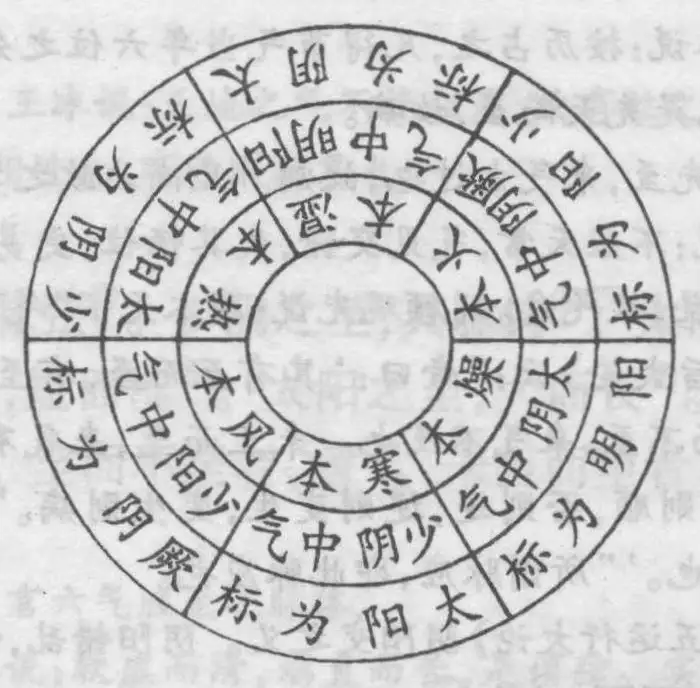

# 至真要大论第七十四①

①**至真要大论第七十四**：**伯坚按：**《甲乙经》和今存残本《黄帝内经太素》都没有收载本篇的文字。本篇和《类经》的篇目对照，列表于下：

| 素问 | 类经 |
|---|---|
| 至真要大论第七十四 | 卷十——六气标本所从不同（标本类一） |
|  | 卷十——病有标本取有逆顺（标本类二） |
|  | 卷十——病反其本得标之病治反其本得标之方（标本类三） |
|  | 卷十二——治有缓急方有奇偶（论治类三） |
|  | 卷十二——气味方制治法逆从（论治类四） |
|  | 卷十二——方制君臣上下三品（论治类五） |
|  | 卷十二——病之中外治有先后（论治类六·一） |
|  | 卷十二——病之中外治有先后（论治类六·二） |
|  | 卷十二——寒之而热取之阴热之而寒取之阳（论治类七） |
|  | 卷十三——病机（疾病类一） |
|  | 卷十六——如疟证（疾病类五十一） |
|  | 卷二十三——南政北政阴阳交尺寸反（运气类五·二） |
|  | 卷二十七——六气之化分司天地主岁纪岁间气纪步少阴不司气化（运气类二十四） |
|  | 卷二十七——天地淫胜病治（运气类二十五） |
|  | 卷二十七——邪气反胜之治（运气类二十六） |
|  | 卷二十七——六气相胜病治（运气类二十七） |
|  | 卷二十七——六气之复病治（运气类二十八） |
|  | 卷二十七——天枢上下胜复有常（运气类二十九） |
|  | 卷二十七——客主胜而无复病治各有正味（运气类三十） |
|  | 卷二十七——六气之胜五藏受邪脉应（运气类三十一） |
|  | 卷二十七——胜复早晏脉应（运气类三十二） |
|  | 卷二十七——三阴三阳幽明分至（运气类三十三·一） |
|  | 卷二十七——三阴三阳幽明分至（运气类三十三·二） |
|  | 卷二十七——六气补泻用有先后（运气类三十四） |

> 黄帝问曰：五气交合，盈虚更作，余知之矣。六气分治司天地者，其至何如①？
>
> 岐伯再拜对曰：明乎哉问也！天地之大纪，人神之通应也②。

**【集解】**

①**六气分治司天地者，其至何如**：王冰说：五行主岁，岁有少多，故曰盈虚更作也。《天元纪大论》曰：“其始也，有余而往，不足随之，不足而往，有余从之”，则其义也。天分六气，散主太虚，三之气司天，终之气监地，天地生化，是为大纪，故言司天地者，余四可知矣。

张介宾说：至者，言其当位也。

②**天地之大纪，人神之通应也**：王冰说：天地变化，人神运为，中外虽殊，然其通应则一也。

〔p.1050 (인쇄 1033)〕

张介宾说：天地变化之纪，人神运动之机，内外虽殊，其应则一也。

> 帝曰：愿闻上合昭昭，下合冥冥，奈何？
>
> 岐伯曰：此道之所主，工之所疑也①。

**【集解】**

①**此道之所主，工之所疑也**：王冰说：不知其要，流散无穷。

张介宾说：昭昭者，合天道之明显。冥冥者，合造化之隐微。道之所生，其生惟一。工不知要，则流散无穷，故多疑也。

> 帝曰：愿闻其道也。
>
> 岐伯曰：厥阴司天，其化以风①。少阴司天，其化以热②。太阴司天，其化以湿③。少阳司天，其化以火④。阳明司天，其化以燥⑤。太阳司天，其化以寒⑥。以所临藏位，命其病者也⑦。

**【集解】**

①**厥阴司天，其化以风**：王冰说：飞扬鼓折，和气发生，万物荣枯，皆因而化变成败也。

张介宾说：厥阴属木，其化以风。凡和气升扬，发生万物，皆风之化。

②**少阴司天，其化以热**：王冰说：炎蒸郁燠，故庶类蕃茂。

张介宾说：少阴属君火，其化以热，凡炎蒸郁燠，庶类蕃茂，皆君火之化。

③**太阴司天，其化以湿**：王冰说：云雨润泽，津液生成。

张介宾说：太阴属土，其化以湿，凡云雨滋泽，津液充实，皆土之化。

④**少阳司天，其化以火**：王冰说：炎炽赫烈，以烁寒灾。

张介宾说：少阳属相火，亦曰畏火。凡炎暑赫烈，阳气盛极，皆相火之化。

⑤**阳明司天，其化以燥**：王冰说：干化以行，物无湿败。

张介宾说：阳明属金，其化以燥，凡清明干肃，万物坚刚，皆金之化。

⑥**太阳司天，其化以寒**：王冰说：对阳之化也。（顾观光说：太阳而其化反寒，似与阳为对待，故云对阳之化。）

《新校正》云：详注云“对阳之化”，“阳”字疑误。

张介宾说：太阳属水，其化以寒，凡阴凝凛冽，万物闭藏，皆水之化。

⑦**以所临藏位，命其病者也**：王冰说：肝，木，位东方；心，火，位南方；脾，土，位西南方及四维（顾观光说：藏本：“脾，土，位中央”，似与此文并有脱误。当云：“脾，土，位中央及四维”。）；肺，金，位西方；肾，水，位北方；是五藏定位。然六气御五运，所至气不相得则病，相得则和，故先以六气所临，后言五藏之病也。

张介宾说：肝木位东，心火位南，脾土位中及四维，肺金位西，肾水位北，所临之气，与藏相得和，不相得则病。

> 帝曰：地化奈何？
>
> 岐伯曰：司天同候，间气皆然①。

**【集解】**

①**地化奈何？岐伯曰**：司天同候，间气皆然：王冰说：六气之本，自有常性，故虽位易，而化治皆同。

张介宾说：地化，在泉之化也。间气，义如下文。六步之位虽有上下左右之分，而气化皆相类，故与上文司天之化同其候。

〔p.1051 (인쇄 1034)〕

> 帝曰：间气何谓？
>
> 岐伯曰：司左右者，是谓间气也①。

**【集解】**

①**司左右者，是谓间气也**：王冰说：六气分化，常以二气司天地为上下吉凶胜复客主之事，岁中悔吝从而明之，余四气散居左右也。故《阴阳应象大论》曰：“天地者万物之上下，左右者阴阳之道路。”此之谓也。

张介宾说：六气分主六步，上谓司天，下谓在泉，余四者谓之间气。在上者为司天左间，司天右间。在下者为在泉左间，在泉右间。《阴阳应象大论》曰：“天地者，万物之上下。左右者，阴阳之道路。”有图在《图翼》二卷。

> 帝曰：何以异之？
>
> 岐伯曰：主岁者纪岁，间气者纪步也①。

**【集解】**

①**主岁者纪岁，间气者纪步也**：王冰说：岁，三百六十五日四分日之一。步，六十日余八十七刻半也。积步之日而成岁也。

张介宾说：主岁者纪岁，司天主岁半之前，在泉主岁半之后也。间气者纪步，岁有六步，每步各主六十日八十七刻半也。

> 帝曰：善。岁主奈何？
>
> 岐伯曰：厥阴司天为风化①，在泉为酸化②，司气为苍化③，间气为动化④。

**【集解】**

①**厥阴司天为风化**：王冰说：巳、亥之岁，风高气远，云飞物扬，风之化也。

张介宾说：木气在天为风化，而飘怒摇动，云物飞扬，如巳、亥岁厥阴司天是也。

②**在泉为酸化**：王冰说：寅、申之岁，木司地气，故物化从酸。

张介宾说：木气在地则味为酸化，如寅、申岁厥阴在泉是也。

③**司气为苍化**：王冰说：木运之气，丁、壬之岁化。苍，青也。

张介宾说：司气，言五运之气也。木运司气，故色化青苍，丁、壬年是也。

④**间气为动化**：王冰说：偏主六十日余八十七刻半也。

《新校正》云：详丑、未之岁，厥阴为初之气；子、午之岁，为二之气；辰、戌之岁，为四之气；卯、酉之岁，为五之气。

张介宾说：厥阴所临之位，风化行则群物鼓动，故曰动化。如丑、未岁则为地之左间，主初之气；子、午岁则为天之右间，主二之气；辰、戌岁则为天之左间，主四之气；卯、酉岁则为地之右间，主五之气也。

> 少阴司天为热化①，在泉为苦化②，不司气化③，居气为灼化④。

**【集解】**

①**少阴司天为热化**：王冰说：子、午之岁，阳光熠耀，暄暑流行，热之化也。

张介宾说：君火在天为热化，而为阳光明耀，温养万物，如子、午岁少阴司天是也。

②**在泉为苦化**：王冰说：卯、酉之岁，火司地气，故物以苦生。

张介宾说：火气在地则味为苦化，如卯、酉岁少阴在泉是也。

〔p.1052 (인쇄 1035)〕

③**不司气化**：王冰说：君不主运。

《新校正》云：按《天元纪大论》云：“君火以名，相火以位”，谓君火不主运也。

张介宾说：君不司运也。夫五运六气之有异者，运出天干，故运惟五；气出地支，故气有六。五者，五行各一也。六者火分君相也。故在六气则有君火相火所主之不同，而五运则火居其一耳。于六者而缺其一，则惟君火独不司五运之气化，正以君火者太阳之火也，为阳气之本，为万化之原，无气不司，故不司气化也。按《新校正》及诸家之注此者，皆曰：“君火以名，相火以位，正以明君火之不主运也。”其说殊谬。夫《天元纪大论》原曰：“君火以明”，非曰“以名”也，奈何将明字改作名字，牵强为解，大失经旨。盖不改全不相干，义殊不通，必欲引以注此，则不得不改明为名，尤属诗乱矣。愚有详注，在本类前第三章（**伯坚按：**“本类前第三章”，指《天元纪大论》第三段。）君火以明之下，所当考正。

④**居气为灼化**：王冰说：六十日余八十七刻半也。居，本位。君火为居，不当间之也。

《新校正》云：详少阴不曰间气而云居气者，盖尊君火无所不居，不当间之也。王注云：“居本位为居，不当间之”，则居他位不为居而可间也。寅、申之岁，为初之气；丑、未之岁，为二之气；巳、亥之岁，为四之气；辰、戌之岁，为五之气。

张介宾说：居，所在也。灼，光明也。不曰间气而曰居气者，君之所居，无往不尊，故不敢言间也。如寅、申岁居在泉之左，主初之气；丑、未岁居司天之右，主二之气；巳、亥岁居司天之左，主四之气；辰、戌岁居在泉之右，主五之气也。

> 太阴司天为湿化①，在泉为甘化②，司气为黅化③，间气为柔化④。

**【集解】**

①**太阴司天为湿化**：王冰说：丑、未之岁，埃郁曚昧，云雨润湿之化也。（顾观光说：“润”下似脱“泽”字。）

张介宾说：土气在天为湿化，而为埃郁曚昧，云雨润湿，如丑、未岁太阴司天是也。

②**在泉为甘化**：王冰说：辰戌之岁也。土司地气，故甘化先焉。

张介宾说：土气在地则味为甘化，如辰戌岁太阴在泉是也。

③**司气为黅化**：王冰说：土运之气，甲、巳之岁。黅，黄也。

张介宾说：土运司气则色化黅黄，甲、巳年是也。

④**间气为柔化**：王冰说：湿化行则庶物柔软。

《新校正》云：详太阴，卯、酉之岁，为初之气；寅、申之岁，为二之气；子、午之岁，为四之气；巳、亥之岁，为五之气。

张介宾说：太阴所临之位，湿化行则庶物柔软也。如卯、酉岁则为地之左间，主初之气；寅、申岁则为天之右间，主二之气；子、午岁则为天之左间，主四之气；巳、亥岁则为地之右间，主五之气也。

> 少阳司天为火化①，在泉为苦化②，司气为丹化③，间气为明化④。

**【集解】**

①**少阳司天为火化**：王冰说：寅、申之岁也。炎光赫烈，燔灼焦然，火之化也。

张介宾说：相火在天为火化，而为炎光赫烈，燔灼焦然，如寅、申岁少阳司天是也。

②**在泉为苦化**：王冰说：巳、亥之岁也。火司地气，故苦化先焉。

张介宾说：火气在地则味为苦化，如巳、亥岁少阳在泉是也。

③**司气为丹化**：王冰说：火运之气，戊、癸岁也。

〔p.1053 (인쇄 1036)〕

张介宾说：火运司气，则色化丹赤，戊、癸年是也。

④**间气为明化**：王冰说：明，炳明也，亦谓霞烧。

《新校正》云：详少阳、辰戌之岁，为初之气；卯、酉之岁，为二之气；丑、未之岁，为四之气；子、午之岁，为五之气。

张介宾说：少阳所临之位，火化行则庶物明灿也。如辰、戌岁则为地之左间，主初之气；卯、酉岁则为天之右间，主二之气；丑、未岁则为天之左间，主四之气；子、午岁则为地之右间，主五之气也。

> 阳明司天为燥化①，在泉为辛化②，司气为素化③，间气为清化④。

**【集解】**

①**阳明司天为燥化**：王冰说：卯、酉之岁，清切高明，雾露萧瑟，燥之化也。

张介宾说：金气在天为燥化，而为清凉劲切，雾露萧瑟，如卯、酉岁阳明司天是也。

②**在泉为辛化**：王冰说：子、午之岁也。金司地气，故辛化先焉。

张介宾说：金气在地则味为辛化，如子、午岁阳明在泉是也。

③**司气为素化**：王冰说：金运之气，乙，庚岁也。

张介宾说：金运司气则色化素白，乙、庚年是也。

④**间气为清化**：王冰说：风生高劲，草木清冷，清之化也。

《新校正》云：详阳明，巳、亥之岁，为初之气；辰、戌之岁，为二之气；寅、申之岁，为四之气；丑、未之岁，为五之气。

张介宾说：阳明所临之位，燥化行则清凉至也。如巳、亥岁则为地之左间，主初之气；辰、戌岁则为天之右间，主二之气；寅、申岁则为天之左间，主四之气；丑、未岁则为地之右间，主五之气也。

> 太阳司天为寒化①，在泉为咸化②，司气为玄化③，间气为藏化④。

**【集解】**

①**太阳司天为寒化**：王冰说：辰、戌之岁，严肃峻整，惨栗凝坚，寒之化也。

张介宾说：水气在天为寒化，而为严肃栗冽，阴惨坚凝，如辰、戌岁为太阳司天是也。

②**在泉为咸化**：王冰说：丑、未之岁，水司地气，故化从咸。

张介宾说：水气在地则味为咸化，如丑、未岁太阳在泉是也。

③**司气为玄化**：王冰说：水运之气，丙、辛岁也。

张介宾说：水运司气则色化玄黑，丙、辛年是也。

④**间气为藏化**：王冰说：阴凝而冷，庶物敛容，藏之化也。

《新校正》云：详子、午之岁，太阳为初之气；巳、亥之岁，为二之气；卯、酉之岁，为四之气；寅、申之岁，为五之气。

张介宾说：太阳所临之位，寒化行则万物闭藏也。如子、午岁则为地之左间，主初之气；巳、亥岁则为天之右间，主二之气；卯、酉岁则为天之左间，主四之气；寅、申岁则为地之右间，主五之气也。

> 故治病者必明六化分治，五味，五色所生，五藏所宜，乃可以言盈虚病生之绪也。①

**【集解】** ①故治病者必明六化分治，五味，五色所生，五藏所宜，乃可以言盈虚病生之绪也：王冰说：学不厌备习也。

〔p.1054 (인쇄 1037)〕

张介宾说：凡治病者必求其本，六化是也；必察其形，五色是也；必分其主治，五味是也；必辨其宜否，五藏是也。明此数者，而后知孰为气之盛，孰为气之衰，乃可以言盈虚病生之端绪，而治之无失矣。

> 帝曰：厥阴在泉而酸化，先余知之矣。风化之行也何如①？
>
> 岐伯曰：风行于地，所谓本也。余气同法②。本乎天者，天之气也。本乎地者，地之气也③。天地合气，六节分而万物化生矣④。故曰：谨候气宜，无失病机，此之谓也⑤。

**【集解】**

①**厥阴在泉而酸化，先余知之矣。风化之行也何如**：张介宾说：此问厥阴在泉既为酸化，而上文之言地化者曰司天同候，则厥阴在泉亦曰风化。然则酸之与风其辨为何如也？

②**风行于地，所谓本也。余气同法**：王冰说：厥阴在泉，风行于地；少阴在泉，热行于地；太阴在泉，湿行于地；少阳在泉，火行于地；阳明在泉，燥行于地；太阳在泉，寒行于地；故曰余气同法也。本，谓六气之上元气也。

张介宾说：有风化而后有酸化，是风为酸化之本，其他余气皆同此义，故有热化火化而后有苦，有湿化而后有甘，有燥化而后有辛，有寒化而后有咸。凡六气之行乎地者，即化生五味之本也。《天元纪大论》曰：“所谓本也，是谓六元”，与此本字义同。

③**本乎天者，天之气也。本乎地者，地之气也**：王冰说：化于天者为天气。化于地者为地气。

《新校正》云：按《易》曰：“本乎天者亲上，本乎地者亲下”，此之谓也。

张介宾说：六气之在天，即为天之气。六气之在地，即为地之气。上下之位不同，而气化之本则一。

④**天地合气，六节分而万物化生矣**：王冰说：万物居天地之间，悉为六气所生化阴阳之用，未尝有逃生化出阴阳也。

张介宾说：天气下降，地气上升，会于气交，是谓合气。由是六节气分，而万物化生无穷矣。

⑤**谨候气宜，无失病机，此之谓也**：王冰说：病机，下文具矣。

张介宾说：本于天地者，是为气宜。应于人身者，是为病机。

> 帝曰：其主病何如①？
>
> 岐伯曰：司岁备物，则无遗主矣②。

**【集解】**

①**其主病何如**：王冰说：言采药之岁也。

张介宾说：此言药物之主病者。

②**司岁备物，则无遗主矣**：王冰说：谨候司天地所生化者，则其味正当其岁也。故彼药工，专司岁气，所收药物，则一岁二岁其所主用无遗略也。今详“则”字当作“用”。（度会常珍说：古抄本，“则”作“用”，可从正也。按据例，“今”上盖脱“新校正云”四字。）

张介宾说：天地之气，每岁各有所司，因司气以备药物，则主病者无遗矣。如厥阴司岁则备酸物，少阴少阳司岁则备苦物，太阴司岁则备甘物，阳明司岁则备辛物，太阳司岁则备咸物，所谓岁物也。岁物备，则五味之用全矣。

〔p.1055 (인쇄 1038)〕

> 帝曰：先岁物何也①？
>
> 岐伯曰：天地之专精也②。

**【集解】**

①**先岁物何也**：《新校正》云：详“先岁”疑作“司岁”。

②**天地之专精也**：王冰说：专精之气，药物肥浓，又于使用当其正气味也。

张介宾说：岁物者，得天地精专之化，气全力厚，故备所当先也。此与《六元正纪大论》：“食岁谷以全其真”者同义。

> 帝曰：司气者何如①？
>
> 岐伯曰：司气者主岁同，然有余不足也②。

**【集解】**

①**司气者何如**：王冰说：司运气也。

②**司气者主岁同，然有余不足也**：王冰说：五运主岁者有余不足，比之岁物，恐有薄有余之岁药专精也。

张介宾说：司气，即上文五运之司气也。主岁，即上文司天在泉之主岁也。运之与气，所主皆同，但五太之运为有余，五少之运为不及，而物性之禀有厚薄矣。

> 帝曰：非司岁物何谓也？
>
> 岐伯曰：散也①，故质同而异等也②。气味有薄厚，性用有燥静，治保有多少，力化有浅深，此之谓也③。

**【集解】**

①**散也**：王冰说：非专精则散气，散气则物不纯也。

张介宾说：非司岁物，谓非主岁之物也。散者，谓六气之序，不司天地则司四间，故物生之应亦当随气散见于四方而各有所禀也。

②**故质同而异等也**：王冰说：形质虽同，力用则异，故不尚之。

张介宾说：惟天地之气变不常，故物生之体质虽同，而性用之厚薄则异。

③**气味有薄厚，性用有燥静，治保有多少，力化有浅深，此之谓也**：王冰说：物与岁不同者何？以此尔。

张介宾说：此即质同异等之谓。盖司气者与不司气者，其有不同如此。

> 帝曰：岁主藏害何谓？
>
> 岐伯曰：以所不胜命之，则其要也①。

**【集解】**

①**以所不胜命之，则其要也**：王冰说：木不胜金，金不胜火之类是也。

张介宾说：此言天有岁气，人有藏气，而岁主有害于五藏者在所不胜者也。如木气淫则脾不胜，火气淫则肺不胜，土气淫则肾不胜，金气淫则肝不胜，水气淫则心不胜，是皆藏害之要。

> 帝曰：治之奈何？
>
> 岐伯曰：上淫于下，所胜平之。外淫于内，所胜治之①。

**【集解】**

①**上淫于下，所胜平之。外淫于内，所胜治之**：王冰说：淫，谓行所不胜己者也。上淫于下，天之气也。外淫于内，地之气也。随所制胜而以平治之也。制胜，谓五味寒热温凉随胜用之，下文备矣。

〔p.1056 (인쇄 1039)〕

《新校正》云：详天气主岁，虽有淫胜，但当平调之，故不曰治而曰平也。

张介宾说：淫，太过为害也。上淫于下，谓天以六气而下病六经也。外淫于内，谓地以五味而内伤五官也。淫邪为害，当各以所胜者平治之也。

> 帝曰：善。平气何如①？
>
> 岐伯曰：谨察阴阳所在而调之，以平为期。正者，正治。反者，反治②。

**【集解】**

①**平气何如**：王冰说：平，谓诊平和之气。

张介宾说：此问岁气和平而亦有病者，又当何如治之也。

②**谨察阴阳所在而调之，以平为期。正者，正治。反者，反治**：王冰说：知阴阳所在，则知尺寸应与不应。不知阴阳所在，则以得为失，以逆为从，故谨察之也。阴病阳不病，阳病阴不病，是为正病，则正治之，谓以寒治热，以热治寒也。阴位已见阳脉，阳位又见阴脉，是谓反病，则反治之，谓以寒治寒，以热治热也。诸方之制，咸悉不然，故曰反者反治也。

张介宾说：阴阳者，脉有阴阳，证有阴阳，气味有阴阳，经络藏象有阴阳，不知阴阳所在则以反为正，以逆为从，故宜谨察而调之，以平为期，无令过也。若阳经阳证而得阳脉，阴经阴证而得阴脉，是为正病。正者正治，谓当以寒治热，以热治寒，治之正也。若阳经阳证而得阴脉，阴经阴证而得阳脉，是为反病。反者反治，谓当以热治热，以寒治寒，治之反也。

> 帝曰：夫子言察阴阳所在而调之，《论》言：“人迎与寸口相应若引绳，小大齐等，命曰平①。”阴之所在，寸口何如②？
>
> 岐伯曰：视岁南北可知之矣③。

**【集解】**

①**人迎与寸口相应若引绳，小大齐等，命曰平**：《新校正》云：详“论言”至“曰平”，本《灵枢经》之文，今出。《甲乙经》云：“寸口主中，人迎主外，两者相应，俱往俱来，若引绳大小齐等。春夏人迎微大，秋冬寸口微大者，名曰平也。”（**伯坚按：**《新校正》所引《甲乙经》，见《甲乙经》卷四《经脉》第一上，系转引《灵枢》第四十八《禁服篇》的文字。本篇经文这里所引的《论》言，即系《灵枢·禁服篇》文字的省略。）

张介宾说：《论》言，《灵枢·禁服篇》也。此引本论之察阴阳者，以人迎寸口为言，盖人迎在头，寸口在手，阴阳相应，则大小齐等，是为平也。

②**阴之所在，寸口何如**：王冰说：阴之所在，脉沉不应，引绳齐等，其候颇乖，故问以明之。

张介宾说：阴，少阴也。少阴所在，脉当不应于寸口，有不可不察也。

③**视岁南北可知之矣**：张介宾说：甲、己二岁为南政。乙、庚、丙、辛、丁、壬、戊、癸八年为北政。南政居南而定其上下左右，故于人之脉则南应于寸，北应于尺。北政居北而定其上下左右，故北应于寸而南应于尺。一曰五运以土为尊，故惟甲、己土运为南政，其他皆北政也。有《推原南北政图说》，在《图翼》二卷。

张介宾《类经·图翼》卷二《推原南北政》说：愚按南北政之义，诸说皆以甲己属土，为五行之尊，故曰南政，似属牵强。夫干支相合而成花甲，十干之中复各有所统十干，如六甲干头，必起甲子，至戊末而六十花甲尽，及至六己，复起甲子，至癸末而六十花甲尽，故甲己年必起于甲子月，甲己日必起于甲子时，此甲己二干所以为十干之首，故象君而为南政。其余则北而象臣而为北政。人之血脉故亦应之。即奇门诸家亦独以甲己为符头。此花甲自然之理，固不待土为五行之尊而分南北也。晰理者以谓然否？

〔p.1057 (인쇄 1040)〕

> 帝曰：愿卒闻之。
>
> 岐伯曰：北政之岁，少阴在泉，则寸口不应①；厥阴在泉，则右不应②；太阴在泉，则左不应③。南政之岁，少阴司天，则寸口不应④；厥阴司天，则右不应⑤；太阴司天，则左不应⑥。诸不应者，反其诊则见矣⑦。

**【集解】**

①**北政之岁，少阴在泉，则寸口不应**：王冰说：木、火、金、水运，面北受气，凡气之在泉者，脉恐不见，唯其左右之气脉可见之。在泉之气，善则不见，恶者可见。病以气及客主淫胜名之。在天之气，其亦然矣。

张介宾说：不应者，脉来沉细而伏，不应于指也。北政之岁，其气居北以定上下，则尺主司天，寸主在泉。故少阴在泉，居北之中，则两手寸口不应，乙、丁、辛、癸、卯、酉年是也。

②**厥阴在泉，则右不应**：王冰说：少阴在右故。

张介宾说：右，右寸也。北政厥阴在泉，则少阴在右寸，故不应。丙、戊、庚、壬、寅、申年是也。

③**太阴在泉，则左不应**：王冰说：少阴在左故。

张介宾说：左，左寸也。北政太阴在泉，则少阴在左寸，故不应，丙、戊、庚、壬、辰、戌年是也。

④**南政之岁，少阴司天，则寸口不应**：王冰说：土运之岁，面南行令，故少阴司天则二手寸口不应也。

张介宾说：南政之岁，其气居南以定上下，则寸主司天，尺主在泉，故少阴司天居南之中，则两手寸口不应，甲子、甲午年是也。

⑤**厥阴司天，则右不应**：张介宾说：右，右寸也。南政厥阴司天，则少阴在右寸，故不应，己巳、己亥年是也。

⑥**太阴司天，则左不应**：王冰说：亦左右义也。

张介宾说：左，左寸也。南政太阴司天，则少阴在左寸，故不应，己丑、己未年是也。

⑦**诸不应者，反其诊则见矣**：王冰说：不应皆为脉沉。脉沉下者，仰手而沉，覆其手则沉为浮、细为大也。

张介宾说：凡南政之应在寸者，则北政应在尺。北政之应在寸者，则南政应在尺。以南北相反而诊之，则或寸或尺之不应者，皆可见矣。

顾观光说：吴《注》云：“反，变也。诊，候也。诸不应者，岁运经候之常也。今乃见者，其候变也。变则不应者斯应矣。”

> 帝曰：尺候何如？
>
> 岐伯曰：北政之岁，三阴在下，则寸不应；三阴在上，则尺不应①。南政之岁，三阴在天，则寸不应；三阴在泉，则尺不应②。左右同③。故曰：“知其要者，一言而终，不知其要，流散无穷。”此之谓也④。

**【集解】** ①北政之岁，三阴在下，则寸不应；三阴在上，则尺不应：王冰说：司天曰上。在泉曰下。

〔p.1058 (인쇄 1041)〕

张介宾说：北政之岁，反于南政，故在下者主寸，在上者主尺。上下，即司天在泉也。

②**南政之岁，三阴在天，则寸不应；三阴在泉，则尺不应**：张介宾说：南政之岁，反于北政，故在天主寸，在泉主尺也。

③**左右同**：王冰说：尺不应寸，左右悉与寸不应义同。

张介宾说：凡左右寸尺之不应者皆与前同，惟少阴之所在则其位也。愚按阴之所在其脉不应，诸家之注皆谓六气以少阴为君，君象无为，不主时气，故少阴所至其脉不应也。此说殊为不然。夫少阴既为六气之一，又安有不主气之理？惟《天元纪大论》中“君火以明，相火以位”之下，王氏注曰：“君火在相火之右，但立名于君位，不立岁气”一言，此在王氏固已误注，而诸家引以释此，盖亦不得已而为之强解耳，义岂然欤？夫三阴三阳者，天地之气也。如《太阴阳明论》曰：“阳者，天气也，主外。阴者，地气也，主内。故阳道实，阴道虚。”此阴阳虚实自然之道也。第以日月证之，则日为阳，其气常盈；月为阴，其光常缺。是以潮汐之盛衰，亦随月而有消长，此阴道当然之义，为可知矣。人之经脉，即天地之潮汐也。故三阳所在，其脉无不应者，气之盈也。三阴所在，其脉有不应者，以阳气有不及，气之虚也。然三阴之列，又惟少阴独居乎中，此又阴中之阴也，所以少阴所在为不应，盖亦应天地之虚耳，岂君不主事之谓乎？明者以为然否？

④**“知其要者，一言而终，不知其要，流散无穷。”此之谓也**：王冰说：要，谓知阴阳所在也。知则用之不惑。不知则尺寸之气沉浮小大，常三岁一差，欲求其意，犹绕树问枝，虽白首区区尚未知所诣，况其旬月而可知乎？

张介宾说：要，即阴阳之所在也。知则不惑，不知则致疑，所以流散无穷而莫测其要也。凡此脉之见，尤于时气为病者最多，虽其中有未必全合者，然遇有不应之脉，便当因此以推察其候。“知其要者”数句，与《六元正纪大论》同，但彼言六元之纪，此言阴阳之要也。

> 帝曰：善。天地之气，内淫而病何如①？
>
> 岐伯曰：岁厥阴在泉，风淫所胜，则地气不明，平野昧，草乃早秀②。民病洒洒振寒，善伸，数欠，心痛支满，两胁里急，饮食不下，鬲咽不通，食则呕，腹胀，善噫，得后与气则快然如衰，身体皆重③。

**【集解】**

①**内淫而病何如**：张介宾说：淫，邪胜也。不胜其德，是谓之淫。内淫者，自外而入，气淫于内，言在泉之变病也。

②**岁厥阴在泉，风淫所胜，则地气不明，平野昧，草乃早秀**：张介宾说：厥阴在泉，寅、申岁也。风淫于地，则木胜土，风胜湿，尘埃飞扬，故地气不明，平野昏昧。木气有余，故草乃早秀。

③**民病洒洒振寒，善伸，数欠，心痛支满，两胁里急，饮食不下，鬲咽不通，食则呕，腹胀，善噫，得后与气则快然如衰，身体皆重**：王冰说：谓甲寅、丙寅、戊寅、庚寅、壬寅、甲申、丙申、戊申、庚申、壬申岁也。气不明，谓天围之际，气色昏暗，风行地上，故平野皆然。昧，谓暗也。胁，谓两乳之下及胠外也。伸，谓以欲伸努筋骨也。

《新校正》云：按《甲乙经》，洒洒振寒，善伸数欠，为胃病；食则呕，腹胀，善噫，得后与气则快然如衰，身体皆重，为脾病；饮食不下，鬲咽不通，邪在胃脘也。盖厥阴在泉之岁，木王而克脾胃，故病如是。又按《脉解》云：“所谓食则呕者，物盛满而上溢，故呕也。所谓得后与气则快然如衰者，十一月阴气下衰而阳气且出，故曰得后与气则快然如衰也。”

〔p.1059 (인쇄 1042)〕

张介宾说：按《经脉篇》，自“洒洒振寒”至“数欠”，为阳明胃病。自“食则呕”至“身体皆重”，为太阴脾病。且厥阴肝脉，贯膈布胁肋，故又为心痛支满等证。皆木邪淫胜，脾胃受伤之为病。

> 岁少阴在泉，热淫所胜，则焰浮川泽，阴处反明。民病腹中常鸣，气上冲胸，喘不能久立，寒热，皮肤痛，目瞑，齿痛，䪼肿，恶寒发热如疟，少腹中痛，腹大。蛰虫不藏。①

**【集解】**

①岁少阴在泉，热淫所胜，则焰浮川泽，阴处反明。民病腹中常鸣，气上冲胸，喘不能久立，寒热，皮肤痛，目瞑，齿痛，䪼肿，恶寒发热如疟，少腹中痛，腹大。蛰虫不藏：王冰说：谓乙卯、丁卯、己卯、辛卯、癸卯、乙酉、丁酉、己酉、辛酉、癸酉岁也。阴处，北方也。不能久立，足无力也。腹大，谓心气不足也。金火相薄而为是也。

《新校正》云：按《甲乙经》，齿痛，䪼肿，为大肠病；腹中雷鸣，气上冲胸，喘不能久立，邪在大肠也。盖少阴在泉之岁，火克金，故大肠病也。

张介宾说：少阴在泉，卯、酉岁也。君火淫胜于下，故焰浮川泽，阴处反明，蛰虫不藏。腹中常鸣者，火气奔动也。气上冲胸者，火性炎上也。喘不能久立，寒热，皮肤痛者，火邪乘肺也。目瞑者，热甚阴虚，畏阳光也。齿动、䪼肿，热乘阳明经也。恶寒发热如疟，金水受伤，阴阳争胜也。热在下焦，故少腹中痛。热在中焦，故腹大。

> 岁太阴在泉，草乃早荣，湿淫所胜，则埃昏岩谷，黄反见黑，至阴之交①，民病饮积，心痛，耳聋，浑浑焞焞，嗌肿，喉痹，阴病血见，少腹痛肿，不得小便，病冲头痛，目似脱，顶似拔，腰似折，髀不可以曲，腘如结，腨如别②。

**【集解】**

①**岁太阴在泉，草乃早荣，湿淫所胜，则埃昏岩谷，黄反见黑，至阴之交**：张介宾说：太阴在泉，辰、戌岁也。土为草木之所资生，故草乃早荣。岩谷者，土厚之处，故埃昏岩谷。黄，土色。黑，水色。土胜湿淫，故黄反见黑。《五常政大论》曰：“太阴司天，湿气下临，肾气上从，黑起水变”，即土临水应之义。至阴之交，当三气四气之间，土之令也。

②民病饮积，心痛，耳聋，浑浑焞焞，嗌肿，喉痹，阴病血见，少腹痛肿，不得小便，病冲头痛，目似脱，顶似拔，腰似折，髀不可以曲，腘如结，腨如别：王冰说：谓甲辰、丙辰、戊辰、庚辰、壬辰、甲戌、丙戌、戊戌、庚戌、壬戌岁也。太阴为土，色见应黄于天中，而反见于北方黑处也。水土同见，故曰至阴之交，合其气色也。冲头痛，谓脑后眉间痛也。腘，谓膝后曲脚之中也。腨，䯒后软肉处也。

《新校正》云：按《甲乙经》，耳聋，浑浑焞焞，嗌肿，喉痹，为三焦病；为病冲头痛，目似脱，顶似拔，腰似折，髀不可以曲，腘如结，腨如别，为膀胱足太阳病；又少腹肿痛，不得小便，邪在三焦。盖太阴在泉之岁，土王克太阳，故病如是也。

张介宾说：饮积心痛，寒湿乘心也。自“耳聋”至“喉痹”，按《经脉篇》为三焦经病。自“阴病”至“不得小便”，以邪湿下流，为阴虚肾病。自“冲头痛”至“腨如别”，按《经脉篇》为膀胱经病。此以土邪淫胜克水，而肾合三焦膀胱俱为水藏，故病及焉。

> 岁少阳在泉，火淫所胜，则焰明郊野，寒热更至①。民病注泄赤白，少腹涌，溺赤，甚则血便。少阴同候②。

〔p.1060 (인쇄 1043)〕

**【集解】**

①**岁少阳在泉，火淫所胜，则焰明郊野，寒热更至**：张介宾说：少阳在泉，巳、亥岁也。相火淫胜于下，故焰明郊野。热极生寒，故寒热更至。

②**民病注泄赤白，少腹痛，溺赤，甚则血便。少阴同候**：王冰说：谓乙巳、丁巳、己巳、辛巳、癸巳、乙亥、丁亥、己亥、辛亥、癸亥岁也。处寒之时，热更其气，热气既往，寒气后来，故云更至也。余候与少阴在泉正同。

张介宾说：热伤血分，则注赤。热伤气分，则注白。热则下焦，故少腹痛，溺赤、血便。其余诸病，皆与前少阴在泉同候。

> 岁阳明在泉，燥淫所胜，则霿雾清暝①。民病喜呕，呕有苦，善太息，心胁痛不能反侧，甚则嗌干，面尘，身无膏泽，足外反热②。

**【集解】**

①**岁阳明在泉，燥淫所胜，则霿雾清暝**：张介宾说：阳明在泉，子、午岁也。金气淫胜于下，故霿暗如雾，清冷晦暝也。

②**民病喜呕，呕有苦，善太息，心胁痛不能反侧，甚则嗌干，面尘，身无膏泽，足外反热**：王冰说：谓甲子、丙子、戊子、庚子、壬子、甲午、丙午、戊午、庚午、壬午岁也。霿雾，谓雾暗不分似雾也。清，薄寒也。言雾起霿暗，不辨物形，而薄寒也。心胁痛，谓心之傍胁中痛也。面尘，谓面上如有触冒尘土之色也。

《新校正》云：按《甲乙经》，病喜呕，呕有苦，善太息，心胁痛，不能反侧，甚则面尘，身无膏泽，足外反热，为胆病；嗌干，面尘，为肝病。盖阳明在泉之岁，金王克木，故病如是。又按《脉解》云：“少阳所谓心胁痛者，言少阳盛也。盛者心之所表也。九月阳气尽而阴气盛，故心胁痛。所谓不可反侧者，阴气藏物也。物藏则不动，故不可反侧也。”

张介宾说：按《经脉篇》以口苦、善太息、心胁痛不能转侧、甚则面微有尘、体无膏泽、足外反热，为足少阳胆经病；嗌干、面尘，为厥阴肝经病。此以金邪淫胜，故肝胆受伤，而为病如此。

> 岁太阳在泉，寒淫所胜，则凝肃惨栗。民病少腹控睾，引腰脊，上冲心痛，血见，嗌痛，颔肿①。

**【集解】**

①**岁太阳在泉，寒淫所胜，则凝肃惨栗。民病少腹控睾，引腰脊，上冲心痛，血见，嗌痛，颔肿**：王冰说：谓乙丑、丁丑、己丑、辛丑、癸丑、乙未、丁未、己未、辛未、癸未岁也。凝肃，谓寒气蔼空，凝而不动，万物静肃其仪形也。惨栗，寒甚也。控，引也。睾，阴丸也。颔，颊车前牙之下也。

《新校正》云：按《甲乙经》，嗌痛，颔肿，为小肠病；又少腹控睾，引腰脊，上冲心肺，邪在小肠也。盖太阳在泉之岁，水克火，故病如是。

张介宾说：寒淫于下，自伤其类，则膀胱与肾受之。膀胱居腹，故少腹痛。肾主阴丸，故控睾。太阳之脉，挟脊抵腰中，故引腰脊。肾脉络心，故上冲心痛。心主血属而寒逼之，故血见。故《经脉篇》以嗌痛、颔肿为小肠经病，亦水邪侮火而然。

> 帝曰：善。治之奈何①？
>
> 岐伯曰：诸气在泉，风淫于内，治以辛、凉，佐以苦，以甘缓之，以辛散之②。

**【集解】**

〔p.1061 (인쇄 1044)〕

①**治之奈何**：张介宾说：此下言在泉淫胜之治。

②**诸气在泉，风淫于内，治以辛、凉，佐以苦，以甘缓之，以辛散之**：王冰说：风性喜温而恶清，故治之凉，是以胜气治之也。佐以苦，随其所利也。木苦急则以甘缓之。苦抑则以辛散之。《藏气法时论》曰：“肝苦急，急食甘以缓之。肝欲散，急食辛以散之。”此之谓也。食亦音饲，己曰食，他日饲也。大法正味如此，诸为方者不必尽用之，但一佐二佐，病已则止，余气皆然。

张介宾说：风为木气，金能胜之，故治以辛凉。过于辛恐反伤其气，故佐以苦甘，苦胜辛，甘益气也。木性急，故以甘缓之。风邪胜，故以辛散之。《藏气法时论》曰：“肝苦急，急食甘以缓之。肝欲散，急食辛以散之。”此之谓也。

> 热淫于内，治以咸、寒，佐以甘、苦，以酸收之，以苦发之。①

**【集解】**

①**热淫于内，治以咸、寒，佐以甘、苦，以酸收之，以苦发之**：王冰说：热性恶寒，故治以寒也。热之大盛，甚于表者，以苦发之；不尽，复寒制之；寒制不尽，复苦发之，以酸收之。甚者再方，微者一方，可使必已。时发时止，亦以酸收之。

张介宾说：热为火气，水能胜之，故宜治以咸寒，佐以甘苦。甘胜咸，所以防咸之过也。苦能泄，所以去热之实也。热盛于经而不敛者，以酸收之。热郁于内而不解者，以苦发之。

> 湿淫于内，治以苦、热，佐以酸、淡，以苦燥之，以淡泄之。①

**【集解】**

①**湿淫于内，治以苦、热，佐以酸、淡，以苦燥之，以淡泄之**：王冰说：湿与燥反，故治以苦、热，佐以酸、淡也。燥除湿，故以苦燥其湿也。淡利窍，故以淡渗泄也。《藏气法时论》曰：“脾苦湿，急食苦以燥之。”《灵枢经》曰：“淡利窍也。”《生气通天论》曰：“味过于苦，脾气不濡，胃气乃厚”。明苦燥也。

《新校正》云：按《六元正纪大论》曰：“下太阴，其化下甘温。”

张介宾说：湿为土气，燥能除之，故治以苦热。酸从木化，制土者也，故佐以酸淡。以苦燥之者，苦从火化也。以淡泄之者，淡能利窍也。《藏气法时论》曰：“脾苦湿，急食苦以燥之”，即此之谓。

> 火淫于内，治以咸、冷，佐以苦、辛，以酸收之，以苦发之。①

**【集解】**

①**火淫于内，治以咸、冷，佐以苦、辛，以酸收之，以苦发之**：王冰说：火气大行心腹，心怒之所生也。咸性柔软，故以治之，以酸收之。大法候其须汗者，以辛佐之，不必要资苦味令其汗也。欲柔软者，以咸治之。《藏气法时论》曰：“心欲软，急食咸以软之。心苦缓，急食酸以收之。”此之谓也。

张介宾说：相火，畏火也，故宜治以咸冷。苦能泄火，辛能散火，故用以为佐。以酸收之，以苦发之，义与上文热淫治同。

> 燥淫于内，治以苦、温，佐以甘、辛，以苦下之。①

**【集解】**

①**燥淫于内，治以苦、温，佐以甘、辛，以苦下之**：王冰说：温利凉性，故以苦治之。下，谓利之使不得也。

《新校正》云：按《藏气法时论》曰：“肺苦气上逆，急食苦以泄之，用辛泻之，酸补之。”又按下文司天燥淫所胜，佐以酸辛，此云甘辛者，“甘”字疑当作“酸”。《六元正纪大论》云：“下酸热”，与苦温之治又异。又云：“以酸收之而安其下，甚则以苦泄之。”

〔p.1062 (인쇄 1045)〕

张介宾说：燥为金气，火能胜之。治以苦温，苦从火化也。佐以甘辛，木受金伤，以甘缓之；金之正味，以辛泻之也。燥结不通则邪实于内，故当以苦下之。按下文燥淫所胜，佐以酸辛，与此甘辛稍异。又如《六元正纪大论》子午年阳明在泉，亦云下酸温。皆与此不同。考之《藏气法时论》曰：“肺苦气上逆，急食苦以泄之，用酸补之，辛泻之”，正此之辨。

> 寒淫于内，治以甘、热，佐以苦、辛，以咸泻之，以辛润之，以苦坚之。①

**【集解】**

①**寒淫于内，治以甘、热，佐以苦、辛，以咸泻之，以辛润之，以苦坚之**：王冰说：以热治寒，是为摧胜，折其气用，令不滋繁也。苦辛之佐，通事行之。

《新校正》云：按《藏气法时论》曰：“肾苦燥，急食辛以润之。肾欲坚，急食苦以坚之，用苦补之，咸泻之。”旧注引此在湿淫于内之下，无义，今移于此。

张介宾说：寒为水气，土能胜水，热能胜寒，故治以甘热，甘从土化，热从火化也。佐以苦辛等义，如《藏气法时论》曰：“肾苦燥，急食辛以润之，坚欲坚，急食苦以坚之，用苦补之，咸泻之”也。

> 帝曰：善。天气之变何如？
>
> 岐伯曰：厥阴司天，风淫所胜，则太虚埃昏，云物以扰，寒生春气，流水不冰。民病胃脘当心而痛，上支两胁，鬲咽不通，饮食不下，舌本强，食则呕，冷泄，腹胀，溏泄，瘕，水闭。蛰虫不去。病本于脾①。冲阳绝，死不治②。

**【集解】**

①厥阴司天，风淫所胜，则太虚埃昏，云物以扰，寒生春气，流水不冰。民病胃脘当心而痛，上支两胁，鬲咽不通，饮食不下，舌本强，食则呕，冷泄，腹胀，溏泄，瘕，水闭。蛰虫不去。病本于脾：王冰说：谓乙巳、丁巳、己巳、辛巳、癸巳、乙亥、丁亥、己亥、辛亥、癸亥岁也。是岁民病集于中也。风自天行，故太虚埃起。风动飘荡，故云物扰也。埃，青尘也。不分远物，是为埃昏。土之为病，其善泄利，若病水则小便闭而不下，若大泄利则经水亦多闭绝也。

《新校正》云：按《甲乙经》，舌本强，食则呕，腹胀，溏泄，瘕，水闭，为脾病；又胃病者，腹胀，胃脘当心而痛，上支两胁，隔咽不通，食饮不下，盖厥阴司天之岁，木胜土，故病如是也。

张介宾说：巳、亥岁也。风淫于上，故太虚埃昏，云物扰乱，风木主温，故寒生春气，而流水不冰。然风胜则金令承之，清肃气行，故蛰虫不出。胃脘当心而痛等证，病皆在脾。按《经脉篇》以舌本强、食则呕、胃脘痛、腹胀食不下、溏泄、瘕、水闭，为足太阴脾病。此以木邪乘土，故诸病皆本于脾也。

②**冲阳绝，死不治**：王冰说：冲阳，在足跗上，动脉应手，胃之气也。冲阳脉微，则食饮减少，绝则药食不入，亦下嗌还出也。攻之不入，养之不生，邪气日强，真气内绝，故其必死，不可复也。

张介宾说：冲阳，足阳明胃脉也。在足跗上，动脉应手，土不胜木，则脾胃气竭而冲阳绝，故死不治。

> 少阴司天，热淫所胜，怫热至，火行其政，民病胸中烦热，嗌干，右胠满，皮肤痛，寒热，咳喘。大雨且至。唾血，血泄，鼽，衄，嚏，呕，溺色变，甚则疮疡，胕肿，肩，背，臂、臑及缺盆中痛，心痛，肺䐜，腹大满，膨膨而喘咳。病本于肺①。尺泽绝，死不治②。

〔p.1063 (인쇄 1046)〕

**【集解】**

①少阴司天，热淫所胜，怫热至，火行其政，民病胸中烦热，嗌干，右胠满，皮肤痛，寒热，咳喘。大雨且至。唾血，血泄，鼽，衄，嚏，呕，溺色变，甚则疮疡，胕肿，肩，背，臂、臑及缺盆中痛，心痛，肺䐜，腹大满，膨膨而喘咳。病本于肺：王冰说：谓甲子、丙子、戊子、庚子、壬子、甲午、丙午、戊午、庚午、壬午岁也。怫热至是，火行其政乃尔。是岁民病集于右，盖以小肠通心故也。病自肺生，故曰病本于肺也。

《新校正》云：按《甲乙经》，溺色变，肩背臂臑及缺盆中痛，肺胀满膨膨而喘咳，为肺病。鼽，衄，为大肠病。盖少阴司天之岁，火克金，故病如是。又王注民病集于右，以小肠通心故。按《甲乙经》，小肠附脊左环，回肠附脊右环，所说不应，得非火盛克金而大肠病欤？

张介宾说：子、午岁也。热淫于上，故火行其政。君火之下，阴精承之，故大雨且至。胸中烦热嗌干等证，皆君火上炎，肺金受伤也。金气主右，故右胠满。按《经脉篇》以溺色变、肩、背、臂、臑及缺盆中痛、肺胀满膨膨而喘咳，为手太阴经肺病；鼽、衄、肩前臑痛，为手阳明大肠病。盖肺与大肠为表里，金被火伤，故诸病皆本于肺也。

②**尺泽绝，死不治**：王冰说：尺泽，在肘内廉大文中，动脉应手，肺之气也。火烁于金，承天之命，金气内竭，故必危亡。尺泽不至，肺气已绝，荣卫之气宣行无主，真气内竭，生之何有哉？

张介宾说：尺泽，手太阴肺脉也。在肘内廉大文中，动脉应手。金不胜火，则肺气竭而尺泽绝，故死不治。

> 太阴司天，湿淫所胜，则沉阴旦布，雨变枯槁①。胕肿，骨痛，阴痹，阴痹者按之不得，腰、脊、头、项痛，时眩，大便难，阴气不用，饥不欲食，咳唾则有血，心如悬。病本于肾②。太溪绝，死不治③。

**【集解】**

①**太阴司天，湿淫所胜，则沉阴旦布，雨变枯槁**：张介宾说：丑、未岁也。湿淫于上，故沉阴旦布。沉，深也。沉阴雨变，则浸渍为伤，故物多枯槁。

②**胕肿，骨痛，阴痹，阴痹者按之不得，腰、脊、头、项痛，时眩，大便难，阴气不用，饥不欲食，咳唾则有血，心如悬。病本于肾**：王冰说：谓乙丑、丁丑、己丑、辛丑、癸丑、乙未、丁未、己未、辛未、癸未岁也。沉，久也。肾气受邪，水无能润，下焦枯槁，故大便甚难也。

《新校正》云：按《甲乙经》，饥不欲食，咳唾则有血，心悬如饥状，为肾病；又邪在肾则骨痛，阴痹，阴痹者按之而不得，腹胀，腰痛，大便难，肩背颈项强痛，时眩。盖太阴司天之岁，土克水，故病如是也。

张介宾说：胕肿骨痛等证，皆肾经病也。按《经脉篇》以腰脊、头项痛，为足太阳膀胱病；以饥不欲食、咳唾则有血、心如悬，为足少阴肾病。此以肾与膀胱为表里，水为土克，故诸病皆本于肾也。

③**太溪绝，死不治**：王冰说：太溪在足内踝后跟骨上，动脉应手，肾之气也。土邪胜水，则肾气内绝，邪甚正微，故方无所用矣。

张介宾说：太溪，足少阴肾脉也。在足内踝后跟骨上，动脉应手。水不胜土，则肾气竭而太溪绝，故死不治。

〔p.1064 (인쇄 1047)〕

> 少阳司天，火淫所胜，则温气流行，金政不平①。民病头痛，发热，恶寒而疟，热上皮肤痛，色变黄赤，传而为水，身面胕肿，腹满，仰息，泄注赤白，疮疡，咳唾血，烦心，胸中热；甚则鼽，衄。病本于肺②。天府绝，死不治③。

**【集解】**

①**少阳司天，火淫所胜，则温气流行，金政不平**：张介宾说：寅、申岁也。相火淫胜于上，则金受其制，故温气流行，金政不平。

②民病头痛，发热，恶寒而疟，热上皮肤痛，色变黄赤，传而为水，身面胕肿，腹满，仰息，泄注赤白，疮疡，咳唾血，烦心，胸中热；甚则鼽，衄。病本于肺：王冰说：谓甲寅、丙寅、戊寅、庚寅、壬寅、甲申、丙申、戊申、庚申、壬申岁也。火来用事，则金气受邪，故曰金政不平也。火炎于上，金肺受邪，客热内燔，水无能救，故化生诸病也。制火之客则已矣。

《新校正》云：按《甲乙经》，邪在肺则皮肤痛，发寒热。盖少阳司天之岁，火克金，故病如是。

张介宾说：相火用事，金气受邪，客热内燔，水不能制，故为此诸病，皆本于肺也。

③**天府绝，死不治**：王冰说：天府，在肘后内侧上掖下，同身寸之三寸，动脉应手，肺之气也。火胜而金脉绝，故死。

张介宾说：天府，手太阴肺脉也。在臂臑内廉腋下三寸，动脉应手。金不胜火，则肺气竭而天府绝，故死不治。

> 阳明司天，燥淫所胜，则木乃晚荣，草乃晚生，筋骨内变。民病左胠胁痛，寒清于中，感而疟。大凉革候。咳，腹中鸣，注泄，鹜溏。名木敛生菀于下，草焦上首。心胁暴痛，不可反侧，嗌干，面尘，腰痛，丈夫㿗疝，妇人少腹痛，目昧①，眦疡、疮、痤、痈。蛰虫来见。病本于肝②。太冲绝，死不治③。

**【集解】**

①**目昧**：陆懋修说：昧，亦作眛。《说文》：“眛，目不明也。”《左传》二十四年《传》：“目不别五色之章为眛。”

②**病本于肝**：王冰说：谓乙卯、丁卯、己卯、辛卯、癸卯、乙酉、丁酉、己酉、辛酉、癸酉岁也。金胜，故草木晚生荣也。配于人身，则筋骨内应而不用也。大凉之气，变易时候，则人寒清发于中，内感寒气则为痎疟也。大肠居右，肺气通之，今肺气内淫，肝居于左，故左胠胁痛如刺割也。其岁民自注泄，则无淫胜之疾也。大凉，次寒也。大凉且甚，阳气不行，故木容收敛，草荣悉晚，生气已升，阳不布令，故闭积生气而稸于下也。在人之应，则少腹之内，痛气居之，发疾于仲夏；疮疡之疾，犹及秋中，疮痤之类生于上，痈肿之患生于下。疮色虽赤，中心正白，物气之常也。

《新校正》云：按《甲乙经》，腰痛不可以俯仰，丈夫㿗疝，妇人少腹肿，甚则嗌干，面尘，为肝病；又胸满洞泄，为肝病；又心胁痛不能反侧，目锐，眦痛，缺盆中肿痛，掖下肿马刀挟瘿，汗出振寒，疟，为胆病。盖阳明司天之岁，金克木，故病如是。又按《脉解》云：“厥阴所谓㿗疝妇人少腹肿者，厥阴者辰也，三月阳中之阴邪在中，故曰㿗疝少腹肿也。”

张介宾说：卯、酉岁也。燥金淫胜于上，则木受其克，故草木生荣俱晚，其在于人，则肝血受伤，不能营养筋骨，故生内变。且金气大凉，能革发生之候，故草木之应如此。然阳明金气在上，则少阴火气在下，故蛰虫来见也。左胠胁痛等证，皆肝经病，肝木主左也。按《经脉篇》以心胁痛不可转侧，面微有尘，为足少阳胆病；腰痛不可俯仰、丈夫㿉疝、妇人少腹痛、嗌干、面尘、飧泄，为足厥阴肝病。此以肝与胆为表里，木被金伤，故诸病皆本于肝也。

〔p.1065 (인쇄 1048)〕

③**太冲绝，死不治**：王冰说：太冲，在足大指本节后二寸，动脉应手，肝之气也。金来伐木，肝气内绝，真不胜邪，其死宜也。

张介宾说：太冲，足厥阴肝脉也。在足大指本节后二寸，动脉应手。木不胜金，则肝气竭而太冲绝，故死不治。

> 太阳司天，寒淫所胜，则寒气反至，水且冰。血变于中，发为痈疡。民病厥心痛，呕血，血泄，鼽、衄、善悲，时眩仆。运火炎烈，雨暴乃雹。胸腹满，手热，肘挛，掖肿，心澹澹大动，胸胁胃脘不安，面赤，目黄，善噫，嗌干；甚则色炲，渴而欲饮，病本于心①。神门绝，死不治②。

**【集解】**

①太阳司天，寒淫所胜，则寒气反至，水且冰。血变于中，发为痈疡。民病厥心痛，呕血，血泄，鼽、衄、善悲，时眩仆。运火炎烈，雨暴乃雹。胸腹满，手热，肘挛，掖肿，心澹澹大动，胸胁胃脘不安，面赤，目黄，善噫，嗌干；甚则色炲，渴而欲饮，病本于心：王冰说：谓甲辰、丙辰、戊辰、庚辰、壬辰、甲戌、丙戌、戊戌、庚戌、壬戌岁也。太阳司天，寒气布化，故水且冰而血凝，皮肤之间卫气结聚，故为痈也。若乘火运，而火热炎烈与水交战，故暴雨半珠形雹也。心气为噫，故善噫，是岁民病集于心胁之中也。阳气内郁，湿气下蒸，故心厥痛而呕血，血泄，鼽，衄，面赤，目黄，善噫，手热，肘挛，掖肿，嗌干。甚则寒气胜阳，水行凌火，火气内郁，故渴而欲饮也。病始心生，为阴凌犯，故云病本于心也。

《新校正》云：按《甲乙经》，手热，肘挛，掖肿，甚则胸胁支满，心澹澹大动，面赤，目黄，为手心主病；又邪在心则病心痛，善悲，时眩仆。盖太阳司天之岁，水克火，故病如是。

张介宾说：辰、戌岁也。寒淫于上，故寒反至，水且冰。若乘火运而火气炎烈，则水火相激，故雨暴乃雹。寒水胜则邪乘心，故为血变于中，发为痈疡等证。按《经脉篇》以手心热、臂肘挛急、腋肿、胸胁支满、心中澹澹大动、面赤、目黄，为手厥阴心包络病。盖火受寒伤，故诸病皆本于心也。澹，淡同。炲音台。焦，黑色也。

②**神门绝，死不治**：王冰说：神门，在手之掌后锐骨之端，动脉应手，真心气也。水行乘火，而心气内绝，神气已亡，不死何待？善知其诊，故不治也。

张介宾说：神门，手少阴心脉也。在手掌后锐骨之端，动脉应手，火不胜水，则心气竭而神门绝，故死不治。

> 所谓动气知其藏也①。

**【集解】**

①**所谓动气知其藏也**：王冰说：所以诊视而知死者何？以皆是藏之经脉动气，知神藏之存亡尔。

张介宾说：动气者，气至脉动也。察动脉之有无，则藏气之存亡可知矣。此总结六气之变病也。

> 帝曰：善。治之奈何①？
>
> 岐伯曰：司天之气，风淫所胜，平以辛、凉，佐以苦、甘，以甘缓之，以酸泻之②。

**【集解】**

①**治之奈何**：王冰说：谓可攻治者。

〔p.1066 (인쇄 1049)〕

张介宾说：此下言司天淫胜之治。

②**司天之气，风淫所胜，平以辛、凉，佐以苦、甘，以甘缓之，以酸泻之**：王冰说：厥阴之气，未为盛热，故曰凉药平之。夫气之用也，积凉为寒，积温为热。以热少之，其则温也；以寒少之，其则凉也；以温多之，其则热也；以凉多之，其则寒也；各当其分。则寒寒也，温温也，热热也，凉凉也，方书之用，可不务乎？故寒热温凉迁降多少，善为方者，意必精通。余气皆然，从其制也。

《新校正》云：按本论上文云：“上淫于下，所胜平之；以淫于内，所胜治之；”故在泉曰治，司天曰平也。

张介宾说：风淫于上，平以辛凉，佐以苦甘，以甘缓之，俱与上文在泉治同。以酸泻之者，木之正味，其泻以酸也。

> 热淫所胜，平以咸、寒，佐以苦、甘，以酸收之。①

**【集解】**

①**热淫所胜，平以咸、寒，佐以苦、甘，以酸收之**：王冰说：热气已退，时发动者，是为心虚，气散不敛，以酸收之。虽以酸收，亦兼寒助，乃能殄除其源本矣。热见太甚，则以苦发之。汗已便凉，是邪气尽，勿寒水之。汗已犹热，是邪气未尽，则以酸收之。已又热，则复汗之。已汗复热，是藏虚也，则补其心可矣。法则合尔。诸治热者，亦未必得再，三发三治，况四变而反覆者乎？

张介宾说：此与上文在泉治同，但缺以苦发之一句，而下文火淫所胜复言之，则义与此节同也。

> 湿淫所胜，平以苦、热，佐以酸、辛，以苦燥之，以淡泄之①。湿上甚而热，治以苦、温，佐以甘、辛，以汗为故，而止②。

**【集解】**

①**湿淫所胜，平以苦、热，佐以酸、辛，以苦燥之，以淡泄之**：王冰说：湿气所淫，皆为肿满，但除其湿，肿满自衰。因湿生病，不肿不满者，亦尔治之。湿气在上，以苦吐之；湿气在下，以苦泄之，以淡渗之；则皆燥也。泄，谓渗泄以利水道、下小便为法。然酸虽热，亦用利小便、去伏水也。治湿之病，不下小便，非其法也。

《新校正》云：按“湿淫于内，佐以酸淡”，此云“酸辛”者，“辛”疑当作“淡”。

张介宾说：诸与上文在泉治同，惟佐以酸辛，与彼酸淡少异。盖辛胜酸，所以防酸之过也，故当用以为佐。

②**湿上甚而热，治以苦、温，佐以甘、辛，以汗为故，而止**：王冰说：身半以上，湿气余，火气复郁，郁湿相搏，则以苦温甘辛之药解表流汗而祛之，故云以汗为除病之故而已也。

张介宾说：湿上甚而热者，湿郁于上而成热也。治以苦温，欲其燥也。佐以甘辛，欲其散也。以燥以散，则热湿之在上者，以汗之故而止矣。

> 火淫所胜，平以酸、冷，佐以苦、甘，以酸收之，以苦发之，以酸复之。热淫同。①

**【集解】**

①**火淫所胜，平以酸、冷，佐以苦、甘，以酸收之，以苦发之，以酸复之。热淫同**：王冰说：同热淫义。热亦如此法以酸复其本气也。不复其气，则淫气空虚，招其损。

张介宾说：此与在泉热淫治同。盖水能胜火，故平以咸冷。苦能泻火之实，甘能缓火之急，故佐以苦甘。火盛而散越者，以酸收之。火郁而伏留者，以苦发之。然以发去火，未免伤气，故又当以酸复之，而火热二气同治也。

〔p.1067 (인쇄 1050)〕

> 燥淫所胜，平以苦、湿，佐以酸、辛，以苦下之①。

**【集解】**

①**燥淫所胜，平以苦、湿，佐以酸、辛，以苦下之**：王冰说：制燥之胜，必以苦湿，是火之气味也。宜下，必以苦。宜补，必以酸。宜泻，必以辛。清甚生寒，留而不去，则以苦。湿下之气有余，则以辛泻之。诸气同。

《新校正》云：按上文“燥淫于内，治以苦温”，此云“苦湿”者，“湿”当为“温”。文注中“湿”字三，并当作“温”。又按《六元正纪大论》，亦作“苦小温”。

张介宾说：此与上文燥淫于内治同，但彼此佐以甘辛，此云酸辛为异。详注见前燥淫条下。“苦湿”误也，当作“苦温”。

> 寒淫所胜，平以辛、热，佐以甘、苦，以咸泻之①。

**【集解】**

①**寒淫所胜，平以辛、热，佐以甘、甘，以咸泻之**：王冰说：淫散止之，不可过也。

《新校正》云：按上文“寒淫于内，治以甘热，佐以苦辛”，此云“平以辛热，佐以甘苦”者，此文为误。又按《六元正纪大论》云：“太阳之政岁宜苦以燥之”也。

张介宾说：辛热足以散寒。苦甘可以胜水。以咸泻之，水之正味，其泻以咸也。此与在泉治同。而文有颠倒，详见前寒淫于内条下。

> 帝曰：善。邪气反胜①，治之奈何？
>
> 岐伯曰：风司于地，清反胜之，治以酸、温，佐以苦、甘，以辛平之②。

**【集解】**

①**邪气反胜**：王冰说：不能淫胜于他气，反为不胜之气为邪以胜之。

张介宾说：反胜者，以天地气有不足，则间气乘虚为邪而反胜之也。

②**风司于地，清反胜之，治以酸、温，佐以苦、甘，以辛平之**：王冰说：厥阴在泉，则风司于地，谓五寅岁、五申岁。邪气胜盛，故先以酸泻，佐以苦、甘。邪气退则正气虚，故以辛补，养而平之。

张介宾说：凡寅、申岁厥阴风木在泉，而或气有不及，则金之清气反胜之，故当治以酸湿，酸求木之同气，温以制清也。佐以苦甘，苦以温金，甘以缓肝之急也。以辛平之，木之正味，其补以辛；金之正味，其泻以辛也。

> 热司于地，寒反胜之，治以甘、热，佐以苦、辛，以咸平之①。

**【集解】**

①**热司于地，寒反胜之，治以甘、热，佐以苦、辛，以咸平之**：王冰说：少阴在泉，则热司于地，谓五卯、五酉岁也。先泻其邪而后平其正气也。

张介宾说：凡卯酉岁少阴君火在泉，而或气有不及，则水之寒气反胜之，故当治以甘热，甘能胜水，热能制寒也。佐以苦辛，寒得土而温，得辛而散也。以咸平之，火之正味，其补以咸；水之正味，其泻以咸也。

> 湿司于地，热反胜之，治以苦、冷，佐以咸、甘，以苦平之①。

**【集解】**

①**湿司于地，热反胜之，治以苦、冷，佐以咸、甘，以苦平之**：王冰说：太阴在泉，则湿司于地，谓五辰、五戌岁也。补泻之义，余气皆同。

〔p.1068 (인쇄 1051)〕

张介宾说：凡辰、戌岁太阴湿土在泉，而或气有不及，则火之热气反胜之，故当治以苦冷，抑火邪也。佐以咸甘，咸寒制热，甘温补土也。以苦平之，即苦冷之义。

> 火司于地，寒反胜之，治以甘、热，佐以苦、辛，以咸平之①。

**【集解】**

①**火司于地，寒反胜之，治以甘、热，佐以苦、辛，以咸平之**：王冰说：少阳在泉，则火司于地，谓五巳、五亥岁也。

张介宾说：凡巳、亥岁少阳相火在泉，而气有不及，与上文热司于地者同其治。

> 燥司于地，热反胜之，治以平、寒，佐以苦、甘，以酸平之，以和为利①。

**【集解】**

①**燥司于地，热反胜之，治以平、寒，佐以苦、甘，以酸平之，以和为利**：王冰说：阳明在泉，则燥司于地，谓五子、五午岁也。燥之性恶热，亦畏寒，故以冷热和平为方制也。

张介宾说：凡子、午岁阳明燥金在泉，而气有不及，则热反胜之，治以平寒，以金司于地，气本肃杀，若用大寒必助其惨，故但宜平寒抑其热耳。佐以苦甘，所以泻火也。以酸平之，金之正味，其补以酸也。以和为利，戒过用也，即平寒之意。

> 寒司于地，热反胜之，治以咸、冷，佐以甘、辛，以苦平之①。

**【集解】**

①**寒司于地，热反胜之，治以咸、冷，佐以甘、辛，以苦平之**：王冰说：太阳在泉，则寒司于地，谓五丑、五未岁也。此六气方治与前淫胜法殊贯。云治者，泻客邪之胜气也。云佐者，皆所利所宜也。云平者，补已弱之正气也。

张介宾说：凡丑、未岁太阳寒水在泉，而气有不及，则热反胜之，故治以咸冷，抑火邪也。佐以甘辛，甘泻火而辛能散也。以苦平之，水之正味，其补以苦也。

> 帝曰：其司天邪胜何如①？
>
> 岐伯曰：风化于天，清反胜之，治以酸、温，佐以甘、苦②。

**【集解】**

①**其司天邪胜何如**：张介宾说：言司天反胜也。

②**风化于天，清反胜之，治以酸、温，佐以甘、苦**：王冰说：亥、巳岁也。

张介宾说：巳、亥岁也。治与上文风司于地大同。

> 热化于天，寒反胜之，治以甘、温，佐以苦、酸、辛①。

**【集解】**

①**热化于天，寒反胜之，治以甘、温，佐以苦、酸、辛**：王冰说：子、午岁也。

张介宾说：子、午岁也。治与上文热司于地稍同。但少一咸味，多一酸味。盖火为水胜则心苦缓，故宜食酸以收之。

> 湿化于天，热反胜之，治以苦、寒，佐以苦、酸①。

**【集解】**

①**湿化于天，热反胜之，治以苦、寒，佐以苦、酸**：王冰说：丑、未岁也。

张介宾说：丑、未岁也。苦寒所以祛热。苦酸所以敛热。按此与上文湿司于地，皆当言风反胜之，而俱言热者，盖风火本属同气，均能胜湿故也。然佐以苦酸，则木之正味其泻以酸，此虽治热而亦兼乎风也。

〔p.1069 (인쇄 1052)〕

> 火化于天，寒反胜之，治以甘、热，佐以苦、辛①。

**【集解】**

①**火化于天，寒反胜之，治以甘、热，佐以苦、辛**：王冰说：寅、申岁也。

张介宾说：寅、申岁也。治与上文热司于地大同。

> 燥化于天，热反胜之，治以辛、寒，佐以苦、甘①。

**【集解】**

①**燥化于天，热反胜之，治以辛、寒，佐以苦、甘**：王冰说：卯、酉岁也。

张介宾说：卯、酉岁也。辛寒所以散热，苦甘所以泻火。

> 寒化于天，热反胜之，治以咸、冷，佐以苦、辛①。

**【集解】**

①**寒化于天，热反胜之，治以咸、冷，佐以苦、辛**：王冰说：辰、戌岁也。

张介宾说：辰、戌岁也。治与上文寒司于地大同。

> 帝曰：六气相胜奈何①？
>
> 岐伯曰：厥阴之胜，耳鸣，头眩，愦愦欲吐，胃鬲如寒。大风数举，倮虫不滋，胠胁气并，化而为热，小便黄赤，胃脘当心而痛，上支两胁，肠鸣，飧泄，少腹痛，注下赤白；甚则呕吐，鬲咽不通②。

**【集解】**

①**六气相胜奈何**：王冰说：先举其用为胜。

张介宾说：相胜者，六气互相强弱，而乘虚以相胜也。

②厥阴之胜，耳鸣，头眩，愦愦欲吐，胃鬲如寒。大风数举，倮虫不滋，胠胁气并，化而为热，小便黄赤，胃脘当心而痛，上支两胁，肠鸣，飧泄，少腹痛，注下赤白；甚则呕吐，鬲咽不通：王冰说：五巳、五亥岁也。心下齐上，胃之分。胃鬲，谓胃脘之上及大鬲之下风寒气生也。气并，谓偏著一边。鬲咽，谓食饮入而复出也。

《新校正》云：按《甲乙经》，胃病者，胃脘当心而痛，上支两胁，鬲咽不通。

张介宾说：厥阴之胜，风邪盛也。耳鸣，头眩，肝脉会于顶巅而风主动也。愦愦欲吐，胃鬲如寒，以木邪伤胃，胃虚生于寒也，倮虫不滋，土气衰也。胠胁气并，肝邪聚也。化热而小便黄赤，邪侵小肠也。其在上则胃脘当心而痛，上支两胁，为呕吐，为鬲咽不通；在下则飧泄、少腹痛、注下赤白；皆肝经脉气所及，而木邪乘于肠胃也。

> 少阴之胜，心下热，善饥，齐下反痛，气游三焦。炎暑至，木乃津，草乃萎，呕逆，躁烦，腹满痛，溏泄，传为赤沃①。

**【集解】**

①**少阴之胜，心下热，善饥，齐下反痛，气游三焦。炎暑至，木乃津，草乃萎，呕逆，躁烦，腹满痛，溏泄，传为赤沃**：王冰说：五子、五午岁也。沃，沫也。

张介宾说：少阴之胜，君火甚也。少阴之脉起心中，出属心系，故心下热而善饥。少阴之脉络小肠，而热乘之，故齐下反痛，心火盛而热及心包络，包络之脉历络三焦，故气游三焦。其在天则炎暑至。在物则水乃津，草乃萎。火在上焦则呕逆，躁烦；在中焦则腹满痛；在下焦则溏泄，传为赤沃。赤沃者，利血、尿赤也。

〔p.1070 (인쇄 1053)〕

> 太阴之胜，火气内郁，疮疡于中，流散于外，病在胠胁；甚则心痛热格，头痛，喉痹，项强。独胜则湿气内郁，寒迫下焦，痛留顶，互引眉间，胃满。雨数至，燥化乃见①。少腹满，腰脽重强，内不便，善注泄，足下温，头重，足胫胕肿，饮发于中，胕肿于上②。

**【集解】**

①**燥化乃见**：顾观光说：张景岳云：“‘燥’当作‘湿’。”

②**少腹满，腰脽重强，内不便，善注泄，足下温，头重，足胫胕肿，饮发于中，胕肿于上**：王冰说：五丑、五未岁也。湿胜于上，则火气内郁。胜于中，则寒迫下焦，水溢河渠，则鳞虫离水也。脽，谓臀肉也。不便，谓腰重，内强直，屈伸不利也。独胜，谓不兼郁火也。胕肿于上，谓首面也。足胫肿，是火郁所生也。

《新校正》云：详注云：“水溢河渠，则鳞虫离水也。”王作此注，于经文无所解。又按太阴之复云：“大雨时行，鳞见于陆”，则此文于雨数至下脱少“鳞见于陆”四字。不然，则王注无因为解也。

张介宾说：太阴之胜，湿邪盛也。寒湿外甚，则心火内郁，故疮疡先发于中，而后流散于外，心脉起于心中，出腋下，故病在胠胁，甚则心痛，热格于上，则为头痛、喉痹、项强。若无热而湿独胜，则湿气内郁，寒迫下焦，故痛留巅顶，互引眉间，胃属土，不能制湿，则为胀满。其在天则雨数至。在物则湿化见。湿下流则少腹满，腰脽重强。内湿不便则清浊不分，故善注泄。湿郁于下则热生，故足温。湿滞于上故头重。脾胃不能胜湿则足胫胕肿，故饮发于中，浮肿于上也。

> 少阳之胜，热客于胃，烦心，心痛，目赤，欲呕，呕酸，善饥，耳痛，溺赤，善惊，谵妄。暴热消烁，草萎水涸，介虫乃屈。少腹痛，下沃赤白①。

**【集解】**

①少阳之胜，热客于胃，烦心，心痛，目赤，欲呕，呕酸，善饥，耳痛，溺赤，善惊，谵妄。暴热消烁，草萎水涸，介虫乃屈。少腹痛，下沃赤白：王冰说：五寅、五申岁也。热暴甚，故草萎水涸，阴气消烁，介虫金化也。火气大胜，故介虫屈伏。酸，醋水也。

张介宾说：少阳之胜，相火盛也。热客于胃而上行，则为烦心、心痛、目赤欲呕、呕酸、善饥、耳痛等病；下行则为溺赤。火盛则伤阴，故善惊、谵妄、暴热、消烁。热极则害物，故草萎、水涸。介虫属金，故遇火而屈。热陷下焦，故少腹为痛。下沃赤白者，热在血分则赤，气分则白，大便曰利，小便曰浊也。

> 阳明之胜，清发于中，左胠胁痛，溏泄，内为嗌塞，外发㿗疝。大凉肃杀，华英改容，毛虫乃殃。胸中不便，嗌塞而咳①。

**【集解】**

①**阳明之胜，清发于中，左胠胁痛，溏泄，内为嗌塞，外发㿗疝。大凉肃杀，华英改容，毛虫乃殃。胸中不便，嗌塞而咳**：王冰说：五卯、五酉岁也。大凉肃杀，金气胜木，故草木华英为杀气损削，改易形容而焦其上首也。毛虫木化，气不宜金，故金政大行而毛虫死耗也。肝木之气，下主于阴，故大凉行而㿗疝发也。胸中不便，谓呼吸回转，或痛或缓急而不利便也。气大盛故嗌塞而咳也。嗌谓喉之下接连胸中肺两叶之间者也。

张介宾说：阳明之胜，金邪盛也。金气寒肃，故清发于中。木受其制，故左胠胁痛。清气在下，则为溏泄，在上则为嗌塞，在少腹则为㿗疝，在天则大凉肃杀，在物则华英改容。毛虫，木虫也，故受其殃。胸中，肺所居也。燥胜则肺气敛、而失其治节，故有不便而嗌塞为咳也。

〔p.1071 (인쇄 1054)〕

> 太阳之胜，凝凓且至，非时水冰，羽乃后化。痔，疟发，寒厥入胃，则内生心痛，阴中乃疡，隐曲不利，互引阴股，筋肉拘苛，血脉凝泣，络满色变，或为血泄，皮肤否肿，腹满，食减，热反上行，头、项、囟顶，脑户中痛，目如脱，寒入下焦，传为濡泻①。

**【集解】**

①太阳之胜，凝凓且至，非时水冰，羽乃后化。痔，疟发，寒厥入胃，则内生心痛，阴中乃疡，隐曲不利，互引阴股，筋肉拘苛，血脉凝泣，络满色变，或为血泄，皮肤否肿，腹满，食减，热反上行，头、项、囟顶，脑户中痛，目如脱，寒入下焦，传为濡泻：王冰说：五辰、五戌岁也。寒气凌逼，阳不胜之，故非寒时而止水冰结也。水气大胜，阳火不行，故诸羽虫生化而后也。拘，急也。苛，重也。络，络脉也。太阳之气，标在于巅，故热反上行于头也。以其脉起于目内眦，上额，交巅上，入络脑，还出别下项，故囟顶及脑户中痛，目如脱也。濡，谓水利也。

《新校正》云：按《甲乙经》，痔，疟，头项囟顶脑户中痛，目如脱，为太阳经病。

张介宾说：太阳之胜，水邪盛也。故为凝凛水冰。羽虫属火，故后化。太阳经挟脊贯臀，故痔发。寒胜则邪正分争，故为疟。寒气入胃，厥逆于中，上侵君火，故内生心痛。太阳之脉络肾属膀胱，故为阴疡，为隐曲不利，而互引阴股。筋肉得寒则为急为痹，故筋急肉苛。血脉得寒则营卫凝涩，经脉不行，故络满色变。血滞于经则妄行，故或为血泄，表寒不行，故皮肤否肿。里寒为滞，故腹满、食减。阴寒在下则戴阳于上，故热反上行，头项、囟顶、脑户、目内眦皆太阳经也，寒气居之，故为痛如脱。寒入下焦，则命门阳衰，故传为大便濡泻。

> 帝曰：治之奈何①？
>
> 岐伯曰：厥阴之胜，治以甘、清，佐以苦、辛，以酸泻之②。

**【集解】**

①**治之奈何**：张介宾说：治六气相胜。

②**厥阴之胜，治以甘、清，佐以苦、辛，以酸泻之**：张介宾说：木胜土败，治以甘清，甘益土，清平木也。佐以苦辛，散风邪也。以酸泻之，木之正味，其泻以酸也。

> 少阴之胜，治以辛、寒，佐以苦、咸，以甘泻之①。

**【集解】**

①**少阴之胜，治以辛、寒，佐以苦、咸，以甘泻之**：张介宾说：热胜则乘金，治以辛寒，散火也。佐以苦咸，泄热也。以甘泻之，火之正味，其泻以甘也。

> 太阴之胜，治以咸、热，佐以辛、甘，以苦泻之①。

**【集解】**

①**太阴之胜，治以咸、热，佐以辛、甘，以苦泻之**：张介宾说：土胜则湿淫，治以咸热，咸能润下，热能燥湿也。湿胜则土寒，佐以辛甘，辛能温土，甘能补土也。以苦泻之，土之正味，其泻以苦也。

> 少阳之胜，治以辛、寒，佐以甘、咸，以甘泻之①。

**【集解】**

①**少阳之胜，治以辛、寒，佐以甘、咸，以甘泻之**：张介宾说：此与上少阴治同，但佐有少异，盖甘能泻火也。

〔p.1072 (인쇄 1055)〕

> 阳明之胜，治以酸、温，佐以辛、甘，以苦泄之①。

**【集解】**

①**阳明之胜，治以酸、温，佐以辛、甘，以苦泄之**：张介宾说：燥金之胜，病在肺肝，治以酸温，润燥暖肺也。佐以辛甘，泻肺补肝也。以苦泄之，苦从火化，能泄燥邪之实也。

> 太阳之胜，治以甘、热，佐以辛、酸，以咸泻之①。

**【集解】**

①**太阳之胜，治以甘、热，佐以辛、酸，以咸泻之**：王冰说：六胜之至，皆先归其不胜己者，之（顾观光说：“之”字衍。）故不胜者当先泻之以通其道。次泻所胜之气，令其退释也。治诸胜而不泻遣之，则胜气浸盛而内生诸病也。

《新校正》云：详此为治，皆先泻其不胜而后泻其来胜，独太阳之胜治以甘热为异，疑“甘”字“苦”之误也。若云“治以苦热”，则六胜之治皆一贯也。

张介宾说：水胜则火衰，治以甘热，甘益土以制水，热扶阳以逐寒也。佐以辛酸，辛散寒邪之实，酸收心气之伤也以咸泻之，水之正味，其泻以咸也。

> 帝曰：六气之复何如①？

**【集解】**

①**六气之复何如**：王冰说：复，谓报复，报其胜也。凡先有胜，后必有复。

《新校正》云：按《玄珠》云：“六气分正化、对化。厥阴正司于亥，对化于巳。少阴正司于午，对化于子。太阴正司于未，对化于丑。少阳正司于寅，对化于申。阳明正司于酉，对化于卯。太阳正司于戌，对化于辰。正司化令之实，对司化令之虚。对化胜而有复，正化胜而不复。”此注云：“凡先有胜，后必有复”，似未然。（顾观光说：经文明云：“有胜则复，无胜则否”，安得有胜而不复者乎？《玄珠》正化对化之说，不特不见于经，亦并不见于注，不知林氏何以取之。）

张介宾说：复者，报复之义。六气盛衰不常，有所胜则有所复也。愚按王氏曰：“凡先有胜，后必复。”《新校正》引《玄珠》正化对化之义云：“正司化令之实。对司化令之虚。对化胜而有复。正化胜而不复。”反以王注为未然。或又曰：“甲、丙、戊、庚、壬阳年太过，有胜无复。乙、丁、己、辛、癸阴年不及，有胜必有复。”皆未达之言也。夫胜复之道，随气盛衰而见，非有正对之分。考之本经诸篇，原无此言。其于不及有复太过无复之说，盖以《气交变大论》凡太过之运皆不言复，惟不及之年则有之；《六元正纪大论》所载六十年运气之纪，亦惟不及之岁言复，而太过之年则无，似乎阳年太过有胜无复也。然《五常政大论》云：“发生之纪，不务其德，则收气复。赫曦之纪，暴烈其政，藏气乃复。敦阜之纪，大风迅至，邪伤脾也。坚成之纪，政暴变，长气斯救。流衍之纪，政过则化气大举。”是皆以太过之岁为言。由此观之，则阳年未尝无复也。惟是阴年气弱，彼来胜我，故子必起而报之，故谓之复。阳年气强，无胜我者，但以我胜彼，故承乃从而制之。然曰承曰复，本一理也，但相继而制者谓之承，因胜而报者谓之复，胜复相仍，本无罅隙，故《经》曰：“有胜则复，无胜则否。胜至则复，无常数也。”又曰：“微者复微，甚者复甚。”然则气之微甚尚不可以假借，又何有阴阳正对复与不复之理哉？故本论无分太过不及之年，皆有淫胜反胜相胜之气，可见阳年未必全盛而反胜者有之，阴年未必全衰而淫胜者亦有之。天地变化，消长无穷，但当随厥气机而察以方月之义，庶得其妙。若必欲因辞害意，则失之远矣。

> 岐伯曰：悉乎哉问也！厥阴之复，少腹坚满，里急暴痛，偃木飞沙，倮虫不荣。厥心痛，汗发，呕吐，饮食不入，入而复出，筋骨掉眩，清厥；甚则入脾，食痹而吐①。
>
> 〔p.1073 (인쇄 1056)〕冲阳绝，死不治②。

**【集解】**

①厥阴之复，少腹坚满，里急暴痛，偃木飞沙，倮虫不荣。厥心痛，汗发，呕吐，饮食不入，入而复出，筋骨掉眩，清厥；甚则入脾，食痹而吐：王冰说：里，腹胁之内也。木偃沙飞，风之大也。风为木胜，故土不荣气。厥，谓气冲胸胁而凌及心也。胃受逆气而上攻心痛也。痛甚则汗发泄。掉，谓肉中动也。清厥，手足冷也。食痹，谓食已心下痛阴阴然，不可名也，不可忍也，吐出乃止，此为胃气逆而不下流也。食饮不入，入而复出，肝乘脾胃，故令尔也。

张介宾说：厥阴风木之复，内应肝气。少腹坚满，肝邪实也。里急暴痛，肝主筋膜，其气急也。偃木飞沙，风之甚也。倮虫不荣，木制土也。厥心痛汗发，肝邪乘胃，上凌于心而阳气泄也。饮食不入，入而复出，脾受肝伤也。掉为颤掉，眩为眩运，风淫所致也。风之甚者，必兼承制之化，故手足清冷而厥也。食痹者，食入不化，入则闷痛呕汁，必吐出乃已也。

②**冲阳绝，死不治**：王冰说：冲阳，胃脉气也。

张介宾说：冲阳，胃脉也，胃绝则脾亦绝矣。按前章（**伯坚按：**“前章”，指本篇第九段而言。）天地淫胜，止言司天六脉绝者不治，而在泉未言。此章于六气之复者言之，正以明在泉之化，盖四气尽终气，地气主之，复之常也。

> 少阴之复，燠热内作，烦躁，鼽，嚏，少腹绞痛。火见燔焫。嗌燥，分注时止，气动于左，上行于右，咳，皮肤痛，暴瘖，心痛，郁冒不知人，乃洒淅恶寒，振栗谵妄，寒已而热，渴而欲饮，少气，骨痿，隔肠不便，外为浮肿，哕，噫。赤气后化，流水不冰，热气大行，介虫不复。病痱，胗，疮，疡，痈，疽，痤，痔；甚则入肺，咳而鼻渊①。天府绝，死不治②。

**【集解】**

①少阴之复，燠热内作，烦躁，鼽，嚏，少腹绞痛。火见燔焫。嗌燥，分注时止，气动于左，上行于右，咳，皮肤痛，暴瘖，心痛，郁冒不知人，乃洒淅恶寒，振栗谵妄，寒已而热，渴而欲饮，少气，骨痿，隔肠不便，外为浮肿，哕，噫。赤气后化，流水不冰，热气大行，介虫不复。病痱，胗，疮，疡，痈，疽，痤，痔；甚则入肺，咳而鼻渊：王冰说：火热之气，自小肠从齐下之左入大肠，上行至左胁，其则上行于右而入肺，故动于左，上行于右，皮肤痛也。分注，谓大小俱下也。骨痿，言骨弱而无力也。隔肠，谓肠如隔绝而不便泻也。寒热甚则然。阳明先胜，故赤气后化，流水不冰，少阴之本司于地也。在人之应，则冬脉不凝。若高山穷谷，已是至高之处，水亦当冰，平下川流则如经矣。火气内蒸，金气外拒，阳热内郁，故为痱胗。疮、疡，胗甚亦为疮也。热少，则外生痱胗。热多则内结痈痤。小肠有热，则中外为痔。其复热之变，皆病于身后及外侧也。疮、疡、痱、胗生于上，痈、疽、痤、痔生于下，反其处者皆为逆也。

张介宾说：君火之复，燠热内作，烦躁鼽嚏，火盛于中而炎于上也。少腹绞痛，火在阴也。火见燔焫、嗌躁，身表焦热而火在喉也。分注时止，谓大肠或泄，膀胱或癃，火居二便也。气动于在，阳升在东也。上行于右，火必乘金也。咳而皮肤痛、暴瘖，肺主声音，外合皮毛，而受火之伤也。心痛、郁冒不知人，心邪自实而神明乱也。洒淅恶寒、振栗、谵妄、寒已而热，水火相争，热极生寒也。渴而欲饮，亡津液也。少气、骨痿、壮火食气，热极伤精也。隔肠不便，热结不通也。外为浮肿、为哕噫，热胜则肿，火逆冲上也。赤气后化，阳明先胜，少阴后复也。流水不冰，热气大行，介虫不福，火盛制金也。痱、胗、疮、疡、痈、疽、痤、痔，火克肺金而皮毛受病也。火甚必伤肺，故咳而鼻渊所由作矣。

〔p.1074 (인쇄 1057)〕

②**天府绝，死不治**：王冰说：天府，肺脉气也。

《新校正》云：按上文“少阴司天，热淫所胜，尺泽绝，死不治。少阳司天，火淫所胜，天府绝，死不治。”此云：“少阴之复，天府绝，死不治。”下文：“少阳之复，尺泽绝，死不治。”文如相反者，盖尺泽天府俱手太阴脉之所发动，故此互文也。

张介宾说：天府，肺经穴也。

> 太阴之复，湿变乃举，体重，中满，食饮不化，阴气上厥，胸中不便，饮发于中，咳喘有声。大雨时行，鳞见于陆。头顶痛重，而掉瘛尤甚，呕而密默，唾吐清液；甚则入肾，窍泻无度①。太溪绝，死不治②。

**【集解】**

①太阴之复，湿变乃举，体重，中满，食饮不化，阴气上厥，胸中不便，饮发于中，咳喘有声。大雨时行，鳞见于陆。头顶痛重，而掉瘛尤甚，呕而密默，唾吐清液；甚则入肾，窍泻无度：王冰说：湿气内逆，寒气不行，太阳上流，故为是病。头顶痛重，则脑中掉瘛尤甚。肠胃寒湿，热无所行，重灼胸府，故胸中不便，食饮不化，呕而密默欲静定也。喉中恶冷，故唾吐冷水也。寒气易位，上入肺喉，则息道不利，故咳喘而喉中有声也。水居平泽，则鱼游于市。头顶囟痛，女人亦兼痛于眉间也。

《新校正》云：按上文“太阴在泉，头痛项似拔”；又“太阴司天，云头项痛”；此云“头顶痛”，“顶”疑当作“项”。

张介宾说：太阴湿土之复，体重中满，饮食不化，自伤同气也。阴气上厥，胸中不便，湿泛寒化也。饮发于中，喘咳有声，湿浸脾肺也。大雨时行，鳞见于陆，湿令行也。头顶痛重而掉瘛尤甚，湿在三阳，筋脉濡软也。呕而密默，唾吐清液，寒湿内动也。甚则土邪传肾，窍泻无度，以肾开窍于二便而门户不要也。

②**太溪绝，死不治**：王冰说：太溪，肾脉气也。

张介宾说：太溪，肾经穴也。

> 少阳之复，大热将至，枯燥燔爇，介虫乃耗。惊，瘛，咳，衄，心热烦躁，便数，憎风，厥气上行，面如浮埃，目乃瞤瘛，火气内发，上为口糜，呕逆，血溢，血泄，发而为疟，恶寒鼓栗，寒极反热，嗌络焦槁，渴引水浆，色变黄赤，少气，脉萎化而为水，传为胕肿；甚则入肺，咳而血泄①。尺泽绝，死不治②。

**【集解】**

①少阳之复，大热将至，枯燥燔爇，介虫乃耗。惊，瘛，咳，衄，心热烦躁，便数，憎风，厥气上行，面如浮埃，目乃瞤瘛，火气内发，上为口糜，呕逆，血溢，血泄，发而为疟，恶寒鼓栗，寒极反热，嗌络焦槁，渴引水浆，色变黄赤，少气，脉萎化而为水，传为胕肿；甚则入肺，咳而血泄：王冰说：火气专暴，枯燥草木，燔焰自生，故燔爇也。爇，音焫。火内炽，故惊、瘛、咳、衄、心热烦躁、便数、憎风也。火炎于上，则庶物失色，故如尘埃浮于面而目瞤动也。火烁于内，则口舌糜烂、呕逆，及为血溢、血泄。风火相薄，则为温疟。气蒸热化，则为水病，传为胕肿。胕，谓皮肉俱肿，按之陷下，泥而不起也。如是之证，皆火气所生也。

张介宾说：少阳相火之复，故大热至而枯燥燔爇。介虫属金，所以耗也。其病则惊、瘛、咳、衄、心热、烦躁，火乘心肺也。便数憎风，表里皆热也。厥气上行，面如浮埃，目乃瞤瘛。火气内发，上为口糜、呕逆。血溢、血泄，皆火炎于上，故形色变而逼血妄行也。发而为疟，恶寒鼓栗，寒极反热，以风火相薄而阴阳相并也。嗌络焦槁，渴引水浆，津液涸也。色变黄赤，热在脾则黄，在心则赤也。少气脉萎，气血伤也。化而为水，传为胕肿，以气蒸热化，水道不通，而浮肿如泥也。火盛必伤金，故甚则入肺，咳而血泄。

〔p.1075 (인쇄 1058)〕

②**尺泽绝，死不治**：王冰说：尺泽，肺脉气也。

张介宾说：尺泽，肺经穴也。按前章少阴司天热淫所胜言尺泽，少阳司天火淫所胜言天府，此章所言与前章相反，然皆是肺经之穴，以火克金，故能互见其害。

> 阳明之复，清气大举，森木苍干，毛虫乃厉。病生胠胁，气归于左，善太息，甚则心痛，否满，腹胀而泄，呕苦，咳，哕，烦心，病在鬲中，头痛；甚则入肝，惊骇，筋挛①。太冲②绝，死不治。

**【集解】**

①阳明之复，清气大举，森木苍干，毛虫乃厉。病生胠胁，气归于左，善太息，甚则心痛，否满，腹胀而泄，呕苦，咳，哕，烦心，病在鬲中，头痛；甚则入肝，惊骇，筋挛：王冰说：杀气大举，木不胜之，故苍青之叶不及黄而干燥也。厉，谓疵厉疾疫死也。清甚于内，热郁于外故也。

张介宾说：阳明燥金之复，故清气大举，森木苍干，毛虫乃厉，金克木也。病生胠胁，气归于左，肝木伤也。金气盛则木郁火衰而阳气不达，故善太息。甚则心痛否满、腹胀而泄、呕吐、咳哕、烦心，清邪在中也。头痛者，阴寒外束，热聚于经也。金强侮肝，故为惊骇筋挛之病。

②**太冲**：王冰说：太冲，肝脉气也。

张介宾说：太冲，肝经穴也。

> 太阳之复，厥气上行，水凝雨冰，羽虫乃死。心胃生寒，胸膈不利，心痛，否满，头痛，善悲，时眩仆，食减，腰脽反痛，屈伸不便。地裂冰坚，阳光不治，少腹控睾，引腰脊，上冲心，唾出清水，及为哕噫；甚则入心，善忘，善悲①。神门②绝，死不治。

**【集解】**

①太阳之复，厥气上行，水凝雨冰，羽虫乃死。心胃生寒，胸膈不利，心痛，否满，头痛，善悲，时眩仆，食减，腰脽反痛，屈伸不便。地裂冰坚，阳光不治，少腹控睾，引腰脊，上冲心，唾出清水，及为哕噫；甚则入心，善忘，善悲：王冰说：雨冰，谓雹也。寒而遇雹，死亦其宜。寒化于地，其上复土，故地体分裂，水积冰坚，久而不释，是阳光之气不治寒凝之物也。太阳之复，与不相持，上湿下寒，火无所往，心气内郁，热由是生，火热内燔，故生斯病。

《新校正》云：详注云“与不相持”，“不”字疑作“土”。

张介宾说：太阳寒水之复，其气上行，则水凝雨冰。羽虫属火，水盛乃死也。其病心胃生寒，故胸中不利也。心痛否满，寒在膈间也。头痛善悲，寒并于上而阳神虚也。时眩仆、食减，清阳失位而胃中寒也。腰脽反痛，屈伸不便，寒归水藏而连及太阳经也。地裂冰坚，阳光不治，水令行也。少腹控睾，引腰脊上冲于心，寒客三阴，上侵君火也。唾出清水，及为哕噫，寒水侮土，胃脘无阳也。寒甚者必乘心，心藏神，神不足则善忘、善悲。

②**神门**：王冰说：神门，真心脉气。

张介宾说：神门，心经穴也。

> 帝曰：善。治之奈何①？

**【集解】**

〔p.1076 (인쇄 1059)〕

①**治之奈何**：王冰说：复气倍胜，故先问以治之。

张介宾说：治六气之复。

> 岐伯曰：厥阴之复，治以酸、寒，佐以甘、辛，以酸泻之，以甘缓之①。

**【集解】**

①**厥阴之复，治以酸、寒，佐以甘、辛，以酸泻之，以甘缓之**：王冰说：不大缓之，夏犹不已，复重于胜，故治以辛、寒也。

《新校正》云：按别本，“治以酸寒”作“治以辛寒”也。

张介宾说：厥阴风木之复，治以酸寒，木之正味，其泻以酸；木火相生，宜清以寒也。佐以甘辛，木盛土衰，以甘补土；辛从金化，以辛制木也。泻者，泻肝之实，缓者，缓肝之急也。

> 少阴之复，治以咸、寒，佐以苦、辛，以甘泻之，以酸收之，辛、苦发之，以咸软之①。

**【集解】**

①**少阴之复，治以咸、寒，佐以苦、辛，以甘泻之，以酸收之，辛、苦发之，以咸软之**：王冰说：不大发汗，以寒攻之，持至仲秋，热内伏结而为心热，少气，少力而不能起矣。热伏不散，归于骨也。

张介宾说：少阴君火之复，治以咸寒，制以所不胜也。佐以苦辛，发散其热也。以甘泻之，甘写火也。以酸收之，敛浮热也。以苦发之，散火之郁也。以咸软之，解热之结也。

> 太阴之复，治以苦、热，佐以酸、辛，以苦泻之，燥之、泄之①。

**【集解】**

①**燥之、泄之**：王冰说：不燥泄之，久而为身肿、腹满、关节不利、腨及伏兔佛满内作、膝腰胫内侧胕肿病。

张介宾说：太阴湿土之复，治以苦热，苦能泻土，热能燥湿也。佐以酸辛，酸能制土，辛能温寒也。以苦泻之，燥之，泄之，泻以夺其壅，燥以胜其湿，泄以利其水也。

> 少阳之复，治以咸、冷，佐以苦、辛，以咸软之，以酸收之，辛、苦发之，发不远热，无犯温凉。少阴同法①。

**【集解】**

①**少阳之复，治以咸、冷，佐以苦、辛，以咸软之，以酸收之，辛、苦发之，发不远热，无犯温凉。少阴同法**：王冰说：不发汗以夺盛阳，则热内淫于四支而为解㑊不可名也。谓热不甚，谓寒不甚，谓强不甚，谓弱不甚，不可以名言，故谓之解㑊，粗医呼为鬼气恶病也。久久不已，则骨热、髓涸、齿干，乃为骨热病也。发汗夺阳，故无留热。故发汗者，虽热生病，夏月及差，亦用热药以发之；当春秋时，纵火热胜，亦不得以热药发汗。汗不发而药热内甚，助病为虐，逆伐神灵，故曰无犯温凉。少阴气热，为疗则同，故云与少阴同法也。数夺其汗，则津液竭涸，故以酸收以咸润也。

《新校正》云：按《六元正纪大论》云：“发表不远热”。

张介宾说：少阳相火之复，与上文少阴之复治同。发不远热，无犯温凉，重明用发者，勿犯寒凉也。少阴之治亦然。

> 阳明之复，治以辛、温，佐以苦、甘，以苦泄之，以苦下之，以酸补之①。

**【集解】** ①阳明之复，治以辛、温，佐以苦、甘，以苦泄之，以苦下之，以酸补之：王冰说：泄，谓渗泄，汗及小便、汤浴皆是也。秋分前后则亦发之，春有胜则依胜法，或不已亦汤渍和其中外也。怒复之后，其气皆虚，故补之以安全其气。余复治同。

〔p.1077 (인쇄 1060)〕

张介宾说：阳明燥金之后，治以辛温，金之正味，泻之以辛；金之清燥，胜之以温也。佐以苦甘，苦从火化，以苦制金；木被金伤，以甘缓急也。以苦泄之、下之，开燥结以通实邪。以酸补之，敛津液以滋干涸也。

> 太阳之复，治以咸、热，佐以甘、辛，以苦坚之①。

**【集解】**

①**太阳之复，治以咸、热，佐以甘、辛，以苦坚之**：王冰说：不坚则寒气内变，止而复发，发而复止，绵历年岁，生大寒疾。

张介宾说：太阳寒水之复，治之咸热，水之正味，其泻以咸，而治寒以热也。佐以甘辛，甘从土化，用以制水，而辛能散寒也。寒水通于肾，肾不坚则寒易起，故《藏气法时论》曰：“肾欲坚，急食苦以坚之”也。

> 治诸胜复，寒者热之，热者寒之，温者清之，清者温之，散者收之，抑者散之，燥者润之，急者缓之，坚者软之，脆者坚之，衰者补之，强者泻之，各安其气，必清必静，则病气衰去，归其所宗，此治之大体也①。

**【集解】**

①治诸胜复，寒者热之，热者寒之，温者清之，清者温之，散者收之，抑者散之，燥者润之，急者缓之，坚者软之，脆者坚之，衰者补之，强者泻之，各安其气，必清必静，则病气衰去，归其所宗，此治之大体也：王冰说：大阳气寒，少阴、少阳气热，厥阴气温，阳明气清，太阴气湿，有胜复则各倍其气以调之，故可使平也。宗，属也。调不失理，则余之气自归其所属，少之气自安其所居，胜复衰已，则各补养而平定之，必清必静，无妄挠之，则六气循环，五神安泰。若运气之寒热，治之平之，亦各归司天地气也。

张介宾说：此总结前章淫胜反胜相胜相复之治，皆不外乎此法，则正气得安，衰气衰去，阴阳宗主各有所归，自无偏胜之患，而治法尽于此矣。

> 帝曰：善。气之上下何谓也？
>
> 岐伯曰：身半以上，其气三矣，天之分也，天气主之。身半以下，其气三矣，地之分也，地气主之①。以名命气，以气命处，而言其病。半，所谓天枢也②。故上胜而下俱病者，以地名之。下胜而上俱病者，以天名之③。所谓胜至，报气屈伏而未发也。复至，则不以天地异名，皆如复气为法也④。

**【集解】**

①**身半以上，其气三矣，天之分也，天气主之。身半以下，其气三矣，地之分也，地气主之**：张介宾说：气之上下，司天在泉也。而人身应之，则身半以上，阳气三，阴气亦三，是为手之六经，应天之分，故天气主之。身半以下，亦阳气三，阴气三，是为足之六经，应地之气，故地气主之。《六节藏象论》亦云：“其气三，三而成天，三而成地，三而成人”，亦是三阴三阳之义。

②**以名命气，以气命处，而言其病。半，所谓天枢也**：王冰说：身之半，谓齐中也。或以腰为身半，是以居中为义，过天中也。中原之人悉如是矣当伸臂指天，舒足指地，以绳量之，中正当齐也。故又曰半，所谓天枢也。天枢止当齐两傍同身寸之二寸也。其气三者，假如少阴司天，则上有热，中有太阳，兼之三也。六气皆然。司天者其气三，司地者其气三，故身半以上三气，身半以下三气也。以名言其气，以气言其处，以气处寒热而言其病之形证也。则如足厥阴，气居足及股胫之内侧，上行于少腹，循胁；足阳明，气在足之上，䯒之外、股之前，上行腹齐之傍，循胸乳，上面；足太阳，气起于目，上额，络头，下项背，过腰，横过髀枢股后，下行入腘，贯腨，出外踝之后，足小指外侧；足太阴，气循足及股胫之内侧，上行腹胁之前，足少阴同之；足少阳，气循胫外侧，上行腹胁之侧，循颊耳，至目锐眦，在首之侧；此足六气之部主也。手厥阴、少阴、太阴，气从心胸横出，循臂内侧至中指、小指、大指之端；手阳明、少阳、太阳，气并起手表，循臂外侧，上肩及甲，上头；此手六气之部主也。欲知病诊，当随气所在以言之，当阴之分，寒病归之。当阳之分，热病归之。故胜复之作，先言病生寒热者，必依此物理也。

〔p.1078 (인쇄 1061)〕

《新校正》云：按《六微旨大论》曰：“天枢之上，天气主之。天枢之下，地气主之。气交之分，人气从之。”

张介宾说：以名命气，谓正其名则气有所属。如三阴三阳者名也，名既立则六气各有所主矣。以气命处，谓六经之气各有其位，察其气则中外前后上下左右病处可知矣。半，身半也，上下之中也。以人身言之，则前及于脐，后及于腰，故脐旁二寸名天枢穴，正取身半之义。

③**故上胜而下俱病者，以地名之。下胜而上俱病者，以天名之**：王冰说：彼气既胜，此未能复，抑郁不畅而无所行，进则困于仇嫌，退则穷于怫塞，故上胜至则下与俱病，下胜至则上与俱病。上胜下病，地气郁也，故从地郁以名地病。下胜上病，天气塞也，故从天塞以名天病。夫以天名者方顺天气为制则可，假如阳明司天，少阴在泉，上胜而下俱病者，是怫于下而生也。天气正胜，天可逆之，故顺天之气方同清也。少阴等司天上下胜同法。

《新校正》云：按《天元正纪大论》云：“上胜则天气降而下，下胜则地气迁而上”，此之谓也。

张介宾说：上胜则下虚，而下俱病者，即名地气也。下胜则上虚，而上俱病者，即名天气也。《六元正纪大论》曰：“天气不足，地气随之。地气不足，天气从之”。亦此之谓。

④**所谓胜至，报气屈伏而未发也。夏至，则不以天地异名，皆如复气为法也**：王冰说：胜至未复而病生，以天地异名为式。复气已发，则所生无问上胜下胜，悉皆依复气为病寒热之主也。

张介宾说：凡胜至为病者，以报气未发也。故病在上则求乎天，病在下则求乎地，若复气已至，则不以天地异名，但求复气所居，随微甚以为治法耳。如前章治六气之复，及下文云：“气之复也，和者平之，暴者夺之”，皆治复之法也。

> 帝曰：胜复之动，时有常乎？气有必乎？
>
> 岐伯曰：时有常位，而气无必也①。

**【集解】**

①**时有常位，而气无必也**：王冰说：虽位有常，而发动有无不必定之也。

张介宾说：时有常，气无必，义如下文。

> 帝曰：愿闻其道也。
>
> 岐伯曰：初气终三气，天气主之，胜之常也。四气尽终气，地气主之，复之常也①。有胜则复，无胜则否②。

**【集解】**

①**初气终三气，天气主之，胜之常也。四气尽终气，地气主之，复之常也**：张介宾说：岁半之前，天气主之。岁半之后，地气主之。胜在前，复在后。故自初气以至三气，乃司天所主之时，太过则胜其不胜，不及则胜者来胜，此胜之常也。自四气以至终气，乃在泉所主之时，太过则承者起而制之，不及则子为母而复之，此复之常也。故曰时有常位。

〔p.1079 (인쇄 1062)〕

②**有胜则复，无胜则否**：张介宾说：有胜必有复，无胜则无复。《五常政大论》曰：“微者复微，甚者复甚。”可见胜复之气，或有或无，或微或甚，其变不一，故曰气无必也。

> 帝曰：善。复已而胜何如？
>
> 岐伯曰：胜至则复，无常数也，衰乃止耳①。复已而胜，不复则害，此伤生也②。

**【集解】**

①**胜至则复，无常数也，衰乃止耳**：王冰说：胜微则复微，故复已而又胜。胜甚则复甚，故复已少有再胜者也。假有胜者，亦随微甚而复之尔。然胜复之道虽无常数，至其衰谢则胜复皆自止也。

张介宾说：复已而胜，谓既复之后而又胜也。胜至则复，言再胜则再复，本无常数也。胜复之变，本由乎气，若气有余而胜复微，则气有未尽，故不免再胜再复。若胜复甚，则彼此气尽而已，故衰乃止耳。

②**复已而胜，不复则害，此伤生也**：王冰说：有胜无复，是复气已衰，衰不能复，是天真之气已伤败甚而生意尽。

张介宾说：若有胜无复，则亢而为害，故伤生也。

> 帝曰：复而反病何也？
>
> 岐伯曰：居非其位，不相得也。大复其胜，则主胜之，故反病也①。所谓火燥热也②。

**【集解】**

①**大复其胜，则主胜之，故反病也**：王冰说：舍己宫观，适于他邦，己力已衰，主不相得，怨随其后，唯便是求，故力极而复，主反袭之，反自病者也。

张介宾说：复而反病，谓反复自病也。复气居非其位，则客主之气不相得。气不相得而大复其胜，力极必虚，虚则主气乘之，故反受病也。

②**所谓火燥热也**：王冰说：少阳，火也。阳明，燥也。少阴，热也。少阴、少阳在泉，为火居水位。阳明司天，为金居火位。金复其胜，则火主胜之。火复其胜，则水主胜之。余气胜复，则无主胜之病气也。故又曰所谓火燥热也。

张介宾说：此即居非其位也。火，少阳也。燥，阳明也。热，少阴也。少阳少阴在泉，以客之火气而居主之水位，火气大复，而水主胜之。阳明司天，以客之金气而居主之火位，金气大复，则火主胜之。余气胜复，则无主胜之反病，故曰所谓火燥热也。按此以复气反病为言，然燥在三气之前，本非复之时也，但言复则胜可知矣。故胜气不相得者亦得反病，天地之气皆然也。

> 帝曰：治之何如？
>
> 岐伯曰：夫气之胜也，微者随之，甚者制之。气之复也，和者平之，暴者夺之。皆随胜气安其屈伏，无问其数，以平为期，此其道也①。

**【集解】**

①**夫气之胜也，微者随之，甚者制之。气之复也，和者平之，暴者夺之。皆随胜气安其屈伏，无问其数，以平为期，此其道也**：王冰说：随，谓随之。安，谓顺胜气以和之也。制，谓制止。平，谓平调。夺，谓夺其盛气也。治此者，不以数之多少，但以气平和为准度尔。

〔p.1080 (인쇄 1063)〕

张介宾说：此总言胜复微甚之治也。微者随之，顺其气以安之也。甚者制之，制其所畏也。和者平之，调其微邪也。暴者夺之，泻其强盛也。但随胜气以治，则屈伏之气可安矣。然不必计其数之多少，但以得平为期，乃气胜之道。此言皆随胜气者，非单以胜气为言，而复气之至气亦胜矣，盖兼言之也。本节治法，乃与前章治诸气复相参阅。

> 帝曰：善。客主之胜复奈何①？
>
> 岐伯曰：客主之气，胜而无复也②。

**【集解】**

①**客主之胜复奈何**：王冰说：客，谓天之六气，主，谓五行之位也。气有宜否，故各有胜复之者。

张介宾说：客者，天地之六气。主者，四时之六步。凡前云胜复者，皆客气之变故此复明主气也。有逐年主气客气图，在《图翼》二卷。（**伯坚按：**逐年主气客气图见《素问》第六十七《五运行大论》第四段“寡于畏也”句下集解。）

②**客主之气，胜而无复也**：王冰说：客主自有多少，以其为胜与常胜殊。

张介宾说：客气动而变，主气静而常。气强则胜，时去则已，故但以盛衰相胜而无复也。

> 帝曰：其逆从何如？
>
> 岐伯曰：主胜逆，客胜从，天之道也①。

**【集解】**

①**主胜逆，客胜从，天之道也**：王冰说：客承天命，部统其方，主为之下，固宜只奉天命，不顺而胜，则天命不行，故为逆也。客胜于主，承天而行理之道，故为顺也。

张介宾说：客行天令，运动不息；主守其位，只奉天命者也。主胜客，则违天之命而天气不行，故为逆。客胜主，则以上临下而政令乃布，故为从。

> 帝曰：其生病何如？
>
> 岐伯曰：厥阴司天，客胜则耳鸣，掉眩，甚则咳；主胜则胸胁痛，舌难以言①。

**【集解】**

①**厥阴司天，客胜则耳鸣，掉眩，甚则咳；主胜则胸胁痛，舌难以言**：王冰说：五巳、五亥岁也。

张介宾说：初气终三气，天气主之也。巳、亥年厥阴司天，以风木之客而加以厥阴少阴少阳之主，若客胜则木气上动而风邪盛，故耳鸣、掉眩、甚则为咳。若主胜则火挟木邪，在相火，则胸胁痛，心包所居也；在君火，则舌难言，心开窍于舌也。

> 少阴司天，客胜则鼽、嚏，颈，项强，肩、背瞀热，头痛，少气，发热，耳聋，目瞑，甚则胕肿，血溢，疮疡，咳喘；主胜则心热烦躁，甚则胁痛支满①。

**【集解】**

①少阴司天，客胜则鼽、嚏，颈，项强，肩、背瞀热，头痛，少气，发热，耳聋，目瞑，甚则胕肿，血溢，疮疡，咳喘；主胜则心热烦躁，甚则胁痛支满：王冰说：五子、五午岁也。

张介宾说：子午年少阴司天，以君火之客而加于木火三气之主，客胜则火在上焦，故热居头项、肌表；主胜则火木为邪，故心肝二经为病。

> 太阴司天，客胜则首面胕肿，呼吸气喘；主胜则胸腹满，食已而瞀①。

**【集解】**

〔p.1081 (인쇄 1064)〕

①**食已而瞀**：王冰说：五丑、五未岁也。

张介宾说：丑、未年太阴司天，以湿土之客而加于木火之主，客胜则湿热上升，故首面浮肿而喘；主胜则风热侵脾，故胸腹满，食已而瞀。

> 少阳司天，客胜则丹胗外发，及为丹熛①，疮疡，呕逆，喉痹，头痛，嗌肿，耳聋，血溢，内为瘛疭；主胜则胸满，咳，仰息，甚而有血，手热②。

**【集解】**

①**丹熛**：陆懋修说：《说文》：“熛，火飞也。”《春秋·文耀钩》：“赤帝，其名赤熛怒。”《一切经音义》引《三苍》：“迸火曰熛。”

②**手热**：王冰说：五寅、五申岁也。

张介宾说：寅、申年少阳司天，以畏火之客而加于木火之主，客主互胜，火在上焦，故为热病如此。

> 阳明司天，清复内余，则咳，衄，嗌塞，心鬲中热，咳不止而白血出者死①。

**【集解】**

①**阳明司天，清复内余，则咳，衄，嗌塞，心鬲中热，咳不止而白血出者死**：王冰说：复，谓复旧居也。白血，谓咳出浅红色血似肺似肉者。五卯、五酉岁也。

《新校正》云：详此不言客胜主胜者，以金居火位，无客胜之理，故不言也。

张介宾说：卯、酉年阳明司天，以燥金之客而加于木火之主，金居火位则客不胜主，故不言客主之胜，然阳明以清肃为政，若清气复盛而有余于内，则热邪承之，故为咳、衄、嗌塞等证，皆肺金受伤也。肺伤极则白血出，盖血竭于肺，乃为白涎、白液。涎液虽白，实血所化，故曰白血出者死。

> 太阳司天，客胜则胸中不利，出清涕，感寒则咳；主胜则喉嗌中鸣①。

**【集解】**

①**太阳司天，客胜则胸中不利，出清涕，感寒则咳；主胜则喉嗌中鸣**：王冰说：五辰、五戌岁也。

张介宾说：辰、戌年太阳司天，以寒水之客而加于木火之主，客胜则寒气在上，故胸中不利，涕出而咳；主胜则火因寒覆，故阳气欲达而喉嗌鸣也。

> 厥阴在泉，客胜则大关节不利，内为痉、强、拘、瘛，外为不便；主胜则筋骨繇并，腰、腹时痛①。

**【集解】**

①**厥阴在泉，客胜则大关节不利，内为痉、强、拘、瘛，外为不便；主胜则筋骨繇并，腰、腹时痛**：王冰说：五寅、五申岁也。大关节，腰、膝也。

张介宾说：四气尽终气，地气主之也。寅、申年厥阴在泉，以风木之客而加于太阴阳明太阳之主，客胜主胜皆以木居土金水之乡，肝木受制于下，故为关节不利、痉强、拘瘛、筋骨等病。繇，摇同。并，挛束不开也。

> 少阴在泉，客胜则腰痛，尻、股、膝、髀、腨、胻、足病瞀热以酸，胕肿不能久立，溲便变；主胜则厥气上行，心痛发热，鬲中众痹皆作，发于胠胁，魄汗不藏，四逆而起①。

**【集解】** ①少阴在泉，客胜则腰痛，尻、股、膝、髀、腨、胻、足病瞀热以酸，胕肿不能久立，溲便变；主胜则厥气上行，心痛发热，鬲中众痹皆作，发于胠胁，魄汗不藏，四逆而起：王冰说：五卯、五酉岁也。

〔p.1082 (인쇄 1065)〕

张介宾说：卯、酉年少阴在泉，以君火之客而加于土金水之主，客胜则腰尻下部为痛、为热、为溲便变者，火居阴外也；为胕肿不能久立者，火在太阴，脾主肌肉四支也。主胜则君火受制于群阴，故为厥气上行、心痛、发热等病。魄汗，阴汗也。四逆，厥冷也。《脉要精微论》曰：“阴气有余为多汗身寒”，即此谓也。

> 太阴在泉，客胜则足痿，下重，便溲不时，湿客下焦，发而濡泻，及为肿，隐曲之疾；主胜则寒气逆满，食饮不下，甚则为疝①。

**【集解】**

①**太阴在泉，客胜则足痿，下重，便溲不时，湿客下焦，发而濡泻，及为肿，隐曲之疾；主胜则寒气逆满，食饮不下，甚则为疝**：王冰说：五辰、五戌岁也。隐曲之疾，谓隐蔽委曲之处病也。

张介宾说：辰、戌年太阴在泉，以湿土之客而加于金水之主，客胜则为足痿、下重等病，湿挟阴邪在下也；主胜而为寒气逆满，食饮不下者，寒水侮土伤脾也。甚则为疝，即隐曲之疾。盖前阴者，太阴阳明之所合，而寒湿居之，故为是证。

> 少阳在泉，客胜则腰腹痛而反恶寒，甚则下白，溺白；主胜则热反上行而客于心，心痛发热，格中而呕。少阴同候①。

**【集解】**

①**少阳在泉，客胜则腰腹痛而反恶寒，甚则下白，溺白；主胜则热反上行而客于心，心痛发热，格中而呕。少阴同候**：王冰说：五巳、五亥岁也。

张介宾说：巳、亥年少阳在泉，以相火之客而加于土金水之主，客胜则火居阴分，故下焦热，腰腹痛而恶寒、下白；主胜则阴盛格阳，故热反上行，心痛发热，格中而呕，少阳少阴皆属火，故同候。

> 阳明在泉，客胜则清气动下，少腹坚满而数便泻；主胜则腰重、腹痛，少腹生寒，下为鹜溏，则寒厥于肠，上冲胸中，甚则喘不能久立①。

**【集解】**

①**阳明在泉，客胜则清气动下，少腹坚满而数便泻；主胜则腰重、腹痛，少腹生寒，下为鹜溏，则寒厥于肠，上冲胸中，甚则喘不能久立**：王冰说：五子、五午岁也。鹜，鸭也，言如鸭之后也。

张介宾说：子、午岁阳明在泉，以燥金之客而加于土金水之主，客胜则清寒之气动于下焦，故少腹坚满而便泻；主胜则寒侵金藏，故下在肠腹，则为腰重、腹痛、鹜溏、寒厥、上干肺经则冲于胸中，甚则气喘不能久立也。

> 太阳在泉，寒复内余，则腰、尻痛，屈伸不利，股、胫、足、膝中痛①。

**【集解】**

①**太阳在泉，寒复内余，则腰、尻痛，屈伸不利，股、胫、足、膝中痛**：王冰说：五丑、五未岁也。

《新校正》云：详此不言客主胜者，盖太阳以水居水位，故不言也。

张介宾说：丑、未年太阳在泉，以寒水之客而加于金水之主，水居水位，故不言客主之胜。重阴气盛，故寒复内余，而为腰、尻股、胫、足、膝中痛。

〔p.1083 (인쇄 1066)〕

> 帝曰：善。治之奈何？
>
> 岐伯曰：高者抑之。下者举之。有余，折之。不足，补之。佐以所利，和以所宜。必安其主客，适其寒温。同者逆之。异者从之①。

**【集解】**

①**高者抑之。下者举之。有余，折之。不足，补之。佐以所利，和以所宜。必安其主客，适其寒温。同者逆之。异者从之**：王冰说：高者抑之，制其胜也。下者举之，济其弱也。有余折之，屈其锐也。不足补之，全其气也。虽制胜扶弱，而客主须安，一气失所，则矛楯更作，榛棘互兴，各伺其便，不相得志，内淫外并，而危败之由作矣。同，谓寒热温清气相比和者。异，谓水火金木土不比和者。气相得者，则逆所胜之气以治之；不相得者，则顺所不胜气以治之。治火胜负，欲益者以其味，欲泻者亦以其味，胜与不胜皆折其气也。何者？以其性躁动也。治热亦然。

张介宾说：高者抑之，欲其降也。下者举之，欲其升也。有余者折之，攻其实也。不足者补之，培其虚也。佐以所利，顺其升降浮沉也。和以所宜，酌其气味厚薄也。安其主客，审强弱以调之也。适其寒温，用寒远寒，用温远温也。同者逆之，客主同气者可逆而治也。异者从之，客主异气者或从于客，或从于主也。

> 帝曰：治寒以热，治热以寒，气相得者逆之，不相得者从之，余以知之矣。其于正味何如①？
>
> 岐伯曰：木位之主，其泻以酸，其补以辛②。

**【集解】**

①**其于正味何知**：张介宾说：五行气化，补泻之味各有专主，故曰正味。此不特客主之气为然，凡治诸胜复者皆同。

②**木位之主，其泻以酸，其补以辛**：王冰说：木位春分前六十一日初之气也。

张介宾说：木之主气，初之气也，在春分前六十日有奇，乃厥阴风木所主之时，故曰木位之主。木性升，酸则反其性而敛之，故为泻；辛则助其发生之气，故为补。《藏气法时论》曰：“肝欲散，急食辛以散之，用辛补之，酸泻之。”

> 火位之主，其泻以甘，其补以咸。①

**【集解】**

①**火位之主，其泻以甘，其补以咸**：王冰说：君火之位，春分之后六十一日，二之气也。相火之位，夏至前后各三十日，三之气也。二火之气则殊，然其气用则一矣。

张介宾说：火之主气有二。春分后六十日有奇，少阴君火主之，二之气也。夏至前后各三十日有奇，少阳相火主之，三之气也。火性烈，甘则反其性而缓之，故为泻。火欲软，咸则顺其气而软之，故为补。《藏气法时论》曰：“心欲软，急食咸以软之，用咸补之，甘泻之。”

> 土位之主，其泻以苦，其补以甘①。

**【集解】**

①**土位之主，其泻以苦，其补以甘**：王冰说：土之位，秋分前六十一日，四之气也。

张介宾说：土之主气，四之气也。在秋分前六十日有奇，乃太阴湿土所主之时。土性湿，苦则反其而燥之，故为泻。土欲缓，甘则顺其气而缓之，故为补。《藏气法时论》曰：“脾欲缓，急食甘以缓之，用苦泻之，甘补之。”

> 金位之主，其泻以辛，其补以酸①。

〔p.1084 (인쇄 1067)〕

**【集解】**

①**金位之主，其泻以辛，其补以酸**：王冰说：金之位，秋分后六十一日，五之气也。

张介宾说：金之主气，五之气也。在秋分后六十日有奇，乃阳明燥金所主之时。金性敛，辛则反其性而散之，故为泻。金欲收，酸则顺其气而收之，故为补。《藏气法时论》曰：“肺欲收，急食酸以收之，用酸补之，辛泻之。”

> 水位之主，其泻以咸，其补以苦①。

**【集解】**

①**水位之主，其泻以咸，其补以苦**：王冰说：水之位，冬至前后各三十日，終之气也。

张介宾说：水之主气，終之气也。在冬至前后各三十日有奇，乃太阳寒水所主之时。水性凝，咸则反其性而软之，故为泻。水欲坚，苦则顺其气而坚之，故为补。《藏气法时论》曰：“肾欲坚，急食苦以坚之，用苦补之，咸泻之。”

> 厥阴之客，以辛补之，以酸泻之，以甘缓之①。

**【集解】**

①**厥阴之客，以辛补之，以酸泻之，以甘缓之**：张介宾说：客者，客气之为病也。后仿此。厥阴之客，与上文木位之主同其治，而复曰以甘缓之者，木主肝，《藏气法时论》曰：“肝苦急，急食甘以缓之”也。

> 少阴之客，以咸补之，以甘泻之，以咸收之①。

**【集解】**

①**少阴之客，以咸补之，以甘泻之，以咸收之**：《新校正》云：按《藏气法时论》曰：“心苦缓，急食酸以收之。心欲软，急食咸以软之。”此云：“以咸收之”者误也。

张介宾说：少阴君火之客，与上文火位之主同其治。以咸收之误也，当作酸。《藏气法时论》曰：“心苦缓，急食酸以收之”者，是其义。

> 太阴之客，以甘补之，以苦泻之，以甘缓之①。

**【集解】**

①**太阴之客，以甘补之，以苦泻之，以甘缓之**：张介宾说：太阴湿土之客，与上文土位之主治同。

> 少阳之客，以咸补之，以甘泻之，以咸软之①。

**【集解】**

①**少阳之客，以咸补之，以甘泻之，以咸软之**：张介宾说：少阳相火之客，与上文火位之主少阴之客治同。但曰以咸软之者，按《藏气法时论》云：“心欲软，急食咸以软之”，虽心非少阳，而君相皆火，故味同也。

> 阳明之客，以酸补之，以辛泻之，以苦泄之①。

**【集解】**

①**阳明之客，以酸补之，以辛泻之，以苦泄之**：张介宾说：阳明燥金之客，与上文金位之主治同。复言以苦泄之者，金主肺，《藏气法时论》曰：“肺苦气上逆，急食苦以泄之”也。

> 太阳之客，以苦补之，以咸泻之，以苦坚之，以辛润之。开发腠理，致津液，通气也。①

**【集解】** ①太阳之客，以苦补之，以咸泻之，以苦坚之，以辛润之。开发腠理，致津液，通气也：王冰说：客之部主各六十一日，居无常所，随岁迁移，客胜则泻客而补主，主胜则泻主而补客，应随当缓当急以治之。

〔p.1085 (인쇄 1068)〕

张介宾说：太阳寒水之客，与上文水位之主治同。复曰以辛润之者，水属肾，如《藏气法时论》曰：“肾苦燥，急食辛以润之”也。

> 帝曰：善。愿闻阴阳之三也何谓①？
>
> 岐伯曰：气有多少异用也②。

**【集解】**

①**愿闻阴阳之三也何谓**：张介宾说：厥阴、少阴、太阴，三阴也。少阳、阳明、太阳，三阳也。

②**气有多少异用也**：王冰说：太阴为正阴，太阳为正阳。次少者为少阴，次少者为少阳。又次为阳明，又次为厥阴。厥阴为尽，义具《灵枢·系日月论》中。

《新校正》云：按《天元纪大论》云：“何谓气有多少？”鬼臾区曰：“阴阳之气各有多少，故曰三阴三阳也。”

张介宾说：《易》曰：“一阴一阳之谓道。”而此曰三者，以阴阳之气各有盛衰，盛者气多，衰者气少，《天元纪大论》曰：“阴阳之气各有多少”，故曰三阴三阳也。按《阴阳类论》以厥阴为一阴，少阴为二阴，太阴为三阴，少阳为一阳，阳明为二阳，太阳为三阳，数各不同，故气亦有异。

> 帝曰：阳明何谓也？
>
> 岐伯曰：两阳合明也①。

**【集解】**

①**两阳合明也**：王冰说：《灵枢·系日月论》曰：“辰者三月，主左足之阳明。巳者四月，主右足之阳明。两阳合于前，故曰阳明也。”

张介宾说：两阳合明，阳之盛也。《阴阳系日月论》曰：“辰者三月，主左足之阳明，巳者四月，主右足之阳明，此两阳合于前，故曰阳明。丙主左手之阳明，丁主右手之阳明，此两火并合，故曰阳明。”

> 帝曰：厥阴何也？
>
> 岐伯曰：两阴交尽也①。

**【集解】**

①**两阴交尽也**：王冰说：《灵枢·系日月论》曰：“戌者九月，主右足之厥阴。亥者十月，主左足之厥阴。两阴交尽，故曰厥阴也。”

张介宾说：厥，尽也。两阴交尽，阴之极也。

> 帝曰：气有多少，病有盛衰①，治有缓急，方有大小，愿闻其约奈何②？
>
> 岐伯曰：气有高下，病有远近，证有中外，治有轻重，适其至所为故也③。《大要》曰：“君一，臣二，奇之制也。君二，臣四，偶之制也。君二，臣三，奇之制也。君二，臣六，偶之制也④。”故曰：近者奇之，远者偶之，汗者不以奇，下者不以偶⑤，补上治上制以缓，补下治下制以急，急则气味厚，缓则气味薄，适其至所，此之谓也⑥。病所远，而中道气味之者，食而过之，无越其制度也⑦。是故平气之道，近而奇偶制小其服也，远而奇偶制大其服也。大则数少，小则数多。多则九之，少则二之⑧。
>
> 〔p.1086 (인쇄 1069)〕奇之不去则偶之，是谓重方。偶之不去，则反佐以取之，所谓寒热温凉反从其病也⑨。

**【集解】**

①**病有盛衰**：《新校正》云：按《天元纪大论》曰：“形有盛衰。”

②**治有缓急，方有大小，愿闻其约奈何**：张介宾说：五运六气，各有太过不及，故曰气有多少。人之疾病必随气而为盛衰，故治之缓急，方之大小，亦必随其轻重而有要约也。

③**气有高下，病有远近，证有中外，治有轻重，适其至所为故也**：王冰说：藏位有高下，府气有远近，病证有表里，药用有轻重，调其多少，和其紧慢，令药气至病所为故，勿太过与不及也。

张介宾说：岁有司天在泉，则气有高下。经有藏府上下，则病有远近。在里曰中，在表曰外。缓者治宜轻，急者治宜重也。适其至所为故，言必及于病至之所，而务得其以然之故也。（**伯坚按：**“为故”，应当作“为事”解释，张介宾这一解释错了。参阅《素问》卷八《离合真邪论》第二十七第一段“以得气为故”句下集解。）

④**君一，臣二，奇之制也。君二，臣四，偶之制也。君二，臣三，奇之制也。君二，臣六，偶之制也**：王冰说：奇，谓古之单方。偶，谓古之复方也。单复之制皆有大小，故奇方云君一臣二，君二臣三，偶方云君二臣四，君二臣六也。病有大小，气有远近，治有轻重所宜，故云制也。

张介宾说：君三之三当作二，误也。《大要》，古法也。主病之谓君，君当倍用。佐君之谓臣，臣以助之。奇者阳数，即古所谓单方也。偶者阴数，即古所复方也。故君一臣二其数三，君二臣三其数五，皆奇之制也。君二臣四其数六，君二臣六其数八，皆偶之制也。奇方属阳而轻，偶方属阴而重。

⑤**近者奇之，远者偶之，汗者不以奇，下者不以偶**：张介宾说：近者为上为阳，故用奇方，用其轻而缓也。远者为下为阴，故用偶方，用其重而急也。汗者不以偶，阴沉不能达表也。下者不以奇，阳升不能降下也。旧本云：“汗者不以奇，下者不以偶。”而王大仆注云：“汗药不以偶方。泄下药不以奇制。”是注与本文相反矣。然王注得理而本文似误，今改从之。按本节特举阴阳奇偶以分汗下之概，则气味之阴阳又岂后于奇偶哉。故下文复言之。此其微意，正不止于品数之奇偶，而实以发明方制之义耳，学者当因之以深悟。（**伯坚按：**“汗者不以奇，下者不以偶”，张介宾《类经》作“汗者不以偶，下者不以奇”。）

顾观光说：近奇远偶，言其常也。汗剂近而用偶，下剂远而用奇，言其变也。故下有“近而奇偶，远而奇偶”之文。

⑥**补上治上制以缓，补下治下制以急，急则气味厚，缓则气味薄，适其至所，此之谓也**：王冰说：汗药不以偶方，气不足以外发泄。下药不以奇制，药毒攻而致过，治上补上，方迅急则上不住而迫下。治下补下，方缓慢则滋道路而力又微。制急方而气味薄，则力与缓等。制缓方而气味厚，则势与急同。如是为缓不能缓，急不能急，厚而不厚，薄而不薄，则大小非制，轻重无度，则虚实寒热，藏府纷挠，无由致理，岂神灵而可望安哉？

张介宾说：补上治上，制以缓，欲其留布上部也。补下治下制以急，欲其直达下焦也。故欲急者须气味之厚，欲缓者须气味之薄。若制缓方而气味厚，则峻而去速。用急方而气味薄，则柔而不前。惟缓急厚薄得其宜，则适其病至之所，而治得其要矣。

⑦**病所远，而中道气味之者，食而过之，无越其制度也**：王冰说：假如病在肾，而心之气味饲而冷足，（顾观光说：“冷”当作“令”。）仍急过之，不饲以气味，肾药凌心，心复益衰。余上下远近例同。

〔p.1087 (인쇄 1070)〕

张介宾说：言病所有深远，而药必由于胃，故用之无法，则药未及病而中道先受其气味矣。故当以食为节而使其远近皆达，是过之也。如欲其远者，药在食前，则食催药而致远矣。欲其近者，药在食后，则食隔药而留止矣。由此类推，则服食之疾徐，根梢之升降，以及汤膏丸散各有所宜，故云无越其制度也。

⑧**是故平气之道，近而奇偶制小其服也，远而奇偶制大其服也。大则数少，小则数多。多则九之，少则二之**：王冰说：汤丸多少，凡如此也。远近，谓府藏之位也。心、肺为近，肾、肝为远，脾胃居中。三阳、胞、脏、胆亦有远近。身三分之上为近，下为远也。或识见高远，权以合宜，方奇而分两偶，方偶而分两奇，如是者近而偶制多数服之，远而奇制少数服之，则肺服九，心服七，脾服五，肝服三，肾服一，为常制矣。故曰小则数多，大则数少。（《新校正》云：详注云“三阳胞脏胆”一本作“三肠胞脏胆”。再详三阳无义，三肠亦未为得，肠有大小，并直脏肠为三，今已云胞脏，则不得云三肠，“三”当作“二”。）

张介宾说：平气之道，平其不平之谓也。如在上为近，在下为远，远者近者各有阴阳表里之分，故远方近方亦各有奇偶相兼之法。如方奇而分两偶，方偶而分两奇，皆互用之妙也。故近而奇偶，制小其服，小则数多而尽于九，盖数多则分两轻，分两轻则性力薄而仅及近处也。远而奇偶，制大其服，大则数少而止于二，盖少则分两重，分两重则性力专而直达深远也。是皆奇偶兼用之法，若病近而大其制，则药胜于病，是谓诛伐无过。病远而小其制，则药不及病，亦犹风马牛不相及耳。上文云近者奇之，远者偶之，言法之常也。此云近而奇偶，远而奇偶，言用之变也。知变知常，则应变可以无方矣。

⑨**奇之不去则偶之，是谓重方。偶之不去，则反佐以取之，所谓寒热温凉反从其病也**：王冰说：方与其重也宁轻，与其毒也宁善，与其大也宁小，是以奇方不去，偶方主之，偶方病在，则反其佐以同病之气而取之也。夫热与寒背，寒与热违，微小之热为寒所折，微小之冷为热所消，甚大寒热则必能与违性者争雄，能与异气者相格，声不同不相应，气不同不相合，如是则且惮而不敢攻之，攻之则病气与药气抗行而自为寒热，以关闭固守矣。是以圣人反其佐以同其气，令声气应合，复令寒热参合，使其终异始同，燥润而败坚，刚强必折，柔脆自消尔。

张介宾说：此示人以圆融通变也。如始也用奇，奇之而病不去，此其必有未合，乃当变而为偶。奇偶迭用，是曰重方，即后世所谓复方也。若偶之而又不去，则当求其微甚真假而反佐以取之，反佐者，谓药同于病而顺其性也。如以热治寒而寒拒热，则反佐以寒而入之。以寒治热而热格寒，则反佐以热而入之。又如寒药热用，借热以行寒，热药寒用，借寒以行热，是皆反佐变通之妙用，盖欲因其势而利导之耳。

俞正燮说：按古言处方者由持脉，故采于此。《淮南子》言：“所以贵扁鹊者，非贵其随病而调药，贵其擫息脉血而知病之所从生。”《魏志·华佗传》言：“其疗病合汤，不过数种，心解分剂，不称量，煮熟便饮。”《旧唐书·许胤宗传》言：“脉既精别，然后识病。病与药正相当者，须用一味，攻病立愈。今不能别脉，莫识病源，以情臆度，多安药味，以此疗疾，不亦疏乎？假令一药偶然当病，复共他味相和，君臣相制，气势不行，由此难差。”据此当明气味、阴阳、大小、奇偶之法。而《老学庵笔记》石用之言：“今人禀赋怯薄，金石草木之药亦比古力弱，非倍古方用之不能取效。”谓药力弱，是也；人怯薄，非也。医者能审于贵贱、贫富、壮弱、勇怯，则佳妙矣。

> 帝曰：善。病生于本，余知之矣。生于标者，治之奈何①？
>
> 岐伯曰：病反其本，得标之病。治反其本，得标之方②。

**【集解】** ①病生于本，余知之矣。生于标者，治之奈何：张介宾说：病之先受者为本。病之后变者为标。生于本者，言受病之原根。生于标者，言目前之多变也。

〔p.1088 (인쇄 1071)〕

②**病反其本，得标之病。治反其本，得标之方**：王冰说：言少阴、太阳之二气。余四气标本同。

张介宾说：谓病有标本，但反求其所致之本，则见在之标病可得其阴阳表里之的矣。治有本末，但反求其拔本之道，则治标之运用可得其七方十剂之妙矣。此无他，亦必求于其本之意。

> 帝曰：善。六气之胜，何以候之①？
>
> 岐伯曰：乘其至也②。清气大来，燥之胜也，风木受邪，肝病生焉③。热气大来，火之胜也，金燥受邪，肺病生焉④。寒气大来，水之胜也，火热受邪，心病生焉⑤。湿气大来，土之胜也，寒水受邪，肾病生焉⑥。风气大来，木之胜也，土湿受邪，脾病生焉⑦。所谓感邪而生病也⑧。乘年之虚，则邪甚也⑨。失时之和，亦邪甚也⑩。遇月之空，亦邪甚也⑪。重感于邪，则病危矣⑫。有胜之气，其必来复也⑬。

**【集解】**

①**何以候之**：张介宾说：候者，候其气之应见也。

②**乘其至也**：张介宾说：乘其气至而察之也。

③**清气大来，燥之胜也，风木受邪，肝病生焉**：王冰说：流于胆。

张介宾说：金气克木，故肝木受邪。肝病则并及于胆。

④**热气大来，火之胜也，金燥受邪，肺病生焉**：王冰说：流于回肠、大肠。

《新校正》云：详注云：“回肠大肠”，按《甲乙经》，回肠即大肠。

张介宾说：火气克金，故肺金受邪。肺病则并及于大肠。

⑤**寒气大来，水之胜也，火热受邪，心病生焉**：王冰说：流于三焦、小肠。

张介宾说：水气克火，故心火受邪。心病则并及于小肠、包络、三焦。

⑥**湿气大来，土之胜也，寒水受邪，肾病生焉**：王冰说：流于膀胱。

张介宾说：土气克水，故肾水受邪。肾病则并及膀胱。

⑦**风气大来，木之胜也，土湿受邪，脾病生焉**：王冰说：流于胃。

张介宾说：木气克土，故脾土受邪，脾病则并及于胃。

⑧**所谓感邪而生病也**：王冰说：外有其气而内恶之，中外不喜，因而遂病，是谓感也。

张介宾说：不当至而至者谓之邪气，有所感触，则病生矣。

⑨**乘年之虚，则邪甚也**：王冰说：年木不足，外有清邪；年火不足，外有寒邪；年土不足，外有风邪；年金不足，外有热邪；年水不足，外有湿邪；是年之虚也。岁气不足，外邪凑甚。

张介宾说：凡岁气不及，邪胜必甚，如乙、丁、己、辛、癸年是也。

⑩**失时之和，亦邪甚也**：王冰说：六气临统，与位气相克，感之而病，亦随所不胜而与内藏相应，邪复甚也。

张介宾说：客主不和，四时失序，感而为病，则随所不胜而与藏气相应也，其邪亦甚。

⑪**遇月之空，亦邪甚也**：王冰说：谓上弦前，下弦后，月轮中空也。

张介宾说：《八正神明论》曰：“月始生则血气始精，卫气始行。月廓满则血气实，肌肉坚。月廓空则肌肉减，经络虚，卫气去，形独居。”是即月空之义，亦邪之所以甚也。以上三节，曰乘、曰失、曰遇，皆以人事为言，是谓三虚。（**伯坚按：**《灵枢》第七十九《岁露论》云：“乘年之衰，逢月之空，失时之和，因为贼风所伤，是谓三虚”。）

〔p.1089 (인쇄 1072)〕

⑫**重感于邪，则病危矣**：王冰说：年已不足，邪气大至，是一感也。（**伯坚按：**守山阁本原文作“是感也”，没有“一”字。顾观光说：“‘是’下脱‘一’字，吴刻有。”明顾从德覆宋本有“一”字。今据补。）年已不足，天气克之，此时感邪，是重感也。内气召邪，天气不祐，病之不危可乎？

张介宾说：如《岁露论》云：“冬至之日，中于虚风而不发，至立春之日，又皆中于虚风。”此两邪相搏，即重感之谓。

⑬**有胜之气，其必来复也**：王冰说：天地之气不能相无，故有胜之气其必来复也。

张介宾说：天地之气不能相过也，有胜则有复也。

> 帝曰：其脉至何如①？
>
> 岐伯曰：厥阴之至，其脉弦②。少阴之至，其脉钩③。太阴之至，其脉沉④。少阳之至，大而浮⑤。阳明之至，短而涩⑥。太阳之至，大而长⑦。至而和，则平⑧。至而甚则病⑨。至而反者，病⑩。至而不至者，病⑪。未至而至者，病⑫。阴阳易者，危⑬。

**【集解】**

①**其脉至何如**：张介宾说：言六气胜至之脉体。

②**厥阴之至，其脉弦**：王冰说：软虚而滑，端直而长，是谓弦。实而强，则病。不实而微，亦病。不端直长，亦病。不当其位，亦病。位不能弦，亦病。

张介宾说：厥阴之至，风木气也。木体端直以长，故脉弦。弦者，长直有力，如弓弦也。

③**少阴之至，其脉钩**：王冰说：来盛去衰，如偃带钩，是谓钩。来不盛，去反盛，则病。来盛去盛，亦病。来不盛去不盛，亦病。不偃带钩，亦病，不当其位，亦病。位不能钩，亦病。

张介宾说：少阴之至，君火气也。火性升浮，故脉钩。钩者，来盛去衰，外实内虚，如同带之钩也。

④**太阴之至，其脉沉**：王冰说：沉，下也。按之乃得，下诸位脉也。沉甚则病。不沉亦病。不当其位，亦病。位不能沉，亦病。

张介宾说：太阴之至，湿土气也。土体重实，故脉沉。沉者，行于肌肉之下也。

⑤**少阳之至，大而浮**：王冰说：浮，高也。大，谓稍大诸位脉也。大浮甚，则病。浮而不大，亦病。大而不浮，病。不大不浮，亦病。不当其位，亦病。位不能大浮，亦病。

张介宾说：少阳之至，相火气也。火热盛长于外，故脉来洪大而浮于肌肤之上也。

⑥**阳明之至，短而涩**：王冰说：往来不利，是谓涩也。往来不远，是谓短也。短甚，则病，涩甚，则病。不短不涩，亦病，不当其位，亦病。位不能短涩，亦病。

张介宾说：阳明之至，燥金气也。金性收敛，故脉来短而涩也。

⑦**太阳之至，大而长**：王冰说：往来远是谓长。大甚，则病。长甚，则病。长而不大，亦病。大而不长，亦病。大而不长，亦病。不当其位亦病。位不能长大，亦病。

张介宾说：太阳之至，寒水气也。水源长而生意广，故其脉至，大而且长。

⑧**至而和，则平**：王冰说：不太甚则为平调。不弱不强。是为和也。

张介宾说：以上六脉之至，各无太过不及，是为和平之脉。不平则为病矣。

⑨**至而甚则病**：王冰说：弦似张弓弦，滑如连珠，沉而附骨，浮高于皮，涩而止住，短如麻黍，大如帽簪，长如引绳，皆谓至而太甚也。

张介宾说：甚，谓过甚而失其中和之气，如但弦而无胃之类是也。

〔p.1090 (인쇄 1073)〕

⑩**至而反者，病**：王冰说：应弦反涩，应大反细，应沉反浮，应浮反沉，应短涩反长滑，应软虚反强实，应细反大，是皆为气反常平之候，有病乃如此见也。

张介宾说：反者，反见胜己之脉，如应弦反涩，应大反小之类是也。

⑪**至而不至者，病**：王冰说：气位已至而脉气不应也。

张介宾说：时已至而脉不应，来气不足也，故病。

⑫**未至而至者，病**：王冰说：按历占之，凡得节气当年六位之分，当如南北之岁脉象改易而应之，气序未移而脉先变易，是先天而至，故病。

张介宾说：时未至而脉先至，来气太过也，故病。凡南北政之岁，脉象变易皆然。

⑬**阴阳易者，危**：王冰说：不应天常，气见交错，失其恒位，更易见之，阴位见阳脉，阳位见阴脉，是易位而见也。二气错乱，故气危。（顾观光说：藏本无下“气”字，当删。）

《新校正》云：按《六微旨大论》云：“帝曰：‘其有至而至，有至而不至，有至而太过，何也？’岐伯曰：‘至而至者和。至而不至，来气不及也。未至而至，来气有余也。’帝曰：‘至而不至，未至而至，何如？’岐伯曰：‘应则顺，否则逆，逆则变生，变生则病。’帝曰：‘请言其应。’岐伯曰：‘物生，其应也。气脉，其应也。’”所谓脉应，即此脉应也。

张介宾说：阴阳易，即《五运行大论》阴阳交之义。阴阳错乱，故谓之危。

> 帝曰：六气标本所从不同，奈何①？
>
> 岐伯曰：气有从本者，有从标本者，有不从标本者也。

**【集解】**

①**六气标本所从不同，奈何**：张介宾说：六气者，风、寒、暑、湿、火、燥，天之令也。标，末也。本，原也。犹树木之有根枝也。分言之则根枝异形，合言之则标出乎本。此篇当与《六微旨大论》：“少阳之上，火气治之，中见厥阴”之义参看。

> 帝曰：愿卒闻之。
>
> 岐伯曰：少阳、太阴，从本①。少阴、太阳，从本、从标②。阳明、厥阴，不从标本，从乎中也③。故从本者，化生于本；从标本者，有标本之化；从中者，以中气为化也④。

**【集解】**

①**少阳、太阴，从本**：张介宾说：六气少阳为相火，是少阳从火而化，故火为本，少阳为标。太阴为湿土，是太阴从湿而化，故湿为本，太阴为标。二气之标本同，故经病之化皆从乎本。

②**少阴、太阳，从本、从标**：张介宾说：少阴为君火，从热而化，故热为本，少阴为标，是阴从乎阳也。太阳为寒水，从寒而化，故寒为本，太阳为标，是阳从乎阴也。二气之标本异，故经病之化，或从乎标，或从乎本。

③**阳明、厥阴，不从标本，从乎中也**：王冰说：少阳之本火，太阴之本湿，本末同，故从本也。少阴之本热，其标阴；太阳之本寒，其标阳；本末异，故从本、从标。阳明之中太阴，厥阴之中少阳，本末与中不同，故不从标本从乎中也。从本，从标，从中，皆以其为化主之用也。

张介宾说：阳明为燥金，从燥而化，故燥为本，阳明为标。厥阴为风木，从风而化，故风为本，厥阴为标。但阳明与太阴为表里，故以太阴为中气，而金从湿土之化；厥阴与少阳为表里，故以少阳为中气，而木从相火之化；是皆从乎中也。详义见《图翼》四卷《上中下本标中气图解》。

〔p.1091 (인쇄 1074)〕

张介宾《类经·图翼》卷四《上中下本标中气图解》：六经之气，以风寒热湿火燥为本，三阴三阳为标，本标之中见者为中气。中气者，如少阳厥阴为表里，阳明太阴为表里，太阳少阴为表里，表里相通，则彼此互为中气。义出《六微旨大论》，详《运气类》六。

**上中下本标中气图**

④**故从本者，化生于本；从标本者，有标本之化；从中者，以中气为化也**：王冰说：化，谓气化之元主也。有病以元主气用寒热治之。

《新校正》云：按《六微旨大论》云：“少阳之上，火气治之，中见厥阴、阳明之上，燥气治之，中见太阴；太阳之上，寒气治之，中见少阴；厥阴之上，风气治之，中见少阳；少阴之上，热气治之，中见太阳；太阴之上，湿气治之，中见阳明；所谓本也。本之下，中之见也。见之下，气之标也。本标不同，气应异象，此之谓也。”

张介宾说：六气之太过不及，皆能为病。病之化，必有所因，故或从乎本，或从乎标，或从乎中气。知其所从，则治无失矣。

> 帝曰：脉从而病反者，其诊何如①？
>
> 岐伯曰：脉至而从，按之不鼓，诸阳皆然②。

**【集解】**

①**脉从而病反者，其诊何如**：张介宾说：谓脉之阴阳必从乎病，其有脉病不应而相反者，诊当何如也。

②**脉至而从，按之不鼓，诸阳皆然**：王冰说：言病热而脉数按之不动，乃寒盛格阳而致之，非热也。

张介宾说：阳病见阳脉，脉至而从也。若浮洪滑大之类，本皆阳脉，但按之不鼓，指下无力，便非真阳之候，不可误认为阳。凡诸阳证得此者，似阳非阳皆然也。故有为假热，有为格阳等证，此脉病之为反也。

> 帝曰：诸阴之反，其脉何如？
>
> 岐伯曰：脉至而从，按之鼓甚而盛也①。

**【集解】**

①**脉至而从，按之鼓甚而盛也**：王冰说：形证是寒，按之而脉气鼓击于手下盛者，此为热盛拒阴而生病，非寒也。

〔p.1092 (인쇄 1075)〕

张介宾说：阴病见阴脉，脉至而从矣。若虽细小而按之鼓甚有力者，此则似阴非阴也。凡诸阴病而得此，有为假寒，有为格阴，表里异形，所以为反。凡此相反者，皆标本不同也。如阴脉而阳证，本阴标阳也。阳脉而阴证，本阳标阴也。故治病当必求其本。

> 是故百病之起，有生于本者，有生于标者，有生于中气者。有取本而得者，有取标而得者，有取中气而得者，有取标本而得者，有逆取而得者，有从取而得者①。逆，正顺也。若顺，逆也②。故曰：知标与本，用之不殆，明知逆顺，正行无问，此之谓也。不知是者，不足以言诊，足以乱经③。故《大要》曰：“粗工嘻嘻，以为可知，言热未已，寒病复始，同气异形，迷诊乱经”，此之谓也④。夫标本之道，要而博，小而大，可以言一而知百病之害⑤。言标与本，易而勿损⑥。察本与标，气可令调⑦。明知胜复，为万民式⑧。天之道毕矣⑨。

**【集解】**

①**有逆取而得者，有从取而得者**：王冰说：反佐取之，是为逆取。奇偶取之，是为从取。寒病治以寒，热病治以热，是为逆取。从，顺也。

张介宾说：百病之生于本标中气者，义见前篇。（**伯坚按：**“前篇”，指本篇第二十四段。）中气，中见之气也，如少阳厥阴互为中气，阳明太阴互为中气，太阳少阴互为中气，以其相为表里，故其气互通也。取，求也。病生于本者必求其本而治之，病生于标者必求其标而治之，病生于中气者必求中气而治之。或生于标或生于本者，必或标或本而治之。取有标本，治有逆从。以寒治热，治真热也，以热治寒，治真寒也，是为逆取。以热治热，治假热也，以寒治寒，治假寒也，是为从取。

②**逆，正顺也。若顺，逆也**：王冰说：寒盛格阳，治热以热，热盛拒阴，治寒以寒之类，皆时谓之逆，外虽用逆，中乃顺也，此逆乃正顺也。若寒格阳而治以寒，热拒寒而治以热，外则虽顺，中气乃逆，故方若顺，是逆也。

张介宾说：病热而治以寒，病寒而治以热，于病似逆，于治为顺，故曰，逆，正顺也。病热而治以热，病寒而治以寒，于病若顺，于治为反，故曰，若顺，逆也。本论曰：“逆者正治，从者反治”，是亦此意。

③**知标与本，用之不殆，明知逆顺，正行无问，此之谓也。不知是者，不足以言诊，足以乱经**：张介宾说：用，运用也。殆，危也。正行，执中而行，不偏不倚也。无问，无所疑问，以资惑乱也。不有真见，乌能及此？错乱经常，在不知其本耳。

④**故《大要》曰**：“粗工嘻嘻，以为可知，言热未已，寒病复始，同气异形，迷诊乱经”，此之谓也：王冰说：嘻嘻，悦也，言心意怡悦以为知道终尽也。六气之用，粗之与工得其半也。厥阴之化，粗以为寒，其乃是温。太阳之化，粗以为热，其乃是寒。由此差互，用失其道，故其学问识用，不达工之道半矣。夫太阳、少阴，各有寒化热量，其标本应用则正反矣。何以言之？太阳本为寒，标为热；少阴本为热，标为寒；方之用亦如是也。厥阴、阳明中气亦尔。厥阴之中气为热，阳明之中气为湿，此二气亦反，其类太阳、少阴也。然太阳与少阴有标本用与诸气不同，故曰同气异形也。夫一经之标本寒热既殊，言本当究其标，论标合寻其本，言气不穷其标本，论病未辨其阴阳，虽同一气而生，且阻寒温之候，故心迷正理，治益乱经，呼曰粗工，允膺其称尔。

张介宾说：粗工，浅辈也。嘻嘻，自得貌。妄谓道之易知，故见标之阳，辄从火治，假热未除，真热复起，虽阴阳之气若同，而变见之形则异。即如甲乙同为木化，而甲阳乙阴，一六同为水数而一阳六阴，何非同气异形者。粗工昧此，未有不迷乱者矣。

〔p.1093 (인쇄 1076)〕

⑤**夫标本之道，要而博，小而大，可以言一而知百病之害**：江有诰《先秦韵读》：夫标本之道，要而博，小而大，可以言一而知百病之害。（祭部）

⑥**言标与本，易而勿损**：江有诰《先秦韵读》：言标与本，易而勿损。（文部）

⑦**察本与标，气可令调**：江有诰《先秦韵读》：察本与标，气可令调。（幽通韵）

⑧**为万民式**：江有诰《先秦韵读》：明知胜复，为万民式。（之幽通韵）

⑨**天之道毕矣**：王冰说：天地变化，尚可尽知，况一人之诊，而云冥昧？得经之要，持法之宗，为天下师，尚卑其道，万民之式，岂曰大哉？

《新校正》云：按《标本病传论》云：“有其在标而求之于标，有其在本而求之于本，有其在本而求之于标，有其在标而求之于本，故治有取标而得者，有取本而得者，有逆取而得者，有从取而得者。故知逆与从，正行无问。知标本者，万举万当。不知标本，是为妄行。夫阴阳、逆从、标本之为道也，小而大，言一而知百病之害。少而多，浅而博，可以言一而知百也。以浅而知深，察近而知远，言标与本，易而勿及，治反，为逆。治得，为从。先病而后逆者，治其本。先逆而后病者，治其本。先寒而后生病者，治其本。先热而后生病者，治其本。先热而后生中满者，治其标。先病而后泄者，治其本。先泄而后生他病者，治其本。必且调之，乃治其他病。先病而后生中满者，治其标。先中满而后烦心者，治其本。人有客气，有同气。小大不利，治其标。小大利，治其本。病发而有余，本而标之，先治其本，后治其标。病发而不足，标而本之，先治其标，后治其本。谨察闲甚，以意调之，间者，并行。甚者，独行。先小大不利而后生病者，治其本。”此经论标本尤详。

张介宾说：要而博，小而大者，谓天地之运气，人身之疾病，变化无穷，无不有标本在也。如三阴三阳皆由六气所化，故六气为本，三阴三阳为标。知标本胜复之化，则气可令调，而天之道毕矣。然疾病之或生于本，或生于标，或生于中气，凡病所从生即皆本也。夫本者，一而已矣，故知其要则一言而终，不知其要则流散无穷也。

> 帝曰：胜复之变，早晏何如①？
>
> 岐伯曰：夫所胜者，胜至已病，病已愠愠而复已萌也②。夫所复者，胜尽而起，得位而甚。胜有微甚，复有少多。胜和而和，胜虚而虚，天之常也③。

**【集解】**

①**早晏何如**：张介宾说：言迟速之应。

②**夫所胜者，胜至已病，病已愠愠而复已萌也**：王冰说：复心之愠，不远而有。

张介宾说：胜气之至，既已病矣。病将已，尚愠愠未除，而复气随之已萌矣。故凡治病者，于阴阳先后之变，不可不察也。

③**夫所复者，胜尽而起，得位而甚。胜有微甚，复有少多。胜和而和，胜虚而虚，天之常也**：张介宾说：胜尽而起，随而至也。得位而甚，专其令也。胜有微甚，则复有少多，报和以和，报虚以虚，故胜复之道，亦犹形影声应之不能爽也。

> 帝曰：胜复之作，动不当位，或后时而至，其故何也①？
>
> 岐伯曰：夫气之生与其化，衰盛异也②。寒暑温凉，盛衰之用，其在四维③。故阳之动，始于温，盛于暑；阴之动，始于清，盛于寒；春、夏、秋、冬，各差其分④。故《大要》曰：“彼春之暖为夏之暑，彼秋之忿为冬之怒⑤。谨按四维，斥候皆归，其终可见，其始可知”⑥，此之谓也⑦。

〔p.1094 (인쇄 1077)〕

**【集解】**

①**胜复之作，动不当位，或后时而至，其故何也**：王冰说：言阳盛于夏，阴盛于冬，清盛于秋，温盛于春，天之常候，然其胜复气用，四序不同，其何由哉？

张介宾说：胜复之动，有不应时者也。

②**夫气之生与其化，衰盛异也**：张介宾说：生者，发生之始，化者，气化大行，故衰盛异也。气有衰盛则胜复之动，有不当位而后先至矣。

③**寒暑温凉，盛衰之用，其在四维**：张介宾说：寒暑温凉，四季之正气也。四维，辰、戌、丑、未之月也。春温盛于辰，夏暑益于未，秋凉盛于戌，冬寒盛于丑，此四季盛衰之用也。

④**故阳之动，始于温，盛于暑；阴之动，始于清，盛于寒；春、夏、秋、冬，各差其分**：王冰说：言春夏秋冬四正之气，在于四维之分也。即事验之，春之温，正在辰巳之月；夏之暑、正在未申之月；秋之凉，正在戌亥之月；冬之寒，正在丑寅之月。春始于仲春，夏始于仲夏，秋始于仲秋，冬始于仲冬，故丑之月，阴结层冰于厚地；未之月，阳焰电掣于天垂；戌之月，霜清肃杀而庶物坚；（顾观光说：“坚”下似脱“成”字。）辰之月，风扇和舒而陈柯荣秀；此则气差其分，昭然而不可蔽也。然阴阳之气，生发收藏，与常法相会，征其气化及在人之应，则四时每差其日数，与常法相违，从差法乃正当之也。

张介宾说：始于温，阳之生也。盛于暑，阳之化也。始于清，阴之生也。盛于寒，阴之化也。气至有微甚，故四季各有差分也。

⑤**彼春之暖为夏之暑，彼秋之忿为冬之怒**：江有诰《先秦韵读》：彼春之暖为夏之暑，彼秋之忿为冬之怒。（鱼部）

⑥**谨按四维，斥候皆归，其终可见，其始可知**：江有诰《先秦韵读》：谨按四维，斥候皆归，其终可见，其始可知。（支脂通韵）

⑦**此之谓也**：王冰说：言气之少壮也。阳之少为暖，其壮也为暑。阴之少也为忿，其壮也为怒。此悉谓少壮之异气，证用之盛衰。但立盛衰于四维之位，则阴阳、终始，应用皆可知矣。

张介宾说：斥候，四时之大候也。春之暖即夏暑之渐，秋之忿即冬寒之渐，但按四维之正，则四时斥候之所归也，故见其始即可知其终矣。

> 帝曰：差有数乎？
>
> 岐伯曰：又凡三十度也①。

**【集解】**

①**又凡三十度也**：王冰说：度者，日也。

《新校正》云：按《六元正纪大论》曰：“‘差有数乎？’曰：‘后皆三十度而有奇也。’”此云三十度也者，此文为略。

张介宾说：凡气有迟早，总不出一月之外。三十度，即一月之日数也。此二句与《六元正纪大论》相同。

> 帝曰：其脉应皆何如？
>
> 岐伯曰：差同正法，待时而去也①。《脉要》曰：“春不沉，夏不弦，冬不涩，秋不数，是谓四塞②。沉甚曰病。弦甚曰病。涩甚曰病。数甚曰病③。参见曰病。复见曰病。未去而去曰病。去而不去曰病④。反者死⑤。”故曰：气之相守司也，如权衡之不得相失也⑥，夫阴阳之气，清静则生化治，动则苛疾起，此之谓也⑦。

〔p.1095 (인쇄 1078)〕

**【集解】**

①**差同正法，待时而去也**：王冰说：脉亦差以随气应也。待差日足，应王气至而乃去也。

张介宾说：气至脉亦至，气去脉亦去，气有差分，脉必应之，故曰差同正法。

②**春不沉，夏不弦，冬不涩，秋不数，是谓四塞**：王冰说：天地四时之气，闭塞而无所运行也。

张介宾说：此即脉之差分也。春脉宜弦，然自冬而至，冬气犹存，故尚有沉意。夏脉宜数，然自春而至，春气犹存，故尚有弦意。秋脉宜涩，然自夏而至，夏气犹存，故尚有数意。冬脉宜沉，然自秋而至，秋气犹存，故尚有涩意。若春不沉，夏不弦，秋不数，冬不涩，是失其所生之气，气不交通，故曰四塞，是皆非脉气之正。

③**沉甚曰病。弦甚曰病。涩甚曰病，数甚曰病**：王冰说：但应天和气，是则为平，形见太甚，则为力致，以力而致，安能久乎，故甚皆病。

张介宾说：此又其差之甚者也。故春可带沉而沉甚则病，夏可带弦而弦甚则病，秋可带数而数甚则病，冬可带涩而涩甚则病，以盛非其时也。

④**参见曰病。复见曰病。未去而去曰病。去而不去曰病**：王冰说：参，谓参和诸气来见。复见，谓再见已衰已死之气也。去，谓王已而去者也。日行之度，未出于差，是为天气未出。日度过差是谓天气已去，而脉尚在，既非得应，故曰病也。

张介宾说：参见者，气脉乱而杂至也。复见者，脉随气去而再来也。时未去而脉先去，本气不足，来气有余也；时已去而脉不去，本气有余，来气不足也；皆不免于病。

⑤**反者死**：王冰说：夏见沉，秋见数，冬见缓，春见涩，是谓反也。犯违天命，生其能久乎？

《新校正》云：详上文“秋不数，是谓四塞。”此注云：“秋见数，是谓反。”盖以脉差只在仲月，差之度尽而数不去，谓秋之季月而脉尚数，则为反也。

张介宾说：春得秋脉，夏得冬脉，秋得夏脉，冬得长夏脉，长夏得春脉，反见胜己之化，失天和也。故死。

⑥**如权衡之不得相失也**：王冰说：权衡，秤也。天地之气，寒暑相对，温清相望，如持秤也。高者否，下者否，两者齐等无相夺伦，则清静而生化各得其分也。

张介宾说：权衡，秤也。凡六气之用，亦犹权衡之平，而不可失也。

⑦**夫阴阳之气，清静则生化治，动则苛疾起，此之谓也**：王冰说：动，谓变动常平之候而为灾眚也。苛，重也。

《新校正》云：按《六微旨大论》曰：“成败倚伏生乎动，动而不已，则变作矣。”

张介宾说：阴阳之气，平则清静而生化治，不平则动而苛疾起。《六微旨大论》曰：“成败倚伏生乎动，动而不已，则变作矣。”

> 帝曰：幽明何如？
>
> 岐伯曰：两阴交尽，故曰幽；两阳合明，故曰明；幽明之配，寒暑之异也①。

**【集解】**

①**寒暑之异也**：王冰说：两阴交尽于戌、亥。两阳合明于辰、巳。《灵枢·系日月论》云：“亥十月，左足之厥阴。戌九月，右足之厥阴。此两阴交尽，故曰厥阴。辰三月，左足之阳明。巳四月，右足之阳明，此两阳合于前，故曰阳明。”然阴交则幽，阳合则明，幽明之象，当由是也。寒暑位西南、东北，幽明位西北、东南，幽明之配，寒暑之位，诚斯异也。

《新校正》云：按《太始天元册文》云：“幽明既位，寒暑弛张。”

〔p.1096 (인쇄 1079)〕

张介宾说：幽明者阴阳盛极之象也。故《阴阳系日月篇》以辰巳为阳明，戌亥为厥阴。夫辰巳之气暑，戌亥之气寒，如夜寒昼热，冬寒夏热，西北寒东南热，无非辰、巳、戌、亥之气，故幽明之配为寒暑之异。

> 帝曰：分至何如？
>
> 岐伯曰：气至之谓至，气分之谓分。至则气同，分则气异，所谓天地之正纪也①。

**【集解】**

①**气至之谓至，气分之谓分。至则气同，分则气异，所谓天地之正纪也**：王冰说：因幽明之问而形斯义也。言冬夏二至，是天地气主岁至其所在也。春秋二分，是间气初二四五四气各分其政于主岁左右也。故曰至则气同，分则气异也。所言二至二分之气配者，此所谓是天地气之正纪也。

张介宾说：分言春秋二分，至言冬夏二至。冬夏言至者，阴阳之至极也。如司天主夏至，在泉主冬至，此六气之至也。夏至热极凉生而夜短昼长之极，冬至寒极温生而昼短夜长之极，此阴阳盈缩之至也。春秋言分者，阴阳之中分也。初气居春分之前，二气居春分之后，四气居秋分之前，五气居秋分之后，此间气之分也。春分前寒而后热，前则昼短夜长，后则夜短昼长；秋分前热而后寒，前则夜短昼长，后则昼短夜长；此寒热昼夜之分也。至则纯阴纯阳，故曰气同。分则前后更易，故曰气异。此天地岁气之正纪也。

> 帝曰：夫子言春秋气始于前，冬夏气始于后，余已知之矣。然六气往复主岁不常也，其补泻奈何①？
>
> 岐伯曰：上下所主，随其攸利。正其味，则其要也。左右同法②。《大要》曰：“少阳之主，先甘后咸。阳明之主，先辛后酸。太阳之主，先咸后苦。厥阴之主，先酸后辛。少阴之主，先甘后咸。太阴之主，先苦后甘。佐以所利，资以所生，是谓得气③。”

**【集解】**

①**夫子言春秋气始于前，冬夏气始于后，余已知之矣。然六气往复主岁不常也，其补泻奈何**：王冰说：以分至明六气分位，则初气、四气，始于立春、立秋前各一十五日为纪法；三气、六气，始于立夏、立冬后各一十五日为纪法；由是四气前后之纪，则三气、六气之中，正当二至日也。故曰春秋气始于前，冬夏气始于后也。然以三百六十五日易一气，一岁已往，气则改新，新气既来，旧气复去，所宜之味，天地不同，补泻之方，应知先后，故复以问之也。

张介宾说：初之气，始于立春前十五日；四之气，始于立秋前十五日；故春秋气始于前。三之气，始于立夏后十五日，终之气，始于立冬后十五日，故冬夏气始于后，此不易之次序也。然六气迭为进退，旧者去而新者来，往复不常，则其补泻之味亦用有先后也。

②**上下所主，随其攸利。正其味，则其要也。左右同法**：张介宾说：司天在泉，上下各有所主，应补应泻，但随所利而用之，其要以正味为主也。左右间气，上者同于司天，下者同于在泉，故曰左右同法。

③少阳之主，先甘后咸。阳明之主，先辛后酸。太阳之主，先咸后苦。厥阴之主，先酸后辛。少阴之主，先甘后咸。太阴之主，先苦后甘。佐以所利，资以所生，是谓得气：王冰说：主，谓主岁。得，谓得其性用也。得其性用，则舒卷由人；不得性用，则动生乖忤，岂祛邪之可望乎，适足以伐天真之妙气尔。如是先后之味，皆谓有病先泻之而后补之也。

〔p.1097 (인쇄 1080)〕

张介宾说：主谓主岁，非客主之主也。按此即六气补泻之正味。六气胜至，必当先去其有余，后补其不足，故诸味之用皆先泻而后补。自补泻正味之外，而复佐以所利，兼其所宜也。资以所生，助其化源也。是得六气之和平矣。

> 帝曰：善。夫百病之生也，皆生于风、寒、暑、湿、燥、火，以之化之变也①。经言：“盛者泻之，虚者补之，”余锡以方士，而方士用之尚未能十全。余欲令要道必行，桴鼓相应，犹拔刺雪汙，工巧神圣，可得闻乎②？
>
> 岐伯曰：审察病机，无失气宜，此之谓也③。

**【集解】**

①**夫百病之生也，皆生于风、寒、暑、湿、燥、火，以之化之变也**：王冰说：风、寒、暑、湿、燥、火，天之六气也。静而顺者为化，动而变者为变，故曰之化之变也。

张介宾说：风、寒、暑、湿、燥、火，天之六气也。气之正者为化，气之邪者为变，故曰之化之变也。

②**余锡以方士，而方士用之尚未能十全。余欲令要道必行，桴鼓相应，犹拔刺雪汙，工巧神圣，可得闻乎**：王冰说：针曰工巧，药曰神圣。

《新校正》云：按《难经》云：“望而知之谓之神。闻而知之谓之圣，问而知之谓之工。切脉而知之谓之巧。以外知之曰圣。以内知之曰神。”

张介宾说：锡，赐也。十全，无一失也。桴，鼓槌也。由，犹同。拔刺雪汙，去病如拾也。

③**审察病机，无失气宜，此之谓也**：王冰说：得其机要，则动小而功大，用浅而功深也。

张介宾说：病随气动，必察其机，治之得其要，是无失气宜也。愚按《气交变》《五常政》《至真要》等论，皆详言五运六气，各有太过不及，而天时民病，变必因之，故有淫胜、反胜、客胜、主胜之异。盖气太过则亢极而实，气不及则被侮而虚，此阴阳盛衰自然之理也。本篇随《至真要大论》之末，以统言病机，故藏五气六，各有所主，或实或虚，则亦无不随气之变而病有不同也。即如诸风掉眩皆属于肝矣，若木胜则四支强直而为掉，风动于上而为眩，脾土受邪，肝之实也；木衰则血不养筋而为掉，气虚于上而为眩，金邪乘木，肝之虚也。又如诸痛痒疮皆属于心矣，若火盛则炽热为痈，心之实也；阳衰则阴胜为疽，心之虚也。五藏六气，虚实皆然。故本篇首言盛者泻之，虚者补之，末言有者求之，无者求之，盛者责之，虚者责之，盖既以气宜言病机矣，又特以盛虚有无四字贯一篇之首尾以书其义，此正先圣心传，精妙所在，最为吃紧纲领。奈何刘完素未之详审，略其颠末，独取其中一十九条演为《原病式》，皆偏言盛气实邪，且于十九条中凡归重于大者十之七八，至于不及虚邪，则全不相顾。又曰：“其为治者，但当泻其过甚之气以为病本，不可反误治其兼化也。”立言若此，虚者何堪，故楼氏指其治法之偏，诚非过也。夫病机为入道之门，为跬步之法，法有未善，而局人心目，初学得之，多致终身不能超脱。习染既久，流弊日深，所以近代医家举动皆河间遗风，其于泻假热、伐真虚、覆人于反掌间者，比比皆然，不忍见也。或讳之曰：“河间当胡元之世，其风声气习，本有不同，因时制宜，故为是论。”即或有之，则世变风移，今非昔比，设欲率由其旧，恐冰炭钩绳不相符也。心切悯之，不容不辨。

> 帝曰：愿闻病机何如？
>
> 岐伯曰：诸风掉眩，皆属于肝①。

**【集解】** ①诸风掉眩，皆属于肝：王冰说：风性动，木气同之。

〔p.1098 (인쇄 1081)〕

张介宾说：风类不一，故曰诸风。掉，摇也。眩，运也。风主动摇，木之化也，故属于肝。其虚其实，皆能致此。如发生之纪其动掉眩巅疾，厥阴之复，筋骨掉眩之类者，肝之实也。又如阳明司天，掉振鼓栗、筋痿不能久立者，燥金之盛，肝受邪也；太阴之复，头顶痛重而掉瘛尤甚者，木不制土，湿气反胜；皆肝之虚也。故《卫气篇》曰：“下虚则厥，上虚则眩”，亦此之谓。凡实者宜凉宜泻，虚则宜补宜温，反而为之，祸不旋踵矣。余治仿此。

> 诸寒收引，皆属于肾①。

**【集解】**

①**诸寒收引，皆属于肾**：王冰说：收，谓敛也。引，谓急也。寒物收缩，水气同也。

张介宾说：收，敛也。肾属水，其化寒，凡阳气不达则营卫凝聚，形体拘挛，皆收引之谓。如太阳之胜，为筋肉拘苛，血脉凝泣；岁水太过，为阴厥、为上下中寒；水之实也。岁水不及，为足痿清厥；涸流之纪，其病癃闭；水之虚也。水之虚实，皆本于肾。

> 诸气膹郁，皆属于肺①。

**【集解】**

①**诸气膹郁，皆属于肺**：王冰说：高秋气凉，雾气烟集，凉至则气热，复甚则气殚，征其物象，属可知也。膹，谓膹满。郁，谓奔迫也。气之为用，金气同之。

张介宾说：膹，喘急也。郁，否闷也。肺属金，其化燥，燥金盛则清邪在肺而肺病有余，如岁金太过，甚则喘咳逆气之类是也。金气衰则火邪胜之，而肺病不足，如从革之纪其发喘咳之类是也。肺主气，故诸气膹郁者，其虚其实，皆属于肺。

> 诸湿肿、满，皆属于脾①。

**【集解】**

①**诸湿肿、满，皆属于脾**：王冰说：土薄则水浅，土厚则水深，土平则干，土高则湿。湿气之有，土气同之。

张介宾说：脾属土，其化湿，土气实则湿邪盛行，如岁土太过，则饮发、中满、食减、四支不举之类是也。土气虚则风木乘之，寒水侮之，如岁木太过，脾土受邪，民病肠鸣、腹支满；卑监之纪，其病留满、否塞；岁水太过，甚则腹大胫肿之类是也。脾主肌肉，故诸湿肿满等证，虚实皆属于脾。

> 诸热瞀、瘛，皆属于火①。

**【集解】**

①**诸热瞀、瘛，皆属于火**：王冰说：火象征。

张介宾说：瞀，昏闷也。瘛，抽掣也。邪热伤神则瞀，亢阳伤血则瘛，故皆属于火。然岁火不及，则民病两臂内痛，郁冒、矇昧。岁水太过，则民病身热、烦心、躁悸、渴而妄冒。此又火之所以有虚实也。

> 诸痛、痒、疮，皆属于心①。

**【集解】**

①**诸痛、痒、疮，皆属于心**：王冰说：心寂则痛微，心躁则痛甚，百端之起，皆自心生，痛痒疮疡，生于心也。

张介宾说：热甚则疮痛，热微则疮痒，心属火，其化热，故疮疡皆属于心也。然赫曦之纪其病疮疡，心邪盛也。太阳司天，亦发为痈疡，寒水胜也。火盛则心实，水胜则心虚，于此则可见矣。

〔p.1099 (인쇄 1082)〕

> 诸厥、固、泄，皆属于下①。

**【集解】**

①**诸厥、固、泄，皆属于下**：王冰说：下，谓下焦，肝肾气也。夫守司于下，肾之气也。门户束要，肝之气也。故厥、固、泄，皆属下也。厥，谓气逆也。固，谓禁固也。诸有气逆上行及固不禁，出入无度，燥湿不恒，皆由下焦之主守也。

张介宾说：厥，逆也。厥有阴阳二证，阳衰于下则为寒厥，阴衰于下则为热厥。固，前后不通也。阴虚则无气，无气则清浊不化，寒闭也。火盛则水亏，水亏则精液干涸，热结也。泄，二阴不固也。命门火衰则阳虚失禁，寒泄也。命门水衰则火迫注遗，热泄也。下言肾气，盖肾居五藏之下，为水火阴阳之宅，开窍于二阴，故诸厥固泄皆属于下。

> 诸痿、喘、呕，皆属于上①。

**【集解】**

①**诸痿、喘、呕，皆属于上**：王冰说：上，谓上焦，心肺气也。炎热薄烁，心之气也。承热分化，肺之气也。热郁化上，故病属上焦。

《新校正》云：详痿之为病，似非上病，王注不解所以属上之由，使后人拟议。今按《痿论》云：“五藏使人痿者，因肺热叶焦，发为痿躄”，故云属于上也。痿又谓肺痿也。

张介宾说：痿有筋痿、肉痿、脉痿、骨痿之辨，故曰诸痿。凡支体痿弱多在下部，而于属于上者，如《痿论》云：“五藏使人痿者，因肺热叶焦，发为痿躄”也。肺居上焦，故属于上。气急曰喘，病在肺也。吐而有声有物曰呕，病在胃口也。逆而不降，是皆上焦之病。

> 诸禁鼓栗，如丧神守，皆属于火①。

**【集解】**

①**诸禁鼓栗，如丧神守，皆属于火**：王冰说：热之内作。

张介宾说：禁，噤也。寒厥咬牙曰噤。鼓，鼓颔也。栗，战也。凡病寒战而精神不能主持，如丧失神守者，皆火之病也。然火有虚实之辨，若表里热甚而外生寒栗者，如阴阳应象大论所谓“热极生寒、重阳必阴”也；河间曰：“心火热甚，亢极而战，反兼水化制之，故为寒栗”者；皆言火之实也。若阴盛阳虚而生寒栗者，如《调经论》曰：“阳虚畏外寒”《刺节真邪论》曰：“阴胜则为寒，寒则真气去，去则虚，虚则寒搏于皮肤之间”者，皆言火之虚也。有伤寒将解而为战汗者，如仲景云：“其人本虚，是以作战”成无己曰：“战栗者皆阴阳之争也。伤寒欲解将汗之时，正气内实，邪不能与之争，则便汗出而不发战，邪气欲出，其人本虚，邪与正争，微者为振，甚者则战，”皆言伤寒之战汗，必因于虚也。有痎疟之为寒栗者，如《疟论》曰：“疟之始发也，阳气并于阴，当是之时，阳虚而阴盛，外无气故先寒栗也，夫疟气者并于阳则阳胜，并于阴则阴胜，阴胜则寒，阳胜则热”；又曰：“阳并于阴则阴实而阳虚，阳明虚则寒栗鼓颔”也。由此观之，可见诸禁鼓栗虽皆属火，但火实者少，而火虚者多耳。

> 诸痉、项强，皆属于湿①。

**【集解】**

①**诸痉、项强，皆属于湿**：王冰说：太阳伤湿。

张介宾说：痉，风强病也。项为足之太阳，湿兼风化而侵寒水之经，湿之极也。然太阳所至为屈伸不利，太阳之复为腰脽反痛、屈伸不便者，是又为寒水反胜之虚邪矣。

〔p.1100 (인쇄 1083)〕

> 诸逆、冲上，皆属于火①。

**【集解】**

①**诸逆、冲上，皆属于火**：王冰说：炎上之性用也。

张介宾说：火性炎上，故诸逆冲上者皆属于火。然诸藏诸经皆有逆气，则其阴阳虚实有不同矣。其在心脾胃者，如《脉解篇》曰：“太阴所谓上走心为噫者，阴盛而上走于阳明，阳明络属心，故曰上走心为噫也。”有在肺者，如《藏气法时论》曰：“肺苦气上逆”也。有在脾者，如《经脉篇》曰：“足太阴厥气上逆则霍乱”也。有在肝者，如《脉要精微论》曰：“肝脉若搏令人喘逆”也。有在肾者，如《脉解篇》曰：“少阴所谓呕咳上气喘者，阴气在下，阳气在上，诸阳气浮，无所依从”也。又《缪刺篇》曰：“邪客于足少阴之络，令人无故善怒，气上走贲上”也；又《示从容论》曰：“咳喘烦冤者，是肾气之逆”也；又《邪气藏府病形篇》曰：“肾脉微缓为洞，洞者食不化，下咽还出”也。有在胃者，如《宣明五气篇》曰：“胃为气逆为哕”也；又《阴阳别论》曰：“二阳之病发心脾，其传为息奔”也有在胆胃者，如《四时气篇》曰：“善呕，呕有苦，长太息，心中憺憺恐人将捕之，邪在胆，逆在胃”也。有在小肠者，曰：“少腹控睾，引腰脊，上冲心”也。有在大肠者，曰：“腹中善鸣，气上冲胸，喘不能久立”也；又《缪刺篇》曰：“邪客于手阳明之络，令人气满，胸中喘息”也。有在膀胱者，如《经脉别论》曰：“太阳藏独至，厥喘虚气逆，是阴不足，阳有余也。”有在冲督者，如《骨空论》曰：“冲脉为病，逆气里急；督脉生病，从少腹上冲心而痛，不得前后为冲疝”也。凡此者，皆诸逆冲上之病。虽诸冲上皆属于火，但阳盛者火之实，阳衰者火之虚，治分补泻，当于此详察之矣。

> 诸胀、腹大，皆属于热①。

**【集解】**

①**皆属于热**：王冰说：热郁于内，肺胀所生。

张介宾说：热气内盛者，在肺则胀于上，在脾胃则胀于中，在肝肾则胀于下，此以火邪所至，乃为烦满，故曰诸胀腹大皆属于热。如岁火太过，民病胁支满；少阴司天，肺䐜，腹大满，膨膨而喘咳；少阳司天，身面跗肿，腹满、仰息之类；皆实热也。然岁水太过，民病腹大，胫肿；岁火不及，民病胁支满，胸腹大；流衍之纪，其病胀；水郁之发，善厥逆、痞坚、腹胀；太阳之胜，腹满、食减；阳明之复，为腹胀而泄；又如《五常政大论》曰：“适寒凉者胀”；《异法方宜论》曰：“藏寒生满病”，《经脉篇》曰：“胃中寒，则胀满”，是皆言热不足寒有余也。仲景曰：“腹满不减，减不足言，须当下之，宜与大承气汤”，言实胀也。腹胀时减复如故，此为寒，当与温药，言虚胀也。东垣曰：“大抵寒胀多、热胀少”，岂虚语哉？故治此者，不可以诸胀腹大悉认为实热而不察其盛衰之义。

> 诸躁、狂越，皆属于火①。

**【集解】**

①**诸躁、狂越，皆属于火**：王冰说：热盛于胃及四末也。

张介宾说：躁，烦躁不宁也。狂，狂乱也。越，失常度也。热盛于外，则支体躁扰。热盛于内，则神志躁烦。盖火入于肺则烦，火入于肾则躁，烦为热之轻，躁为热之甚耳。如少阴之胜，心下热、呕逆、躁烦；少阳之复，心热、烦躁、便数、憎风之类；是皆火盛之躁也。然有所谓阴躁者，如岁水太过，寒气流行，邪害心火，民病心热、烦心、躁悸、阴厥谵妄之类，阴之胜也，是为阴盛发躁，名曰阴躁，成无己曰：“虽躁欲坐井中，但欲水不得入口”是也。东垣曰：“阴躁之极，欲坐井中，阳已先亡，医犹不悟，复指为热，重以寒药投之，其死也何疑焉？况寒凉之剂入腹，周身之火得水则升走矣。且凡内热而躁者，有邪之热也。病多属火。外热而躁者，无根之火也，病多属寒。此所以热躁宜寒，阴躁宜热也。”狂，阳病也。《宣明五气篇》曰：“邪入于阳则狂。”《难经》曰：“重阳者狂。”如赫曦之纪，血流狂妄之类，阳狂也。然复有虚狂者，如，《本神篇》曰：“肝悲哀动中则伤魂，魂伤则狂妄不精，肺喜乐无极则伤魄，魄伤则狂，狂者意不存人”；《通天篇》曰：“阳重脱者阳狂”；《腹中论》曰：“石之则阳气虚，虚则狂。”是又狂之有虚实，补泻不可误用也。

〔p.1101 (인쇄 1084)〕

> 诸暴、强直，皆属于风①。

**【集解】**

①**诸暴、强直，皆属于风**：王冰说：阳内郁而阴行于外。

张介宾说：暴，猝也。强直，筋病强劲不柔和也。肝主筋，其化风。风气有余，如木郁之发，善暴强仆之类，肝邪实也。风气不足，如委和之纪，其动软戾拘缓之类，肝气虚也。此皆肝木本气之化，故曰属风，非外来虚风八风之谓。凡诸病风而筋为强急者，正以风位之下，金气乘之，燥逐风生，其燥益甚，治宜阴以制阳，养营以润燥，故曰治风先治血，血行风自灭，此最善之法也。设误认为外感之邪，而用疏风愈风等剂，则益燥其燥，非惟不能去风而适所以致风矣。

> 诸病有声，鼓之如鼓，皆属于热①。

**【集解】**

①**诸病有声，鼓之如鼓，皆属于热**：王冰说：谓有声也。

张介宾说：鼓之如鼓，胀而有声也。为阳气所逆，故属于热。然《师傅篇》曰：“胃中寒则腹胀，肠中寒则肠鸣飧泄”，《口问篇》曰：“中气不足肠为之苦鸣”，此又皆寒胀之有声者也。

> 诸病胕肿、疼酸、惊骇，皆属于火①。

**【集解】**

①**诸病胕肿、疼酸、惊骇，皆属于火**：王冰说：热气多也。

张介宾说：胕肿，浮肿也。胕肿疼酸者，阳实于外，火在经也。惊骇不宁者，热乘阴分，火在藏也。故如少阴、少阳司天，皆为疮汤胕肿之类，是火之实也。然伏明之纪，其发痛；太阳司天，为胕肿、身后痈；太阴所至，为重胕肿；太阳在泉，寒复内余则腰尻股胫足膝中痛之类；皆以寒湿之胜而为肿、为痛，是又火之不足也。至于惊骇、虚实亦然。如少阴所至为惊骇，君火盛也。若委和之纪，其发惊骇；阳明之复，亦为惊骇；此又以木衰金胜，肝胆受伤，火无生气，阳虚所致，当知也。

> 诸转反戾，水液浑浊，皆属于热①。

**【集解】**

①**诸转反戾，水液浑浊，皆属于热**：王冰说：反戾，筋转也。水液，小便也。

张介宾说：诸转反戾，转筋拘挛也。水液，小便也。河间曰：“热气燥烁于筋，则挛瘛为痛，火主燔烁燥动故也。小便浑浊者，天气热则水浑浊，寒则清洁，水体清而火体浊故也。又如清水为汤，则自然浊也。此所谓皆属于热宜从寒者是也。”然其中亦各有虚实之不同者。如伤暑霍乱而为转筋之类，宜用甘凉调和等剂，清其亢烈之火者，热之属也。如感冒非时风寒，或因暴雨之后，湿毒中藏而为转筋霍乱，宜用辛温等剂，理中气以逐阴邪者，寒之属也。大抵热胜者必多烦燥焦渴，寒胜者必多厥逆畏寒。故太阳之至为痉，太阳之复为腰脽反痛、屈伸不便，水郁之发为大关节不利，是皆阳衰阴胜之病也。水液之浊，虽为属火，然思虑伤心，劳倦伤脾，色欲伤肾，三阴亏损者多有是病。治宜慎起居，节劳欲。阴虚者壮其水，阳虚者益其气，金水既足，便当自清。若用寒凉，病必益甚。故《玉机真藏论》曰：“冬脉不及，则令人少腹满、小便变。”《口问篇》曰：“中气不足，溲便为之变。”阴阳盛衰，义有如此，又岂可尽以前证为实热。

〔p.1102 (인쇄 1085)〕

> 诸病水液澄澈清冷，皆属于寒①。

**【集解】**

①**诸病水液澄澈清冷，皆属于寒**：王冰说：上下所出及吐出溺出也。

张介宾说：水液者，上下所出皆是也。水体清，其气寒，故凡或吐或利，水谷不化而澄澈清冷者，皆得寒水之化，如秋冬寒冷，水必澄清也。

> 诸呕吐酸，暴注下迫，皆属于热①。

**【集解】**

①**诸呕吐酸，暴注下迫，皆属于热**：王冰说：酸，酸水及沫也。

张介宾说：河间曰：“胃膈热甚则为呕，火气炎上之象也。酸者，肝木之味也。由火盛制金，不能平木，则肝木自甚故为酸也。暴注，卒暴注泄也。肠胃热甚而传化失常，火性疾速，故如是也。下迫，后重里急迫痛也。火性急速而能燥物故也。是皆就热为言耳。不知此之皆属于热者，言热化之本也，至于阴阳盛衰，则变如水炭，胡可偏执为论？”如《举痛论》曰：“寒气客于肠胃，厥逆上出，故痛而呕也”；《至真要大论》论曰：“太阳司天，民病呕血、善噫；太阳之复，心胃生寒、胸中不和、唾出清水、及为哕噫；太阳之胜，寒入下焦，传为濡泄”之类；是皆寒胜之为病也。又如岁木太过，民病飧泄肠鸣，反胁痛而吐甚；发生之纪，其病吐利之类；是皆木邪乘土，脾虚病也。又如岁土不及，民病飧泄霍乱；土郁之发，为呕吐、注下；太阴所至，为霍乱吐下之类；是皆湿胜为邪，脾家本病。有湿多成热者，有寒湿同气者，湿热宜清，寒湿宜温，无失气宜，此之谓也。至于吐酸一证，在本节明言属热，又如少阳之证为呕酸，亦相火证也，此外别无因寒之说。惟东垣曰：“呕吐酸水者，甚则酸水浸其心，其次则吐出酸水，令上下牙酸涩不能相对，以大辛热剂疗之必灭。酸味者，收气也。西方肺金旺也。寒水乃金之子，子能令母实，故用大咸热之剂泻其子，以辛热为之佐，以泻肺之实。若以河间病机之法作热攻之者，误矣。盖杂病酸心，浊气不降，欲为中满，寒药岂能治之乎？此东垣之说独得前人之未发也。”又丹溪曰：“或问吞酸，《素问》明以为热，东垣又以为寒，何也？曰：《素问》言热者，言其本也。东垣言寒者，言其末也。但东垣不言外得风寒，而作收气立说，欲泻肺金之实，又谓寒药不可治酸，而用安胃汤，加减二陈汤，俱犯丁香，且无治热湿郁积之法，为未合经意。余尝治吞酸，用黄连茱萸各制炒，随时令迭为佐使，苍术茯苓为辅，以汤浸蒸饼为小丸吞之，仍教以粝食蔬果自养，则病亦安。”此又二公之说有不一也。若以愚见评之，则吞酸虽有寒热，但属寒者多，属热者少，故在东垣则全用温药，在《丹溪》虽用黄连而亦不免茱萸苍术之类，其义可知。盖凡饮留中焦，郁久成积，湿多生热，则木从火化，因而作酸者，酸之热也，当用丹溪之法。若客寒犯胃，顷刻成酸，本非郁热之谓，明是寒气，若用清凉，岂其所宜？又若饮食或有失节，及无故而为吞酸嗳腐等证，此以水味为邪，肝乘脾也，脾之不化，火之衰也，得热则行，非寒而何？欲不温中，其可得乎？故余愿东垣之左袒，而特表出之，欲人之视此者，不可谓概由乎实热也。

> 故《大要》曰：“谨守病机，各司其属，有者求之，无者求之，盛者责之，虚者责之，必先五胜，疏其血气，令其调达，而致和平”，此之谓也①。

〔p.1103 (인쇄 1086)〕

**【集解】**

①**“谨守病机，各司其属，有者求之，无者求之，盛者责之，虚者责之，必先五胜，疏其血气，令其调达，而致和平”，此之谓也**：王冰说：深乎圣人之言，理宜然也。有无求之，虚盛责之，言悉由也。夫如大寒而甚，热之不热，是无火也；热来复去，昼见夜伏，夜发昼止，时节而动，是无火也；当助其心，又如大热而甚，寒之不寒，是无水也；热动复止，倏忽往来，时动时止，是无水也；当助其肾。内格呕逆，食不得入，是有火也。病呕而吐，食久反出，是无火也。暴速注下，食不及化，是无水也。溏泄而久，止发无恒，是无火也。故心盛则生热，肾盛则生寒，肾虚则寒动于中，心虚则热收于内。又热不得寒，是无火也。寒不得热，是无水也。（顾观光说：“火”“水”二字互误，当依《类经》改。）夫寒之不寒，责其无水。热之不热，责其无火。热之不久，责心之虚。寒之不久，责肾之少。有者泻之，无者补之，虚者补之，盛者泻之，居其中间，疏诸壅塞，（顾观光说：有误字，当依《类经》作“适其中外，疏其壅塞。”）令上下无碍，气血通调，则寒热自和，阴阳调达矣。是以方有治热以寒，寒之而水食不入；攻寒以热，热之而昏躁以生；此则气不疏通，壅而为是也。纪于水火，余气可知。故曰：有者求之，无者求之，盛者责之，虚者责之，令气通调妙之道也。五胜，谓五行更胜也。先以五行，寒、暑、温、凉、湿，酸、咸、甘、辛、苦，相胜为法也。

张介宾说：上文一十九条，即病机也。机者，要也，变也，病变所由出也。凡或有或无，皆谓之机。有者言其实，无者言其虚。求之者，求有无之本也。譬犹寻物一般，必得其所，取之则易。如太阴雨化施于太阳，太阳寒化施于少阴，少阴热化施于阳明，阳明燥化施于厥阴，厥阴风化施于太阴，凡淫胜在我者，我之实也，实者真邪也。反胜在彼者，我之虚也，虚者假邪也。此六气之虚实，即所谓有无也。然天地运气虽分五六，而阴阳之用，水火而已。故阳胜则阴病，阴胜则阳病。泻其盛气，责其有也。培其衰气，责其无也。求得所本而直探其赜，则排难解纷如拾芥也。设不明逆顺盈虚之道，立言之意，而凿执不移，所谓面东者不见西墙，面南者不睹北方，察一曲者不可与言化，察一时者不可以言大，未免实实虚虚，遗人害矣。故余于本篇但引经释经，冀以明夫大义耳，非谓病机之变止于是也。夫规矩准绳匠氏之法，一隅三反，巧则在人，知此义者，惟王太仆乎。究其所注最妙而人多忽者，何也？

> 帝曰：善。五味阴阳之用何如？
>
> 岐伯曰：辛甘发散，为阳。酸苦涌泄，为阴。咸味涌泄，为阴。淡味渗泄，为阳。六者，或收，或散，或缓，或急，或燥，或润，或软，或坚，以所利而行之，调其气使其平也①。

**【集解】**

①辛甘发散，为阳。酸苦涌泄，为阴。咸味涌泄，为阴。淡味渗泄，为阳。六者，或收，或散，或缓，或急，或燥，或润，或软，或坚，以所利而行之，调其气使其平也：王冰说：涌，吐也。泄，利也。渗泄，小便也。言水液自回肠泌别汁，渗入膀胱之中，胞气化之而为溺以泄出也。

《新校正》云：按《藏气法时论》云：“辛散。酸收。甘缓。苦坚。咸软。”又云：“辛、酸、甘、苦、咸，各有所利，或散，或收，或缓，或急，或坚，或软，四时五藏病随五味所宜也。”

张介宾说：涌，吐也。泄，泻也。渗泄，利小便及通窍也。辛、甘、酸、苦、咸、淡六者之性，辛主散、主润，甘主缓，酸主收，主急，苦主燥、主坚，咸主软，淡主渗泄。《藏气法时论》曰：辛散。酸收。甘缓。苦坚。咸软。故五味之用，升而轻者为阳，降而重者为阴，各因其利而行之，则气可调而平矣。

〔p.1104 (인쇄 1087)〕

> 帝曰：非调气而得者，治之奈何？有毒无毒，何先何后，愿闻其道①。
>
> 岐伯曰：有毒无毒所治为主，适大小为制也②。

**【集解】**

①**非调气而得者，治之奈何？有毒无毒，何先何后，愿闻其道**：王冰说：夫病生之类，其有四焉。一者，始因气动而内有所成。二者，始因气动而外有所成。三者，不因气动而病生于内。四者，不因气动而病生于外。夫因气动而内成者，谓积聚、癥瘕、瘤气、瘿起、（顾观光说：“起”字误，当依《类经》作“气”。）结核、癫痫之类也。外成者，谓痈肿、疮疡、（守山阁本原文作“疮肠”，今据明顾从德覆宋本校改。）痂疥、疽痔、掉瘛、胕肿、目赤、瘭胗、胕肿、痛痒之类也。不因气动而病生于内者，谓留饮、癖食、饥饱、劳损、宿食、霍乱、悲恐、喜怒、想慕、郁结之类也。生于外者，谓瘴气、贼鬼、虫蛇、蛊毒、蜚尸、鬼击、冲薄、坠堕、风寒、暑湿、斫射、刺割、捶扑之类也。如是四类，有独治内而愈者，有兼治内而愈者，有独治外而愈者，有兼治外而愈者，有先治内后治外而愈者，有先治外后治内而愈者，有须齐毒而攻击者，有须无毒而调引者。凡此之类，方法所施，或重或轻，或缓或急，或收或散，或润或燥，或软或坚，方士之用，见解不同，各擅己心，好丹非素，故复问之。

张介宾说：非调气，谓病有不因于气而得者也。

②**有毒无毒所治为主，适大小为制也**：王冰说：言但能破积愈疾，解急脱死，则为方，非必要言以先毒为是，后毒为非，后毒为非，有毒为是，必量病轻重大小制之者也。

张介宾说：治之之道，有宜毒者，有不宜毒者，但以所治为主，求当于病而已。故其方之大小轻重，皆宜因病而为之制也。

> 帝曰：请言其制。
>
> 岐伯曰：君一、臣二，制之小也。君一、臣三、佐五，制之中也。君一、臣三、佐九，制之大也。寒者热之。热者寒之①。微者逆之。甚者从之②。坚者削之。客者除之。劳者温之。结者散之。留者攻之。燥者濡之。急者缓之。散者收之。损者益之③。逸者行之。惊者平之。上之，下之，摩之，浴之，薄之，劫之，开之，发之，适事为故④。

**【集解】**

①**寒者热之，热者寒之**：张介宾说：治寒以热，治热以寒，此正治法也。

②**微者逆之，甚者从之**：王冰说：夫病之微小者，犹人火也，遇草而焫，遇木而燔，可以湿伏，可以水灭，故逆其性气以折之、攻之。病之大甚者，犹龙火也，得湿而焰、遇水而燔，不知其性，以水湿折之，适足以光焰诣天，物穷方止矣；识其性者，反常之理以火逐之，则燔灼自消焰光扑灭。然逆之谓以寒攻热，以热攻寒；从之谓攻以寒热，虽从其性，用不必皆同。是以下文曰：“从者正治，从者反治，从少从多，观其事也”，此之谓乎。

《新校正》云：按《神农》云：“药有君臣佐使，以相宣摄，合和，宜用一君、二臣、三佐、五使，又可一君、二臣、九佐使也。”

张介宾说：病之微者，如阳病则热，阴病则寒，真形易见，其病则微，故可逆之，逆即上文之正治也。病之甚者，如热极反寒，寒极反热，假证难辨，其病则甚，故当从之，从即下文之反治也。

③**损者益之**：顾观光说：吴刻“益”作“温”，与李东垣《内伤辨》合。此依《藏》本，与王氏《溯洄集》亦合。

〔p.1105 (인쇄 1088)〕

④劳者温之。结者散之。留者攻之。燥者濡之。急者缓之。散者收之。损者益之。逸者行之。惊者平之。上之，下之，摩之，浴之，薄之，劫之，开之，发之，适事为故：王冰说：量病证候适事用之。

张介宾说：温之，温养之也。逸者，奔逸溃乱也。行之，行其逆滞也。平之，安之也。上之，吐之也。摩之，按摩之也。薄之，迫其隐藏也。劫之，夺其强盛也。适事为故，适当其所事之故也。

> 帝曰：何谓逆从？
>
> 岐伯曰：逆者正治。从者反治。从少从多，观其事也①。

**【集解】**

①**逆者正治。从者反治。从少从多，观其事也**：王冰说：言逆者，正治也；从者，反治也。逆病气而正治，则以寒攻热，以热攻寒，虽从顺病气，乃反治法也。从少，谓一同而二异。从多，谓二同而三异也。言尽同者，是奇制也。

张介宾说：以寒治热，以热治寒，逆其病者，谓之正治。以寒治寒，以热治热，从其病者，谓之反治。从少谓一同而二异，从多谓二同而一异，必观其事之轻重而为之增损。然则宜于全反者，自当尽同无疑矣。愚按治有逆从者以病有微甚，病有微甚者以证有真假也。寒热有真假，虚实亦有真假。真者正治，知之无难。假者反治，乃为难耳。如寒热之真假者，真寒则脉沉而细，或弱而迟，为厥逆，为呕吐，为腹痛，为飧泄下利，为小便清频，即有发热，必欲得衣，此浮热在外而沉寒在内也；真热则脉数有力，滑大而实，为烦燥喘满，为声音壮厉，或大便秘结，或小水赤涩，或发热掀衣，或胀痛热渴，此皆真病。真寒者宜温其寒，真热者宜解其热，是当正治者也。至若假寒者，阳证似阴，火极似水也，外虽寒而内则热，脉数而有力，或沉而鼓击，或身寒恶衣，或便热秘结，或烦渴引饮，或肠垢臭秽，此则恶寒非寒，明是热证，所谓热极反兼寒化，亦曰阳盛隔阴也；假热者，阴证似阳，水极似火也，外虽热而内则寒，脉微而弱，或数而虚，或浮大无根，或弦芤断续，身虽炽热而神则静，语虽谵妄而声则微，或虚狂起倒而禁之即止，或蚊迹假班而浅红细碎，或喜冷水而所用不多，或舌胎面赤而衣被不撤，或小水多利，或大便不结，此则恶热非热，明是寒证，所谓寒极反兼热化，亦曰阴盛隔阳也；此皆假病。假寒者清其内热，内清则浮阴退舍矣；假热者温其真阳，中温则虚火归原矣；是当从治者也。又如虚实之治，实则泻之，虚则补之，此不易之法也。然至虚有盛候，则有假实矣。大实有羸状，则有假虚矣。总之虚者正气虚也，为色惨形疲，为神衰气怯，或自汗不收，或二便失禁，或梦遗精滑，或呕吐隔塞，或病久攻多，或气短似喘，或劳伤过度，或暴困失志，虽外证似实而脉弱无神者，皆虚证之当补也。实者邪气实也，或外闭于经络，或内结于藏府，或气壅而不行，或血留而凝滞，必脉病俱盛者，乃实证之当攻也。然而虚实之间最多疑似，有不可不辨其真耳。如《通评虚实论》曰：“邪气盛则实，精气夺则虚”，此虚实之大法也。设有人焉，正已夺而邪方盛者，将顾其正而补之乎，抑先其邪而攻之乎，见有不的则死生系之，此其所以宜慎也。夫正者本也，邪者标也，若正气既虚，则邪气虽盛亦不可攻，盖恐邪未去而正先脱，呼吸变生，则措手无及。故治虚邪者，当先顾正气，正气存则不至于害。且补中自有攻意，盖补阴即所以攻热，补阳即所以攻寒，世未有正气复而邪不退者，亦未有正气竭而命不倾者。如必不得已，亦当酌量缓急，暂从权宜，从多从少，寓战于守，斯可矣，此治虚之道也。若正气无损者，邪气虽微，自不宜补，盖补之则正无与而邪反盛，适足以藉寇兵而资盗粮。故治实证者当直去其邪，邪去则身安，但法贵精专，便臻速效，此治实之道也。要之，能胜攻者方是实证，实者可攻，何虑之有？不能胜攻者便是虚证，气去不返，可不寒心？此邪正之本末，有不可不知也。惟是假虚之证不多见，而假实之证最多也。假寒之证不难治，而假实之证多误也。然实者多热，虚者多寒。如丹溪曰：“气有余便是火，故实能受寒。”而余续之曰：“气不足便是寒，故虚能受热。”世有不明真假本末而曰知医者，余则未敢许也。

〔p.1106 (인쇄 1089)〕

> 帝曰：反治何谓？
>
> 岐伯曰：热因寒用，寒因热用，塞因塞用，通因通用，必伏其所主，而先其所因，其始则同，其终则异，可使破积，可使溃坚，可使气和，可使必已①。

**【集解】**

①热因寒用，寒因热用，塞因塞用，通因通用，必伏其所主，而先其所因，其始则同，其终则异，可使破积，可使溃坚，可使气和，可使必已：王冰说：夫大寒内结，稸聚疝瘕，以热攻除，寒格热反，纵之则痛发尤甚，攻之则热不得前。方以蜜煎乌头，佐之以热，蜜多其药，则服已便消，是则张公从此而以热因寒用也。有火气动，服冷已过，热为寒格，而身冷、呕哕、嗌干、口苦、恶热、好寒，众议攸同，咸呼为热，冷治则甚，其如之何？逆其好则拒治，顺其心则加病，若调寒热逆，冷热必行，则热物冷服，下嗌之后，冷体既消，热性便发，由是病气随愈，呕哕皆除，情且不违，而致大益，醇酒冷饮，则其类矣，是则热因寒用也。所谓恶热者，凡诸食余气主于王者（《新校正》云：详“王”字疑误。）上见之已呕也。又病热者寒攻不入，恶其寒胜，热乃消除，从其气则热增，寒攻之则不入，以豉豆诸冷药，酒渍或温而服之，酒热气同，固无违忤，酒热既尽，寒药已行，从其服食，热便随散，此则寒因热用也。或以诸冷物热齐和之，服之，食之，热复围解，是亦寒因热用也。又热食猪肉及粉葵乳，以椒、姜、橘热齐和之，亦其类也。又热在下焦，治亦然。假如下气虚乏，中焦气拥，胠胁满甚，食已转增，粗工之见无能断也，欲散满则恐虚其下，补下则满甚于中，散气则下焦转虚，补虚则中满滋甚，医病参议，言意皆同，不救其虚，且攻其满，药入则减，药过依然，故中满下虚，其病常在，乃不知疏启其中，峻补于下，少服则资壅，多服则宣通，由是而疗，中满自除，下虚斯实，此则塞因塞用也。又大热内结，注泄不止，热宜寒疗，结复须除，以寒下之，结散利止，此则通因通用也。又大寒凝内，久利溏泄，愈而复发，绵历岁年，以热下之，寒去利止，亦其类也。投寒以热，凉而行之，投热以寒，温而行之，始同终异，斯之谓也。诸如此等，其徒实繁，略举宗兆，犹是反治之道，斯其类也。

《新校正》云：按《五常政大论》云：“治热以寒，温而行之。治寒以热，凉而行之。”亦热因寒用，寒因热用之义也。

张介宾说：热因寒用者，如大寒内结当治以热，然寒甚格热，热不得前，则以热药冷服，下嗌之后，冷体既消，热性便发，情且不违，而致大益，此热因寒用之法也。寒因热用者，如大热在中，以寒攻治则不入，以热攻治则病增，乃以寒药热服，入腹之后，热气既消，寒性遂行，情且协和，而病以灭，此寒因热用之法也。如《五常政大论》云：“治热以寒，温而行之，治寒以热，凉而行之”，亦寒因热用，热因寒用之义。塞因塞用者，如下气虚乏，中焦气壅，欲散满则更虚其下，欲补下则满甚于中，治不知本而先攻其满，药入或灭，药过依然，气必更虚，病必渐甚，乃不知少服则资壅，多服则宣通，峻补其下以疏启其中，则下虚自实，中满自除，此塞因塞用之法也。通因通用者，如大热内蓄，或大寒内凝，积聚留滞，泻利不止，寒滞者以热下之，热滞者以寒下之，此通因通用之法也。以上四治，必伏其所主者，制病之本也；先其所因者，求病之由也。既得其本而以真治真，以假治假，其始也类治似同，其终也病变则真矣。是为反治之法，故可使破积溃坚，气和而病必已也。

〔p.1107 (인쇄 1090)〕

> 帝曰：善。气调而得者何如？
>
> 岐伯曰：逆之，从之，逆而从之，从而逆之，疏气令调，则其道也①。

**【集解】**

①**逆之，从之，逆而从之，从而逆之，疏气令调，则其道也**：王冰说：逆，谓逆病气以正治。逆，谓从病气而反疗。逆其气以正治，使其从顺；从其病以反取，令彼和调；故曰逆从也。不疏其气，令道路开通，则气感寒热而为变始，生化多端也。

张介宾说：气调而得者，言气本调和而偶感于病，则或因天时，或因意料之外者也。若其治法，亦无过逆从而已。或可逆者，或可从者，或先逆而后从者，或先从而后逆者，但疏其邪气而使之调和，则治道尽矣。

> 帝曰：善。病之中外何如？
>
> 岐伯曰：从内之外者，调其内。从外之内者，治其外①。从内之外而盛于外者，先调其内而后治其外。从外之内而盛于内者，先治其外而后调其内②。中外不相及，则治主病③。

**【集解】**

①**从内之外者，调其内。从外之内者，治其外**：王冰说：各绝其源。

张介宾说：从内之外者内为本，从外之内者外为本，但治其本无不愈矣。

②**从外之内而盛于内者，先治其外而后调其内**：王冰说：皆谓先除其根属，后削其枝条也。

张介宾说：病虽盛于标。治必先其本，而后可愈，此治病之大法也，故曰治病必求于本。

③**中外不相及，则治主病**：王冰说：中外不相及，自各一病也。

张介宾说：中外不相及，谓既不从内，又不从外，则但求其见在所主之病而治之。愚按此篇即三因之义也。如《金匮玉函要略》曰：“千般疢难，不越三条。一者，经络受邪入藏府，为内所因也。二者，四肢九窍血脉相传，壅塞不通，为外皮肤所中也。三者，房室金刃虫兽所伤也。”故陈无择著《三因方》曰：“有内因，有外因，有不内外因”，盖本于仲景之三条，而仲景之论实本诸此耳。

> 帝曰：善。火热，复恶寒发热有如疟状，或一日发，或间数日发，其故何也①？
>
> 岐伯曰：胜复之气，会遇之时，有多少也。阴气多而阳气少，则其发日远。阳气多而阴气少，则其发日近。此胜复相薄，盛衰之节。疟亦同法②。

**【集解】**

①**火热，复恶寒发热有如疟状，或一日发，或间数日发，其故何也**：张介宾说：凡病寒热，多由外感，然有不因风寒而火热内盛者，亦为恶寒发热，其作有期，状虽似疟而实非疟证，故特为问辨也。

②**胜复之气，会遇之时，有多少也。阴气多而阳气少，则其发日远。阳气多而阴气少，则其发日近。此胜复相薄，盛衰之节。疟亦同法**：王冰说：阴阳齐等，则一日之中，寒热相半。阳多阴少，则一日一发，而但热不寒。阳少阴多，则隔日发而先寒后热，虽胜复之气，若气微则一发后六七日乃发，时谓之愈而复发，或频三日发而六七日止，或隔十日发而四五日止者，皆由气之多少，会遇与不会遇也。俗见不远，乃谓鬼神暴疾，而又祈祷避匿，病势已过，旋至其毙，病者殒殁，自谓其分，致令冤魂塞于冥路，夭死盈于旷野，仁爱鉴兹，能不伤楚，习俗既久，难卒厘革，非复可改，末如之何。悲哉！悲哉！

〔p.1108 (인쇄 1091)〕

张介宾说：夫寒热者，阴阳之气也。迟速者，阴阳之性也。人之阴阳则水火也，营卫也。有热而反寒者，火极似水也。寒而反热者，阴极似阳也。阴阳和则血气匀，表里治。阴阳不和，则胜复之气，会遇之时，各有多少矣。故阳入之阴，则阴不胜阳而为热。阴出之阳，则阳不胜阴而为寒。又若阴多阳少，则阴性缓而会遇迟，故其发日远。阳多阴少，则阳性速而会遇早，故其发日近。此胜复盛衰之节，虽非疟证而多变似疟，法亦同然。所谓同者，皆阴阳出入之理也。然同中自有不同，则曰是疟，曰非疟，是疟非疟者，在有邪无邪之辨耳。真疟有邪，由卫气之会以为止作。似疟无邪，由水火争胜以为盛衰。此则一责在表，一责在里，一治在邪，一治在正，勿谓法同而治亦同也。同与不同之间，即杀人生人之歧也。学者于此，不可不察。

> 帝曰：论言：“治寒以热，治热以寒”，而方士不能废绳墨而更其道也。有病热者，寒之而热；有病寒者，热之而寒；二者皆在，新病复起，奈何治①？
>
> 岐伯曰：诸寒之而热者，取之阴；热之而寒者，取之阳；所谓求其属也②。

**【集解】**

①**有病热者，寒之而热；有病寒者，热之而寒；二者皆在，新病复起，奈何治**：王冰说：谓治之而病不衰退，反因药寒热而随生寒热病之新者也。亦有止而复发者。亦有药在而除，药去而发者。亦有全不息者。方士若废此绳墨，则无更新之法，欲依标格则病势不除，舍之则阻彼凡情，治之则药无能验，心迷意惑，无由通悟，不知其道，何恃而为，因药病生，新旧相对，欲求其愈，安可奈何？

张介宾说：寒之而热，言治热以寒而热如故；热之而寒，言治寒以热而寒如故；及有以寒治热者，旧热尚在而新寒生；以热攻寒者，旧寒未除而新热起；皆不得不求其详也。

②**诸寒之而热者，取之阴；热之而寒者，取之阳；所谓求其属也**：王冰说：言益火之源以消阴翳，壮水之主以制阳光，故曰求其属也。夫粗工褊浅，学未精深，以热攻寒，以寒疗热，治热未已而冷疾已生，攻寒日深而热病更起，热起而中寒尚在，寒生而外热不除，欲攻寒则惧热不前，欲疗热则思寒又止，进退交战，危亟已臻，岂知藏府之源，有寒热温凉之主哉？取心者不必齐以热，取肾者不必齐以寒，但益心之阳，寒亦通行，强肾之阴，热之犹可。观斯之故，或治热以热，治寒以寒，万举万全，孰知其意，思方智极，理尽辞穷。呜呼，人之死者，岂谓命不谓方士愚昧而杀之耶？

张介宾说：诸寒之而热者，谓以苦寒治热而热反增，非火之有余，乃真阴之不足也。阴不足则阳有余而为热，故当取之于阴，谓不宜治火也，只补阴以配其阳，则阴气复而热自退矣。热之而寒者，谓以辛热治寒而寒反甚，非寒之有余，乃真阳之不足也。阳不足则阴有余而为寒，故当取之于阳，谓不宜攻寒也。但补水中之火，则阳气复而寒自消也。故启玄子注曰：“益火之源以消阴翳。壮水之主以制阳光。”又曰：“藏府之源，有寒热温凉之主。取心者不必齐以热，取肾者不必齐以寒，但益心之阳，寒亦通行，强肾之阴，热之犹可。故或治热以热，治寒以寒，万举万全，孰知其意。”此王氏之心得也。然求其所谓益与壮者，即温养阳气，填补真阴也。求其所谓源与主者，即所谓求其属也。属者根本之谓，水火之本，则皆在命门之中耳。

> 帝曰：善。服寒而反热，服热而反寒，其故何也？
>
> 岐伯曰：治其王气，是以反也①。

**【集解】**

①**治其王气，是以反也**：王冰说：物体有寒热，气性有阴阳，触王之气则强其用也。夫肝气温和，心气暑热，肺气清凉，肾气寒冽，脾气兼并之，故也（顾观光说：“也”字衍。）春以清治肝而反温，夏以冷治心而反热，秋以温治肺而反清，冬以热治肾而反寒，盖由补益王气太甚也。补王太甚，则藏之寒热气自多矣。

〔p.1109 (인쇄 1092)〕

张介宾说：此承上文而详求其服寒反热、服热反寒之所以然也。治其王气者，谓病有阴阳，气有衰王。不明衰王，则治之反甚。如阳盛阴衰者，阴虚火王也，治之者不知补阴以配阳，而专用苦寒治火之王，岂知苦寒皆沉降，沉降则亡阴，阴愈亡则火愈盛，故服寒反热者，阴虚不宜降也。又如阳衰阴盛者，气弱生寒也，治之者不知补阳以消阴，而专用辛温治阴之王，岂知辛温多耗散，耗散则亡阳，阳愈亡则寒愈甚，故服热反寒者，阳虚不宜耗也。此无他，皆以专治王气，故其病反如此。又如夏令本热，而伏阴在内，故每多中寒。冬令本寒，而伏阳在内，故多内热。设不知此而必欲用寒于夏治火之王，用热于冬治寒之王，则有中寒隔阳者服寒反热，中热隔阴者服热反寒矣。是皆治王之谓，而病之所以反也。春秋同法。

> 帝曰：不治王而然者，何也？
>
> 岐伯曰：悉乎哉问也！不治五味属也。夫五味入胃，各归所喜，故酸先入肝①，苦先入心，甘先入脾，辛先入肺，咸先入肾②。久而增气，物化之常也。气增而久，夭之由也③。

**【集解】**

①**故酸先入肝**：原文作“攻酸先入肝”。

顾观光说：林校《宣明五气篇》引此文，“攻”作“故”。故字是也。《灵枢·五味篇》云：“五味各走其所喜”，正与此同。

**伯坚按：**今据顾观光说校改。

②**苦先入心，甘先入脾，辛先入肺，咸先入肾**：《新校正》云：按《宣明五气篇》云：“五味所入，酸入肝，辛入肺，苦入心，咸入肾，甘入脾，是谓五入也。”

张介宾说：此言不因治王而病不愈者，以五味之属治有不当也。凡五味必先入胃，而后各归所喜攻之藏。喜攻者，谓五味五藏各有所属也。如《九针论》曰：“病在筋，无食酸。病在气，无食辛。病在骨，无食咸。病在血，无食苦。病在肉，无食甘。”犯之者，即所谓不治五味属也。

③**久而增气，物化之常也。气增而久，夭之由也**：王冰说：夫入肝为温，入心为热，入肺为清，入肾为寒，入脾为至阴而四气兼之，皆为增其味而益其气，故各从本藏之气用尔，故久服黄连苦参而反热者，此其类也。余味皆然。但人疏忽不能精候耳。故曰久而增气，物化之常也。气增不已，益岁年则藏气偏胜，气有偏胜则有偏绝，藏有偏绝则有暴夭者，故曰气增而久，夭之由也。是以《正理观化药集商较服饵》曰：“药不具五味，不备四气，而久服之，虽且获胜，益久必致暴夭”，此之谓也。绝粒服饵，则不暴亡，斯何由哉？无五谷味资助故也。复令食谷，其亦夭焉。

张介宾说：凡五味之性各有所入，若味有偏用，则气有偏病，偏用既久，其气必增，此物化之常也。气增而久，则藏有偏胜，藏有偏胜则必有偏绝矣，此致夭之由也。如《生气通天论》曰：“味过于酸，肝气以津，脾气乃绝；味过于咸，大骨气劳，短肌，心气抑”之类是也。此篇前言寒热者，言病机也。后言五味者，言药饵也。药饵病机必审其真，设有谬误，鲜不害矣。

> 帝曰：善。方制君臣何谓也？
>
> 〔p.1110 (인쇄 1093)〕岐伯曰：主病之谓君，佐君之谓臣，应臣之谓使，非上下三品之谓也①。

**【集解】**

①**主病之谓君，佐君之谓臣，应臣之谓使，非上下三品之谓也**：王冰说：上药为君，中药为臣，下药为佐使，所以异善恶之名位。服饵之道，当从此为法。治病之道，不必皆然；以主病者为君，佐君者为臣，应臣之用者为使，皆所以赞成方用也。

张介宾说：主病者，对证之要药也，故谓之君。君者，味数少而分两重，赖之以为主也。佐君者谓之臣，味数稍多而分两稍轻，所以匡君之不迨也。应臣者谓之使，数可出入而分量更轻，所以备通行向导之使也。此则君臣佐使之义、非上下三品如下文善恶殊贯之谓。

> 帝曰：三品何谓？
>
> 岐伯曰：所以明善恶之殊贯也①。

**【集解】**

①**所以明善恶之殊贯也**：王冰说：三品，上、中、下品，此明药善恶不同性用也。

《新校正》云：按神农云：“上药为君，主养命以应天。中药为臣，主养性以应人。下药为佐使，主治病以应地也。”

张介宾说：前言方制，言处方之制，故有君臣佐使。此言三品，言药性善恶，故有上中下之殊。故在本草经有上中下三品之分，此所谓善恶之殊贯也。

> 帝曰：善。病之中外何如①？
>
> 岐伯曰：调气之方，必别阴阳。定其中外，各守其乡。内者内治。外者外治。微者，调之。其次，平之。盛者，夺之、汗之、下之。寒热温凉，衰之以属，随其攸利②。谨道如法，万举万全，气血正平，长有天命③。
>
> 帝曰：善。

**【集解】**

①**病之中外何如**：王冰说：前问病之中外，谓调气之法，今此未尽，故复问之。此下对当次前“求其属也”之下，应古之错简也。

张介宾说：此下与前本出同篇，但前篇（**伯坚按：**“前篇”，指本篇第三十三段。）问病之中外，伯答以标本之义，故此复问者，盖欲明阴阳治法之详也。

②调气之方，必别阴阳。定其中外，各守其乡。内者内治。外者外治。微者，调之。其次，平之。盛者，夺之、汗之、下之。寒热温凉，衰之以属，随其攸利：王冰说：病有中外，治有表里。在内者，以内治法和之。在外者，以外治法和之。气微不和，以调气法调之。其次大者，以平气法平之。盛甚不已，则夺其气，令其衰也。假如小寒之气，温以和之。大寒之气，热以取之。甚寒之气，则下夺之。夺之不已，则逆折之。折之不尽，则求其属以衰之。小热之气，凉以和之。大热之气，寒以取之。甚热之气，则汗发之。发之不尽，则逆制之。制之不尽，则求其属以衰之。故曰：“汗之，下之，寒热温凉，衰之以属，随其攸利。”攸，所也。

张介宾说：方，法也。阴阳之道，凡病治脉药皆有关系，故必当详别之。中外，表里也。微者调之，谓小寒之气和之以温，小热之气和之以凉也。其次平之，谓大寒之气平之以热，大热之气平之以寒也。盛者夺之，谓邪之甚者当直攻而取之，如甚于外者汗之，甚于内者下之。凡宜寒、宜热、宜温、宜凉，当各求其属以衰去之，惟随其攸利而已。攸，所也。

③**谨道如法，万举万全，气血正平，长有天命**：王冰说：守道以行，举无不中，故能驱役草石，召遣神灵，调御阴阳，蠲除众疾，血气保平和之候，天真无耗竭之由。夫如是者，盖以舒卷在心，去留从意，故精神内守，寿命灵长。

〔p.1111 (인쇄 1094)〕

张介宾说：能谨于道而如其法，则举无不当，而天命可以永昌矣。

〔p.1112 (인쇄 1095)〕
