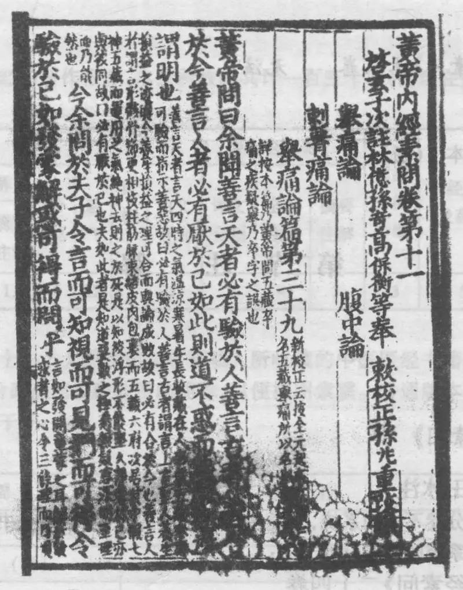
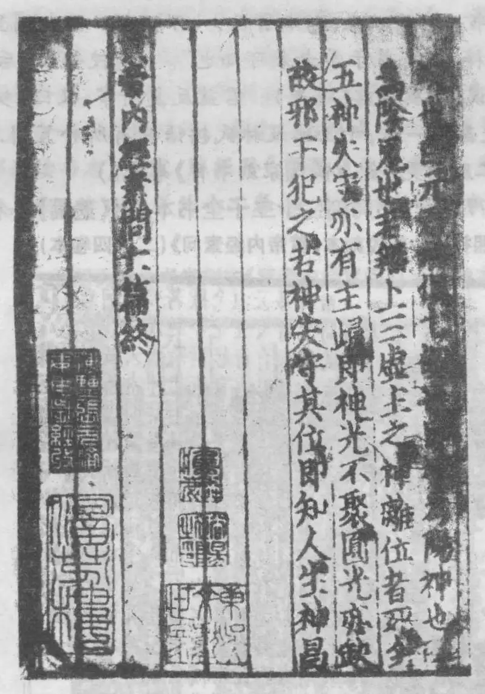
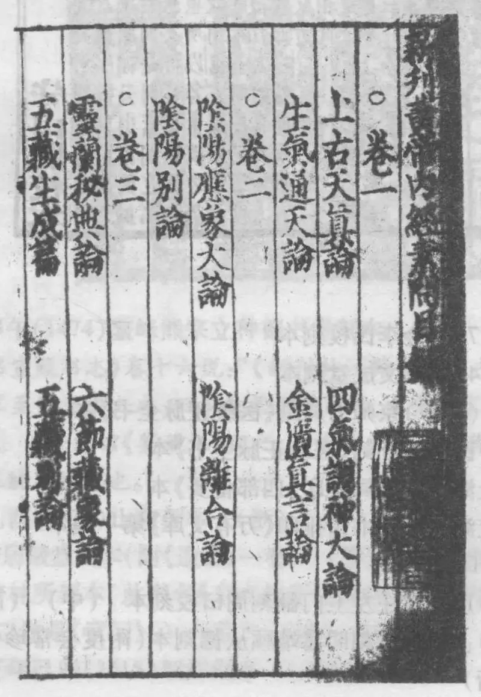
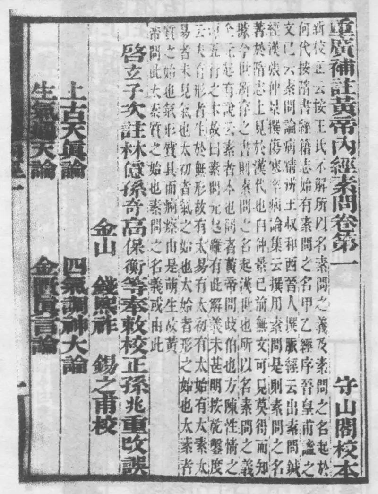
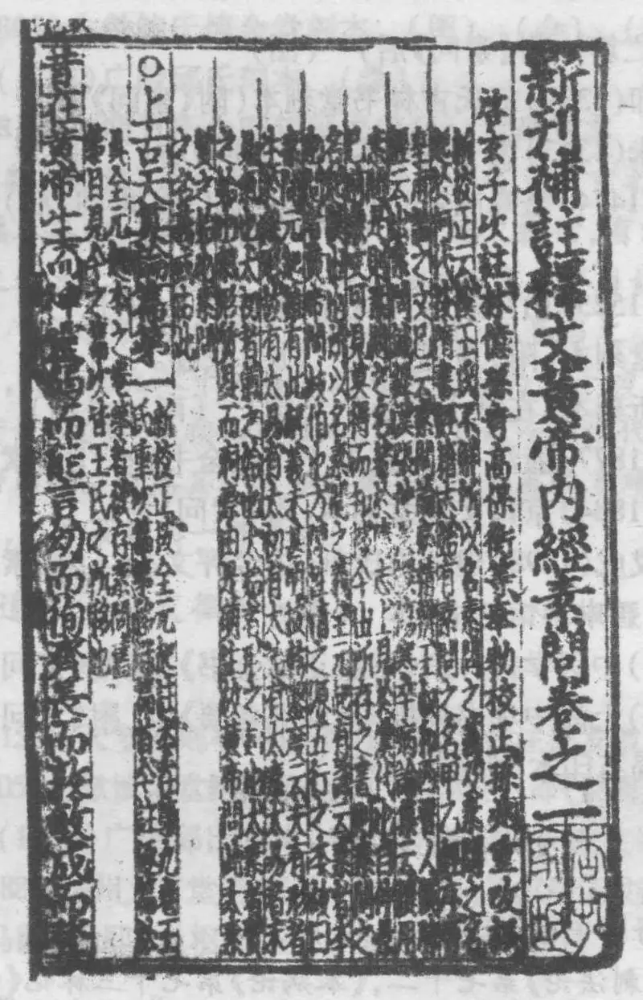
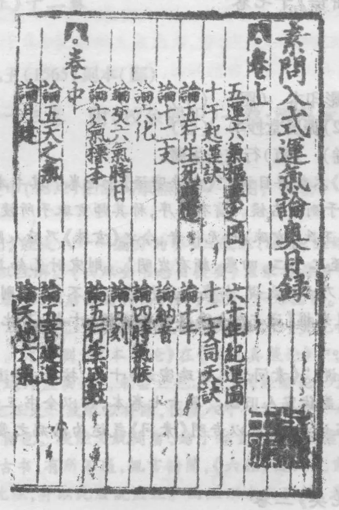
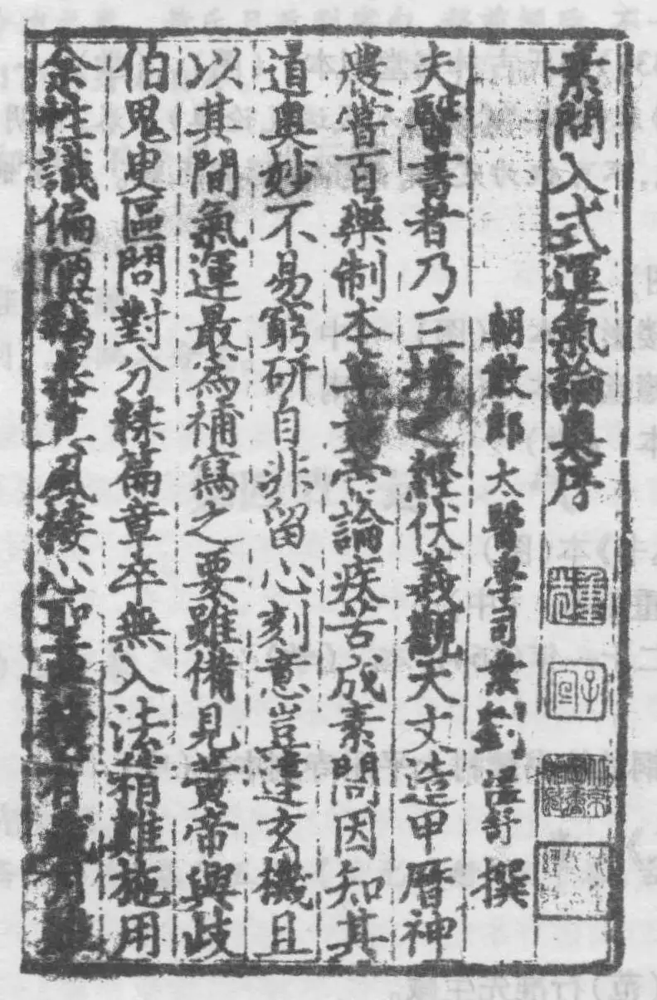
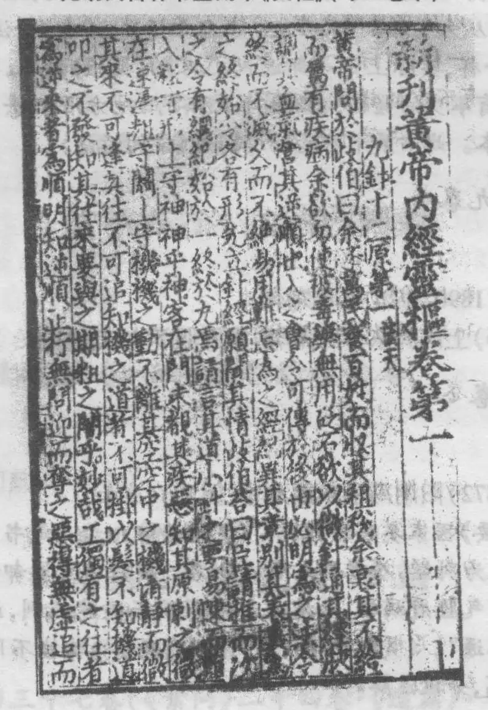

# 二、现存黄帝内经书录

第一章　素问 1233

第一节　白文 1233

第二节　注解 1233

全书注解 1233

摘要注解 1241

第三节　分类 1243

第四节　运气 1244

第二章　灵枢 1250

第三章　素灵合刻 1253

第一节　白文合刻 1253

第二节　评文合刻 1253

第三节　全书注解 1253

第四节　摘要注解 1255

第四章　素灵分类合编 1256第五章　内经处方及药理 1260

〔p.1249 (인쇄 1232)〕

第六章　难经 1261

第七章　杂著 1269

医经就是中国医学的经典文献，计有三种：

(1)《素问》

(2)《灵枢》

(3)《难经》

历代关于这三种医经的著作很多，本录所收的共计一百三十四种，现在分类列表于下：

| 分类 | 素问 |  |  |  |  | 灵枢 | 素灵合刻 |  |  |  | 素灵分类合编 | 内经处方及药理 | 难经 | 杂著 |
|---|---|---|---|---|---|---|---|---|---|---|---|---|---|---|
|  | 白文 | 注解 |  | 分类 | 运气 |  | 白文合刻 | 评文合刻 | 全书注解 | 摘要注解 |  |  |  |  |
|  |  | 全书注解 | 摘要注解 |  |  |  |  |  |  |  |  |  |  |  |
| 种数 | 1 | 10 | 13 | 5 | 22 | 7 | 1 | 1 | 4 | 3 | 13 | 5 | 32 | 17 |

本录是根据国内一十一个大图书馆与个别私人所收藏的中医医经书籍分类编目而成。凡比较特别的版本，均在后面注明收藏处所的简称，以便按图索骥。普通版本则不注明。现在将各大图书馆的简称列表于下：

| 简称 | 单位 |
|---|---|
| （图） | 北京图书馆 |
| （科） | 中国科学院图书馆 |
| （学） | 北京大学图书馆 |
| （协） | 中国协和医学院图书馆 |
| （中） | 中医研究院图书馆 |
| （南） | 南京图书馆 |
| （上） | 上海图书馆 |
| （苏） | 苏州图书馆 |
| （会） | 上海中华医学会图书馆 |
| （浙） | 浙江图书馆 |
| （鄞） | 鄞县古物陈列所 |

〔p.1250 (인쇄 1233)〕

## 第一章 素问

### 第一节 白文

1.《黄帝内经素问》十二卷　无注

不著撰人

①明金溪吴悌刻本　（浙）

②明抄本　（南）

### 第二节 注解

**【全书注解】**

2.《黄帝内经素问》

不著撰人　唐王冰注

此书版本有三种分卷不同的系统，分卷多少虽然彼此不同，但是全书内容，基本上完全相同。现将这三种不同系统的版本分列于下：

（甲）《黄帝内经素问》二十四卷

①金刻本（附《亡篇》一卷）　（图）残存卷三至卷五，卷十一至卷十八，卷二十，亡篇一卷，共十三卷。

②元读书堂刻本（附《亡篇》一卷）　（图）

注：涵芬楼旧藏有此本一部。《涵芬楼烬余书录》子部著录，注为宋刊本，说：“后有读书堂刊四字不全牌记，此或坊版已鬻他人，而时代亦有移易，故剜改也”。此本现由涵芬楼转入北京图书馆，该馆所编《馆藏中国医药书目》著录此书，下注为元读书堂刻本。按孙殿起《贩书偶记》卷九医家类著录《新刊黄帝内经素问》二十四卷附《亡篇》一卷，下注云：“无刻书朝代，约元至正癸未（一三四三）读书堂刊。首有王冰序，次□□岁癸未中和节书于读书堂行书序。次林亿序，次总目，总目后有长方木记‘读书堂刊’四字。每页二十行，每行十八字，小字双行。上下单栏，口中双鱼尾，上有字数，黑线口。惟卷一第二十四页每行十九字。此本较明影宋刊本小字注文增多”。据此可知先藏涵芬楼后转入北京图书馆的即是此本，《涵芬楼烬余书录》作为宋刊本著录是错误了。此本将音释分散附入注文之内，孙殿起所说小字注文增多，寔在只增多了这此散入注文的音释，并没有增加其他注文。

〔p.1251 (인쇄 1234)〕

③明嘉靖二十九年庚戌（1550）武陵顾从德翻宋刻本　（图）　（协）　（中）　（南）　（上）　（苏）　（会）　（浙）　（鄞）残存八卷

此书有民国十一年（1922）上海商务印书馆影印《四部丛刊》本

此书有民国恽铁樵影印本　（中）　（南）　（上）　（会）　（浙）

④明万历十二年甲申（1584）绣谷书林周曰校刻本　（学）　（中）　（浙）

⑤明万历二十九年辛丑（1601）吴勉学校刻《医统正脉全书》本　（科）　（学）　（协）　（中）

**金刻本《黄帝内经素问》（二十四卷本）**

⑥明万历四十八年庚申（1620）潘之恒编《黄海》本　（中）

注：书前有马之骏题识，说：“潘景升先生（之恒）编《黄海》五纪数百卷，所收黄帝事迹文章略查。内《素问》二十四卷，又得旧家宋本，雠校缮写，咸极工雅，将谋诸同志先成之”。书中中缝鱼尾上题“《黄海》”二字，鱼尾下题“《纪藏》”二字。可知此书系潘之恒所编《黄海》全书的五纪中《纪藏》的一部分。此本又称为《黄海》本。

⑦《四库全书》本　（图）

⑧清道光二十九年己酉（1849）赵楫序刻本　（上）

⑨清咸丰二年壬子（1852）钱熙祚守山阁校刻本（附《校勘记》一卷顾观光撰）　（学）

此书有民国十七年（1928）上海中国学会影印本

注：清钱熙祚《内经素问跋》说：“《素问》古注，全元起本已不可得，惟王注存。唐时去古未远，训诂皆有师承，又得宋林亿荟萃群书，析疑正误。方诸吾儒，其郑注之有贾疏乎？……《素问》该括理数，词奥旨深，不特为言医之祖，注亦精简得经意为多。俗医苦其难读，竟趋捷径。儒者津逮偶及，亦未深究全书。自明以来，刻本瞀乱，几不可解。因与同里顾君尚之（顾光）悉心校复，将与《灵枢》同授之梓，或有益于学者未可知也”。又《校勘记》后有钱培杰、钱培荪跋说：“素问既刻成，恐犹有舛误，以属顾君（观光）。君益反复研审，叹曰：乡者于此书殊鲁莽，今始稍得其条理耳。乃别为校勘记一卷，于王冰及林氏按语皆有所补苴纠正，或引旧说，或出己见，期于精当而后已。”（上二跋均见《金山钱氏家刻书目》卷九。）

〔p.1252 (인쇄 1235)〕

**元《读书堂》刻本《黄帝内经素问亡篇》（一卷本）**

**元读书堂刻本《黄帝内经素问》（二十四卷本）**

〔p.1253 (인쇄 1236)〕

⑩清光绪三年丁丑（1877）浙江书局刻二十二子全书本（附《遗篇》一卷）

**钱熙祚守山阁校刻本《黄帝内经素问》（二十四卷本）**

⑪清光绪三年丁丑（1877）新会李氏校刻本

⑫清光绪十年甲申（1884）京口文成堂刻本

⑬清光绪三十三年丁未（1907）京师书局刻《医统正脉全书》本

⑭民国十二年（1923）中医学社补刻《医统正脉全书》本

⑮民国十八年（1929）上海中华书局排印《四部备要》本

⑯民国二十年（1931）上海商务印书馆排印《万有文库》第一集本

⑰民国上海广益书局石印本

⑱日本宽文三年（1663）风月堂庄左卫门翻刻周曰校刻本　（中）　（南）

⑲日本安政四年（1857）占恒堂覆刻明嘉靖顾从德刻本（附度会常珍《校讹》一卷）　（学）　（协）　（中）　（南）　（浙）（乙）《补注释文黄帝内经素问》十二卷

〔p.1254 (인쇄 1237)〕

①元后至元五年己卯（1339）胡氏古林书堂刻本　（图）全一部，又一部残存卷八至十二，又一部残存卷五至九。（学）　（协）残存卷三卷四。

注：《平津馆鉴藏书籍记》卷一说：“《新刊补注释文黄帝内经素问》十二卷。总目一卷后题云：元本二十四卷，今并为一十二卷刊行。卷十二后有至元己卯菖节古林书堂新刊十二字木长印”。按宋晁公武《郡斋读书志》和宋·陈振孙《直斋书录解题》著录此书，都是二十四卷，可知此书原来是二十四卷。将二十四卷并为十二卷，是从古林书堂刊本开始的。

**元胡氏古林书堂刻本《黄帝内经素问》（十二卷本）**

②明成化十年甲午（1474）鳌峰熊宗立种德书堂刻本　（图）　（南）　（中）影抄本。

注：丁丙《善本书室藏书志》卷十六说：“《新刊补注释文黄帝内经素问》十二卷。总目后有木记云：‘是书乃医家至切至要之文，旧本昏蒙讹舛漏落，本堂将家藏善本三复订正，重新绣梓。鳌峰熊氏种德堂识’。以平津馆《鉴藏记》证之，乃依元至元己卯菖节古林书堂本翻刊者。鳌峰熊宗立，乃明成化、正统间坊贾也。”

③明嘉靖四年乙酉（1525）山东刻本　（浙）

④明嘉靖间赵府居敬堂刻本（附《遗篇》一卷）　（图）胶卷　（南）　（会）　（浙）缺卷十一。

⑤明正福书林詹林所刻本（此书名《京本校正注释音文黄帝内经素问灵枢集注》，计共十六卷，其第一卷至第十二卷是《素问》。）　（学）　（南）　（浙）

⑥明万历四十三年己卯（1615）朝鲜刻本　（上）（丙）《黄帝内经素问补注释文》五十卷

〔p.1255 (인쇄 1238)〕

明正统《道藏》本　（图）

此书有民国上海商务印书馆影印本

3.《黄帝内经素问遗篇》

不著撰人

此书版本有两种分卷不同的系统，分卷多少虽然彼此不同，但是全书内容基本上相同。现将这两种不同系统的版本分列于下：

（甲）一卷本

①金刻本（书题为《亡篇》，附《素问》后）　（图）

②元后至元五年己卯（1339）胡氏古林书堂刻本（附《素问》后）　（学）

③元后至元九年癸未（1343）读书堂刻本（附《素问》后）　（图）

④明成化十年甲午（1474）鳌峰熊宗立种德堂刻本（附《素问》后）　（图）　（南）　（中）影抄本。

⑤明嘉靖四年乙酉（1525）山东刻本（附《素问》后）　（浙）

⑥明嘉靖赵府居敬堂刻本（附《素问》后）　（图）胶卷。　（中）　（南）　（浙）

⑦明正福书林詹林所刻本（在第十三卷）　（学）　（南）　（浙）

⑧清光绪三年丁丑（1877）浙江书局刻《二十二子全书》本（附《素问》后）

⑨清光绪十年甲申（1884）京口文成堂刻本（附《素问》后）

⑩清光绪二十四年戊戌（1898）建德周氏刻《内经评文》本（附《素问》后）

⑪清光绪方功惠刻《碧琳琅馆丛书》本　（图）

⑫民国十二年（1923）中医学社补刻《医统正脉全书》本（附《素问》后）

⑬民国十八年（1929）上海中华书局排印《四部备要》本（附《素问》后）

⑭民国上海广益书局石印本（附《素问》后）

（乙）五卷本

明正统《道藏》本

此书有民国上海商务印书馆影印本

注；《黄帝内经素问·刺法论》第七十二，《本病论》第七十三林亿《新校正》说：“详此二篇亡在王注之前。按《病能篇》末王冰注云：世本既阙第七二篇，谓此二篇也。而今世有《素问亡篇》及《昭明隐者论》。以谓此三篇，仍托名王冰为注，辞理鄙陋，无足取者”。丹波元胤《医籍考》卷二说：“赵简王补刊《素问遗篇》。按先子曰：今所传《遗篇》一卷，此乃王冰以后人所托而作，经注一律，出于一人之手，辞理浅薄，不取”。据此，可知此书是王冰以后的人伪撰的。这伪书是甚么时候的人作的呢？《明史·艺文志》著录赵简王补刊《素问遗篇》一卷，下面小注说：“世传《素问》王冰注本，中有缺篇，简王得全本补之”。按此即系指明赵府居敬堂刊《素问》所附《遗篇》。但金·元刻本《素问》都已附有《遗篇》（当时书名是《素问亡篇》），可见并不始于居敬堂本。《四库全书总目提要》医家类一说：“《素问入式运气论奥三卷》，宋刘温舒撰，卷末别附《刺法论》一卷，题曰《黄帝内经素问遗篇》，按《刺法论》之亡，在王冰作注之前，温舒生北宋之末，何从得此？其注亦不知出自何人，殆不免有所依托，未可尽信。焦竑《经籍志》载此书四卷，合此论为一书，益舛误矣”。按《素问遗篇》包括《刺法论》第七十二，《本病论》第七十三，凡二篇。《四库提要》说：“卷末别附《刺法论》一卷”，大概是只看了开卷第一页即没有再看下去，所以不知道还有《本病论》一篇。郑樵《通志艺文略》和《宋史·艺文志》著录此书都是四卷，都是包括《素问遗篇》在内，并不始于焦竑《国史经籍志》。据林亿《新校正》说：“今世有《素问亡篇》”，可知这一书在林亿校正医书的时代即已存在，这一书应当是王冰以后林亿以前的人所伪撰的。

〔p.1256 (인쇄 1239)〕

4.《黄帝内经素问注证发微》九卷

明·马莳注证

①明万历十四年丙戌（1586）刻本　（协）

②清嘉庆十年乙丑（1805）古歙鲍氏慎余堂刻本　（图）　（会）　（浙）

③清光绪十四年戊子（1888）广陵邱氏刻本　（学）

④日本宽永五年（1628）重刻明万历十四年丙戌（1586）宝命堂本　（学）

注：清汪昂《素问灵枢类纂约注》凡例说：“《素问》在唐有王启玄之注，为注释之开山。至明万历间而有马玄台、吴鹤皋二注。马注舛谬颇多，又有随文敷衍，有注犹之无注者。反訾王注逢疑则默，应变不知量之过也”。《四库全书总目提要》医家类存目说：“《素问注证发微》九卷。其说据汉《志》内经十八篇之文，以《素问》九卷《灵枢》九卷当之。复引《离合真邪论》中《九针》九篇因而九之之文，定为九九八十一篇。此唐王冰分为二十四卷为误……其注亦无所发明，而于前人著述多所訾议，过矣”。按马莳注本，实际上是一部近代文的《素问》翻译本，分段清晰，对读者是有很大帮助的。虽然其中有不少的错误，也有讲多难解的地方滑了过去，但在所有《素问全书》注本中，还是最好的一种注本。

5.《黄帝内经素问遗篇注证发微》一卷

明·马莳注证

①明万历十四年丙戌（1586）天宝楼刻本（明马莳注，即《灵枢注证发微》卷十）　（协）　（南）

②清嘉庆十年乙丑（1805）古歙慎余堂鲍氏重刻本（明马莳注，即《灵枢注证发微》卷十）　（南）

③清光绪十四年戊子（1888）广陵邱氏刻本（明马莳注，即《灵枢注证发微》卷十）　（南）

④清光绪十四年戊子（1888）扬州文富堂刻本（明马莳注，即《灵枢注证发微》卷十）　（协）　（中）

⑤日本宽永刻本（明马莳注，即《录枢注证发微》卷十）　（南）

6.《黄帝内经素问》二十四卷

不著撰人　明·吴崑注

①明万历三十七年己酉（1609）刻本（石室藏版）　（科）　（学）　（协）　（中）　（南）　（苏）　（浙）

②清光绪二十四年戊戌（1898）新安程氏刻本　（图）　（会）

③清大兴堂刻本　（协）

④日本元禄六年（1893）书林吉村吉左卫门重刻明玉树堂本　（学）

⑤日本宝永刻本　（南）

注：《汪昂素问灵枢类纂约注》凡例说：“《素问吴注》间有阐发，补前注所未备。然多改经文，亦觉嫌于轻擅”。此书每页中缝鱼尾上题“《内经》吴注”四字，前有明万历二十二年甲午

〔p.1257 (인쇄 1240)〕

（1594）吴崑自序

7.《黄帝内经素问》九卷

清·张志聪集注

①清康熙九年庚戌（1670）刻本　（协）

②清咸丰间刻本（三多斋藏版）　（中）

③清光绪十六年庚寅（1890）浙江书局刻本

④清艺林堂刻本　（协）

⑤民国二十五年（1936）上海大东书局排印《中国医学大成》本

注：清汪昂《素问灵枢类纂约注》凡例说：“张隐庵《素问集注》刻于康熙庚戌，皆其同人所著。画屏旧文，多创臆解，恐亦以私意测度圣人者也”。

8.《黄帝素问直解》九卷

清·高士栻撰

①清康熙三十四年乙亥（1695）刻本　（科）

②清光绪十三年丁亥（1887）浙江书局刻本

注：本书前有凡例九条，说：“《素问》一经，各家虽有注释，余详观之，非苟简隙陋，即敷浅不经。隐庵（张志聪）《集注》，义意艰深，其失也晦。余不得已而更注之，颜曰《直解》，……注释直捷明白，可合正文诵读”。前有清康熙三十四年乙亥（1695）注者自序。

9.《素问释义》十卷

清·张琦学

清道光九年己丑（1829）编者宛鄰书屋自刻本　（协）　（中）

注：前有清道光九年己丑（1829）著者自序，说：“（王）冰之注得不偿失……于芜杂之文曲为解说，牵合附会，强以相通。……琦少好是书，又病其杂。因求其宗旨，按其条理，重为诠释。……其篇次仍王氏（冰）之旧，而以林氏（亿）《校正》分注，以存其真。……昌邑黄元御《素灵微蕴》，江阴章合节《素问阙疑》二书，行世未久，见者或少，篇中时用其说焉”。

10.《黄帝内经素问完璧直讲详注》九卷

清·高亿撰

清同治十一年壬申（1872）刻本（绿云岗藏版）　（中）原缺卷八。

注：此书有注、有讲、有顶批。注是注明音义。讲是讲解大意，顶批是揭出要旨。完全是高头讲章的办法。原缺第八卷（《六元正纪论》七十一，《刺法论》七十二，《本病论》七十三，凡三篇），在目录下注明“原稿散佚嗣刻”。目录分卷与内容不合。

11.《黄帝内经素问讲义》十二卷

日本·喜多村直宽学

日本文久三年（1863）长憙抄本　（协）

〔p.1258 (인쇄 1241)〕

**【摘要注解】**

12.《黄帝内经素问节文注释》十卷

唐·王冰注　明·马莳注释　明·黄球抄

明万历四十七年己未（1619）黄球序刻本（武林卓观堂藏版）　（科）　（中）　（会）　（浙）

注：此书系节录《素问》原文，将王冰及马莳的注解附在下面。凡是马莳的注解，均另起行低一格，以示区别。其中有十六篇（包括《遗篇》二篇）原文，全未录入。

13.《内经纂要》二卷

清·冯兆张撰

①清庚熙四十一年壬午（1702）刻《冯氏锦囊秘录》本　（科）　（协）　（中）　（南）　（苏）　（会）

②清嘉庆会成堂重刻《冯氏锦囊秘录》本　（图）　（协）　（中）

③清道光二年壬午（1822）杨文堂修刻《冯氏锦囊秘录》本　（苏）

注：此书摘录《素问》原文，下附注解。《冯氏锦囊秘录》前有清康熙三十三年甲戌（1694）著者自序。

14.《内经要略》一卷

清·徐大椿撰

清光绪二十九年癸卯（1903）赵翰香居排印《医略六书》本

注：此书系摘出《素问》中的句子，加以注解。

15.《内经铨释》一卷

清·徐大椿撰

①清光绪三十三年丁未（1907）六艺书局石印《徐灵胎医书全集》本

②民国三十七年（1948）广益书局排印《徐灵胎医书全集》本

注：此书与《内经要略》内容完全相同，即系一书改题。谢仲墨《中国医书丛考》说：《内经诠释》里面解释《刺禁论》的小心即命门，和徐大椿所著《医贯砭》驳斥小心即命门，恰恰主张相反，疑《内经铨释》不是徐大椿作的。

16.《黄帝内经素问校义》一卷

清·胡澍撰

①清光绪五年己卯（1879）世泽堂刻本　（图）　（南）　（会）　（浙）

②清光绪九年癸未（1883）蛟川二仁堂刻本　（图）　（协）　（南）

③清光绪刻《滂喜斋丛书》本

④民国十三年（1924）三三医社排印《三三医书》第二集本⑤民国二十五年（1936）上海世界书局排印《珍本医书集成》本

〔p.1259 (인쇄 1242)〕

注：清胡培系《胡君荄甫事状》说：“君讳澍，字荄甫，一学甘伯。中年多病，因治医术，时有超悟。后于都肆浔宋刻《内经》，乃以元熊氏本，明《道藏》本，及唐以前古书，悉心校勘，发明古义，撰《内经校义》。草创未就，今存数十条，诂说精确。其义例略如王氏（念孙）《读书杂志》。”

17.《舒艺室续笔》一卷

清·张文宪撰

清同治十三年（1874）刻本

注：此书中有一部分是《素问》的校注。

18.《内经辨言》一卷

清·俞樾撰

民国十三年（1924）杭州三三医社排印《三三医书》第一集本

注：此书是俞樾读书的按语，共四十八条。缪荃荪《俞先生行状》说：“一意治经，以高邮王氏为宗。其大要在正句读、审字义，通古文段借，由经以及诸子皆循此法，冀不背王氏之旨（《续碑传集》卷七十五）。”这些按语都是根据这一种精神写的。此书即《第一楼丛书》第七种《读书余录》卷一的一部分

19.《素问王冰注校》一卷

清·孙诒让撰

清刻《札迻》本

20.《内经素问校证》不分卷　计三册

清·田晋蕃撰

手稿本　（范）行准先生藏。

21.《王注（素问）撮要》三卷

日本·武田道安撰

日本文政九年（1826）稿本（范）行准先生藏。

22.《素问识》八卷　卷首一卷

日本·丹波元简撰

①日本天宝八年（1837）东都万笈堂刻本　（图）　（学）　（中）　（南）

②清光绪十年甲申（1884）杨守敬印日本刻《聿修堂丛书》本　（图）　（协）　（中）　（南）

③民国二十四年（1935）上海国光印书局排印《聿修堂丛书》本

④民国二十五年（1936）上海世界书局排印《皇汉医学丛书》本

⑤民国上海中医书局排印《聿修堂丛书》本

注：此书系将《素问》摘句加经注解，书前有文化三年（1806）著者自序，说：“于是采择马莳、吴崑、张介宾等诸家之说，更依朱氏之言，添之于经传百氏之书，以补其遗漏，正其纰缪。……如其疑义，则举众说，不敢决择是非。……虽未能掸斯道之至迹，钩经文之深义，然视之明、清诸注，句外添意，凿空臆测，以为浔岐、黄未显之微言者，其于讲肄之际，或有资于稽考欤”。

〔p.1260 (인쇄 1243)〕

23.《素问绍识》四卷

日本·丹波元坚撰

民国二十五年（1936）上海世界书局排印《皇汉医学丛书》本

注：此书系继续他的父亲丹波元简所著的《素问识》而作，所以名为《素问绍识》。他因为得了杨上善注的《黄帝内经太素》，张琦的《素问释义》及乾隆以来专治小学名学者的著书，都是他父亲所未及见的，再加入他们兄弟二人（元胤、元坚）的见解，遂成此书。

24.《黄帝内经素问注》二十四卷

日本·不著撰人

日本钞本　（协）

注：此书体例与《素问识》《素问绍识》同，采用旧注以马莳、张介宾的注为最多。

### 第三节 分类

25.《读素问钞》九卷　《补遗》一卷

元·滑寿编　明·汪机续注

①明嘉靖五年丙戌（1526）休宁程文杰刻本　（图）　（学）　（中）　（南）

②明嘉靖二十年辛丑（1541）刻本　（鄞）

③明崇祯六年癸酉（1633）祁门汪邦铎重辑《石山医书八种》本　（协）　（中）　（上）

④民国十年（1921）上海石竹山房石印《石山医书八种》本

注：元滑寿有《素问钞》一书，系将《素问》节录分类编辑而成。计分藏象、经度、十二经、脉候、病能、摄生、论治、色诊、针刺、阴阳、标本、运气、荟萃凡十三类。明汪机因滑寿原书采王冰注太略，于是重为补录。凡是他所补的王冰注，上面都标一“续”字；滑氏自注，则加“今按”二字；汪氏自注，则加“愚谓”二字；以示区别。共分上、中、下三部，上四卷，中一卷，下四卷。此书《四库全书总目》和《医籍考》著录，都作“《续素问钞》”，但是刻本都作“读”字，不作“续”字。书前有明正德十四年己卯（1519）汪机自序。崇祯本即系嘉靖本原版覆印，并非另一刻本。

26.《黄帝素问钞》七卷

元·滑寿编　明汪机续注

明万历四十年壬子（1612）闽建乔木山房刻本　（协）　（中）

注：此书前六卷内容与《读素问钞》完全相同，只增入《诊家枢要》一卷，作为第七卷。

〔p.1261 (인쇄 1244)〕

27.《素问钞补正》十二卷

明·丁瓒补正

明嘉靖四十四年乙丑(1565)刻本(鄞)

28.《素问悬解》十三卷　附《校余偶识》一卷·清冯承熙撰

清·黄元御解

①清同治十一年壬申(1872)阳湖冯承熙刻本　(图)　(协)　(中)　(南)

②清光绪刻本

注:此书系将《素问》经文八十一篇分为养正、藏象、脉法、经络、孔穴、病论、治论、刺法、雷公问、运气,凡十类,加以注解。《四库全书总目提要》医家类存目说:“《素问悬解》十三卷。是书谓《素问》八十一篇,秦、汉以后始著竹帛,传写屡更,不无错乱。因为参互校正,如《本病论》《刺志论》《刺法论》,旧本皆谓已亡(按《刺志论》旧本未亡,黄元御谓系错简,移入《通评虚实论》,《提要》此句有误)。元御则谓《本病论》在《玉机真藏论》中,《刺志论》则误入《诊要经络论》,《刺法论》则误入《通评虚实论》,未尝亡也。又谓《经络论》乃《皮部论》之后半篇,皮部论乃《十二正经经络论》之正文。故取以补阙,仍复八十一篇之旧。考言经文错简者,起于刘向之校《尚书》,犹有古文可据也。疑经文脱简者,始于郑玄之注《玉藻》,然犹不敢移其次第。至北宋以后,始各以己意改古书,有所不通,辄言错简,《六经》遂几无完本。余波所渐,刘梦鹏以此法说《楚词》。迨元御此注,并以此法说医经。而汉以来之旧帙,无能免于点窜者矣”。清陆懋修《内经难字音义》略例说:“马莳、张志聪、黄元御辈注释《灵》《素》,尽将古字改成今字,如膲作焦,梁作粱,𪔂𪔂作冲冲之类。黄氏且改削字句,移前掇后,不一而是。是皆不可依据”。前有清乾隆二十年乙亥(1755)著者自序。

29.《医经类纂初稿》不分卷　计五册

清·田晋蕃撰

手稿本　(范)行准先生藏。

注:此书仅探《素问》,按病名分类。

### 第四节 运气

30.《天元玉册》三十卷

原题唐·王冰撰

写本　(范)行准先生藏。

注:宋晁公武《郡斋读书志》卷十五说:《天元玉册》三十卷,古启玄子撰,按即唐王冰也,书推五运六气之变。

〔p.1262 (인쇄 1245)〕

31.《素问六气玄珠密语》十七卷

原题唐·王冰编

①明正统道藏本　(图)

此书有民国上海涵芬楼影印本　(图)　(中)

②清道光二年壬午(1822)振贤堂抄本　(会)

③清仁寿山房写本(十卷)　(范)行准先生藏。

注:《四库全书总目提要》术数存目说:“《玄珠密语》十七卷。其书本《素问》五运六气之说而敷衍之,始言医术,浸淫及于测望占候。前有自序,称其师玄珠子所授,故曰《玄珠密语》。宋高保衡等校正《内经》云:‘详王氏《玄珠》世无传者,今之《玄珠》乃后人附托之文耳。虽非王氏之书,亦于《素问》第十九卷至二十二,四卷,颇有发明’。则宋时已知其伪。明洪武间吕复作《群经古方论》云:‘密语所述乃六气之说,与高氏所指诸卷全不侔’。则吕复所见者,并非高保衡所见,又伪本中之重儓。且郑樵《通志略》称:《玄珠密语》十卷,而此本乃十七卷,则后人更有所附益,又非明初之本矣”。

《持静斋藏书纪要》卷下说:“《素问六气玄珠密语》十卷,按是书《道藏》本十七卷,晁公武《志》录此书十卷,与此本合,盖犹宋人旧编。其十七卷本,特以全书三十论(按全书只二十六编)多增卷帙耳。其书推演五运六气,盖以专明《素问》气运为治病之要之说,后来刘温舒《素问入式论奥》,亦发明斯旨”。

32.《素问入式运气论奥》三卷

宋·刘温舒撰

①元后至元五年己卯(1339)胡氏古林书堂刻本　(图)　(学)

注:《四库全书简明目录》卷十说:“《素问入式运气论奥》三卷,发明《素问》运气之理,凡三十一论,九十二图。五运六气,不可执为定法,而不可谓其无理。故有时不验,亦有时而验,存之以备医家之一义”。

②明正统《道藏》本　(图)

此书有民国上海涵芬楼影印本　(图)　(中)

③明成化鳌峰熊宗立种德堂刻本　(图)　(南)

④明正福书林詹林所刻本　(学)

⑤《四库全书》本　(图)

⑥清光绪刻《碧琳琅馆丛书》本(图)

⑦日本宽永二年(1625)重刻本　(中)

⑧日本芳野屋重刻宽永二十一年(1644)本　(学)

⑨日本庆安刻本　(南)

⑩日本元禄七年(1693)铜驼坊书肆村上平乐寺刻本　(中)

33.《素问玄机原病式》一卷

金·刘完素撰

①明嘉靖刻本(二卷)　(范)行准先生藏。

〔p.1263 (인쇄 1246)〕

**元胡氏古林书堂刻本《素问入式运气论奥》目录**

**元胡氏古林书堂刻本《素问入式运气论奥》序**

〔p.1264 (인쇄 1247)〕

②明万历二十九年辛丑(1601)吴勉学校刻《医统正脉全书》本　(科)　(学)　(协)　(中)　(南)

③《四库全书》本　(图)

④清光绪三十三年丁未(1907)京师书局刻《医统正脉全书》本

⑤民国十二年(1923)补刻《医统正脉全书》本

⑥日本宽永七年(1630)梅寿重刻本　(中)

⑦日本元禄三年(1690)通古斋伊藤一道子刻本(二卷)　(学)

注:此书分“五运主病”“六气为病”两大节。《四库全书总目提要》医家类二说:“《素问玄机原病式》一卷。是书因《素问·至真要论》,详言五运六气盛衰胜复之理,而以病机一十九条附于篇末。乃于十九条中,采一百七十六字,演为二百七十七字,以为纲领,而反复辨论以申之,凡二万余言”。清周中孚《郑堂读书记》卷四十二说:“(此书)大旨多主于火,故喜用寒凉之剂,亦缘其时其地施之,自无不可。张景岳《传忠录》极诋之,殊不自知喜用温补,亦仍不免偏主之弊耳”。

34.《新刊图解素问要旨论》八卷

金·刘完素撰

清抄本　(图)

注:此书《医籍考》卷八十著录,题为“刘完素《内经运气要旨论》,《国史经籍志》八卷”。刘完素《素问玄机原病式序》说:“据乎所见,而辄伸短识,本乎《三坟》之圣经,兼以众贤之妙论,编集运气要妙之说,十万余言,九篇三部,勒成一部,命曰《内经运气要旨》,备见圣经之用矣”。可见此书原名应当是《内经运气要旨》。

35.《图解运气铃》一卷

不著撰人

元刻本　(学)

注:附于元刻伤寒论注解后。

36.《素问运气图括定局立成》一卷

明·熊宗立撰

明成化十年甲午(1474)鳌峰熊宗立种德堂刻本　(南)

注:《四库全书总目提要》医家类存目说:“宗立字道轩,建阳人,刘剡之门人也。(刘,永乐中人,有《四书通义》,已著录。好讲阴阳医卜之术,是书以《素问》五运六气之说,编为歌辞,又有天符岁会之说,以人生年之甲子,观其得病之日气运盛衰,决其生死。医家未有用其法者。盖本五运六气,以生克制化推其旺相休囚而已,初无所征验也”。

37.《运气易览》三卷

明·汪机编

①明嘉靖刻本　(科)　(学)　(中)　(南)　(会)②明崇祯重刻《石山医书八种》本　(协)　(中)　(上)

〔p.1265 (인쇄 1248)〕

③民国十年(1921)上海石竹山房石印《石山医书八种》本

注:《四库全书总目提要》医家类存目说:“《运气》易览三卷。是篇取《素问》中五运六气之说,详加辨论。所衍各图,亦颇有发明。然治病自以脉证为主,拘泥司天在泉,终无益于经旨也。”

38.《运气略》一卷

明·张三锡撰

明刻《医学六要》本　(南)　(浙)

39.《运气谷》不分卷　计二册

明·张旭辑

明万历四十七年己未(1619)刻本　(科)

40.《五运六气详解》一卷

明·董玹订

明崇祯五年壬申(1630)十竹斋刻《薛氏医案》本　(中)

41.《宋陈无择三因司天方》二卷　附图说一卷

清·缪问撰

清嘉庆刻本　(会)

42.《运气掌诀录》一卷

清·曹乐斋撰　胡乾元传

①清光绪二十年甲午(1894)成都崇文斋刻《仲景全书》本　(协)　(中)　(南)　(会)

②民国五年(1914)上海千顷堂石印《仲景全书》本

③民国十八年(1929)上海受古书局石印《仲景全书》本

注:前有清道光十八年戊戌(1838)著者自序,说:“兹纂本古今之医统,录《素问·运气六节藏象论》《五运五行论》《指微要论》《至真要论》便知运气之源。详考逐年司天、在泉、太过、不及、主运、客运、天时、民病、立局于后,以便取证”。

43.《内经运气病释》九卷　《附内经遗篇病释》一卷

清·陆懋修撰

①清光绪四年戊寅(1878)刻清光绪十二年丙戌(1886)山左书局印《世补斋医书》本

②清光绪十年甲申(1884)成都文益堂刻《世补斋医书》本

③民国元年(1912)上海江东茂记书局石印《世补斋医书》本

④民国二十年(1931)上海中医书局石印《世补斋医书》本

注:此书系选择《素问》中讲五运六气的八篇论文(《六节藏象论》《天元纪大论》《五运行大论》《六微旨大论》《气交变大论》《五常政大论》《六元正纪大论》《至真要大论》),加以注释。末附以宋·陈言著的《三因十六方》,和清·缪问著的《三因十六方解》。前有清光绪十年甲申(1884)著者自序。

〔p.1266 (인쇄 1249)〕

44.《内经运气表》一卷

清·陆懋修辑

①清光绪四年戊寅(1878)刻清光绪十二年丙戌(1886)山左书局印《世补斋医书》本

②清光绪十年甲申(1884)成都文益堂刻《世补斋医书》本

③民国元年(1912)上海江东茂记书局石印《世补斋医书》本

④民国二十年(1931)上海中医书局石印《世补斋医书》本

注:前有著者题识,说:“运气之学,非图不明。……惟图说愈伙,卒业愈难,且有不能图而宜于表者,余故易图为表,……便于检查而止”。

45.《运气辨》不分卷　计二册

清·陆儋辰撰

《海陵丛刊》本　(范)行准先生藏。

46.《内经病机纂要》二卷

清·周孝垓订

清刻本　(南)

47.《运气指掌》一卷

清·高思敬撰

民国六年(1917)排印高憩云《外科全书》本

注:前有民国五年(1916)著者自序,说:“仆也幼未读书,学识浅陋,仅于外科一门,一知半解,而于逐年运气,时时体验,确有可凭而可信者。爰将运气编辑浅明歌括,并摘录六元正纪逐年胜复邪正变化,为之图说大概,以公诸同好”。

48.《素问入式运气论奥口义》三卷

日本·玄璞撰

日本宽永刻本　(学)　(南)

49.《运气一言集》四卷

日本·吉田宗恂撰

日本承应刻本　(南)

50.《素问入式运气论奥谚解》七卷

宋·刘温舒原撰　日本·冈本为竹解日本宽永元年(1704)芳野屋权兵卫等刻本　(中)

〔p.1267 (인쇄 1250)〕

51.《素问运气抄》三卷

不著撰人

日本铜活字本　(图)

## 第二章 灵枢

52.《黄帝内经灵枢》

不著撰人　宋·史崧音释

此书版本,有四种分卷不同的系统。分卷多少虽然彼此不同,但是全书的内容基本上完全相同。现将这四种不同系统的版本分列于下:

(甲)《黄帝内经灵枢》二十四卷

①明万历十二年甲申(1584)绣谷书林周曰校刻本　(学)　(中)　(浙)

②清咸丰二年壬子(1852)钱熙祚守山阁校刻本(附顾观光《校勘记》一卷)

此书有民国十七年(1928)上海中国学会影印本　(会)

③日本宽文三年(1663)风月堂庄右卫门翻周曰校刻本　(南)

(乙)《黄帝内经灵枢》十二卷

①元后至元五年己卯(1339)胡氏古林书堂刻本　(图)

②明成化十年甲午(1474)鳌峰熊宗立种德堂刻本　(中)影抄本。

③明嘉靖四年乙酉(1525)山东刻本　(浙)

④明嘉靖间赵府居敬堂刻本(书名《黄帝素问灵枢经》)　(南)　(会)　(浙)　(鄞)存六卷。

此书有民国上海商务印书馆《四部丛刊》影印本。

⑤明万历二十九年辛丑(1601)新安吴勉学校刻《医统正脉全书》本　(科)　(学)　(协)　(中)　(南)　(会)

⑥《四库全书》本　(图)

⑦光绪三年丁丑(1877)浙江书局刻《二十二子全书》本

⑧清光绪十年甲申(1884)京口文成堂仿宋刻本

⑨清光绪三十三年丁未(1907)京师书局刻《医统正脉全书》本

⑩民国十二年(1923)中医学社补刻《医统正脉全书》本

⑪民国十八年(1929)上海中华书局排印《四部备要》本

⑫民国二十年(1931)上海商务印书馆排印《万有文库》本

⑬民国上海广益书局石印本

(丙)《黄帝素问灵枢集注》二十三卷(此本题为《素问灵枢》,实际上只是《灵枢》而无《素问》,题为集注,实际上只有原文及史崧音释,与其他各本完全相同,并**元胡氏古林书堂刻本《灵枢》(十二卷本)**

〔p.1268 (인쇄 1251)〕

没有集注)。

明正统《道藏》本　(图)

此书有民国上海商务印书馆影印本　(图)　(中)

(丁)二卷本

明正福书林詹林所刻“《京本校正注释音文》《黄帝内经素问灵枢集注》”十六卷,其第十四、第十五两卷是《灵枢》　(学)　(南)　(浙)

53.《黄帝内灵枢略》一卷

不著撰人

明正统《道藏》本　(图)

此书有民国上海涵芬楼影印本

54.《黄帝内经灵枢注证发微》十卷

明·马莳注证

①清嘉庆十年乙丑(1805)古歙鲍氏慎余堂刻本　(协)　(会)

②清光绪五年己卯(1879)太医院刻本　(浙)

③清维扬文富堂刻本　(学)

④日本宽永五年(1628)重刻明万历十六年戊子(1588)宝命堂本　(学)

注:清·汪昂《素问灵枢类纂约注》凡例说:“《灵枢》从前无注,其文字古奥,名数繁多,观者皱额颦眉,医家率废而不读。至明始有马玄台之注,其疏经络穴道,颇为详明,可谓有功于后学。虽其中间有出入,然以从来畏难之书,而能力开坛坫,以视《素问》注,过之远矣”。按马莳此书,和他所注的《素问》一样,实际上是一部近代文的《灵枢》翻译本,分段清晰,对于读者是有很大帮助的。虽然其中有不少的错误,也有许多难解的地方滑了过去,但在所有《灵枢》全书注本中还是最好的一种注本。此书第十卷是补遗,即《素问遗篇》。

〔p.1269 (인쇄 1252)〕

55.《灵枢经集注》九卷

清·张志聪集注

①清光绪十六年庚寅(1890)浙江书局刻本

②民国二十五年(1936)上海大东书局排印《中国医学大成》本

56.《灵枢悬解》九卷

清·黄元御解

清同治十一年壬申(1872)阳湖冯承熙刻本　(图)　(中)

注:《四库全书总目提要》医家类存目说:“《灵枢悬解》九卷。是书亦以错简为说,谓经别前十三段为正经,后十五段为别经,乃经别之所以命名。而后十五段却误在经脉中,标本而误名卫气,四时气大半误入邪气脏府病形,论津液五别误名五癃津液别,此类甚多。乃研究《素问》,比栉其辞,使之脉络环通”。《灵枢悬解》和《素问悬解》的编法不同,《灵枢悬解》没有分类,是仍按《灵枢》八十一篇,分段注解的。

57.《灵枢识》六卷

日本·丹波元简撰

①日本文久三年(1863)跻寿馆活字本　(协)　(中)

②民国二十五年(1936)上海大东书局排印《中国医学大成》本

注:此书系将《灵枢经》文中字句摘出,下加注解。

58.《黄帝内经灵枢注》二十三卷

日本·不著撰人

日本抄本　(协)

注:此书体例与《灵枢识》同,所采旧注以马莳、张介宾的注为最多。

〔p.1270 (인쇄 1253)〕

## 第三章 素灵合刻

### 第一节 白文合刻

59.《黄帝内经素问》九卷·《黄帝内经灵枢》九卷

不著撰人

日本田中清左卫门刻本　(中)

### 第二节 评文合刻

60.《内经评文》三十七卷(《素问》二十四卷·《遗篇》一卷·《灵枢》十二卷)

不著撰人　唐·王冰编　清·周学海评注

清光绪二十四年戊戌(1898)建德周氏《医学丛书》本

此书有民国二十五年(1936)影印本

注:前有清光绪二十二年丙申(1896)著者自序,说:其文之可法可师,稍知慕古者,莫不知好。向来选家,遗而不录。学海不揣固陋,辄仿茅鹿门,储同人,评《左氏传》《战国策》文例,取两经之文,为之分析腠理,指点起伏,使览者见其脉络贯通,义理昭著,抑扬顿挫,情韵流连,足以发人之神智,而舞蹈于不自觉也。

### 第三节 全书注解

61.《黄帝内经素问》·《灵枢》

不著撰人　《素问》唐·王冰注

此书版本,有四种分卷不同的系统。分卷多少虽彼此不同,但是全书内容基本上完全相同。现在将四种不同系统的版本分列于下:

(甲)《重广补注黄帝内经素问》二十四卷·《灵枢》二十四卷。

①明万历十二年甲申(1584)绣谷书林周曰校刻本　(学)　(中)　(浙)②清咸丰二年壬子(1852)钱熙祚守山阁校刻本(书名为《重广补注黄帝内经素问》二十四卷·《灵枢经》二十四卷　附《素问校勘记》一卷·《灵枢经校勘记》一卷·《顾尚之别传》)

〔p.1271 (인쇄 1254)〕

此书有民国十七年(1928)上海中国学会影印本。

③日本宽文三年(1663)风月堂庄左卫门翻刻明万历十二年甲申(1854)周曰校刻本　(中)　(上)

(乙)《重广补注黄帝内经素问》二十四卷·《灵枢经》十二卷

①明万历二十九年辛丑(1601)新安吴勉学校刻《医统正脉全书》本(映旭斋藏板)　(图)

②清光绪三年丁丑(1877)浙江书局刻本(书名为《补注黄帝内经素问》二十四卷·《素问遗篇》一卷·《内经灵枢》十二卷)

③清光绪十年甲申(1884)京口文成堂刻本(书名为《补注黄帝内经素问》二十四卷·素问遗篇一卷·《内经灵枢》十二卷)

④民国上海广益书局石印本(书名为《补注黄帝内经素问》二十四卷·《素问遗篇》一卷·《内经灵枢》十二卷)

(丙)《黄帝内经素问》十二卷·《灵枢》十二卷

①明成化十年甲午(1474)鳌峰熊宗立种德堂刻本(附《素问遗篇》一卷·《素问入式运气论奥》三卷·《新增运气图括定局立成》一卷·《黄帝内经素问灵枢音释补遗》一卷)　(丁)济民先生藏。

②明嘉靖四年乙酉(1525)山东刻本(明田经校·书名为《新刊补注释文黄帝内经》十二卷·《灵枢集注》十二卷　《附运气论奥》三卷·《素问遗篇》一卷·《运气图括定局立成》一卷)　(浙)

③明嘉靖间赵府居敬堂刻本(书名为《补注释文黄帝内经素问》十二卷·《素问遗篇》一卷·《黄帝素问灵枢经》十二卷)　(中)

(丁)《京本校正注释音文黄帝内经素问》十六卷

明正福书林詹林所刻本　(学)　(南)　(浙)

注:此书第一卷至第十二卷是《素问》,第十三卷是《素问遗篇》,第十四、十五两卷是《灵枢》,第十六卷是《素问入式运气论奥》,末附熊宗立纂集的两种书,一种是《素问运气图括定局立成》,一种是《黄帝内经素问灵枢运气音释补遗》。

62.《黄帝内经素问注证发微》九卷·《灵枢注证发微》十卷

明·马莳注证

①明万历十四年丙戌(1586)天宝堂刻本　(南)

②清嘉庆十年乙丑(1805)古歙鲍氏慎余堂刻本　(南)

③清嘉庆十年乙丑(1805)大文堂刻本　(上)

④清光绪五年己卯(1879)坊刻本

⑤清光绪十四年戊子(1888)广陵邱氏刻本　(南)

⑥清光绪十四年戊子(1888)扬州文富堂刻本　(协)　(中)

⑦清光绪间润州包氏守研堂刻本　(中)

⑧日本宽永刻本　(南)

〔p.1272 (인쇄 1255)〕

63.《黄帝素问集注》九卷·《灵枢经集注》九卷

清·张志聪集注

①清咸丰间刻本(三多斋藏版·《素问集注》九卷·《灵枢经集注》九卷　(中)

②清光绪五年己卯(1879)刻本(太医院藏版·《素问集注》九卷·《灵枢经集注》十卷·《灵枢经集注》第十卷是补遗,即《素问遗篇》。)

64.《黄帝内经素问灵枢合编》二十卷

明·马莳、清·张志聪合注

①清宣统二年庚戌(1910)医学公会石印本

②民国十一年(1922)上海锦章图书局石印本

注:此书计《素问合纂》十卷,《灵枢合纂》十卷。《灵枢合纂》前九卷是《灵枢》,第十卷是《素问遗篇》。此书系将明·马莳、清·张志聪二家的注解,合为一书,每注上均用黑地白字标明马注或张注,眉目很清醒。

### 第四节 摘要注解

65.《内经难字音义》一卷

清·陆懋修辑

①《世补斋医书》手稿本　(范)行准先生藏。

②清光绪四年戊寅(1878)刻清光绪十二年丙戌(1886)山左书局印《世补斋医书》本

③清光绪十年甲申(1884)成都文益堂刻《世补斋医书》本

④民国元年(1912)上海江东茂记书局石印《世补斋医书》本

⑤民国二十年(1931)上海中医书局石印《世补斋医书》本

注:此书系取《素问》《灵枢》二书中的难字,加以注解。《灵枢》列前,《素问》列后。每篇各标原书的篇次。为什么《灵枢》列在《素问》之前呢?书前有略例,说:“《素问》诸篇幅所引经曰皆《灵枢》文。”又《离合真邪论》明言:“余闻九针九篇,夫子因而九之,九九八十一篇,余尽通其意矣”。据此则《灵枢》自当居《素问》之前”。

66.《灵素五解篇》一卷

廖宗泽辑

民国十二年(1923)成都存古书局刻《六译馆丛书》本

注:此书是一种以经解经的注解。前有民国四年(1915)黄镕序,说:“《小针》解,《针解》即解《九针经十二原篇》,《八正神明论》即解《官针篇》,《阳明脉解》即解《经脉》阳脉病状,《脉解》亦解《经脉》足六经脉状。其他散见之足以互相证明者尤为繁夥。惟此数篇纲领明著,历来解家未能合之以成两美。大抵分篇作注,不免肢解全牛”。所以著者就取此数篇作为注解。“其余针刺脉法类之零散各篇互相为解者,并以附后”。

〔p.1273 (인쇄 1256)〕

67.《黄帝内经素问要语集注》九卷·《黄帝内经灵枢要语集注》九卷

日本·竹村畇集注

中野宗左卫门刻本·[《素问》]日本宝永三年(1706)·[《灵枢》]享保二十年(1735)　(中)

注:此书系摘录《内经》经文中的要句,下加注解而成。

## 第四章 素灵分类合编

68.《黄帝内经太素》三十卷

唐·杨上善奉敕撰注

①清光绪二十三年丁酉(1897)袁昶通隐堂刻本

②民国十三年(1924)黄陵萧延平兰陵堂仿宋校刻本

注:此书是将《素问》《灵枢》二书分析归类编辑而成。计缺卷一、卷四、卷七、卷十六、卷十八、卷二十、卷二十一,凡七卷,实存二十三卷。杨守敬《日本访书志》卷九说:“是书合《灵枢》《素问》纂为一书,故其篇目次第,与二书皆不合。而上足以证皇甫谧,下足以订王冰,洵医家鸿宝也”。黄以周《儆季文抄》卷二旧抄《太素经校本序》说:“《太素》改编经文,各归其类,取法于皇甫谧之《甲乙经》,而无其破碎大义之失。……《太素》之文,同全元起本,不以别论羼入其中。其为注依经立训,亦不逞私见。则其有胜于王氏次注者,概可知矣。且《太素》所编之文,为唐以前之旧本,可以校正今之《素问》《灵枢》者,难经缕述”。杨上善是唐高宗李治时代的人(650—683),详见杨守敬《日本访书志》卷九,萧延平《黄帝内经太素例言》,及《医籍考》卷六眉批引杜光庭说。

69.《黄帝内经始生考》三卷

明·阴秉旸撰

明隆庆元年丁卯(1567)刻本　(科)　(中)

注:此书是将《素问》《灵枢》二书的经文分析删节抄撮归类而成,在书眉上标出原书的篇次。著者原想将《内经》区分为始生、修养、病因、诊视、医疗、针灸、运气、药性八部分。这是始生的部分。书前有明隆庆元年丁卯(1567)著者自序。

70.《类经》三十三卷　附《图翼》十一卷·《附翼》四卷

明·张介宾类注

①明天启四年甲子(1624)金间童涌泉刻本　(图)　(科)　(学)缺图翼。(中)　(南)　(浙)　(鄞)

②《四库全书》　(图)

③清嘉庆四年己未(1799)金间萃英堂刻本④清宏道堂刻本

〔p.1274 (인쇄 1257)〕

⑤天德堂刻本

注:此书系将《素问》《灵枢》二书分析归类编辑而成。每一段都标出原书的篇名。《四库全书总目提要》医家类说:“是书以《素问》《灵枢》分类相从。一曰摄生、二曰阴阳、三曰藏象、四曰脉色、五曰经络、六曰标本、七曰气味、八曰论治、九曰疾病、十曰针刺、十一曰运气、十二曰会通,共三百九十条。又益以《图翼》十一卷,《附翼》四卷。虽不免割裂古书,而条理井然,易于寻览。其注亦颇有发明”。《图翼》十一卷,第一、二两卷运气,第三至第十卷经络,第十一卷针灸要览。《附翼》四卷,第一卷医易,第二卷律原,第三卷求正录,第四卷针灸诸赋。前有明天启四年甲子(1624)著者自序。

71.《黄帝内经素问灵枢经合类》九卷

明·王九达撰

明崇祯元年戊辰(1628)刻本　(中)　(会)

注:此书是将《素问》《灵枢》二书分析归类编辑而成,分为摄生、藏象、经度、运气、脉候、色诊、病能、论治、针刺九类。每一类首列《素问》,次列《灵枢》,都标明原书出处。每段下面均有注解。《医籍考》卷六著录此书,引《九江府志》说:“王九达,字曰逵,崇祯间典职太医,著有《素问灵枢合类》九卷”。书前有明崇祯元年戊辰(1628)著者自序。

72.《内经知要》二卷

明·李中梓撰

①清乾隆二十九年甲申(1764)扫叶庄刻本　(中)　(南)　(会)

②清道光五年乙酉(1825)太邑赵氏重刻本(存心堂藏版)　(图)

③清光绪九年癸未(1883)上海江左书林刻本

④清光绪十一乙酉(1885)苏州王氏绿慎堂刻本

⑤清扫叶山房刻本

⑥民国二十二年(1933)上海商务印书馆排印本

⑦日本宽文二年(1662)武林市兵卫刻本(十卷)　(协)　(南)

注:此书是摘录《素问》及《灵枢》经文分析归类编辑而成,分道生、阴阳、色诊、脉诊、藏象、经络、治则、病能八类。每段均标出原书篇名,下附注解。

73.《灵素合抄》十五卷

明·遗民林澜撰

清康熙间刻本　(范)行准先生藏。

注:此书《医籍考》卷六著录,引毛奇龄《林君墓表》说:“仿滑氏(《读素问抄》)分类十二,约文五百,汰其冗而贯其错,合《灵枢素问》为一书,自摄生至运气,定十有五卷”。

74.《素问灵枢类纂约注》三卷

清·汪昂编

〔p.1275 (인쇄 1258)〕

①清乾隆间刻本　(丁)济民先生藏。

②清同治十年辛未(1871)扫叶山房刻本

③清光绪六年庚辰(1880)江左书林刻本

④清光绪六年庚辰(1880)尚德堂刻本

⑤清光绪六年庚辰(1880)重刻本(紫文阁藏版)

⑥清光绪十三年丁亥(1887)扫叶山房刻本

⑦清光绪二十一年乙未(1895)刻本(醉六堂藏版)

⑧清光绪二十二年丙申(1896)上海图书集成局排印本

⑨通行本

⑩民国商务印书馆排印本

注:此书系摘录《素问》《灵枢》二书经文分析归类编辑而成,每一段注明原书篇名。清周中孚《郑堂读书记》卷四十三说:“讱庵(汪昂)以《素问》《灵枢》各八十一篇,随问条答,读之芒无津涯,难以得其窍会,因合纂为一篇。凡分藏象、经络、病机、脉要、诊候、运气、审治、生死、杂论九类。于各篇之中,复前后条贯。且参酌旧注,增入己见,务令语简意明,使读者了然心目,故名《约注》。至于针灸之法,与医药不同,则置之不录”。前有清康熙二十八年己巳(1689)著者自序。

75.《医以理解》九卷

清·程知撰

民国十四年(1925)上海元昌印书馆石印本

注:此书分为脏府解、经络解、穴名解、骨部解、脉象解、脉理解、望色解、病名解、药名解凡九解。系将《素问》《灵枢》和《本草经》三书分析归类,下加注解而成。

76.《医经原旨》六卷

清·薛雪集注

①清乾隆间薛氏扫叶庄刻本　(科)　(学)　(南)　(苏)　(浙)

②清刻本(宁郡简香斋藏版)

③民国十七年(1928)上海千顷堂书局石印本

注:前有清乾隆十九甲戌(1754)著者自序,说:“近有会稽张景岳出,才大学博,胆志颇坚,将二书(《素问》和《灵枢》)串而为一,名曰《类经》。惜乎疑信相半,未能去华存实。余则一眼觑破,既非圣经贤传,何妨割裂。于是彻底掀翻,重为删述。至于针灸一法,另有专书,故略收一二,余多节去。其据文注释,皆广集诸家之说,约取张氏者为多”。此书共分摄生、阴阳、藏象、脉色、经络、标本、气味、论治、疾病九类。书中所采经文,均不注明原书的篇名卷数,使读者看去,仿佛是另外一书,这就是自序中所说的彻底掀翻,重为删述了。

77.《医经读》四卷

清·沈又彭抄订

①清乾隆三十年乙酉(1765)刻本(附《伤寒杂病论读》,宁俭堂藏版)　(中)

②民国十三年(1924)三三医社排印《三三医书》本

〔p.1276 (인쇄 1259)〕

注：此书分平、病、诊、治四集，将《素问》《灵枢》经文摘出著者认为可信的，按性质分列于各集，每条下注明原书篇名，书前有清乾隆二十九年甲申（1764）著者自序，说：“扁鹊、仲景非世所称医中之圣而去古未远者耶？其书具在，其所引用者皆可信，其所不引用者为可疑。其所不引用而复与其所引用者相背，定属后人添造”。这就是他摘录的标准。

78.《灵素集注节要》十二卷

清·陈念祖集注

①清同治四年乙丑（1865）文奎堂刻《南雅堂医书》本　（科）　（中）

②清光绪二年丙子（1876）仿南雅堂刻本

③清光绪十八年壬辰（1892）敦厚堂刻《陈修园医书十八种》本

④清光绪十八年壬辰（1892）图书集成局排印《陈修园医书二十一种》本

⑤清光绪三十一年乙巳（1905）上海商务印书馆排印《陈修园医书五十种》本

⑥清光绪三十四年戊申（1908）宝庆经元书局刻《陈修园医书二十三种》本

⑦清宣统元年己酉（1909）四川善成堂刻《陈修园医书三十二种》本

⑧清聚和堂刻本

⑨清扫叶山房刻本

⑩清末刻《陈修园医书十六种》本（南雅堂藏版）

⑪清末连元阁刻《陈修园医书十五种》本

⑫民国五年（1916）上海广益书局石印《陈修园医书七十种》本

⑬民国八年（1919）颐性室石印本

⑭民国八年（1919）扫叶山房石印《陈修园医书六十种》本

⑮民国二十四年（1935）上海三星书店石印《陈修园医书四十八种》本

⑯民国二十六年（1937）上海大文书局排印《陈修园医书七十二种》本

注：此书系摘录《素问》《灵枢》二书条文分析归类编成，分道生、藏象、经络、图形、运气、望色、闻声、问疗、审治、生死、脉诊、病机十二类，下附注解。每段均标出原书篇幅名。每卷第一行书题是《灵素提要浅注》。

79.《类经纂要》三卷　附《寿芝医案》一卷

明·张介宾类注　清·虞庠辑　清·王廷俊增注

清同治六年丁卯（1867）浙省翰墨斋刻本

注：此书将明张介宾《类经》删繁节要而成，分上、中、下三卷。下卷之末，为《难经节抄》。后附王廷俊所著《寿芝医案》一卷。医案前有清同治六年丁卯（1867）著者自序。

80.《黄帝内经太素补注》三十卷

隋·杨上善奉敕撰　民国·杨明济补注

民国二十四年（1935）刘震鋆等汉口排印本

注：此书虽名《补注》，但它的内容，系将《素问》《灵枢》二书中的字句与本书字句不同的地方，校出注明。又将每段原属何书何篇，标出注明。与萧延平校刊本内容相似，但远不及萧本的精详。此书只算是一种校证，并非补注，书名与内容不相应。第七卷原佚，此本因卷六是“藏府之一”，遂推定卷七应当是“藏府之二”，于是将《素问》《灵枢》二书关于藏府各条补列以充卷七。所以此本只缺卷一、卷四、卷十六、卷十八、卷二十、卷二十一，凡六卷。

〔p.1277 (인쇄 1260)〕

## 第五章 内经处方及药理

81.《内经拾遗方论》四卷

宋·骆龙吉撰　明·刘裕铎·朱练增补

①清康熙刻本　（范）行准先生藏。

②清乾隆四十一年丙申（1776）刻本（武林大成斋藏版）　（协）　（中）　（南）　（会）

注：此书将病症分为六十二类，每类首举《素问》经文说明学理，次列处方。

82.《黄帝素问宣明论方》十五卷

金·刘完素撰

①元刻本七卷·书名为《黄帝素问精要宣明方论》　（范）行准先生藏。

②明正统刻本　（范）行准先生藏。

③明万历二十九年辛丑（1601）新安吴勉学校刻《医统正脉全书》本　（科）　（学）　（协）　（中）　（南）　（会）

④明万历间刻本　（范）行准先生藏。

⑤《四库全书》本　（图）

⑥清光绪三十三年丁未（1907）京师书局刻《医统正脉全书》本

⑦民国十二年（1923）中医学社补刻《医统正脉全书》本

⑧日本元文五年（1740）皇都植村藤左卫门等刻本　（学）

注：此书是根据《素问》的学理，列举对病处方的法子。计分诸证、诸风、热、伤寒、积聚、水湿、痰饮、劳、添、泄痢、妇人、补养、诸痛、痔瘘、眼目、小儿、杂病，凡十七门。每门有一篇总论。《四库全书简明目录》医家类说：“《宣明论方》十五卷，其大旨本《素问》及《金匮要略》，而用药多主寒凉，盖因北方地气而施，泥之者非，废之者亦非也。自序称三卷，此本乃十五卷。其方下小序有称灌顶王子所传者，金时安有是名，知传刻有所窜入也”。清吴寿旸《拜经楼藏书题跋记》卷四说：“先君子书《河间三书》前云：河间《宣明论方》原刻七卷，后人翻刻妄分为十五卷，而行疑亦多改换”。

83.《素问病机气宜保命集》三卷

金·刘完素撰

①明万历二十九年辛丑（1601）新安吴勉学校刻《医统正脉全书》本　（科）　（学）　（协）　（中）　（南）　（浙）

②明怀德堂刻本　（南）　（会）

③《四库全书本》（题张元素撰）　（图）④清光绪三十三年丁未（1907）京师书局刻《医统正脉全书》本

〔p.1278 (인쇄 1261)〕

⑤民国十二年（1923）中医学社补刻《医统正脉全书》本

注：此书三卷。上卷总论九篇，是根据《素问》的学理来说明治病的方法。中、下二卷诸证论二十二篇，每证都附医方。下卷最末一篇是药略，列举六十五种常用药的药性。后附针法。《四库全书总目提要》医家类根据李时珍所说，认为此书不是刘完素撰的，而是张元素撰的。《医籍考》卷五十说：“杜思敬《济生拔萃》，称东垣《活法机要》，与洁古《家珍》，及刘守真《保命》，大同小异。……杜思敬编书，在于元延祐二年，时八十一岁。其生距守真之时，未为辽阔。则是书之出自守真，断可知矣。且其所述方论，与《宣明论》《原病式》相出入。李时珍有何所证，以为张元素之书”？据此，此书应当是刘完素著的。

84.《内经方集释》二卷

张骥撰

民国二十二年（1933）成都义生堂刻本

注：此书卷上为《内经》十二方，卷下为方制、方宜、方禁三篇，皆先录《内经》原文，下附注解。前有民国二十二年（1933）著者自序，说：“世医皆曰《内经》无方，今其书具在，其方具在，特为表出，并裒集诸家，参以独见。……他如方制、方宜诸篇，其于方之大小奇偶，药之君臣佐使，病之调适禁忌，言之綦详。后之方剂学者，如徐之才、王好古辈，乌能出乎规矩准绳之外哉”。

85.《内经药瀹》十卷

张骥撰

民国二十四年（1935）成都张氏义生堂刻本

注：《内经》书上所载药物的品名很少，张骥认为药物的主要特性是气和味，凡是《内经》上讲气讲味的地方，也即是讲药物的地方。他根据这一原则，将《内经》上讲气味的地方，汇集起来，分为阴阳色气味、气运、五岁、六化、五方、水谷、五宜、五过、药制凡九项，下附注解，而成本书。

## 第六章 难经

86.《难经》一卷

原题战国·秦越人撰

①明刻《医要集览》本　（图）　（科）　（中）

②清康熙三十八年己卯（1699）唐元恺刻《医要集览》本　（协）　（中）

注：此书是将医学中的八十一个问题和答案汇编而成，所以名叫《难经》，难经是问难的意思。一难至二十二难是论脉的，二十三难至二十九难是论经络的，三十难至四十七难是论藏府的，四十八难至六十一难是论病的，六十二难至六十八难是论穴道的，六十九难至八十一难是论针法的（据元吴澄的分类法，见《吴文正集》卷二十九《赠医士章伯明序》）。张仲景《伤寒论

〔p.1279 (인쇄 1262)〕

序》说：“撰用《素问》《九卷》《八十一难》《阴阳大论》《胎胪药录》《平脉辨症》，为《伤寒杂病论》合十六卷”。可见此书是张仲景著《伤寒论》时所采用的原始资料之一。《医籍考》卷七说：“按《八十一难经》，较之于《素问》《灵枢》，其语气稍弱，似出于东都以后之人，而其所记又有与当时之语相类者。若元气之语，始见于董仲舒《春秋繁露》，杨雄《解嘲》，而至后汉比比称之。男生于寅、女生于申，《说文》包字注、高绣。《淮南子》注、《离骚章句》俱载其说。木所以沉，金所以浮，出于《白虎通》。金生于巳，水生于申，泻南方火，补北方水之类，并是五行纬说家之言，而《素》《灵》中未有道及者，特见于此经。且此经诊脉之法，分之三部，其事约易明。自张仲景、王叔和辈执而用之，乃在医家实为不磨之矜式。然征之《素》《灵》，业已不同。（按《素问·三部九候论》，以头面动脉为上部三候，两手动脉为中部三候，两足动脉为下部三候，而《难经》以寸、关、尺为三部，浮、中、沉为九候。）稽之仓公诊籍，复又不合。则想其古法隐奥，以不遂易辨识，故至后汉或罕传其术者，于是时师据《素问》有三部九候之称，仿而演之，以作一家言者欤？其决非西京之文者，可以观矣”。所引证据确凿，此书大概是东汉后期的作品。此本是《难经》白文，没有注解的。

87.《黄帝八十一难经》不分类　计一册

唐·杨玄操注

旧写本　（范）行准先生藏。

注：此书《医籍考》卷七著录，下注佚字，按语说：“杨玄操不详何朝人。考开元中张守节作《史记正义》，于《仓公传》采录杨序及说，则知为初唐人。其演注全在于《王翰林集注》中，所谓亦是名亡而实不亡者”。杨玄操的注本早已亡佚，此书是从明王九思《难经集注》中辑出的。

88.《黄帝八十一难经纂图句解》七卷

宋·李驹句解

明正统《道藏》本　（图）

此书有民国上海涵芬楼影印本，附《注义图序论》一卷。

注：清廖平《难经经释补证总论》（《难经旧注考》）说：“宋李驹《难经纂图句解》七卷。《经籍访古志补遗》《黄帝八十一难经纂图句解》七卷，宋临川晞叶李驹子野句解，序称大宋咸淳五年岁次己巳。考《国史·经籍志》四卷，此本七卷，亦《道藏》所析也”。元戴良《九灵山房集》卷二十七《沧洲翁传》说：“（吕后说）李子野亦为《句解》，而无所启发”。

89.《难经本义》二卷

元·滑寿本义

①明万历二十九年辛丑（1601）吴勉学校刻《医统正脉全书》本　（科）　（学）　（协）　（中）　（南）

②明刻《薛氏医案》本　（图）　（学）　（中）　（上）　（浙）

③《四库全书》本　（图）

④清嘉庆十四年己巳（1800）书业堂刻《薛氏医案》本

⑤清光绪三十三年丁未（1907）京师书局刻《医统正脉全书》本

⑥清东溪堂刻《薛氏医案》本⑦清刻《薛氏医案》本

〔p.1280 (인쇄 1263)〕

⑧民国十年（1921）大成书局石印《薛氏医案》本

⑨民国十二年（1923）中医学社补刻《医统正脉全书》本

⑩日本万治三年（1660）刻本　（南）　（鄞）

⑪日本天和四年（1684）芳野屋作十郎刻本　（学）　（协）　（中）

注：《四库全书总目提要》医家类一说：“《难经本义》二卷，元滑寿注。……（此书）历代医家多有注释。寿所采摭，凡十一家，今惟寿书传于世。其书首列汇考一篇，论书之名义源流；次列阙误总类一篇，记脱文误字；又次图说一篇；皆不入卷数。其注则融会诸家之说，而以己意折衷之，辨论精核，考证亦极详审。《樱宁生传》（按即《滑寿传》）称：‘《难经》本《灵枢》《素问》之旨，设难释义。其间荣卫部位、藏府脉法、与夫经络腧穴，辨之博矣，而阙误或多。愚将本其旨义，注而读之，即此本也。寿本儒者，能通解古书文义，故其所注，视他家所得为多云”。

90.《勿听子俗解八十一难经》六卷

明·熊宗立解

①明正统间刻本　（丁）济民先生藏，残存一册。

②日本宽永四年（1627）刻本　（学）

③日本翻刻本　（中）（会）

注：明徐春圃《古今医统大全》卷一采摭诸书目录说：“《难经》六卷。正统间熊宗立《俗解》相传，愈失其义。如五十九难云：颠狂之脉，阴阳俱盛。《俗解》分阴分阳，与本文畔。诸如此类甚多，浸使后学晦盲”。前有明正统三年戊午（1438）著者自序。

91.《难经集注》五卷

明·王九思集注

①清刻《守山阁丛书》本

此书有民国上海博古斋影印本。

②民国十三年（1924）上海商务印书馆影印《佚存丛书》本（即《四部丛刊》本）

③民国二十年（1931）上海中华书局排印《四部备要》本

④日本文化元年（1804）濯缨堂刻本　（中）

注：清道光二十年庚子（1840）钱熙祚跋说：“先秦医书之存于今者，《素问》《灵枢》，并为后人窜乱，惟《难经》尚系原本。吴吕广、唐杨元操、宋丁德用、虞庶、杨康侯，并有注释。元滑伯仁采诸家之说，而以己意折衷之，为《难经本义》二卷，然所采甚略。惟明王九思等《集注》，备录诸说，不下一语，深得古人撰述之体。今去明季仅二百载，而诸家之注亡佚殆尽。……是书存而吕、杨、丁、虞，五家之注俱存，于以考其异同而究其得失，亦医家所当尽心者也。……大率宋、元以来说经者好为臆解，而余波所渐，乃并及于医书。此书所集诸家之注，未必尽是，然尚循文释义，不为新奇可喜之谈。由是以讲求蕴奥，俾古人之意晦而复明，而妄议古人者亦得之关其口而夺之气，讵不足重也与”？王九思是明弘治九年（1496）进士，《明史》卷二百八十六有传。

92.《图注八十一难经》

明·张世贤撰

〔p.1281 (인쇄 1264)〕

注：《四库全书总目提要》医家类存目说：“《图注难经》八卷，明张世贤撰。世贤，字天成，宁波人，正德中名医也。《难经》……宋嘉祐中丁德用始于文义隐奥者各为之图；元滑寿作本义，亦有数图；然皆不备。世贤是编于八十一篇，篇篇有图，凡注所累言不尽者，可以披图而解。惟其中有文义显然，不必待图始解者，亦强足其数，稍为冗赘。其注亦循文敷衍，未造深微”。

此书版本，有四种分卷不同的系统，现在分列于下：

（甲）《黄帝八十一难经》八卷

①明正德刻本　（范）行准先生藏，残存四卷。

②明嘉靖刻本　（范）行准先生藏。

（乙）《图注难经》四卷·《图注脉诀》四卷　附《奇经八脉考》一卷·《濒湖脉学》一卷·《脉诀考正》一卷·明李时珍撰

①明冯翁刻本　（学）

②明吕邦佑刻本　（协）

③清乾隆间刻本（书业堂藏版式）　（中）

④清光绪间江左书林刻本

⑤清苏州扫叶山房永记重刻本

⑥上海千顷堂石印本

（丙）《图注八十一难经辨真》四卷

①明刻本　（学）

②清初刻本　（上）

③清乾隆四十五年庚子（1780）刻本　（浙）

④清宣统元年己酉（1909）扫叶山房刻本

⑤善成堂刻本

⑥务本堂刻本（附《删注脉诀规正》·沈镜删注）

注：《医籍考》卷七张世贤《图注八十一难经》按语说：“是书吴门沈氏碧梧堂梓刊，凡八卷，为世贤原本。又有《图注八十一难经辨真》四卷，题曰四明张世贤注，盖系坊刻之妄改焉”。

（丁）《图注难经》二卷

清康熙中和堂刻本　（范）行准先生藏。

93.《难经正义》十卷

明·马莳撰

明万历间刻本　（科）残存卷一至卷五。

注：此书明殷仲春《医藏目录》理窟函著录，作九卷。

94.《锲王氏秘传图注八十一难经评林捷经统宗》六卷

明·王文洁撰

①明万历二十七年己亥（1599）刘氏安正堂刻本　（图）　（学）缺卷一卷二。（协）

②日本翻刻明万历刘氏安正堂本

注：日本人贞竹玄节著《难经本义摭遗》，注中引用此书。据贞竹玄节说：“马玄台（莳）万历十七年己丑注《难经正义》。水鉴王文洁述《难经评林》，是亦本马氏《正义》注之者也，万历二十七年己亥成也。自己丑至己亥十一年也。盖《评林》者胜《正义》也。”（《难经本义摭遗》卷一第三页）

〔p.1282 (인쇄 1265)〕

95.《难经经释》二卷

清·徐大椿释

①清雍正五年丁未（1727）原刻本　（图）　（协）　（中）　（浙）

②清同治三年甲子（1864）经纶堂刻《徐氏医书十二种》本

③清同治十二年癸酉（1873）湖北崇文书局刻《徐氏医书六种》本

④清同治间善成堂刻本

⑤清光绪四年戊寅（1878）扫叶山房刻《徐氏医书八种》本

⑥清光绪十五年己丑（1889）校经山房刻《徐氏医书八种》本

⑦清光绪十八年壬辰（1892）湖北官书处刻《徐氏医书八种》本

⑧清光绪十九年癸巳（1893）上海图书集成局排印《徐氏医书八种》本

⑨清光绪十九年癸巳（1893）上海图书集成局排印《徐氏医书十二种》本

⑩清光绪二十二年丙申（1896）珍艺书局排印《徐氏医书八种》本

⑪清光绪三十三年丁未（1907）六艺书局石印《徐灵胎医学全书十六种》本

⑫清刻《徐氏医书六种》本（半松斋藏版）

⑬民国二年（1913）上海中华图书馆排印《徐氏医书十二种》本

⑭民国十七年（1928）宝文堂刻《徐氏医书八种》本

⑮民国三十七年（1948）广益书局排印《徐灵胎医书全集十六种》本

⑯著易堂书局排印《徐氏医书八种》本

⑰日本宽政十二年（1800）东都丹波元简刻本　（中）

注：《四库全书总目提要》医家类存目说：“《难经经释》二卷，是书以秦越人《八十一难经》有不合《内经》之旨者，援引经文以驳正之。考《难经》，《汉书·艺文志》不载，隋志始著于录。虽未必越人之书，然三国已有吕博望注本，而张机《伤寒论》平脉篇中所称经说，今在第五难中，则亦后汉良医之所为。历代以来，与《灵枢》《素问》并尊，绝无异论。大椿虽研究《内经》，未必学出古人上。遽相排斥，未见其然”。按《难经》的学说与《素问》《灵枢》的学说不尽相同。《难经》比《素问》《灵枢》晚出，徐大椿此书将《难经》与《素问》《灵枢》作了一次详细比较的研究，虽他的初意是在以《内经》驳正《难经》，而结果则使读者了然于《内》《难》不同的地方，对于读者有很大的帮助。前有清雍正五年丁未（1727）著者自序。

96.《古本难经阐注》四卷

清·丁锦注

①清乾隆三年戊午（1738）刻本（四卷）　（中）

②清嘉庆五年庚申（1800）刻本（种竹山房藏版·不分卷）　（会）

③清同治三年甲子（1864）高邮赵春普重刻本（二卷）

④民国十九年（1930）上海千顷堂书局石印本（不分卷）

⑤民国十九年（1930）上海中医书局影印本（二卷）

⑥民国二十五年（1936）上海世界书局排印《珍本医书集成》本（二卷）

〔p.1283 (인쇄 1266)〕

注：此书凡例说：“是经相传既久，错简颇多，如三难误列十八难，十难误列四十八难，凡误三十余条，今悉依古本厘正。……余就古本原文阐发，并采前人之说，附于其下，遂觉本义复明。即不业医者，亦可展卷了然矣。……是经越人悉本《内经》。或字句间与《内经》小有异同，其义实无相悖。后人执此一二字以识其非，亦已妄矣”。前有清乾隆元年丙辰（1736）著者自序。

97.《越人难经真本说约》四卷

清·沈德祖撰

清乾隆四年己未（1739）亦政堂刻本　（会）　（浙）　（鄞）

98.《难经直解》二卷

清·冯熺注

清乾隆六年辛酉（1741）刻《莫氏锦囊》本　（中）

99.《难经悬解》二卷

清·黄元御解

①清同治十一年壬申（1872）阳湖冯承熙刻本　（图）　（协）　（中）

②民国十九年（1930）上海中医书局影印本

注：《四库全书总目提要》医家类存目说：“《难经悬解》二卷，黄元御撰。……其文（按指《难经》）自三国以来，不闻有所窜乱。元御亦谓旧本有讹，复多所更定。均所谓我用我法也”。前有清乾隆二十一年丙子（1756）著者自序。

100.《增辑难经本义》二卷

元·滑寿本义　清·周学海增辑

清光绪十七年辛卯（1891）建德周氏刻《周氏医学丛书》本

此书有民国二十五年（1936）影印本

注：此书系以滑寿《难经本义》为主，增辑徐大椿《难经经释》、张世贤《图注难经》、丁锦《难经阐注》，再加周学海自己的见解而成。前有清光绪十七年辛卯（1891）周学海自序说：“《难经》继《灵》《素》而起，为医经之正宗，前人久无异议。至徐灵胎氏（大椿）乃摘其纰缪甚众。丁履中氏（锦）乃移其篇第，托言古本。金山钱锡之（熙祚）又因《脉经》引扁鹊语不见《难经》，引《难经》言不称扁鹊，疑《难经》非越人书也（按见钱熙祚《脉经跋》）。其言皆新奇可喜，而未察其实也。……徐氏（大椿）虽好索瘢，犹可引人以读《内经》也。张天成氏（世贤）、丁履中氏（锦）肤庸极矣，丁氏尤多臆说。今主滑氏《本义》，其诸家之义可附互癸者附之。偶参鄙见，则加按以别之。夫岂敢谓能羽翼经旨也，以视夫肤词臆说横肆诋其者，当有间矣”。

101.《难经正义》六卷

清·叶霖撰

民国二十五年（1936）上海世界书局排印《珍本医书集成》本

〔p.1284 (인쇄 1267)〕

注：前有清光绪二十一年乙未（1895）著者自序，说：“霖学识庸陋，难探元微，谨考经文，寻其意旨，旁采群籍，资为佐证，质以诸贤之笺释，西士之剖验，以正其义。非敢启幽前秘，嘉惠来兹。唯在讲肄之际，取便审阅尔”。

102.《难经广说》一卷

清·王三重撰　郁宦光增补

抄本　（浙）

103.《难经晰解》二卷

清·袁崇毅解

传抄本　（图）

104.《难经章句》三卷　卷末一卷

孙鼎宜撰

民国二十一年（1932）上海中华书局排印《孙氏医学丛书》本

注：孙鼎宜认为《难经》的内容有可信的，也有不可信的。于是将八十一难重新编过，分为上、中、下三卷；将最可信的编为上卷，次可信的编为中卷，不可信的编为下卷。每卷分为叙人、疾病、诊法、治法四类（下卷没有治法）。下面均附注解，用徐大椿的注解（《难经经释》最多。间或也用滑寿的注解（《难经本义》）。孙鼎宜将丁锦所编自称古本的《难经阐注》认为是真古本，所以每难均标明古本今本的篇次。前有清宣统元年己酉（1909）著者自序。

105.《难经经释补证》二卷·总论一卷

廖平撰

民国刻《六译馆丛书》本

注：此书系以徐大椿的《难经经释》做根据而加以补证。著者认为《难经》出于齐、梁以后，在《脉经》之后，与高阳生《脉经》同出一手。他说：“其书因脉而作。此二十二条（一难至二十二难）尤为妖妄，当付之丙丁。恐其惑世诬民，故驳而梓之，所谓宣布罪状”。

106.《难经编正》二卷

司树屏编

民国八年（1919）南通编者排印本

注：著者认为《难经》前后误列三十多章，于是重新编过，认为可以恢复秦越人原本的样子。卷首有《证误》一篇，说明这三十多章为什么认为是误刊的理由。每难之后均有注解。每四难之后，有四章《荟疏》一篇，作为总释；第八十一难单独有《荟疏》一篇；共有《荟疏》二十一篇。

107.《难经汇注笺正》四卷

张寿颐撰

民国十二年（1923）兰溪中医专门学校石印本

〔p.1285 (인쇄 1268)〕

108.《难经注疏》不分卷

日本·吉田宗恂注

日本抄本　（协）

109.《难经本义钞》六卷

元·滑寿本义　日本·法眼玄由注

①日本宽永二十一年（1644）黑泽玄长刻本　（中）

②日本正保五年（1648）敦贺屋久兵卫刻本　（学）

注：此书系取滑寿《难经本义》加以注解而成。书后有宽永六年（1629）寿德庵法眼玄由题识。

110.《难经本义摭遗》十卷

元·滑寿本义　日本·贞竹玄节摭遗

日本万治二年（1654）谷冈七尢卫门刻本　（中）

注：此书系为滑寿《难经本义》作一详注。将《难经》本文，滑寿《本义》及著者的《摭遗》，分为《难》《本》《摭》，用黑底白字标出，以示区别。末有庆安二年（1649）著者题识。

111.《难经注疏》二卷　附《三焦心包络命门辨》

日本名古屋玄医注

①日本天和四年（1684）洛德田十兵卫刻本　（协）

②民国十八年（1929）上海中医书局印本

112.《难经或问》二卷　附录一卷

日本·古林正祯撰

日本正德五年（1715）京都林久兵卫刻本　（中）

注：此书不录《难经》本文，只按八十一难次序，每一难提出一些问题，附以答案。书前有正德元年（1711）著者自序。

113.《卢经裒腋》二卷　首附《总论·图解·后附或问》

日本·加藤宗博编

日本享保六年（1721）柳枝轩刻本　（中）

注：《难经》正文，各本有些不同，此本正文以元滑寿《难经本义》为主。此书系采取诸家注解，删繁节要（多数不注出处）间加己意而成。取集腋成裘的意义，所以叫作《卢经裒腋》。著者认为《难经》的卓越贡献，是在独取寸口。凡是意见纷纭彼此互相攻击的，如命门三焦等，别成《或问》一卷，加以辨析，附在后面。前在正德四年（1714）著者自序。

114.《难经古义》二卷

日本·滕万卿撰

〔p.1286 (인쇄 1269)〕

①日本宝历刻本　（学）

②民国二十五年（1936）上海世界书局排印《珍本医书集成》本

注：著者认为八十一难的次序，是吕广编次时所加的，他认为这一次序不适当，于是将八十一难的次序完全重新编过，但仍将旧次注出，以便查考。又因为正文简古，不易看懂，于是在文中加些必要的字，以使意义通畅。凡是联贯语路的用白字，解释字义的用黑字。注解中也常有些新的解释。前有宝历十年（1760）著者自序。

115.《难经解义》二卷

日本·菊池玄藏撰

日本宝历刻本　（学）

116.《难经疏证》二卷

日本·多纪元胤撰

①日本文政二年（1819）东都青云堂刻本　（图）　（学）　（协）　（中）

②清光绪十年甲申（1884）杨守敬印日本刻《聿修堂丛书》本（附《解题》）　（图）　（学）　（协）　（中）　（南）

③民国二十四年（1935）国光印书局排印《聿修堂丛书》本

④民国二十五年（1936）上海世界书局排印《皇汉医学丛书》本

⑤民国上海中医书局排印《聿修堂丛书》本

注：此书根据《隋书经籍志》将《难经》分为二卷；又根据元吴澄的分类（见《吴文正集》卷二十九赠医《士章伯明序》），将八十一难按原有的次序分为六篇。所采注解，以王九思《难经集注》为主，还采用了滑寿《难经本义》和徐大椿《难经经释》。著者自己的注解，均低一格，上加按字，以示区别。前有《难经解题》一卷，《解题》后有文政二年（1819）著者题识。

117.《难经本义疏》二卷

元·滑寿本义　日本·山田业广疏

日本原稿本　（中）

注：此书是明治四年（1871）起稿，明治五年（1872）完毕的。书后有明治五年著者跋，说：“是书注家虽多，特以滑氏为主，旁采摭诸家之说。盖以徐半松之辨博，犹称《本义》最有条理，是所以编此疏也。……但耻梼昧之质，既不能建一家之说，又无启发后学之才，是以疏中所载，悉系前人所说，鄙见则百中之一耳”。

## 第七章 杂著

118.《医经大旨》四卷

明·贺岳撰

〔p.1287 (인쇄 1270)〕

明嘉靖刻本　（范）行准先生藏。

119.《心印绀珠经》二卷

明·李汤卿撰

明嘉靖刻本　（会）

注：《四库全书总目提要》医家类存目说：“上卷曰原道统、曰推运气、曰评脉法。下卷曰察病机、曰理伤寒、曰演治法、曰辨药性、曰十八剂。融合诸家之说，义论颇为纯正。惟以十八剂为主，而欲以轻清暑火解甘淡缓寒调夺湿补平荣涩和温数字该之，未免失之拘泥”。

120.《医学穷源集》六卷

明·王肯堂撰　殷宅心辑释

清嘉庆吟香书屋刻本

121.《素问内编》九卷

□姚止庵注

清康熙十六年丁巳（1677）刻本　（鄞）

122.《内经博议》四卷

清·罗美撰

民国二十五年（1936）世界书局排印《珍本医书集成》本

注：此书共分天道、人道、脉法、针刺、病能、述病，凡六部。清周中孚《郑堂读书记》卷四十三《古今名医汇粹八卷》条说：“罗美，字澹生，号东逸，徽州人，康熙间以医名”。

123.《素灵微蕴》四卷

清·黄元御撰

①清咸丰十年庚申（1860）长沙徐树铭燮和精舍刻《昌邑黄先生医书八种》本

②清同治七年戊辰（1868）彭汝琮成都刻《昌邑黄先生医书八种》本

③清光绪二十年甲午（1894）上海图书集成局排印《昌邑黄先生医书八种》本

④清光绪二十六年庚子（1900）源记书局石印《昌邑黄先生医书八种》本

⑤清七曲会刻《昌邑黄先生医书八种》本

⑥民国九年（1920）铸记书局石印《昌邑黄先生医书八种》本

注：《四库全书总目提要》医家类存目《素灵微蕴》条说：“其书以胎化、藏象、经脉、荣卫、藏候、五色、五声、问法、诊法、医方，为十篇，又病解十六篇，多附以医案。其说诋诃历代名医，无所不至。以钱乙为悖谬，以李杲为昏蒙，以刘完素、朱震亨为罪孽深重，擢发难数，可谓之善骂矣”。

124.《吕茶村内经要论》一卷

清·吕震名撰

清咸丰五年乙卯（1855）管庆祺精抄本　（上）

〔p.1288 (인쇄 1271)〕

125.《中西汇通医经精义》二卷

清·唐宗海撰

①清光绪三十二年丙午（1906）善成堂刻《中西汇通医书五种》本

②清光绪三十四年戊申（1908）上海千顷堂书局石印《中西汇通医书五种》本

③清宣统二年庚戌（1910）文伦书局排印《中西六种》本

④民国二十四年（1935）上海千顷堂书局石印《中西汇通医书五种》本

⑤民国二十四年（1935）上海千顷堂书局排印《中西汇通医书五种》本

⑥民国二十四年（1935）上海中国文学书局排印《中西汇通医书五种》本

注：此书上卷为人身阴阳、五藏所主、藏府所合、藏府之官、五藏九窍、男女天癸、气血所生、营卫生会、六经六气、经气主治、十二经脉、冲任督带，凡十二篇；下卷为全体总论、五藏所伤、五藏所恶、藏府为病、诸病所属、四时所病、藏府通治、望形察色、闻声别证、问察原委、诊脉精要、审治处方、气味阴阳、七方十剂，凡十四篇。前有清光绪十八年壬辰（1892）唐宗海序，说：“因摘《灵》《素》诸经，录其要义，兼中西之说解之，不存疆域异同之见，但求折衷归于一是。冀五大洲万国之民咸无夭札，始无歉于寸心”。这是我国最早的一部汇通中西的医书。

126.《内经通论》·《难经通论》　合一册

丁福保撰

清宣统元年己酉（1909）医学书局刻本

注：按此二书系根据日本丹波元简所著《素问解题》和《黄帝八十一难经解题》二篇编成的，并非丁福保自著。《素问解题》载在《素问识》卷首。《黄帝八十一难经解题》载在《难经疏证》卷首。

127.《灵枢商兑》一卷

余岩撰

排印本

128.《群经见智录》三卷　附《古经医论》·韦格六撰

恽铁樵撰

民国十一年（1922）排印本

129.《灵素生理新论》不分卷　计二册

杨百城撰

民国十三年（1924）山西中医改进研究会排印本

注：此书共分原始、形气、外形、内形，凡四篇，计共二十四章。主要是根据唐宗海著《中西汇通医经精义》，加以改编，用西医的解剖生理来解释《内经》。

130.《素问评》不分卷　附《素问》批点　计一册

日本·宇惠编

〔p.1289 (인쇄 1272)〕

日本明和三年（1767）东都乔山堂刻本　（中）

131.《素难评》不分卷　计一册

日本·徂来务撰

日本明和刻本　（学）

132.《素问解题》一卷　附《难经解题》一卷

日本·多纪元简撰

日本天明七年（1787）跻寿馆刻本　（协）

133.《素问劄记》三卷

日本·喜多村直宽撰

日本抄本　（图）

134.《素问诸说》不分卷　计二册

不著撰人

日本抄本　（学）
