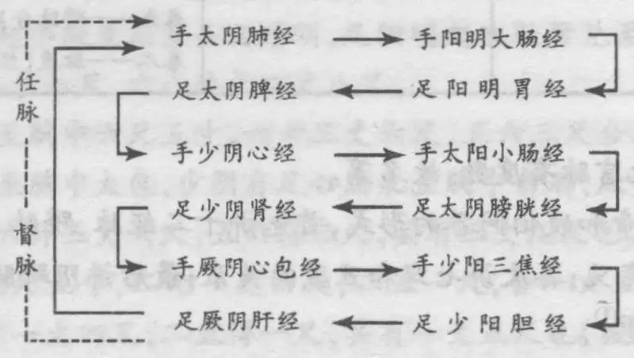

# 营气第十六①

①**营气第十六**：**伯坚按：**本篇和《甲乙经》《黄帝内经太素》《类经》三书的篇目对照，列表于下：

| 灵枢 | 甲乙经 | 黄帝内经太素 | 类经 |
|---|---|---|---|
| 营气第十六 | 卷一——营气第十 | 卷十二——□□篇 | 卷八——营气运行之次（经络类二十四） |

**【释题】** 马莳说：此篇论营气运行，故名篇。

**【提要】** 本篇讲述营气在人体内运行的路线，次序与《经脉篇》所说相同。上一篇《五十营》讲血液循行的速度，本篇讲血液循行的道路。

> 黄帝曰①：营气之道，内谷为宝②，谷入于胃，气传之肺③，流溢于中，布散于外④，精专者行于经隧⑤，常营无已，终而复始，是谓天地之纪⑥。故气从太阴出注手阳明⑦，上行注足阳明⑧，下行至跗上，注大趾间，与太阴合⑨。上行抵脾⑩，从脾注心中⑪，循手少阴出腋下臂，注小指之端⑫，合手太阳⑬，上行乘腋出䪼内⑭，注目内眦，上巅下项，合足太阳⑮。循脊下尻，下行注小趾之端⑯，循足心，注足少阴⑰。上行注肾⑱，从肾注心，外散于胸中，循心主脉出腋下臂，出两筋之间，入掌中，出中指之端⑲，还注小指次指之端，合手少阳，上行注膻中，散于三焦⑳，从三焦注胆出胁，注足少阳。下行至跗上㉑，复从跗注大趾间，合足厥阴。上行至肝，从肝上注膈㉒，上循喉咙，入颃颡之窍，究于畜门㉓。其支别者，上额循巅下项中，循脊入骶，是督脉也㉔。络阴器，上过毛中，入脐中，上循腹里，入缺盆㉕，下注肺中，复出太阴。此营气之所行也，逆顺之常也㉖。

**【本段提纲】** 马莳说：此言营气之运行，一如宗气之所行也。宗气所行之次，尽见于《经脉篇》，此篇论营气所行与宗气无异，辞虽不同，而其次同也。

**【集解】**

〔p.277 (인쇄 1567)〕

①**黄帝曰**：萧延平说：《甲乙》无“黄帝曰”三字。

②**营气之道，内谷为宝**：张介宾说：营气之行，由于谷气之化，谷不入则营气衰，故云内谷为宝。

顾观光说：内谷为宝，《素问·平人气象论》《痹论》《刺志论》三注，“宝”并作“实”。

江有诰《先秦韵读》：营气之道，内谷为宝。（幽部）

③**气传之肺**：守山阁本原刻作“乃传之肺”。

钱熙祚说：《素问·平人气象论》《痹论》《刺志论》三注，引此文，并作气传与肺。《甲乙经》作气传之肺。

河北医学院《灵枢经校释》：“气”原作“乃”，据《素问·平人气象论》王注引《灵枢》文《五藏别论》《痹论》《新校正》引文及《甲乙》卷一第十改。

④**流溢于中，布散于外**：杨上善说：谷入胃已，精浊下流，清精注肺，肺得其气，流溢五藏，布散六府也。

⑤**精专者行于经隧**：陆懋修说：经与径通。《广雅·释言》：“经，径也。”隧，徐醉切，与“遂”通。《素问·调经论》：“五藏之道，皆出于经隧。”注：“隧，潜道也。”

江有诰《先秦韵读》：谷入于胃，乃传之肺（叶音“费”），流溢于中，布散于外（叶音“魏”），精专者行于经隧。（脂祭通韵）

⑥**常营无已，终而复始，是谓天地之纪**：杨上善说：精专，血气，常营无已，名曰营气也。

马莳说：宗气者，大气也。大气积于胸中，出喉咙，司呼吸，以行经隧，始于手太阴肺经，终于肝经，积至一万三千五百息，脉行八百一十丈，如前篇五十营之所论者是也。营气者，阴气也。由中焦之气，阳中有阴者，随中焦之气以降于下焦，而生此阴气。故气之清者为营，又谓之营气出于中焦者是也。然此营气者，必成于水谷所化精微之气，故曰：营气之道，内谷为宝。非谷气不能生此营气，非营气不能生血也。道者，脉气所由行之经隧也。正以谷入于胃，则精微之气即升之而为宗气者，由中焦传肺经之中府，以上云门，而行于太阴肺经，遂行手阳明大肠经，足阳明胃经，足太阴脾经，手少阴心经，手太阳小肠经，足太阳膀胱经，足少阴肾经，手厥阴心包络经，手少阳三焦经，足少阳胆经，足厥阴肝经。流溢于藏府之中，布散于经脉之外。此营气者，阴性精专，必随宗气以运行于经隧之中，始于手太阴肺经，终于足厥阴肝经，终而复始，是谓天地之纪，亘万古而不易者也。

张介宾说：谷入于胃，以传于肺，清者为营，营行脉中，故其精专者行于经隧，常营无已，终而复始，以周流于十二经也。天地之纪，义见前章。

⑦**故气从太阴出注手阳明**：张介宾说：此下言营气运行之次，即前十二经脉之序也。营气出于中焦，上行于肺，故于寅时始于手太阴肺经，出注中府、云门，下少商，以交于手阳明商阳也。

⑧**上行注足阳明**：钱熙祚说：《甲乙经》云气从太阴出，循臂内上廉，注手阳明，上行至面，注足阳明，视此文为备。

⑨**下行至跗上，注大趾间，与太阴合**：杨上善说：以下言营行十二经脉也。气，营气也。营气起于中焦，并胃口出上焦之后，注手太阴、手阳明乃之足阳明也。

马莳说：试以其脉气之行，一如宗气所行者言之。故气从太阴肺经，出注手阳明大肠经。上行注足阳明胃经，下行至跗……上注大趾间……与太阴合……

张介宾说：手阳明大肠经，循臂上行至鼻旁迎香穴，交于目下承泣穴，注足阳明胃经。下行至足跗，出次趾之厉兑。其支者，别跗上，入大趾出其端，以交于足太阴隐白也。

〔p.278 (인쇄 1568)〕

张志聪说：盖布散于皮肤之外者，应天气之运行于肤表，荣于经脉之内者，应地之十二经水也，故荣气从手太阴肺脉，出注于手大指之少商，其支者注于次指之端，以交于手阳明，上行于鼻，交额中，而注于足阳明胃脉，下行至跗上之冲阳，注足大趾间，与足太阴脾脉，合于隐白。

⑩**脾**：钱熙祚说：原刻误作“髀”，依《甲乙经》改。

⑪**从脾注心中**：马莳说：上行抵脾，即阴陵泉、血海、箕门等穴，俱在髀之内廉，属脾经穴，注心中心经。

张介宾说：足太阴脾经，自足上行抵髀，入腹属脾，上膈注于心中，以交于手少阴经也。

⑫**之端**：钱熙祚说：原刻脱此二字，依《甲乙经》补。

河北医学院《灵枢经校释》：“之端”原脱，据《太素》卷十二首篇及《甲乙》卷一第十补。

⑬**合手太阳**：马莳说：循手少阴，出腋下臂，即极泉、青灵等处，皆属手少阴心经，注小指（少泽穴属心经）。合手太阳，即小指外侧，属小肠经。

张介宾说：心脉发自心中，循手少阴经出腋下极泉穴，下臂注小指内侧少冲穴，出外侧，以交于手太阳少泽也。

张志聪说：上行抵髀，从脾注心中，循手少阴之脉，出腋下之极泉，循臂注小指之少冲，合手太阳于小指外侧之少泽。

⑭**上行乘腋出䪼内**：丹波元简说：出䪼内，《甲乙》注，一作“项内”。马以“内”字接下句，恐非。

⑮**注目内眦，上巅下项，合足太阳**：马莳说：上行乘腋，臑俞等处，小肠经穴，出䪼，目下为䪼，颧髎等处小肠经穴。内注目内眦睛明，足太阳膀胱经穴。上巅，曲差、五处、通天、络却等处，足太阳膀胱经穴。下项，天柱、大杼等穴，亦膀胱经穴，合足太阳膀胱经。

张介宾说：手太阳小肠经，自小指上行，乘腋外，上出于䪼内颧髎之次，注目内眦，以交于足太阳睛明穴。

⑯**循脊下尻，下行注小趾之端**：杨上善说：足太阴脉注心中，从心中循手少阴脉行也。合者，合手小指端也。上巅下项者，十二经中，手太阳脉支者，别颊上䪼，抵鼻至目内眦。手太阳脉，起目内眦。此言上巅者，循手太阳气至目内眦，合足太阳之气，与之共行，上顶下项，然后称合，理亦无违也。

⑰**循足心，注足少阴**：马莳说：循足心（斜趋足心之涌泉穴，属足少阴肾经），注足少阴（即肾经）。

⑱**上行注肾**：张介宾说：足太阳膀胱经，过巅下项，循脊下尻，注小趾端之至阴，循小趾入足心，以交于足少阴之涌泉，而上行注肾也。

⑲**从肾注心，外散于胸中，循心主脉出腋下臂，出两筋之间，入掌中，出中指之端**：张介宾说：足少阴肾经，从足心上行入肾，注于心，外散于胸中，以交于手心主。其脉出腋下之天池，下臂，出两筋之间，入掌中，出中指端之中冲也。

⑳**还注小指次指之端，合手少阳，上行注膻中，散于三焦**：张介宾说：手厥阴心主之支者，别掌中，还注无名指端，以交于手少阳之关冲，循臂上行注膻中，下膈，散于三焦也。

㉑**下行至跗上**：张介宾说：手少阳经自三焦注于胆，出胁肋间，以交于足少阳经，上者行于头，起于目锐眦瞳子髎穴，下者至足跗，出小趾次趾端之窍阴穴也。

㉒**膈**：钱熙祚说：原刻误作“肺”，若此处即已注肺，下文不当又云下注肺中，复出太阴矣。今依《甲乙经》改。

〔p.279 (인쇄 1569)〕

㉓**上循喉咙，入颃颡之窍，究于畜门**：钱熙祚说：按卷五《经脉篇》叙足厥阴之脉云：“属肝络胆，上贯膈，布胁肋，循喉咙之后，上入颃颡。”正与此文相合，益见上文“肺”为“膈”字之误无疑也。“畜门”二字无考，林亿以胃为贲门当之，不思循喉咙入颃颡，从此上行，则在头中矣，安有下及于胃之理。《素问·评热论》注云：“暴卒咳者，气冲突于畜门而出于鼻。”详其文义，亦不指胃也。张介宾以为喉鼻相通之窍得之。

㉔**其支别者，上额循巅下项中，循脊入骶，是督脉也**：张介宾说：足少阳胆经，支者别跗上，注大趾间，以交于足厥阴之大敦穴，乃上行至肝，上肺，上循喉咙之上，入颃颡之窍。究，深也。畜门，即喉屋上通鼻之窍门也。如《评热病论》启玄子有云：“气冲突于畜门而出于鼻。”即此谓也。其支别者，自颃颡上出额，循巅以交于督脉，循脊下行入尾骶也。

㉕**络阴器，上过毛中，入脐中，上循腹里，入缺盆**：丹波元简说：据上文之例，此下当有“是任脉也”四字，然《骨空论》任督互称，以其为一源也，故不别著任脉耶。

顾观光说：以上文例之，此下当云“是任脉也”。

㉖**此营气之所行也，逆顺之常也**：杨上善说：问曰：肝脉足厥阴，上贯膈，布胁肋，循喉咙之后，上入颃颡，连目系，上出额，与督脉会于颠。此言足厥阴脉循喉咙究于畜门，循颠入骶等是督脉者，未知督脉与足厥阴脉同异何如？答曰：足厥阴脉从肝上注肺，上循喉咙，上至于颠，与督脉会。督脉自从畜门上额至颠，下项入骶，与厥阴不同。此言别者，上额循颠之言，乃是营气行足厥阴至畜门，别于厥阴之脉，循督脉上额至颠，下项入骶，络阴器，上循腹里，入缺盆，复别于督脉，注于肺中，复出手太阴之脉，此是营气循列度数常行之道，与足厥阴及督脉各异也。颃颡，当会厌上双孔。畜门，鼻孔也。逆顺者，在手循阴而出，循阳而入，在足循阴而入，循阳而出，此为营气行逆顺常也。

马莳说：络前之阴器，上过毛中，入脐中（任脉经自会阴至神阙），上循腹里，至缺盆（自水分至天突），皆任脉也。下注肺中，复出于手太阴肺经。此营气之所行，或逆数，或顺数，皆合常脉，其运行之次，无相失也。

张介宾说：督脉自尾骶前络阴器，即名任脉，上过阴毛中，入脐上腹，入缺盆，下肺中，复出于手太阴经。前《经脉篇》未及督任，而此始全备，是十四经营气之序。

张志聪说：此篇论荣血，荣行于经隧之中，始于手太阴肺，终于足厥阴肝，常荣无已，终而复始。营血者，中焦受气取汁，化而为血，以奉生身，莫贵于此，故独行于经隧，名曰荣气。盖谓血之气为荣气也。流液于中，布散于外者，谓中焦所生之津液，有流溢于中而为精，奉心神化赤而为血，从冲脉任脉布散于皮肤肌肉之外，充肤热肉生毫毛。其精之专赤者，行于经隧之中，常荣无已，终而复始，是谓天地之纪。盖布散于皮肤之外者，应天气之运行于肤表。荣于经脉之内者，应地之十二经水也。故荣气从手太阴肺脉，出注于手大指之少商，其支者注于次指之端，以交于手阳明，上行于鼻，交额中，而注于足阳明胃脉，下行至足跗上之冲阳，注足大趾间，与足太阴脾脉合于隐白，上行抵髀，从髀注心中，循手少阴之脉，出腋下之极泉，循臂，注小指之少冲，合手太阳于小指外侧之少泽，上行乘腋，出䪼内，注目内眦，而交于足太阳之睛明穴上巅下项，循脊下尻，下行注足小趾之至阴，循足心之涌泉，注足少阴之经，上行注肾，从肾注心，散于胸中，而交于心主包络，循心主之脉，出腋下臂，出两筋之间，入掌中，出中指端之中冲，还注小指次指端之关冲，而合于手少阳之脉，上行注膻中，散于三焦，从三焦注胆出胁，注足少阳之脉，下行至跗上，复从跗注大趾间之大敦，合足厥阴之脉，上行至肝，从肝复上注于肺，上循喉咙，入颃颡之窍，究于畜门。颃颡，鼻之内窍。畜门，鼻之外窍。究，终也。其支别者，从肝脉上额，循巅，而与督脉会于巅顶，复下项中，循脊入骶，是督脉也。督脉之行于前者，络阴器，上过毛中，入脐中，上循腹里，入缺盆，下注肺中，复出循于太阴之脉，此荣气之所行，外内逆顺之常也。逆顺者，谓经脉内外之血气交相逆顺而行也。夫荣卫者，精气也，乃中焦水谷之精，生此荣卫二气。清气行于脉中，浊气行于脉外，此荣气与宗气偕行于二十八脉之中，以应呼吸漏下者也。中焦之汁，化赤而为血，以奉生身，命曰荣气，此独行于经隧之血而名荣气，荣于十二经脉之中，始于手太阴肺，终于足厥阴肝，此与荣卫之荣气，循度应漏之不同也。是以本篇论荣气之行，外荣于十二经脉，内荣于五藏六府，其支者行于督脉，复注于肺中，而任脉及两𫏋不与焉。其荣气宗气行于脉中，以应呼吸漏下，内行于二十四脉，并任督两𫏋共二十八脉，以应二十八宿者也。尚御公曰：“荣气宗气行于脉中者，应呼吸漏下，昼夜而为五十荣也。荣卫相将，偕行于皮肤肌腠之间者，日行阳二十五度，夜行阴二十五度，外内出入者也。本篇之荣气，荣于脉中，始于手太阴肺，终于足厥阴肝，昼夜止环转一周，是谓天地之纪。盖天道运行于地之外，昼夜止环转一周而过一度者也。”再按《平脉篇》曰：“荣卫不能相将，三焦无所仰。夫荣行脉中，卫行脉外，乃各走其道，外内逆顺而行者也。相将而行者，乃脉外之荣与卫气偕行于肌腠之间，故曰三焦无所仰。盖腠者肌肉之纹理，乃三焦通会之处，三焦之气，仰藉荣卫而游行也。”金西铭问曰：“荣血之不荣于任脉两𫏋者何也？”曰：“任脉起于胞中，阳𫏋乃足太阳之别脉，阴𫏋乃足少阴之别脉，胞中为血海，膀胱乃津液之府，肾主藏精，皆有流溢于中之精血贯通，故荣血不荣焉。”又问曰：“荣气之不行于冲脉、带脉，阳维阴维者何也？”曰：“冲任二脉，虽并起于胞中，任脉统任一身之阴，与督脉交通，阴阳环转者也。冲脉上循背里，为经络之海，其浮而外者，循腹上行，至胸中而散，充肤，热肉，生毫毛，盖主行胞中之血，充溢于经脉皮肤之外内，不与经脉循度环转。”越人曰：“阳维、阴维者，维络于身，溢畜不能环流灌溉诸经者也。故阳维起于诸阳之会，阴维起于诸阴之交。带脉者，有如束带，围绕于腰，统束诸脉，此皆不与经脉贯通，故不循度环转。”莫云从问曰：“藏府之气，本于五运六气之所生，荣气之行，始于手太阴肺，终于足厥阴肝，与五行逆顺之理，不相符合，请详示之”。曰：“血脉生于后天之水谷，始于先天之阴阳，肺属天而主脉，其脉环循胃口，是以胃府所生之精血，先从肺脉，而行腹，走手，而手走头，头走足，而足走腹，藏府相传，外内相贯，此后天之道也。以先天论之，肾主天一之水，心包络主地二之火，肝主天三之木，肺主地四之金，脾主天五之土，是以肾传之包络，包络传之肝，肝传之肺，肺传之脾，脾复传于少阴、少阳之土，君火主之，君火出于先天之水中，后天之太阳也，故复从手少阴心而传于足少阴肾。肾主先天之水，肺主后天之气，督脉环绕于前后上下，应天运之包乎地外，血脉之生始出入，咸从天气以流行，故人之所以合于天道也。”

〔p.280 (인쇄 1570)〕

丹波元简说：逆顺之常也，志云：“逆顺者，谓经脉内外之血气交相逆顺而行也。”马云：“或逆数，或顺数，皆合常脉，其运行之次，无相失也。”张云：“前《经脉篇》未及任督，而此始全备，是十四经营气之序。”

山东中医学院《甲乙经校释》卷一《营气第十》按语：本篇指出“营气之道，内谷为宝”。这是说营气是水谷的精微化生，胃必须能受纳水谷，营气才能正常的营运于周身。营气运行于周身，始于手太阴而终于足厥阴。其运行径路，基本上和十二经脉的循行次序是相同的。它的循行次序是：从手太阴肺开始，顺次流注手阳明、足阳明、足太阴、手少阴、手太阳、足太阳、足少阴、手厥阴、手少阳、足少阳、足厥阴，又复上行至肝，注肺，深入畜门；它的支别，注入督脉、任脉后，复注手太阴肺，然后又从肺开始循行。这样的周而复始，循环流注，日夜共循行五十周次，濡养五脏六腑四肢百骸。

〔p.281 (인쇄 1571)〕

河北医学院《灵枢经校释》：本篇阐述了营气由水谷精气化生而成，其流注路径与十二经顺序一致。不同点在于，十二经的循行，始于肺，渐次传注肝，由肝复入于肺，如此循行不息。营气循行是由肝别出，向上行经额、巅，下项入督脉，再绕阴器而交任脉，由任脉流注于肺，再开始新的循环，这是营气在十四经循行的次序。

  
**附：营气流注次序表**

## 《营气第十六》今译

黄帝说：营气的运行，主要依靠进食五谷才能得到支持，五谷首先入胃，通过变化生成精微之气，水谷精微之气上注到肺，再又流溢于中，营养脏腑，布散于外，灌溉四肢百骸，其精华部分运行于经脉之中，不停息地在全身营运，终而复始地循环，这与天地的运转万古不变一样。营气的运行，从手太阴肺经开始，灌注手阳明大肠经，上行到面部，注入足阳明胃经，再循经下行到足背，流注于大趾附近，而与足太阴脾经相合。再沿足太阴脾经从足上行，抵达脾脏，从脾脏出发又流注心中，沿手少阴心经，走出腋下，向下沿臂内侧后缘注入小指末端与手太阳小肠经相合，再向上行，通过腋部，向上出于眼眶下部，流注眼的内角，然后经过头顶而下至项部，与足太阳膀胱经相合。接着沿脊柱向下到尾骶部，继续下行，流注足小趾末端，再入足心流注足少阴肾经。而后沿足少阴肾经，从足部上行注于肾，经过肾脏而注入心脏，向外散布于胸中，然后沿手厥阴心主经走出腋下，再下到臂部，走在两筋中间，进入手掌中，直出中指末端，再回转注入无名指的末端，而与手少阳三焦经相合，再沿手臂上行，注入膻中穴，向下到横膈，而散布于三焦，再由三焦而灌注入胆，从胁肋间走出，注入足少阳胆经，向下行到足背，再从足背注入足大趾间，与足厥阴肝经相合，接着循肝经上行到肝脏，再由肝脏上注入肺，而后向上流注横膈，经过喉咙，进入后鼻孔，而终止于喉鼻相通处。从肝别出而行的部分，上至额，到达头顶，再下入项部，沿脊柱而入骶部，这是沿督脉循行的道路，继续前行，又联络前阴，上过阴毛部位，进入脐部，向上沿腹里，进入缺盆，这是循任脉而行，然后注入肺中，再从手太阴肺经发出，开始新的一周循行。以上所述，是营气运行的路径；或自上而下，或自下而上，或出阴入阳，或出阳入阴，相互顺逆而行的正常规律。
