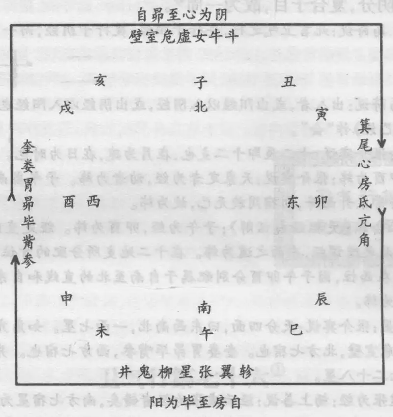

**〔卷二十二〕**

卫气行第七十六  
九宫八风第七十七

# 卫气行第七十六①

①**卫气行第七十六**：**伯坚按：**本篇和《甲乙经》《黄帝内经太素》《类经》三书的篇目对照列表于下：

| 灵枢 | 甲乙经 | 黄帝内经太素 | 类经 |
|---|---|---|---|
| 卫气行第七十六 | 卷一——气息周身五十营四时 十分漏刻第九 | 卷十二——卫五十 周篇 | 卷八——卫气运行之次（经络类 二十五） |

**【释题】** 马莳说：详论卫气之行，故名篇。

**【提要】** 本篇用黄帝、岐伯问答的形式，讲卫气在人体内一昼夜之间，可以环绕全身行五十次，以及每一天什么时刻行到什么经脉。施行针刺疗法时，如果病在三阳经，应当等待卫气行到阳经的时刻方可刺。如果病在三阴经，应当等待卫气行到三阴经的时刻方可刺。

> 黄帝问于岐伯曰：愿闻卫气之行，出入之合①何如？
>
> 岐伯曰：岁有十二月，日有十二辰②，子午为经，卯酉为纬③，天周二十八宿，而一面七星，四七二十八星④，房昴为纬，虚张为经⑤。是故房至毕为阳，昴至心为阴，阳主昼，阴主夜⑥，故卫气之行，一日一夜五十周于身，昼日行于阳二十五周，夜行于阴二十五周，周于五藏⑦。是故平旦阴尽，阳气出于目，目张则气上行于头，循项下足太阳，循背下至小趾之端⑧。其散者别于目锐眦，下手太阳，下至手小指之端外侧⑨。其散者别于目锐眦，下足少阳，注小趾次趾之间⑩。以上循手少阳之分侧，下至小指次指之间⑪。别者以上至耳前，合于颔脉，注足阳明，以下行至跗上，入五趾之间⑫。其散者，从耳下，下手阳明，入大指之间，入掌中⑬。其至于足也，入足心，出内踝下，行阴分，复合于目，故为一周⑭。

〔p.735 (인쇄 2025)〕

**【本段提纲】** 马莳说：此言卫气之行，昼行于阳经，夜行于阴经，而一昼一夜乃二十五度周于身也。

**【集解】**

①**出入之合**：马莳说：出入者，或出阳经以入阴经，或出阴经以入阳经也。

钱熙祚说：《甲乙经》作“会”。

②**日有十二辰**：张介宾说：十二辰即十二支也，在月为建，在日为时也。

③**子午为经，卯酉为纬**：张介宾说：天象定者为经，动者为纬。子午当南北二极，居其所而不移，故为经。卯酉常东升西降，列宿周旋无已，故为纬。

陈璧琉、郑卓人合编《灵枢经白话解》：子午为经，卯酉为纬。经是直线，纬是横线。《周礼》体国经野疏：南北之道谓经，东西之道为纬。在十二地支所分配的方位中，子在北位，午在南位，卯在东位，酉在西位，因子午卯酉分别配属于自南至北的直线和自东至西的横线，所以说：子午为经，卯酉为纬。

④**四七二十八星**：张介宾说：天分四面，曰东西南北，一面七星。如角亢氐房心尾箕，东方七宿也。斗牛女虚危室壁，北方七宿也。奎娄胃昴毕嘴参，西方七宿也。井鬼柳星张翼轸，南方七宿也，是为四七二十八星。

⑤**房昴为纬，虚张为经**：杨上善说：经云虚张为经者错矣，南方七宿星为中也。

马莳说：一岁之内，有十二月，一日之中，有十二时，其夜之子时，昼之午时，当为南北之经，经者自纵而言之也，旦之卯时，夕之酉时，当为东西之纬，纬者自横而言之也。绕天一周，有二十八宿，而一方计有七星，四方各七，则四七计有二十八星，其房昴为东西之纬，虚张为南北之经。

张介宾说：房在卯中，昴在酉中，故为纬。虚在子中，张在午中，故为经。

陈璧琉、郑卓人合编《灵枢经白话解》：二十八宿，是古代天文学名词，也是天体运行所环周之处。古人把周天之星，四方各分有主要的七宿，亦称七曜星。合共二十八宿。其中的房宿在东方，昴宿在西方，东西为横线，所以说，房昴为纬，虚宿在北方，张宿在南方，南北为直线，所以说，虚张为经。

⑥**是故房至毕为阳，昴至心为阴，阳主昼，阴主夜**：杨上善说：经云昴至尾为阴，便漏心宿也。

马莳说：房至毕则为星之属阳者也，昴至心则为星之属阴者也，阳星则主于昼，阴星则主于夜。

张介宾说：自房至毕，其位在卯辰巳午未申，故属阳而主昼。自昴至尾，其位在酉戌亥子丑寅，故属阴而主夜。

陈璧琉、郑卓人合编《灵枢经白话解》：房至毕为阳，昴至心为阴。这是把二十八宿，对分为阴阳两方面，每一方面，各十四宿。房宿在东方，从房宿经过南方而至西方的毕宿共十四宿，在十二地支中为卯辰巳午未申六个时辰，也就是从早晨到傍晚，属于白昼的时间，昼为阳，所以说“房至毕为阳”。昴宿在西方，从昴宿经北方而至东方的心宿共十四宿，在十二地支中为酉戌亥子丑寅六个时辰，也就是黄昏到黎明的时间，夜为阴，所以说“昴至心为阴”。为了易于理解，特作示意图如下：

〔p.736 (인쇄 2026)〕

⑦**故卫气之行，一日一夜五十周于身，昼日行于阳二十五周，夜行于阴二十五周，周于五藏**：杨上善说：昼行手足三阳，终而复始，二十五周，夜行五藏，终而复始，二十五周也。

马莳说：人身卫气之行，一日一夜，当为五十周于身，其昼日行于阳经者，二十五周，盖自足太阳而至手阳明也。夜行于阴经者，二十五周，盖自足少阴而至足太阴也。彼六气者自甲子以至戊辰，五藏方周百刻，而卫气则一昼夜而周，故谓之周于五藏也。

张介宾说：卫气之行于身者，一日一夜凡五十周于身。天之阳主昼，阴主夜。人之阳主府，阴主藏。故卫气昼则行于阳分二十五周，夜则行于阴分二十五周。阳分者言表言府，阴分者言里言藏也，故夜则周于五藏。岁当作藏。

钱熙祚说：原刻“藏”误作“岁”，依《甲乙经》改。

⑧**是故平旦阴尽，阳气出于目，目张则气上行于头，循项下足太阳，循背下至小趾之端**：杨上善说：行于五藏，阴气尽也。卫气出目，循足太阳，气出于目也。小趾之端，足小趾外侧端也。

马莳说：自平旦之时，则行于阴经者尽矣，此阳气者即卫气也，出于目之睛明穴，正以目开，则卫气上行于头，乃循项下足太阳膀胱经之众穴，又循背下至足小趾之端至阴穴。

张介宾说：此下言卫气昼行阳分，始于足太阳经，以及六府而及于肾经，是为一周。太阳始于睛明，故出于目。然目者宗脉之所聚，凡五藏六府之精阳气，皆上走于目而为睛，故平旦阴尽，则阳气至目而目张。目张则卫气由睛明穴上头，循项，下足太阳经之分，循背下行，以至足小趾端之至阴穴也。

⑨**下至手小指之端外侧**：张介宾说：散者，散行者也。卫气之行，不循经相传，故始自目内眦而下于足太阳，其散者自目锐眦而行于手太阳也。下至手小指之间外侧少泽穴也。

〔p.737 (인쇄 2027)〕

河北医学院《灵枢经校释》：“端”原作“间”，据《太素》卷十二卫五十周改。

⑩**其散者别于目锐眦，下足少阳，注小趾次趾之间**：张介宾说：此自太阳行于足手少阳也。目锐眦，足少阳瞳子髎也。足小趾次趾之间，窍阴穴也。

⑪**以上循手少阳之分侧，下至小指次指之间**：张介宾说：分侧当作外侧，小指下当有次指二字，谓手少阳关冲穴也。

河北医学院《灵枢经校释》：“次指”原脱，据《太素》卷十二卫五十周及杨注补。

⑫**别者以上至耳前，合于颔脉，注足阳明，以下行至跗上，入五趾之间**：张介宾说：此自少阳而行于手足阳明也，合于颔脉，谓由承泣、颊车之分，下注足阳明经。五趾当作中趾，谓厉兑穴也。

顾观光说：入五趾之间，经文无称五趾之例，以《经脉篇》校之，当作“中趾”。

⑬**其散者，从耳下，下手阳明，入大指之间，入掌中**：杨上善说：眦，目崖，一曰目眶。散者，卫之悍气，循足太阴脉而有余别，故曰散者。别目兑眦，目外决眦也。目之兑眦，有手太阳，无足太阳，今言别者，足太阳脉系于目系，其气至于兑眦，故卫气别目兑眦，下手太阳，至小指之端外侧也。行此手足太阳，一刻时也。卫之悍气别者，循足少阳至小趾次趾之间。别者循手少阳至于小指次指之间，二刻时也。卫之悍气别者，合于颔脉，谓足阳明也。入五指间者，谓足阳明络，散入十指间，故刺疟者，先刺足阳明十趾间也。手阳明偏历大络斜肩髃上曲颊偏齿。其别者从齿入耳，故卫别于耳下，下手阳明至大指间。入掌中者，手阳明脉不入掌中，而言入者，手阳明脉气虽不至掌中，卫之悍气循手阳明络至掌中，三刻时也。

张介宾说：手阳明之别者入耳，故从耳下行本经。大指下当有“次指”二字，谓商阳穴也。

⑭**其至于足也，入足心，出内踝下，行阴分，复合于目，故为一周**：杨上善说：卫之悍气，昼日行手足三阳已，从于足心，循足少阴脉上，复合于目，以为行阳一周，如是昼日行二十五周也。

马莳说：此阳气者即卫气也，出于目之睛明穴，正以目开，则卫气上行于头，乃循项下足太阳膀胱经之众穴，又循背下至足小趾之端至阴穴，其在头而散者，别于目之锐眦近听宫穴，下手太阳小肠经，而至于手小指外侧之少泽穴，其在头而又散者，别于目锐眦，即足少阳之瞳子髎穴，以下足少阳之经，而注于足第四趾间之窍阴穴，又从而上循手少阳之分侧，以下至手小指之间关冲穴，其别而散者以上至耳前，合于颔脉，上近足阳明经之承泣穴，乃注足阳明之经而下行至足跗面之冲阳穴，入次趾之间厉兑穴，其在头而散者，从耳下下行手阳明经之迎香等穴以入于大（当作次）指之间商阳穴，入手掌中，此则昼行于阳经者如此，计二十五度，至夜则行于阴经，亦二十五度，其至于足少阴肾经，乃足心之涌泉穴，出内踝，下行阴分，自足少阴肾经而行手少阴心经、手太阴肺经、足厥阴肝经、足太阴脾经，其夜行于阴经者，计有二十五度，至明日平旦，阴经已尽，而阳经又受气，则复因目开而会于目，又自足太阳膀胱经之睛明穴始也，故谓之五十度为一周者如此。

张介宾说：此自阳明入足心出内踝者，由足少阴肾经以下行阴分也。少阴之别为𫏋脉，𫏋脉属于目内眦，故复合于目，交于足太阳之睛明穴。此卫气昼行之序，自足手六阳而终于足少阴经，乃为一周之数也。按卫气之行，昼在阳分，然又兼足少阴肾经，方为一周。考之《邪客篇》亦曰，卫气者昼日行于阳，夜行于阴，尝从足少阴之分间，行于五藏六府。然则无论昼夜，皆不离于肾经者何也？盖人之所本，惟精与气。气为阳也，阳必生于阴。精为阴也，阴必生于阳。故营本属阴，必从肺而下行。卫本属阳，必从肾而上行。此即卫出下焦之义。而肾属水，水为气之本也，故上气海在膻中，下气海在丹田，而人之肺肾两藏，所以为阴阳生息之根本。

〔p.738 (인쇄 2028)〕

张志聪说：玉师曰，经言卫气先行皮肤，先充络脉，是卫气与络脉相通也，卫气大会于风府，日下一节，二十一日下至尾骶内，行于伏冲之脉，是卫气行于皮肤而内行于经脉也，此言卫气入于阳明之颔脉，是荣卫之行于经脉外内，又不可执一而论。

> 是故日行一舍，人气行于身一周，与十分身之八①；日行二舍，人气行于身三周②，与十分身之六③；日行三舍，人气行于身五周，与十分身之四④；日行四舍，人气行于身七周，与十分身之二⑤；日行五舍，人气行于身九周⑥；日行六舍，人气行于身十周，与十分身之八⑦；日行七舍，人气行于身十二周在身，与十分身之六⑧；日行十四舍，人气二十五周于身有奇分，与十分身之二⑨，阳尽于阴，阴受气矣⑩。其始入于阴，常从足少阴注于肾，肾注于心⑪，心注于肺⑫，肺注于肝⑬，肝注于脾⑭，脾复注于肾为周⑮，是故夜行一舍，人气行于阴藏一周与十分藏之八，亦如阳行之二十五周，而复合于目⑯，阴阳一日一夜，合有奇分十分身之二，与十分藏之二⑰，是故人之所以卧起之时有早晏者，奇分不尽故也。

**【本段提纲】** 马莳说：此承上文而详言卫气昼夜各行二十五度之义也。

**【集解】**

①**是故日行一舍，人气行于身一周，与十分身之八**：杨上善说：以下俱言行阳二十五周，人气行身一周，复行第二周内十分之中八分，即日行之一舍也。

马莳说：人气者卫气也，对天之日数而言，故谓卫气为人气，此当言日行舍八分七厘半，漏水下三刻一分二厘半，人气行一周五分六厘二毛半。

张介宾说：此下言卫气运行之数也，天周二十八舍，而一日一周，人之卫气昼夜凡行五十周，以五十周为实，而用二十八归除之，则日行一舍，卫气当行一周，与十分身之七分八厘五毛有奇数为正数，此言一周与十分之八者，亦如天行过日一度，而犹有奇分也。舍即宿也，按太史公律书及天官等书，俱以二十八宿作二十八舍，曰舍者为七政之所舍也。

顾观光说：人气行一周与十分身之八，《素问·八正神明论》注：“行”下有“于身”二字，与下文一例，当补。

陈璧琉、郑卓人合编《灵枢经白话解》：人气，在这里是指卫气。在一昼夜中，天周二十八宿，卫气则在全身运行五十周，用二十八去除五十，等于一·七八五余二，也就是说日行一宿的时间，卫气在全身运行了一周又千分之七百八十五，因为零数以四舍五入的计算方法，变为整数，即成为一周又十分之八，所以说“人气行一周与十分身之八”。余类推。

河北医学院《灵枢经校释》：“于身”原脱。据《甲乙》卷一第九及《素问·八正神明论》王注引文补，以与后文相合。

②**日行二舍，人气行于身三周**：钱熙祚说：原作“人气行二周于身”，依《甲乙经》改正。

河北医学院《灵枢经校释》：“于身三周”原作“二周于身”，据《甲乙》卷一第九及《素问·八正神明论》王注引，并参照黄校本改，以与后文合。

③**与十分身之六**：马莳说：当云日行一舍七分半，漏水下六刻二分半，人气行三周一分二厘半。

张介宾说：日行二舍，人气当行三周于身与十分身之五分七厘一毛有奇为正数，云十分身之六者，有奇分也。

〔p.739 (인쇄 2029)〕

④**日行三舍，人气行于身五周，与十分身之四**：马莳说：当云日行三舍六分二厘半，漏水下九刻三分七厘半，人气行四周六分八厘七毛半。

张介宾说：人气当行五周与十分身之三分五厘七毛有奇为正数，余者为奇分。

⑤**日行四舍，人气行于身七周，与十分身之二**：马莳说：当云日行三舍半，漏水下十二刻半，人气行六周二分半。

张介宾说：人气当行七周与十分身之一分四厘二毛有奇为正数，余者为奇分。

⑥**日行五舍，人气行于身九周**：马莳说：当云日行四舍三分七厘半，水下十五刻六分二厘半，人气行七周八分一厘二毛半。

张介宾说：人气当行八周与十分身之九分二厘八毛为正数，余者为奇分。

⑦**日行六舍，人气行于身十周，与十分身之八**：马莳说：当云日行五舍二分半，水下十八刻七分半，人气行九周三分七厘半，又当增云日行六舍一分二厘半，水下二十一刻八分七厘半，人气行十周九分三厘七毛半。

张介宾说：人气当行十周与十分身之七分一厘四毛有奇为正数，余者为奇分。

⑧**日行七舍，人气行于身十二周在身，与十分身之六**：马莳说：当云日行七舍，水下二十五刻，人气行十二周五分；又当增云日行七舍八分七厘半，水下二十八刻一分二厘半，人气行十四周六厘二毛半；又当增云日行八舍七分半，水下三十一刻二分半，人气行十五周六分二厘半；又当增云日行九舍六分二厘半，水下三十四刻三分七厘半，人气行一十七周一分八厘七毛半；又当增云日行十舍五分，水下二十七刻半，人气行十八周七分半；又当增云日行十一舍二分七厘半，水下四十刻六分二厘半，人气行二十周三分一厘二毛半；又当增云日行十二舍二分半，水下四十三刻七分半，人气行二十一周八分七厘半；又当增云日行十三舍一分二厘半，水下四十六刻八分七厘半，人气行二十三周四分三厘七毛半。

张介宾说：人气当行十二周与十分身之四分九厘有奇为正数，余者为奇分，此一面七星之数也。

⑨**与十分身之二**：钱熙祚说：原刻误作“四”，今以算改正，下同。

杨上善说：人气昼日行阳，二十五周于身有奇分十分身之二，言四误也。

马莳说：此正当云，日行一十四舍，水下五十刻，人气行于身二十五周。

陈璧琉、郑卓人合编《灵枢经白话解》：在一昼夜的时间内，日行二十八宿，卫气运行五十周，如以对半计算，照理日行十四宿，卫气恰好运行二十五周，但如前所述，由于计算日行一宿的时间，是卫气运行了一周又十分之八，用这个数字来乘十四宿的时间，等于二十五周又十分之二，所以说“人气二十五周于身，有奇分与十分身之二”。奇分，就是指有余或不足的奇零之数而言。

河北医学院《灵枢经校释》：“二”原作“四”，据日刻本、黄校本、守山阁校本及《太素》卷十二卫五十周及杨注改。

⑩**阳尽于阴，阴受气矣**：张介宾说：日行七舍为半日，行十四舍则自房至毕为一昼，人气当行二十五周为正数，今凡日行一舍，人气行一周与十分身之八，则每舍当余一厘四毛有奇为奇分，合十四舍而计之，共得十分身之二，是为一昼之奇分也，昼尽则阳尽，阳尽则阴受气而为夜矣。

⑪**其始入于阴，常从足少阴注于肾，肾注于心**：杨上善说：卫之阳气，昼日行三阳二十五周已，至夜行于五藏二十五周。肾脉支者从肺出络心，故卫气循之注心者也。卫气夜行五藏皆从能克注于所克之藏以为次也。

〔p.740 (인쇄 2030)〕

⑫**心注于肺**：杨上善说：心脉直者手少阴复从心系却上肺，故卫气循心注肺者也。

⑬**肺注于肝**：杨上善说：肝脉支者复从肝别贯膈上注肺，故卫气循肺注肝者也。

⑭**肝注于脾**：杨上善说：肝脉挟胃，胃脉络脾，故得肝脉注于脾也。

⑮**脾复注于肾为周**：杨上善说：脾脉足太阴从下入少腹，气生于肾，故卫气循之注肾者也。

马莳说：其始入于阴也，常从足少阴注于肾，肾注于手少阴心经，又注于手太阴肺经，又注于足厥阴肝经，又注于足太阴脾经，又注于足少阴肾经，此乃一昼一夜而为五十度一周也。

张介宾说：此言卫气夜行阴分，始于足少阴肾经以周五藏，其行也以相克为序，故肾心肺肝脾相传为一周，而复注于肾也。

⑯**是故夜行一舍，人气行于阴藏一周与十分藏之八，亦如阳行之二十五周，而复合于目**：杨上善说：前行阳中，日行一舍，人气行身一周，复行后周十分身之八分，此夜行一舍，人气行阴藏一周，复行后周十分藏之八，与前行阳二十五周数同，亦有二十五周，合五十周，复合于目，终而复始也。

马莳说：日行一舍，人气行于阴藏一周，与十分藏之八，亦如阳行之二十五周，而平旦则复合于目，盖又自睛明穴而始也。

张介宾说：卫气行于阴分二十五周则夜尽，夜尽则阴尽，阴尽则人气复出于目之睛明穴，而行于阳分，是为昼夜五十周之度。

⑰**阴阳一日一夜，合有奇分十分身之二，与十分藏之二**：杨上善说：行阳奇分十分身之二，行阴奇分亦有十分藏之二，其数同也。

马莳说：阴阳一日一夜各有奇分十分身之四与十分藏之二，人之所以卧起之时有早晏者，正以其所值之时，有奇分未尽故耳。

张介宾说：前日行十四舍，人气行二十五周为半日，凡得奇分者十分身之二，故此一昼一夜日行二十八舍，人气行五十周合有奇分者，在身得十分身之四，在藏得十分藏之二，所谓奇分者言气有过度不尽也，故人之起卧亦有早晏不同耳。

> 黄帝曰：卫气之在于身也，上下往来不以①其②候气而刺之奈何？
>
> 伯高曰：分有多少，日有长短，春秋冬夏，各有分理，然后常以平旦为纪，以夜尽为始③。是故一日一夜，水下百刻。二十五刻者，半日之度也，常如是毋已，日入而止，随日之长短，各以为纪而刺之④。谨候其时，病可与期，失时反候者，百病不治⑤。故曰：刺实者，刺其来也；刺虚者，刺其去也⑥，此言气存亡之时，以候虚实而刺之，是故谨候气之所在而刺之，是谓逢时。病在于三阳⑦，必候其气在于阳而刺之，病在于三阴，必候其气在阴分而刺之⑧。

**【本段提纲】** 马莳说：此言刺诸经者必候卫气之所在而刺之也。

**【集解】**

①**不以**：钱熙祚说：《甲乙经》作“无已”，“已”与“以”古字通。

②**其**：钱熙祚说：原刻“其”误作“期”，依《甲乙经》改。

③**分有多少，日有长短，春秋冬夏，各有分理，然后常以平旦为纪，以夜尽为始**：马莳说：正当候其气之所在而刺之，故虽日之所分，有多有少，春分后日长，秋分后日短，而春夏秋冬其昼夜刻数，各有分理，然以所候卫气者，常以平旦为纪，则知其行于阳经，以夜尽为始，则知其行于阴经。

〔p.741 (인쇄 2031)〕

张介宾说：四时分至昼夜，虽各有长短不同，然候气之法，必以平旦为纪，盖阴阳所交之候也。

④**是故一日一夜，水下百刻。二十五刻者，半日之度也，常如是毋已，日入而止，随日之长短，各以为纪而刺之**：张介宾说：一昼一夜凡百刻，司天者纪以漏水，故曰水下百刻，二十五刻者得百刻四分之一，是为半日之度，分一日为二则为昼夜，分一日为四时，则朝为春，日中为夏，日入为秋，夜半为冬，故当以平旦为阳始，日入为阳止，各随日之长短，以察其阴阳之纪而刺之也。

⑤**谨候其时，病可与期，失时反候者，百病不治**：张介宾说：失时反候，谓不知四时之气候，阴阳之盛衰，而误施其治也。

⑥**故曰**：刺实者，刺其来也；刺虚者，刺其去也：杨上善说：刺实等，卫气来而实者，可刺而泻之，卫气去而虚者，可刺而补之。

张介宾说：邪盛者为实，气衰者为虚，刺实者刺其来，谓迎其气而夺之，刺虚者刺其去，谓随其气去而补之也。

⑦**病在于三阳**：河北医学院《灵枢经校释》：“病在于三阳”，原脱“病”字，例以下文，当有“病”字，据《甲乙》卷一第九补。另《甲乙》卷一第九“三阳”作“阳分”。

⑧**必候其气在于阳而刺之，病在于三阴，必候其气在阴分而刺之**：杨上善说：补泻之道，必须候于邪气所在刺之。病在手足三阳，刺之可以用疗阳病之道也，病在三阴，刺之可以取疗阴病之道也。

张介宾说：病在三阳，必候其气在阳分而刺之，病在三阴，必候其气在阴分而刺之，此刺卫气之道，是谓逢时，逢时者逢各阴阳之气候也。

> 水下一刻，人气在太阳，水下二刻，人气在少阳，水下三刻，人气在阳明，水下四刻，人气在阴分①。水下五刻，人气在太阳，水下六刻，人气在少阳，水下七刻，人气在阳明，水下八刻，人气在阴分②。水下九刻，人气在太阳，水下十刻，人气在少阳，水下十一刻，人气在阳明，水下十二刻，人气在阴分③。水下十三刻，人气在太阳，水下十四刻，人气在少阳，水下十五刻，人气在阳明，水下十六刻，人气在阴分④。水下十七刻，人气在太阳，水下十八刻，人气在少阳，水下十九刻，人气在阳明，水下二十刻，人气在阴分⑤。水下二十一刻，人气在太阳，水下二十二刻，人气在少阳，水下二十三刻，人气在阳明，水下二十四刻，人气在阴分⑥。水下二十五刻，人气在太阳，此少半日之度也⑦，从房至毕一十四舍⑧，水下五十刻，半日之度也，从昴至心亦十四舍，水下五十刻，终日之度也⑨。回行一舍，水下三刻与七分刻之四⑩，大要⑪常以日之加于宿上也，人气在太阳，是故日行一舍，人气行三阳与阴分⑫，常如是无已，与天地同纪⑬，纷纷盼盼⑭，终而复始，一日一夜，水下百刻而尽矣⑮。

**【本段提纲】** 马莳说：此承上文而详卫气有在阳在阴之时正当候其气而刺之也。

**【集解】** ①水下一刻，人气在太阳，水下二刻，人气在少阳，水下三刻，人气在阳明，水下四刻，人气在阴分：杨上善说：在太阳者，在手足太阳也。在少阳者，谓是手足少阳。在阳明，谓是手足阳明也。

〔p.742 (인쇄 2032)〕

马莳说：方漏水下一刻，则卫气在手足太阳经，漏水下二刻，则卫气在足手少阳经，漏水下三刻，则卫气在足手阳明经，然卫气慓悍疾利，故日间虽当行于阳经，而又于漏下四刻之时，则入足少阴肾经。本经《邪客篇》云：卫气者，出其悍气之慓疾而先行于四末皮肤分肉之间而不休者也，昼日行于阳，夜行于阴，常从足少阴之分间行于五藏六府者是也。故曰：水下四刻，卫气在阴分。下文水下八刻、十二刻、十六刻、二十刻、二十四刻皆曰在阴分者，俱指足少阴肾经而言也。

张介宾说：此以平旦为始也，太阳、少阳、阳明，俱兼手足两经为言，阴分则单以足少阴经为言，此卫气行于阳分之一周也。

②**水下五刻，人气在太阳，水下六刻，人气在少阳，水下七刻，人气在阳明，水下八刻，人气在阴分**：张介宾说：此卫气行于阳分之二周也。

③**水下九刻，人气在太阳，水下十刻，人气在少阳，水下十一刻，人气在阳明，水下十二刻，人气在阴分**：张介宾说：此卫气行于阳分之三周也。

④**水下十三刻，人气在太阳，水下十四刻，人气在少阳，水下十五刻，人气在阳明，水下十六刻，人气在阴分**：张介宾说：此卫气行于阳分之四周也。

⑤**水下十七刻，人气在太阳，水下十八刻，人气在少阳，水下十九刻，人气在阳明，水下二十刻，人气在阴分**：张介宾说：此卫气行于阳分之五周也。

⑥**水下二十一刻，人气在太阳，水下二十二刻，人气在少阳，水下二十三刻，人气在阳明，水下二十四刻，人气在阴分**：张介宾说：此卫气行于阳分之六周也。

⑦**水下二十五刻，人气在太阳，此少半日之度也**：张介宾说：水下二十五刻，计前数凡六周于身，而又兼手足太阳二经，此日行七舍，则半日之度也，按前数二十五刻得周日四分之一，而卫气之行止六周有奇，然则总计周日之数，惟二十五周于身，乃与五十周之义未合，意者水下一刻，人气在太阳者二周，或以一刻作半刻，则正合全数，此中或有别解，惟后之君子再正。

钱熙祚说：原刻脱“少”字，依《甲乙经》补，少半日者，四分日之一也。

⑧**从房至毕一十四舍**：钱熙祚说：原刻“一”误作“二”，依《甲乙经》改。

⑨**水下五十刻，半日之度也，从昴至心亦十四舍，水下五十刻，终日之度也**：张介宾说：从房至毕十四舍为阳，主一昼之度，水下当五十刻，从昴至心十四舍为阴，主一夜之度，亦水下五十刻，昼夜百刻，日行共少天一度，故此一昼五十刻，日行于天者半度也。

钱熙祚说：“半日之度也，从昴至心亦十四舍，水下五十刻，终日之度也”。已上二十三字，原刻并脱，依《甲乙经》及《素问·八正神明论》注引此文补。

钱熙祚又说：原刻“半日之度也”下有“半度回行”四字，不可通，依《甲乙经》删。

⑩**回行一舍，水下三刻与七分刻之四**：杨上善说：回行一舍，水下三刻与七分刻之四，言七分刻之二者错矣。置五十刻，以十四除之，法实俱半之，得七分之四也。

张介宾说：此言日度回行一舍，则漏水当下三刻与七分刻之四，若以二十八归除分百刻之数，则每舍当得三刻与十分刻之五分七厘一毛四丝有奇，亦正与七分刻之四，毫忽无差也，此节乃约言二十八舍之总数，故不论宿度之有多寡也。

〔p.743 (인쇄 2033)〕

⑪**大要**：河北医学院《灵枢经校释》：“大要”，此下原有“曰”字，据《甲乙》卷一第九删，此处大要非古经大要之名，乃《素问·八正神明论》王注“略而言之”之意。

⑫**常以日之加于宿上也，人气在太阳，是故日行一舍，人气行三阳与阴分**：杨上善说：卫气行三阳上于目者，从足心循足少阳脉上至目，以为一刻。若至于夜，便入肾，常从肾注于肺，昼夜行藏二十五周，明至于目，合五十周，终而复始，以此为准，不烦注解也。

钱熙祚说：原刻“三阳”下衍“行”字，依《甲乙经》改。

河北医学院《灵枢经校释》：“阳”，此后原有“行”字，据《甲乙》卷一第九及《太素》卷十二卫五十周删。

⑬**常如是无已，与天地同纪**：张介宾说：以日行之数，加于宿度之上，则天运人气，皆可知矣，此总结上文而言人与天地同其纪也。

⑭**纷纷**：史崧说：纷纷，按《太素·音义》云普巴切。

陆懋修说：纷，普巴切，分明之貌。

⑮**水下百刻而尽矣**：杨上善说：卫气行身不息，纷纷盼盼，无有穷期也。

张介宾说：纷纷盼盼，言于纷纭丛杂之中，而条理不乱也，故终而复始，昼夜循环，无穷尽矣。

## 《卫气行第七十六》今译

黄帝问岐伯说：我希望听你谈谈卫气是怎样出入，阴阳表里，怎样汇合的？

岐伯回答说：一年有十二个月，一天有十二个时辰。十二时辰与东西南北四方有一定的配属关系，子时属北位，午时属南位，南北呈竖线为经，所以说子时午时是经，卯时在东位，酉时在西位，东西呈横线为纬，所以说卯时酉时是纬。整个天周共有二十八个星宿，它们分布在东、南、西、北四方，每一方分别有七个星宿。东方七个星宿是角、亢、氐、房、心、尾、箕，北方的七个星宿是斗、牛、女、虚、危、室、壁，西方的七个星宿是奎、娄、胃、昴、毕、嘴、参，南方的七个星宿是井、鬼、柳、星、张、翼、轸。四个方向总共有二十八个星宿。房宿居东方，昴宿居西方，所以房昴是纬，虚宿居北方，张宿居南方，所以虚张是经。天体的运行，从东方的房宿，经过南方至西方的毕宿，其位在十二地支中为卯、辰、巳、午、未、申六个时辰，这六个时是白昼，属阳，所以从房至毕为阳的运行，由西方的昴宿经过北方至东方的心宿，其位在十二地支中为酉、戌、亥、子、丑六个时辰，这六个时辰为夜晚，所以从昴至心为阴的运行。卫气的运行，在一日一夜之间，要循行全身五十周次。白天在阳分运行二十五周次，夜晚在阴分运行二十五周次，也就是周行于五脏之间。因此，当黎明到来的时候，卫气在阴分已运行完二十五周次之后，出于目，眼睛张开，卫气开始从目内眦上行到头部，沿着项后足太阳膀胱经下行，接着沿背向下，到足小趾外侧端的至阴穴。另一条散行的，从眼内眦别出，向下沿着手太阳小肠经，下行到手小指外侧端的少泽穴。另一条散行的，也从眼内眦别出，沿着足少阳胆经向下，注入到足小趾和第四趾之间的窍阴穴。然后又向上沿手少阳三焦经所过的部位，下行到手小指与次指之间的关冲穴。从手少阳别行向上行到耳前，会合于颔脉，注入足阳明胃经，再向下运行到足背，进入足中趾的厉兑。另一条散行的，是从耳向下，沿手阳明大肠经，进入大指、次指间的商阳穴，再注入手掌之中。至于卫气从足阳明经行到足部的，则进入足心的涌泉，从足内踝出来，入足少阴经，由足少阴肾经行于阴分。然后，行于手少阴心经、手太阴肺经、足厥阴肝经、足太阴脾经，最后沿着足少阴肾经的别支𫏋脉，又复会合于眼内眦，相交于足太阳膀胱经的睛明穴。这就是卫气周而复始运行一周的情况。

〔p.744 (인쇄 2034)〕

天象运行一舍，卫气在人身运行一周又十分之八；天象运行二舍，卫气在人身运行三周又十分之六；天象运行三舍，卫气在人身运行五周又十分之四；天象运行四舍，卫气在人身运行七周又十分之二；天象运行五舍，卫气在人身运行九周；天象运行六舍，卫气在人身运行十周又十分之八；天象运行七舍，卫气在人身运行十二周又十分之六；天象运行十四舍，卫气在人身运行二十五周又十分之二。这时，卫气经过白天运行完阳分之后，就进入阴分，由阴分来承受卫气。在它开始进入阴分的时候，卫气常常是从足少阴肾经运行到肾脏，然后由肾脏运行于心脏，由心脏运行于肺脏，再由肺脏运行于肝脏，由肝脏运行到脾脏，最后再由脾重新运行回到肾脏为一周。和白天卫气行于阳分二十五周一样，夜间行于阴分也是二十五周，所以天象运行一宿，卫气在人身的阴分也运行了一又十分之八周，如同白天在阳分运行二十五周一样，夜间卫气在阴分运行二十五周后，再从目内眦出进入阳。卫气一日一夜共运行五十周，但按照卫气每舍运行一周又十分之八来计算，行于阳分就要多出十分之二，行于阴分也要多出十分之二，多出了一些余数，人的起床和入睡时间有早晚不同的差别，就是由于余数造成的。

黄帝问道：卫气在人体内上下往来不停地运行着，怎样才可以测候卫气的运行而进行针刺呢？

伯高回答说：昼夜阴阳多少不同，有时天长，有时天短，春夏秋冬，各有不同的节气，因而昼夜长短有一定的规律。测候卫气可根据早晨太阳刚出来的时候为准，此时标志着夜尽昼始，为卫气行于阳分的开端。一日一夜之中，计时的水共漏下一百刻，所以二十五刻恰好是半天的度数，卫气就是依着时间的推移环行不止，到日没的时候，卫气就停止了在阳分的运行。依据白天时间的长短来确定卫气出入的情况，而进行针刺。只有谨慎地测候卫气运行的时间规律而进行针刺，才能够期望疾病得到治愈。如果抓不住治病的时机，则任何疾病都难以治好。候卫气而进行针刺的方法，对于实证来说，是迎着卫气到来的方向而刺，属于泻法；对于虚证来说，则应顺着卫气运行的方向而刺，属于补法。这就是针对邪气的盛衰候察疾病的虚实而进行针刺。所以说，谨慎地候察卫气运行的所在进行针刺，就叫作逢时。疾病发生在三阳的经脉，必须等候卫气运行到阳分时再进行针刺；疾病发生在三阴的经脉，必须等候卫气运行到阴分时再进行针刺。

从早晨开始，用计算时间地间的铜壶滴水计时，水滴一刻，卫气运行在手足太阳经；水漏下二刻，卫气运行在手足少阳经；水漏下三刻，卫气运行在手足阳明经；水漏下四刻，卫气运行于足少阴肾经。水漏下五刻，卫气又运行到阳分手足太阳经；水漏下六刻，卫气运行于手足少阳经；水漏下七刻，卫气运行于手足阳明经；水漏下八刻，卫气运行于足少阴肾经。水漏下九刻，卫气运行在手足太阳经；水漏下十刻，卫气运行在手足少阳经；水漏下十一刻，卫气运行在手足阳明经；水漏下十二刻，卫气运行于足少阴肾经。水漏下十三刻，卫气运行到手足太阳经；水漏下十四刻，卫气运行在手足少阳经；水漏下十五刻，卫气运行在手足阳明经；水漏下十六刻，卫气运行于足少阴肾经；水漏下十七刻，卫气运行在手足太阳经；水漏下十八刻，卫气运行在手足少阳经；水漏下十九刻，卫气运行在手足阳明经；水漏下二十刻，卫气运行在足少阴肾经。水漏下二十一刻，卫气运行在手足太阳经；水漏下二十二刻的时刻，卫气运行在手足少阳经；水漏下二十三刻的时候，卫气运行在手足阳明经；水漏下二十四刻，卫气运行于足少阴肾经；当水漏下二十五刻的时候，卫气又回到了手足太阳经，这就是卫气在半天的时间内所运行的度数。从房宿到毕宿共运转了十四宿，也就是在一个白昼的时间内，水漏下五十刻，日行半个周天；从昴宿运转到心宿，也要经过十四宿的时间，水也漏下五十刻，与整个白昼之中卫气所运行的度数合起来，就是一昼夜卫气运行的度数。当天体运行经历一宿，水漏下三又七分之四刻。简要地说，通常在天体运行每到一宿刚过，下一宿就要开始的时候，卫气正好运行在手足太阳经。所以，在每天体运行一宿的过程中，卫气也正好运行完阳分的三阳经与阴分的足少阴肾经。卫气就是这样昼夜不停地运行着，同自然界的运动一样，有着自己的规律。卫气的运行虽然很复杂，但却是一周接着一周终而复始地运行着，在一日一夜之中，水漏下一百刻的时候，卫气也恰好在人体内运行完五十周次。

〔p.745 (인쇄 2035)〕
