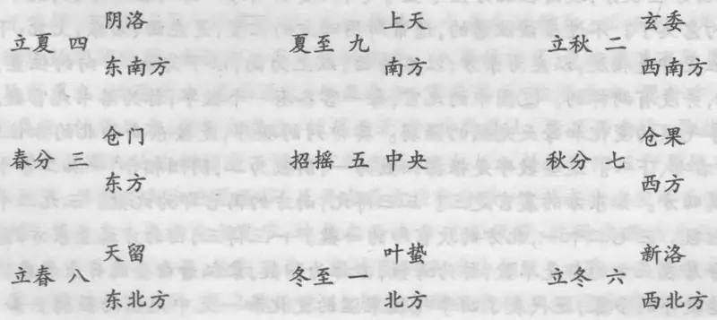
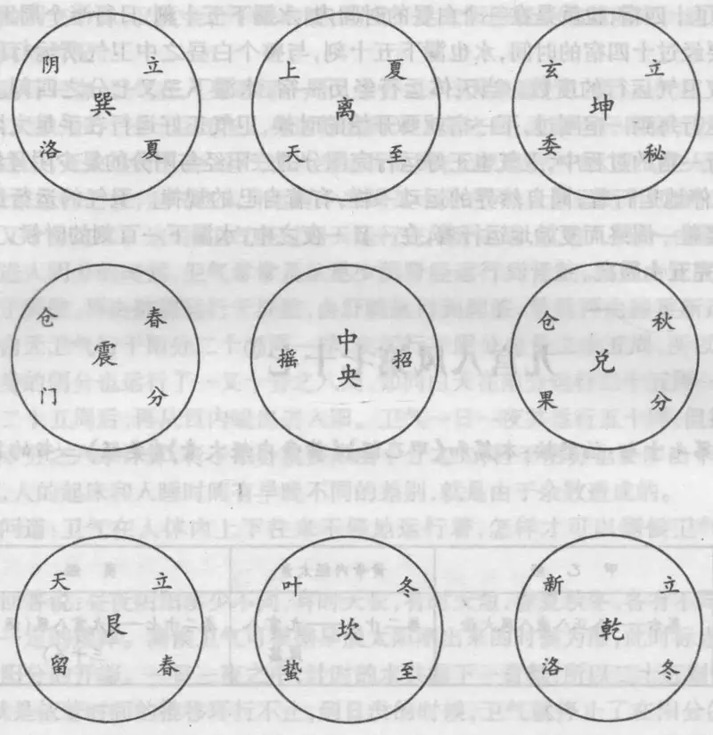
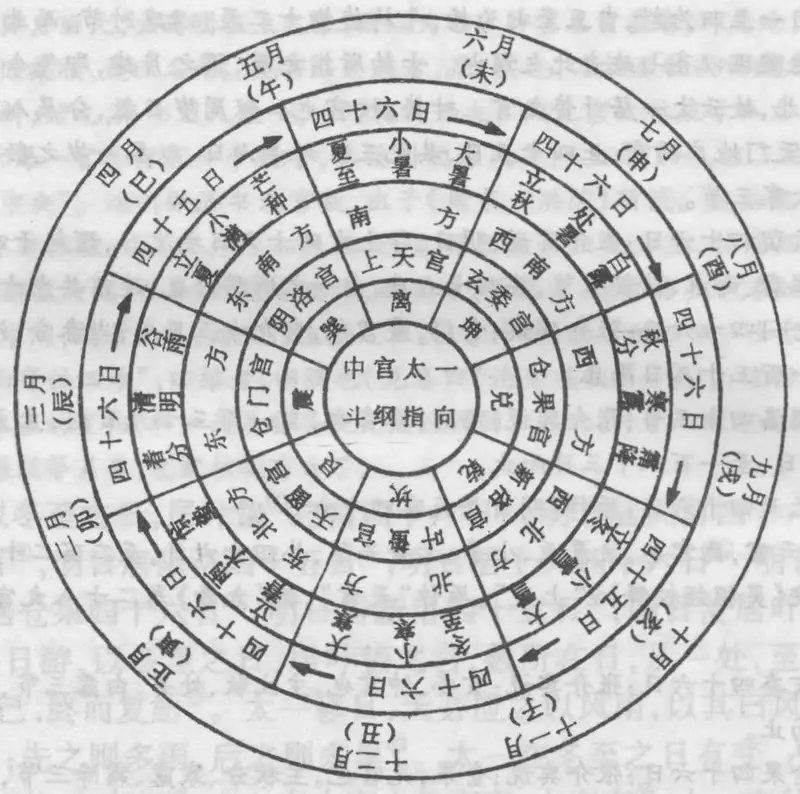

# 九宫八风第七十七①

①**九宫八风第七十七**：**伯坚按：**本篇和《甲乙经》《黄帝内经太素》《类经》三书的篇目对照列表于下：

| 灵枢 | 甲乙经 | 黄帝内经太素 | 类经 |
|---|---|---|---|
| 九宫八风第 七十七 | 卷六——八正八虚八风大论 | 卷二十八——九宫八 风篇 | 卷二十七——九宫八风（运气类 三十五） |

**【释题】** 马莳说：内论九宫八风，故名篇。

**【提要】** 每年有一位主岁的岁神，叫作太乙。太乙在一年三百六十五天之中，分期在八宫居住，每一宫住四十五天或四十六天，满期之后，按次移到别宫居住。这说明每年各季的气候转变是有一定的。当太乙移宫的那一天应当有风雨则吉利，否则就会发生疾病。太乙居五宫（冬至、春分、中央、秋分、夏至）的那一天，如果有狂风吹折树木、飞扬沙石，看它是居哪一宫，就会对哪一种人不利。实风可以生长万物，虚风可以伤害人。从八方来的虚风，它是哪一方来的，就会侵害人体的哪一部分。

〔p.746 (인쇄 2036)〕

  
**合八风虚实邪正**

九宫图说明：

陈璧琉、郑卓人合编《灵枢经白话解》：①九宫的方位，是依据乾、坤、艮、兑、坎、震、巽、离八卦的位置来分配的。八卦的位置，就是按照其五行的属性，排列在四面八方，例如坎卦属水，位居北方，离卦属火，位居南方；震卦属木，位居东方，巽卦亦属木，位居东南方；兑卦属金，位居西方；乾卦亦属金，位居西北方；坤、艮二卦，同属于土，位居西南与东北方。图中每一卦名之下列有不同的节气，这是根据八卦的阴阳五行属性而配合的，例如震卦在东方应春分；离卦在南方应夏至；兑卦在西方应秋分；坎卦在北方应冬至等等，只要明确每一卦所在的方位，就不难理解它所代表节气的意义了。不过应该注意的，通常所用四方的位置，是左西、右东、上北、下南，但本图中的四方位置却是相反，以左为东方，以右为西，以上为南，以下为北，方向的位置虽不同，可是它的作用，并没有两样的。②图中的九宫，每一宫各有一个数字，称为洛书九宫数。这些数字代表了四季气候的变化和每天光热的强弱。其排列的顺序，是按东南西北的方位环转的，即左三、上九、右七、下一。这些数字是根据阳数为一，阴数为二，阴阳相合，一加二等于三，由三的相乘而分属四方。如东方的震宫是三。三三得九，南方的离宫即为九数。三九二十七，西方的兑宫即为七数。三七二十一，北方的坎宫即为一数。一三得三，由北方返至东方的震宫仍为三数。这些分居在正方的都是单数，称为奇数，亦称为阳数，象征着白昼的日出于东，而没于西的现象。这些数字的多寡，还代表了四季气候寒温的变化和一天中光热的强弱。如东方的震宫为春分，这东方的三数表示春温，温则生万物；阳气由始温发展到热极，转至南方离宫的九数是夏至，即为夏热，热则长万物；热极变为凉爽，再转到西方兑宫的七数是秋分，即为秋凉，凉则收万物；由凉爽发展到冷极，再转到北方坎宫的一数是冬至，即为冬寒，寒则杀万物；由寒极又变为温和，再回复到东方震宫的三数，仍是春分。如以一天的温度来说，东方的三数可代表黎明，为光热逐渐增强的时候；由此转到九数是中午，光热最强，再顺序环转，七是下午，光热逐渐减弱；一是夜间，光热最弱。图中的四角，都是双数，即为偶数，亦称为阴数，它的环转方向，适与阳数相反。阴数以二为起点，也就是从西南角的坤宫开始，二二得四，转到东南角的巽宫就是四；二四得八，转到东北角的艮宫就是八；二八十六，再转到西北角的乾宫就是六，二六十二，回复至西南角的坤宫仍是二。阴数的多寡与其转向的先后，也可以代表四季和一天中温度的强弱，以说明寒往则暑来，昼往则夜来。特别是图中的五数，位居中央，可以作为一切数字演变的根源，只要对照九宫图中四面八方的数字来看，就不难理解。如以阴阳的起点二乘五等于十，所以图中四方和交叉的数字相加都是十，例如上九下一是十，左三右七是十，四与六交叉相加是十，二与八交叉相加也是十。再以阳数的三乘五等于十五，所以图中的数字纵横相加都是十五，纵的如东侧直线四、三、八相加是十五，正中的九、五、一相加是十五，西侧的二、七、六相加也是十五。横的如将上面的横线二、九、四相加等于十五，当中横线的七、五、三相加等于十五，下面横线的六、一、八相加也等于十五。同时如将二、四、六、八各阴数相加的和数乘五，等于一百；各阳数相加，即一、三、七、九的和数乘五，也等于一百。再如将各个数字反复相加相乘，更可以演变出许多相等的数字，可见九宫的数字，虽分列在四面八方，却有着一定的关联。本篇把这个图置于篇首，分述了八方风向对人体的影响，也就是说明气候的复杂变化，其中是有规律性的。

〔p.747 (인쇄 2037)〕

河北医学院《灵枢经校释》：以上九个圆圈，即为九宫的图示。图上的一行字“合八风虚实邪正”，是指这九宫方位与后面提到的八风的虚实邪正相合。根据各宫位所标志的方向和节气，可以推测四时风向的差异，因此也可作为八风来路的图解。九宫图的中央一宫（中宫），是周围八宫的指导核心。古人观察天象，认为北极星（古称“太一”）位恒居北方，可以作为测定方向的惟一标准，因为确认了北方，其相对面就是南方，然后左东、右西，以及四隅，自然形成了四面八方，所以九宫图确立北极星为中宫。如《管窥辑要》说：“北极星名中宫，实居子（北）位对午（南）方”；此外，中宫并以北斗星围绕北极星旋转运行的规律，作为测定方向的指针，根据“斗柄”旋指的八宫方位，便能推知四时节气的变迁，以及来自八方气象的变化，所以古有“斗柄指东，天下皆春”的谚语。总之，北极星位为定向的标准，北斗星（斗柄）为指向的指针，二者一体一用，主持中宫（另详于后太一注释中）。图中周围各圈内所排列的乾、坎、艮、震、巽、离、坤、兑字样，是《周易》八卦的名称，在此作为八个方向的特征，以标志一年之中阴阳消长、升降、进退的不同阶段，来说明四时气候的变迁。八卦的位置，是按照其五行属性，分列于八个方位，坎卦属水，位居北方；离卦属火，位居南方；震卦属木，位居东方，巽卦亦属木，位居东南方；兑卦属金，位居西方；乾卦亦属金，位居西北方；坤卦属土，位居西南方；艮卦亦属土，位居东北方。图中各圈内的右侧标有不同的节气名称，这也与八卦的阴阳五行属性有关。震卦在东方应春分节；离卦在南方应夏至节；兑卦在西方应秋分节；坎卦在北方应冬至节；艮卦在东北方应立春节；巽卦在东南方应立夏节；坤卦在西南方应立秋节；乾卦在西北方应立冬节（图中的方向为上南下北左东右西，恰与现代一般地图的表示法相反）。圆心左侧的字样，如“阴洛”“仓门”等分别为九宫名称，这名称的意义，与各宫所代表的不同时序有关，如倪仲玉说：“坎宫名叶蛰者”冬令主蛰封藏，至一阳初动之时（按：指冬至节），蛰虫始振，故名曰叶蛰。艮宫名天留者，艮为山，正而不动，因以为名。震宫为仓门者，仓，藏也，天地万物之气收藏，至东方春令而始震动开辟，故名仓门。巽宫名阴洛者，洛书以二四为肩，巽宫位居东南，而主四月，因以为名。离宫名天宫者，日月丽天，主离明在上之象，因以为名。坤宫名玄委者，坤为地，玄，幽远也，委，随顺也，地道幽远柔顺，是以名之。兑宫名仓果者，果，实也，万物至秋而收藏成实，是以名之。乾宫名新洛者，新，始也，洛书戴九履一，一乃乾之始也。此九宫之位应于八方四时，各随时而命名也。图下于每一宫各标有一个数字，其排列的形式是：“上九下一，左三右七，二四为肩，六八为足，五居中央”。这叫做洛书九宫数，出于《周书·洪范》所载。这些数字中一、三、五、七、九为奇数，亦称阳数；二、四、六、八为偶数，亦称阴数。阳数为主，位居四正（东、南、西、北），代表天气，阴数为辅，位居四隅（东南方，西南方、西北方、东北方），代表地气；“五”居一、三、五、七、九的中间，属于土气，为五行生数之祖，位于中宫，而寄旺四隅。如《运气论奥谚解》说：“土居中央而寄位四维”，四维者，四隅也（见卷四《论生成数第十》）。这些数字的多寡，标志着四时气候寒温的变化，和一天晨昏昼夜光热的强弱。因此，对于八风方向的来路及其性质的刚柔、寒热、燥湿等差异，也就推测有方了。

〔p.748 (인쇄 2038)〕

> 太一常以冬至之日，居叶蛰①之宫四十六日②，明日居天留四十六日③，明日居仓门四十六日④，明日居阴洛四十五日⑤，明日居上天四十六日⑥，明日居玄委四十六日⑦，明日居仓果四十六日⑧，明日居新洛四十五日⑨，明日复居叶蛰之宫，曰冬至矣⑩。太一日游，以冬至之日，居叶蛰之宫，数所在日，从一处，至九日，复反于一，常如是无已，终而复始⑪。太一移日，天必应之以风雨，以其曰风雨则吉，岁美民安少病矣⑫；先之则多雨，后之则多旱⑬。太一在冬至之日有变，占在君⑭；太一在春分之日有变，占在相⑮；太一在中宫之日有变，占在吏⑯；太一在秋分之日有变，占在将⑰；太一在夏至之日有变，占在百姓⑱。所谓有变者，太一居五宫之日，病风折树木，扬沙石，各以其所主，占贵贱⑲，因视风所从来而占之⑳。风从其所居之乡来为实风，主生长养万物；从其冲后来为虚风，伤人者也，主杀，主害者。谨候虚风而避之，故圣人曰避虚邪之道，如避矢石，然后邪弗能害㉑，此之谓也㉒。

**【本段提纲】** 马莳说：此言太一居九宫之日，各有所忌也。

**【集解】**

①**居叶蛰**：陆懋修说：叶，胡颊切。《玉篇》：古文“协”字。《书·尧典》：协，和万邦。传：协，合也。蛰，直立切。《说文》：蛰，藏也。

②**太一常以冬至之日，居叶蛰之宫四十六日**：马莳说：太乙者，岁神也。常以冬至之日，居于坎方叶蛰之宫，计有四十六日；至次日乃第四十七日也，则为立春，而居于艮方之天留宫，亦计四十六日，连前共计九十二日；至次日乃第九十三日也，则为春分，而居于震方之仓门宫，亦计四十六日，连前共计一百三十八日；至次日乃至一百三十九日也，则为立夏，而居于巽方之阴洛宫，亦计四十五日，连前共计一百八十三日；至次日乃一百八十四日也，则为夏至，而居于离方之上天宫，亦计四十六日，连前共计二百二十九日；至次日乃二百三十日也，则为立秋，而居于坤方之玄委宫，亦计四十六日，连前共计二百七十四日；至次日乃二百七十五日也，则为秋分，而居于兑方之仓果宫，亦计四十六日，连前共计三百二十一日；至次日乃三百二十二日也，则为立冬，而居于乾方之新洛宫，亦计四十五日，连前共计三百六十五日；至次日乃来岁之冬至，又居坎方之叶蛰宫矣。

〔p.749 (인쇄 2039)〕

张介宾说：太一，北辰也。按西志曰：中宫，天极星，其一明者，太一之常居也。盖太者至尊之称，一者万数之始，为天元之主宰，故曰太一，即北极也。北极居中不动，而斗运于外，斗有七星，附者一星，自一至四为魁，自五至七为杓，斗杓旋指十二辰，以建时节，而北极统之，故曰北辰。古云太一运璇玑以齐七政者此之谓也。十杓所指之辰，谓之月建，即气令所旺之方，如冬至节，月建在正北，故云太一居叶蛰之宫。叶蛰，坎宫也。以周岁日数，分属八宫，则每宫得四十六日，惟乾巽天门地户两宫，正四十五日，共纪三百六十六日，以尽一岁之数，坎宫四十六日主冬至、小寒、大寒三节。

③**明日居天留四十六日**：张介宾说：明日，即上文四十六日之次日，谓起于四十七日也。天留，艮宫也，主立春、雨水、惊蛰三节，共四十六日，太一之所移居也，连前共九十二日而止。

④**明日居仓门四十六日**：张介宾说：仓门，震宫也，自九十三日起，当春分、清明、谷雨三节，共四十六日至一百三十八日而止。

⑤**明日居阴洛四十五日**：张介宾说：阴洛，巽宫也，自一百三十九日起，主立夏、小满、芒种三节，共四十五日，至一百八十三日而止。

⑥**明日居上天四十六日**：原作“明日居天宫四十六日”。

张介宾说：天宫，离宫也，主夏至、小暑、大暑三节，共四十六日，至二百二十九日而止。

河北医学院《灵枢经校释》：“上天”，原作“天宫”，据《太素》卷二十八九宫八风改以与篇首九宫图相合。

⑦**明日居玄委四十六日**：张介宾说：玄委，坤宫也，主立秋、处暑、白露三节，共四十六日，至二百七十五日而止。

⑧**明日居仓果四十六日**：张介宾说：仓果，兑宫也，主秋分、寒露、霜降三节，共四十六日，至三百二十一日而止。

⑨**明日居新洛四十五日**：张介宾说：新洛，乾宫也，主立冬、小雪、大雪三节，共四十五日，至三百六十六日，周一岁之全数而止。

⑩**明日复居叶蛰之宫，曰冬至矣**：张介宾说：岁尽一周，复起于叶蛰之宫，交于冬至，乃为来岁之首也。

丹波元简说：倪昌世曰，坎宫名叶蛰者，冬令主蛰封藏，至一阳初动之时，蛰虫始振，故名曰叶蛰。艮宫名天留者，艮为山，止而不动，因以为名。震宫名仓门者，仓、藏也，天地万物之气，收藏至东方春令而始震动开辟，故名仓门。巽宫名阴洛者，《洛书》以二四为肩，巽宫位居东南而主四月，因以为名。离宫名天宫者，日月丽天，主离明在上之象，因以为名。坤宫名玄委者，坤为地。玄，幽远也。委，随顺也。地道幽远柔顺，是以名之。兑宫名仓果者，果，实也，万物至秋而收藏成实，是以名之。乾宫名新洛者，新，始也。《洛书》戴九履一，一乃乾之始也，此九宫之位，应于八方，四时各随时而命名也。

河北医学院《灵枢经校释》：丹波元简曰：上文太一所移之日，但八宫而无居中央招摇之日，似可疑，然郑玄云：四季乃入中央，则四季每十八日在中宫也。可参考。本节所叙述的太一依次移居方位，术语叫作太一游宫。实际可把它理解为北斗围绕太一“北极星”旋指十二辰，以交移二十四节气，其所指的方位（即所谓太一游宫），也就是各节气当令之时。下附太一游宫图。

⑪**太一日游，以冬至之日，居叶蛰之宫，数所在日，从一处，至九日，复反于一，常如是无已，终而复始**：马莳说：太一所游之日，假如冬至居叶蛰之宫，照图数所在之日，从一处至九，冬至为一，立秋为二，春分为三，立夏为四，中央为五，立冬为六，秋分为七，立春为八，夏至为九，复反于冬至之一，常如是轮之无已，终而复始。

〔p.750 (인쇄 2040)〕

  
**太一游宫图**

张介宾说：此结上文而总其义也。太一，始于坎，终于乾，乃八宫之日也，八尽而九，则复反于一而循环无已矣。然河图宫九，而此居惟八，盖中宫为太一所主，而临御乎八宫者也。

⑫**太一移日，天必应之以风雨，以其曰风雨则吉，岁美民安少病矣**：张介宾说：移日，交节过宫日也，节之前后，必有风雨应之，若当其日，而风雨调和则吉，故岁美民安少病也。

⑬**先之则多雨，后之则多旱**：张介宾说：汗，当作旱。风雨先期而至，其气有余，故多雨，风雨后期而至，其气不足，故多旱。

河北医学院《灵枢经校释》：“旱”原作“汗”，据《太素》卷二十八九宫八风改。

⑭**太一在冬至之日有变，占在君**：张介宾说：冬至为一岁之首，位在正北，君居震极，南面而治，其象应之，故占在君。

⑮**太一在春分之日有变，占在相**：张介宾说：春分为卯之中，位在正东，相持文衡，职司教化，其象应春，故占在相。

⑯**太一在中宫之日有变，占在吏**：张介宾说：中宫属土，旺在四维，吏有分任，其象应之，故占在吏。

⑰**太一在秋分之日有变，占在将**：张介宾说：秋分为酉之中，位居正西，将在威武，职司杀伐，其象应秋，故占在将。

⑱**太一在夏至之日有变，占在百姓**：张介宾说：夏至为午之中，位在正南，兆民众庶，如物蕃盛，其象应夏，故占在百姓。

〔p.751 (인쇄 2041)〕

⑲**所谓有变者，太一居五宫之日，病风折树木，扬沙石，各以其所主，占贵贱**：马莳说：五宫者东、南、西、北、中央也。

张介宾说：此释上文有变之义。其病在风霾异常，折树木、扬沙石者乃谓之变，否则非也。太一居五宫之日，言所重者在子、午、卯、酉四正之节及中宫之应，即四季土旺用事之日是也。

⑳**因视风所从来而占之**：张介宾说：既察风雨之微甚，以观其变，又当察其方位以占吉凶。

㉑**然后邪弗能害**：钱熙祚说：“然”下原脱“后”字，依《甲乙经》补。

㉒**此之谓也**：张介宾说：所居者，太一所居之乡也，如月建居子，风从北方来，冬气之正也；月建居卯，风从东方来，春气之正也；月建居午，风从南方来，夏气之正也；月建居酉，风从西方来，秋气之正也；四隅十二建，其气皆然。气得其正者，正气旺也，故曰实风，所以能生长养万物。冲者，对冲也。后者，言其来之远，远则气盛也，如太一居子，风从南方来，火反胜也。太一居卯，风从西方来，金胜木也。太一居午，风从北方来，水胜火也。太一居酉，风从东方来，木反胜也。气失其正者，正气不足，故曰虚风，所以能伤人而主杀主害，最当避也。

丹波元简说：马云，按《岁露篇》，以太一冬至居叶蛰宫，而风雨从南方来者为虚风，立春之日，而风雨从西方来者为虚风，则此篇所谓从后来者为虚风，须知东以西与北为后，南以北与东为后，西以东与南为后，北以南与西为后也。

顾观光说：故圣人日避虚邪之道，“日”疑“曰”。如避矢石然后邪弗能害，原无“后”字，则于“然”字绝句，亦通。

> 是故太一入徙，立于中宫，乃朝八风，以占吉凶也①，风从南方来，名曰大弱风，其伤人也，内舍于心，外在于脉，其气主为热②。风从西南方来，名曰谋风，其伤人也，内舍于脾，外在于肉③，其气主为弱④。风从西方来，名曰刚风，其伤人也，内舍于肺，外在于皮肤，其气主为燥⑤。风从西北方来，名曰折风，其伤人也，内舍于小肠，外在于手太阳脉，脉绝则溢⑥，脉闭则结不通，善暴死⑦。风从北方来，名曰大刚风，其伤人也，内舍于肾，外在于骨与肩背之膂筋，其气主为寒⑧。风从东北方来，名曰凶风，其伤人也，内舍于大肠，外在于两胁腋骨下及肢节⑨。风从东方来，名曰婴儿风，其伤人也，内舍于肝，外在于筋纽，其气主为湿⑩。风从东南方来，名曰弱风，其伤人也，内舍于胃，外在于肌⑪，其气主体重⑫。此八风皆从其虚之乡来，乃能病人⑬，三虚相搏，则为暴病卒死⑭，两实一虚⑮，病则为淋露寒热，犯其雨湿之地则为痿⑯，故圣人避风如避矢石焉，其有三虚而偏中于邪风则为击仆偏枯矣⑰。

**【本段提纲】** 马莳说：此又言朝八风可以占吉凶也。

**【集解】**

①**是故太一入徙，立于中宫，乃朝八风，以占吉凶也**：张介宾说：此正以明太一即北极也。盖中不立，则方隅气候皆不得其正，故太一立于中宫，而斗建其外，然后可以朝八风，占吉凶，所谓北辰北极天之枢纽者以此。

②**风从南方来，名曰大弱风，其伤人也，内舍于心，外在于脉，其气主为热**：马莳说：南方属火，主于热，人之心应之，通于脉，故风从南方来者，名曰大弱风，其伤人内舍于心而外在于脉，其气主于为病之热也。

张介宾说：此下皆言虚风伤人之为病。南方离，火宫也。凡热盛之方，风至必微，故曰大弱风。其在于人，则火藏应之，内舍于心，外在于脉，其病为热，心病则包络在其中矣。

〔p.752 (인쇄 2042)〕

顾观光说：风从南方来，《素问·移精变气论》注引八风始东方、终东北方，与今本异。内舍于心，外在于脉，此二句《素问》注倒，下并同。

钱熙祚说：原脱其字、为字，依《甲乙经》补，与下数条一例。

③**风从西南方来，名曰谋风，其伤人也，内舍于脾，外在于肉**：钱熙祚说：“肉”原作“肌”，依《素问·脉要精微论》注及《移精变气论》注引此文改。

④**其气主为弱**：张介宾说：西南方坤，土宫也。阴气方生，阳气犹盛，阴阳去就，若有所议，故曰谋风，其在于人，则土藏应之，故内舍于脾，外在于肌，脾恶阴湿，故其气主为弱。

⑤**风从西方来，名曰刚风，其伤人也，内舍于肺，外在于皮肤，其气主为燥**：马莳说：西方属金，主于燥，人之肺应之，通于皮肤，故风从西方来者，名曰刚风，其伤人内舍于肺，而外在于皮肤，其气主于为病之燥也。

张介宾说：西方兑，金宫也。金气刚劲，故曰刚风，其在于人，则金藏应之，内舍于肺，外在皮肤，其病气主燥也。

⑥**脉绝则溢**：钱熙祚说：《甲乙经》“溢”作“泄”。

⑦**风从西北方来，名曰折风，其伤人也，内舍于小肠，外在于手太阳脉，脉绝则溢，脉闭则结不通，善暴死**：张介宾说：西北方乾，金宫也。金主折伤，故曰折风，凡风气伤人，南应在上，北应在下，故此小肠手太阳经受病者，以小肠属丙，为下焦之火府，而乾亥虚风，其冲在巳也，然西方之金，其气肃杀，北方之水，其气惨冽，西北合气，最伐生阳，故令人善暴死。

⑧**风从北方来，名曰大刚风，其伤人也，内舍于肾，外在于骨与肩背之膂筋，其气主为寒**：马莳说：北方属水，主于寒，人之肾应之，通于骨，故风从北方来者，名曰大刚风，其伤人内舍于肾，而外在于骨及肩背内之膂筋，其气主于为病之寒也。

张介宾说：北方坎，水宫也。气寒则风烈，故曰大刚风，其在于人，则水藏应之，内舍于肾，外在于骨，肩背膂筋，足太阳经也，言肾则膀胱亦在其中，而病气皆主寒也。

⑨**风从东北方来，名曰凶风，其伤人也，内舍于大肠，外在于两胁腋骨下及肢节**：张介宾说：东北方艮，土宫也，阴气未退，阳和未盛，故曰凶风，其在于人，则伤及大肠，以大肠属庚，为下焦之金府，而艮寅虚风，其冲在申也，两胁腋骨下，大肠所近之位，肢节手阳明脉气所及。

⑩**风从东方来，名曰婴儿风，其伤人也，内舍于肝，外在于筋纽，其气主为湿**：马莳说：东方属木，主于风湿，人之肝应之，通于筋纽，其气主为肝，为病之风湿也。夫东方主风，而曰湿病者，以风为婴儿，其气尚柔，不能胜湿故也。

张介宾说：东方震，木宫也。风生于东，故曰婴儿风，其在于人，则木藏应之，故病舍于肝，外在于筋纽，肝病则胆在其中矣。风木胜湿，而其气反为身湿者，以东南水乡，湿气所居，故东风多雨，湿征可见矣。

丹波元简说：纽，筋所束也。《说文》系也，一曰结而可解，博雅，束也。

钱熙祚说：原刻“为”下衍“身”字，依《甲乙经》删。

⑪**外在于肌**：钱熙祚说：原作“外在肌肉”，依《甲乙经》改，与《素问·脉要精微论》注引此文合。

⑫**其气主体重**：马莳说：东南方来者为弱风，以未主于土也，内伤于胃，而外在肌肉，其气主体重（戊辰亦主土也）。

张介宾说：东南方巽，水宫也。气暖则风柔，故曰弱风，东南湿胜，挟木侮土，故其伤人，则内舍于胃，外在肌肉，其病气主体重也。

⑬**此八风皆从其虚之乡来，乃能病人**：马莳说：此八风者皆从其冲后来为虚风，即虚之乡来也，如立冬而风从南方、西方来，立春而风从北方、西方来，立夏而风从北方、东方来，立秋而风从南方、东方来者是也。

〔p.753 (인쇄 2043)〕

张介宾说：凡上文之为病者，皆以虚风为言，而实风不在其列。

⑭**三虚相搏，则为暴病卒死**：马莳说：三虚者，据《素问·刺法》《本病》二篇，则以人忧愁思虑伤心及汗出于心，惊而夺精为人二虚，遇司天失守，为天之虚，为三虚。据后《岁露论》以乘年之虚为一虚，即司天失守是也，逢月之虚为一虚，即月郭空，则海水东盛云云是也，失时之和为一虚，即春应暖而反寒之盛是也。据此篇其人已虚，其风又虚，其岁又虚，是谓三虚。三虚相搏，则为暴病卒死矣。

⑮**两实一虚**：钱熙祚说：《甲乙经》作“两虚一实”。

⑯**两实一虚，病则为淋露寒热，犯其雨湿之地则为痿**：张介宾说：两实一虚，言三虚犯一，亦能为病，其病则或因淋雨，或因露风，而为寒热，或犯其雨湿之地而为痿，皆一虚之为病也。

⑰**故圣人避风如避矢石焉，其有三虚而偏中于邪风则为击仆偏枯矣**：杨上善说：风从冲后来，故称虚乡来也。三虚谓年虚、月虚、时虚。三虚之中纵使二实，但令一虚遇邪，犹为淋露寒热，居处湿地，即为痿厥，况二虚一实遇邪，其病安得不甚，若先三虚逢邪，遂致击仆偏枯之病也。

马莳说：若有三虚而为邪风偏中之，则又为击仆为偏枯矣。击仆者，如击之而仆晕也。偏枯者，或左或右偏枯也。

张介宾说：邪风非时，不正之风也。击仆为风所击而仆倒也。然必犯三虚而后为此病，则人之正气实者，邪不能伤可知矣。

丹波元简说：本篇八风与《吕览》《淮南子》所言各异，惟隋萧吉《五行大义》，引太公兵书云，坎名大刚风，乾名折风，兑名小刚风，艮名凶风，坤名谋风，巽名小弱风，震名婴儿风，离名大弱风。大刚风者，太阴之气好杀，故刚。折风者，金强能摧折物也。小刚风者，亦金杀故也。凶风者，艮在鬼门，凶害之所也。谋风者，坤为地，太阴之本，多阴谋也。小弱风者，巽为长女，故称弱也。婴儿风者，震为长男，爱之故曰儿。大弱风者，离为中女，又弱于长女也。大刚、小刚客胜，大弱、小弱主人胜，凶有凶害之事，谋有谋逆之人。折为将死，婴儿风主人强，此并兵家观客主盛衰，候风所从来也。

河北医学院《灵枢经校释》：八方虚风与病变部位归纳表：

附：八方虚风与病变部位归纳表

<table>
<thead>
<tr>
<th colspan="4">风名与来路</th>
<th colspan="3">对人体影响</th>
</tr>
<tr>
<th>宫位</th>
<th>五行</th>
<th>风向</th>
<th>风名</th>
<th>内舍</th>
<th>外在</th>
<th>病气所主</th>
</tr>
</thead>
<tbody>
<tr>
<td>离</td>
<td>火</td>
<td>南风</td>
<td>大弱风</td>
<td>心</td>
<td>脉</td>
<td>热</td>
</tr>
<tr>
<td>坤</td>
<td>土</td>
<td>西南风</td>
<td>谋风</td>
<td>脾</td>
<td>肌</td>
<td>弱</td>
</tr>
<tr>
<td>兑</td>
<td>金</td>
<td>西风</td>
<td>刚风</td>
<td>肺</td>
<td>皮肤</td>
<td>燥</td>
</tr>
<tr>
<td>乾</td>
<td>金</td>
<td>西北风</td>
<td>折风</td>
<td>小肠</td>
<td>手太阳脉</td>
<td>脉绝则溢 脉闭则结不通 善暴死</td>
</tr>
<tr>
<td>坎</td>
<td>水</td>
<td>北风</td>
<td>大刚风</td>
<td>肾</td>
<td>骨与肩背之膂筋</td>
<td>寒</td>
</tr>
<tr>
<td>艮</td>
<td>土</td>
<td>东北风</td>
<td>凶风</td>
<td>大肠</td>
<td>两胁腋骨下及肢节</td>
<td></td>
</tr>
<tr>
<td>震</td>
<td>木</td>
<td>东风</td>
<td>婴儿风</td>
<td>肝</td>
<td>筋纽</td>
<td>身湿</td>
</tr>
<tr>
<td>巽</td>
<td>木</td>
<td>东南风</td>
<td>弱风</td>
<td>胃</td>
<td>肌肉</td>
<td>身重</td>
</tr>
</tbody>
</table>

〔p.754 (인쇄 2044)〕

## 《九宫八风第七十七》今译

（天上的岁神，叫作太一。天空按东南西北的方向，可分作八个方位，连同中央一个方位，共有九个方位，就叫作九宫。每年随着不同的气节，太一分别逐个在八宫中游移居住，每年游居八宫一周。）太一在冬至节日，移居于正北方的叶蛰宫，共住四十六天；之后移居东北方的天留宫，共住四十六天；之后移居正东方的仓门宫，共住四十六天；之后移居东南方的阴洛宫，共住四十六天；之后移居正南方的上天宫，共住四十六天；之后移居西南方的玄委宫，共住四十六天；之后移居正西方的仓果宫，共住四十六天；之后移居西北方的新洛宫，共住四十六天；之后又重复移居于正北方的叶蛰宫，这又到了冬至节气。太一逐日游规律，以节气言，是从冬至日开始，以方位言，是首居叶蛰宫，以此作为第一天的起点，来计算居留的天数，到了一定的日数，就移居另一宫位，从第一个宫位起，经过八个宫位的移居，到第九个宫位的日期，又返回到第一个宫位，如此周而复始，永不停息。太一从一宫移居下一宫的第一天，也就是每逢交节的日子，必定有相应的风雨发生。如果当天有风雨，是吉利的象征，这样吉利的年景，民众平安无事，疾病很少发生；如果在交节前有风雨，在这一年里，必定会多雨；如果在交节后出现风雨，在这一年里，必定会多干旱。如果太一在交冬至的那一天，气候突然变化，可以预测君王中将要发生反应；如果太一在交春分的那一天，气候突然变化，可以预测在宰相阶层中将要发生反应；如果太一在交中宫的那一天，气候突然变化，可以预测在官吏阶层中将要发生反应；如果太一在交秋分的那一天，气候突然变化，可以预测在将军阶层将要发生反应；如果太一在交夏至的那一天，气候突然变化，可以预测在百姓阶层中将要发生反应。所谓气候突然变化，是指太一移居在东、南、西、北、中央五个方向的宫中时，狂风四起，树木被吹折，飞沙走石弥漫天空。这种异常的气候，依不同的节气，造成不同阶层的伤害，由此可以推测受病者的身份。此外，还应当观察风是从什么方向来的，以此作为预测吉凶的依据。如果风是从太一居住宫位方向吹来的，就是实风，它主持生长，养育万物。如果风是从太一居住宫位相反方向远处吹来的，就是虚风，它对人体是有害的，因此人人都必须谨慎地避开虚风。所以，聪明的人尽量回避这种虚邪贼风，就好像躲避利箭、飞石一样。这样，才能避免遭到风邪的侵袭和危害。我要说的就是这些。

所以，太一移居中宫时，确立它为定向的标准，可以确定八方风吹的朝向，从而根据风向来预测吉凶。从南方吹来的风，叫大弱风。伤害人体的时候，在内可以侵入到心脏；在外可以侵犯血脉，主要导致热性病。从西南方吹来的风，叫作谋风，伤害人体的时候，在内可以侵入到脾脏，在外可以侵犯肌肉，主要导致衰弱的病症。从西方吹来的风，叫作刚风，伤害人体的时候，在内可以侵袭到肺脏，在外可以侵犯皮肤，主要导致燥病。从西北方吹来的风，叫作折风，侵袭人体的时候，在内可以侵入到小肠，在外可以侵犯手太阳经脉，如果脉气衰绝，表明寒邪充斥，如果脉气闭塞，则属结聚不通，容易突然死亡。从北方吹来的风，叫作大刚风，侵袭人体的时候，在内可以侵入到肾脏，在外可以侵犯骨骼和背脊部位的膂筋，主要导致寒性的疾病。从东北方吹来的风，叫作凶风，侵袭人体的时候，在内可以侵入到大肠，在外可以侵犯两胁肋腋骨下及上肢关节。从正东方吹来的风，叫作婴儿风，伤害人体的时候，在内可以侵入到肝脏，在外可以侵犯筋结部位，主要导致湿病。从东南方吹来的风，叫作弱风，伤害人体的时候，在内可以侵入到胃，在外可以侵犯到肌肉，主要导致身体沉重的疾病。上面讲的八种风，都是从当时太一移居宫位相反方向吹来的，都是属于虚邪贼风，都能使人发生病。如果人体虚弱，又受到虚风袭击，再逢上岁虚，这三种虚邪碰在一起，就可发生急病而突然死亡。如果在三虚中只犯一虚，或由于雨淋，或因暴露于虚风，而发生寒热病，或住在多雨潮湿的地方，则可发生痿病。所以聪明的人躲避虚风的侵袭，如同躲避射来的箭石一样。如果病人同时遇上三虚，而受到邪风的袭击更为严重，就会像受到打击一样突然仆倒或发生半身不遂。

〔p.755 (인쇄 2045)〕

〔p.756 (인쇄 2046)〕
